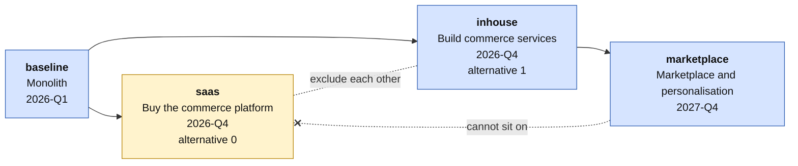
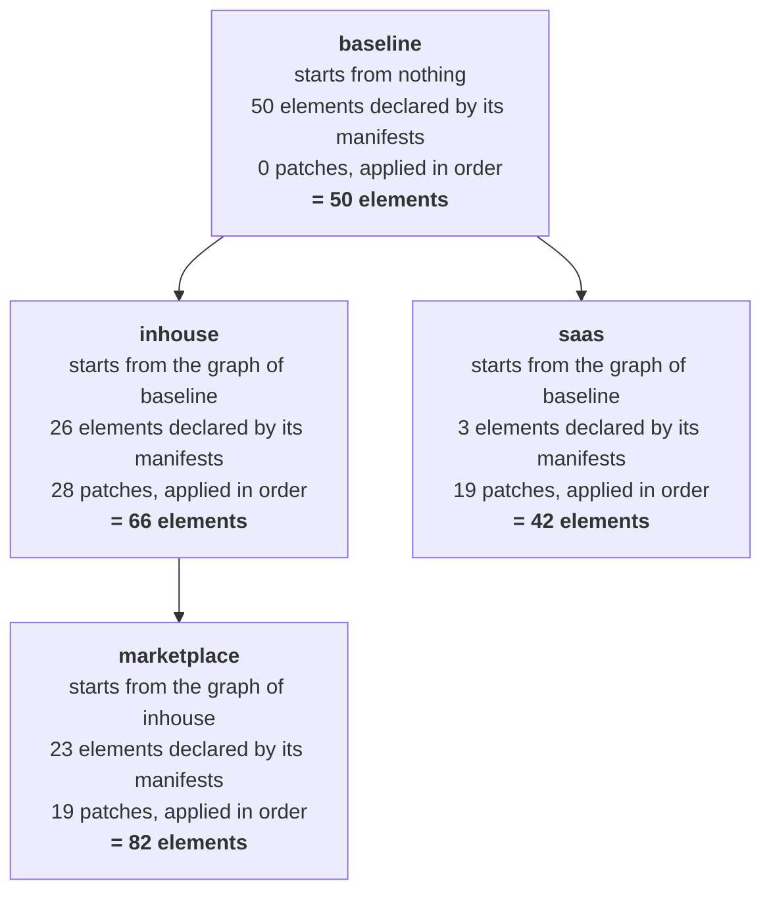
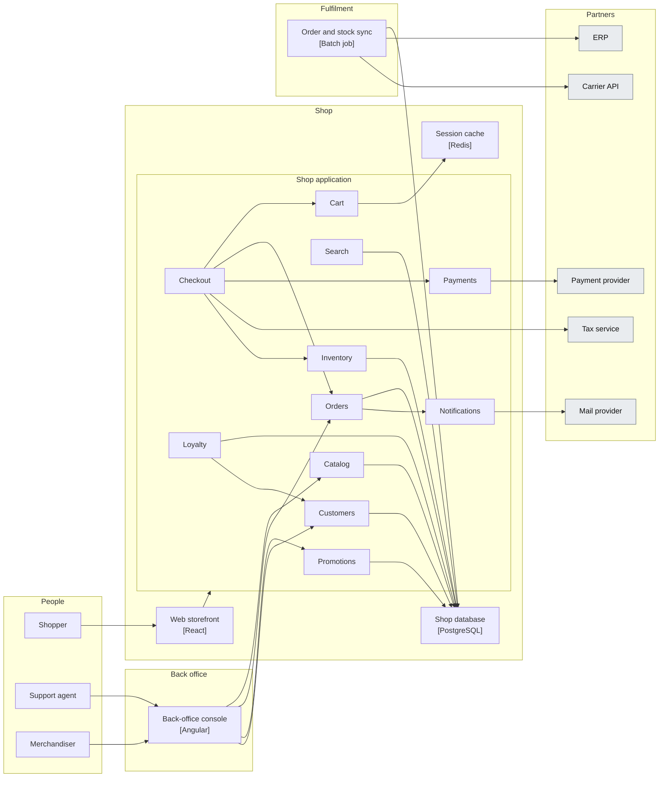
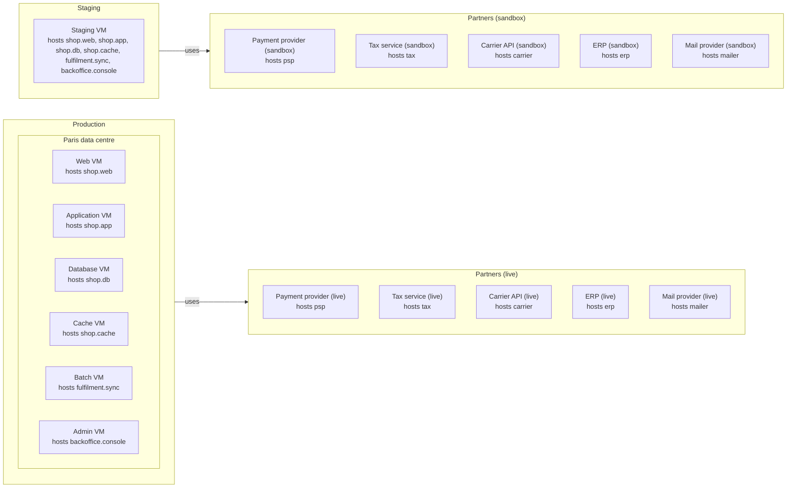
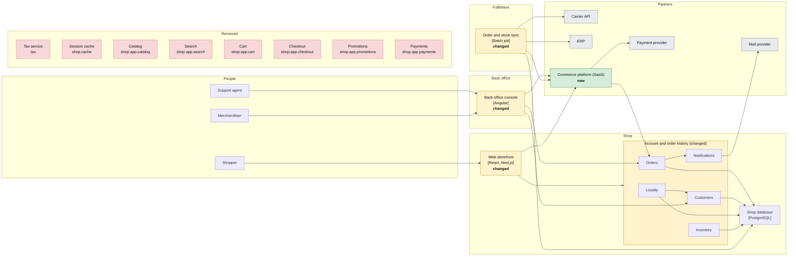
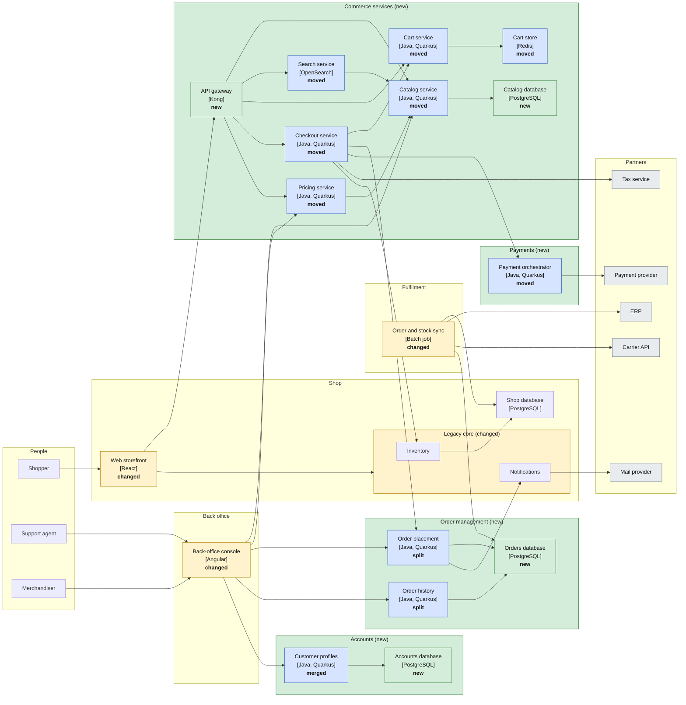
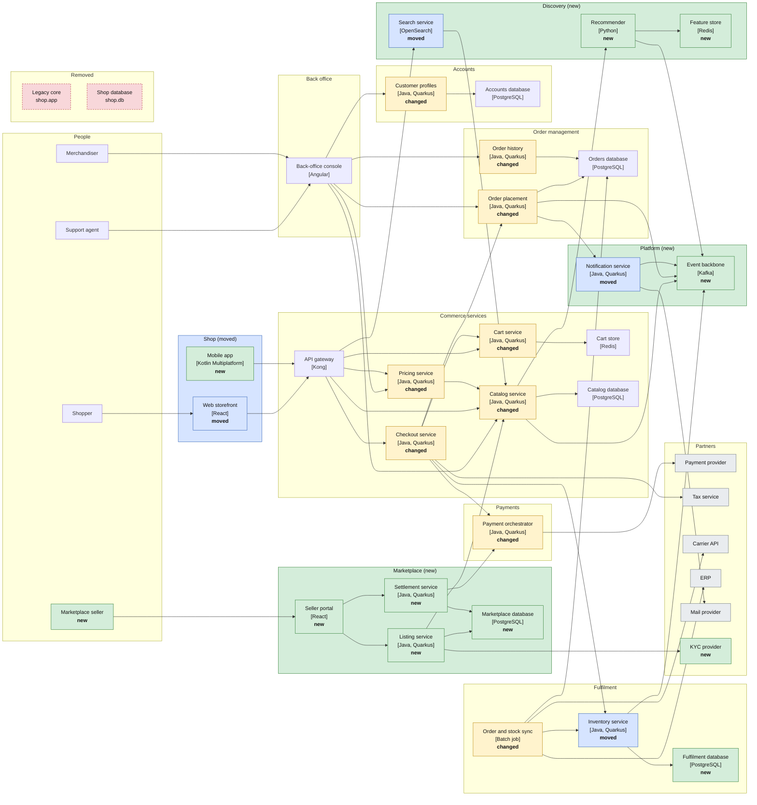
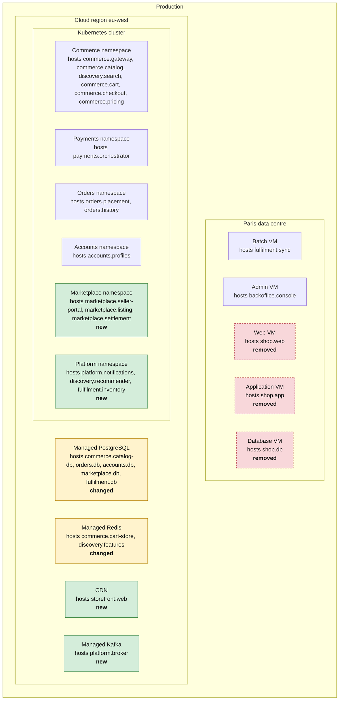
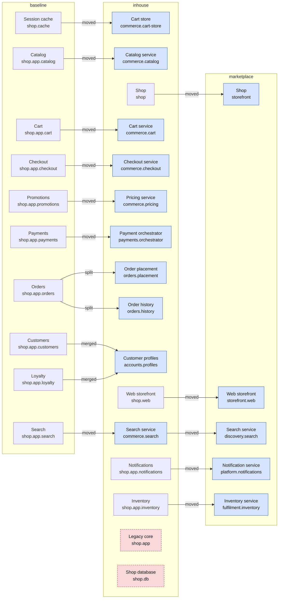

# Brightcart: a shopping fixture across four plateaus

An invented online retailer, described as manifests, whose architecture changes over four plateaus. It is written for three uses at once: to think about where ArchiCode should go with plateaus, to ship as a worked example, and to drive tests. This document specifies it; the files are not written yet.

Nothing here comes from a real workspace. Every name, id and label is invented.

## 1. Purpose and status

**What it is for**

1. *Prospective.* The layered model under study (a plateau is a layer, its manifests add to the graph, its patches change the graph, plateaus form a tree, an editor built around a timeline) needs a case that is big enough to hurt. The fixture is that case, with the hard parts on purpose (section 10).
2. *Example.* A realistic project for the manual and the tutorial, next to the small examples that exist (`domain_plateaus`, the bookshop).
3. *Fixture.* One source of truth that generates every test input: the kernel (`compare`), the command line (`diff`, `views generate`, facets), the editor (open, compare, faithful saves on every manifest), the native smoke step, and, once it exists, the layered engine.

**What "convincing" means here:** 42 to 82 elements per plateau across both layers (a real workspace is bigger, section 13), the six states of `compare` all present, a fork between two exclusive alternatives, a plateau that only makes sense on one of them, and the awkward cases a real migration produces (a split, a merge, a subtree renamed, an element moved twice, a stale reference).

**How it was checked.** The content of this document was produced by a throwaway model, not written by hand: it applies the layers and replays the rules of `compare.rs`. The model was then cross-checked against the real thing. The four plateaus were written out as complete folders and read by the current `archicode diff`; the five comparisons it can run (section 10) gave exactly the counts below. The layered semantics themselves (patches) are only the model's: nothing of the layered engine exists yet.

**Out of scope for this document:** deciding the open design points (each assumption below is labelled as open), writing the files, golden outputs of the renderer.

## 2. The story

Brightcart sells home and garden goods in four countries. It started as one Java application, a PostgreSQL database and a nightly batch to the ERP, run in one data centre. The shop works, but every change goes through the monolith.

| Plateau | Id | Horizon | Parent | What happens |
| --- | --- | --- | --- | --- |
| Monolith | `baseline` | 2026-Q1 | none | One Java application serves the storefront, orders, accounts and payments. |
| Buy the commerce platform | `saas` | 2026-Q4 | `baseline` | Alternative 0. A SaaS commerce platform takes the catalog, search, cart, checkout, promotions and payments. The monolith keeps accounts, orders and stock. |
| Build commerce services | `inhouse` | 2026-Q4 | `baseline` | Alternative 1. The same capabilities become in-house services on Kubernetes. Orders are split in two, accounts and loyalty merged. |
| Marketplace and personalisation | `marketplace` | 2027-Q4 | `inhouse` | Third-party sellers, an event backbone, recommendations, a mobile app. The monolith is retired and the shop system is renamed. |



The two alternatives exclude each other: they are two answers to the same question, each starting from the baseline. `marketplace` builds on `inhouse` only. It publishes to the API gateway, lists offers in `commerce.catalog`, pays sellers through `payments.orchestrator` and reads from the Kubernetes cluster, none of which exists in `saas`. Putting `marketplace` on top of `saas` must fail (variant V3).

## 3. Conventions

**Elements.** Application layer: `person`, `system`, `container`, `component`. Technology layer: `environment`, `node`. An external system is a `system` with the tag `rendering-stereotypes: external`. Qualifiers hold the technology (`Java`, `Quarkus`, `PostgreSQL`, `Kafka`). A reference is the dotted chain of ids, as today.

**Manifests.** One root element per file, with its subtree nested, like the existing examples. A container or a node whose parent lives in another file uses `parent:` in the header. A file is named after its root reference. A relationship is owned by its source.

**Where a manifest belongs.** Each plateau is a folder (`baseline/`, `saas/`, `inhouse/`, `marketplace/`) with a `plateau.yaml` (`Kind: Plateau`). A manifest has no `plateau:` header and belongs to the plateau of the nearest folder that holds a `Plateau`. One file carries the property explicitly, `inhouse/technology/staging.k8s.yaml`, to show that the header agrees with the folder. A file never sits outside a plateau folder, except `workspace.yaml`.

**Two renditions of the same fixture.**

| Rendition | Folder | Read by | Notes |
| --- | --- | --- | --- |
| Layered | `layered/` | the layered engine (does not exist yet) | The source of truth. Four folders, patches in each `plateau.yaml`. |
| Complete folders | `folders/` | the current tools (`settings.plateaus`) | Generated by resolving the layers. Each plateau is a whole folder, `replaces` written relative to the `baseline` key of the plateau. |

Both are generated from one description. The tests assert that they describe the same plateaus (section 11).

**How a plateau is resolved.** Each layer starts from the graph of its parent, adds the elements its manifests declare, then applies its patches in order. The numbers are those of this fixture.



**What the layered rendition assumes of the target model.** Each rule is an assumption of this document, with the question it leaves open; none is decided.

| # | Rule | Open question |
| --- | --- | --- |
| L0 | A manifest belongs to the plateau named by its header, else to the nearest folder that holds a `Plateau`, else to `baseline`. | Who says the plateau of a manifest |
| L1 | A plateau is loaded as its parent's graph, plus its manifests, then its patches in the order of the array. | Order and scope of the patches |
| L2 | The references in a plateau's manifests are those of its parent plateau. A `MOVE` runs after the manifests and carries them along. | When references are resolved |
| L3 | A patch with no match is an error. A free `json-path` states how many nodes it expects (`expect`). | A patch with no match: error or ignored |
| L4 | `target` is a full reference. `json-path` is for bulk operations written by hand. | The shape of a selector, which is a public contract |
| L5 | `REMOVE` takes the subtree, the relationships towards it and its entries in `applications` and `uses`. It does not take the empty node that hosted it. | What a removal takes with it |
| L6 | `MOVE` rewrites the references towards the moved subtree and records `replaces` for the nodes that exist in the parent plateau. | Whether move and rename operators exist at all |
| L7 | A relationship has no id. A patch finds it by `where: {destination, label}`. | Identity of a relationship |
| L8 | A reference declared twice, in any layer of the chain, is an error. | Redeclaring an element of an ancestor plateau |
| L9 | `replaces` is a fact of one plateau. Comparing two plateaus several steps apart composes the facts of the steps in between. | `replaces` across several steps |
| L10 | Views and stories are patchable and follow a `MOVE`. | Views and stories under patches |

## 4. The workspace

`workspace.yaml` holds what is shared by every plateau: the name, the styles and the facets. In the layered rendition there is no `settings.plateaus`.

```yaml
settings:
  name: "Brightcart"
  views:
    path: "views"
  facets:
    customs:
      - name: "journey"            # the purchase journey: no staff tools, no fulfilment
        actions:
          - operator: REMOVE
            json-path: "$.application..elements[?(@.id == 'agent' || @.id == 'merchandiser' || @.id == 'backoffice' || @.id == 'fulfilment')]"
      - name: "no-externals"       # what Brightcart builds, without its partners
        actions:
          - operator: REMOVE
            json-path: "$.application..elements[?(@.tags['rendering-stereotypes'] == 'external')]"
      - name: "without-cart"       # selects nothing in `saas`, where the cart is gone
        actions:
          - operator: REMOVE
            json-path: "$.application..elements[?(@.id == 'cart')]"
styles:
  by-tags:
    external:
      background-color: "lightgray"
    legacy:
      line-style: 8
      line-gap: 4
    hot-path:
      line-color: "orangered"
      line-thickness: 3
  by-qualifiers:
    PostgreSQL:
      round-corner: 20
```

The three facets were run on the four plateaus with the current command line: they all generate, `no-externals` leaves no `Payment provider` in any view, and `journey` leaves no `Back office`. `without-cart` selects nothing in `saas`, where the cart is gone, and generates all the same: a facet tolerates a path that selects nothing, a patch does not (L3).

## 5. Plateau `baseline`: the monolith

28 application elements, 22 technology elements, 28 relationships, 17 manifest files.

```
baseline/
  plateau.yaml
  application/
    customer.yaml                      # 1 element
    agent.yaml                         # 1 element
    merchandiser.yaml                  # 1 element
    psp.yaml                           # 1 element
    tax.yaml                           # 1 element
    carrier.yaml                       # 1 element
    erp.yaml                           # 1 element
    mailer.yaml                        # 1 element
    shop.yaml                          # 4 elements
    shop.app.yaml                      # 12 elements
    backoffice.yaml                    # 2 elements
    fulfilment.yaml                    # 2 elements
  technology/
    prod.yaml                          # 8 elements
    staging.yaml                       # 2 elements
    partners.yaml                      # 6 elements
    sandbox.yaml                       # 6 elements
```

A first look at the application layer. Grey boxes are partners. An arrow is a relationship; its label is in the table below.



**Application layer.**

| Reference | Kind | Name | Qualifiers | Relationships |
| --- | --- | --- | --- | --- |
| `customer` | person | Shopper | - | shop.web "browses and buys with" |
| `agent` | person | Support agent | - | backoffice.console "handles orders with" |
| `merchandiser` | person | Merchandiser | - | backoffice.console "maintains the catalog with" |
| `psp` | system | Payment provider | - | - |
| `tax` | system | Tax service | - | - |
| `carrier` | system | Carrier API | - | - |
| `erp` | system | ERP | - | - |
| `mailer` | system | Mail provider | - | - |
| `shop` | system | Shop | - | - |
| `shop.web` | container | Web storefront | React | shop.app "calls" |
| `shop.app` | container | Shop application | Java, Spring Boot | - |
| `shop.db` | container | Shop database | PostgreSQL | - |
| `shop.cache` | container | Session cache | Redis | - |
| `shop.app.catalog` | component | Catalog | - | shop.db "reads and writes" |
| `shop.app.search` | component | Search | - | shop.db "queries" |
| `shop.app.cart` | component | Cart | - | shop.cache "keeps baskets in" |
| `shop.app.checkout` | component | Checkout | - | shop.app.cart "reads baskets from"<br>shop.app.orders "creates orders in"<br>shop.app.payments "pays through"<br>tax "computes taxes with"<br>shop.app.inventory "reserves stock in" |
| `shop.app.orders` | component | Orders | - | shop.db "stores orders in"<br>shop.app.notifications "asks to notify" |
| `shop.app.customers` | component | Customers | - | shop.db "stores accounts in" |
| `shop.app.loyalty` | component | Loyalty | - | shop.db "stores points in"<br>shop.app.customers "reads accounts from" |
| `shop.app.promotions` | component | Promotions | - | shop.db "reads rules from" |
| `shop.app.payments` | component | Payments | - | psp "authorises payments with" |
| `shop.app.notifications` | component | Notifications | - | mailer "sends mails with" |
| `shop.app.inventory` | component | Inventory | - | shop.db "reads and reserves stock in" |
| `backoffice` | system | Back office | - | - |
| `backoffice.console` | container | Back-office console | Angular | shop.app.catalog "maintains products in"<br>shop.app.orders "handles orders in"<br>shop.app.promotions "configures promotions in"<br>shop.app.customers "looks up customers in" |
| `fulfilment` | system | Fulfilment | - | - |
| `fulfilment.sync` | container | Order and stock sync | Batch job | shop.db "reads orders, writes stock levels"<br>erp "exchanges orders and stock with"<br>carrier "books shipments with" |

**Technology layer.** Production runs on virtual machines in one data centre. Staging is one machine. The partners are deployed in two environments of their own, so that `uses` has something to resolve: production uses `partners`, staging uses `sandbox`.



| Reference | Kind | Name | Hosts (`applications`) | `uses` |
| --- | --- | --- | --- | --- |
| `prod` | environment | Production | - | `partners` |
| `prod.dc` | node | Paris data centre | - | - |
| `prod.dc.web-vm` | node | Web VM | `shop.web` | - |
| `prod.dc.app-vm` | node | Application VM | `shop.app` | - |
| `prod.dc.db-vm` | node | Database VM | `shop.db` | - |
| `prod.dc.cache-vm` | node | Cache VM | `shop.cache` | - |
| `prod.dc.batch-vm` | node | Batch VM | `fulfilment.sync` | - |
| `prod.dc.admin-vm` | node | Admin VM | `backoffice.console` | - |
| `staging` | environment | Staging | - | `sandbox` |
| `staging.vm` | node | Staging VM | `shop.web`, `shop.app`, `shop.db`, `shop.cache`, `fulfilment.sync`, `backoffice.console` | - |
| `partners` | environment | Partners (live) | - | - |
| `sandbox` | environment | Partners (sandbox) | - | - |
| `partners.psp-live` | node | Payment provider (live) | `psp` | - |
| `sandbox.psp-sandbox` | node | Payment provider (sandbox) | `psp` | - |
| `partners.tax-live` | node | Tax service (live) | `tax` | - |
| `sandbox.tax-sandbox` | node | Tax service (sandbox) | `tax` | - |
| `partners.carrier-live` | node | Carrier API (live) | `carrier` | - |
| `sandbox.carrier-sandbox` | node | Carrier API (sandbox) | `carrier` | - |
| `partners.erp-live` | node | ERP (live) | `erp` | - |
| `sandbox.erp-sandbox` | node | ERP (sandbox) | `erp` | - |
| `partners.mail-live` | node | Mail provider (live) | `mailer` | - |
| `sandbox.mail-sandbox` | node | Mail provider (sandbox) | `mailer` | - |

The five partner nodes of each of `partners` and `sandbox` follow one pattern: `<partner>-live` and `<partner>-sandbox`, hosting the external system.


**Two manifests, as they are written.** A system with nested containers; a container whose parent is in another file, with its components; an environment with nodes.

```yaml
# baseline/application/shop.yaml
header:
  kind: "archicode.morin.io/system"
  version: "1"
content:
  id: "shop"
  name: "Shop"
  description: "The web shop of the retailer."
  elements:
    - kind: "container"
      id: "web"
      name: "Web storefront"
      description: "Pages of the shop, in the browser."
      qualifiers: ["React"]
      relationships:
        - destination: "shop.app"
          label: "calls"
          qualifiers: ["JSON/HTTPS"]
    - kind: "container"
      id: "db"
      name: "Shop database"
      description: "Products, accounts, orders and stock."
      qualifiers: ["PostgreSQL"]
    - kind: "container"
      id: "cache"
      name: "Session cache"
      description: "Baskets and sessions."
      qualifiers: ["Redis"]
```

```yaml
# baseline/application/shop.app.yaml
header:
  kind: "archicode.morin.io/container"
  version: "1"
  parent: "shop"
content:
  id: "app"
  name: "Shop application"
  description: "The monolith that runs every shop feature."
  qualifiers: ["Java", "Spring Boot"]
  elements:
    - kind: "component"
      id: "catalog"
      name: "Catalog"
      description: "Products, prices and availability."
      relationships:
        - destination: "shop.db"
          label: "reads and writes"
    - kind: "component"
      id: "search"
      name: "Search"
      description: "Full-text search over products."
      relationships:
        - destination: "shop.db"
          label: "queries"
    - kind: "component"
      id: "cart"
      name: "Cart"
      description: "Keeps the basket of a shopper."
      relationships:
        - destination: "shop.cache"
          label: "keeps baskets in"
    # ... eight more components, checkout among them (see the table)
```

```yaml
# baseline/technology/prod.yaml
header:
  kind: "archicode.morin.io/environment"
  version: "1"
content:
  id: "prod"
  name: "Production"
  uses:
    - "partners"
  elements:
    - kind: "node"
      id: "dc"
      name: "Paris data centre"
      elements:
        - kind: "node"
          id: "web-vm"
          name: "Web VM"
          applications:
            - "shop.web"
        - kind: "node"
          id: "app-vm"
          name: "Application VM"
          applications:
            - "shop.app"
        - kind: "node"
          id: "db-vm"
          name: "Database VM"
          applications:
            - "shop.db"
        - kind: "node"
          id: "cache-vm"
          name: "Cache VM"
          applications:
            - "shop.cache"
        - kind: "node"
          id: "batch-vm"
          name: "Batch VM"
          applications:
            - "fulfilment.sync"
        - kind: "node"
          id: "admin-vm"
          name: "Admin VM"
          applications:
            - "backoffice.console"
```

```yaml
# baseline/plateau.yaml
header:
  kind: "archicode.morin.io/plateau"
  version: "1"
content:
  id: "baseline"
  name: "Monolith"
  horizon: "2026-Q1"
```

A `baseline` has no `override` and no patch.

## 6. Plateau `saas`: buy the commerce platform

The decision: stop building commerce. A hosted platform takes the catalog, the search, the cart, the checkout, the promotions and the payments. The shop keeps accounts, loyalty, order history and stock. `shop.cache` is no longer needed. The tax service is replaced by the platform's own computation.

In the diagram below the colour is the state `compare` gives to the plateau against its parent: green is new, amber is changed, blue is moved, split or merged, red and dashed is removed. The state is also written in the box. Elements that did not change are white.



**Manifests added** (3 elements in 3 files; every other file is inherited).


Application layer:

| Reference | Kind | Name | Qualifiers | Replaces | File |
| --- | --- | --- | --- | --- | --- |
| `commerce-saas` | system | Commerce platform (SaaS) | - | - | `commerce-saas.yaml` |

Technology layer:

| Reference | Kind | Name | Hosts (`applications`) | `uses` |
| --- | --- | --- | --- | --- |
| `partners.commerce-live` | node | Commerce platform (live) | `commerce-saas` | - |
| `sandbox.commerce-sandbox` | node | Commerce platform (sandbox) | `commerce-saas` | - |

```
saas/
  plateau.yaml
  application/
    commerce-saas.yaml                 # 1 element
  technology/
    partners.commerce-live.yaml        # 1 element
    sandbox.commerce-sandbox.yaml      # 1 element
```

**`saas/plateau.yaml`.** 3 ADD, 11 REMOVE, 5 SET.

```yaml
header:
  kind: "archicode.morin.io/plateau"
  version: "1"
content:
  id: "saas"
  name: "Buy the commerce platform"
  horizon: "2026-Q4"
  patches:
    # what the platform replaces
    - operator: REMOVE
      target: "shop.app.catalog"
    - operator: REMOVE
      target: "shop.app.search"
    - operator: REMOVE
      target: "shop.app.cart"
    - operator: REMOVE
      target: "shop.app.checkout"
    - operator: REMOVE
      target: "shop.app.payments"
    - operator: REMOVE
      target: "shop.app.promotions"
    # no longer needed
    - operator: REMOVE
      target: "shop.cache"
    # the platform computes taxes
    - operator: REMOVE
      target: "tax"
    # REMOVE does not take the nodes that hosted what is gone
    - operator: REMOVE
      target: "prod.dc.cache-vm"
      layer: technology
    - operator: REMOVE
      target: "partners.tax-live"
      layer: technology
    - operator: REMOVE
      target: "sandbox.tax-sandbox"
      layer: technology
    # the storefront talks to the platform
    - operator: SET
      target: "shop.web"
      field: description
      value: "Headless storefront on the commerce platform."
    - operator: SET
      target: "shop.web"
      field: qualifiers
      value: ["React", "Next.js"]
    - operator: ADD
      target: "shop.web"
      field: relationships
      value: {destination: "commerce-saas", label: "browses and checks out with", qualifiers: ["GraphQL"]}
    # what is left of the application
    - operator: SET
      target: "shop.app"
      field: name
      value: "Account and order history"
    - operator: SET
      target: "shop.app"
      field: description
      value: "Accounts, loyalty, order history and stock; the rest moved to the platform."
    # the staff tools
    - operator: ADD
      target: "backoffice.console"
      field: relationships
      value: {destination: "commerce-saas", label: "maintains products in", qualifiers: ["HTTPS"]}
    # the nightly batch
    - operator: SET
      target: "fulfilment.sync"
      field: relationships
      where: {destination: "shop.db", label: "reads orders, writes stock levels"}
      value: {label: "writes stock levels"}
    - operator: ADD
      target: "fulfilment.sync"
      field: relationships
      value: {destination: "commerce-saas", label: "pulls orders from", qualifiers: ["REST"]}
```

What to notice:

- The `REMOVE` of `catalog` and `promotions` take, silently, the relationships `backoffice.console` had towards them: the console loses two links nobody wrote a patch for, and gains one by an explicit `ADD`. Section 10 (N2) follows it.
- `REMOVE shop.cache` takes its entry out of `staging.vm`, but not the node `prod.dc.cache-vm` (L5): the node needs its own `REMOVE`. `tax` is the same, with `partners.tax-live` and `sandbox.tax-sandbox`.
- A relationship whose label changes is a `SET` with `where` (L7). `compare` calls it a label change, not a removal plus an addition.


## 7. Plateau `inhouse`: build commerce services

The decision: keep control. The capabilities leave the monolith one by one, on a Kubernetes cluster with managed PostgreSQL and Redis. This is the plateau where `compare` is asked the most.



**Manifests added** (26 elements in 11 files).


Application layer:

| Reference | Kind | Name | Qualifiers | Replaces | File |
| --- | --- | --- | --- | --- | --- |
| `commerce` | system | Commerce services | - | - | `commerce.yaml` |
| `commerce.gateway` | container | API gateway | Kong | - | `commerce.yaml` |
| `commerce.catalog` | container | Catalog service | Java, Quarkus | `shop.app.catalog` | `commerce.catalog.yaml` |
| `commerce.catalog-db` | container | Catalog database | PostgreSQL | - | `commerce.yaml` |
| `commerce.search` | container | Search service | OpenSearch | `shop.app.search` | `commerce.search.yaml` |
| `commerce.cart` | container | Cart service | Java, Quarkus | `shop.app.cart` | `commerce.cart.yaml` |
| `commerce.checkout` | container | Checkout service | Java, Quarkus | `shop.app.checkout` | `commerce.checkout.yaml` |
| `commerce.pricing` | container | Pricing service | Java, Quarkus | `shop.app.promotions` | `commerce.pricing.yaml` |
| `payments` | system | Payments | - | - | `payments.yaml` |
| `payments.orchestrator` | container | Payment orchestrator | Java, Quarkus | `shop.app.payments` | `payments.yaml` |
| `orders` | system | Order management | - | - | `orders.yaml` |
| `orders.placement` | container | Order placement | Java, Quarkus | `shop.app.orders` | `orders.yaml` |
| `orders.history` | container | Order history | Java, Quarkus | `shop.app.orders` | `orders.yaml` |
| `orders.db` | container | Orders database | PostgreSQL | - | `orders.yaml` |
| `accounts` | system | Accounts | - | - | `accounts.yaml` |
| `accounts.profiles` | container | Customer profiles | Java, Quarkus | `shop.app.customers`, `shop.app.loyalty` | `accounts.yaml` |
| `accounts.db` | container | Accounts database | PostgreSQL | - | `accounts.yaml` |

Technology layer:

| Reference | Kind | Name | Hosts (`applications`) | `uses` |
| --- | --- | --- | --- | --- |
| `prod.cloud` | node | Cloud region eu-west | - | - |
| `prod.cloud.k8s` | node | Kubernetes cluster | - | - |
| `prod.cloud.k8s.commerce` | node | Commerce namespace | `commerce.gateway`, `commerce.catalog`, `commerce.search`, `commerce.cart`, `commerce.checkout`, `commerce.pricing` | - |
| `prod.cloud.k8s.payments` | node | Payments namespace | `payments.orchestrator` | - |
| `prod.cloud.k8s.orders` | node | Orders namespace | `orders.placement`, `orders.history` | - |
| `prod.cloud.k8s.accounts` | node | Accounts namespace | `accounts.profiles` | - |
| `prod.cloud.pg` | node | Managed PostgreSQL | `commerce.catalog-db`, `orders.db`, `accounts.db` | - |
| `prod.cloud.redis` | node | Managed Redis | - | - |
| `staging.k8s` | node | Staging cluster | `commerce.gateway`, `commerce.catalog`, `commerce.catalog-db`, `commerce.search`, `commerce.cart`, `commerce.checkout`, `commerce.pricing`, `payments.orchestrator`, `orders.placement`, `orders.history`, `orders.db`, `accounts.profiles`, `accounts.db` | - |

```
inhouse/
  plateau.yaml
  application/
    commerce.yaml                      # 3 elements
    commerce.catalog.yaml              # 1 element
    commerce.search.yaml               # 1 element
    commerce.cart.yaml                 # 1 element
    commerce.checkout.yaml             # 1 element
    commerce.pricing.yaml              # 1 element
    payments.yaml                      # 2 elements
    orders.yaml                        # 4 elements
    accounts.yaml                      # 3 elements
  technology/
    prod.cloud.yaml                    # 8 elements
    staging.k8s.yaml                   # 1 element
```

**`inhouse/plateau.yaml`.** 9 ADD, 1 MOVE, 10 REMOVE, 8 SET.

```yaml
header:
  kind: "archicode.morin.io/plateau"
  version: "1"
content:
  id: "inhouse"
  name: "Build commerce services"
  horizon: "2026-Q4"
  patches:
    # pattern M: the operator changes parent and id, rewrites the references and records replaces
    - operator: MOVE
      target: "shop.cache"
      to: "commerce.cart-store"
    - operator: SET
      target: "commerce.cart-store"
      field: name
      value: "Cart store"
    - operator: SET
      target: "commerce.cart-store"
      field: description
      value: "Baskets, one key per shopper."
    # pattern R: the new containers say replaces, the old components go
    - operator: REMOVE
      target: "shop.app.catalog"
    - operator: REMOVE
      target: "shop.app.search"
    - operator: REMOVE
      target: "shop.app.cart"
    - operator: REMOVE
      target: "shop.app.checkout"
    - operator: REMOVE
      target: "shop.app.payments"
    - operator: REMOVE
      target: "shop.app.promotions"
    - operator: REMOVE
      target: "shop.app.orders"
    - operator: REMOVE
      target: "shop.app.customers"
    - operator: REMOVE
      target: "shop.app.loyalty"
    # the monolith is reduced
    - operator: SET
      target: "shop.app"
      field: name
      value: "Legacy core"
    - operator: SET
      target: "shop.app"
      field: description
      value: "What is left of the monolith: stock levels and notifications."
    - operator: SET
      target: "shop.app"
      field: tags
      value: {"rendering-stereotypes": "legacy"}
    # the storefront
    - operator: SET
      target: "shop.web"
      field: description
      value: "Pages of the shop, served behind the API gateway."
    - operator: ADD
      target: "shop.web"
      field: relationships
      value: {destination: "commerce.gateway", label: "browses and buys through", qualifiers: ["REST"]}
    # deployment
    - operator: ADD
      target: "prod.cloud.redis"
      layer: technology
      field: applications
      value: ["commerce.cart-store"]
    - operator: ADD
      target: "staging.k8s"
      layer: technology
      field: applications
      value: ["commerce.cart-store"]
    - operator: SET
      target: "staging.vm"
      layer: technology
      field: applications
      value: ["shop.web", "shop.app", "shop.db", "fulfilment.sync", "backoffice.console"]
    - operator: REMOVE
      target: "prod.dc.cache-vm"
      layer: technology
    # the staff tools follow
    - operator: ADD
      target: "backoffice.console"
      field: relationships
      value: {destination: "commerce.catalog", label: "maintains products in"}
    - operator: ADD
      target: "backoffice.console"
      field: relationships
      value: {destination: "commerce.pricing", label: "configures promotions in"}
    - operator: ADD
      target: "backoffice.console"
      field: relationships
      value: {destination: "orders.placement", label: "handles orders in"}
    - operator: ADD
      target: "backoffice.console"
      field: relationships
      value: {destination: "orders.history", label: "looks up past orders in"}
    - operator: ADD
      target: "backoffice.console"
      field: relationships
      value: {destination: "accounts.profiles", label: "looks up customers in"}
    # the nightly batch
    - operator: SET
      target: "fulfilment.sync"
      field: relationships
      where: {destination: "shop.db", label: "reads orders, writes stock levels"}
      value: {label: "writes stock levels"}
    - operator: ADD
      target: "fulfilment.sync"
      field: relationships
      value: {destination: "orders.db", label: "reads orders from", qualifiers: ["SQL"]}
```

One file of this plateau names its plateau, although its folder already does:

```yaml
# inhouse/technology/staging.k8s.yaml
header:
  kind: "archicode.morin.io/node"
  version: "1"
  parent: "staging"
  plateau: "inhouse"
content:
  id: "k8s"
  name: "Staging cluster"
  applications:
    - "commerce.gateway"
    - "commerce.catalog"
    - "commerce.catalog-db"
    - "commerce.search"
    - "commerce.cart"
    - "commerce.checkout"
    - "commerce.pricing"
    - "payments.orchestrator"
    - "orders.placement"
    - "orders.history"
    - "orders.db"
    - "accounts.profiles"
    - "accounts.db"
```

How each replaced element is expressed. Two patterns are used on purpose, because both exist in real migrations:

- *Pattern R* (a manifest that says `replaces`, plus a `REMOVE` of the old element). Used when the kind, the name or the description change with the move: `catalog`, `search`, `cart`, `checkout` and `payments` become containers (component to container), `promotions` becomes `commerce.pricing`. `orders` is **split** (two manifests replace `shop.app.orders`) and `customers` and `loyalty` are **merged** (`accounts.profiles` replaces both). The old element has to be removed explicitly: if it stays, it stays in the plateau.
- *Pattern M* (the operator). `MOVE shop.cache` to `commerce.cart-store` changes the parent and the id at once, rewrites `staging.vm`'s entry and records `replaces` by itself.

The monolith survives as `shop.app`, reduced to `inventory` and `notifications`, renamed *Legacy core* and tagged `rendering-stereotypes: legacy`.


## 8. Plateau `marketplace`: sellers, events, recommendations

The decision: open the catalog to third-party sellers, publish domain events and personalise. The monolith has done its job and goes. The shop system is renamed `storefront` now that it is a front only.



**Manifests added** (23 elements in 15 files).


Application layer:

| Reference | Kind | Name | Qualifiers | Replaces | File |
| --- | --- | --- | --- | --- | --- |
| `seller` | person | Marketplace seller | - | - | `seller.yaml` |
| `kyc` | system | KYC provider | - | - | `kyc.yaml` |
| `marketplace` | system | Marketplace | - | - | `marketplace.yaml` |
| `marketplace.seller-portal` | container | Seller portal | React | - | `marketplace.yaml` |
| `marketplace.listing` | container | Listing service | Java, Quarkus | - | `marketplace.yaml` |
| `marketplace.settlement` | container | Settlement service | Java, Quarkus | - | `marketplace.yaml` |
| `marketplace.db` | container | Marketplace database | PostgreSQL | - | `marketplace.yaml` |
| `platform` | system | Platform | - | - | `platform.yaml` |
| `platform.broker` | container | Event backbone | Kafka | - | `platform.yaml` |
| `platform.notifications` | container | Notification service | Java, Quarkus | `shop.app.notifications` | `platform.yaml` |
| `discovery` | system | Discovery | - | - | `discovery.yaml` |
| `discovery.recommender` | container | Recommender | Python | - | `discovery.yaml` |
| `discovery.features` | container | Feature store | Redis | - | `discovery.yaml` |
| `fulfilment.inventory` | container | Inventory service | Java, Quarkus | `shop.app.inventory` | `fulfilment.inventory.yaml` |
| `fulfilment.db` | container | Fulfilment database | PostgreSQL | - | `fulfilment.db.yaml` |
| `shop.mobile` | container | Mobile app | Kotlin Multiplatform | - | `shop.mobile.yaml` |

Technology layer:

| Reference | Kind | Name | Hosts (`applications`) | `uses` |
| --- | --- | --- | --- | --- |
| `prod.cloud.cdn` | node | CDN | `shop.web` | - |
| `prod.cloud.k8s.marketplace` | node | Marketplace namespace | `marketplace.seller-portal`, `marketplace.listing`, `marketplace.settlement` | - |
| `prod.cloud.k8s.platform` | node | Platform namespace | `platform.notifications`, `discovery.recommender`, `fulfilment.inventory` | - |
| `prod.cloud.kafka` | node | Managed Kafka | `platform.broker` | - |
| `partners.kyc-live` | node | KYC (live) | `kyc` | - |
| `sandbox.kyc-sandbox` | node | KYC (sandbox) | `kyc` | - |
| `staging.platform` | node | Staging cluster (platform) | `marketplace.seller-portal`, `marketplace.listing`, `marketplace.settlement`, `marketplace.db`, `platform.broker`, `platform.notifications`, `discovery.recommender`, `discovery.features`, `fulfilment.inventory`, `fulfilment.db` | - |

```
marketplace/
  plateau.yaml
  application/
    seller.yaml                        # 1 element
    kyc.yaml                           # 1 element
    marketplace.yaml                   # 5 elements
    platform.yaml                      # 3 elements
    discovery.yaml                     # 3 elements
    fulfilment.inventory.yaml          # 1 element
    fulfilment.db.yaml                 # 1 element
    shop.mobile.yaml                   # 1 element
  technology/
    prod.cloud.cdn.yaml                # 1 element
    prod.cloud.k8s.marketplace.yaml    # 1 element
    prod.cloud.k8s.platform.yaml       # 1 element
    prod.cloud.kafka.yaml              # 1 element
    partners.kyc-live.yaml             # 1 element
    sandbox.kyc-sandbox.yaml           # 1 element
    staging.platform.yaml              # 1 element
```

**`marketplace/plateau.yaml`.** 8 ADD, 2 MOVE, 5 REMOVE, 4 SET.

```yaml
header:
  kind: "archicode.morin.io/plateau"
  version: "1"
  override: "inhouse"
content:
  id: "marketplace"
  name: "Marketplace and personalisation"
  horizon: "2027-Q4"
  patches:
    # retire the monolith; inventory and notifications are replaced by the manifests of this plateau
    - operator: REMOVE
      target: "shop.app"
    - operator: REMOVE
      target: "shop.db"
    # rewire what pointed at the monolith (the REMOVE took those links)
    - operator: ADD
      target: "commerce.checkout"
      field: relationships
      value: {destination: "fulfilment.inventory", label: "reserves stock in", qualifiers: ["REST"]}
    - operator: ADD
      target: "orders.placement"
      field: relationships
      value: {destination: "platform.notifications", label: "asks to notify"}
    - operator: ADD
      target: "fulfilment.sync"
      field: relationships
      value: {destination: "fulfilment.inventory", label: "writes stock levels to", qualifiers: ["REST"]}
    # a second move for this element
    - operator: MOVE
      target: "commerce.search"
      to: "discovery.search"
    # rename the system; its subtree follows, shop.mobile included
    - operator: MOVE
      target: "shop"
      to: "storefront"
    - operator: SET
      target: "storefront.web"
      field: description
      value: "Pages of the shop, served from the CDN."
    # sellers, events, recommendations
    - operator: SET
      target: "commerce.catalog"
      field: description
      value: "Products, prices and availability, including offers of marketplace sellers."
    - operator: ADD
      target: "commerce.catalog"
      field: relationships
      value: {destination: "platform.broker", label: "publishes product events to"}
    - operator: ADD
      target: "commerce.catalog"
      field: relationships
      value: {destination: "discovery.recommender", label: "asks for suggestions"}
    - operator: ADD
      target: "orders.placement"
      field: relationships
      value: {destination: "platform.broker", label: "publishes order events to"}
    # drawing only: compare ignores it
    - operator: SET
      target: "commerce.gateway"
      field: tags
      value: {"rendering-stereotypes": "hot-path"}
    # retire the virtual machines
    - operator: REMOVE
      target: "prod.dc.web-vm"
      layer: technology
    - operator: REMOVE
      target: "prod.dc.app-vm"
      layer: technology
    - operator: REMOVE
      target: "prod.dc.db-vm"
      layer: technology
    # deployment
    - operator: ADD
      target: "prod.cloud.pg"
      layer: technology
      field: applications
      value: ["marketplace.db", "fulfilment.db"]
    - operator: ADD
      target: "prod.cloud.redis"
      layer: technology
      field: applications
      value: ["discovery.features"]
    # a bulk edit written by hand, guarded by expect
    - operator: SET
      json-path: "$.application..elements[?(@.qualifiers[?(@ == 'Quarkus')])].tags"
      value: {"runtime": "quarkus"}
      expect: 12
```

What to notice:

- `shop.mobile` and the CDN node (which hosts `shop.web`) are declared with the **old** name (L2). The manifests are read before the patches, so `shop` still exists when they load. `MOVE shop` to `storefront` then carries the subtree along, the new child included, and rewrites the CDN's entry. `shop.mobile` is new in this plateau, so it has no `replaces`; `shop` and `shop.web` do.
- `commerce.search` is moved a second time (to `discovery.search`). Seen from `baseline`, `discovery.search` replaces `shop.app.search`: the chain has to be composed (L9).
- `REMOVE shop.app` and `REMOVE shop.db` cascade silently into `shop.web`, `commerce.checkout`, `orders.placement`, `fulfilment.sync` and the nodes. Three `ADD` of relationships re-point the ones that matter. `shop.web`'s old link to `shop.app` just disappears.
- The tag `rendering-stereotypes: hot-path` on `commerce.gateway` changes how the box is drawn and nothing else: `compare` ignores `rendering-*` tags, so the gateway stays unchanged.
- The last operation is a bulk edit written by hand: every container qualified `Quarkus` gets the tag `runtime: quarkus`. It selects 12 containers and says so with `expect`.


**Production after this plateau.** The virtual machines of the data centre are retired, except the batch and the admin machines, and the cloud region grows.



**Where the monolith went.** Every element of the baseline that is replaced or removed along the chain, with the state `compare` gives it. Column by column: `baseline`, `inhouse`, `marketplace`. A box can appear in two columns when it moves twice or is replaced after being left alone.



## 9. Views, stories and facets

Views and stories are manifests. The fixture has five views and two stories in the baseline and grows them with the plateaus.

| Plateau | Views | Stories |
| --- | --- | --- |
| `baseline` | `shop_overview` (overview, application, `shop`), `shop_detailed` (detailed, `shop`), `checkout_overview` (overview, `shop.app.checkout`), `prod_overview` (overview, technology, `prod`), `prod_deep` (deep, technology, `prod`) | `order_journey`: shop, checkout, production (three steps) |
| `saas` | `checkout_overview` is retargeted to `commerce-saas` | the text of the checkout step of `order_journey` changes |
| `inhouse` | `checkout_overview` is retargeted to `commerce.checkout`; new `commerce_detailed`, `orders_overview` | `order_journey` gains a step on the gateway |
| `marketplace` | `shop_overview` and `shop_detailed` must follow `shop` to `storefront`; new `marketplace_overview`, `platform_deep` | new `seller_journey`; `order_journey` ends on the event backbone |

Two cases are there to ask a question, not to assert an answer (L10): a view that points at an element a plateau removes (`checkout_overview` in `saas`), and a view that points at an element a plateau renames (`shop_overview` in `marketplace`). Until the study decides, the fixture lists the expected outcome as "to decide" and the tests do not assert it.

Generated views. With the current command line on the complete-folder rendition, `views generate` writes 109 (`baseline`), 93 (`saas`), 147 (`inhouse`), 181 (`marketplace`) PlantUML files for the four plateaus (default views, no manifest views yet).


## 10. Expected results

### Sizes

| Plateau | Application | Technology | Elements | Relationships | Files | Declared | Patches | Views |
| --- | --- | --- | --- | --- | --- | --- | --- | --- |
| baseline | 28 | 22 | 50 | 28 | 17 | 50 | 0 | 109 |
| saas | 21 | 21 | 42 | 21 | 4 | 3 | 19 | 93 |
| inhouse | 36 | 30 | 66 | 35 | 12 | 26 | 28 | 147 |
| marketplace | 48 | 34 | 82 | 50 | 16 | 23 | 19 | 181 |

`Files` counts the `plateau.yaml`. `Declared` counts the elements the plateau's own manifests declare. `Views` is the number of PlantUML files the current command line writes for the plateau.

### The two renditions, side by side

| Rendition | Files | Lines | Bytes |
| --- | --- | --- | --- |
| Layered (49 manifests, 4 `plateau.yaml`, 66 patches) | 49 | 1171 | 32167 |
| Complete folders | 73 | 1913 | 52089 |

The layered rendition is about 40% smaller, and 9 of its 32 KB are patches. The saving is real and not dramatic; it grows with the number of plateaus and shrinks when plateaus restructure. The `inhouse` increment is 10 KB against 14 KB for its complete folder, because it adds 26 elements.

### Comparisons

Counts as `archicode diff` prints them: elements `+new ~changed -removed`, then `moved / split / merged`, then relationships `+new ~changed -removed` (a label change counts as changed). The two layers are added together.

| Comparison | Elements | Replacing (moved / split / merged) | Relationships | Source |
| --- | --- | --- | --- | --- |
| P1 `saas` vs `baseline` | +3 ~5 -11 | 0 / 0 / 0 | +5 ~1 -12 | Verified with `archicode diff`. |
| P2 `inhouse` vs `baseline` | +17 ~5 -1 | 7 / 2 / 1 | +17 ~1 -6 | Verified with `archicode diff`. |
| P3 `marketplace` vs `inhouse` | +21 ~12 -5 | 5 / 0 / 0 | +18 ~1 -3 | Verified with `archicode diff`. |
| P4 `marketplace` vs `baseline`, composed | +38 ~3 -6 | 11 / 2 / 1 | +35 ~1 -9 | The model only: needs L9. The current tool cannot say this. |
| P5 `inhouse` vs `saas` (siblings) | +27 ~4 -3 | 0 / 2 / 1 | +25 ~0 -7 | Verified with `archicode diff --baseline saas`. |
| P6 `marketplace` vs `baseline`, last step only | +48 ~3 -16 | 4 / 0 / 0 | +44 ~0 -22 | Verified. What the current tool prints: only the last step's `replaces` count. |

P4 and P6 compare the same two plateaus. P6 reports 16 removed and 48 new elements where the real change is 6 and 38, and sees 4 moves where there are 11 moves, 2 splits and 1 merge. That is the cost of `replaces` being relative to one baseline (L9, section 12).

### Notable cases

Each case is a place where the fixture asks something specific. "State" is what `compare` says in the comparison named.


| Id | Case | Where | State | Why it is there |
| --- | --- | --- | --- | --- |
| N1 | Plain addition | `commerce.gateway` | P2: new | An element with outgoing relationships to five others. |
| N2 | Removal that reaches another element | `shop.app.catalog` removed, `backoffice.console` | P1: removed; console changed | The cascade of `REMOVE` takes two of the console's relationships, on top of the one it gains by an explicit `ADD`. |
| N3 | Label change | `fulfilment.sync` to `shop.db` | P1, P2: changed (label) | One removed and one new relationship between the same pair are one label change. |
| N4 | Move with a change of kind | `shop.app.cart` to `commerce.cart` | P2: moved | Component to container. Pattern R. `MOVE` cannot do this as designed (section 12). |
| N5 | Move with the operator | `shop.cache` to `commerce.cart-store` | P2: moved | Pattern M: new parent, new id, new name; `staging.vm` follows. |
| N6 | Split | `shop.app.orders` to `orders.placement`, `orders.history` | P2: split (2) | The relationships of a split element are not compared: they all read as new. |
| N7 | Merge | `shop.app.customers`, `shop.app.loyalty` to `accounts.profiles` | P2: merged | The link between the two merged elements becomes a self-link of the result and reads as removed. |
| N8 | Moved twice | `shop.app.search`, `commerce.search`, `discovery.search` | P2: moved; P3: moved; P4: moved from `shop.app.search` | Needs the composition of `replaces` (L9). P6 gets it wrong. |
| N9 | Subtree renamed | `shop`, `shop.web`, `shop.mobile` to `storefront`... | P3: moved (2), `storefront.mobile` new | The new child was declared under the old name (L2). |
| N10 | Destination replaced, qualifier added | `commerce.checkout` to `fulfilment.inventory` | P3: changed (relationship) | The link follows the replaced destination; only its qualifier (`REST`) differs. |
| N11 | Render-only change | `commerce.gateway` tag `hot-path` | P3: unchanged | `rendering-*` tags are ignored by `compare`. |
| N12 | Bulk edit | 12 `Quarkus` containers, tag `runtime` | P3: changed for the ones that were not already | Five elements are changed by this and nothing else. The guard `expect: 12` is the contract. |
| N13 | Box that only contains changes | `shop` in P1 and P2, `prod.dc` in P1 to P4 | contains-changes | No change of its own. |
| N14 | Deployment follows | `staging.vm` | P1, P2, P3: changed | Entry removed by a cascade (P1), replaced by `SET` (P2), cascade and rename (P3). |
| N15 | Swap of a partner | `tax` removed, `commerce-saas` new | P1 | With their nodes in `partners` and `sandbox`. |
| N16 | Siblings | `commerce.*` and `commerce-saas` | P5: `commerce-saas` removed, every `commerce.*` service new | Neither plateau is the other's past or future. |
| N17 | Old reference in a list | `inhouse` `SET staging.vm applications` | variant V8 | A list copied into a patch goes stale when the parent plateau changes. |

## 11. Variants and tests

**Negative variants.** Each is the fixture with one change. The messages below are what the model reports; the final wording belongs to the implementation, but each must name the plateau, the file or the patch rank, and the reference.

| Id | Change | Expected |
| --- | --- | --- |
| V1 | A typo in a `target`: `commerce.catalogue` | Error in `marketplace`: the patch on `commerce.catalogue` has no match (it names the rank of the patch). |
| V2 | `marketplace` declares `commerce.cart` again | Error: `commerce.cart` declared twice (`inhouse` and `marketplace`). |
| V3 | `marketplace` gets `override: saas` | Error in `marketplace`: the parent of `prod.cloud.cdn` does not exist when its manifest is read. |
| V4 | `inhouse/application/commerce.cart.yaml` loses its folder default (moved outside `inhouse/`) | The file lands in `baseline`; error: the parent of `commerce.cart` does not exist. A warning on the folder name is also expected. |
| V5 | A plateau typo, `plateau: inhous` | Same error in the implicit plateau `inhous`; with a warning that it exists only through one header. |
| V6 | `MOVE platform.broker` to `platform.notifications` | Error: target reference already exists. |
| V7 | `REMOVE shop.cache` in `marketplace` | Error: no match (`inhouse` already moved it). The stale-patch case. |
| V8 | The `baseline` renames `shop.db` to `shop.database` | `saas`: relationship `fulfilment.sync -> shop.db` matches nothing. `inhouse`: `staging.vm` lists a missing application (the copied list). `marketplace`: `REMOVE shop.db` matches nothing. |
| V9 | Two `SET` of the same field in one plateau | A warning; the last one wins. |
| V10 | `horizon` of a child earlier than its parent's | A warning. |
| V11 | Two plateaus with the same `override` and the same `id` | Error: plateau declared twice. |

**What the fixture drives.**

| Level | Test |
| --- | --- |
| Kernel | `compare` returns the counts of P1, P2, P3 and P5 on the complete-folder rendition, and the table of changes for the notable cases. |
| Kernel | The composition of `replaces` gives P4 (layered engine only). |
| Command line | `diff` for the verified pairs; `views generate` for the four plateaus and for both facets; two runs give identical bytes. |
| Command line | `views generate` on the comparison views of `inhouse` and `marketplace`. They fail today (section 12, E1): they become the regression test of the fix. |
| Editor | Open each plateau, switch *Compare to*, read the Changes panel, *Write replaces* on the candidates, *Move* an element. Save each manifest (49 in the layered rendition, 73 in the complete folders) through the line-preserving save and compare the bytes. |
| Native | The smoke step runs `diff` and `views generate` on `folders/`. |
| Layered engine | For each plateau, resolving `layered/` gives the same plateau as `folders/` (byte for byte once written out). |
| Migration | `plateau migrate` on `folders/` gives patches that resolve back to the same plateaus. |
| Variants | V1 to V11 each fail, or warn, with the expected class of message. |

## 12. What building it showed

These are findings, not decisions.

**On the design.**

1. **Manifests are read before patches, so a manifest cannot name what a patch creates (L2).** `shop.mobile` and the CDN node had to be written with the old name. This is a rule to state, and a trap for an author.
2. **`replaces` has to compose (L9).** With the facts of the last step only, P6 reports 16 removed elements where the real answer is 6. Today `replaces` is relative to the `baseline` of one plateau; in a chain it becomes a history.
3. **`MOVE` has to say what it does with the kind.** Seven elements move in `inhouse`; six of them change kind (component to container), so only one could use the operator. If `MOVE` cannot change the kind or the name, pattern R is the norm and `MOVE` is the exception.
4. **The cascade of `REMOVE` leaves empty nodes (L5).** The hosting node needs its own `REMOVE`. `staging.vm` is changed by cascades nobody wrote, in `saas` and in `marketplace`.
5. **A copied list goes stale (V8).** `SET applications` on `staging.vm` froze a reference that the baseline later renames. `ADD`, and a way to remove one entry, would not have.
6. **A relationship has no identity (L7).** `where: {destination, label}` works until two relationships share both. `compare` has the same rule for its own keys.
7. **A merge makes a self-link.** The relationship between the two merged elements is rewritten into a link from the result to itself and reads as removed, in the model and in the real `diff` alike. It may be right; it is surprising.
8. **Render-only tags are invisible to `compare`** by design, so the fixture needs one to prove it (N11).
9. **A bulk edit with a guard is the right contract.** `expect: 12` turns a silent drift (a thirteenth container) into an error.

**On the engine (today).**

- **E1. `views generate` fails on the comparison views of `inhouse` and `marketplace`** with `dangling application reference: shop.cache` and `dangling reference: shop.web`, while `diff` works. A node that is removed keeps an application that another element replaced, so the union model points at nothing. Removing the `replaces` from the element involved makes the plateau generate, which isolates the cause. A second error appears once the first is out (`dangling reference: shop.app.inventory`); whether it is the same cause is not known. A workspace of four small files reproduces the first one:

```yaml
# workspace.yaml: settings.plateaus a (plateaus/a) and b (plateaus/b, baseline: a)
# plateaus/a: system s { container x }                  environment e { node n, applications: [s.x] }
# plateaus/b: system s { container y, replaces: [s.x] } environment e { node m, applications: [s.y] }
```

`archicode diff --plateau b` prints `+1 ~0 -1` and one move. `archicode views generate --plateau b` stops with `error: dangling application reference: s.x`.
- **E2. `--baseline` has to be written** when the `baseline` key of a plateau is missing and the previous plateau in the list is not the right one (`inhouse` would otherwise compare with `saas`). The fixture sets the key everywhere.

## 13. Limits of this fixture

Read these before using it as evidence.

- **One author invented it, to show one design.** The hard cases are the ones its author thought of, and the layered rules (L0 to L10) are the author's own. It shows that the design can express a plausible migration, not that it is the right design.
- **It leans on structure.** Its changes are mostly additions, splits, merges and moves. A real migration may be mostly small changes of fields and relationships, which is where patches would earn their keep and where this fixture has least. The numbers of a real pair must set its proportions.
- **It is small.** 42 to 82 elements per plateau. Problems of scale (candidates precision, editor speed, view clutter) will not show.
- **`MOVE` is thinly used.** Of the twelve elements that move across the two later plateaus, the operator is the right tool for four (`shop.cache`, `commerce.search`, and the rename of `shop` that carries `shop.web`); the others change kind or name and are better written as a manifest that says `replaces`.
- **P4 is not checked against the real tool.** It needs a composition of `replaces` that the current tool does not have; only the model computes it.

## 14. Next steps

1. Read the story and the hard cases; say what is missing or unrealistic (a payment flow, a returns flow, an observability stack?).
2. Decide the home. Proposed: the specification stays at `docs/fixtures/brightcart-spec.md`; the files live in `src/test/resources/brightcart/` (`layered/`, `folders/`, `variants/`, `expected/`) with a generator next to them (`generate.mjs`, like the harbour pair), and a subset is copied to `src/doc/examples/` once the layered engine exists.
3. Write the generator from the model (a throwaway Python model exists in the working folder; the generator is its port). Regenerate byte for byte, as the harbour pair does.
4. Wire the tests of section 11 that need only the current tools: `diff` on P1, P2, P3, P5; `views generate`; the editor's saves.
5. File E1 and fix it; its test is already described.
6. The rest (L1 to L10, P4, the variants, `migrate`) waits for decisions that are not taken.

**Scale.** About 80 elements per plateau is a small workspace next to a real one (170 and more). A generator parameter that repeats the bounded contexts (`orders`, `accounts`, `marketplace`) under new ids would give a large variant for performance tests without a second story. It is not needed for the first version.
