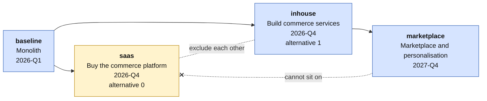
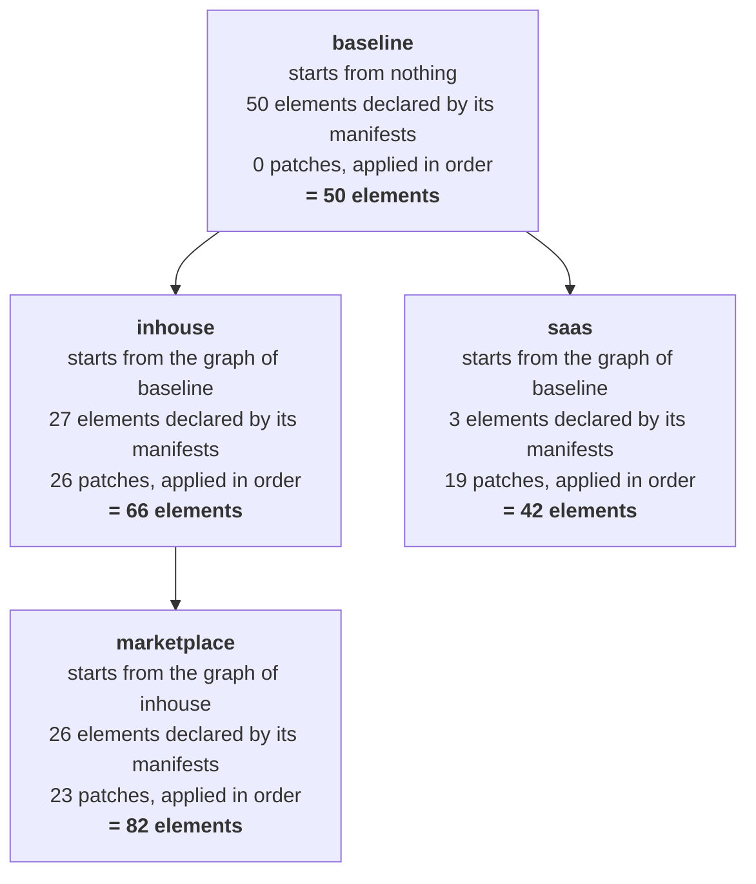
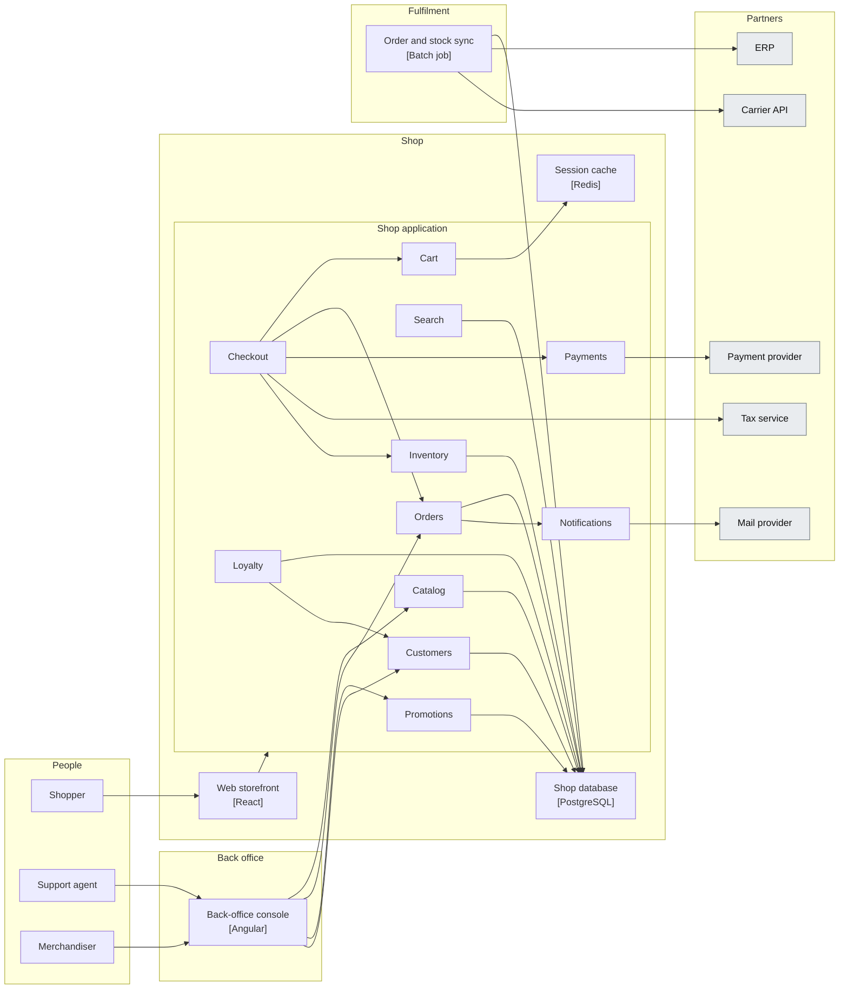
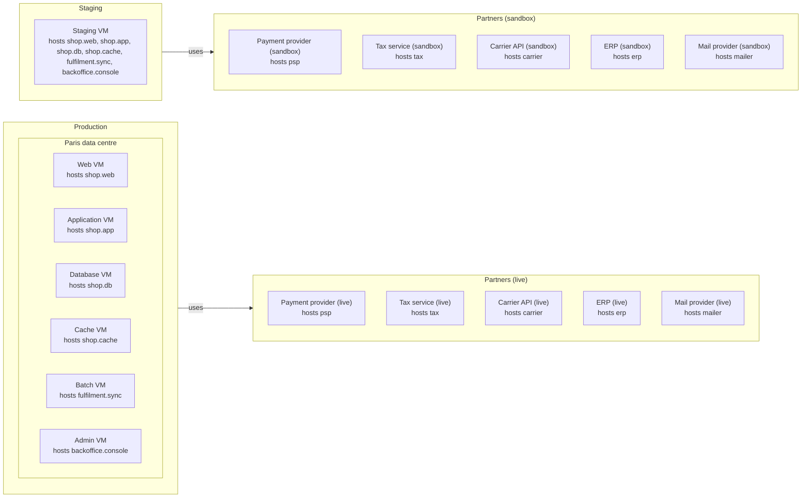
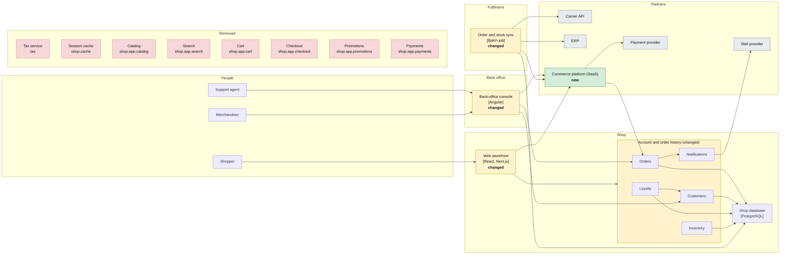
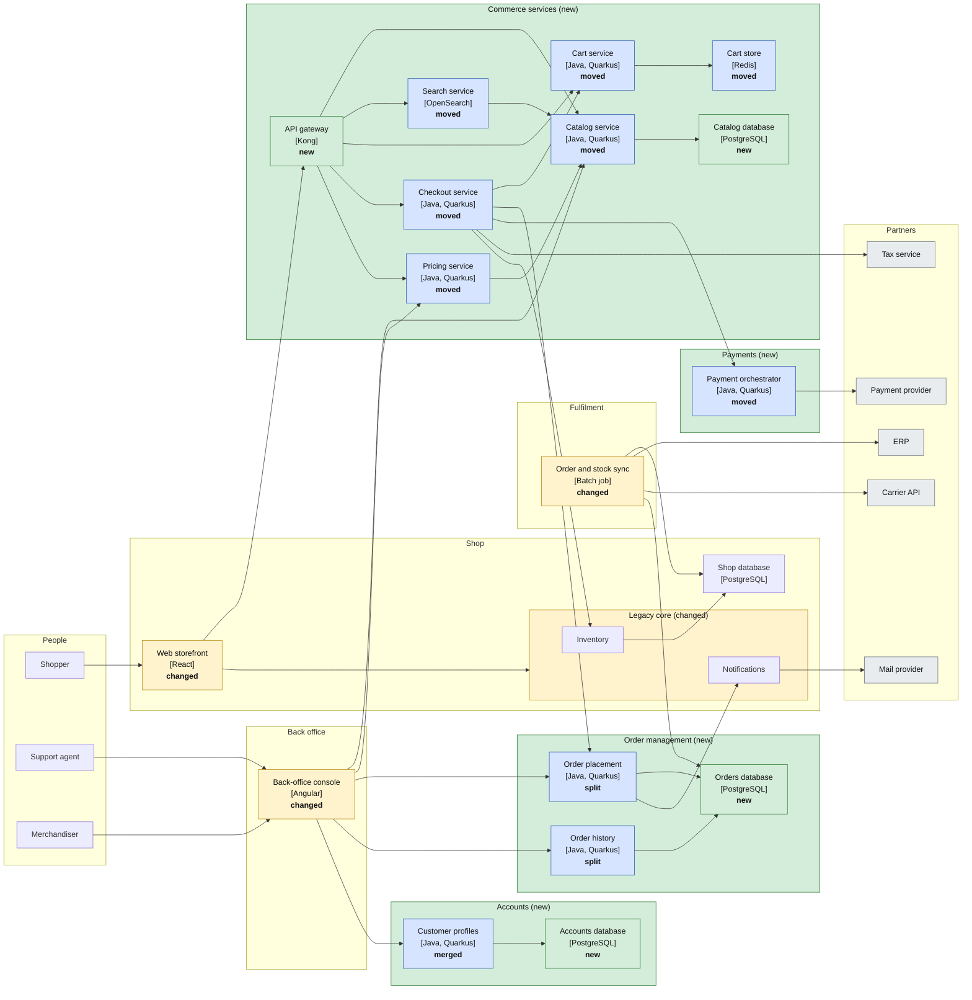
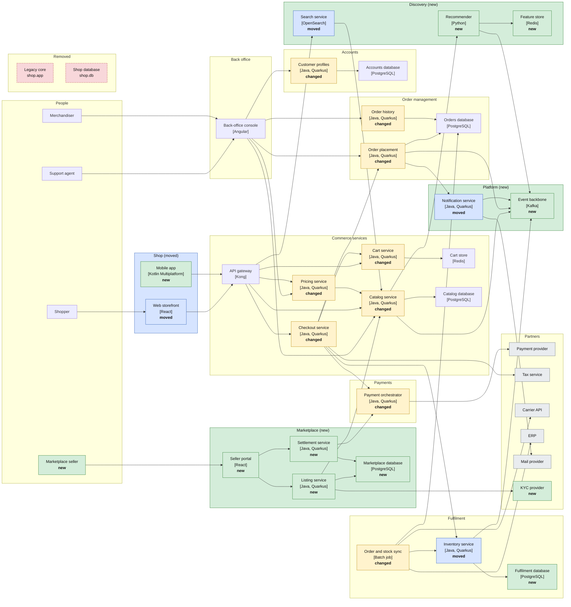
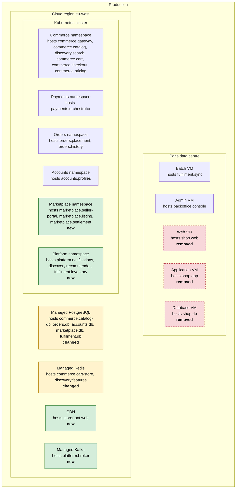
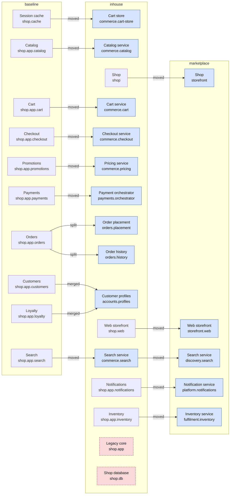
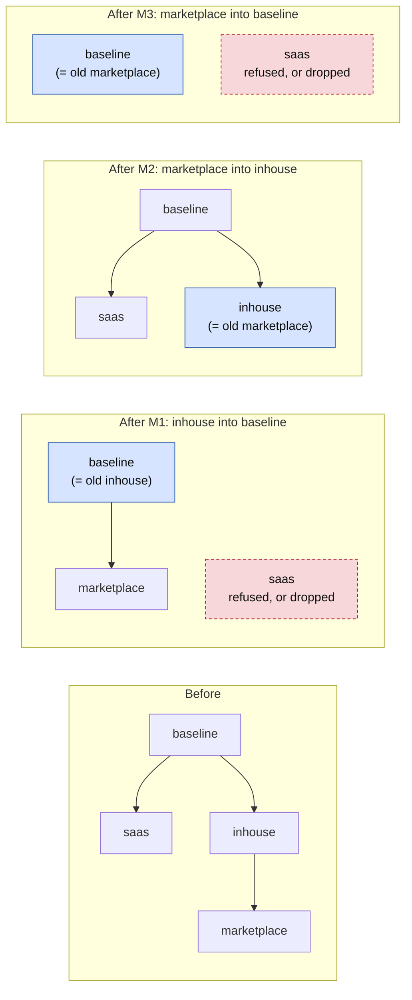

# Brightcart: a shopping fixture across four plateaus

An invented online retailer, described as manifests, whose architecture changes over four plateaus. It is written for three uses at once: to think about where ArchiCode should go with plateaus, to ship as a worked example, and to drive tests. This document specifies it; the files are written by `src/test/resources/brightcart/generate.mjs` (section 15).

Nothing here comes from a real workspace. Every name, id and label is invented.

## 1. Purpose and status

**What it is for**

1. *Prospective.* The layered model under study (a plateau is a layer, its manifests add to the graph, its patches change the graph, plateaus form a tree, an editor built around a timeline) needs a case that is big enough to hurt. The fixture is that case, with the hard parts on purpose (section 10).
2. *Example.* A realistic project for the manual and the tutorial, next to the small examples that exist (`domain_plateaus`, the bookshop).
3. *Fixture.* One source of truth that generates every test input: the kernel (`compare`), the command line (`diff`, `views generate`, facets, `plateau list`), the editor (open, compare, faithful saves on every manifest), the native smoke step, and the layered engine. One rendition is committed: `layered/`, which the layered tools read. The second one, `folders/`, which the old mechanism (`settings.plateaus`) read, went with that mechanism (wave 014, runs 0083 and 0084); what this document says of it is the record of how the fixture was checked (section 3).

**What "convincing" means here:** 42 to 82 elements per plateau across both layers (a real workspace is bigger, section 13), the six states of `compare` all present, a fork between two exclusive alternatives, a plateau that only makes sense on one of them, and the awkward cases a real migration produces (a split, a merge, a subtree renamed, an element moved twice, a stale reference).

**How it was checked.** The content of this document was produced by a throwaway model, not written by hand: it applies the layers and replays the rules of `compare.rs`. The model was then cross-checked against the real thing. The four plateaus were written out as complete folders and read by the current `archicode diff`; the five comparisons it can run (section 10) gave exactly the counts below. The layered semantics themselves (patches) were only the model's at the time. Since then the tools have been wired to the files, and the layered engine (wave 014) reads `layered/` and gave, plateau by plateau, the counts and the drawings of `folders/` (the complete folders, since removed): section 12 says which result each tool now verifies and which stay the model's, and section 13 what is still not checked.

**Out of scope for this document:** deciding the open design points (each assumption below is labelled as open), writing the files, golden outputs of the renderer.

**What a tool verifies today** (wave 015, after the manual of run 0106; each line names the test that pins it):

| What | Verified by | State |
| --- | --- | --- |
| P1, P2, P3 and P5 (counts, table of changes, notable cases, the views byte for byte, the facets) | `BrightcartLayeredDiffTest`, `BrightcartLayeredViewsTest`, and the editor's Changes panel (`cli-editor-counts.test.js`) on `layered/` | Verified. |
| P4 and N8 (a move that took two steps, composed) | `BrightcartLayeredDiffTest` (`marketplaceAgainstBaselineIsP4BecauseTheReplacesOfTheTwoStepsAreComposed`, and P4 among the parameterised tests), the shared cases `compose-replaces-cases.json` (`ComposeReplacesCasesTest`, `compose-replaces.test.js`), and the editor's Changes panel on `layered/` | Verified (wave 017, run 0125, #89): `archicode diff --plateau marketplace --against baseline` prints +38 ~3 -6, 11 / 2 / 1, +35 ~1 -9 with no warning, as the model does, and the editor gives the same table. |
| V1 to V11 (negative variants) | `BrightcartNegativeCasesTest` (command line) and `brightcart-negative.test.js` (editor), from `negative-cases.json`; V11 also from `plateau-model-cases.json` | Verified: one `error:` line (or one warning, V9 and V10) from each tool. |
| The cases of wave 015 on the same files (N56 to N85, and N89 to N93 of wave 018: `container-group`, `solution-group`, `system-group` and `group` are no kinds, with the sentence "a group is no kind any more"; the camel-case keys of the facets are refused with the key to write; a key or an item with no value, a number or a `yes` where a word is wanted, the keys of the facets in kebab-case; a story or a view that says `plateau:`; a view that names an element that exists in no plateau; a view or a map that names what only another plateau has; the steps of a story told at a plateau) | `BrightcartNegativeCasesTest` and `brightcart-negative.test.js`, from `negative-cases.json` (74 cases: the numbers are identifiers, not a count, and the notable cases N1 to N17 of section 10 are another list) | Verified: the exit code and the lines of the command line, the sentence of the editor. Each case alters a copy of `layered/` in a temporary folder, so nothing negative is committed. |
| The plateau model and the reading of values (the tree, the header key, `settings.current`, a null, a dotted id, a story that declares the same id in two plateaus: M01 to M86) | `PlateauModelTest` and `plateau-model.test.js`, from `plateau-model-cases.json` (81 cases) | Verified, one file of cases for the two tools. |
| The checks of a layer, the nesting rule and what a view or a story names (K01 to K42: a relationship, a `uses`, a hosted application, a parent that is not there or cannot hold the kind, a name that exists in no plateau, the plateaus a step names) | `LayerLoaderTest` and `layer-checks.test.js`, from `layer-checks-cases.json` (37 cases), and `StepPlateausTest` and `story-steps-plateaus.test.js` for the story `migration` of `domain_plateaus` | Verified: the command line stops at the first layer that is wrong, the editor tells the same sentences in the same order and draws the plateau all the same. The table `nesting.holds` of the file is compared with the model classes and with the editor's `READ_SCHEMA` (`EditorReadSchemaTest`). |
| Which files are manifests (D01 to D36, among them the folder of a comparison, D34 and D35, and a manifest in TOML, D36) | `ManifestDiscoveryTest` and `discovery.test.js`, from `discovery-cases.json` (36 cases); `TomlManifestTest` and `TomlManifestIT` (a manifest in TOML gives the graph of its YAML twin) | Verified. A layered project written in TOML or JSON is not run by anything (section 13). |
| The map of the technology layer | `TechnologyMapTest` (the command line) and `technology-map-shared.test.js` (the page of a view and the page Environments), from `src/test/resources/technology-map/expected-boxes.json`, on the example `domain_technology_map` | Verified: the boxes and the links of each of the three views, in both tools. The layered Brightcart's two saved technology maps, `environments_map` and `cloud_map` (section 9), are in the same contract file, with the applications deployed on the nodes and the dependency of `prod` on the partners' environment that those applications give (wave 016, run 0114, #107): the boxes and the links of each, and the variants that leave the applications or the relationships out, in both tools. |
| The views and the stories of `layered/shared/` (7 views, 3 stories, `ENTRIES` of `description.mjs`, `expected/entries.json`) | `BrightcartViewsAndStoriesTest` (the command line draws them with `-i` in each plateau: the files, the warnings, the maps; every plateau loads with them; a mistyped `at` is one sentence) and `brightcart-views-and-stories.test.js` (the editor: the same stories and views in every plateau, which view cannot be drawn where, the saved maps, the steps told at the plateaus of the fork with the counts of `archicode diff`, the guard of a delete) | Verified (section 9). |
| `diff --fail-on` and `views generate --only-changes` | `DiffFailOnTest` and `OnlyChangesTest`, and the integration tests of `src/test/java/io/morin/archicode/it` (`PlateauComparisonIT`: exit 3, exit 0, exit 1) on the bookshop and on the layered Brightcart | Verified on the JVM jar; the native runner is the CI job's. |
| V12 to V14, M1 to M3 (merge) | nothing | Wait for `plateau merge` (#65). |
| The files of `layered/` (the views and the stories included) | `ShippedFilesTest` and `shipped-files.test.js` (every plateau of every shipped workspace opens, in both tools), `TomlManifestTest` (the TOML twin of every manifest, the views and the stories too), `brightcart-layered.test.js` (the generator, byte for byte) | Verified. |
| The manual's example `domain_plateaus` and its tutorial | `ManualExamplesTest`, `ShippedFilesTest`, `PlateauComparisonTest` (the table the manual quotes) and `example-identity.test.js` | Verified. |

## 2. The story

Brightcart sells home and garden goods in four countries. It started as one Java application, a PostgreSQL database and a nightly batch to the ERP, run in one data centre. The shop works, but every change goes through the monolith.

| Plateau | Id | Horizon | Parent | What happens |
| --- | --- | --- | --- | --- |
| Monolith | `baseline` | 2026-Q1 | none | One Java application serves the storefront, orders, accounts and payments. |
| Buy the commerce platform | `saas` | 2026-Q4 | `baseline` | Alternative 0. A SaaS commerce platform takes the catalog, search, cart, checkout, promotions and payments. The monolith keeps accounts, orders and stock. |
| Build commerce services | `inhouse` | 2026-Q4 | `baseline` | Alternative 1. The same capabilities become in-house services on Kubernetes. Orders are split in two, accounts and loyalty merged. |
| Marketplace and personalisation | `marketplace` | 2027-Q4 | `inhouse` | Third-party sellers, an event backbone, recommendations, a mobile app. The monolith is retired and the shop system is renamed. |



The two alternatives exclude each other: they are two answers to the same question, each starting from the baseline. `marketplace` builds on `inhouse` only. It publishes to the API gateway, lists offers in `commerce.catalog`, pays sellers through `payments.orchestrator` and reads from the Kubernetes cluster, none of which exists in `saas`. Putting `marketplace` on top of `saas` must fail (variant V3).

## 3. Conventions

**Elements.** Application layer: `person`, `system`, `container`, `component`. Technology layer: `environment`, `node`. An external system is a `system` with the tag `rendering-stereotypes: external`. Qualifiers hold the technology (`Java`, `Quarkus`, `PostgreSQL`, `Kafka`). A reference is the dotted chain of ids, as today.

**Manifests.** One root element per file, with its subtree nested, like the existing examples. A container or a node whose parent lives in another file uses `parent:` in the header. A file is named after its root reference. A relationship is owned by its source.

**Where a manifest belongs.** The plateau of a manifest is its `plateau:` header, whatever folder it is in; a manifest without one belongs to `baseline` (L0). Each plateau has a folder (`baseline/`, `saas/`, `inhouse/`, `marketplace/`) with a `plateau.yaml` (`Kind: Plateau`: its `id`, `name`, `horizon`, `override` when its parent is not `baseline`, and its `patches`) and the manifests that say `plateau: <id>`; the folder only keeps the files of a plateau together, and the tools do not look at it. The manifests of `baseline` carry no header, the others carry one each. A file never sits outside a plateau folder, except `.archicode.yaml`.

**One rendition, `layered/`.** It is committed and read by the layered tools: `archicode diff --plateau <id>`, `views generate --plateau <id>`, `plateau list`, and the editor, which opens it and draws any plateau of its band. It is the source of truth: four folders, the patches in the `plateau.yaml` of each plateau but `baseline`, `settings.manifests.paths: ["./**"]`, no `settings.plateaus`. The tree forks (`inhouse` and `saas` both override `baseline`), so every command names the plateau. It is generated from one description by `generate.mjs`, which resolves the layered files back and fails if a plateau differs from what the model resolves.

A second rendition used to be committed next to it, `folders/`, with each plateau as a whole folder read by the old mechanism (`settings.plateaus`, `--baseline`, the editor's plateau selector). It was generated by resolving the layers and went with that mechanism, which no longer exists (wave 014). The sections below that say "complete folders" or `folders/` describe how the layered tools were checked against it while it existed, with the same counts. The tables below that give the layered manifests as text (sections 5 to 8) are the same files.

**How a plateau is resolved.** Each layer starts from the graph of its parent, adds the elements its manifests declare, then applies its patches in order. The numbers are those of this fixture.



**What the layered rendition assumes of the target model.** Each rule is an assumption of this document, with the question it leaves open; none is decided.

| # | Rule | Open question |
| --- | --- | --- |
| L0 | A manifest belongs to the plateau named by its header, else to `baseline`; its folder does not matter. | Who says the plateau of a manifest |
| L1 | A plateau is loaded as its parent's graph, plus its manifests, then its patches in the order of the array. | Order and scope of the patches |
| L2 | The manifests of a layer are added to the graph before its patches run, and a patch may target an element the layer has just added (A9). Only a manifest creates an element: a patch never changes an `id` or a `parent`. | When references are resolved |
| L3 | A patch with no match is an error. A free `json-path` states how many nodes it expects (`expect`). | A patch with no match: error or ignored |
| L4 | `target` is a full reference. `json-path` is for bulk operations written by hand. | The shape of a selector, which is a public contract |
| L5 | `REMOVE` takes the subtree, the relationships towards it and its entries in `applications` and `uses`. It does not take the empty node that hosted it. | What a removal takes with it |
| L6 | No operator moves or renames (`MOVE` and `RENAME` do not exist in wave 014): an element that moves is declared again by a manifest of the layer that says `replaces`, and the old one is removed. | Whether move and rename operators exist at all |
| L7 | A relationship has no id. A patch finds it by `where: {destination, label}`. | Identity of a relationship |
| L8 | A reference declared twice, in any layer of the chain, is an error. | Redeclaring an element of an ancestor plateau |
| L9 | `replaces` is a fact of one plateau. Comparing two plateaus several steps apart composes the facts of the steps in between. | `replaces` across several steps |
| L10 | Views and stories are patchable. (Closed by wave 015, run 0100, #86 and #100: they belong to no plateau and nothing patches them; the fixture ships some, section 9.) | Views and stories under patches |
| L11 | A plateau can be merged into an ancestor, and the result resolves to what the future plateau resolved to (section 14). | Whether the fold exists, and how its result is produced |

**What the layered tools do with these rules** (wave 014, run 0079; the answers of the open questions are the ones of the wave plan, A1 to A9). L0, L1, L3, L4, L5, L7 and L8 are run on `layered/`: a patch with no match is an error that names the plateau, the rank and the selector; `target` is a full reference and selects one element; `REMOVE` takes the subtree and what points at it and not the node that hosted it, and says so in the table of changes (the cascade); a relationship is found by `where: {destination, label}`; a reference declared twice in a chain is an error. L2 is restated above: the three `MOVE` of the earlier drafts of this document are manifests that say `replaces` (L6). L9 is built (wave 017, run 0125, #89): the kernel's `compare` takes the plateaus the target stands on (`chain`) and reads the `replaces` of the layers in between through the layers that made them, in the command line and in the editor, so the tools give P4 (section 10). L10 is not built (#86) and L11 is the merge (#65).

## 4. The workspace

`.archicode.yaml` holds what is shared by every plateau: the name, the styles and the facets. In the layered rendition there is no `settings.plateaus`; `settings.manifests.paths` is `["./**"]`: every manifest below the folder of `.archicode.yaml` is read, recursively and sorted, except the folders of generated views (`views-*`), and the plateau of each is its header (the default `manifests` folder does not exist there).

```yaml
settings:
  name: "Brightcart"
  views:
    path: "views"
  facets:
    customs:
      - name: "journey"            # the purchase journey: no staff tools, no fulfilment
        actions:
          - operator: REMOVE
            json-path: "$.application..elements[?(@.id == 'agent' || @.id == 'merchandiser' || @.id == 'backoffice' || @.id == 'fulfilment')]"
      - name: "no-externals"       # what Brightcart builds, without its partners
        actions:
          - operator: REMOVE
            json-path: "$.application..elements[?(@.tags['rendering-stereotypes'] == 'external')]"
      - name: "without-cart"       # selects nothing in `saas`, where the cart is gone
        actions:
          - operator: REMOVE
            json-path: "$.application..elements[?(@.id == 'cart')]"
styles:
  by-tags:
    external:
      background-color: "lightgray"
    legacy:
      line-style: 8
      line-gap: 4
    hot-path:
      line-color: "orangered"
      line-thickness: 3
  by-qualifiers:
    PostgreSQL:
      round-corner: 20
```

The three facets were run on the four plateaus with the current command line: they all generate, `no-externals` leaves no `Payment provider` system in any view (the technology nodes `Payment provider (live)` and `(sandbox)` keep the partner's name in theirs), and `journey` leaves no `Back office`. `without-cart` selects nothing in `saas`, where the cart is gone, and generates all the same: a facet tolerates a path that selects nothing, a patch does not (L3). It selects nothing in the elements, not in the bytes: the 20 technology views of `saas` through that facet differ from the plain ones (section 12, note 2).

## 5. Plateau `baseline`: the monolith

28 application elements, 22 technology elements, 28 relationships, 17 manifest files.

```
baseline/
  plateau.yaml
  application/
    customer.yaml                      # 1 element
    agent.yaml                         # 1 element
    merchandiser.yaml                  # 1 element
    psp.yaml                           # 1 element
    tax.yaml                           # 1 element
    carrier.yaml                       # 1 element
    erp.yaml                           # 1 element
    mailer.yaml                        # 1 element
    shop.yaml                          # 4 elements
    shop.app.yaml                      # 12 elements
    backoffice.yaml                    # 2 elements
    fulfilment.yaml                    # 2 elements
  technology/
    prod.yaml                          # 8 elements
    staging.yaml                       # 2 elements
    partners.yaml                      # 6 elements
    sandbox.yaml                       # 6 elements
```

A first look at the application layer. Grey boxes are partners. An arrow is a relationship; its label is in the table below.



**Application layer.**

| Reference | Kind | Name | Qualifiers | Relationships |
| --- | --- | --- | --- | --- |
| `customer` | person | Shopper | - | shop.web "browses and buys with" |
| `agent` | person | Support agent | - | backoffice.console "handles orders with" |
| `merchandiser` | person | Merchandiser | - | backoffice.console "maintains the catalog with" |
| `psp` | system | Payment provider | - | - |
| `tax` | system | Tax service | - | - |
| `carrier` | system | Carrier API | - | - |
| `erp` | system | ERP | - | - |
| `mailer` | system | Mail provider | - | - |
| `shop` | system | Shop | - | - |
| `shop.web` | container | Web storefront | React | shop.app "calls" |
| `shop.app` | container | Shop application | Java, Spring Boot | - |
| `shop.db` | container | Shop database | PostgreSQL | - |
| `shop.cache` | container | Session cache | Redis | - |
| `shop.app.catalog` | component | Catalog | - | shop.db "reads and writes" |
| `shop.app.search` | component | Search | - | shop.db "queries" |
| `shop.app.cart` | component | Cart | - | shop.cache "keeps baskets in" |
| `shop.app.checkout` | component | Checkout | - | shop.app.cart "reads baskets from"<br>shop.app.orders "creates orders in"<br>shop.app.payments "pays through"<br>tax "computes taxes with"<br>shop.app.inventory "reserves stock in" |
| `shop.app.orders` | component | Orders | - | shop.db "stores orders in"<br>shop.app.notifications "asks to notify" |
| `shop.app.customers` | component | Customers | - | shop.db "stores accounts in" |
| `shop.app.loyalty` | component | Loyalty | - | shop.db "stores points in"<br>shop.app.customers "reads accounts from" |
| `shop.app.promotions` | component | Promotions | - | shop.db "reads rules from" |
| `shop.app.payments` | component | Payments | - | psp "authorises payments with" |
| `shop.app.notifications` | component | Notifications | - | mailer "sends mails with" |
| `shop.app.inventory` | component | Inventory | - | shop.db "reads and reserves stock in" |
| `backoffice` | system | Back office | - | - |
| `backoffice.console` | container | Back-office console | Angular | shop.app.catalog "maintains products in"<br>shop.app.orders "handles orders in"<br>shop.app.promotions "configures promotions in"<br>shop.app.customers "looks up customers in" |
| `fulfilment` | system | Fulfilment | - | - |
| `fulfilment.sync` | container | Order and stock sync | Batch job | shop.db "reads orders, writes stock levels"<br>erp "exchanges orders and stock with"<br>carrier "books shipments with" |

**Technology layer.** Production runs on virtual machines in one data centre. Staging is one machine. The partners are deployed in two environments of their own, so that `uses` has something to resolve: production uses `partners`, staging uses `sandbox`.



| Reference | Kind | Name | Hosts (`applications`) | `uses` |
| --- | --- | --- | --- | --- |
| `prod` | environment | Production | - | `partners` |
| `prod.dc` | node | Paris data centre | - | - |
| `prod.dc.web-vm` | node | Web VM | `shop.web` | - |
| `prod.dc.app-vm` | node | Application VM | `shop.app` | - |
| `prod.dc.db-vm` | node | Database VM | `shop.db` | - |
| `prod.dc.cache-vm` | node | Cache VM | `shop.cache` | - |
| `prod.dc.batch-vm` | node | Batch VM | `fulfilment.sync` | - |
| `prod.dc.admin-vm` | node | Admin VM | `backoffice.console` | - |
| `staging` | environment | Staging | - | `sandbox` |
| `staging.vm` | node | Staging VM | `shop.web`, `shop.app`, `shop.db`, `shop.cache`, `fulfilment.sync`, `backoffice.console` | - |
| `partners` | environment | Partners (live) | - | - |
| `sandbox` | environment | Partners (sandbox) | - | - |
| `partners.psp-live` | node | Payment provider (live) | `psp` | - |
| `sandbox.psp-sandbox` | node | Payment provider (sandbox) | `psp` | - |
| `partners.tax-live` | node | Tax service (live) | `tax` | - |
| `sandbox.tax-sandbox` | node | Tax service (sandbox) | `tax` | - |
| `partners.carrier-live` | node | Carrier API (live) | `carrier` | - |
| `sandbox.carrier-sandbox` | node | Carrier API (sandbox) | `carrier` | - |
| `partners.erp-live` | node | ERP (live) | `erp` | - |
| `sandbox.erp-sandbox` | node | ERP (sandbox) | `erp` | - |
| `partners.mail-live` | node | Mail provider (live) | `mailer` | - |
| `sandbox.mail-sandbox` | node | Mail provider (sandbox) | `mailer` | - |

The five partner nodes of each of `partners` and `sandbox` follow one pattern: `<partner>-live` and `<partner>-sandbox`, hosting the external system.


**Two manifests, as they are written.** A system with nested containers; a container whose parent is in another file, with its components; an environment with nodes.

```yaml
# baseline/application/shop.yaml
header:
  kind: "archicode.morin.io/system"
  version: "1"
content:
  id: "shop"
  name: "Shop"
  description: "The web shop of the retailer."
  elements:
    - kind: "container"
      id: "web"
      name: "Web storefront"
      description: "Pages of the shop, in the browser."
      qualifiers: ["React"]
      relationships:
        - destination: "shop.app"
          label: "calls"
          qualifiers: ["JSON/HTTPS"]
    - kind: "container"
      id: "db"
      name: "Shop database"
      description: "Products, accounts, orders and stock."
      qualifiers: ["PostgreSQL"]
    - kind: "container"
      id: "cache"
      name: "Session cache"
      description: "Baskets and sessions."
      qualifiers: ["Redis"]
```

```yaml
# baseline/application/shop.app.yaml
header:
  kind: "archicode.morin.io/container"
  version: "1"
  parent: "shop"
content:
  id: "app"
  name: "Shop application"
  description: "The monolith that runs every shop feature."
  qualifiers: ["Java", "Spring Boot"]
  elements:
    - kind: "component"
      id: "catalog"
      name: "Catalog"
      description: "Products, prices and availability."
      relationships:
        - destination: "shop.db"
          label: "reads and writes"
    - kind: "component"
      id: "search"
      name: "Search"
      description: "Full-text search over products."
      relationships:
        - destination: "shop.db"
          label: "queries"
    - kind: "component"
      id: "cart"
      name: "Cart"
      description: "Keeps the basket of a shopper."
      relationships:
        - destination: "shop.cache"
          label: "keeps baskets in"
    # ... eight more components, checkout among them (see the table)
```

```yaml
# baseline/technology/prod.yaml
header:
  kind: "archicode.morin.io/environment"
  version: "1"
content:
  id: "prod"
  name: "Production"
  uses:
    - "partners"
  elements:
    - kind: "node"
      id: "dc"
      name: "Paris data centre"
      elements:
        - kind: "node"
          id: "web-vm"
          name: "Web VM"
          applications:
            - "shop.web"
        - kind: "node"
          id: "app-vm"
          name: "Application VM"
          applications:
            - "shop.app"
        - kind: "node"
          id: "db-vm"
          name: "Database VM"
          applications:
            - "shop.db"
        - kind: "node"
          id: "cache-vm"
          name: "Cache VM"
          applications:
            - "shop.cache"
        - kind: "node"
          id: "batch-vm"
          name: "Batch VM"
          applications:
            - "fulfilment.sync"
        - kind: "node"
          id: "admin-vm"
          name: "Admin VM"
          applications:
            - "backoffice.console"
```

```yaml
# baseline/plateau.yaml
header:
  kind: "archicode.morin.io/plateau"
  version: "1"
content:
  id: "baseline"
  name: "Monolith"
  horizon: "2026-Q1"
```

A `baseline` has no `override` and no patch, and its manifests carry no `plateau:` header: without one a manifest is the `baseline`'s.

## 6. Plateau `saas`: buy the commerce platform

The decision: stop building commerce. A hosted platform takes the catalog, the search, the cart, the checkout, the promotions and the payments. The shop keeps accounts, loyalty, order history and stock. `shop.cache` is no longer needed. The tax service is replaced by the platform's own computation.

In the diagram below the colour is the state `compare` gives to the plateau against its parent: green is new, amber is changed, blue is moved, split or merged, red and dashed is removed. The state is also written in the box. Elements that did not change are white.



**Manifests added** (3 elements in 3 files; every other file is inherited).


Application layer:

| Reference | Kind | Name | Qualifiers | Replaces | File |
| --- | --- | --- | --- | --- | --- |
| `commerce-saas` | system | Commerce platform (SaaS) | - | - | `commerce-saas.yaml` |

Technology layer:

| Reference | Kind | Name | Hosts (`applications`) | `uses` |
| --- | --- | --- | --- | --- |
| `partners.commerce-live` | node | Commerce platform (live) | `commerce-saas` | - |
| `sandbox.commerce-sandbox` | node | Commerce platform (sandbox) | `commerce-saas` | - |

```
saas/
  plateau.yaml
  application/
    commerce-saas.yaml                 # 1 element
  technology/
    partners.commerce-live.yaml        # 1 element
    sandbox.commerce-sandbox.yaml      # 1 element
```

**`saas/plateau.yaml`.** 3 ADD, 11 REMOVE, 5 SET.

```yaml
header:
  kind: "archicode.morin.io/plateau"
  version: "1"
content:
  id: "saas"
  name: "Buy the commerce platform"
  horizon: "2026-Q4"
  patches:
    # what the platform replaces
    - operator: REMOVE
      target: "shop.app.catalog"
    - operator: REMOVE
      target: "shop.app.search"
    - operator: REMOVE
      target: "shop.app.cart"
    - operator: REMOVE
      target: "shop.app.checkout"
    - operator: REMOVE
      target: "shop.app.payments"
    - operator: REMOVE
      target: "shop.app.promotions"
    # no longer needed
    - operator: REMOVE
      target: "shop.cache"
    # the platform computes taxes
    - operator: REMOVE
      target: "tax"
    # REMOVE does not take the nodes that hosted what is gone
    - operator: REMOVE
      target: "prod.dc.cache-vm"
      layer: technology
    - operator: REMOVE
      target: "partners.tax-live"
      layer: technology
    - operator: REMOVE
      target: "sandbox.tax-sandbox"
      layer: technology
    # the storefront talks to the platform
    - operator: SET
      target: "shop.web"
      field: description
      value: "Headless storefront on the commerce platform."
    - operator: SET
      target: "shop.web"
      field: qualifiers
      value: ["React", "Next.js"]
    - operator: ADD
      target: "shop.web"
      field: relationships
      value: {destination: "commerce-saas", label: "browses and checks out with", qualifiers: ["GraphQL"]}
    # what is left of the application
    - operator: SET
      target: "shop.app"
      field: name
      value: "Account and order history"
    - operator: SET
      target: "shop.app"
      field: description
      value: "Accounts, loyalty, order history and stock; the rest moved to the platform."
    # the staff tools
    - operator: ADD
      target: "backoffice.console"
      field: relationships
      value: {destination: "commerce-saas", label: "maintains products in", qualifiers: ["HTTPS"]}
    # the nightly batch
    - operator: SET
      target: "fulfilment.sync"
      field: relationships
      where: {destination: "shop.db", label: "reads orders, writes stock levels"}
      value: {label: "writes stock levels"}
    - operator: ADD
      target: "fulfilment.sync"
      field: relationships
      value: {destination: "commerce-saas", label: "pulls orders from", qualifiers: ["REST"]}
```

What to notice:

- The `REMOVE` of `catalog` and `promotions` take, silently, the relationships `backoffice.console` had towards them: the console loses two links nobody wrote a patch for, and gains one by an explicit `ADD`. Section 10 (N2) follows it.
- `REMOVE shop.cache` takes its entry out of `staging.vm`, but not the node `prod.dc.cache-vm` (L5): the node needs its own `REMOVE`. `tax` is the same, with `partners.tax-live` and `sandbox.tax-sandbox`.
- A relationship whose label changes is a `SET` with `where` (L7). `compare` calls it a label change, not a removal plus an addition.


## 7. Plateau `inhouse`: build commerce services

The decision: keep control. The capabilities leave the monolith one by one, on a Kubernetes cluster with managed PostgreSQL and Redis. This is the plateau where `compare` is asked the most.



**Manifests added** (27 elements in 11 files).


Application layer:

| Reference | Kind | Name | Qualifiers | Replaces | File |
| --- | --- | --- | --- | --- | --- |
| `commerce` | system | Commerce services | - | - | `commerce.yaml` |
| `commerce.gateway` | container | API gateway | Kong | - | `commerce.yaml` |
| `commerce.catalog` | container | Catalog service | Java, Quarkus | `shop.app.catalog` | `commerce.catalog.yaml` |
| `commerce.catalog-db` | container | Catalog database | PostgreSQL | - | `commerce.yaml` |
| `commerce.cart-store` | container | Cart store | Redis | `shop.cache` | `commerce.yaml` |
| `commerce.search` | container | Search service | OpenSearch | `shop.app.search` | `commerce.search.yaml` |
| `commerce.cart` | container | Cart service | Java, Quarkus | `shop.app.cart` | `commerce.cart.yaml` |
| `commerce.checkout` | container | Checkout service | Java, Quarkus | `shop.app.checkout` | `commerce.checkout.yaml` |
| `commerce.pricing` | container | Pricing service | Java, Quarkus | `shop.app.promotions` | `commerce.pricing.yaml` |
| `payments` | system | Payments | - | - | `payments.yaml` |
| `payments.orchestrator` | container | Payment orchestrator | Java, Quarkus | `shop.app.payments` | `payments.yaml` |
| `orders` | system | Order management | - | - | `orders.yaml` |
| `orders.placement` | container | Order placement | Java, Quarkus | `shop.app.orders` | `orders.yaml` |
| `orders.history` | container | Order history | Java, Quarkus | `shop.app.orders` | `orders.yaml` |
| `orders.db` | container | Orders database | PostgreSQL | - | `orders.yaml` |
| `accounts` | system | Accounts | - | - | `accounts.yaml` |
| `accounts.profiles` | container | Customer profiles | Java, Quarkus | `shop.app.customers`, `shop.app.loyalty` | `accounts.yaml` |
| `accounts.db` | container | Accounts database | PostgreSQL | - | `accounts.yaml` |

Technology layer:

| Reference | Kind | Name | Hosts (`applications`) | `uses` |
| --- | --- | --- | --- | --- |
| `prod.cloud` | node | Cloud region eu-west | - | - |
| `prod.cloud.k8s` | node | Kubernetes cluster | - | - |
| `prod.cloud.k8s.commerce` | node | Commerce namespace | `commerce.gateway`, `commerce.catalog`, `commerce.search`, `commerce.cart`, `commerce.checkout`, `commerce.pricing` | - |
| `prod.cloud.k8s.payments` | node | Payments namespace | `payments.orchestrator` | - |
| `prod.cloud.k8s.orders` | node | Orders namespace | `orders.placement`, `orders.history` | - |
| `prod.cloud.k8s.accounts` | node | Accounts namespace | `accounts.profiles` | - |
| `prod.cloud.pg` | node | Managed PostgreSQL | `commerce.catalog-db`, `orders.db`, `accounts.db` | - |
| `prod.cloud.redis` | node | Managed Redis | - | - |
| `staging.k8s` | node | Staging cluster | `commerce.gateway`, `commerce.catalog`, `commerce.catalog-db`, `commerce.search`, `commerce.cart`, `commerce.checkout`, `commerce.pricing`, `payments.orchestrator`, `orders.placement`, `orders.history`, `orders.db`, `accounts.profiles`, `accounts.db` | - |

```
inhouse/
  plateau.yaml
  application/
    commerce.yaml                      # 4 elements
    commerce.catalog.yaml              # 1 element
    commerce.search.yaml               # 1 element
    commerce.cart.yaml                 # 1 element
    commerce.checkout.yaml             # 1 element
    commerce.pricing.yaml              # 1 element
    payments.yaml                      # 2 elements
    orders.yaml                        # 4 elements
    accounts.yaml                      # 3 elements
  technology/
    prod.cloud.yaml                    # 8 elements
    staging.k8s.yaml                   # 1 element
```

**`inhouse/plateau.yaml`.** 9 ADD, 11 REMOVE, 6 SET.

```yaml
header:
  kind: "archicode.morin.io/plateau"
  version: "1"
content:
  id: "inhouse"
  name: "Build commerce services"
  horizon: "2026-Q4"
  patches:
    # pattern R: commerce.cart-store says replaces; the cascade takes the entries of the nodes that hosted the cache
    - operator: REMOVE
      target: "shop.cache"
    # pattern R: the new containers say replaces, the old components go
    - operator: REMOVE
      target: "shop.app.catalog"
    - operator: REMOVE
      target: "shop.app.search"
    - operator: REMOVE
      target: "shop.app.cart"
    - operator: REMOVE
      target: "shop.app.checkout"
    - operator: REMOVE
      target: "shop.app.payments"
    - operator: REMOVE
      target: "shop.app.promotions"
    - operator: REMOVE
      target: "shop.app.orders"
    - operator: REMOVE
      target: "shop.app.customers"
    - operator: REMOVE
      target: "shop.app.loyalty"
    # the monolith is reduced
    - operator: SET
      target: "shop.app"
      field: name
      value: "Legacy core"
    - operator: SET
      target: "shop.app"
      field: description
      value: "What is left of the monolith: stock levels and notifications."
    - operator: SET
      target: "shop.app"
      field: tags
      value: {"rendering-stereotypes": "legacy"}
    # the storefront
    - operator: SET
      target: "shop.web"
      field: description
      value: "Pages of the shop, served behind the API gateway."
    - operator: ADD
      target: "shop.web"
      field: relationships
      value: {destination: "commerce.gateway", label: "browses and buys through", qualifiers: ["REST"]}
    # deployment
    - operator: ADD
      target: "prod.cloud.redis"
      layer: technology
      field: applications
      value: ["commerce.cart-store"]
    - operator: ADD
      target: "staging.k8s"
      layer: technology
      field: applications
      value: ["commerce.cart-store"]
    - operator: SET
      target: "staging.vm"
      layer: technology
      field: applications
      value: ["shop.web", "shop.app", "shop.db", "fulfilment.sync", "backoffice.console"]
    - operator: REMOVE
      target: "prod.dc.cache-vm"
      layer: technology
    # the staff tools follow
    - operator: ADD
      target: "backoffice.console"
      field: relationships
      value: {destination: "commerce.catalog", label: "maintains products in"}
    - operator: ADD
      target: "backoffice.console"
      field: relationships
      value: {destination: "commerce.pricing", label: "configures promotions in"}
    - operator: ADD
      target: "backoffice.console"
      field: relationships
      value: {destination: "orders.placement", label: "handles orders in"}
    - operator: ADD
      target: "backoffice.console"
      field: relationships
      value: {destination: "orders.history", label: "looks up past orders in"}
    - operator: ADD
      target: "backoffice.console"
      field: relationships
      value: {destination: "accounts.profiles", label: "looks up customers in"}
    # the nightly batch
    - operator: SET
      target: "fulfilment.sync"
      field: relationships
      where: {destination: "shop.db", label: "reads orders, writes stock levels"}
      value: {label: "writes stock levels"}
    - operator: ADD
      target: "fulfilment.sync"
      field: relationships
      value: {destination: "orders.db", label: "reads orders from", qualifiers: ["SQL"]}
```

Every manifest of this plateau says so in its header, `plateau: "inhouse"`, and a manifest whose parent is in another file says that too:

```yaml
# inhouse/technology/staging.k8s.yaml
header:
  kind: "archicode.morin.io/node"
  version: "1"
  plateau: "inhouse"
  parent: "staging"
content:
  id: "k8s"
  name: "Staging cluster"
  applications:
    - "commerce.gateway"
    - "commerce.catalog"
    - "commerce.catalog-db"
    - "commerce.search"
    - "commerce.cart"
    - "commerce.checkout"
    - "commerce.pricing"
    - "payments.orchestrator"
    - "orders.placement"
    - "orders.history"
    - "orders.db"
    - "accounts.profiles"
    - "accounts.db"
```

How each replaced element is expressed. There is one pattern, because no operator moves or renames an element (a patch never changes an `id` or a `parent`):

- *Pattern R* (a manifest that says `replaces`, plus a `REMOVE` of the old element). Used for every element that moves: `catalog`, `search`, `cart`, `checkout` and `payments` become containers (component to container), `promotions` becomes `commerce.pricing`, and `shop.cache` becomes `commerce.cart-store` (a new parent, a new id and a new name). `orders` is **split** (two manifests replace `shop.app.orders`) and `customers` and `loyalty` are **merged** (`accounts.profiles` replaces both). The old element has to be removed explicitly: if it stays, it stays in the plateau. The `REMOVE` takes, with the element, the entries of the nodes that hosted it (`staging.vm`'s entry for the cache), and the new element is hosted by an `ADD`.

The monolith survives as `shop.app`, reduced to `inventory` and `notifications`, renamed *Legacy core* and tagged `rendering-stereotypes: legacy`.


## 8. Plateau `marketplace`: sellers, events, recommendations

The decision: open the catalog to third-party sellers, publish domain events and personalise. The monolith has done its job and goes. The shop system is renamed `storefront` now that it is a front only.



**Manifests added** (26 elements in 16 files).


Application layer:

| Reference | Kind | Name | Qualifiers | Replaces | File |
| --- | --- | --- | --- | --- | --- |
| `seller` | person | Marketplace seller | - | - | `seller.yaml` |
| `kyc` | system | KYC provider | - | - | `kyc.yaml` |
| `marketplace` | system | Marketplace | - | - | `marketplace.yaml` |
| `marketplace.seller-portal` | container | Seller portal | React | - | `marketplace.yaml` |
| `marketplace.listing` | container | Listing service | Java, Quarkus | - | `marketplace.yaml` |
| `marketplace.settlement` | container | Settlement service | Java, Quarkus | - | `marketplace.yaml` |
| `marketplace.db` | container | Marketplace database | PostgreSQL | - | `marketplace.yaml` |
| `platform` | system | Platform | - | - | `platform.yaml` |
| `platform.broker` | container | Event backbone | Kafka | - | `platform.yaml` |
| `platform.notifications` | container | Notification service | Java, Quarkus | `shop.app.notifications` | `platform.yaml` |
| `discovery` | system | Discovery | - | - | `discovery.yaml` |
| `discovery.recommender` | container | Recommender | Python | - | `discovery.yaml` |
| `discovery.features` | container | Feature store | Redis | - | `discovery.yaml` |
| `discovery.search` | container | Search service | OpenSearch | `commerce.search` | `discovery.yaml` |
| `fulfilment.inventory` | container | Inventory service | Java, Quarkus | `shop.app.inventory` | `fulfilment.inventory.yaml` |
| `fulfilment.db` | container | Fulfilment database | PostgreSQL | - | `fulfilment.db.yaml` |
| `storefront` | system | Shop | - | `shop` | `storefront.yaml` |
| `storefront.web` | container | Web storefront | React | `shop.web` | `storefront.yaml` |
| `storefront.mobile` | container | Mobile app | Kotlin Multiplatform | - | `storefront.mobile.yaml` |

Technology layer:

| Reference | Kind | Name | Hosts (`applications`) | `uses` |
| --- | --- | --- | --- | --- |
| `prod.cloud.cdn` | node | CDN | `storefront.web` | - |
| `prod.cloud.k8s.marketplace` | node | Marketplace namespace | `marketplace.seller-portal`, `marketplace.listing`, `marketplace.settlement` | - |
| `prod.cloud.k8s.platform` | node | Platform namespace | `platform.notifications`, `discovery.recommender`, `fulfilment.inventory` | - |
| `prod.cloud.kafka` | node | Managed Kafka | `platform.broker` | - |
| `partners.kyc-live` | node | KYC (live) | `kyc` | - |
| `sandbox.kyc-sandbox` | node | KYC (sandbox) | `kyc` | - |
| `staging.platform` | node | Staging cluster (platform) | `marketplace.seller-portal`, `marketplace.listing`, `marketplace.settlement`, `marketplace.db`, `platform.broker`, `platform.notifications`, `discovery.recommender`, `discovery.features`, `fulfilment.inventory`, `fulfilment.db` | - |

```
marketplace/
  plateau.yaml
  application/
    seller.yaml                        # 1 element
    kyc.yaml                           # 1 element
    marketplace.yaml                   # 5 elements
    platform.yaml                      # 3 elements
    discovery.yaml                     # 4 elements
    fulfilment.inventory.yaml          # 1 element
    fulfilment.db.yaml                 # 1 element
    storefront.yaml                    # 2 elements
    storefront.mobile.yaml             # 1 element
  technology/
    prod.cloud.cdn.yaml                # 1 element
    prod.cloud.k8s.marketplace.yaml    # 1 element
    prod.cloud.k8s.platform.yaml       # 1 element
    prod.cloud.kafka.yaml              # 1 element
    partners.kyc-live.yaml             # 1 element
    sandbox.kyc-sandbox.yaml           # 1 element
    staging.platform.yaml              # 1 element
```

**`marketplace/plateau.yaml`.** 13 ADD, 1 MERGE, 7 REMOVE, 2 SET. (`override` is a key of the `content` of a Plateau manifest, not of its header; a plateau whose parent is `baseline` leaves it out.)

```yaml
header:
  kind: "archicode.morin.io/plateau"
  version: "1"
content:
  id: "marketplace"
  name: "Marketplace and personalisation"
  horizon: "2027-Q4"
  override: "inhouse"
  patches:
    # retire the monolith; inventory and notifications are replaced by the manifests of this plateau
    - operator: REMOVE
      target: "shop.app"
    - operator: REMOVE
      target: "shop.db"
    # rewire what pointed at the monolith (the REMOVE took those links)
    - operator: ADD
      target: "commerce.checkout"
      field: relationships
      value: {destination: "fulfilment.inventory", label: "reserves stock in", qualifiers: ["REST"]}
    - operator: ADD
      target: "orders.placement"
      field: relationships
      value: {destination: "platform.notifications", label: "asks to notify"}
    - operator: ADD
      target: "fulfilment.sync"
      field: relationships
      value: {destination: "fulfilment.inventory", label: "writes stock levels to", qualifiers: ["REST"]}
    # a second move for this element: discovery.search says replaces
    - operator: REMOVE
      target: "commerce.search"
    # what pointed at the old search (the REMOVE took the link)
    - operator: ADD
      target: "commerce.gateway"
      field: relationships
      value: {destination: "discovery.search", label: "routes to"}
    # and the nodes that hosted it
    - operator: ADD
      target: "prod.cloud.k8s.commerce"
      layer: technology
      field: applications
      value: ["discovery.search"]
    - operator: ADD
      target: "staging.k8s"
      layer: technology
      field: applications
      value: ["discovery.search"]
    # rename the system: storefront says replaces for shop and shop.web; the subtree goes
    - operator: REMOVE
      target: "shop"
    # what pointed at the old storefront
    - operator: ADD
      target: "customer"
      field: relationships
      value: {destination: "storefront.web", label: "browses and buys with", qualifiers: ["HTTPS"]}
    - operator: ADD
      target: "staging.vm"
      layer: technology
      field: applications
      value: ["storefront.web"]
    # sellers, events, recommendations
    - operator: SET
      target: "commerce.catalog"
      field: description
      value: "Products, prices and availability, including offers of marketplace sellers."
    - operator: ADD
      target: "commerce.catalog"
      field: relationships
      value: {destination: "platform.broker", label: "publishes product events to"}
    - operator: ADD
      target: "commerce.catalog"
      field: relationships
      value: {destination: "discovery.recommender", label: "asks for suggestions"}
    - operator: ADD
      target: "orders.placement"
      field: relationships
      value: {destination: "platform.broker", label: "publishes order events to"}
    # drawing only: compare ignores it
    - operator: SET
      target: "commerce.gateway"
      field: tags
      value: {"rendering-stereotypes": "hot-path"}
    # retire the virtual machines
    - operator: REMOVE
      target: "prod.dc.web-vm"
      layer: technology
    - operator: REMOVE
      target: "prod.dc.app-vm"
      layer: technology
    - operator: REMOVE
      target: "prod.dc.db-vm"
      layer: technology
    # deployment
    - operator: ADD
      target: "prod.cloud.pg"
      layer: technology
      field: applications
      value: ["marketplace.db", "fulfilment.db"]
    - operator: ADD
      target: "prod.cloud.redis"
      layer: technology
      field: applications
      value: ["discovery.features"]
    # a bulk edit written by hand, guarded by expect
    - operator: MERGE
      json-path: "$.application..elements[?(@.qualifiers[?(@ == 'Quarkus')])]"
      field: tags
      value: {"runtime": "quarkus"}
      expect: 12
```

What to notice:

- The rename of `shop` to `storefront` is pattern R too, for a whole subtree: `storefront` and `storefront.web` are manifests that say `replaces` (`shop`, `shop.web`), `storefront.mobile` is new in this plateau (it has no `replaces`) and is declared under its final name, the CDN node hosts `storefront.web`, and `REMOVE shop` takes the old subtree and every link and entry that pointed at it. What pointed at the old storefront is written again: `customer`'s link, and `staging.vm`'s entry, by an `ADD`.
- `commerce.search` is replaced a second time (by `discovery.search`). Seen from `baseline`, `discovery.search` replaces `shop.app.search`: the chain has to be composed (L9), and since wave 017 (run 0125, #89) both tools compose it (section 10, P4).
- `REMOVE shop.app` and `REMOVE shop.db` cascade silently into `shop.web`, `commerce.checkout`, `orders.placement`, `fulfilment.sync` and the nodes. Three `ADD` of relationships re-point the ones that matter. `shop.web`'s old link to `shop.app` just disappears.
- The tag `rendering-stereotypes: hot-path` on `commerce.gateway` changes how the box is drawn and nothing else: `compare` ignores `rendering-*` tags, so the gateway stays unchanged.
- The last operation is a bulk edit written by hand: every container qualified `Quarkus` gets the tag `runtime: quarkus`. It is a `MERGE` (a `SET` would replace the tags the containers have), it selects 12 containers and says so with `expect`.


**Production after this plateau.** The virtual machines of the data centre are retired, except the batch and the admin machines, and the cloud region grows.



**Where the monolith went.** Every element of the baseline that is replaced or removed along the chain, with the state `compare` gives it. Column by column: `baseline`, `inhouse`, `marketplace`. A box can appear in two columns when it moves twice or is replaced after being left alone.



## 9. Views, stories and facets

Views and stories are manifests, and they belong to no plateau (wave 015, run 0100, #100): a view or a story is declared once in the workspace, whatever plateau is drawn, a `plateau:` in its header means nothing (and is told by nothing since wave 016, run 0107), and what it names must exist in at least one plateau. A step of a story may be told at a plateau and compared with another one (`at` and `against`, wave 015, run 0101, #24).

**What the fixture ships** (wave 016, run 0110, #115, decision of the author on 2026-10-20). Ten manifests in `layered/shared/`, a folder that no plateau owns (it must not begin with `views`, which is the folder of the generated views): seven views and three stories, with no `plateau:`. They are invented like the rest. `description.mjs` holds them (`ENTRIES`), `generate.mjs` writes them, works out from the model where each view can be drawn (`expected/entries.json`, with the sentence of the command line where it cannot) and reads them back from the disk. The names `shop_overview`, `order_journey` and `seller_journey` are those of the plan of the study (views and stories per plateau, `shop_detailed`, `checkout_overview`, `prod_deep`, ...); that plan assumed they belonged to plateaus, and what ships is the part of it that survives their being untied.

| File (in `layered/shared/`) | Kind | What it names, and what it checks | Read by |
| --- | --- | --- | --- |
| `view.customer_overview.yaml` | view, overview, application | `customer`, which the four plateaus have: drawn everywhere, no warning. | `BrightcartViewsAndStoriesTest` (command line), `brightcart-views-and-stories.test.js` (editor) |
| `view.shop_overview.yaml` | view, overview, application | `shop`, which `marketplace` renames `storefront`: drawn in `baseline`, `saas` and `inhouse`; in `marketplace` the command line skips it with a warning and the page says the element is not in the plateau (the question L10 asked, answered by #100 and #86). | the same two |
| `view.commerce_overview.yaml` | view, overview, application | `commerce`, which `inhouse` declares and `marketplace` keeps: skipped in `baseline` and `saas`. | the same two |
| `view.marketplace_overview.yaml` | view, overview, application | `marketplace`, which one plateau alone declares: drawn there, skipped in the three others. | the same two |
| `view.environments_map.yaml` | view, map, technology | The Map of the technology layer, `prod` opened, `sandbox` and `staging` hidden: drawn in the four plateaus (it is the page Environments in the editor), with the applications of the nodes that are open and the link from `prod` to the partners that the deployed applications give (`applications: false` or `relationships: false` in its properties leaves them out). | the same two |
| `view.cloud_map.yaml` | view, map, technology | The Map pinned on `prod.cloud.k8s`, which `inhouse` and `marketplace` have: nothing it is pinned on is in `baseline` and `saas`, so it is skipped there. | the same two |
| `view.applications_map.yaml` | view, map, application | The Map of the application layer, pinned on `customer` and `psp`, `shop` opened: drawn everywhere; `marketplace` has no `shop`, so the entry is left out, with a warning. | the same two |
| `story.order_journey.yaml` | story, three steps | No step names a plateau: the story is told in whatever plateau is drawn, and every step can be drawn in each of the four. | the editor test (the page Stories lists it in each plateau; each step is told in each plateau); the command line loads it with every plateau |
| `story.fork_tour.yaml` | story, seven steps | The steps across the fork: told at `baseline`, then at `saas` against `baseline` (P1), at `inhouse` against `baseline` (P2), at `inhouse` against `saas` (P5, the two alternatives, which override `baseline` and do not stack), at `marketplace` against `inhouse` (P3), at `marketplace` against `baseline` (P4's pair: the tools do not compose `replaces`, and the page gives the counts the tool prints), and a last one with `against: saas` and no `at`, told at the plateau drawn. One step (the second) carries its own view of an element one plateau alone declares (`commerce-saas`), since no view of it is saved (see below). | the editor test (the plateau and the comparison a step draws, and the counts of the Changes panel); `BrightcartViewsAndStoriesTest` (a mistyped `at` is one sentence) |
| `story.seller_journey.yaml` | story, three steps | Every step is told at `marketplace`, whatever plateau is drawn; the last one is compared with `inhouse` (P3). | the editor test |

Where each view can be drawn, as `expected/entries.json` says it (the command line draws it with `views generate --plateau <p> -i <id>`; the page calls it a view that cannot be drawn in this plateau):

| View | `baseline` | `saas` | `inhouse` | `marketplace` |
| --- | --- | --- | --- | --- |
| `customer_overview` | drawn | drawn | drawn | drawn |
| `shop_overview` | drawn | drawn | drawn | skipped |
| `commerce_overview` | skipped | skipped | drawn | drawn |
| `marketplace_overview` | skipped | skipped | skipped | drawn |
| `environments_map` | drawn | drawn | drawn | drawn |
| `cloud_map` | skipped | skipped | drawn | drawn |
| `applications_map` | drawn | drawn | drawn | drawn, without `shop` |
| Written when all seven are asked for | 4 files, 3 warnings | 4 files, 3 warnings | 6 files, 1 warning | 6 files, 2 warnings |

`commerce-saas` is not the subject of a saved view on purpose: it carries `rendering-stereotypes: external`, the facet `no-externals` removes it, and a view of an element that a facet removes fails the whole command (`error: dangling reference: commerce-saas`, run on `saas`; the comment of `GenerateViewsCommand` says it has always been so); the step that needs it (the second of `fork_tour`) carries its own view, which the command line does not draw. The ids of the views and the stories avoid those that the negative cases add to a copy of `layered/` (`cart_view`, `catalog_view`, `shop_map`, `catalog_map`, `tour`, ...), since an id is declared once.

What changes in the tests: `negative-cases.json` is read as before, but the page's account of the shipped views and steps is left out of what a case expects (it is a constant of the fixture, pinned by `brightcart-views-and-stories.test.js`); the tests of the page that delete an element or a plateau start from `layered/` without `shared/`, since the shipped entries refuse those deletes (that they do is a test of the new file). The tables of `diff` (P1 to P6) and `expected/changes.json` did not change: a view is not part of a comparison.

Generated views. With the current command line, `views generate` writes 109 (`baseline`), 93 (`saas`), 147 (`inhouse`), 181 (`marketplace`) PlantUML files for the four plateaus (the built-in views of the elements). A saved view is drawn only when it is named (`-i <id>`), and then alone, so the shipped views add nothing to these counts.


## 10. Expected results

### Sizes

| Plateau | Application | Technology | Elements | Relationships | Files | Declared | Patches | Views |
| --- | --- | --- | --- | --- | --- | --- | --- | --- |
| baseline | 28 | 22 | 50 | 28 | 17 | 50 | 0 | 109 |
| saas | 21 | 21 | 42 | 21 | 4 | 3 | 19 | 93 |
| inhouse | 36 | 30 | 66 | 35 | 12 | 27 | 26 | 147 |
| marketplace | 48 | 34 | 82 | 50 | 17 | 26 | 23 | 181 |

`Files` counts the `plateau.yaml`. `Declared` counts the elements the plateau's own manifests declare. `Views` is the number of PlantUML files the current command line writes for the plateau (the built-in views; a saved view is drawn only when it is named, section 9).

### The two renditions, side by side (the second one is gone)

The complete-folder rendition was removed with the old mechanism (wave 014); the figures are the ones `generate.mjs` wrote for it while it existed, and `expected/renditions.json` keeps them.

| Rendition | Files | Lines | Bytes |
| --- | --- | --- | --- |
| Layered (50 files: 46 manifests and 4 `plateau.yaml`, 68 patches) | 50 | 1251 | 34446 |
| Complete folders | 73 | 1913 | 52089 |
| Layered with the views and the stories of section 9 (60 files: the 50 above, 7 views and 3 stories) | 60 | 1415 | 39186 |

Counted on the files `generate.mjs` writes (the generator prints their count on every run, and `renditions.json` and a node test keep them), `.archicode.yaml` left out (it is shared). The third row is what `layered/` holds since run 0110 of wave 016 (`renditions.json`: `files` 60, with `views` 7 and `stories` 3); the first two rows are the comparison of the two renditions of the elements, which the views and the stories (164 lines, 4740 bytes) do not enter. The layered rendition is about a third smaller, and about 9 of its 34 KB are patches. The saving is real and not dramatic; it grows with the number of plateaus and shrinks when plateaus restructure. The `inhouse` increment is 10.5 KB against 14.4 KB for its complete folder, because it adds 27 elements.

### Comparisons

Counts as `archicode diff` prints them: elements `+new ~changed -removed`, then `moved / split / merged`, then relationships `+new ~changed -removed` (a label change counts as changed). The two layers are added together. The layered tool gives these counts for P1 to P5 (`diff --plateau <id>`, `--against <id>` for the sibling), row by row of the table of changes; the "complete folders" below are the old rendition, removed in wave 014, with the same numbers.

| Comparison | Elements | Replacing (moved / split / merged) | Relationships | Source |
| --- | --- | --- | --- | --- |
| P1 `saas` vs `baseline` | +3 ~5 -11 | 0 / 0 / 0 | +5 ~1 -12 | Verified with `archicode diff` on `layered/` (and, while it existed, on `folders/`). |
| P2 `inhouse` vs `baseline` | +17 ~5 -1 | 7 / 2 / 1 | +17 ~1 -6 | Verified with `archicode diff` on `layered/` (and on `folders/`). |
| P3 `marketplace` vs `inhouse` | +21 ~12 -5 | 5 / 0 / 0 | +18 ~1 -3 | Verified with `archicode diff` on `layered/` (and on `folders/`). |
| P4 `marketplace` vs `baseline`, composed | +38 ~3 -6 | 11 / 2 / 1 | +35 ~1 -9 | Verified with `archicode diff` on `layered/` and in the editor since wave 017 (run 0125, #89): the tools compose the `replaces` of the layers, so `discovery.search` is moved from `shop.app.search`. The old tool cannot say this, and before wave 017 the layered tool gave +39 ~3 -7, 10 / 2 / 1, +35 ~1 -9 (see L3 below). |
| P5 `inhouse` vs `saas` (siblings) | +27 ~4 -3 | 0 / 2 / 1 | +25 ~0 -7 | Verified with `archicode diff --against saas` on `layered/` (it was `--baseline saas` on `folders/`). |
| P6 `marketplace` vs `baseline`, last step only | +48 ~3 -16 | 4 / 0 / 0 | +44 ~0 -22 | Was verified on `folders/` (removed). What the old tool printed: only the last step's `replaces` count. The layered tool has no such reading: the question is P4's. |

P4 and P6 compare the same two plateaus. P6 reports 16 removed and 48 new elements where the real change is 6 and 38, and sees 4 moves where there are 11 moves, 2 splits and 1 merge. That is the cost of `replaces` being relative to one baseline (L9, section 12). Before wave 017 the layered tool read the `replaces` of every layer of the chain, so it found 10 of the 11 moves; the eleventh is the one that took two steps (`shop.app.search` to `commerce.search` to `discovery.search`): the second entry names `commerce.search`, which `baseline` does not have, and was ignored with a warning, so `discovery.search` read as new and `shop.app.search` as removed. Since run 0125 the composition of the chain gives P4.

### Notable cases

Each case is a place where the fixture asks something specific. "State" is what `compare` says in the comparison named.


| Id | Case | Where | State | Why it is there |
| --- | --- | --- | --- | --- |
| N1 | Plain addition | `commerce.gateway` | P2: new | An element with outgoing relationships to five others. |
| N2 | Removal that reaches another element | `shop.app.catalog` removed, `backoffice.console` | P1: removed; console changed | The cascade of `REMOVE` takes two of the console's relationships, on top of the one it gains by an explicit `ADD`; the layered tool lists them under the table (*Cascade of the removals*). |
| N3 | Label change | `fulfilment.sync` to `shop.db` | P1, P2: changed (label) | One removed and one new relationship between the same pair are one label change. |
| N4 | Move with a change of kind | `shop.app.cart` to `commerce.cart` | P2: moved | Component to container: a manifest that says `replaces`, and a `REMOVE` of the old element. |
| N5 | Move to another parent | `shop.cache` to `commerce.cart-store` | P2: moved | New parent, new id, new name: a manifest that says `replaces`, and a `REMOVE` whose cascade takes the entry of the nodes that hosted the cache; `staging.vm` follows. |
| N6 | Split | `shop.app.orders` to `orders.placement`, `orders.history` | P2: split (2) | The relationships of a split element are not compared: they all read as new. |
| N7 | Merge | `shop.app.customers`, `shop.app.loyalty` to `accounts.profiles` | P2: merged | The link between the two merged elements becomes a self-link of the result and reads as removed. |
| N8 | Moved twice | `shop.app.search`, `commerce.search`, `discovery.search` | P2: moved; P3: moved; P4: moved from `shop.app.search` | Needs the composition of `replaces` (L9), built in wave 017 (run 0125): the tools say P4. P6 gets it wrong. |
| N9 | Subtree renamed | `shop`, `shop.web` to `storefront`, `storefront.web`; `storefront.mobile` | P3: moved (2), `storefront.mobile` new | The new system is a manifest that says `replaces`, with its children, the new one among them; a `REMOVE` of `shop` takes the old subtree, and the links to it are written again. |
| N10 | Destination replaced, qualifier added | `commerce.checkout` to `fulfilment.inventory` | P3: changed (relationship) | The link follows the replaced destination; only its qualifier (`REST`) differs. |
| N11 | Render-only change | `commerce.gateway` tag `hot-path` | P3: unchanged | `rendering-*` tags are ignored by `compare`. |
| N12 | Bulk edit | 12 `Quarkus` containers, tag `runtime` | P3: changed for the ones that were not already | Five elements are changed by this and nothing else. A `MERGE` (a `SET` would replace the tags they have); the guard `expect: 12` is the contract. |
| N13 | Box that only contains changes | `shop` in P1 and P2, `prod.dc` in P1 to P4 | contains-changes | No change of its own. |
| N14 | Deployment follows | `staging.vm` | P1, P2, P3: changed | Entry removed by a cascade (P1), replaced by `SET` (P2), cascade and `ADD` of the new name (P3). |
| N15 | Swap of a partner | `tax` removed, `commerce-saas` new | P1 | With their nodes in `partners` and `sandbox`. |
| N16 | Siblings | `commerce.*` and `commerce-saas` | P5: `commerce-saas` removed, every `commerce.*` service new | Neither plateau is the other's past or future. |
| N17 | Old reference in a list | `inhouse` `SET staging.vm applications` | variant V8 | A list copied into a patch goes stale when the parent plateau changes. |

## 11. Variants and tests

**Negative variants.** Each is the fixture with one change. The messages below are what the model reports; the final wording belongs to the implementation, but each must name the plateau, the file or the patch rank, and the reference.

| Id | Change | Expected | Run today |
| --- | --- | --- | --- |
| V1 | A typo in a `target`: `commerce.catalogue` | Error in `marketplace`: the patch on `commerce.catalogue` has no match (it names the rank of the patch). | **Run** (case N44): one line from the command line and from the editor, ``plateau marketplace: patch 13 (SET target commerce.catalogue): selects nothing, there is no element commerce.catalogue in the application layer``. |
| V2 | `marketplace` declares `commerce.cart` again | Error: `commerce.cart` declared twice (`inhouse` and `marketplace`). | **Run** (case N53): one line, ``the reference `commerce.cart` is declared in the plateau `marketplace` (`marketplace/application/commerce.cart-again.yaml`) and again in its ancestor `inhouse` (`inhouse/application/commerce.cart.yaml`)``, from both tools, whichever plateau is drawn. Its twin in one plateau is case N7 (``the reference ... is declared twice``). |
| V3 | `marketplace` gets `override: saas` | Error in `marketplace`: the parent of `prod.cloud.cdn` does not exist when its manifest is read. | **Run** (case N45): one line, ``in the plateau `marketplace`, `prod.cloud.cdn` is declared under `prod.cloud`, which does not exist (3 more elements of the plateau are declared under a parent that does not exist)``, from both tools: the first element by reference is told and the others are counted. Cases N54 (two elements) and N46 (V4) are its smaller forms. |
| V4 | `inhouse/application/commerce.cart.yaml` loses its `plateau: inhouse` header (the folder does not say the plateau) | The file lands in `baseline`; error: the parent of `commerce.cart` does not exist. (A warning that the folder `inhouse` holds a manifest of `baseline` is the editor's Files page, W-7.) | **Run** (case N46): one line, ``in the plateau `baseline`, `commerce.cart` is declared under `commerce`, which does not exist``. The warning about the folder is not told by the command line. |
| V5 | A plateau typo, `plateau: inhous` | Same error in the implicit plateau `inhous`; with a warning that it exists only through one header. | **Run** (case N47): `diff --plateau inhous` gives two warnings (the plateau `inhous` exists only through one header; it is one letter from `inhouse`) and the error the document expects, ``in the plateau `inhous`, `commerce.cart` is declared under `commerce`, which does not exist``; `diff --plateau inhouse`, which lacks the cart, gives the same warnings and one line, ``in the plateau `inhouse`, `commerce.checkout` has a relationship towards `commerce.cart`, which does not exist (3 more elements of the plateau point at it)``. |
| V6 | A `SET` of the `id` of `platform.broker` to `platform.notifications` (no operator renames or moves) | Error: a patch never changes an `id`. | **Run** (case N48): one line, ``plateau marketplace: patch 1 (SET target platform.broker): `id` cannot be changed: a patch never changes an id or a parent``. (The earlier V6, a `MOVE` onto an existing reference, has no operator to run.) |
| V7 | `REMOVE shop.cache` in `marketplace` | Error: no match (`inhouse` already removed it, `commerce.cart-store` replaces it). The stale-patch case. | **Run** (case N49): one line, ``plateau marketplace: patch 1 (REMOVE target shop.cache): selects nothing, there is no element shop.cache in the application layer``. |
| V8 | The `baseline` renames `shop.db` to `shop.database` | `saas`: relationship `fulfilment.sync -> shop.db` matches nothing. `inhouse`: `staging.vm` lists a missing application (the copied list). `marketplace`: `REMOVE shop.db` matches nothing. The model stops a plateau at its first error: it reports the relationship in `saas` and in `inhouse` (the patch that fails first, after the copied list) and does not resolve `marketplace`; an engine that collects every error would list the three. | **Run** (case N50): the tools stop at the first error of the plateau asked for, one line each: ``plateau saas: patch 18 (SET target fulfilment.sync): fulfilment.sync has no relationship to shop.db with the label ...`` for `saas`, the same with ``plateau inhouse: patch 25`` for `inhouse` and for `marketplace`, which is not resolved. |
| V9 | Two `SET` of the same field in one plateau | A warning; the last one wins. | **Run** (case N51): exit 0 and one warning, ``the plateau `marketplace` sets `description` of `commerce.catalog` in patches 1 and 14: the last one wins``, from both tools. Only the patches that name a `target` are compared. |
| V10 | `horizon` of a child earlier than its parent's | A warning. | **Run** (case N52): exit 0 and one warning, `` the horizon `2026-Q1` of the plateau `marketplace` is earlier than the horizon `2026-Q4` of the plateau it overrides, `inhouse` ``, from both tools. A horizon is a free label: two are compared only when both read as a period (`2026`, `2026-10`, `2026-10-18`, `2026-Q4`, `2026-H2`), and one is earlier when its whole period ends before the other begins (`2026` under `2026-Q4` is not; the forms are in case M61 of `plateau-model-cases.json`). |
| V11 | Two plateaus with the same `override` and the same `id` | Error: plateau declared twice. | **Run** (the cases of `plateau-model-cases.json`, read by a Java and a node test: a plateau declared by two manifests, `the plateau ... is declared twice`; and case N43 of `negative-cases.json`). |
| V12 | Merge `inhouse` into `baseline` while `saas` hangs under `baseline` | Refused: `saas` no longer resolves (`patch REMOVE has no match for shop.app.catalog`). Allowed with `--drop saas`. Nothing is written when it is refused. | Waits for `plateau merge` (#65). |
| V13 | Merge `marketplace` into `saas` | Error: `saas` is not an ancestor of `marketplace`. | Waits for `plateau merge` (#65). |
| V14 | Merge a plateau into itself, or `baseline` into anything | Error: nothing to merge. | Waits for `plateau merge` (#65). |

**What is run today.** Each variant of the table is the layered `layered/` with one change, built in a temporary folder by the test (no negative workspace is committed). V1 to V11 are run, from the command line and from the editor, by the cases of `src/test/resources/brightcart/negative-cases.json` (and, for V11, the cases of `plateau-model-cases.json`): `BrightcartNegativeCasesTest` runs the command line and `brightcart-negative.test.js` the editor, from the same file. A command gives exit 1 and one `error:` line without a stack trace (the warnings that come first, V5; exit 0 and the warning for V9 and V10), and the editor says the same sentence up to three differences (the capital and the full stop of its banners, their heading, the position `(line L, column C)` of a file). The column "Run today" is written by `generate.mjs` from the `runToday` field of each variant in `description.mjs`, which also writes `variants/Vn.json`: the document and the folder cannot say two things. V12 to V14, and the merge scenarios M1 to M3, wait for `plateau merge` (#65).

*One cause, one line.* When one mistake has many consequences, the tools say the first one (by reference) and count the others: the elements a layer declares under a parent that is not there are one sentence (V3, case N45: ``... (3 more elements of the plateau are declared under a parent that does not exist)``; the first told is a symptom of a missing layer, and a second wrong parent shows once the first is repaired), and so are the elements that point at one reference that is not there, one sentence for each reference (V5, case N47). While a manifest is refused the command line stops at it, before any layer is built; the editor, which draws what it can, says that file, in place of the parents its missing elements leave empty, for a plateau that has such layer problems (cases N21, N22, N26 and N28: `` `inhouse/application/commerce.yaml` is not valid: unknown kind ... ``).

The other cases of the file are not variants of the document: a `replaces` that names nothing (a warning), a mistyped `--plateau` or `--against` (the editor offers no such option), an unknown key in a header, in a manifest, in `.archicode.yaml` or in a style, a manifest that lacks `header.kind`, `header.version` or `content.id`, is empty, or has a nested element with no `id`, no `kind` or an unknown one, a relationship to an element that is not there (V8 within one plateau: a `dangling reference`, a badge in the editor), a workspace that still has `settings.plateaus`, a `settings.current` that names nothing and a plateau declared by two manifests.

**What the fixture drives.**

| Level | Test |
| --- | --- |
| Kernel | `compare` returns the counts of P1, P2, P3 and P5, and the table of changes for the notable cases (the kernel's own tests, and the layered tool above it). |
| Kernel | The composition of `replaces` gives P4 (`compare` with a `chain`: the kernel's tests, `compose-replaces-cases.json`, and the layered tool above it; wave 017, run 0125, #89). |
| Command line | `diff` for the verified pairs; `views generate` for the four plateaus and for both facets; two runs give identical bytes. |
| Command line | `views generate` on the comparison views of `inhouse` and `marketplace`. They failed until E1 was fixed (section 12): they are its regression test. |
| Editor | Open each plateau, choose it in the list *Plateau* of the band and a comparison in *Compare with*, read the Changes panel, *Write replaces* on the candidates, *Move* an element (which writes no `replaces`; it can go to another file or to the top level). Save each of the files of `layered/` (50 before the views and the stories of section 9, 60 since) through the line-preserving save and compare the bytes. |
| Native | The smoke step runs `plateau list`, `diff` and `views generate` on `layered/` (a copy of it), and on the manual's example. |
| Layered engine | For each plateau, resolving the layered rendition gives the plateau the model resolves (and gave the one of `folders/`, while that rendition existed). The generator's resolver does it from the committed files on every run (and a node test runs the generator in a copy and compares what it writes, byte for byte, with the committed files). The layered tools do it in their own words: `diff --plateau <id>` gives the counts and the table of changes of the model for P1, P2, P3 and P5 (`BrightcartLayeredDiffTest`), `query graph --plateau <id>` the elements and relationships of the four plateaus, and `views generate --plateau <id>` the same PlantUML files, byte for byte, plateau by plateau, comparison by comparison and facet by facet (`BrightcartLayeredViewsTest`). The only difference is the cascade of a `REMOVE`, which only the layers know and the table lists. |
| Migration | `plateau migrate` gives patches that resolve back to the same plateaus. Not built: there is no `plateau migrate`, and `folders/` is gone. |
| Merge | M1 to M3 (section 14): the state of each surviving plateau is unchanged, byte for byte; its comparison with the new present equals the old comparison (P3 for M1, P4 for M2); a second run changes nothing; `--dry-run` writes nothing. |
| Variants | V1 to V11 each give the expected class of message, one line, on the command line and in the editor (above, from the same file of cases); V12 to V14 wait for `plateau merge`. |

## 12. What building it showed

These are findings, not decisions. They are the record of the time they were made: where they speak of `folders/`, `settings.plateaus`, `--baseline`, the editor's plateau selector or *Compare to*, the thing no longer exists (wave 014, runs 0083 and 0084), and the sentence says what was found with it.

**On the design.**

1. **Manifests are read before patches, so a manifest cannot name what a patch creates (L2).** With a `MOVE` that created the new name, `shop.mobile` and the CDN node had to be written with the old name: a trap for an author. There is no `MOVE` now, and the trap went with it: the new subtree is declared by manifests under its final names (`storefront.mobile`, a CDN that hosts `storefront.web`), and only a manifest creates an element.
2. **`replaces` has to compose (L9).** With the facts of the last step only, P6 reports 16 removed elements where the real answer is 6. Today `replaces` is relative to the `baseline` of one plateau; in a chain it becomes a history. (Built in wave 017, run 0125, #89: each layer's `replaces` stays relative to the plateau it overrides and the comparison reads them through the layers in between.)
3. **`MOVE` has to say what it does with the kind.** Seven elements move in `inhouse`; six of them change kind (component to container), so only one could use the operator. Wave 014 does not build `MOVE` or `RENAME`: pattern R, a manifest that says `replaces` and a `REMOVE`, is the only way, and the three moves that were `MOVE` in the first drafts (`shop.cache`, `commerce.search`, `shop`) are written that way, with the links and the entries of the nodes that pointed at the old element written again by `ADD`. It costs two patches more (8 in place of 6 with the `SET` that completed them) and four declared elements more (`commerce.cart-store`, `discovery.search`, `storefront`, `storefront.web`).
4. **The cascade of `REMOVE` leaves empty nodes (L5).** The hosting node needs its own `REMOVE`. `staging.vm` is changed by cascades nobody wrote, in `saas` and in `marketplace`. The layered tool lists what a `REMOVE` took besides the elements it selected, in a section under the table of changes (*Cascade of the removals*, key `cascade` of `gap.json`), only for the removals between the two plateaus compared.
5. **A copied list goes stale (V8).** `SET applications` on `staging.vm` froze a reference that the baseline later renames. `ADD`, and a way to remove one entry, would not have.
6. **A relationship has no identity (L7).** `where: {destination, label}` works until two relationships share both. `compare` has the same rule for its own keys.
7. **A merge makes a self-link.** The relationship between the two merged elements is rewritten into a link from the result to itself and reads as removed, in the model and in the real `diff` alike. It may be right; it is surprising.
8. **Render-only tags are invisible to `compare`** by design, so the fixture needs one to prove it (N11).
9. **A bulk edit with a guard is the right contract.** `expect: 12` turns a silent drift (a thirteenth container) into an error.
10. **A merge composes `replaces` too (section 14).** Folding `marketplace` into `inhouse` leaves `discovery.search` declared once, replacing `shop.app.search`: the two moves become one.
11. **Merging into the root materialises.** The root has no patches, so every `REMOVE`, `SET` and `ADD` of the absorbed layers has to end as a manifest.
12. **`SET` replaces, `MERGE` adds (A4).** The bulk edit that tags the twelve `Quarkus` containers is a `MERGE` with a `json-path` and `field: tags`; a `SET` would have replaced the tags they have (and a path ending in `.tags` selects nothing on an element that has none). The `SET` of `tags` on `shop.app` and on `commerce.gateway` replace nothing, the elements had none.
13. **A patch on a node or an environment says `layer: technology`.** The layer of a `target` is the application layer unless told otherwise, and the error says so. Every `REMOVE`, `SET` and `ADD` on a node of this fixture carries it.

**On the engine (today).**

- **E1 (fixed: issue #67, commit `ce452a2`). `views generate` failed on the comparison views of `inhouse` and `marketplace`** with `dangling application reference: shop.cache` and `dangling reference: shop.web`, while `diff` worked. On Brightcart, `views generate --plateau inhouse` (and `marketplace`) stopped with it, because those plateaus have a `baseline` key and the command then also draws the comparison; the views of the plateau itself (147 and 181 files) were written before it stopped. Removing the `replaces` from the element involved made the plateau generate, which isolated the cause. A workspace of four small files reproduced it, and is now a test:

```yaml
# .archicode.yaml: settings.plateaus a (plateaus/a) and b (plateaus/b, baseline: a)
# plateaus/a: system s { container x }                  environment e { node n, applications: [s.x] }
# plateaus/b: system s { container y, replaces: [s.x] } environment e { node m, applications: [s.y] }
```

  `archicode diff --plateau b` prints `+1 ~0 -1` and one move; `archicode views generate --plateau b` stopped with `error: dangling application reference: s.x`, and exits 0 now.

  *Where it was.* In the union of the two plateaus a removed element took its `applications` and `uses` from the baseline unchanged, so it named an element that another one replaced and that the union does not hold. Three places held that cause, and the fix touches the three: the kernel's `compare` (a removed element, and the place of a replaced box, read their properties through the same rewrite as every other element), `KernelViewpointFactory.unionOf` (the union of the views of a facet of a comparison overwrote them with the references of the faceted model, which are the baseline's raw ones) and `WorkspaceFactory.createUnion` (the workspace of a comparison held children that another element had replaced, such as `shop.web` under the place `shop`). The second error that appeared once the first was out (`dangling reference: shop.web`, `shop.app.inventory`) was the third place, not a second defect.

  *What was decided.* An entry that points at a replaced element points at the element that replaced it, and one that points at a split element is left out. A removed node that deployed `shop.cache`, which `commerce.cart-store` replaced, now deploys `commerce.cart-store` in the comparison: it is drawn removed, next to the new node that deploys the same element. The other two ways (drop the entry, keep the replaced element in the union) lose what the node hosted, or draw as new an element the author says is not removed. The shape of the kernel's output and its contract version (4) did not change (#34 untouched). The author can overrule it on the pull request.

  *What reads it.* `BrightcartViewsTest` (the four plateaus exit 0 with an empty error output, the comparison folders of `inhouse` and `marketplace`, N13 in P1, P2 and P3), `BrightcartStableOutputTest` (two runs identical, the two comparison folders among them), `ReplacedElementsViewsTest` (the four-file workspace, three tests), the Rust tests of `compare.rs` and `replaces.test.js` and `brightcart-kernel.test.js` (the views of every environment of the union). One consequence a reader will meet: the *Before* of `staging.vm` in P2 lists `commerce.cart-store`, which the baseline never had (it had `shop.cache`), and `archicode diff` says `applications: -commerce.cart-store` for it. It is the same reading in both tools (issue #71 notes it).
- **E2. `--baseline` has to be written** when the `baseline` key of a plateau is missing and the previous plateau in the list is not the right one (`inhouse` would otherwise compare with `saas`). The fixture sets the key everywhere.

**What building the layered form showed (wave 014, run 0079).**

- **L1. The two mechanisms agreed** (while `folders/` existed). `archicode diff --plateau <id>` on `layered/` gives, for P1, P2, P3 and P5, the counts and the table of changes of `folders/`, row by row; `views generate --plateau <id>` writes the same PlantUML files, byte for byte, for the four plateaus, their comparisons and their facets (the tables differ by the cascade only); `query graph` lists the same elements and relationships. Nothing had to be bent in the fixture for it.
- **L2. A defect of the engine, fixed.** Comparing a plateau with its parent warned, for every element the plateau inherits from a layer above that says `replaces` (`warning: replaces of commerce.cart ... shop.app.cart is not an element of the base plateau, ignored`: 10 warnings on P3), although the counts were right. `PlateauComparer` now leaves out of the target the `replaces` that the base writes the same way for the same element; the complete folders never warned, because they write only the `replaces` of their own plateau (`BrightcartLayeredDiffTest.theToolWarnsAboutEveryReplacesItIgnoresAndAboutNothingElse` fails without the fix on P3). A comparison with a cousin (`marketplace --against saas`) still warns once per inherited entry, since the other plateau does not have what they name.
- **L3. The composition of `replaces` was not built (L9, P4); it is since wave 017 (run 0125, #89).** At the time of wave 014, `diff --plateau marketplace --against baseline` gave +39 ~3 -7, 10 / 2 / 1, +35 ~1 -9, where the model's P4 is +38 ~3 -6, 11 / 2 / 1, +35 ~1 -9: `discovery.search` replaces `commerce.search`, which the baseline does not have, so it read as new and `shop.app.search` as removed. It was pinned by a test that was to change the day the tool composes; that test is now `BrightcartLayeredDiffTest.marketplaceAgainstBaselineIsP4BecauseTheReplacesOfTheTwoStepsAreComposed`, and the tool prints the model's table with no warning.
- **L4. The tree forks, so the plateau is named.** Without `--plateau` (and with no `settings.current`) the tools say that the plateaus are not one line and ask for a choice; the smoke step and the tests name the plateau.
- **L5. The editor drew `baseline` alone** (the chain was wave 014 W-6; since run 0080 it draws every plateau, and run 0081 gave it the band): it read the tree of the four plateaus, every manifest and the patches without a mistake, and draws the manifests that name no plateau, which are `baseline`'s (`brightcart-layered.test.js`).

**What a tool verified, and what remains of it.** Wave 012 wired the tests; the numbers are read from `expected/`, never typed in a test, and each test fails when the fixture file it reads is changed. The tests of the old mechanism that this table names (`BrightcartDiffTest`, `BrightcartSizesTest`, `BrightcartViewsTest`, and the node tests on `folders/`) went with `folders/` (wave 014, run 0083); the tests on `layered/` stayed, and the table at the end of section 1 says what runs today.

| Result of the document | Verified by | What is checked |
| --- | --- | --- |
| Sizes (50, 42, 66, 82 elements; 28, 21, 36, 48 application elements) | Java (`BrightcartSizesTest`, `BrightcartLayeredDiffTest`: `query graph` on both renditions), node (the editor opens each plateau of `folders/`, and `baseline` of `layered/`), the look (Map) | The loader finds the sizes of section 10, from the complete folders and from the layers, and the same elements and relationships. The Map, unfolded, draws 28, 21, 36 and 48 items and 28, 21, 35 and 50 links: the application half of the table. |
| P1, P2, P3, P5: counts, text, table of changes, warnings | Java (`BrightcartDiffTest` on `folders/`, `BrightcartLayeredDiffTest` on `layered/`), node (kernel and the Changes panel of the editor, on `folders/`), the look | `diff` gives the counts of section 10, the table of `changes.json` and, for P5 and P6, the warnings of `ignoredReplaces`; on `layered/` the same, with `--against`, and the table equal to the one of `folders/`. The Changes panel gives the same counts for P1, P2, P3, P5 and P6, and the mirror of P1. |
| P6 | the same, as what the tool prints | 4 moves and 16 removed, which is not the real change (P4). |
| Comparison views of the four plateaus | Java (`BrightcartViewsTest`, `BrightcartStableOutputTest`, `ReplacedElementsViewsTest`; on `layered/`: `BrightcartLayeredViewsTest`) | `views generate --plateau <id>` exits 0 for the four, with the file counts of section 10 and an empty error output; `views-inhouse-vs-baseline` and `views-marketplace-vs-inhouse` are written with a table equal to `diff -f json`; two runs give the same bytes, those two folders included; the layered run writes the very files of the complete-folder run. |
| The three facets | Java (`BrightcartViewsTest`, and the same files in `BrightcartLayeredViewsTest`) | They generate on the four plateaus, `journey` leaves no `Back office`, `no-externals` no `Payment provider` system, `without-cart` takes the cart away where there is one. |
| Notable cases N1 to N16 | Java (`theNotableCasesTheTableCanShowHoldInTheTool`, and the same test on `layered/`), node (`brightcart-kernel.test.js`) | Each has a check that the table answers in P1, P2, P3 or P5. N13, a state of the drawing, is read in the PlantUML of the comparison views (P1, P2, P3) and in the kernel. N3 is read under the new label (note 1). N2, the cascade of a `REMOVE`, is also read in the section under the table (`layered/`). |
| Saves | node (`brightcart-editor.test.js`) | The 73 manifests of `folders/` and the 60 files of `layered/` (the Plateau manifests with their patches, the views and the stories among them; 50 files before wave 016, run 0110) go through the line-preserving save: no edit gives the file byte for byte, a rename changes its line and no other, and putting it back gives the file back. The editor itself, on the whole of `folders/`, plateau by plateau, does the same with one rename per manifest. |
| The negative variants | Java (`BrightcartNegativeCasesTest`), node (`brightcart-negative.test.js`), both reading `negative-cases.json`; node (`brightcart-layered.test.js`) for the table | V1 to V11: the exit code and the lines of the command line (one `error:` line, warnings first, no stack trace, no Java class), the sentence of the editor and its equality with the command line's up to three differences; the "Run today" column of the table is the one `generate.mjs` writes from the description. |
| The generator | node (`brightcart-layered.test.js`) | Run in a copy of its folder, it writes `layered/`, `variants/` and `expected/` byte for byte as they are committed, and the last column of the table of variants of this document, and its resolver agrees with the model. |
| The editor on `layered/` | node (`brightcart-layered.test.js`, `cli-editor-counts.test.js`, `shipped-files.test.js`) | It opens the folder: the tree of the four plateaus, every manifest read, no mistake; it draws each plateau, resolved as its chain, and its Changes panel gives the counts of `archicode diff` for P1, P2, P3 and P5. |
| Smoke step | `ci-build.yaml`, step of the `Native` job | `diff` of `inhouse`, `views generate` of `saas` and the view of a facet, on a copy of `folders/`, then `plateau list`, `diff` of `inhouse` (and against `saas`) and `views generate` of `saas` (with its comparison, its cascade and a facet), on a copy of `layered/`; the text of the step was run with `bash -e` against the JVM build (`java -jar target/quarkus-app/quarkus-run.jar` in place of the runner), and every `expect` line passed. The native image itself was not built. |

*Notes on this table.* (1) The label change of N3: `expected/changes.json` keeps the old label of the relationship in its `label-changed` rows; the tools say `changed` with the new label and the old one under `before`; the tests map the two. (2) The facet `without-cart` selects nothing in `saas` and still generates, and the application views are byte for byte those of `saas`; but 20 technology views differ from the plain ones, because a faceted workspace asks the kernel for the links between applications in the technology views (`prod-deep.puml` gains `web_vm_shop_web --> app_vm_shop_app`). It is by design, and it makes the sentence "selects nothing" true of the elements, not of the bytes.

**What the editor showed.** The editor was served on a copy of `folders/` (`archicode editor serve`) and driven in the built-in browser, in light and in dark. The pane of the browser was hidden for the whole session: no screenshot could be taken and the page never fired an animation frame, so what follows was read from the page (its text, its structure, the computed colours), not seen. A look at the screen is still to do.

- Each of the four plateaus opens, in both themes, and the Map unfolded draws the sizes above. The page has no error text; no manifest view or story existed in the fixture then, so the Library was empty and the page of a view was not looked at (wave 016, run 0110 ships some, section 9: their page was read by `brightcart-views-and-stories.test.js`, not looked at).
- The Changes panel gives the counts of `archicode diff` for P1, P2, P3, P5 and P6 (the plateau's *Baseline:* entry and the named plateau give the same). P2 and P5 show the moved, split and merged chips; P5 lists the 7 warnings and P6 the 1 of `ignoredReplaces`; the candidates of P5 (2) are those of the command line.
- The `Deep` view of `prod` is drawn for P1, P2, P3, P5 and P6 (21, 45, 62, 45 and 64 items) with the states, `contains-changes`, `moved`, `split` and `merged` among them: it was the view that failed on E1 in the editor. The facets `no-externals` and `without-cart` draw on P2 and P3; `journey` draws too, as long as nothing was unfolded, pinned or hidden on the Map (#68, below).
- *Write replaces*, on the first candidate of P1 (`partners.commerce-live` replaces `partners.tax-live`, the swap of N15): the comparison went from +3 ~5 -11 to +2 ~5 -10 with one move; *Save all changes* wrote two lines in `tec.partners.yaml` and nothing else, and `archicode diff --plateau saas` on the saved copy gave the same. Reverted by copying `folders/` again.
- *Move and write replaces*, of `shop.app.notifications` under `shop.web` in P2: the dialog offers 2 parents, because the others are in another file (documented in the manual), and says 1 reference is rewritten in 1 file; the comparison went from 7 to 8 moved and the relationships stayed +17 ~1 -6; the save moved the block, rewrote the one `destination` in `app.orders.yaml`, wrote `replaces: [shop.app.notifications]`, and `diff` on the saved copy said 8 moved. Reverted the same way.
- *Changes only*, P3, unfolded Map: 51 items and 53 links become 37 items and 22 links, 6 of the boxes being context, and the key counts 14 new, 9 changed, 3 removed and 5 moved boxes.
- Colours: in both themes, for the 91 (P2) and 130 (P3) boxes drawn, the colour of the text against the fill of its box is 4.5 or more everywhere (computed from the page; the transparency of a fill is not taken into account).
- Speed, measured in the page (a `MutationObserver` on the document, from the click to the last change, with the pane hidden, so layout and paint are not in it): choosing `marketplace` (82 elements, 48 on the Map) takes 230 to 245 ms, which includes reading the folder; adding a comparison, 240 to 270 ms; *Unfold all* on P6 (61 items, 72 links), 440 to 470 ms the first time; the `Deep` view of `prod` in P3 (62 items), 325 ms the first time and 65 to 100 ms after. Nothing here was slow at this size.
- Four surprises, each a GitHub issue with a reproduction on the fixture: **#68** an element opened, pinned or hidden on the Map and removed by a facet (`journey` removes `backoffice`) turns the Map into `dangling reference: backoffice`; **#69** the header does not wrap with four plateaus, and *Compare to* is off screen below about 1275 px; **#70** the candidates of two sibling plateaus (P5) propose the two node pairs that are alternatives, not one thing said twice; **#71** the panel of a removed node lists no applications.

**Open.** Whether the *Before* of an entry that points at a replaced element should read as the replacing one, as it does since E1 was fixed, or as the replaced one the baseline file says (#71); the author can overrule the choice on the pull request.

## 13. Limits of this fixture

Read these before using it as evidence.

- **One author invented it, to show one design.** The hard cases are the ones its author thought of, and the layered rules (L0 to L10) are the author's own. It shows that the design can express a plausible migration, not that it is the right design.
- **It leans on structure.** Its changes are mostly additions, splits, merges and moves. A real migration may be mostly small changes of fields and relationships, which is where patches would earn their keep and where this fixture has least. The numbers of a real pair must set its proportions.
- **It is small.** 42 to 82 elements per plateau. Problems of scale (candidates precision, editor speed, view clutter) will not show.
- **There is no `MOVE`, and the fixture shows why it was asked for.** Of the twelve elements that move across the two later plateaus, four (`shop.cache`, `commerce.search`, and the rename of `shop` that carries `shop.web`) could have used an operator; the others change kind or name. Wave 014 builds none, and the four are written as manifests that say `replaces`, with the links and the entries of the nodes written again by `ADD`: the fixture is a case against the cost of that (two patches and four declared elements more), not a proof that it is the right trade.
- **P4 is checked against the real tool since wave 017.** It needed a composition of `replaces` that neither tool had; the kernel composes it now (run 0125, #89) and `archicode diff` and the editor give the model's +38 ~3 -6, 11 / 2 / 1, +35 ~1 -9. Between two plateaus that do not stand on each other (`marketplace` against `saas`) only the layers of the target since their common plateau are read, and the warning of an entry the other plateau lacks names the composed reference.
- **P6 is the old tool's reading, not the change.** It was verified, as what the old mechanism printed for `marketplace` against `baseline` (last step only, 4 moves, 16 removed); the real change of the two plateaus is P4.
- **The layered semantics are run for L0, L1, L3, L4, L5, L7 and L8 only, on one fixture.** The layered tools agreed with the complete folders, while they existed, on the counts, the tables and the drawings (section 12), which says the two mechanisms read these four plateaus the same way; it does not say the rules are the right ones. L9 (the composition of `replaces`) is run since wave 017 (P4 and `compose-replaces-cases.json`); L11 (the merge) and `plateau migrate` are not run by anything, and neither is a layered project in a TOML or a JSON manifest (a manifest in TOML is run by itself: `TomlManifestTest`, case D36). L10 (views and stories under patches) is closed: they belong to no plateau, and nothing patches them.
- **The layered rendition nests.** (The complete-folder rendition, now gone, was flat: one folder holding all the manifests of a plateau.) `layered/` has sub-folders by layer (`application/`, `technology/`) and is read recursively (`./**`). That the loader finds a manifest in a folder of another plateau, or at another depth, is tested by the discovery cases, not by this fixture.
- **The merge variants are described, not run.** V1 to V11 are run by a test on both tools (section 11); V12 to V14 and M1 to M3 are in `variants/` with the class of message they expect and wait for `plateau merge` (#65). V1 to V8 also fail in the model with the words they expect. N17 is V8.
- **The native image was not built.** The smoke step was run with `bash -e` against the JVM build (`java -jar target/quarkus-app/quarkus-run.jar` in place of the runner) and every `expect` line passed; the first run of the `Native` job is the pull request's.
- **The editor was read, not seen.** It was driven in one browser (the built-in one) with its pane hidden: the counts, the texts, the structure and the colours of the page were read, there is no screenshot and no measure of layout or paint. Other browsers, the folder picker (the editor was served by the command line) and the published page were not tried. The speed is for 82 elements; a real workspace has twice as many.
- **The facets are generated, not compared byte by byte.** The three facets generate on the four plateaus and the tests assert what they leave out; the bytes of the technology views of a faceted workspace differ from the plain ones even for a facet that selects nothing (note 2 above).
- **The views and the stories are few and small** (section 9): seven views and three stories, one element or one Map each, and no story with a long chain of plateaus. What the tools do with a view or a story that points at something that is not there at all is still run on a copy of `layered/` with one file added (cases N80 to N88), since a committed workspace is never negative. The stories are checked by the command line and played by the editor; no command draws a story (#109), so a step is never drawn from the command line. The Map of the technology layer shows no application and no relationship yet (#107), so what the shipped maps are checked for is what they open, hide and pin.

## 14. Merging a future plateau into the present

Over a year the chain grows: every plateau adds a layer, patches pile up, and the root stays what the architecture was. When a future plateau becomes real, the author wants to fold it into the present, so that the present is what was planned and the layers between disappear. This is the fold ("replier") of the time axis.

**Definition.** `merge F into P`, where `F` is a descendant of `P`. Afterwards:

1. `P` resolves to exactly what `F` resolved to before. `F` and every plateau between `P` and `F` are gone.
2. Every plateau below `F` resolves to the same state as before, and now hangs under `P`.
3. A plateau that hangs under `P` but not under `F` (a rejected alternative) survives only if it still resolves. Otherwise the merge is refused and lists them; `--drop` removes them.
4. The `replaces` of the absorbed layers described changes against parents that no longer exist. They are dropped for the absorbed elements, and composed where two moves become one. The files cannot say any more what changed between the old present and the new one: git does. An option may keep the old present as a read-only plateau (`--archive`).

**Two ways to produce the new `P`.** *Concatenation* puts the manifests and the patches of `F`'s layers after those of `P`. *Derivation* computes the canonical delta between the parent of `P` and the state of `F` (the machinery `migrate` needs anyway). On this fixture, concatenation gives the right state (M2): it works because no manifest of the later layer depends on something an earlier patch creates, which is not true in general, since all the manifests are then read before the older patches. Derivation is safe in general. The recommendation is to derive, and to accept concatenation only as a shortcut that is checked by state equality.



**Scenarios on the fixture.**

| Id | Merge | New present | Survivors | Expected |
| --- | --- | --- | --- | --- |
| M1 | `inhouse` into `baseline` | `baseline` resolves to 66 elements, with manifests only (the root has no patch) | `marketplace` now hangs under `baseline`: its 26 manifests and 23 patches are unchanged, its state is unchanged (82 elements) and its comparison with the new `baseline` is exactly P3 (+21 ~12 -5, 5 moved). `saas` is refused: it targets `shop.app.catalog`, which the new baseline no longer has. | `--drop saas` is needed, or the merge stops before writing anything. |
| M2 | `marketplace` into `inhouse` | `inhouse` resolves to 82 elements and declares 53. Of the 23 patches of `marketplace`, 14 fold into manifests (they target elements `inhouse` or `marketplace` declares, or are the bulk edit); 9 stay patches because they target elements of the baseline: `REMOVE shop.app`, `REMOVE shop.db`, `ADD` on `fulfilment.sync`, `REMOVE shop`, `ADD` on `customer`, `ADD` on the applications of `staging.vm` and the three `REMOVE` of virtual machines. | `saas` is untouched and still resolves. The new `inhouse` against `baseline` is exactly P4 (+38 ~3 -6, 11 moved, 2 split, 1 merged). `discovery.search` is declared once and replaces `shop.app.search`, and `storefront` replaces `shop`. | The only case where the composition of `replaces` is visible in the files. |
| M3 | `marketplace` into `baseline` (two steps) | `baseline` resolves to 82 elements, manifests only | `saas` is refused or dropped. Nothing survives below. | The chain has become one node. |

The counts are computed by the model, like the rest of this document.

**Command line.**

```
archicode plateau merge marketplace --into inhouse
archicode plateau merge inhouse --into baseline --drop saas
archicode plateau merge marketplace --into baseline --dry-run
```

- `--into` names the present. It defaults to `settings.current`.
- `--dry-run` prints what would be written and the comparison of the present with the future (the table `diff` already prints). It writes nothing.
- The report lists the plateaus absorbed, the plateaus that now hang under the new present, the refused ones with their first failing patch, the manifests moved, the patches folded and the `replaces` composed.
- It writes everything or nothing. A plateau that stops resolving after the merge aborts it.

**Editor.** On the timeline, select the future node and choose *Merge into present*. The panel shows the same Changes as a comparison of the two plateaus, the plateaus that would be refused with their first failing patch (and a button to drop them), and what will be rewritten. The writes go through the line-preserving save. Undo is git.

**In the complete-folder rendition** a merge is a copy of the folder of `F` over the folder of `P`, the removal of the folders in between, and a rewrite of the `baseline` key of the survivors. The `replaces` of the survivors, written against `F`, stay right; those of `F` itself, written against its old parent, are dropped. That is the version a command of today could implement, and it is the one the tests can start with.

## 15. Next steps

1. Read the story and the hard cases; say what is missing or unrealistic (a payment flow, a returns flow, an observability stack?).
2. The home is taken: the specification stays at `docs/fixtures/brightcart-spec.md`; the files live in `src/test/resources/brightcart/` (`layered/`, `variants/`, `expected/`, with `description.mjs`, `generate.mjs` and a README next to them, like the harbour pair). The manual describes the layers with its own small example, `src/doc/examples/domain_plateaus` (the bookshop; wave 014, run 0088), and does not copy this fixture.
3. Done: `generate.mjs` is the port of the throwaway Python model (which stays outside the repository). `node src/test/resources/brightcart/generate.mjs` regenerates the files byte for byte (and a node test checks it in a copy), writes `layered/`, resolves the layered files back from the disk and fails if a plateau differs from what the model resolves (it wrote `folders/` too, until wave 014 removed the old mechanism).
4. Done: the tests of section 11 that need only the tools of today (`diff` on P1, P2, P3, P5, `views generate`, the facets, the kernel, the editor's Changes panel and saves, the smoke step); section 12 lists what each verifies.
5. Done: E1 is filed (#67) and fixed (commit `ce452a2`); the editor was looked at (section 12), and its four findings are issues #68 to #71.
6. Done (wave 014, run 0079): the layered rendition is committed and run by the layered tools; the editor draws its `baseline`.
7. The rest (L11, the merge, `migrate`) waits for decisions that are not taken (L9 and P4 are done: wave 017, run 0125; L10 is closed). Done (wave 014, run 0085): V1 to V11 run on the command line and in the editor.

**Scale.** About 80 elements per plateau is a small workspace next to a real one (170 and more). A generator parameter that repeats the bounded contexts (`orders`, `accounts`, `marketplace`) under new ids would give a large variant for performance tests without a second story. It is not needed for the first version.
