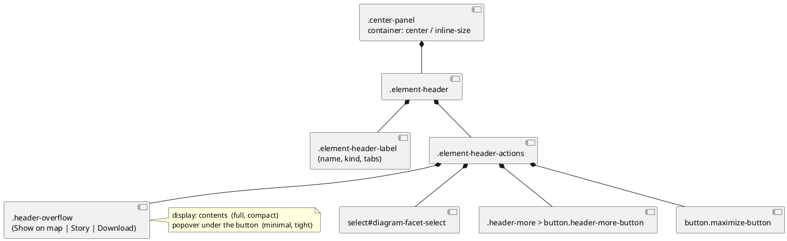

# Editor — the centre header holds together at any width

# Summary

The header of the centre panel of the editor (`.element-header`) is a fixed-height flex row whose controls never shrink;
the diagram headers (Elements on a diagram tab, the Map) carry up to eight controls and, when the panel is narrow, hide
the overflow in a scroll strip that has no scrollbar. This design makes the header answer to the width of the **panel**
(which the user changes by resizing the left panel) with container queries and three states — full, compact (icons
only), minimal (a "⋯" menu) — plus a two-row fallback for the narrowest panels, and removes the hidden-scroll strip.
Scope arrives settled from the wave plan (row W-2), so there is no PRD.

# Scope

In: the header markup of the two diagram headers (`renderElementDiagramHtml`, `renderMapPerspectiveHtml`) and the
`.element-header` CSS in `src/main/resources/editor-webapp/standalone.html`; the "⋯" menu (open/close/Esc/focus); the
tests of `src/test/javascript/viewpoint-kernel/**` that read that markup; one paragraph in the manual.

Out: the story bar over the diagram, the top bar, the diagram toolbar (floating over the canvas), the right and bottom
panels, the headers of Settings/Library/files (they get only the generic two-row fallback), a roving-tabindex `menu`
widget (see DEC-6).

# PRD Traceability

No PRD: traceability is **incomplete by design**. The requirements are the "Scope" and "Verified by" cells of row W-2
of the wave plan, and the user's decisions recorded in the wave's progress log:

- R1. The header holds together whatever the width of the panel (focus of W-2); for the diagram headers, which are the
  ones that overflow; the others get the two-row fallback.
- R2. Container queries on the centre panel, three states: full / compact (icon-only controls keeping `title` and
  `aria-label`) / minimal (the "⋯" menu reusing the `.help-menu` pattern, with Esc, `aria-haspopup`, `aria-expanded`).
- R3. The menu holds Story (`Name view…`, `Add to story…`), Download (PNG/SVG) and "Show on map" / "Open in Elements"
  (the same slot in both perspectives); the Facet select stays visible.
- R4. No `overflow-x: auto` strip left in `.element-header-actions`.
- R5. The TDD decides duplicate-versus-move of the controls and how the focus returns; the existing header tests are
  updated deliberately; DOM-level tests per state.

All five are addressed.

# Technical Goals

- TG-1. A diagram header never overflows its panel and never scrolls inside itself, in any state (R1, R4). The other
  headers (Settings, Library, files, element details/edit) only get the two-row fallback below 46rem.
- TG-2. The state follows the width of the centre panel, not of the window (R2).
- TG-3. One DOM for every state, so that ids, `data-action`s, the download enable state and the focus restoration work
  unchanged (R5).
- TG-4. Looks right in light and dark (the colours are the theme's tokens).

# Non-Goals

- A faster or smarter layout (no ResizeObserver, no JavaScript measuring).
- A different header for the details/edit views of an element (they have few controls).
- Remembering the open state of the menu across visits.

# Assumptions

- ASM-1. Browsers that run the editor support container queries and `:has()` (Chromium 105/Firefox 121/Safari 16;
  the editor already needs the File System Access picker, Chromium only). Validated: the built-in Chromium browser
  pane applied the queries on the replica described under Observability. A browser without them shows the full state at every width
  (the base rules are the full state) — degraded, never broken.
- ASM-2. `.center-panel`'s width is set by the grid (`minmax(0,1fr)` column, `min-w-0`), not by its content, so
  `container-type: inline-size` on it cannot collapse it. Validated by reading `renderShellHtml` and by the replica.
- ASM-3. The width that matters is the **content width** of the panel (what a container query measures): the header
  bleeds over the panel's `1.75rem` side padding but its controls live inside it. Validated in the replica.

# Constraints

- CON-1. Everything lives in the single file `standalone.html`; its base64 kernel block is not touched.
- CON-2. `render()` rebuilds the whole page (`innerHTML`) on each action; whatever must survive (focus, an open menu)
  is restored by existing mechanisms (`headerControlSelector`, `pendingFocusSelector`) or held in module state.
- CON-3. Base `button` rules use `!important` (border, padding, background): any override that must win needs it too and
  a specificity at least as high.
- CON-4. A container query adds no specificity: its rules must come after the base rules they override.
- CON-5. No browser can be driven against the real editor here (File System Access picker); the harness has no layout.

# Current State

`.element-header` (`height: var(--header-h)`, sticky, flex, `justify-content: space-between`) holds
`.element-header-label` (title `h2` with ellipsis, kind badge, `.viewpoint-switch` tabs — `min-width:0` on the label,
the tabs and the badge do not shrink) and `.element-header-actions` (`flex-shrink:0`). The diagram headers add, in
order: Show on map / Open in Elements, the Story group, the Facet select, the Download group, Maximize. Two viewport
`@media` rules hide the Maximize word (`max-width:1250px`) and tighten gaps and padding (`1000px`), and
`.diagram-view .element-header-actions` is `overflow-x:auto; scrollbar-width:none`, which hides controls instead of
showing them. Measured in a browser (replica of the real markup and CSS; 16px root): the Elements-on-a-diagram header
needs about 1229px of content width for its fixed parts (kind badge 83, tabs 277, actions 764 with the Maximize word),
the Map header about 850px.

# Proposed Design

Three states and a fallback, as container queries on `.center-panel` (`container: center / inline-size`) over its
content width. A fixed rule produces the limits: **each limit is the width at which the longest header (Elements on a
diagram) would leave its name less than 8rem** (about 16 characters; measured with a 40-character name, a shorter name
has room to spare, a longer one is cut with an ellipsis, as before).

| State | Content width of the panel | Header |
|-------|---------------------------|--------|
| full | more than 85rem (1360px) | everything, with its words |
| compact | 60rem to 85rem | Show on map / Open in Elements, Name view…, Add to story…, Maximize lose their words and keep the icon (width 2rem, `title`, `aria-label`); gaps and the Facet select tighten; Download keeps its icon and format |
| minimal | 46rem to 60rem | Show on map / Open in Elements, Story and Download are in the menu of a "⋯" button; Facet and Maximize stay |
| tight | up to 46rem | as minimal, and the header takes two rows (label row, actions row), the label wraps its tabs under the name |

One basis for the figures: fixed parts of the Elements-on-a-diagram header + an 8rem (128px) name. Full: 1229 + 128 =
1357px, rounded up to 1360 (85rem). Compact, with the words gone from five controls: about 954px, so 960 (60rem).
Minimal: about 734px, so 736 (46rem). The replica is not kept in the repository (it is a throwaway page built from the
harness markup and the stylesheet); the figures were measured once, in the built-in Chromium browser, with the name of
40 characters.

These are not the 1150/950/700 estimates of the plan: those were estimates of the panel's outer width without the
tabs and the badge; measurement of the real header gives larger figures. See DEC-2.

The diagram says what to verify: `.header-overflow` is a child of the actions row in every state (never moved or
copied); only its `display` changes. Textual fallback: label | actions[Facet, (⋯ + overflow group), Maximize].

## Decisions

- DEC-1 — One DOM for every state ("move" without moving).
  - Decision: the controls that can fall into the menu are rendered **once**, inside `.header-overflow`, which is
    `display: contents` (they are plain items of the actions row) in full and compact, and the positioned popover in
    minimal and tight. Nothing is duplicated and nothing is moved by JavaScript.
  - Rationale: a duplicate (a row copy and a menu copy) would give every `data-action` and `data-format` twice: the
    delegated click handler is fine with it, but `document.querySelector('[data-action="add-to-story"]')` (focus return
    after the dialog, `headerControlSelector`), and `showDiagramScene` (turns
    `[data-action="diagram-export"]` on) would act on a copy that is `display:none`. Moving them with a ResizeObserver would
    make the container query pointless and redraw on every pixel of a drag.
  - Alternatives considered: duplicate in the DOM, hidden by CSS (rejected above); move with JavaScript on resize
    (rejected); render the menu only when open like `.help-menu` (loses the buttons' state, and the menu items would be
    copies).
  - Tradeoffs: the group `.header-overflow` is in the page in every state, including the wide ones where it is just the
    inline row (see DEC-6); the popover is the same buttons restyled, so their styles must be overridden (CON-3), and the markup of
    the wide header gains a wrapper (`display: contents`) and an extra, hidden "⋯" button. Reading order and Tab order are
    the visual order in every state.
  - Linked requirements: R2, R3, R5.
- DEC-2 — Breakpoints by measurement, one set for every diagram header.
  - Decision: 85rem / 60rem / 46rem of content width, from the rule in "Proposed Design", in `rem` so that a larger
    font moves them with it. The Map header (shorter) uses the same limits as Elements, so both perspectives change
    state at the same width and the controls keep the same slot.
  - Rationale: the plan only estimated them; they are answered here with figures. The 8rem floor for the name keeps it
    recognisable (the tooltip of an ellipsis-cut name is not available on the `h2`).
  - Alternatives: the estimates (1150/950/700) leave the name below 8rem for the longest header in two of the three
    states; per-header limits (the Map would stay full longer: it changes layout between perspectives at the same width);
    viewport `@media` (rejected by the user: the panel width depends on the left panel).
  - Tradeoffs: font metrics differ per platform, so the 8rem floor is an approximation; a name shorter than 40 characters
    leaves the header collapsed a little earlier than necessary.
  - Linked requirements: R2.
- DEC-3 — What each state does to which control.
  - Decision: compact applies to `.diagram-view .with-icon` (Show on map, Open in Elements, Name view…, Add to story…,
    Maximize): the `.control-label` span is hidden and the button becomes a 2rem square; the Download buttons keep
    their format text (two identical icons could not tell PNG from SVG). Minimal moves Show on map/Open in Elements,
    the Story group and the Download group into `.header-overflow`; Facet and Maximize stay (decided by the user).
    The details/edit headers of an element are not `.diagram-view`: they never lose a word (they hold a handful of
    controls); at the narrowest widths they only get the generic two-row fallback.
  - Rationale: the compact label is the control's `aria-label` (identical to the visible text, so label-in-name holds)
    and its `title` (unchanged); icons are inline SVG with `aria-hidden`, drawn with `currentColor` so both themes work.
  - Alternatives: hide the Download icons in compact (saves ~40px, the controls are then text-only; kept as a later
    refinement, not needed by the measurements); collapse the Story pair to a single button (it changes the action).
  - Linked requirements: R2, R3.
- DEC-4 — The order of the actions: Facet first.
  - Decision: `Facet, [Show on map | Story | Download], ⋯, Maximize`. Previously the Facet sat between Story and
    Download.
  - Rationale: the controls that fall into the menu must be contiguous for one wrapper to hold them (reading order
    equals visual order; reordering with CSS `order` would split Tab order from the picture). The Facet is a setting of
    the drawing and the other controls are actions on it. "Show on map" stays the first of the *actions*.
  - Alternatives: Facet last before Maximize (Show on map would then lead the row but the "⋯" would sit before the
    Facet in minimal); `order` (accessibility mismatch).
  - Tradeoffs: the Facet moves left by the width of the three groups in the full state. The existing test that asserts
    "Download before Maximize" still holds.
  - Linked requirements: R3.
- DEC-5 — The menu is a popover of the help's pattern, state in a module variable, no re-render.
  - Decision: `headerMenuOpen` (module state) drives `aria-expanded` on `.header-more-button` and `data-open` on
    `.header-overflow`; `setHeaderMenuOpen` changes the two attributes without `render()` (a redraw would lose what the
    user typed and has not committed — the reason `setHelpOpen` gives). It opens with the click (`toggle-header-menu`) and
    closes on Esc (capture listener on `document`, registered like the help's, `stopImmediatePropagation`, so Esc does not also un-maximize the
    diagram), on a click outside, and on a click on an item. The box reuses the `.help-menu` look (position under the
    button, `z-index`, border, shadow) with the theme's tokens. The state is kept in `render()` (the markup is written from
    `headerMenuOpen`), and the header is raised (`:has([data-open="true"])`, `z-index: 5`) above the chips of the Map.
  - Rationale: reuses what the help already settled and tests; consistent with it.
  - Alternatives: `
` or the Popover API (no Esc/focus behaviour consistent with the help; the Popover API
    renders in the top layer, away from `container` queries and the theme root); a menu rendered only while open (DEC-1).
  - Tradeoffs: see DEC-6 for what the button announces.
  - Linked requirements: R2.
- DEC-6 — Accessibility level: a group of buttons, not a `menu`.
  - Decision: the popup is `role="group" aria-label="More actions"` (it is also the wide-state wrapper, where `menu`
    would be wrong); the button is `aria-haspopup="true"`, `aria-controls`, `aria-expanded`, `aria-label="More actions"`.
    Opened from the keyboard (`click` with `detail === 0`), the focus goes to the first enabled control of the popup;
    Esc gives it back to the button.
  - Rationale: a true `role="menu"` needs arrow-key navigation and `menuitem` roles that cannot be switched by a
    container query; Tab through real buttons is accessible and matches the help.
  - Alternatives: switch roles in JavaScript on resize (rejected, DEC-1).
  - Tradeoffs: a screen reader says "menu" for the button (`aria-haspopup="true"`) while the popup is a group of buttons
    navigated with Tab, as the help's `role="dialog"` of links is. In the wide states the group is announced as "More
    actions" around controls that are not "more" at all; the name is kept (an unnamed group is worse) and accepted.
  - Linked requirements: R2.
- DEC-7 — Focus.
  - Decision: (a) a click on an item of the open menu closes it and moves the focus to the "⋯" button *before* the
    action runs, so the dialog of `Name view…`/`Add to story…` records the "⋯" button as its return target
    (`actionSelectorOf` → `[data-action="toggle-header-menu"]`); (b) `headerControlSelector` already finds the "⋯" button
    and any control of the actions row after a redraw; (c) `focusControl(el)` is used for those two restorations: a target
    that is not drawn (a hidden item after a resize, or a closed menu) hands the focus to the "⋯" button when it is on
    screen.
  - Rationale: the focus must land on something visible; returning to a hidden item silently drops it to `<body>`.
  - Alternatives: leave the focus on the item (hidden once the menu closes); keep the menu open during the dialog.
  - Linked requirements: R5.
- DEC-8 — The two-row fallback and the removal of the strip.
  - Decision: `.diagram-view .element-header-actions { overflow-x: auto … }` is deleted (the actions no longer shrink: the
    states make them fit); the two `@media` rules are deleted (their job moved to the container states). Under 46rem
    `.element-header` gets `height: auto; min-height: var(--header-h); flex-wrap: wrap`; the label and the tabs may wrap.
  - Rationale: "holds together whatever the width": below the minimal state there is no more to collapse, so the header
    grows instead of overflowing. The sticky header is slightly taller on very narrow panels only.
  - Linked requirements: R1, R4.

# Repository Impact

- IMP-1 — `src/main/resources/editor-webapp/standalone.html`: CSS (the new header block after `.element-header-actions`;
  the old `@media` and strip rules removed; `.maximize-button` look moved to the generic `.with-icon`); JS
  (`renderDiagramHeaderActionsHtml`, `controlIconHtml`, `CONTROL_ICON_PATHS`, `headerMenuOpen`, `setHeaderMenuOpen`,
  `handleHeaderMenuKeydown`, `focusControl`, the `toggle-header-menu` case and the menu part of `handleAppClick`, the
  buttons of Show on map / Open in Elements / Story gain `with-icon`, `aria-label` and a `control-label` span).
  Change type: modify (additive markup). Risk: CON-3/CON-4 ordering of rules.
- IMP-2 — `src/test/javascript/viewpoint-kernel/diagram.test.js` (the two `maximize-label` assertions and the
  header-parts test), `help.test.js`-style new file `header.test.js` (states, menu, focus, CSS text). Modify and additive.
- IMP-3 — `src/doc/README.adoc`: one paragraph on the header states (outside the run's `likely_paths`; reported).
  Additive.

# Canonical Impact

- CI-arc-1 — None. The repository declares no `arc` register (no `docs/CLAUDE.md`, no `docs/arc`); the change is a
  presentation change inside one file of the editor, with no element or relationship of the architecture involved.
- CI-dom-1 — None. No `dom` register is declared and no domain invariant becomes enforceable: the change touches
  layout and focus only. The user-visible behaviour is described in the manual, which is task T7's (IMP-3).

# Data Model and Contracts

- CTR-1 — Header markup.
  - Current contract: actions row = `[Show on map|Open in Elements] [Story group] [Facet] [Download group] [Maximize]`;
    buttons carry `data-action`, text, `title`.
  - Proposed contract: `[Facet] <span.header-more> button.header-more-button[data-action="toggle-header-menu"]
    div.header-overflow#header-overflow[role=group][data-open] ( [Show on map|Open in Elements] [Story group]
    [Download group] )  [Maximize]`. Buttons with an icon are `.with-icon` with `aria-label`, an `svg`
    (`aria-hidden`) and ``. `data-action`s, `data-ref`, `data-format`, ids, the tab group
    and `viewpoint-switch` are unchanged.
  - Affected files: `standalone.html`, the tests of IMP-2.
  - Compatibility: the details header keeps `renderShowOnMapButtonHtml` (icon + label, no wrapper); the edit form header has no Show on map (as before).
- CTR-2 — URL, storage, kernel input/output, YAML: unchanged.

# Interfaces and Behavior

- IF-1. The "⋯" button is visible only in minimal and tight; it toggles the popup; the popup shows the actions as a
  vertical list (icon + label), the Download group under a "Download" heading (CSS `::before`), separators between groups.
- IF-2. A click on an item runs the action as before (the menu closes first); Esc closes the menu and returns the
  focus to "⋯"; Esc with the menu closed behaves as before (un-maximize).
- IF-3. Opening the help closes the menu (any click outside it does) and vice versa.

# Flows and Processing Logic

- FLOW-1 — Use of an item. Trigger: click "⋯" → `setHeaderMenuOpen(true)` (no redraw) → click `Add to story…` →
  `handleAppClick`: the menu is open and the click is inside it → `setHeaderMenuOpen(false, {focusButton:true})` → the
  action `add-to-story` → `openAppDialog` records `document.activeElement` ("⋯") → dialog → Esc/Cancel/OK →
  `pendingFocusSelector = [data-action="toggle-header-menu"]` → `render()` → `focusControl` focuses "⋯".
  Failure path: the header became wide meanwhile → "⋯" is not drawn → `focusControl` finds no visible fallback and
  focuses the target as is (then nothing is lost beyond the old behaviour).
- FLOW-2 — Resize. The user drags the left panel: the container's width changes, the browser re-evaluates the queries,
  no JavaScript runs. In the wide states the group is the inline row and `data-open` has no visual effect;
  `headerMenuOpen` stays as it was. A leftover `true` is harmless: the Escape handler ignores it (and clears it) when
  the "⋯" button is not drawn, so Escape still un-maximizes; a click elsewhere or a workspace load also clear it.

# Reliability, Performance, and Scalability

No script on resize. `:has()` only raises the header's `z-index`. Container-query evaluation is the browser's.

# Security and Privacy

None: no new input, storage or network. Icons are constants; all text is existing, escaped markup.

# Observability and Verification

- Node tests (`node --test "src/test/javascript/**/*.test.js"`, harness in `harness.js`): markup of every header in
  every perspective (what is in the row, what is in `.header-overflow`, what is not: Facet, Maximize, tabs); one
  copy of each `data-action`; the CSS text per state (the queries, which rules each one carries, order after the base
  rules, no `overflow-x: auto` in `.element-header-actions`, no viewport `@media` on the header); the menu behaviour
  (open/close without render, click outside, Esc, item click, `aria-expanded`, state across render); the focus
  (`focusControl` with a hidden target, return after the dialog).
- Run in a real browser (the Chromium-based built-in pane) on a **replica** of the markup and CSS rendered from the harness, not on
  the editor: widths swept from 240 to 1500px, no overflow and the state boundaries as in the table (see Findings in
  the pln).
- `./mvnw test`, `embed.sh --check`.
- Cannot be confirmed: the real page (File System Access picker), the sticky header over a real diagram and the Map's
  chips, a dragged resize of the panels, touch.

# Deployment and Rollout

Code-only, one file. No data or URL change. Rollback: revert the commit.

# Risks and Tradeoffs

- RISK-1. The 8rem floor is an approximation (fonts); the tooltip of a name cut by an ellipsis is missing (existing).
- RISK-2. A rule order slip (CON-4) silently disables a state: the CSS-text test asserts that the container block follows
  the base `.element-header` rules.
- RISK-3. `container-type` on `.center-panel` makes it a containing block and a stacking context: nothing inside it is
  `position: fixed` (the dialog is outside the panel; checked by grep).

# Open Questions

None open. Answered here: the exact breakpoints (DEC-2) and duplicate-versus-move (DEC-1), the two questions of the
wave plan for W-2.

# Deferred Work

- DEF-1. A real `role="menu"` with arrow-key navigation, if the popup grows beyond a handful of actions.
- DEF-2. A text-only Download in the compact state, if the Facet needs the room.
- DEF-3. A human look at the page in a Chromium browser, at several panel widths, light and dark, including that the "⋯" popover stays inside the panel at the narrowest widths (anchored to the button, `right: 0`, 13rem wide; not swept).

# File Placement and Frontmatter

`docs/wav/wav-004-editor-workspace-experience/run/run-0016-center-header-responsive/tdd-0016-center-header-responsive.md`.
