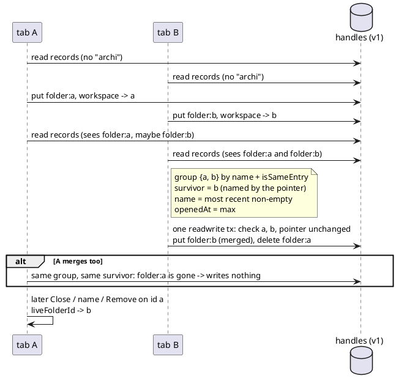

# Editor — the permission state of each remembered folder, and one record per folder

# Summary

Run 0020 gave the standalone editor a list of remembered folders (TDD-0020) and deferred two things: showing, next to
each folder, whether the browser will ask for its permission again (DEF-1), and merging the records two tabs create when
they pick the same folder at the same moment (DEF-2 / RISK-1). This design does both. Each entry of the list says,
without prompting, whether it opens at once, will ask for permission, is blocked, or could not be checked; the states are
queried after the card is drawn, so they never delay the landing. Two records of one folder are merged into one, in one
transaction that checks it still sees what it read, never touches the last-folder pointer, keeps the stored workspace
name and the most recent `openedAt`, and writes nothing when it fails. Scope arrives settled by tmorin/archicode#16
(items 1 and 2) and the wave plan (row W-4); there is no PRD.

# Scope

In: `src/main/resources/editor-webapp/standalone.html` (the IndexedDB helpers of the remembered folders, the folder
flows, the landing card's list and its CSS), `src/test/javascript/viewpoint-kernel/harness.js` (the fake `indexedDB`
serialises its transactions as a browser does), `src/test/javascript/viewpoint-kernel/folders.test.js` (new tests), the
manual paragraph `[[editor-folders]]` of `src/doc/README.adoc`.

Out: the third item of tmorin/archicode#16 (the migration in a real Chromium profile: a human's job); `archicode editor
serve` (no list, unchanged); the Rust kernel and its base64 block; the Java side; synchronising the in-memory list of two
open tabs (a non-goal of run 0020, kept).

# PRD Traceability

No PRD (profile `TDD+pln`): **traceability is incomplete** by construction. The requirements, from tmorin/archicode#16,
the wave plan row W-4 and its Risks, and the dispatch brief (decided upstream, not re-opened here):

- R1 — Each entry of the list shows its permission state without any prompt: granted / will ask for a click / could not
  be queried (e.g. a vanished folder). (#16 item 1, DEF-1 of TDD-0020)
- R2 — It works on the reopen card as on the first-launch card.
- R3 — The state is said in text, not by colour alone.
- R4 — Many stored folders do not slow the landing.
- R5 — Two records of the same folder are merged into one. (#16 item 2, DEF-2 / RISK-1 of TDD-0020)
- R6 — A merge never loses the last-folder pointer (`workspace` record), the stored workspace name, or the `openedAt`
  ordering.
- R7 — A failed merge leaves the records exactly as they were.
- R8 — The TDD decides prevention (Web Locks, `BroadcastChannel`), repair, or both, and says what happens in a browser
  lacking the API (the wave's open question for W-4).
- R9 — The database stays at version 1; the harness's fake `indexedDB` is extended for a race and for permission states;
  the manual's `[[editor-folders]]` is updated.

All nine are addressed (see the Decisions); none is left unresolved.

# Technical Goals

- TG-1 — The list never shows the same folder twice, whatever two tabs did.
- TG-2 — No path loses a remembered folder, its name, or the last-folder pointer; every write is all-or-nothing.
- TG-3 — The landing card is drawn before any permission is queried; the states arrive in one redraw that keeps the
  focus where it was.
- TG-4 — Everything stays testable in Node against the fake (CON-1 of TDD-0020).

# Non-Goals

- No Web Locks and no `BroadcastChannel` (DEC-3 says why).
- No re-query of the states while the card is shown (a permission granted in another tab shows at the next list read).
- No new wording on the reopen card's title, text or buttons (CON-2 of TDD-0020 holds).
- No change of how a folder opens: the click on an entry still asks the permission (`requestPermission`, A-4 of
  TDD-0020).

# Assumptions

- ASM-1 — `FileSystemHandle.queryPermission({ mode: 'read' })` needs no user activation and shows no prompt (the File
  System Access spec; Chromium since 86). The page already relies on it on load (`tryAutoReopen`).
- ASM-2 — It resolves `'granted'`, `'prompt'` or `'denied'`. Whether it rejects (and with which error) for a directory
  moved or deleted since its handle was stored is **not verified**: Chromium may well answer `'prompt'` or `'granted'`
  for it, the failure then showing on the click (as today). The design treats any rejection as "could not be checked",
  and a `NotFoundError` as "could not be reached".
- ASM-3 — Two handles of the same directory have the same `name` (the name of the directory when the handle was made).
  A handle on a directory renamed since no longer reaches it (Chromium's handles are path-based), so it is not "the same
  live folder" either. Used to compare only records of equal `handle.name` (DEC-4), so `isSameEntry` runs almost never.
- ASM-4 — IndexedDB runs `readwrite` transactions on the same store one after the other, in creation order, and a
  transaction sees what every transaction that committed before it started wrote (IndexedDB spec, "transaction
  scheduling"). So a check made inside a `readwrite` transaction holds until it commits. Assumed of a real browser and
  now modelled by the fake (IMP-3).
- ASM-5 — Transitivity of `isSameEntry`: two handles found the same as a third are the same as each other.

# Constraints

- CON-1 — Database `archicode-standalone-editor` **version 1**, store `handles`, record layout of TDD-0020 CTR-1: no
  upgrade (older tabs hold connections, older copies of the page must still open it).
- CON-2 — No `await` of anything but IndexedDB inside a transaction (it auto-commits): `isSameEntry` and
  `queryPermission` run between transactions (CON-3 of TDD-0020).
- CON-3 — The page runs in Node's `vm` for the tests: no `navigator.locks`, no `crypto`, no real DOM focus.
- CON-4 — The base64 kernel block is not touched; no Rust change.
- CON-5 — Older copies of the page (0.10.0, a saved `standalone.html`) keep writing records the old way and take no
  lock; a remedy has to cope with what they write.

# Current State

- The list is read by `readRememberedFolders()` (`tryAutoReopen` on load, `refreshRememberedFolders` after Close and
  "Remembered folders"); each entry is `{ id, handle, name, openedAt, legacy?, problem? }` in `rememberedFolders`.
- `rememberFolder(handle, known)` (picker, list, reopen card) reads the records, looks for the same folder with
  `isSameEntry` (unless `known` has an id), then writes the folder record and the pointer in a second transaction. Two
  tabs picking the same folder at once both read "not remembered" and both add a record (RISK-1 of TDD-0020). With a
  `known` id whose record is gone, it writes the record back.
- The list does not de-duplicate: a duplicate shows as two rows, each removable.
- `tryAutoReopen` queries the permission of the last folder only, to decide whether to open it. The rows show a
  `problem` line (red) once a click failed; nothing says beforehand what a click will do.
- `noteWorkspaceName`, `clearLastFolder` (Close) and `forgetRememberedFolder` (Remove) act on the `id` the page holds.
  An id whose record another tab removed or merged makes them do nothing (the name is not noted, the pointer not
  cleared, the folder not forgotten).
- The fake `indexedDB` of the harness snapshots the store when a transaction is created and lets two `readwrite`
  transactions run interleaved, each blind to the other: unlike a browser (ASM-4).

# Proposed Design

## DEC-1 — The permission state of each entry, queried after the card is drawn

- Decision: every entry read from storage gets a `permission` field, one of `granted`, `prompt`, `denied`,
  `unreachable` (`queryPermission` threw a `NotFoundError`) or `unknown` (any other throw, or no `queryPermission` on
  the handle); absent while not yet queried. `checkFolderPermissions()` queries, in parallel (`Promise.all`), every entry
  of `rememberedFolders` without one, then redraws the landing card once if it still shows the list. It runs after each
  list read that is shown: `tryAutoReopen` (after the first draw of the first-launch or reopen card), `closeFolder` and
  `showRememberedFolders` (after their redraw). `folderPermissionOf(handle)` maps the answer (never rejects). The last
  folder of `tryAutoReopen` gets its state from the same function, which decides whether it opens (`granted` only) and is
  kept as its state in the list (no second query). A failed query on load is therefore said by the state line, no longer
  by a `problem` line (which run 0020 set for a `NotFoundError`): the problem line is for a click that failed. An entry
  created by `rememberFolder` is not queried: the list is read again from storage before it is shown. What precedes the
  first draw is only the list read, which merges records (DEC-5) only when duplicates exist.
- Rationale: R1/R4 — the card is drawn first, so a slow or numerous query never delays it; the queries run in parallel
  and one redraw shows all states instead of one per entry; `queryPermission` needs no gesture (ASM-1).
- Alternatives considered: query before the first draw (delays the landing by the slowest query: rejected by R4); one
  redraw per answer (as many redraws as folders, each moving the screen reader's view); a DOM patch of the row instead of
  a redraw (the page draws everything from state with `innerHTML`; a second way of updating the card for one field is
  not worth it).
- Tradeoffs: the rows grow by one line a few milliseconds after the card is drawn (a small layout shift). A state may be
  stale once shown (another tab granted it): it is re-queried at the next list read.
- Linked IDs: R1, R2, R4.

## DEC-2 — How a state is shown

- Decision: inside each Open button, under the names, a third line `">` (`<i>` the index of the row, since a legacy entry's id is '') with
  an icon (`aria-hidden`) and a sentence; the Open button gets `aria-describedby` on that line only when it exists, so its
  accessible name (unchanged, `Open “Shop” (folder archi)`) is followed by the state. Sentences
  (`FOLDER_PERMISSION_TEXT`, CTR-2): `granted` → "Opens without asking"; `prompt` → "Will ask for permission";
  `denied` → "Blocked by the browser"; `unreachable` → "Could not be reached"; `unknown` → "Could not be checked"
  (short enough to hold on one line in the Open button at the card's width: longer sentences wrapped on every row of
  the replica). The line is muted text (`var(--muted)`) whatever the
  state: the words carry the meaning, the colour none (R3). A row whose `problem` is set (a click failed, TDD-0020 DEC-6)
  shows the problem line instead of the state: it is the more recent and more specific fact, and it becomes the button's
  description (`id="landing-folder-problem-<i>"`). The redraw keeps the focus on the control of the card that had it, a
  button or the Documentation link (`landingControlSelector`, the pattern of `headerControlSelector`); when no control
  of the card had it, the redraw leaves the focus alone instead of giving it to the primary button; and the list keeps
  its `scrollTop`.
- Rationale: inside the button because the state says what a click on that button will do; `aria-describedby` because
  the button's name comes from its `aria-label`, which hides its content from assistive technology.
- Alternatives considered: colour dots (fails R3 alone); folding the state into the `aria-label` (the name would change
  under the user's focus at the redraw, and the label would get long); a line outside the button (separated from what it
  qualifies, and on a narrow card it falls under Remove).
- Tradeoffs: no state shown while it is unknown yet (rather than a "checking…" line that flickers away).
- Linked IDs: R1, R2, R3.

## DEC-3 — Repair after the fact; no Web Locks, no `BroadcastChannel` (the wave's open question for W-4)

- Decision: duplicates are **repaired**, not prevented: merged when the list is read (`readRememberedFolders`) and right
  after a folder was remembered (`rememberFolder`, i.e. picked, opened from the list or reopened). No lock and no channel.
- Rationale: a repair is needed whatever else is done — older copies of the page take no lock (CON-5), duplicates
  written by 0.10.0 are already stored, and a browser without the API needs one — and, made at those two points, it is
  enough: (a) the list is merged before it is shown, so no duplicate is ever listed; (b) of two tabs racing, the one whose
  write commits second reads after it, sees both records (ASM-4) and merges them, so storage holds the duplicate until
  that post-write merge, at the latest until the next list read when it fails. A lock would only narrow a window that is already invisible, and would add a
  cross-tab dependency (a tab stuck inside the lock, e.g. on a slow `isSameEntry`, delays every other tab's open), a
  fallback path for its absence, and no help against 0.10.0 tabs. A `BroadcastChannel` addresses something else (the
  in-memory list of an open tab), a non-goal kept from TDD-0020.
- Alternatives considered: Web Locks around `rememberFolder` (`navigator.locks.request`; in every Chromium that has the
  File System Access API, absent in the test sandbox) — prevention only between new tabs; Web Locks plus repair — the
  same result with more moving parts; repair on read only — enough for the list, but leaves the duplicate in storage
  until the next read, and the wave asks that "a race produces one record".
- Tradeoffs: one more read transaction per open after the write (the post-write check), and one before it for an entry
  of the list (the check that its record is still there, DEC-6); a merge transaction only when duplicates exist. A tab
  that holds the id of a record merged away must not act on that dead id: DEC-6.
- Linked IDs: R5, R8.

## DEC-4 — Which records are the same folder

- Decision: `groupSameFolders(folders)` puts in one group the folder records whose handles are the same entry: only
  records with the same `handle.name` are compared (ASM-3), each with the first record of each group already formed for
  that name (ASM-5), by `isSameEntry`; a comparison that throws counts as "not the same" (as `findSameFolder` does). Run
  between transactions (CON-2).
- Rationale: with distinct names (the usual case) no `isSameEntry` call at all, so R4 holds however many folders there
  are; a throw must never merge two folders, since a merge deletes records.
- Alternatives considered: `isSameEntry` on every pair (n² asynchronous calls on every list read).
- Linked IDs: R4, R5.

## DEC-5 — The merge: one transaction, checked, never touching the pointer

- Decision: for each group of two or more, `mergeSameFolder(group, lastRecord)`:
  1. The survivor is the record the `workspace` pointer names, if it is in the group; else the most recently opened
     (highest `openedAt`; equal: the smallest id, so two tabs choose the same one).
  2. The merged record keeps the survivor's `id` and `handle`, takes the highest `openedAt` of the group, and the `name`
     of the most recently opened record that has a non-empty one ('' only when none has a name).
  3. In **one** `readwrite` transaction: read the pointer and every record of the group again; if any record is gone or
     no longer has the `name` and `openedAt` that were read, or the pointer now names a record of the group other than
     the survivor, **nothing is written** and the merge is reported failed. Otherwise `put` the merged record (only if it
     differs from the survivor's) and `delete` the others.
  The merge never writes the `workspace` record: when the pointer names a record of the group, that record is the
  survivor, so the pointer stays valid as it is (R6).
- Rationale: R6 — the pointer is untouched by construction, the name kept is a stored one (a non-empty name is never
  dropped in favour of an empty one from a record that was merely opened before its name was noted, which is exactly the
  race's state), `openedAt` keeps the group's place in the list. R7 — one transaction; the in-transaction check holds
  until commit (ASM-4); the `put` runs in a request's `onsuccess`, where a `DataCloneError` it throws aborts the
  transaction (IndexedDB: an exception in a request handler aborts it) and `withArchicodeStore` rejects on `onabort`; an
  asynchronous failure aborts it too; an aborted transaction keeps nothing. The survivor's record is rewritten from what
  the transaction read (`Object.assign` of the stored record), so a field this page does not know is kept. Two tabs merging the
  same group at once choose the same survivor; the second finds a record gone and writes nothing.
- Alternatives considered: keep the oldest id (would move the pointer when it names a newer one, i.e. a write to the
  `workspace` record, the one record a failure must never lose); the name of the most recent record even when empty (it
  loses a stored name when a record is merged before its name was noted); one transaction for every group (one changed
  group would cancel the merge of the others).
- Tradeoffs: a name deliberately emptied in Settings, in one record, while a duplicate still holds the old name, comes
  back as the old name until the folder is opened again (the name is refreshed on each open, TDD-0020 DEC-4). Rare (two
  records of one folder and a name emptied in between), and nothing is lost.
- Linked IDs: R5, R6, R7.

## DEC-6 — A failed or skipped merge, and ids that no longer exist

- Decision:
  - A group whose merge failed (or was skipped because something changed) is still **one row**: the entry of the
    survivor with the merged name and `openedAt`, plus `others` (the ids of the other records). Open uses the survivor;
    Remove deletes the survivor and the `others` in its one transaction, and the `workspace` record when it names any of
    them; Close clears the pointer under the same rule (`clearLastFolder(id, others)`). Otherwise a pointer left on one
    of the `others` would be migrated again on the next load and bring the folder back. A pointer naming one of the
    `others` makes that row the last folder. The next read tries the merge again.
  - `liveFolderId(handle, id)` gives the id under which a folder is stored now: `id` if its record exists, else the id
    of the record that is the same folder (`findSameFolder`, where a throw of `isSameEntry` never counts as the same),
    else null. It is used where the page acts on an id it may hold from before a merge done by another tab:
    `noteWorkspaceName` when the record of its id is gone, `closeFolder` (clears the pointer of the live id; a folder
    removed meanwhile in another tab is not remembered again), and Remove (forgets the live id). `rememberFolder` with a
    `known` entry uses the id only while its record is in the records it read (else the same folder by `isSameEntry`):
    a record merged away between that read and its write can still be written back, and is then merged again by the
    post-write merge, the pointer making it the survivor.
  - `mergeDuplicateFolders`, called by `readRememberedFolders` and `rememberFolder`, returns `merged: Map<id, id of the
    row>` for every record not kept as a row's id, `others` included; the in-memory list and the `problem` lines kept by
    `refreshRememberedFolders` follow it, and `rememberFolder`'s caller takes the id it returns as the page's folder id.
  - Older tabs (CON-5). A 0.10.0 tab that opens a folder from a list read before a merge writes back the merged-away
    record and points at it: the next merge keeps that record (the pointer names it) and deletes the other one, the
    stored name kept by DEC-5's rule. A 0.10.0 tab migrating a pointer onto a record merged away leaves `workspace`
    naming no record: the next read migrates it again (TDD-0020 DEC-2) onto the record of the same folder, adding none.
    Its Close, Remove and name updates on a dead id do nothing, as in 0.10.0; the next list read shows the folder again.
- Rationale: TG-1 even when storage could not be repaired; TG-2 for every action of a tab that read the list before
  another tab merged it.
- Alternatives considered: list both rows when a merge fails (the duplicate R5 is about, shown again); retry the merge
  in a loop (a persistent failure — no room left — would loop).
- Linked IDs: R5, R6, R7.

## DEC-7 — The fake `indexedDB` schedules transactions as a browser does

- Decision: in `harness.js`, a transaction starts (takes its view of the store, runs its requests) only when no earlier
  unfinished transaction of the same database (whatever its connection: every page, every tab of a test, opens its own)
  on the same store conflicts with it (one of the two is `readwrite`); it commits its writes before the next one starts.
  A `holdCommit({ mode, keys })` option (`keys` the keys the transaction wrote) returns a promise that delays the commit,
  so a test can hold a tab at a chosen point; a `queryPermission` per handle is already settable by the tests
  (`handleOn`).
- Rationale: R9 — the merge's in-transaction check is only meaningful against a store that serialises `readwrite`
  transactions (ASM-4); the old fake let two such transactions run blind to each other, which a browser never does.
- Alternatives considered: keep the fake as it is (the race test would still pass, but on semantics no browser has).
- Linked IDs: R9.

The reviewer should check that every path of two new tabs ends with one record and the pointer naming it (older tabs:
DEC-6); that the merge never writes
`workspace`; that a merge which finds anything changed writes nothing; and that tab A's later actions go through
`liveFolderId` rather than its dead id. Textual fallback: both tabs write; the second writer's post-write read sees both
records and merges them onto the one the pointer names; a concurrent merge finds a record gone and does nothing.

# Repository Impact

- IMP-1 — IndexedDB helpers
  - Path(s): `src/main/resources/editor-webapp/standalone.html` (JS, section "IndexedDB: the remembered folders").
  - Change type: modify + additive.
  - Why impacted: `isSameFolder`, `groupSameFolders`, `mergedFolderOf`, `mergeSameFolder`, `mergeDuplicateFolders`,
    `liveFolderId`, `storeWorkspaceName` (new); `readRememberedFolders` (merges before migrating, finds the last folder
    among `others` too, returns `merged`), `rememberFolder` (checks a known id, merges after its write),
    `noteWorkspaceName` (follows a merged id), `forgetRememberedFolder(entry, ids)` and `clearLastFolder(id, others)`
    (several ids).
  - Linked IDs: R5-R7.
  - Risks / notes: `hard_judgment` (deletes records). Migration (TDD-0020 DEC-2) runs after the merge, on the merged
    list.
- IMP-2 — Folder flows and permission states
  - Path(s): same file: `tryAutoReopen`, `closeFolder`, `showRememberedFolders`, `refreshRememberedFolders`,
    `forgetFolder`, new `folderPermissionOf`, `checkFolderPermissions`, `landingControlSelector`; `render()` keeps the
    focus of a landing control across the redraw.
  - Change type: modify + additive.
  - Linked IDs: R1, R2, R4, R6.
- IMP-3 — Landing card
  - Path(s): same file: `landingFolderRows` (adds `permission`), `renderLandingFoldersHtml` (state line,
    `aria-describedby`), CSS `.landing-folder-state`.
  - Change type: modify + additive.
  - Linked IDs: R1-R3.
- IMP-4 — Harness
  - Path(s): `src/test/javascript/viewpoint-kernel/harness.js`.
  - Change type: modify (transaction scheduling, `holdCommit`).
  - Risks / notes: every test that uses the fake runs on the new scheduling; the existing ones must pass unchanged.
- IMP-5 — Tests
  - Path(s): `src/test/javascript/viewpoint-kernel/folders.test.js`.
  - Change type: additive.
- IMP-6 — Manual
  - Path(s): `src/doc/README.adoc`, paragraph `[[editor-folders]]`.
  - Change type: modify.

# Canonical Impact

- CI-arc-1 — Not applicable — no canonical registers declared (no `docs/CLAUDE.md`, no `docs/arc`). The change is
  browser-side memory of one file of the editor; no architecture element changes.
- CI-dom-1 — Not applicable — no `dom` register declared; no invariant of the model, the manifests or the kernel changes.

# Data Model and Contracts

- CTR-1 — IndexedDB records
  - Current contract: TDD-0020 CTR-1 (`workspace` → `{ handle, id }`; `folder:<id>` → `{ kind, id, handle, name,
    openedAt }`).
  - Proposed contract: unchanged layout. New invariant: at most one `folder:` record per directory once a list read or
    a remember has settled; the `workspace` record is never written by a merge.
  - Affected files: `standalone.html`.
  - Migration or compatibility notes: version 1 kept; an older page reads the same records (a merge only deletes
    duplicates and rewrites one folder record with the same shape).
  - Linked IDs: R5-R7, R9.
- CTR-2 — `landingFolderRows()`
  - Current contract: `[{ id, title, folder, problem }]`.
  - Proposed contract: `[{ id, title, folder, problem, permission }]`, `permission` one of `granted`, `prompt`,
    `denied`, `unreachable`, `unknown`, or null (not known yet). The sentence of each is `FOLDER_PERMISSION_TEXT[permission]`.
  - Affected files: `standalone.html`, `folders.test.js`.
  - Linked IDs: R1-R3.
- CTR-3 — In-memory entry (`rememberedFolders`)
  - Proposed contract: `{ id, handle, name, openedAt, legacy?, problem?, permission?, others? }`.

# Interfaces and Behavior

- IF-1 — A row of the list: the Open button holds the title, the folder name when it differs, and (once known, no
  problem line) the state line; its accessible description is the state. Remove unchanged.
- IF-2 — Reopen card: the same rows, the last folder's from the answer `tryAutoReopen` already had.
- IF-3 — No visible change of the list when two tabs raced: one row.

# Flows and Processing Logic

- FLOW-1 — Landing with the list
  - Trigger: load (no folder to open directly), Close folder, "Remembered folders".
  - Steps: `readRememberedFolders` (read → group → merge each group → migrate the pointer) → draw the card →
    `checkFolderPermissions` (parallel queries) → redraw if still on the list, keeping the focus.
  - Branches / failure paths: a merge that fails or is skipped → one row with `others`; a query that throws → `unknown` /
    `unreachable`; the card left meanwhile (a folder opened) → no redraw.
  - Final output: the list, one row per folder, each with its state.
- FLOW-2 — Remember (picker, list, reopen)
  - Steps: read → the live entry (`known` id still stored, else `isSameEntry`) → write record + pointer → read again →
    merge → the entry kept (the survivor) is the page's folder id.
  - Branches / failure paths: write fails → the folder opens unremembered (TDD-0020 DEC-3); merge fails → logged, the
    next read retries.
- FLOW-3 — Close / Remove / name from a tab whose id was merged away
  - Steps: `liveFolderId` → act on the live id; none (removed meanwhile) → nothing to clear, nothing to forget, name not
    stored.

# Reliability, Performance, and Scalability

The card is drawn before any query; the queries run in parallel and redraw once. Grouping compares only equal names, so
a list of distinct folders costs no `isSameEntry`; a group costs one comparison per member. A merge is one transaction
per group. A remember costs one more read transaction than before.

# Security and Privacy

Nothing leaves the browser. `queryPermission` shows nothing and grants nothing. A merge deletes only records of the same
directory (checked by `isSameEntry`, a throw never counting as the same); nothing on disk is touched.

# Observability and Verification

- Node tests (`folders.test.js`) with the fake: a state per entry without any `requestPermission` call (granted, prompt,
  denied, a throw, a `NotFoundError`), on the first-launch and the reopen card, in the markup with `aria-describedby`;
  the card drawn before the queries answer, all queries made at once; the focus and the list's scroll kept across the
  redraw, the focus left alone when it was not on the card; a problem line replacing the state; two pages racing to pick
  the same folder end with one record, the pointer naming it, the name kept; stored duplicates merged on load with the
  pointer, the non-empty name and the highest `openedAt`, a folder of the same name never merged; a merge whose `put`
  fails (async, and `DataCloneError`) or whose records changed meanwhile, or whose pointer moved to another record,
  leaves the store exactly as it was and shows one row whose Remove deletes all its records and the pointer; a pointer an
  older tab left on a merged-away record is migrated onto its folder's record; a tab holding a merged-away id closes,
  notes the name, opens and removes through the live id; the fake runs two `readwrite` transactions one after the other.
- `node --test "src/test/javascript/**/*.test.js"` (baseline 372, checked before this run's changes),
  `./mvnw test` with JDK 25 (baseline 111), `src/main/rust/viewpoint-kernel/embed.sh --check`.
- The list on a replica (real stylesheet, markup of `renderLandingHtml`) in the built-in browser, light and dark. Not
  confirmable here: a real IndexedDB, a real `queryPermission` on a vanished folder (ASM-2), a real permission prompt,
  two real tabs.

# Deployment and Rollout

Code-only change of the editor page, shipped with the next release. No database upgrade; a profile holding duplicates
written by 0.10.0 is repaired on its first list read. Rollback: the previous page reads the same records.

# Risks and Tradeoffs

- RISK-1 — ASM-3 wrong (two live handles of one directory with different names): such a duplicate is not merged; it
  shows as two rows, as today. No loss.
- RISK-2 — DEC-5's name rule can bring back a name emptied in one duplicate (see DEC-5 Tradeoffs). No loss.
- RISK-3 — The fake is not a browser: its scheduling follows the spec (ASM-4), but two real tabs are not exercised here.
- RISK-4 — An `isSameEntry` that wrongly answers true would merge two folders (deleting one record). Mitigated by the
  name prefilter (two different names are never merged) and the throw rule; the API is the browser's own identity test.

# Open Questions

None. The wave's open question for W-4 is answered by DEC-3 (repair, no prevention).

# Deferred Work

- DEF-1 — Re-query the states when the tab becomes visible again (`visibilitychange`), for a permission granted in
  another tab while the card is shown. Not asked; the next list read shows it.
- DEF-2 — Trying the merge and the states with two real Chromium tabs and a real vanished folder (with the third item of
  tmorin/archicode#16, left to a human).

# File Placement and Frontmatter

`docs/wav/wav-005-follow-ups-and-field-check/run/run-0023-remembered-folders-followups/tdd-0023-remembered-folders-followups.md`,
`run: 0023`, `wave: 005`.
