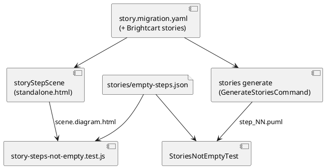

# The story `migration` plays a slide with content at step 3

# Summary

Step 3 of the story `migration` of the example `domain_plateaus` ("The inventory moved to the warehouse.") draws the `overview` viewpoint of `warehouse` in the plateau `to-be`. The overview of an element draws its direct relationships; `warehouse` has none (its container `picking` points at `shop.inventory` in `baseline`, and that relationship is declared on the container, inside the system), so the diagram is one box and no link, and the player says "Nothing to show" (#167). The design changes the viewpoint of that step to `detailed`, which draws the containers inside the system and the link between them, and adds a test that no step of any shipped story is a diagram with nothing to draw unless a file says so with a reason.

No PRD exists for this run (profile TDD+pln): the requirement is the manifest entry W-2 of the wave and the text of #167. Traceability to PRD identifiers is therefore not possible; the sourced requirements are named `REQ-1` to `REQ-3` below and are assumptions about intent only where marked.

# Scope

In scope: `src/doc/examples/domain_plateaus/plateaus/story.migration.yaml`; every test and sentence of the manual that depends on the folder or the words of step 3; one invariant test over the four shipped stories (`migration`, and `fork_tour`, `order_journey`, `seller_journey` of the layered Brightcart).

Out of scope: the player, the diagram code, the kernel, the other steps of `migration`, the stories of the Brightcart fixture unless the invariant finds one empty (see Q-1).

# PRD Traceability

- Source: none (TDD+pln profile). Sources used: wave manifest W-2 (`wav-024-fixes-and-editor-modules.md`, phase P1) and issue #167.
- `REQ-1` (W-2 scope): step 3 of `migration` plays a slide with something on it. Addressed by DEC-1.
- `REQ-2` (W-2 scope): every place the manual quotes the example is updated. Addressed by DEC-1 and IMP-3.
- `REQ-3` (W-2 exit evidence): a test that every step of every shipped story draws at least one element or is stated empty on purpose; the unit and Java suites pass. Addressed by DEC-2, IMP-4, IMP-5.
- Unresolved: none. Traceability is incomplete in the sense of the skill: these requirements are not PRD requirements.

# Technical Goals

- TG-1: step 3 of `migration` draws at least two boxes and one link, in the editor's player and in `archicode stories generate`.
- TG-2: the manual's quotation of the story and of its output folders is true.
- TG-3: a future story step that draws nothing fails a test, in both tools, from one list of exceptions.

# Non-Goals

- Changing how the editor words an empty diagram.
- Rewriting the text of the step ("The inventory moved to the warehouse." stays true and still fits).
- Auditing the stories beyond what the invariant finds.

# Assumptions

- ASM-1: the content change belongs in the example, as the issue says ("not a code defect"). Validated: the editor's `diagramHasNothingToDraw` (no non-secondary link and at most one item) is the intended rule for "Nothing to show".
- ASM-2: the `detailed` viewpoint of `warehouse` in `to-be` draws `warehouse.inventory`, `warehouse.picking` and the link "counts with". Validated by running `archicode stories generate` on a copy of the example with the change: `03-detailed/.../step_03.puml` holds the two containers in a composite `warehouse` and `warehouse.picking --> warehouse.inventory : counts with`.
- ASM-3: the three Brightcart stories draw something at every step. Not validated: a first count of `-->` lines in the generated files found steps with none (for instance `fork_tour` steps 2 and 6) that still draw 10 or 11 boxes, which the editor does not call empty. The test uses the editor's rule, not a link count (DEC-2).

# Constraints

- CON-1: the example is quoted by the manual (`src/doc/README.adoc` includes `story.migration.yaml` with `include::`, so the YAML follows; the prose around it does not).
- CON-2: every shipped file is loaded by both tools in a test; both must keep passing (`ShippedFilesTest`, `shipped-files.test.js`).
- CON-3: the folder of a step is `<NN>-<view or viewpoint>`: a changed viewpoint renames the folder (`03-overview` becomes `03-detailed`).
- CON-4: the tests run under the Native job's rules where they are `*IT`; no change to resources of the native image is needed.
- CON-5: nothing in `src/main` changes; no kernel contract moves.

# Current State

- `story.migration.yaml` step 3: `viewpoint: "overview"`, `element: "warehouse"`, `at: "to-be"`.
- `warehouse.yaml` (baseline) declares the system `warehouse` and its container `picking`, whose relationship goes to `shop.inventory`; in `to-be`, `inventory.yaml` declares `warehouse.inventory` (with `replaces: shop.inventory`) and a patch adds `warehouse.picking -> warehouse.inventory`. The system has no relationship of its own.
- Dependent places found by search: `StoriesGenerateIT.migrationIsDrawnWithoutAnOption` (`<step>-overview/.../step_<step>.puml` for the four steps); `GenerateStoriesTest.theManualsMigrationIsDrawnAtItsPlateausAndAgainstBaseline` (`03-overview`); `src/test/e2e/story-player.spec.js` line 82 (`'Overview of warehouse'`, the status line starts with the label of the viewpoint, `DIAGRAM_VIEWPOINTS.detailed.label` is `Detailed`); `src/doc/README.adoc` around line 2425 (`01-overview/` to `04-overview/` and the sentence on `02-overview` and `04-overview`). The node tests (`story-steps-plateaus.test.js`, `story-player-scene.test.js`, `story-player-page.js`) read the story by its steps and compare the player with the editing walk; they do not name the viewpoint of step 3.
- `story-player-scene.test.js` asserts only that something is drawn in some step (`drawnBoxes > 0`), which is how an empty step went unseen.

# Proposed Design

DEC-1 — Change step 3 to the `detailed` viewpoint
- Decision: in `story.migration.yaml`, step 3 gets `viewpoint: "detailed"`; nothing else in the step changes.
- Rationale: the story says the inventory moved to the warehouse; the point is shown by the warehouse holding the inventory and the picking that counts with it, which is the content of the system, not its outside. It is the one-word change the issue suggests, it leaves `to-be` as the plateau of the step, and it changes no relationship in the example, so the tables of `diff` and the other views the manual quotes do not move.
- Alternatives considered: `deep` (same boxes here, different meaning, heavier for a story); a step on `warehouse.inventory` with `overview` (draws the link to `warehouse.picking`, but one box less of context and the folder name stays `overview`, hiding the change); adding a relationship to `warehouse` (changes the model to fix a view).
- Tradeoffs: the folder and the slide title change words (`03-detailed`, "Detailed of warehouse"), touching the places in IMP-2 and IMP-3.
- Linked requirement IDs: REQ-1, REQ-2.

DEC-2 — The invariant is the editor's rule, one list of exceptions for both tools
- Decision: a step is empty when its diagram has no non-secondary link and at most one item (`diagramHasNothingToDraw`). The node test asserts, for each step of each shipped story that has no `problem`, that the scene's diagram html does not hold `diagram-empty`; the Java test asserts the same on the generated file (at least one link, or at least two element rectangles). A step may be empty on purpose if `src/test/resources/stories/empty-steps.json` lists it as `{ "story", "step", "reason" }`; the list is empty after this run and a listed step that is not empty fails (as `known-traces.json` does).
- Rationale: the page already defines "Nothing to show"; testing the same rule in the player's scene keeps the invariant what the reader sees. A shared file keeps "on purpose" in one place and forces a reason, as the wave's exit evidence asks.
- Alternatives considered: only the node test (the command line could draw an empty file unseen); counting `-->` in puml (wrong for steps that draw boxes without links, ASM-3); a field in the story YAML to mark a step as empty on purpose (changes the manifest schema, golden files, guide, out of proportion).
- Tradeoffs: the Java rule (a link or two boxes) is an approximation of the page's rule; it can pass a diagram the page calls empty only if two boxes exist with no link, which `diagramHasNothingToDraw` does not call empty either (it allows more than one item), so the two agree.
- Linked requirement IDs: REQ-3.

The reviewer validates that both tests read the same exceptions file and the same four stories, and that the editor's rule is the one used by the node test.

# Repository Impact

- IMP-1 — Example story
  - Path(s): `src/doc/examples/domain_plateaus/plateaus/story.migration.yaml`
  - Change type: modify
  - Why impacted: step 3 viewpoint.
  - Linked requirement IDs: REQ-1
  - Risks / notes: the file is `include::`d by the manual, so the quoted block follows by itself.
- IMP-2 — Tests naming step 3
  - Path(s): `src/test/java/io/morin/archicode/cli/GenerateStoriesTest.java` (`03-overview` in the list of folders), `src/test/java/io/morin/archicode/it/StoriesGenerateIT.java` (`migrationIsDrawnWithoutAnOption`: the folder of step 3 is `03-detailed`), `src/test/e2e/story-player.spec.js` (line 82: the status line says `Detailed of warehouse`).
  - Change type: modify
  - Why impacted: the folder name and the label follow the viewpoint (CON-3).
  - Linked requirement IDs: REQ-2
  - Risks / notes: read the exact status text in the e2e run before fixing the string; the e2e needs `./mvnw package` first.
- IMP-3 — Manual
  - Path(s): `src/doc/README.adoc` (the paragraph at about line 2425 that lists `01-overview/` to `04-overview/`; the story paragraph at about line 1428 says "four steps" and needs no change; any other quotation found by `grep -n "overview" ` near `migration` and `domain_plateaus`)
  - Change type: modify
  - Why impacted: it names the folders the command writes.
  - Linked requirement IDs: REQ-2
  - Risks / notes: the manual is built by `./mvnw verify`; the sentence "`02-overview` and `04-overview` have the two files" stays true.
- IMP-4 — Node invariant
  - Path(s): `src/test/javascript/viewpoint-kernel/story-steps-not-empty.test.js` (new; loads the four shipped stories with the same helpers as `story-player-scene.test.js`).
  - Change type: additive
  - Why impacted: DEC-2.
  - Linked requirement IDs: REQ-3
  - Risks / notes: loading the page costs seconds per workspace; it reuses one page per workspace like its neighbour. The new file is covered by `node --test` glob and the coverage script without change.
- IMP-5 — Java invariant and exceptions file
  - Path(s): `src/test/java/io/morin/archicode/doc/StoriesNotEmptyTest.java` (new), `src/test/resources/stories/empty-steps.json` (new, `[]`).
  - Change type: additive
  - Why impacted: DEC-2.
  - Linked requirement IDs: REQ-3
  - Risks / notes: draws the Brightcart stories per plateau (`--plateau saas` and `marketplace`, as `StoriesGenerateIT` does), so it costs the load of two plateaus; PMD runs on the test, and a new test class follows T10 (asserts what is drawn).
- IMP-6 — CLAUDE.md
  - Path(s): `CLAUDE.md`
  - Change type: modify
  - Why impacted: the paragraph on the shipped stories gets one sentence on the invariant and the exceptions file.
  - Linked requirement IDs: REQ-3

# Canonical Impact

Not applicable — no canonical registers declared (there is no `docs/CLAUDE.md` and no `arc` or `dom` register in this repository).

# Data Model and Contracts

- CTR-1 — Exceptions file `src/test/resources/stories/empty-steps.json`
  - Current contract: none.
  - Proposed contract: a JSON array of `{ "story": string, "step": integer from 1, "reason": non-empty string }`. A listed step must draw nothing; an unlisted step must draw something. Empty after this run.
  - Affected files: IMP-4, IMP-5.
  - Migration or compatibility notes: a test resource only; not shipped, not read by the application.
  - Linked requirement IDs: REQ-3

No manifest schema, kernel contract, guide, golden file or command output format changes. `archicode stories generate` writes a folder named `03-detailed` instead of `03-overview` for this one example: that is output of the example, not a change of the command.

# Interfaces and Behavior

- IF-1: the editor's player at `#/stories?story=migration&play=migration&step=2` shows "Step 3 of 4", "Plateau To be" and a Detailed diagram of the warehouse with two boxes and one link.
- IF-2: `archicode stories generate` on the example writes `views-stories/migration/03-detailed/plantuml/application/step_03.puml` with the two containers and the link.

# Flows and Processing Logic

FLOW-1 — Invariant over the shipped stories
- Trigger: `npm run test:unit` or `./mvnw verify`.
- Steps: load each shipped workspace; for each story and step, compute the scene (node) or generate the files (Java); skip a step that has a `problem` or a warning; compare with `empty-steps.json`.
- Branches / failure paths: an empty step not listed fails with story, step and the viewpoint; a listed step that draws something fails (stale exception); an entry without a reason fails.
- Final output / rendered result: a green or red test naming the step.
- Linked requirement IDs: REQ-3

# Reliability, Performance, and Scalability

Tests only. The Java test adds two plateau loads of the Brightcart plus one of the example (a few seconds); the node test one page load per workspace, about as long as one existing test of its family. Both are deterministic.

# Security and Privacy

Not applicable: example content and tests, no input from outside.

# Observability and Verification

- `./mvnw test-compile pmd:check` (the new Java test).
- `./mvnw verify`: `GenerateStoriesTest`, `StoriesNotEmptyTest`, `ShippedFilesTest`, the manual build; `./mvnw verify -DskipITs=false` for `StoriesGenerateIT`.
- `node --test src/test/javascript/viewpoint-kernel/story-steps-not-empty.test.js story-steps-plateaus.test.js story-player-scene.test.js shipped-files.test.js example-identity.test.js`, then `npm run test:unit`; `npm run format:check` and `npm run lint` for the new JavaScript.
- `npm run test:e2e` (after `./mvnw package`), at least `story-player.spec.js`.
- Check that the new test fails on the old step: restore `viewpoint: "overview"` once, see the red test, put `detailed` back.
- Manual check: `archicode stories generate` on a copy and read `03-detailed/.../step_03.puml`.

# Deployment and Rollout

Code-only (example and tests). No migration; a person who copied the example keeps their copy. Rollback is a revert of the commit. The change reaches the website's manual with the next tag; the editor does not embed the example.

# Risks and Tradeoffs

- RISK-1: the invariant finds an empty step in a Brightcart story (ASM-3). Mitigation: Q-1.
- RISK-2: the Java approximation (a link or two boxes) disagrees with the page on some step. Mitigation: both agree in the cases above; the node test is the authority and a disagreement is a finding to resolve, not a reason to loosen either.
- RISK-3: the e2e status string is not what DEC-1 expects. Mitigation: read it from the failing run; one-line fix in IMP-2.

# Open Questions

- Q-1: if the invariant reports an empty step in `fork_tour`, `order_journey` or `seller_journey`, is the step fixed (a content change in the fixture, with its golden files and `expected/entries.json` regenerated by `generate.mjs`) or listed in `empty-steps.json` with a reason? Decision rule for the implementer: the fixture is a test corpus, so list it with a reason if it is empty on purpose (for example a "before" step on a lone element), fix it otherwise; a fix that moves a golden file stops the run for the author. Not blocking: a first look found no empty step there.
  - Stage 6 (2026-10-26): not resolvable beforehand. The packaged jar in `target/` failed to start (ArC initialization error), so the stories could not be generated to count the boxes of the Brightcart steps; the question depends on what the invariant finds, so it stays a conditional rule for the implementer, who runs the invariant first (IMP-4, IMP-5). The rule above is the resolution; no author decision is needed unless a fix moves a golden file.

# Deferred Work

- DEF-1: a field on the story step to say "empty on purpose" in the manifest itself (changes the schema and the guide).
- DEF-2: the editor warning the author who writes a step whose diagram will be empty (a product change, not in this run).

# File Placement and Frontmatter

Saved as `docs/wav/wav-024-fixes-and-editor-modules/run/run-0179-migration-story-step-3/tdd-0179-migration-story-step-3.md`, with `type: tdd`, `run: 0179`, `wave: 024`.

# Review pass

Review pass: dispatched (Stage 5, KDMLLC) to an agent other than the drafter, run in a fresh context because the stage's leaf agent has no Agent tool; the review is independent of the drafting. Referent read: the wave manifest, `story.migration.yaml`, `standalone.html` (`diagramHasNothingToDraw`, `diagramEmptyHtml`, the status line), `StoriesGenerateIT`, `GenerateStoriesTest`, `story-player.spec.js`, `story-player-scene.test.js`, `README.adoc` around line 2425, the shipped story files. Verdict: Acceptable; no contradicted descriptive claim. Findings to apply at S2 or above (applied by the main agent): F1 the Java rule needs an exact definition and the page's rule is on non-secondary links and ghosts; F2 the tests must discover the stories and assert how many steps they checked, so a skip cannot make them pass; F3 name the homes the node test draws the steps from; F4 IMP-2 must say that `migrationIsDrawnWithoutAnOption` loops over four steps with one folder suffix and needs step 3 special-cased.
