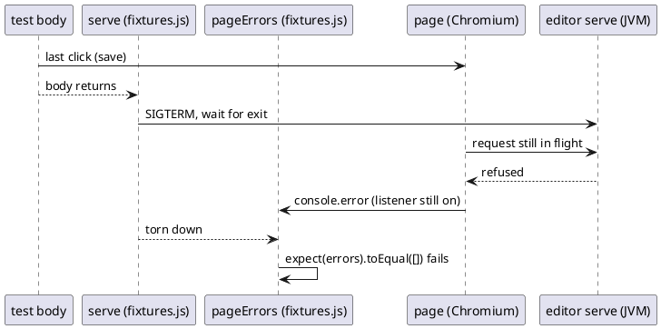

# Technical Design: the E2E suite judges the page before its server stops

# Summary

The E2E job failed once on `main` (GitHub Actions run 40267805459, `edit-and-save.spec.js:165`, the rename test, Chromium). The two fixtures of `src/test/e2e/fixtures.js` are torn down in an order that stops the server while the page is still open and still listened to: a request the page has in flight in that window fails, the page says it as a console error (the editor's own `console.error`, such as `ArchiCode: saving failed`, or the browser's report of the lost resource) or as an uncaught exception, and the automatic fixture `pageErrors`, which reads its list only after `use` returns, counts it. This design makes `pageErrors` read and freeze its list when the test body ends, before the server is stopped, and adds a spec that fails on the old order. It is run W-10 of wave 024, phase P1.

# Scope

In scope: `src/test/e2e/fixtures.js` (the order of the two fixtures and the comment at its head), one new spec `src/test/e2e/teardown.spec.js`, and the sentence of `CLAUDE.md` that describes `pageErrors` and `serve`.

Out of scope: the specs themselves (no flow is changed or retried), `harness.js` and `playwright.config.js`, the application (`EditorHttpServer`, `standalone.html`), the `/favicon.ico` exception (W-1, run 0178, already removed from the same file in the working tree), a change of `retries` or `workers`.

# PRD Traceability

TDD+pln run: there is no PRD, so traceability to requirement IDs is incomplete. The requirements are sourced from the wave plan (row W-10, phase P1 gate, `wav-024-...md`) and named `W10-n`:

- `W10-1` (row W-10): a request the page sends during teardown, after the server stops, is either waited for before the stop or told apart from an error the page raised while the test ran.
- `W10-2` (row W-10): the comment of `fixtures.js` says the order and why.
- `W10-3` (P1 gate): the E2E job is green on three consecutive runs of the wave pull request.
- `W10-4` (row W-10): the same test shows no flake in a repeated run locally (`--repeat-each`).

All four are addressed. `W10-3` can only be observed on the pull request, after this run (see Q-1).

# Technical Goals

- TG-1: an error the page says only because its server stopped after the test body returned never fails the test (`W10-1`).
- TG-2: an error the page says while the test body ran still fails it, in the same words (`W10-1`).
- TG-3: the rule and its reason are in the head comment of `fixtures.js` and in `CLAUDE.md` (`W10-2`).
- TG-4: a spec proves TG-1 and TG-2, and TG-1's test fails when the old order is put back (`W10-4`).

# Non-Goals

- Waiting for the page to be idle before the stop: the end of a test has no signal of "idle" that the editor gives, and a wait is a new timing assumption.
- Ignoring `net::ERR_*` messages by text: it would also hide a real failed request during the test.
- Retries (`retries: 0` is a decision of run 0174/0175).

# Assumptions

- ASM-1: the failure is something the still-open page says on its console as an error, or as an uncaught exception, because a request it had in flight was refused after `serve` stopped the JVM. The editor sends requests only in answer to an action (it has no timer, poll or event stream: `standalone.html` has no `setInterval`, `EventSource` or `WebSocket`), so the candidates are the follow-up of the last action (the rename test ends on a save of several files, then reads the disk, and `saveAllChanges` says `console.error('ArchiCode: saving failed', e)` when a write fails). The text can be the editor's own `console.error`, which every browser reports, or the browser's report of the lost resource, which only a full Chromium gives (the headless shell and Firefox of this suite do not report a failed resource; the comment on the favicon that W-1 removed from `fixtures.js` said so). Source: the fixture code and the position of the failure. The log of the run was not available to this run (`gh run view 40267805459 --log-failed` returned nothing, checked again by the review), so this is inferred. Validation: TG-4's spec makes the page say a console error of its own when a request fails, so that it does not depend on the browser's report; if it does not fail on the old order, the cause is something else and Q-1 applies.
- ASM-2: Playwright 1.64.1 (pinned in `package.json`) tears fixtures down in the reverse order of their setup, and sets up a fixture's dependencies before it. Validation: the same spec.

# Constraints

- CON-1: `workers: 1`, `retries: 0` stay (`playwright.config.js`).
- CON-2: the format (`npm run format:check`) and the lint (`npm run lint`) cover `src/test/e2e/**/*.js`.
- CON-3: W-10 runs after W-1 in the lane (wave plan, overlap verdict `serialize`): `fixtures.js` already has W-1's removal of the favicon exception in the working tree, and this run edits the same file around it, not over it.
- CON-4: the E2E specs need the jar (`./mvnw package -Dmaven.test.skip -Dplugin.asciidoctor.skip=true` is enough) and `JAVA_HOME` on a JDK 25.

# Current State

`src/test/e2e/fixtures.js` defines `serve` (a fixture that hands the test a function starting a server and, after `use`, stops every server it started and removes its copy) and `pageErrors` (automatic, depends on `page`: it registers `console` and `pageerror` listeners, awaits `use(errors)`, then `expect(errors).toEqual([])`).

Playwright sets automatic fixtures up first and tears down in reverse. `serve` is set up when the test asks for it, so after `pageErrors`; it is therefore torn down BEFORE `pageErrors`. The sequence at the end of a test is: the body returns, `serve` stops the JVM (SIGTERM and wait for exit, which takes tens of milliseconds to seconds), then `pageErrors` evaluates `errors`. The page and its listeners are alive during the whole stop. A request the page still has in flight in that window (the follow-up of the last save, ASM-1) is refused or cut, and the page says it on its console or as an uncaught exception. The failure was seen on Chromium only; whether Firefox would say the same is not known (it was not in the failed run).

The failing arrow (`B -> P`) happens between the stop and the check; nothing between the body's return and the stop is an error of the test.

# Proposed Design

Make the verdict about the page the first thing that happens at the end of a test, while its server is still up.

- DEC-1 — `pageErrors` depends on `serve`
  - Decision: `pageErrors` takes `serve` in its parameters (`async ({ page, serve }, use)`). Playwright then sets `serve` up first and tears it down after `pageErrors`; `pageErrors` reads its list right after `use` returns, while the server still answers. Setting `serve` up starts nothing: it only builds the function the test calls. The listeners stay on until the page closes; what the page says after the check is read by no one, and the check is a single `expect` on the list in the same turn, so nothing can be added between the end of `use` and the verdict.
  - Rationale: it uses the order Playwright already guarantees, with no timing and no text filter, and a request that the page sends during the check still succeeds.
  - Alternatives considered: (a) filter console errors that look like a refused connection after the stop; text matching, hides real failures, rejected. (b) wait for network idle before the stop; the editor has no idle signal and a wait is a timing assumption, rejected. (c) one fixture doing both jobs; merges two roles the suite names separately, rejected.
  - Tradeoffs: the order is implicit in a parameter list, so a comment says so (DEC-2) and the spec guards it (DEC-3). Removing the listeners after `use` was considered and dropped (KDMLLC review): in the old order it cannot help, since `serve` stops before `pageErrors` resumes, and in the new order it adds nothing the single `expect` does not already give.
  - Linked PRD IDs: `W10-1`.

- DEC-2 — the comment says the rule
  - Decision: the head comment of `fixtures.js` gains the order (the page is judged first, then its server stops) and the reason, with the run number. The sentence of `CLAUDE.md` about the automatic fixture `pageErrors` gains one clause: it judges the page at the end of the test body, before the server of `serve` stops.
  - Linked PRD IDs: `W10-2`.

- DEC-3 — a spec proves both directions
  - Decision: `src/test/e2e/teardown.spec.js` holds two tests. (1) "a request the page sends while its server stops is no error": open the editor on a small workspace (`workspace.js`), run in the page a loop (`setInterval`, 20 ms) that `fetch`es `/` (the session cookie lets it in) and, when a fetch is refused, says `console.error('lost: ' + message)` itself, so that the verdict does not depend on whether the browser reports a failed resource (the headless shell and Firefox do not); the body waits until one fetch has succeeded (the loop is running), then returns; the verdict is the test passing. With the old order this fails because the loop's requests are refused between the stop and the check (the stop takes tens of milliseconds at least, against a 20 ms period; if V-1 shows it is not long enough, lower the period, never add a wait to the fixture). (2) `test.fail()`: "an error the page raises while the test runs still fails the test": the body does `console.error('on purpose')` in the page; `test.fail()` makes the suite green only if the fixture fails the test.
  - Rationale: (1) is a near-deterministic form of the flake, the same on Chromium and Firefox; (2) guards against a fix that disables the check.
  - Alternatives considered: assert on the order of fixtures by reading Playwright internals (brittle, rejected); no spec, rely on the CI job (the flake is rare, proves nothing, rejected).
  - Tradeoffs: the spec starts a JVM for each test, like every spec of the suite (two more starts, about the cost of two of the 30 existing tests).
  - Linked PRD IDs: `W10-1`, `W10-4`.

# Repository Impact

- IMP-1 — fixtures
  - Path(s): `src/test/e2e/fixtures.js`
  - Change type: modify
  - Why impacted: DEC-1, DEC-2 (parameter list, head comment).
  - Linked PRD IDs: `W10-1`, `W10-2`
  - Risks / notes: the file has W-1's uncommitted removal of the favicon exception; keep it.
- IMP-2 — teardown spec
  - Path(s): `src/test/e2e/teardown.spec.js`
  - Change type: additive
  - Why impacted: DEC-3.
  - Linked PRD IDs: `W10-1`, `W10-4`
  - Risks / notes: format and lint apply; it uses `workspace.js` for a small workspace and the `serve` fixture for the server.
- IMP-3 — project instructions
  - Path(s): `CLAUDE.md` (the paragraph "End-to-end suite", the clause on `pageErrors`)
  - Change type: modify
  - Why impacted: DEC-2. The file is already modified in the working tree by other runs of the wave; edit only that clause.
  - Linked PRD IDs: `W10-2`

# Canonical Impact

Not applicable — no canonical registers declared (`docs/` holds `run`, `wav` and `fixtures` only; there is no `docs/CLAUDE.md`).

# Data Model and Contracts

- CTR-1 — the fixtures of the E2E suite
  - Current contract: `pageErrors` (automatic) fails a test whose page said a console error or threw, judged after `serve` has stopped its servers.
  - Proposed contract: the same, judged when the test body returns and before `serve` stops its servers; what the page says after that is not looked at.
  - Affected files: `src/test/e2e/fixtures.js`; every spec requires it and is unchanged.
  - Migration or compatibility notes: none for the specs. A spec that waits for a delayed error after its last line, which none does, would no longer see it.
  - Linked PRD IDs: `W10-1`

No application, schema or file-format contract changes.

# Interfaces and Behavior

- IF-1 — the fixtures: `test`, `expect`, `openPerspective` and `openPage` are exported as before; `serve(example, files)` returns the same object. Only the moment of the page verdict moves.

# Flows and Processing Logic

- FLOW-1 — end of a test
  - Trigger: the body of a test returns (or throws).
  - Steps: `pageErrors` resumes after `use` and asserts its list is empty; then `serve` stops each server and removes each copy; then Playwright closes the page.
  - Branches / failure paths: a body that threw keeps its own error; the page verdict still runs and Playwright reports both. A server that does not exit is the harness's problem and is unchanged.
  - Final output / rendered result: a test fails on a console error or an uncaught exception raised up to the end of its body, and on nothing later.
  - Linked PRD IDs: `W10-1`

# Reliability, Performance, and Scalability

The change removes a race. No time is added; the two new tests add two JVM starts (about 2 to 5 s each on a busy machine) to the E2E job.

# Security and Privacy

Not applicable: test code only, no network beyond `127.0.0.1`.

# Observability and Verification

- V-1: before the change, `npx playwright test src/test/e2e/teardown.spec.js --project=chromium` fails on the first test (proves ASM-1 and ASM-2); also run it with `--project=firefox`, which fails the same way because the lost request is said by the page itself. If it does not, stop and record Q-1.
- V-2: after the change, the same command passes, including the `test.fail()` test; the `test.fail()` test is shown to bite once by removing its `test.fail()` line and seeing it fail (a fixture error at teardown counts as the test's failure).
- V-3: `npx playwright test --repeat-each=5 src/test/e2e/edit-and-save.spec.js --project=chromium` passes (`W10-4`; a repeated run cannot prove a rare flake gone, the spec of DEC-3 is the proof, this is the check that the rename test does not regress).
- V-4: `npm run test:e2e` passes on Chromium and Firefox; `npm run format:check` and `npm run lint` pass.
- V-5: `W10-3` is observed on the wave pull request (three consecutive green runs of the job `E2E`), after this run; the run document records that it is pending.

# Deployment and Rollout

Test-only change, no release effect. Backward compatible. Rollback is a revert of the commit.

# Risks and Tradeoffs

- RISK-1: the real cause is not the teardown order (ASM-1). Mitigation: V-1 fails loudly if the spec does not reproduce; then Q-1.
- RISK-2: a later change reorders the fixtures. Mitigation: the comment of DEC-2 and the spec of DEC-3.
- RISK-3: the page check happens while a request of the last action is in flight and fails for a real reason. That is a real error and the test should fail; no change.

# Open Questions

- Q-1 (factual lookup, attempted, not resolvable here): the log of run 40267805459 cannot be read (`gh run view 40267805459 --log-failed` returns nothing, tried a third time at Stage 6, the log is gone or not reachable from this machine; nothing else holds the message). Resolution by decision, not by lookup: the design does not depend on the exact message. DEC-1 is the right fix for any error the page says after the body returns and before the check, and V-1 is the gate that tests the inference (ASM-1) on the real suite: the plan's first task runs the new spec against the old order. Rule: if V-1 reproduces on the old order, Q-1 is closed and DEC-1 stands; if it does not, the implementer stops, records it in the prg file and does not ship DEC-1 as the fix for the flake. Not a blocker for the plan.

# Review

Review pass: dispatched. KDMLLC review (`review-kdmllc-content`, standard tier) of this TDD on 2026-10-26, by the agent of Stage 5, which is not the agent that drafted it (Stage 4), so the review is independent of the drafting. Referent read: `src/test/e2e/{fixtures,harness,workspace}.js`, `playwright.config.js`, the diff of `fixtures.js`, `EditorHttpServer.handleRoot`, `standalone.html` (timers, `console.error` sites), `CLAUDE.md` (End-to-end paragraph), the wave plan row W-10, the review log of run 0178. Findings S2 and above were applied: the ASM-1 mechanism and the "poll" claim, DEC-2 of the first draft dropped, the spec of DEC-3 made independent of the browser's resource report. `gh run view` returned nothing again, so Q-1 stays open.

# Deferred Work

- DEF-1: if the editor ever gets an "idle" signal (#162, hosted editor), the suite could wait on it instead of judging at the end of the body.

# File Placement and Frontmatter

Saved as `docs/wav/wav-024-fixes-and-editor-modules/run/run-0181-e2e-teardown-flake/tdd-0181-e2e-teardown-flake.md`, `type: tdd`, `run: 0181`, `wave: 024`.
