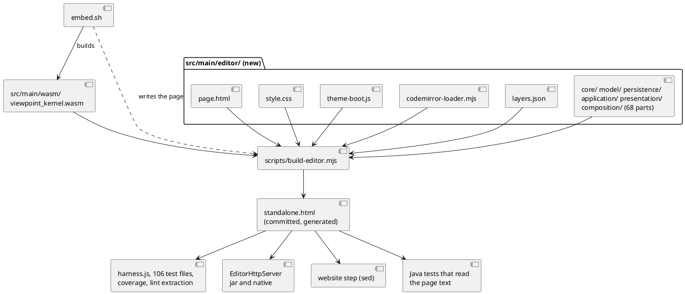
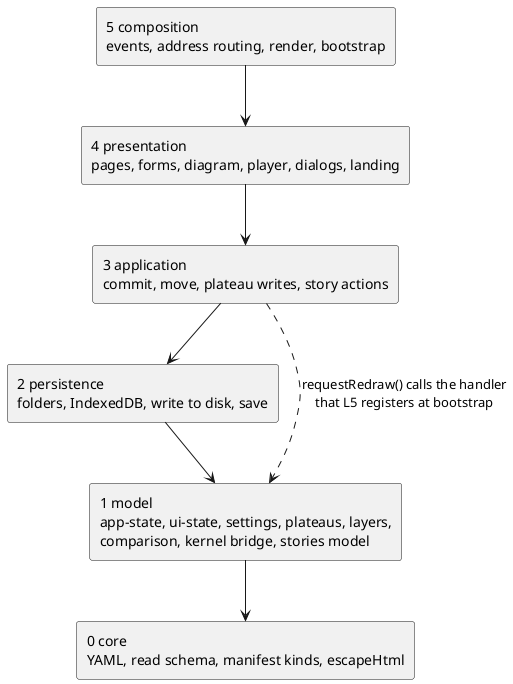

# Technical Design: the editor page assembled from parts, and the cut of its script

# Summary

`src/main/resources/editor-webapp/standalone.html` is one file of 23,170 lines whose main script alone is 22,132 lines, 1,349 top-level declarations. This design says how it becomes `src/main/editor/` (68 parts of the script, 69 once `model/ui-state.js` exists, plus a skeleton, a stylesheet, the theme boot and the CodeMirror loader), assembled into the same committed file by `scripts/build-editor.mjs` (RFC-001, D1 accepted on 2026-10-26), in which order the script is cut, what each part is, which commits may move text and how each kind is proved, and how the tests, the coverage script, the lint, `embed.sh`, CI and the website follow. It is run W-4 of wave 024, phase P2. It changes no source file; the P3 runs W-5 to W-9 and W-11 carry it out.

Four measured facts shape it (section Current State): the committed page stays the one artifact everything reads, so the jar, the native image, the website, the Java tests and the 106 harness-driven test files need no change; the script has one cycle of any size (95 declarations) and it exists only because 146 calls name `render()`; 60 top-level variables are what keeps lower layers pointing up; and formatting the parts later breaks exactly six tests that match the page text.

# Scope

In scope: the part table (DEC-4), the assembly format (DEC-1, DEC-2), the layers and their count (DEC-3), the commit kinds and checks (DEC-5, DEC-6), how the consumers load the sources (DEC-7), the redraw notification (DEC-8), the step list of P3 with a guard for each (DEC-9), the tools to write (DEC-10), the list of names the Java sources use (DEC-11), formatting (DEC-12).

Out of scope: every change to a file under `src/`, `scripts/`, `.github/`, `pom.xml`, `package.json` (this run writes documents and two design attachments only); the hosted editor (#162); consolidating the top-level variables into state objects; the pinned limits of the save (#155 L3, L4).

# PRD Traceability

TDD+pln run: there is no PRD, so traceability to requirement IDs is incomplete. The requirements are sourced from the wave plan (`wav-024-...md`, row W-4, the manifest, the P2 gate) and named `W4-n`:

- `W4-1` (row W-4, scope): read the global state (`AppState`, `layerCache`, the `let`s at the top) and the files that mention the page.
- `W4-2` (P2 gate 1): the modules, their order, what each exports or shares.
- `W4-3` (P2 gate 1, D1): the build and test loading choice.
- `W4-4` (P2 gate 1): the steps of P3, the node suite as the guard of each.
- `W4-5` (row W-4): how the tests, the coverage script (`SCRIPT_URL`, `SECTIONS`) and the lint extraction load the sources.
- `W4-6` (row W-4): how `embed.sh` and the website step change.
- `W4-7` (row W-4): the functions named by Java comments.
- `W4-8` (row W-4, exit evidence): no source file changed.
- `W4-9` (D2): whether CSS, theme boot, kernel base64 and the module script are separate files in W-5.
- `W4-10` (P2 gate 2): the author has accepted the design. Not satisfiable by this run; see Q-1.
- `W4-11` (Risks): if the state is too entangled to cut safely, W-7 and W-8 are re-planned. Answered in DEC-3: it is not.

`W4-1` to `W4-9` and `W4-11` are addressed. `W4-10` is the gate's.

# Technical Goals

- TG-1: a table of parts that covers every line of the script once, in the order of the page, each part with a layer and the run that cuts it (`W4-2`).
- TG-2: a layer rule whose violations are counted by a tool, with a number to start from and a way to make it fall (`W4-2`, `W4-11`).
- TG-3: an assembly that reproduces the current page byte for byte, so that nothing outside the editor sources has to change in W-5 (`W4-3`, `W4-5`, `W4-6`).
- TG-4: three kinds of commit, each proved by a check that is not a review of the diff (`W4-4`).
- TG-5: a step list for W-5 to W-9 and W-11 with the guard of each (`W4-4`).
- TG-6: the names the Java side depends on listed and guarded (`W4-7`).

# Non-Goals

- ES modules, a bundler or a runtime loader (RFC-001, rejected for now). The assembler concatenates.
- Renaming any top-level function or variable. The only new names are those of DEC-8.
- Gathering the 90 top-level `let` into state objects (DEF-1). Only the declarations of the 50 that cross layers move (DEC-3).
- Changing what the editor writes, reads or draws, in any commit but the one of DEC-8, and that one is synchronous.

# Assumptions

- ASM-1: the page does not change between this measure and W-5. Measured on `standalone.html` at commit `af1ed2d` (sha256 starts `a653717d5564c237`). P3 is a chain (`depends_on`), nothing else edits the page. Validation: W-5 starts by comparing the hash; if it differs, it regenerates the numbers with `measure-cut.cjs` and updates the table before cutting.
- ASM-2: the references the measure counts are those a scope analysis finds. The page reaches no top-level name by a string: no `window[name]`, `globalThis[name]` or inline `onclick="name()"` (checked by search: the handlers are `data-action` values read by `handleAppClick`). Validation: the node suite after each relocation (DEC-5).
- ASM-3: the tests reach page functions by name through the sandbox (`sandbox.loadWorkspace`, `sandbox.__state`), and some replace them: 17 test files assign `sandbox.render = ...` (a stub, because the harness has no layout engine) and 3 replace `modelsChanged` with a spy (`grep -rln "modelsChanged *=" src/test/javascript`). So a top-level name is part of the contract with 106 test files (`grep -rl "createApp\|openFixture" src/test/javascript`, out of 116 files by `find src/test/javascript -name '*.test.js'`), and the page must look `render` and `modelsChanged` up at each call (DEC-8). `names.json` (DEC-10) guards the names.
- ASM-4: the node suite takes about 76 s on this machine (2,592 tests, measured on a copy), `npm run lint` 3 s, against "two to three minutes" in `CLAUDE.md`. The cadence of DEC-6 does not depend on it.

# Constraints

- CON-1: the page is a classic script in one file. It must open from `file://` and from the website, and `archicode editor serve` serves `editor-webapp/**` (RFC-001).
- CON-2: `harness.js` runs the first bare ``. An unknown directive, a leftover `<!--@`, a part missing from the order, listed twice, absent on disk, or on disk and not listed is an error. The output carries no part header and no marker. The last commit of W-5 may add one HTML comment after `<html lang="en">` saying the file is generated (`edit src/main/editor and run npm run editor:build`); it is a *change* commit (DEC-5) and the node suite is its guard.
  - Rationale: the prototype reproduces the committed bytes, so W-5 proves "the assembled page equals the old one" by `cmp`. With no header, `--check-identical` is a plain byte comparison, line numbers of the coverage report, of `page.js:N` and of `git show` of an old page stay what they are, and no test that slices the page text meets a new line. `--where <line>` and `--map` give the part of a line without leaving a trace in the file.
  - Alternatives considered: a header comment per part (RFC-003: "after removing the part headers"): needs the headers stripped in every check and moves every line number of the page by the number of parts; rejected. A `.b64` part holding the kernel: the base64 would be in the repository twice (as source and in the generated page); the wasm is already committed; rejected. Generating the page at build time and not committing it: the jar, the native image, the website, 45 test files and `GuideViewPropertiesTest` read the path today; rejected (RFC-001).
  - Tradeoffs: a person reading `standalone.html` cannot see the part boundaries; `--where` does. A change made in the generated file is overwritten by the next `npm run editor:build`, and `--check` in CI fails on it with a sentence that says where to edit.
  - Linked PRD IDs: `W4-3`, `W4-5`, `W4-6`.

- DEC-2 — the first cut is the files that carry no logic (D2)
  - Decision: yes, as the wave defaults. `src/main/editor/`: `page.html` (58 lines, five directives), `style.css` (953 lines), `theme-boot.js` (4), `codemirror-loader.mjs` (27), `layers.json`, and the script as parts. The kernel's base64 is not a file: it is made from `src/main/wasm/viewpoint_kernel.wasm`. In W-5 the script is one part `script.js` of layer `unsorted`, cut later (DEC-9).
  - Rationale: the four files are cut at a tag boundary, so a cut cannot split code; none of them holds logic that the layer count looks at (the CSS is read by `css-theme-audit.test.js` as text of the assembled page, unchanged).
  - Alternatives considered: leave the stylesheet in the skeleton (the skeleton would stay 1,000 lines); rejected.
  - Tradeoffs: none that the byte check does not cover.
  - Linked PRD IDs: `W4-9`.

## Layers and the count

- DEC-3 — six layers, the state in the second, the count by pairs
  - Decision: RFC-002's table, amended in three places (A1-A3 below). Layers, lowest first: `core` (pure: YAML, read schema, manifest kinds, HTML escaping), `model` (the state of the editor and what is computed from it: `app-state`, `ui-state`, settings, plateau tree, layer loader, comparison, kernel bridge, stories model, styles), `persistence` (folders, IndexedDB, the writes to disk, the save), `application` (the commands: commit, move, plateau writes, story actions), `presentation` (renderers, forms, the diagram, the player, dialogs, the landing card), `composition` (the delegated events, address routing, `render`, the bootstrap). A part may name declarations of its own layer and below. The count is the number of pairs (declaration A, declaration B) with A and B in different parts and B in a higher layer than A, where A names B (A calls, reads or assigns B: A is the caller or reader, below, and B the callee above), A and B being top-level declarations, names resolved by scope analysis (so a local variable that shadows a top-level name is not a reference). `layers.json` carries `ratchet.max`; the check fails when the count is above it. Parts of layer `unsorted` are left out on both sides.
  - Measured (parts as cut in DEC-4): 311 pairs. With the 60 top-level variables that lower layers read or write moved to `model/ui-state.js` (`relocate` in `editor-cut.json`): 162 (core to model 1, model to application 8, model to presentation 7, persistence to application 15, persistence to presentation 9, persistence to composition 12, application to presentation 45, application to composition 34, presentation to composition 31). With the redraw going through a notification (DEC-8) no pair names `render`: 100. The 100 pairs left name 59 declarations: `viewLayerOf` (7), `currentRouteHash` (6), `openAppDialog` (5), `resetUiState` and `openTextDialog` (4 each), and 54 more with one to three each (`measure-cut.cjs` lists them): functions that sit in a part of a higher layer than their callers, and one constant (`REMOVED_PLATEAUS_KEY`, read by the read schema of `core`, which would go to `core/read-schema.js` rather than `ui-state`). They are the work list after this wave (DEF-2); each is a function declaration, which DEC-5 lets move.
  - Rationale: the state is below everything that reads it, so no rule has to be made for the 269 readers of `AppState`. The count measures a thing nobody can argue with, and falls only when code changes or a declaration moves, both visible in a diff.
  - Amendments to RFC-002 (A1 state in layer 1, A2 owner rule not enforced in this wave, A3 `requestRedraw()`): written into RFC-002 itself, accepted on 2026-10-26.
  - Alternatives considered: counting names instead of pairs (a name used by 40 callers counts once and hides the reader's cost); rejected. A rule with no count ("fail on any violation"): 162 at the start, nothing could be merged; rejected (RFC-002 chose the ratchet).
  - Tradeoffs: the count depends on the assignment of parts to layers, which is a decision in `layers.json` and is reviewed there. W-5's tool must print 311, 162 and 100 on the page of `af1ed2d` with `editor-cut.json` before its numbers are trusted; the second, 162, is committed as `ratchet.max`.
  - Linked PRD IDs: `W4-2`, `W4-11`.

## The parts

- DEC-4 — 68 parts, in the order of the page, cut where the page already has a heading
  - Decision: the script is cut into the 68 contiguous ranges below (lines of `standalone.html` at `af1ed2d`, from the first line of the heading comment of the part to the line before the next part). The order of the assembly is the order of the page, so a cut is a move that changes no byte of the assembled page. A part is named `<layer>/<name>.js`; the first path segment must equal its layer in `layers.json`. The largest part is 1,343 lines (`yaml-parser`), then 1,036 (`events`), 890 (`changes-panel`); the wave's limit is 3,000. One further part, `model/ui-state.js`, is created in W-7 by relocation (DEC-5) and placed after `model/app-state.js`; it receives the 60 variables (the declarations marked with a minus in the table; 60 declarations, 199 lines with their comments). The machine-readable form of the table is `editor-cut.json`.
  - Exports and sharing: there are no exports. Every top-level name is in the one global scope of the script, as today; what a part "exports" is the set of its names that another part names, which the layer tool lists (`check-editor.mjs --list`). The variables that several parts write are in `ui-state` and `app-state`; the private ones (12 of the 90 `let`, such as `bandCountsTimer`, `cssColorByName`, `diagramMeasureContext`) stay with their part.
  - Rationale: the headings are where the authors already separated concerns; the layer of each part is read from what its functions do (the YAML parts name nothing above `core`; `persistence/save` writes files; `application/commit-pipeline` is the commit of an edit). The group of 95 runs through four layers, so no ordering of parts can remove it: the layer rule and DEC-8 do.
  - Alternatives considered: fewer, larger parts by layer (a part per layer, 6 files of 600 to 8,500 lines): the presentation file would be 8,577 lines, over the limit; rejected. Parts by feature (diagram, stories, plateaus) across layers: the cycles run through features, and the layer is the property the tool can check; rejected for this wave.
  - Tradeoffs: 68 files; a person looking for the diagram reads six parts. The names follow the headings.
  - Linked PRD IDs: `W4-2`.

| # | Part | First-last line of the page | Lines | Declarations | Cut by |
|---|------|-----------------------------|-------|--------------|--------|
| 1 | `core/yaml-parser.js` | 1030-2372 | 1343 | 68 | W-6 |
| 2 | `core/yaml-serializer.js` | 2373-2526 | 154 | 10 | W-6 |
| 3 | `core/yaml-patch-text.js` | 2527-3085 | 559 | 19 | W-6 |
| 4 | `core/yaml-patch-flow.js` | 3086-3579 | 494 | 15 | W-6 |
| 5 | `core/yaml-patch-lines.js` | 3580-4272 | 693 | 14 | W-6 |
| 6 | `core/yaml-block-moves.js` | 4273-4575 | 303 | 11 | W-6 |
| 7 | `persistence/remembered-folders.js` | 4576-5005 | 430 | 29 | W-7 |
| 8 | `model/app-state.js` | 5006-5108 | 103 | 13 | W-7 |
| 9 | `model/settings.js` | 5109-5410 | 302 | 35 (-1) | W-7 |
| 10 | `core/manifest-kinds.js` | 5411-5438 | 28 | 3 | W-7 |
| 11 | `model/element-index.js` | 5439-5561 | 123 | 6 | W-7 |
| 12 | `model/plateau-tree.js` | 5562-5826 | 265 | 14 | W-7 |
| 13 | `model/layer-loader.js` | 5827-6417 | 591 | 34 | W-7 |
| 14 | `model/origin-and-cascade.js` | 6418-6491 | 74 | 5 | W-7 |
| 15 | `application/plateau-choice.js` | 6492-6847 | 356 | 27 (-1) | W-8 |
| 16 | `presentation/plateau-band.js` | 6848-7061 | 214 | 15 | W-8 |
| 17 | `application/layer-writes.js` | 7062-7295 | 234 | 16 | W-8 |
| 18 | `application/plateau-patches.js` | 7296-7724 | 429 | 23 | W-8 |
| 19 | `application/plateau-commands.js` | 7725-8200 | 476 | 15 | W-8 |
| 20 | `model/index-builder.js` | 8201-8380 | 180 | 8 | W-7 |
| 21 | `core/read-schema.js` | 8381-8822 | 442 | 28 | W-7 |
| 22 | `persistence/workspace-loading.js` | 8823-9074 | 252 | 6 | W-7 |
| 23 | `persistence/folder-access.js` | 9075-9437 | 363 | 24 | W-7 |
| 24 | `application/folder-session.js` | 9438-9570 | 133 | 4 | W-8 |
| 25 | `core/escape-html.js` | 9571-9582 | 12 | 1 | W-7 |
| 26 | `presentation/page-registry.js` | 9583-9627 | 45 | 7 (-4) | W-8 |
| 27 | `composition/address-routing.js` | 9628-9932 | 305 | 20 | W-8 |
| 28 | `presentation/shell-state.js` | 9933-10002 | 70 | 9 (-7) | W-8 |
| 29 | `model/record-lookup.js` | 10003-10136 | 134 | 12 | W-7 |
| 30 | `application/commit-pipeline.js` | 10137-10625 | 489 | 21 | W-8 |
| 31 | `persistence/save.js` | 10626-11325 | 700 | 27 | W-7 |
| 32 | `application/move.js` | 11326-11790 | 465 | 25 | W-8 |
| 33 | `model/form-validation.js` | 11791-12145 | 355 | 18 | W-7 |
| 34 | `presentation/top-panel.js` | 12146-12303 | 158 | 11 | W-8 |
| 35 | `presentation/left-panel.js` | 12304-12703 | 400 | 38 (-3) | W-8 |
| 36 | `presentation/help-and-settings.js` | 12704-13169 | 466 | 31 (-1) | W-8 |
| 37 | `presentation/theme.js` | 13170-13300 | 131 | 13 | W-8 |
| 38 | `presentation/element-view.js` | 13301-13483 | 183 | 12 | W-8 |
| 39 | `presentation/element-form.js` | 13484-14123 | 640 | 27 | W-8 |
| 40 | `presentation/inspection.js` | 14124-14238 | 115 | 7 (-1) | W-8 |
| 41 | `presentation/changes-panel.js` | 14239-15128 | 890 | 79 (-1) | W-8 |
| 42 | `presentation/right-panel.js` | 15129-15495 | 367 | 30 (-1) | W-8 |
| 43 | `presentation/pages-plateaus-files.js` | 15496-15636 | 141 | 10 | W-8 |
| 44 | `presentation/diagram-state.js` | 15637-15782 | 146 | 32 (-18) | W-8 |
| 45 | `presentation/map-state.js` | 15783-15920 | 138 | 23 (-10) | W-8 |
| 46 | `model/kernel-bridge.js` | 15921-16060 | 140 | 9 | W-7 |
| 47 | `model/comparison.js` | 16061-16333 | 273 | 16 | W-7 |
| 48 | `presentation/diagram-controls.js` | 16334-16533 | 200 | 23 (-1) | W-8 |
| 49 | `model/styles.js` | 16534-16727 | 194 | 20 | W-7 |
| 50 | `presentation/diagram-states.js` | 16728-17007 | 280 | 23 | W-8 |
| 51 | `presentation/diagram-layout.js` | 17008-17703 | 696 | 39 (-1) | W-8 |
| 52 | `presentation/diagram-interaction.js` | 17704-18374 | 671 | 48 (-1) | W-8 |
| 53 | `presentation/diagram-page.js` | 18375-19084 | 710 | 51 (-2) | W-8 |
| 54 | `model/stories-model.js` | 19085-19248 | 164 | 26 | W-7 |
| 55 | `application/view-recipe.js` | 19249-19399 | 151 | 10 | W-8 |
| 56 | `application/story-entries.js` | 19400-19598 | 199 | 11 | W-8 |
| 57 | `presentation/view-edit.js` | 19599-19886 | 288 | 27 (-1) | W-8 |
| 58 | `presentation/dialogs.js` | 19887-20170 | 284 | 21 (-6) | W-8 |
| 59 | `application/story-actions.js` | 20171-20591 | 421 | 33 | W-8 |
| 60 | `presentation/story-menu.js` | 20592-20630 | 39 | 3 | W-8 |
| 61 | `presentation/story-scene.js` | 20631-20776 | 146 | 10 | W-8 |
| 62 | `presentation/story-player.js` | 20777-21278 | 502 | 38 | W-8 |
| 63 | `presentation/stories-pages.js` | 21279-21654 | 376 | 20 | W-8 |
| 64 | `presentation/shell.js` | 21655-21761 | 107 | 6 | W-8 |
| 65 | `composition/events.js` | 21762-22797 | 1036 | 3 | W-8 |
| 66 | `presentation/landing.js` | 22798-22971 | 174 | 11 | W-8 |
| 67 | `composition/render.js` | 22972-23108 | 137 | 1 | W-8 |
| 68 | `composition/bootstrap.js` | 23109-23161 | 53 | 5 | W-8 |

Sums by layer, in lines: core 4,028 (9 parts), model 2,898 (13), persistence 1,745 (4), application 3,353 (10), presentation 8,577 (28), composition 1,531 (4). By run: W-6 3,546 lines (6 parts), W-7 5,125 (20), W-8 13,461 (42). "Declarations" counts the top-level declarations that start in the range; a minus is how many of them move to `model/ui-state.js`.

A layer names the layers below it. The dotted arrow is the one way up: the model holds a slot, `render` is put in it at bootstrap (DEC-8). The reviewer should check that the table above puts no part in a layer lower than a function it needs to call, except for the 162 pairs the tool counts.

## Commits and their checks

- DEC-5 — three kinds of commit, three checks
  - Decision: every commit of P3 is one of three kinds, named by its subject. **Move** (`refactor: move <part> to src/main/editor/<path>`): text goes from one file to another, the order of the assembly does not change, so the assembled page equals the one of the parent: `build-editor.mjs --check-identical <parent>` compares it with `git show <parent>:src/main/resources/editor-webapp/standalone.html`, byte for byte. **Relocate** (`refactor: relocate <names> to <part>`): a whole top-level declaration (with the comment block directly above it) goes to another part and so to another place in the assembly. Allowed for any function declaration (hoisted, so order is free) and for a `let` or `const` whose initializer names only declarations that stay before it; proved by `check-editor.mjs --statements <parent>`: the multiset of declarations of the main script (each with its comment block) is equal, everything outside the main script is byte-equal, and `--load-order` finds every non-function declaration after what it names at load time (directly, or through the functions it calls while the script loads). A relocation that fails the load-order rule does not move the variable; it stays and the pair stays in the count. **Change** (`refactor: <what it does>`, `fix:` or `feat:` as the change is): anything else, such as DEC-8, the generated-file comment, the tests of DEC-12. A change commit is never mixed with a move or a relocation (RFC-003).
  - Rationale: the byte check is the only proof that costs nothing and has no judgment in it. A relocation is the smallest step that makes the layers real; it needs a weaker check, and one that is exact about what the order of a classic script can break. At least the 60 variables relocate, in a few groups; the functions of the work list (DEF-2) may follow; none changes a character.
  - Alternatives considered: only pure moves, so that the layer rule has to be satisfied by the original order; the table would need parts of one or two declarations (`escapeHtml`, `panelSizeStorage`) and the 60 variables stay scattered; rejected. Relocation checked by the node suite alone: slower, and a wrong order of a `let` shows only at load, in a test that happens to run it; rejected.
  - Tradeoffs: two checks to write and trust. `check-editor.mjs` has tests of its own (DEC-10).
  - Linked PRD IDs: `W4-4`.

- DEC-6 — the guards run at three cadences
  - Decision: **each commit**: `build-editor.mjs --check`, the check of its kind, `check-editor.mjs --layers` (names list, Java names, ratchet; from 5.2 on, since the tool does not exist before: the commits of 5.1 run the `build-editor.mjs` checks only), `npm run lint` and `npm run format:check` (3 s). **Each step** of DEC-9 (a group of commits that ends with something a reviewer can accept) and every relocation or change commit: the node suite (`npm run test:unit`, about 76 s here). **End of each run**: `npm run test:coverage`, `./mvnw verify -DskipITs=false` (the Java tests read the page: `EditorReadSchemaTest`, `GuideViewPropertiesTest`), `npm run test:e2e`, `src/main/rust/viewpoint-kernel/embed.sh --check`. The pull request runs the same in CI, and the Page job re-checks the move and relocate commits of the pull request (FLOW-2).
  - Rationale: a move whose assembled bytes equal the parent's cannot change what the suite says about it, so the suite after every move adds minutes and no information. RFC-003 says "every commit: the node suite"; this narrows it to the commits where it can say something, and runs it at least once per step.
  - Alternatives considered: the whole suite after every move (about 70 moves, 76 s each, about 90 minutes; affordable, so the choice is not about time but about what each run can tell); the author may ask for it back, Q-2.
  - Tradeoffs: a broken environment is found one step late instead of one commit late; a failed step is reverted, not patched (RFC-003).
  - Linked PRD IDs: `W4-4`.

## Loading the sources

- DEC-7 — tests, coverage, lint and the Java side keep reading the committed page
  - Decision: until W-9 nothing that reads the page changes. `harness.js`, the 45 test files that name the page, `EditorReadSchemaTest`, `GuideViewPropertiesTest`, `NativeReflectionConfigTest` (the resource list names the page), `EditorHttpServer`, `quarkus.native.resources.includes`, `extract-editor-script.mjs`, `editor-coverage.mjs` (`SCRIPT_URL = 'standalone.html-script.js'`, the 18 `SECTIONS` markers), the website `sed` and the E2E suite (which runs the jar) read `src/main/resources/editor-webapp/standalone.html` as they do now. `package.json` gets `editor:build` (assemble), `editor:check` (`--check` and the layer check), and `pretest:unit`, `pretest:coverage` and `prelint` that run the assembler, so a part edited and not assembled cannot be tested stale. In W-9: `editor-coverage.mjs` takes the areas from `layers.json` (an `area` on each part, the nine areas of the floor unchanged, so the floor does not move) and the first line of each part from `build-editor.mjs --map`, in place of `SECTIONS` markers that must match once; `extract-editor-script.mjs` still lints the assembled script with all rules and prints the part and line beside `page.js:N` (`--where`); ESLint also lints `src/main/editor/**/*.js` one part at a time with `globals` taken from `names.json` and `no-unused-vars` limited to local scope (a top-level name used by another part is not unused).
  - Rationale: tests that run the shipped artifact are worth more than tests that run its sources, and 106 test files and four Java readers need no edit. The pretest hook makes the generated file impossible to forget.
  - Alternatives considered: tests load the parts through the assembler in memory (`createApp` assembling): the Java tests, the 45 files that name the page and the server would still need the file; two truths; rejected.
  - Tradeoffs: a pretest hook writes a committed file as a side effect (quiet when it changes nothing).
  - Linked PRD IDs: `W4-3`, `W4-5`.

- DEC-8 — a layer below presentation asks for a redraw; it never names `render`
  - Decision: in W-11, `model/app-state.js` gains `let redrawHandler = null`, `onRedraw(handler)` and `requestRedraw()` (calls the handler if there is one, now, in the same turn). `composition/bootstrap.js` calls `onRedraw(() => render())` as a top-level statement of the part, not inside its `DOMContentLoaded` listener, so that it runs while the script loads, before any listener, timer or test can call `requestRedraw()`; it is a 20th statement that names a declaration at load (the 19 of Current State plus this one) and `--load-order` of `--layers` lists 20 after 11.1. `requestRedraw()` with no handler registered throws (`redraw handler not registered`): a missing registration is a bug that must show, not a skipped redraw. The registration is a thunk and not `onRedraw(render)`, so that the global `render` is looked up at each call, as every call looks it up today: 17 test files replace `sandbox.render` by a stub and rely on it (ASM-3). The 97 `render()` calls in persistence (33), application (39) and presentation (25) become `requestRedraw()`; the 49 in composition stay. `rebuildIndexAndRender()` (14 call sites) keeps its name and calls `requestRedraw()`. `modelsChanged()` is not changed: it bumps `modelVersion`, 6 call sites, and does not redraw. The count goes from 162 to 100, and the group of 95 declarations is gone.
  - Rationale: the call is synchronous and late-bound, so the order of every effect, and every stub the tests install, is what it is today; the e2e suite and the node suite guard a change with no timing in it. Merging the redraw into `modelsChanged()` (RFC-002 rule 2 as written) would redraw after 6 events instead of 146 and drop the redraws that follow view-only state; that is a behaviour change nobody asked for.
  - Alternatives considered: a subscriber list with several handlers (nothing needs more than one); a scheduled redraw (`queueMicrotask`) to coalesce redraws (a behaviour change; DEF-3); registering `render` itself (breaks the 17 files that stub it).
  - Tradeoffs: one more indirection to read; `names.json` gains three names (`redrawHandler`, `onRedraw`, `requestRedraw`) in the same commit.
  - Linked PRD IDs: `W4-4`, `W4-11`.

## Steps of P3

- DEC-9 — six runs, each with its steps and guard
  - Decision: the steps below, in order. A "step" ends with the node suite green (DEC-6).

| Run | Step | Content | Kind | Guard of the step |
|-----|------|---------|------|-------------------|
| W-5 | 5.1 | `page.html`, `style.css`, `theme-boot.js`, `codemirror-loader.mjs`, `script.js` (one part, layer `unsorted`), `layers.json`, `scripts/build-editor.mjs`; the page rebuilt | move | `cmp` of the assembled page with the committed one; `--check-identical HEAD~1` |
| W-5 | 5.2 | `scripts/check-editor.mjs` (`--layers`, which includes the load-order check, `--statements`, `--list` and `--cut`), `names.json`, the Java-names list (DEC-11), `package.json` scripts and hooks, `acorn` and `eslint-scope` pinned (DEC-10), tests of the tools | additive | node tests of the tools; `--cut editor-cut.json` prints 311, 162 and 100 on `af1ed2d` |
| W-5 | 5.3 | CI Page job: check the page, check the move and relocate commits (FLOW-2); `embed.sh` through the assembler (FLOW-3); `CLAUDE.md`, "Build & Test" and the editor paragraph | additive | `embed.sh --check`, a CI run of the pull request, the Page job red on a stale page (tried once on purpose) |
| W-5 | 5.4 | the generated-file comment in `page.html` | change | node suite, `EditorServeIT`, e2e |
| W-6 | 6.1-6.6 | the six YAML parts (rows 1-6), one commit each, out of `script.js`; `ratchet.max` unaffected (core names nothing above it) | move | `--check-identical` per commit; node suite after 6.6, with `save-generator.js` and the comparisons with the pages of 0.17.0, 0.18.0 and 0.19.0 passing unmodified |
| W-7 | 7.1 | the parts of rows 7-14, 20-23, 25, 29, 31, 33, 46, 47, 49 and 54 (the `core/`, `model/` and `persistence/` parts, 20 in all), one commit each | move | `--check-identical` per commit; node suite and `EditorReadSchemaTest` after the step |
| W-7 | 7.2 | `model/ui-state.js` created; the 60 variables relocated into it in groups (diagram, map, shell, dialogs, story, page registry, the consts) | relocate | `--statements`, `--load-order`, node suite after each group |
| W-8 | 8.1 | the `application/` parts (rows 15, 17-19, 24, 30, 32, 55, 56, 59) | move | `--check-identical` per commit; node suite after the step |
| W-8 | 8.2 | the `presentation/` parts and the `composition/` parts, in the order of the page | move | `--check-identical` per commit; node suite and e2e after the step |
| W-8 | 8.3 | `script.js` is empty and goes; `ratchet.max` of 5.2 checked against the count the tool prints (expected 162; the count is never above `max`; if it is below, `max` is lowered); the stray functions that cost a pair and are cheap relocate | move, relocate | the tool prints a count no higher than the `max` of W-5; `--statements` per relocation |
| W-11 | 11.1 | DEC-8: `requestRedraw`, `onRedraw`, the 97 call sites, `names.json`, `ratchet.max` lowered | change | e2e suite and node suite; the tool prints at most 100; the group of 95 gone from `measure-cut.cjs` |
| W-9 | 9.1 | the six tests that match the text of the page are made independent of its layout (DEC-12) | change | they pass on the page as it is and on the formatted one |
| W-9 | 9.2 | Prettier on `src/main/editor/**` | format | `check-editor.mjs --same-ast <parent>` (this mode is content of the step: the check of the format commit); node suite, e2e, `./mvnw verify -DskipITs=false` |
| W-9 | 9.3 | `.prettierignore` lists the generated page only; `format` and `format:check` cover the parts; ESLint on the parts; the coverage areas by part; `names.json` and the `unsorted` layer removed or frozen (DEF-4); `CLAUDE.md` and the manual | change | the P3 gate |

  - Rationale: W-6 and W-7 go bottom-up (core, then the model and persistence), so a part is cut after what it needs exists; W-8 cuts the rest in the order of the page. The ratchet is only meaningful once every part has a layer, so it is committed in W-5 as the design number; it is checked at every commit but only means something from 8.3, before which the parts that exist are checked and the rest is `unsorted`.
  - Alternatives considered: all 68 cuts in W-5 (the wave's W-5 is already the run that changes CI and `embed.sh`); the ratchet then counts from the first day, but W-6 to W-8 would have only relocations to do. Kept as an option if the author prefers it, Q-3.
  - Tradeoffs: the gate wording "the ratchet count has not risen since W-5" holds only because `max` is committed in W-5 from this design; if 8.3 prints more than 162 the run lowers it by relocations, or stops and says so.
  - Linked PRD IDs: `W4-4`.

## Tools and dependencies

- DEC-10 — two scripts, two pinned development dependencies
  - Decision: `scripts/build-editor.mjs` has no dependency: assemble, `--check`, `--check-identical <rev>`, `--where <line>`, `--map`. `scripts/check-editor.mjs` parses and analyses: `--layers` (the names list equals `names.json`; every function a Java comment names exists, DEC-11; the load order holds; the count is not above `ratchet.max`), `--statements <rev>`, `--same-ast <rev>`, `--list` (the violations, by name, and for each part the names other parts use), and `--cut <file>`, which evaluates a cut table in the format of `editor-cut.json` against the page instead of the files of `layers.json` (used by 5.2 to reproduce 311, 162 and 100, and again by 8.3). It uses `acorn` and `eslint-scope`, added to `devDependencies` pinned to the versions the lock file already holds (`acorn` 8.19.0, `eslint-scope` 9.1.2); both are installed today as dependencies of ESLint. `src/main/editor/names.json` is `{ "names": [sorted top-level names], "unnamed": 18 }` (`unnamed` is the number of top-level statements that declare no name, the 18 `statement` of `measure-cut.cjs`: listener registrations and calls) and changes only in a commit that adds or removes a declaration. `src/main/editor/layers.json` is `{ "layers": [...], "parts": [{ "file", "layer", "area" }], "ratchet": { "max" } }`, the parts in assembly order.
  - Rationale: the assembler is the thing that ships, so it stays a script anyone can read in five minutes; the analysis is a development check and needs a parser.
  - Alternatives considered: `espree` (the same parser through ESLint's own copy, no new line in `package.json` but a dependency nobody declared); a regex-based reader (cannot tell a shadowing local from a top-level name, which is the point of the count); rejected.
  - Tradeoffs: two entries in `package.json`; the lock file changes by their root entries.
  - Linked PRD IDs: `W4-4`, `W4-5`.

- DEC-11 — the names the Java side depends on are checked, not renamed
  - Decision: `check-editor.mjs --layers` reads every Java comment that says `{@code NAME} in {@code standalone.html}` (and the lines around it) and the three regular expressions of the tests, and fails when a name is not a top-level name of the assembled script. The list at `af1ed2d` (21 names): `READ_SCHEMA` (and the markers `// READ_SCHEMA begin`, `// READ_SCHEMA end`, in `core/read-schema.js`), `dottedIdProblem`, `plateauShapeProblem`, `parseManifestText` (`core/read-schema.js`); `REMOVED_PLATEAUS_KEY`, `facetNameProblem`, `manifestsPathSentence` (`model/settings.js`); `buildPlateauTree` (`model/plateau-tree.js`); `horizonPeriod`, `layerProblemsOf`, `entryProblemsOf`, `rootProblem`, `foldParentProblems`, `stepPlateauProblems` (`model/layer-loader.js`); `duplicateReferenceMessage` (`model/index-builder.js`); `readManifestFolder`, `FORMER_WORKSPACE_FILE_SENTENCE` (`persistence/workspace-loading.js`); `diagramHasNothingToDraw` (`presentation/diagram-layout.js`); `VIEW_PROPERTY_ORDER` (`presentation/view-edit.js`); `MAP_PARTS` (`presentation/map-state.js`, relocated to `model/ui-state.js`); `DIAGRAM_SHOW_NAMES` (`presentation/diagram-state.js`, relocated likewise). The three constants stay `const NAME = [` (CON-3). No rename is planned; a commit that renames one changes the Java comment in the same commit.
  - Rationale: the wave's rule, made a check.
  - Linked PRD IDs: `W4-7`.

- DEC-12 — formatting the parts is a format commit, after a change that frees six tests
  - Decision: W-9 first makes `comparison-cache.test.js:301`, `diagram-box-tab-stops.test.js:285`, `diagram-link-tab-stops.test.js:501`, `inspection-links.test.js:588` and `:750` and `plateau-compare.test.js:920` independent of the layout of the page (they must pass on the page as it is and on the formatted one), as one change commit. Then one commit of Prettier output only, proved by `check-editor.mjs --same-ast <parent>` (the ESTree of the main script without positions and without the `raw` of literals, and the comments in order with the white space inside them normalized, equal) and added to `.git-blame-ignore-revs`, as the earlier formatting commits were.
  - Rationale: measured, not guessed: those six are the only failures on a formatted page. The formatted script has about 29,850 lines (+35%); the largest part would be about 1,800 (an estimate: 1,343 lines at the same +35%), under the limit.
  - Tradeoffs: the generated page loses its hand layout, so a person reading it sees Prettier's.
  - Linked PRD IDs: `W4-4`.

# Repository Impact

Nothing in this list is changed by this run. They are the impacts of P3, by the run that makes them.

- IMP-1 — the editor sources
  - Path(s): `src/main/editor/**` (new: `page.html`, `style.css`, `theme-boot.js`, `codemirror-loader.mjs`, `layers.json`, `names.json`, 69 parts: the 68 of DEC-4 and `model/ui-state.js`)
  - Change type: additive
  - Why impacted: DEC-1, DEC-2, DEC-4.
  - Linked PRD IDs: `W4-2`, `W4-9`
  - Risks / notes: outside `src/main/resources`, so not packaged in the jar or the native image.
- IMP-2 — the generated page
  - Path(s): `src/main/resources/editor-webapp/standalone.html`
  - Change type: modify (generated)
  - Why impacted: it becomes the output of the assembler. Same bytes after W-5 5.1-5.3 and after every move; changed by 5.4, 11.1 and 9.2 only.
  - Linked PRD IDs: `W4-3`
  - Risks / notes: `.prettierignore` keeps it (RFC-001); consider `linguist-generated` in `.gitattributes` so that the pull request view folds it (not present today).
- IMP-3 — the tools
  - Path(s): `scripts/build-editor.mjs`, `scripts/check-editor.mjs`, `src/test/javascript/editor-build/*.test.js` (tests of the tools), `package.json`, `package-lock.json`
  - Change type: additive, modify
  - Why impacted: DEC-7, DEC-10.
  - Linked PRD IDs: `W4-4`, `W4-5`
  - Risks / notes: the tests of the tools use fixtures in a temporary folder; they cover the refusals (part missing, listed twice, unknown directive), a changed byte, a function relocated, a function edited, a `let` moved before the `const` it reads.
- IMP-4 — kernel embedding
  - Path(s): `src/main/rust/viewpoint-kernel/embed.sh`
  - Change type: modify
  - Why impacted: FLOW-3. The write mode builds the wasm, copies it, then runs `node scripts/build-editor.mjs` in place of the Python regex. The check mode keeps its Python comparison of the page's block with the build (CON-7).
  - Linked PRD IDs: `W4-6`
  - Risks / notes: the write mode needs Node; the header of the script says so.
- IMP-5 — CI
  - Path(s): `.github/workflows/ci-build.yaml`
  - Change type: modify
  - Why impacted: the Page job gains "Check the editor page is the assembly of its parts" (`npm run editor:check`, before the format check) and, on a pull request, "Check the move commits" (`scripts/check-editor-moves.sh <base sha> <head sha>`, which runs `--check-identical` on each `refactor: move` commit and `--statements` on each `refactor: relocate` commit; the job already has `fetch-depth: 0`). The website step and the Java, Kernel, E2E, Native jobs are unchanged.
  - Linked PRD IDs: `W4-6`
  - Risks / notes: changes to the workflow are proved on the pull request's own run; the publishing steps are not touched.
- IMP-6 — consumers that change in W-9 only
  - Path(s): `scripts/editor-coverage.mjs`, `scripts/extract-editor-script.mjs`, `eslint.config.mjs`, `.prettierignore`, `package.json` (`format`, `format:check`), the six tests of DEC-12
  - Change type: modify
  - Why impacted: DEC-7, DEC-12.
  - Linked PRD IDs: `W4-5`
  - Risks / notes: the coverage floor file does not change; if an area's figure changes because a part boundary differs from a marker, the run says so before lowering anything (it may not).
- IMP-7 — documents
  - Path(s): `CLAUDE.md` (Build & Test, Architecture: the editor as an assembly, the commit kinds, the tools), `src/doc/**` where the manual says the editor is one file, `README.md` if it does
  - Change type: modify
  - Why impacted: the wave's completion criteria. Edited in 5.3 (the commands) and W-9 9.3 (the layout).
  - Linked PRD IDs: `W4-4`
- IMP-8 — nothing else
  - Path(s): `pom.xml`, `src/main/resources/application.properties`, `EditorHttpServer.java`, `harness.js`, the 45 test files that name the page, the Java tests, the website step: unchanged.
  - Change type: none
  - Why impacted: DEC-1 keeps the path and the bytes. The wave's risk "W-5 changes the native image resources" does not arise; the Native job runs as always and is expected to be unaffected.
  - Linked PRD IDs: `W4-3`

# Canonical Impact

Not applicable — no canonical registers declared (`docs/` holds `run`, `wav` and `fixtures` only; there is no `docs/CLAUDE.md`).

# Data Model and Contracts

- CTR-1 — `src/main/editor/layers.json`
  - Current contract: none.
  - Proposed contract: `{ "layers": ["core","model","persistence","application","presentation","composition"], "parts": [{ "file": "core/yaml-parser.js", "layer": "core", "area": "yaml-and-save" }, ...], "ratchet": { "max": 162 } }`. `parts` is the assembly order. `layer` is one of `layers` or, in P3 only, `unsorted`. The first segment of `file` equals `layer`. `area` (W-9) is one of the nine areas of `scripts/editor-coverage-floor.json`.
  - Affected files: the assembler, `check-editor.mjs`, `editor-coverage.mjs` (W-9).
  - Migration or compatibility notes: `max` only goes down; lowering it is an edit in the commit that removed the pairs.
  - Linked PRD IDs: `W4-2`
- CTR-2 — `page.html` directives
  - Current contract: none.
  - Proposed contract: the three directives of DEC-1; a directive is a line that is only the directive.
  - Affected files: `scripts/build-editor.mjs`.
  - Migration or compatibility notes: the assembled page has none.
  - Linked PRD IDs: `W4-3`
- CTR-3 — `src/main/editor/names.json`
  - Current contract: none.
  - Proposed contract: DEC-10. P3 migration guard; kept or dropped in W-9 (DEF-4). Also the `globals` of the per-part lint (DEC-7).
  - Affected files: `check-editor.mjs`, `eslint.config.mjs` (W-9).
  - Linked PRD IDs: `W4-7`
- CTR-4 — the page, as the other tools see it (unchanged, restated so that it is checked)
  - Current contract: CON-2, CON-3; the path `src/main/resources/editor-webapp/standalone.html`; the top-level names (ASM-3); the first bare `<script>` is the script; `'use strict'` first.
  - Proposed contract: the same, byte for byte after W-5 5.3, and after each move.
  - Affected files: all consumers (they are not edited).
  - Linked PRD IDs: `W4-3`, `W4-5`
- CTR-5 — commit subjects of P3
  - Current contract: Conventional Commits, no scope.
  - Proposed contract: `refactor: move ...`, `refactor: relocate ...` as DEC-5; `scripts/check-editor-moves.sh` reads them. Several commits per run in P3, as the wave's gate requires (a run of P1 made one commit per issue).
  - Affected files: `.github/workflows/ci-build.yaml`.
  - Linked PRD IDs: `W4-4`

No change to the manifests, `.archicode.yaml`, the CLI, the schemas or the kernel contract.

# Interfaces and Behavior

- IF-1 — `node scripts/build-editor.mjs [--check | --check-identical <rev> | --where <line> | --map]`: no option writes the page and prints the number of parts and bytes; `--check` exits 1 with "standalone.html is generated: edit src/main/editor and run npm run editor:build" when the page differs; `--check-identical` exits 1 naming the first differing line and its part; `--where 12345` prints `core/yaml-parser.js:2316`; `--map` prints the parts with first and last line as JSON.
- IF-2 — `node scripts/check-editor.mjs [--layers | --statements <rev> | --same-ast <rev> | --list] [--cut <file>]`: exit 0 or 1; `--list` prints the pairs by name, as the table of DEC-3, each as "A names B" (A the caller or reader, B what it names in a higher layer), and for each part the names other parts use.
- IF-3 — `npm run editor:build`, `editor:check`; the hooks `pretest:unit`, `pretest:coverage`, `prelint`.
- IF-4 — the editor itself: no change in what a person sees, writes or reads. DEC-8 is the only change of code and is synchronous.

# Flows and Processing Logic

- FLOW-1 — edit a part
  - Trigger: a person or an agent changes a file under `src/main/editor/`.
  - Steps: `npm run editor:build` (or a `pretest` hook) rewrites `standalone.html`; tests run on it; the commit holds both.
  - Branches / failure paths: the page was edited by hand: `--check` fails in CI and locally with the sentence of IF-1; the next build overwrites it.
  - Final output / rendered result: the committed page equals the assembly of the committed parts.
  - Linked PRD IDs: `W4-3`
- FLOW-2 — a move or relocate commit
  - Trigger: a commit whose subject begins `refactor: move` or `refactor: relocate`.
  - Steps: the agent cuts or relocates; `build-editor.mjs` rebuilds; `--check-identical HEAD` (or `check-editor.mjs --statements HEAD` with `--load-order`) runs before the commit; the result is written in the run document; on the pull request `scripts/check-editor-moves.sh` runs the same on each such commit against its parent.
  - Branches / failure paths: a byte differs: the first differing line and its part are printed, the commit is not made; a commit that is not of the two kinds is not checked and must say what it changes.
  - Final output / rendered result: a pull request in which every moved line is proved unchanged.
  - Linked PRD IDs: `W4-4`
- FLOW-3 — the kernel changes
  - Trigger: the Rust sources change.
  - Steps: `embed.sh` builds the wasm, copies it to `src/main/wasm/`, runs `node scripts/build-editor.mjs`, which writes the new base64 into the page; `embed.sh --check` (job Kernel) rebuilds in a scratch folder and compares the wasm and the page's block with the build, as now.
  - Branches / failure paths: parts edited and wasm not rebuilt: the Page job's `--check` passes (the page equals its sources) and the Kernel job's `--check` fails (the wasm is not the build), as today.
  - Final output / rendered result: the page's block equals `base64(src/main/wasm/viewpoint_kernel.wasm)` always (tests `compare.test.js`, `change.test.js`, `patches.test.js` assert it).
  - Linked PRD IDs: `W4-6`
- FLOW-4 — release and website
  - Trigger: a release tag.
  - Steps: unchanged. `sed` stamps the version into a copy of the committed page and publishes it at `/editor/`; `Build` needs `Page`, whose first step now fails a stale page.
  - Linked PRD IDs: `W4-6`

# Reliability, Performance, and Scalability

The assembler concatenates files: milliseconds. `check-editor.mjs` parses a 22,000-line script twice for `--statements`: seconds. The node suite is the cost (about 76 s). Nothing changes at run time: the same bytes are served.

Maintainability: a part is 12 to 1,343 lines (before formatting), a change to the save touches a file that holds only the save, and the layer file says which parts may name which. The group of 95 declarations that nobody could hold in mind is one function away from gone.

# Security and Privacy

Nothing new reaches the network. The checks read git objects with `execFileSync('git', [...])` (no shell), as the tests already do. The two added dependencies are development-only, pinned, and already in the lock file.

# Observability and Verification

This run changes no source (`W4-8`). Checks of this run: it adds or edits only files under `docs/wav/wav-024-fixes-and-editor-modules/run/run-0182-editor-modules-design/` (this document, the prg, the run status, `editor-cut.json`, `measure-cut.cjs`); `node docs/wav/wav-024-fixes-and-editor-modules/run/run-0182-editor-modules-design/measure-cut.cjs` prints 1,349 declarations, 68 parts, cycles 95, 7, 3, 3, and 311, 162, 100 upward pairs; the prototype assembly (skeleton, four files, one script file, wasm) gave the committed bytes (done in scratch, repeatable in W-5 5.1 with `cmp`).

Checks of P3, by the gate: `./mvnw verify -DskipITs=false`, `npm run test:unit`, `npm run test:e2e`, `npm run lint`, `npm run format:check`, `node scripts/editor-coverage.mjs` pass; `find src/main/editor -name '*.js' | xargs wc -l` shows no file over 3,000; `.prettierignore` does not list `src/main/editor`; every move commit of the pull request passes `--check-identical <parent>` (CI step); `layers.json` `ratchet.max` is not above 162 and is lower after W-11; `build-editor.mjs --check` passes; `embed.sh --check` passes; `scripts/byte-identity.sh` shows no difference for the commands that do not run the editor; the tests that compare the save with the pages of `archicode-0.17.0`, `0.18.0` and `0.19.0` pass unmodified.

# Deployment and Rollout

Code and build only; no data migration. The page served and published is byte-identical until W-5 5.4, W-11 and W-9 9.2, each of which is a commit of its own and can be reverted alone. Nothing here authorizes a release or a deploy. A pull request that changes the workflow or `embed.sh` is proved by its own CI run; `pom.xml` and the native image are not touched, so the Native job (not runnable here, CON-4) is expected to pass unchanged and is read on the pull request. Rollback: revert the commits of the step; a failed step is reverted, not patched (RFC-003).

# Risks and Tradeoffs

- RISK-1: the printed count differs from 311/162/100 (ASM-1, ASM-2, a boundary cut one line off). Mitigation: W-5 5.2 compares and records the cause before committing `max`; the numbers come from a script that is in the repository.
- RISK-2: a relocation that is wrong only at load (a `let` before the `const` its initializer reads). Mitigation: `--layers` checks the load order, exactly, for the 19 statements that name something at load (listed by the tool; 20 once DEC-8 adds its registration), and each relocation commit runs the node suite, which loads the script in about a hundred test files.
- RISK-3: tests that slice the page text between two function names assume an order. Mitigation: the suite after each relocation; the six known text-matching tests of DEC-12 are the formatting risk, not this one.
- RISK-4: `git blame` and `git log` lose the history of moved lines. Mitigation: `git blame -C -C` follows text across files; move commits are single-purpose; DEF-5 if the ignore list should name them.
- RISK-5: the generated file is edited by hand. Mitigation: DEC-1 (`--check`, the comment, the hook).
- RISK-6: W-5 is declared `hard_judgment` for its effect on release; under this design it does not touch `pom.xml`, the native resources or the website step, so the risk is smaller than the wave says. A reviewer who disagrees keeps the label; nothing in the design depends on it.
- RISK-7: 69 files, about 70 move commits and a few relocation commits is a long chain of small commits; a reviewer cannot read them. They are not meant to be read: each is proved by a check. The reviewer reads `layers.json`, `names.json` and the commits of kind change.
- RISK-8: the CodeMirror loader is a module with top-level `await`; ESLint already lints it as `module.mjs`. No risk found; stated so that nobody tries to concatenate it into the script.

# Open Questions

- Q-1 (resolved 2026-10-26, the author accepts): RFC-002 and RFC-003 accepted with the amendments written into them (see those files). The amendments are the ones of this run: the state in layer 1, rule 4 not enforced, `requestRedraw()`, the layer called Model, the node suite at the end of a step, the order of the notification step after the parts that redraw.
- Q-2 (resolved 2026-10-26, the author accepts DEC-6): the node suite runs at the end of a step, not after each move; the byte check covers each move. The wording in RFC-003 is the one that applies.
- Q-3 (resolved in Stage 6, decision: the wave's split, DEC-9; reopenable): W-5 cuts only the safe parts of step 5.1 (the page skeleton, the CSS, the theme boot, the small module script, D2's default, and the whole script as one part) and commits `ratchet.max` once, from this design, in step 5.2; W-6 to W-8 cut the 68 parts in the wave's order. Reasons from the wave: the rows of W-6, W-7 and W-8 are defined as the extraction of the pure, stateful and UI parts, each a run with its own gate, and D2 delegates to this design only the size of the first cut, not the redistribution of the other three; cutting all 68 parts in W-5 would empty W-6 to W-8 and put the largest change in the run the wave already marks `hard_judgment` for release. The gate "the ratchet count has not risen since W-5" is literal because `max` is committed in W-5 from this design and is owned there; step 8.3 only checks that the count the tool prints is at most `max` and lowers `max` if it is below. The count means something only from 8.3, before which the parts not yet cut are `unsorted`.
- Q-4 (resolved in Stage 6 to a check, not a question): the Native job is not run by this design's commits (CON-4), but the repository settles what it will see. `Targets` builds `linux-amd64` for every pull request, so `Native` runs on the pull request; its inputs are `quarkus.native.resources.includes=...editor-webapp/**...`, which names the committed `src/main/resources/editor-webapp/standalone.html` (its path does not change) and nothing under `src/main/editor/`, which is not on the classpath; `pom.xml` and the resource list are not touched, and the `*IT` classes (`EditorServeIT`) read the page through the packaged application, so the commits that change the page text (5.4, W-11, 9.2) are exercised by the Native job too. Expected result: pass unchanged. What remains is to read the result on the pull request, which the plan carries as a step of the run's verification (observation, not a design choice). Not a blocker.

# Deferred Work

- DEF-1: gather the 90 top-level `let` into state objects with an owner each and enforce RFC-002 rule 4 (a variable is written by one layer). Possible once the variables are in `ui-state`.
- DEF-2: the 100 pairs left after W-11: move the functions that sit in a higher layer than their callers (`viewLayerOf`, `currentRouteHash`, the dialog openers, `resetUiState`), then lower `max`. Each is a relocation.
- DEF-3: coalesce redraws (a scheduled `requestRedraw`). A behaviour change, with the e2e suite as guard, not needed for the split.
- DEF-4: decide in W-9 whether `names.json` stays (it is the list of globals for the per-part lint and a guard against an accidental loss) or is generated; the `unsorted` layer goes.
- DEF-5: ES modules for the pure core (RFC-001 says to revisit when the core is isolated; after P3 it is `core/`, 4,028 lines with no outward reference).
- DEF-6: `.gitattributes` `linguist-generated` for the page; `.git-blame-ignore-revs` entries for the move commits.

# File Placement and Frontmatter

Saved as `docs/wav/wav-024-fixes-and-editor-modules/run/run-0182-editor-modules-design/tdd-0182-editor-modules-design.md`, `type: tdd`, `run: 0182`, `wave: 024`. Design attachments beside it: `editor-cut.json` (the part table and the 60 variables, the input W-5 feeds to its tool) and `measure-cut.cjs` (reproduces the numbers; run from the repository root).

# Review

Review pass: dispatched. KDMLLC review (`review-kdmllc-content`) of this TDD on 2026-10-26, by the agent of Stage 5, which is not the agent that drafted it (Stage 4), so the review is independent of the drafting. Referent read: `standalone.html` at `af1ed2d` (sha256 prefix, line count, script parse), `measure-cut.cjs` (run: 1,349 declarations, 68 parts, cycles 95/7/3/3, pairs 311/162/100, calls of `render` 146, all as the TDD says), `editor-cut.json` (layer and run sums equal the TDD's), the wave plan rows W-4, W-5, W-9, W-11 and the P3 order, RFC-002 and RFC-003 (the quotes of Q-1), `embed.sh`, `.prettierignore`, `package-lock.json` (`acorn` 8.19.0, `eslint-scope` 9.1.2), the Java readers of the page, the test files. Overall: Acceptable (KISS 4, DRY 4, MECE 3, LEAN 4, LUCID 4, C 4). The findings below are returned to the main agent to apply; none is applied by the review.

Checked and found right: the 70 consumer files; the 17 files that assign `sandbox.render`; the CON-3 text (`// READ_SCHEMA begin`, the three `const NAME = [`); the 60 relocated names (of them only `currentPerspective` and `parkedDiagramHost` name another declaration while the script loads, so the 162 does not depend on a relocation the load order forbids); the body of `embed.sh` (a Python regex, the check mode compares the block with the build); the bootstrap is a `DOMContentLoaded` listener.

| ID | Principle | Sev | Evidence | Recommended fix |
|----|-----------|-----|----------|-----------------|
| R-1 | LUCID | S2 | DEC-3 defines the count as pairs "(declaration A, declaration B) ... B in a higher layer than A" without saying which names which; the reader cannot tell a caller below from a callee above. | Write "A names B (calls, reads or assigns it)" in DEC-3 and in IF-2's `--list`. |
| R-2 | MECE-OVERLAP | S2 | `ratchet.max` has two owners: DEC-3, CTR-1 and step 5.2 commit 162 in W-5; step 8.3 says "`ratchet.max` set to the count the tool prints"; Tradeoffs says "if 8.3 prints more than 162 the run lowers it". In W-5 to W-7 every part is `unsorted` or partial, so the number checked is not the number committed. | One owner: `max` is committed once (5.2, from `--cut`); 8.3 only checks that the printed count is equal to or below it and lowers it if below; say that the check means nothing before 8.3 in one sentence. |
| R-3 | MECE-MISSING | S2 | DEC-8 does not say when `onRedraw(() => render())` runs. The bootstrap part holds a `DOMContentLoaded` listener; if the registration sits inside it, `requestRedraw()` before it does nothing where `render()` ran before. As a top-level statement it is a 20th statement that names a declaration at load, and CON/Current State count 19. | State that the registration is a top-level statement of `composition/bootstrap.js`, that `--load-order` lists 20 statements after 11.1, and that `requestRedraw()` with no handler throws (a missing registration is a bug, not a skipped redraw), or say why silence is right. |
| R-4 | MECE-MISSING | S2 | DEC-9 step 5.2 lists the modes `--layers`, `--statements`, `--load-order`, `--list` but its guard uses `--cut`, and 9.2's guard uses `--same-ast`; neither is in any step's content. DEC-10 and IF-2 have no `--load-order` mode (it is part of `--layers` and `--statements`). | Put `--cut` in 5.2 and `--same-ast` in 9.1 or 9.2 as content; drop `--load-order` from 5.2's list or add it to IF-2. |
| R-5 | C-DOC | S1 | ASM-3 says 2 test files replace `modelsChanged`; `grep -rln "modelsChanged *="` finds 3 (`story-player-scene`, `changes-shortcut`, `story-player-modal`). "115 node test files, 103 use `createApp` or `openFixture`": `find ... -name '*.test.js'` gives 116 and `grep -rl "createApp\|openFixture"` 106. The conclusion (a name is part of the contract) is unchanged. | Correct the three numbers or give the command each came from. |
| R-6 | LUCID | S1 | Summary says 68 parts; IMP-1 says 69 (68 plus `model/ui-state.js`); `names.json`'s `"unnamed": 18` is not defined (it is the 18 statements). | Say "68 parts, 69 once `ui-state` exists" once; define `unnamed`. |
| R-7 | MECE-MISSING | S1 | DEC-6 asks `check-editor.mjs --layers` of every commit, but the tool is written in 5.2, after the commits of 5.1. | Say that 5.1 commits run `build-editor.mjs` checks only. |
| R-8 | DRY | S0 | 311, 162 and 100 are stated in Summary, DEC-3, DEC-9 and Observability. | Leave: each states the check of its own section. |

Q-1 to Q-3 are resolved by the author on 2026-10-26. Q-4 is a check read on the pull request. None blocks the plan.

Applied (task-001 of run 0182, after the review): R-1 (DEC-3 and IF-2 say "A names B"), R-3 (DEC-8: the registration is a top-level statement of `composition/bootstrap.js`, the 20th at load, and `requestRedraw()` with no handler throws), R-4 (5.2 lists `--layers` with the load-order check, `--statements`, `--list`, `--cut`; 9.2 carries `--same-ast`), R-5 (3 test files replace `modelsChanged`, 106 use `createApp` or `openFixture` out of 116, with the commands), R-6 (68 parts, 69 once `ui-state` exists; `unnamed` defined), R-7 (the commits of 5.1 run the `build-editor.mjs` checks only). R-2 was already applied in Stage 6 (step 8.3 and Q-3: `max` committed once in 5.2, 8.3 only checks and lowers). R-8 left as recommended. No decision of DEC-3 to DEC-12 changed.
