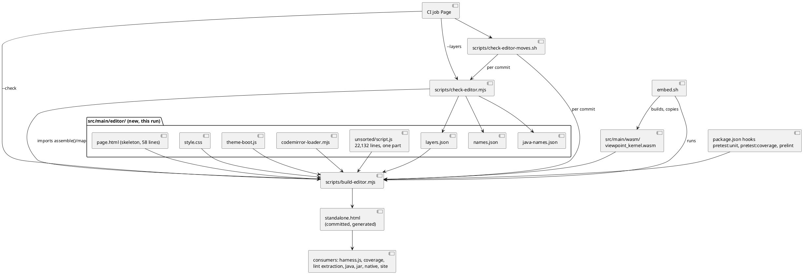
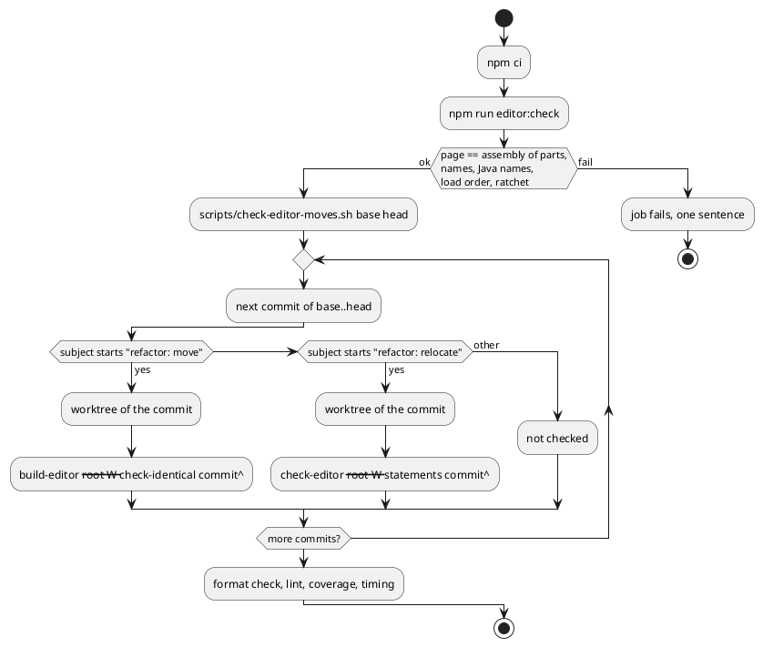

# Technical Design: the editor page assembler, its guards and the first cuts (W-5)

# Summary

Run 0183 is W-5 of wave 024, the first run of phase P3. The design it carries out is the accepted one of run 0182 (`tdd-0182-editor-modules-design.md`, called "the design" below; its decisions are cited as `0182 DEC-n`). This document does not redesign the cut. It says how the four steps 5.1 to 5.4 of `0182 DEC-9` are built in this repository: `scripts/build-editor.mjs` (assemble, `--check`, `--check-identical`, `--where`, `--map`), `scripts/check-editor.mjs` (layers, names, load order, statements, cut), `src/main/editor/` (the skeleton, the stylesheet, the theme boot, the CodeMirror loader and the script as one part), the committed lists (`layers.json`, `names.json`, `java-names.json`), `embed.sh` through the assembler, the CI Page job and the check of move commits. The committed `src/main/resources/editor-webapp/standalone.html` becomes the output of the assembler and stays byte-identical to the page of today (sha256 starts `a653717d5564c237`) until the optional last commit of 5.4. No logic moves in this run.

Three things shape it. First, the accepted design keeps every consumer of the page on the same path and the same bytes, so the jar, the native image, the website step, the node harness, the coverage script, the lint extraction and the Java tests change nothing; the wave row names some of them as paths of this run, and DEC-8 says why they stay unchanged. Second, the tools W-6 to W-9 rely on (`--check-identical`, `--statements`, `--layers`) are written and tested here, so they are the largest part of the work. Third, the run changes the release pipeline's inputs (a generated file, a CI job), which is why the wave marks it `hard_judgment`; nothing it does reaches `pom.xml`, the native resources or the publishing steps.

# Scope

In scope: steps 5.1 to 5.4 of `0182 DEC-9`; the two scripts and their tests; the three committed lists; the npm scripts and hooks; the Page job steps and `scripts/check-editor-moves.sh`; `embed.sh`; the paragraphs of `CLAUDE.md` that give the commands and say the page is generated; the evidence of each step in the run document.

Out of scope: cutting the script into its 68 parts (W-6 to W-8); `model/ui-state.js` and the relocations (W-7); the redraw notification (W-11); `--same-ast`, formatting and linting the parts, the coverage areas by part (W-9); the hosted editor (#162); `.gitattributes` (`0182 DEF-6`); any change to what the editor does, writes or reads.

# PRD Traceability

TDD+pln run: there is no PRD, so traceability to requirement IDs is incomplete. The requirements are sourced from the wave plan (`wav-024-...md`, row W-5, the manifest, the P3 gate) and from the accepted design, and are named `W5-n`:

- `W5-1` (row W-5, scope): `scripts/build-editor.mjs` with assemble, `--check` and `--check-identical <commit>`.
- `W5-2` (row W-5): `src/main/editor/layers.json` and its ratchet, the current violations counted.
- `W5-3` (row W-5): the check that the top-level names equal a committed list, and that the page functions named by Java comments exist.
- `W5-4` (row W-5): tests, coverage and lint read the sources.
- `W5-5` (row W-5): `embed.sh` through the assembler.
- `W5-6` (row W-5): the CI Page job and the website `sed` follow the layout.
- `W5-7` (row W-5): `EditorHttpServer` and `quarkus.native.resources.includes` follow the layout.
- `W5-8` (row W-5, D2): the first cuts are the non-logic parts: CSS, theme boot, kernel base64 (and the small module script, by the default of D2).
- `W5-9` (row W-5, exit evidence): node suite, Java suite, e2e, `embed.sh --check` and `EditorServeIT` pass; the assembled file equals the old page.
- `W5-10` (P3 gate, items this run owns): the assembler check on every move commit (`--check-identical <parent>`), the ratchet maximum committed here and never raised, `embed.sh --check` passing.
- `W5-11` (manifest, `delegation_reason`): the change to the published editor and the release pipeline is made with the Native job, not run here, read on the pull request.

Addressed: `W5-1` to `W5-3`, `W5-5`, `W5-8` to `W5-11`. `W5-4`, `W5-6` and `W5-7` are addressed by a different mechanism than the row suggests (consumers keep reading the assembled page, hooks and a check make it current): see DEC-8.

Mismatches between the wave row and the accepted design, settled here in favour of the design (the author accepted it on 2026-10-26, wave prg):

- The row lists `src/main/java/.../editor/**`, `pom.xml`, `src/test/javascript/harness.js` and the website `sed` among the paths; `0182 IMP-8` says none changes, because the page keeps its path and its bytes. They are in `likely_paths` as places to look, and this run proves they need no edit (DEC-8).
- The exit evidence says "the assembled file equals the old page apart from the part headers"; the design has no part headers (`0182 DEC-1`), so the assembled file equals the old page byte for byte, which is a stronger and simpler check.
- Row 5.3 of `0182 DEC-9` says the Page job is shown red on a stale page "tried once on purpose"; this run proves it locally and by the tools' tests and reads the green run of the pull request instead (Q-3, reopenable by the author). The substitute proof is: the tools' test on a changed byte (exit 1 with the sentence of DEC-2), the same `npm run editor:check` exiting 1 locally on a one-byte hand edit, and the green run of the pull request.
- `0182 DEC-10` says 8.3 uses `--cut` again; the bytes differ after the relocations of 7.2 and `--cut` refuses another page (DEC-4), so 8.3 uses `--layers` and `--list`.
- The row's `likely_paths` does not list `src/main/editor/**`, `src/test/javascript/editor-build/**`, `package-lock.json` or `CLAUDE.md`; the run edits them and names them as files outside `likely_paths` in its plan.

# Technical Goals

- TG-1: `npm run editor:build` writes `standalone.html` from `src/main/editor/`, and the written file equals the committed one (`W5-1`, `W5-8`, `W5-9`).
- TG-2: three kinds of guard exist and are tested before any logic moves: byte identity to a parent commit, statement identity to a parent commit (moves of declarations between parts), and the layer count with a committed maximum (`W5-1`, `W5-2`, `W5-10`).
- TG-3: the names the tests and the Java sources depend on are a committed list that a check compares with the page (`W5-3`).
- TG-4: through the npm scripts that read the page (`test:unit`, `test:coverage`, `lint`) a developer or an agent cannot test or lint a stale page, and CI fails a page that is not the assembly of its parts (`W5-4`, `W5-6`).
- TG-5: the kernel is embedded through the assembler (`W5-5`).
- TG-6: every consumer of the page keeps working with no edit, shown by running them (`W5-7`, `W5-9`).

# Non-Goals

- Moving, renaming or editing any line of the script. After 5.1 the script is one part, `unsorted/script.js`, equal to lines 1030-23161 of the page of today.
- ES modules or a bundler (`RFC-001`).
- Making Prettier or ESLint read `src/main/editor/` (W-9). The assembled script is linted as today, through `extract-editor-script.mjs`.
- A change to the Java side, the Rust kernel, the manifests, the CLI, the schemas or the kernel contract.
- Proving the CI red on a stale page by pushing a deliberately bad commit (DEC-6, Q-3).

# Assumptions

- ASM-1: the page does not change between the measure of run 0182 and this run. Re-verified while drafting this document: `sha256sum` of `standalone.html` starts `a653717d5564c237`, 23,170 lines, and `node docs/wav/wav-024-fixes-and-editor-modules/run/run-0182-editor-modules-design/measure-cut.cjs` prints 1,349 declarations, 68 parts, cycles 95, 7, 3, 3 and pairs 311, 162, 100. `git log` shows the last change to the page at `b67fc90` (#170), before `af1ed2d`. Validation: step 5.1 starts by comparing the hash; if it differs, the run regenerates the numbers with `measure-cut.cjs` and updates the cut table before committing a maximum.
- ASM-2: the skeleton of the design reproduces the page. Checked while drafting with a throwaway assembler in the scratch folder: a 58-line `page.html` with three `@include` lines, one `@parts` line and one `@wasm` line, the files `theme-boot.js` (4 lines, page lines 12-15), `style.css` (953, lines 18-970), `codemirror-loader.mjs` (27, lines 1000-1026), `script.js` (22,132, lines 1030-23161), and the wasm base64 from `src/main/wasm/viewpoint_kernel.wasm` gave a file `cmp`-identical to the committed page. The tags ``. The assembled page keeps that shape; a comment that adds `` 23162, comment 23163-23167, the kernel block at 23168 (1,059,656 characters), `</body></html>`. No CR, ends with one newline.
- `src/main/editor/` does not exist. `scripts/` holds `byte-identity.sh`, `byte-identity-exceptions.txt`, `editor-coverage-floor.json`, `editor-coverage.mjs` and `extract-editor-script.mjs`. `src/test/javascript/` holds `site.test.js` and `viewpoint-kernel/` (134 entries, including `harness.js`).
- `package.json` scripts: `format`, `format:check`, `lint` (`node scripts/extract-editor-script.mjs && eslint ...`), `test:unit`, `test:e2e`, `test:coverage`, `test:timing`; no `pre*` hook, no `editor:*`. `acorn` and `eslint-scope` are not in `package.json`.
- `embed.sh` (write mode) builds the wasm into `$here/target`, then a Python block writes the base64 into the page by a regex and copies the wasm to `src/main/wasm/viewpoint_kernel.wasm`. Check mode builds into a scratch folder and compares the committed wasm and the page's block with the build. CI runs it in the Kernel job.
- CI `Page` job (`.github/workflows/ci-build.yaml` lines 92-141): checkout with `fetch-depth: 0`, Node 22, `npm ci`, format check, lint, `npm run test:coverage`, the coverage artifact, `npm run test:timing`. The workflow runs on `pull_request`, `push` to `main` and tags, and `workflow_dispatch` (the Page job is skipped on dispatch). The website step (lines 350-365) stamps the version into a copy of the committed page with `sed`.
- Consumers of the page, all reading `src/main/resources/editor-webapp/standalone.html`: `harness.js` (and 106 of 116 node test files through `createApp`/`openFixture`), `editor-coverage.mjs`, `extract-editor-script.mjs`, `EditorHttpServer` (`/editor-webapp/standalone.html`), `EditorReadSchemaTest`, `GuideViewPropertiesTest`, `NativeReflectionConfigTest`, the website step, `embed.sh`, `.prettierignore`.
- The Java sources name page functions in comments ("`{@code X} in {@code standalone.html}`, keep them alike"). Checked while drafting: the 21 names of `0182 DEC-11` are each a top-level declaration of the page (one `function`, `const` or `let` line each), and each is named in at least one Java file (listed in CTR-4).

The reviewer should check that every arrow out of `standalone.html` goes to a consumer that keeps its path, and that the new arrows are into `build-editor.mjs`, `check-editor.mjs` and `check-editor-moves.sh` only.

# Proposed Design

## Order of the work and the kind of each commit

| Commit | Step | Kind | Files | Guard | DEC |
| --- | --- | --- | --- | --- | --- |
| 1 | 5.1a | additive | `scripts/build-editor.mjs`, its tests, `editor:build` and `editor:check` (`build-editor.mjs --check` alone) in `package.json` | node suite, `--check` on a temporary tree | DEC-1, DEC-2 |
| 2 | 5.1b | move | `page.html`, the four files, `unsorted/script.js`, `layers.json` (no `ratchet` key); the page is rebuilt | `build-editor.mjs --check-identical HEAD~1`, `cmp` with the parent | DEC-1, DEC-3 |
| 3 | 5.2 | additive | `scripts/check-editor.mjs`, its tests, `names.json`, `java-names.json`, `ratchet.max` 162, `editor:check` extended with `check-editor.mjs --layers`, `acorn` and `eslint-scope` in `devDependencies` | node suite, `--cut` prints 311, 162, 100, `--layers` prints `upward pairs: 0 (max 162)` | DEC-4, DEC-5, DEC-6 |
| 4 | 5.3 | additive | the hooks `pretest:unit`, `pretest:coverage`, `prelint`, the Page job steps, `scripts/check-editor-moves.sh`, `embed.sh`, `CLAUDE.md` | node suite, the stale-page check shown to fail locally, the move script over the run's commits | DEC-6, DEC-7 |
| 5 | 5.4 | change | the generated-file comment line of `page.html` | node suite, `EditorServeIT`, e2e; dropped if a test must be edited | DEC-9 |

- DEC-1 — 5.1 is two commits, and the maximum is committed once, in 5.2
  - Decision: `0182 DEC-9` is followed with two refinements. (a) Step 5.1 is two commits: first `feat: build-editor.mjs assembles the editor page from src/main/editor` (additive: the assembler, its tests, `editor:build` and `editor:check` in `package.json`, nothing assembled yet; in 5.1a `editor:check` is `build-editor.mjs --check` alone, 5.2 extends it with `check-editor.mjs --layers` and adds `acorn` and `eslint-scope`), then `refactor: move the editor page to src/main/editor` (kind *move*: the skeleton, the four files, `unsorted/script.js`, `layers.json`; the page is rebuilt and equals its parent). (b) `layers.json` has no `ratchet` key until 5.2, where `ratchet.max` is written as 162 in the commit that adds `check-editor.mjs` and shows it printing 162 with `--cut`. The steps then run in this order, each ending with the node suite (`0182 DEC-6`): 5.1a, 5.1b, 5.2, 5.3, 5.4.
  - Rationale: a *move* commit must change no byte of the page and be the pure move that `RFC-003` names; putting the assembler in the same commit makes the first move commit also an additive change, which the CI check of move commits (DEC-6) would have to excuse. Committing `max` only when the tool reproduces the design number means no number is committed that the repository cannot print.
  - Alternatives considered: one commit for 5.1 as `0182 DEC-9` lists it (the move check cannot exempt a commit that adds a script); the maximum in 5.1b (a number nothing checks yet).
  - Tradeoffs: one more commit.
  - Linked PRD IDs: `W5-1`, `W5-2`, `W5-10`.

## The assembler

- DEC-2 — `scripts/build-editor.mjs`: directives, rules, modes
  - Decision: the skeleton `src/main/editor/page.html` is read line by line. A line that is exactly one of `<!--@include FILE-->`, `<!--@parts-->` or `<!--@wasm FILE-->` is replaced; any other line is copied. `FILE` is relative to `src/main/editor/` (the wasm line is `<!--@wasm ../wasm/viewpoint_kernel.wasm-->`). `@include` gives the file's content without its last newline (the file must end with one). `@parts` gives the parts of `layers.json` in order, each verbatim, joined with nothing, without the last newline of the last (each part must end with a newline, else two lines would glue: an error). `@wasm` gives ``. Errors, each one line on stderr and exit 1: an unknown directive, a line that contains `<!--@` and is not exactly a directive, a part missing from disk, a part on disk under `src/main/editor/` (any of `core/ model/ persistence/ application/ presentation/ composition/ unsorted/`) that `layers.json` does not list, a part listed twice, a part whose first path segment is not its layer, a layer not in `layers` and not `unsorted`, a file with a CR or a byte-order mark, a part that does not end with a newline. All files are read and written as UTF-8 text with LF. Modes: no option assembles and writes `src/main/resources/editor-webapp/standalone.html` only when the bytes differ and prints the number of parts and bytes; `--check` assembles in memory and exits 1 with ``standalone.html is generated: edit src/main/editor and run `npm run editor:build` `` when the committed file differs, naming the first differing line and the part and line that produce it; `--check-identical <rev>` assembles in memory and compares with `git show <rev>:src/main/resources/editor-webapp/standalone.html` byte for byte, exit 1 naming the first differing line and its part; `--where <line>` prints `<part>:<line in part>` for a line of the page (`page.html:N` or `style.css:N` for the other files); `--map` prints the parts and files with their first and last line of the page as JSON (the input of `check-editor.mjs`); `--root <dir>` assembles the tree at `<dir>` instead of the repository (the check of move commits uses a worktree of each commit). The script exports `assemble(root)` and `mapOf(root)` and runs its command line only when executed directly, so `check-editor.mjs` and the tests import it. It has no dependency.
  - Rationale: `ASM-2` shows these rules reproduce the page; a plain byte comparison is the only check with no judgment in it (`0182 DEC-1`, `RFC-003`). Writing only on a difference keeps the modification time of the committed file, so Maven and editors are not disturbed by a hook that has nothing to do.
  - Alternatives considered: a header comment per part (rejected in `0182 DEC-1`); `@include` taking the trailing newline (then the skeleton line and the file both end a line, and the directive line cannot be replaced by exactly the file's bytes).
  - Tradeoffs: the tool refuses a file in `src/main/editor/` it does not know, so adding a part is always an edit to `layers.json`.
  - Linked PRD IDs: `W5-1`, `W5-8`, `W5-9`.

- DEC-3 — the committed lists, in the shape W-5 needs
  - Decision: `src/main/editor/layers.json` is `{ "layers": ["core","model","persistence","application","presentation","composition"], "parts": [{ "file": "unsorted/script.js", "layer": "unsorted" }], "ratchet": { "max": 162 } }` (the `ratchet` key: see the table above). The one part is under `unsorted/` so that the rule "the first path segment of `file` equals its layer" has no exception; W-6 and W-7 add parts before or after it and 8.3 removes it. No `area` key (W-9, `0182 CTR-1`). `src/main/editor/names.json` is `{ "names": [<the 1,331 distinct top-level names, sorted>], "unnamed": 18 }`, written by `check-editor.mjs --write-names` from the assembled page (a mode used by a commit that adds or removes a declaration, never by CI). `src/main/editor/java-names.json` is DEC-5.
  - Rationale: `unsorted/script.js` follows `0182 DEC-4`'s "`<layer>/<name>.js`" rule. `names.json` is the contract with 106 test files and four Java readers (`0182 ASM-3`).
  - Alternatives considered: `script.js` at the top level of `src/main/editor/` with the rule excused for `unsorted` (an exception in the code for a file that lives a few runs).
  - Tradeoffs: `names.json` makes adding a function a two-file edit until W-9 decides its future (`0182 DEF-4`, RISK-9).
  - Linked PRD IDs: `W5-2`, `W5-3`.

## The checks

- DEC-4 — `scripts/check-editor.mjs`: modes and their exact meaning
  - Decision: the script reads the assembled page (it calls `assemble(root)`), parses the main script with `acorn` (`ecmaVersion: 'latest'`, `sourceType: 'script'`) and analyses it with `eslint-scope`, as `measure-cut.cjs` does. A *declaration* is a top-level function, class, `const`, `let` or statement of the main script (the first bare `<script>`); a *name* is an identifier it declares. A reference is a reference that scope analysis resolves to a variable of the global scope; a local that shadows a top-level name is not a reference. Modes (exit 0 or 1; one line per finding):
    - `--layers`: runs the four checks in this order and stops at the first that fails. (1) *Names*: the sorted top-level names and the number of statements that declare no name equal `names.json` (the message lists the names added and removed). (2) *Java names*: DEC-5. (3) *Load order*: for every top-level declaration that is not a function declaration, the names it resolves to a `let`, `const` or class at load time (outside any function body, plus the bodies of the functions it calls while the script loads, transitively, over-approximated by every call to a top-level function that appears in the declaration or in such a body outside deferred code) are declared earlier in the assembled script; a name that is a function declaration is always satisfied (hoisted). The listener registrations that pass a function by name are satisfied by the same rule. (4) *Ratchet*: the number of pairs (A, B) with A and B in different parts, B in a higher layer than A, A naming B (calls, reads or assigns), A and B top-level declarations, parts of layer `unsorted` left out on both sides, is not above `ratchet.max`; the line printed is `upward pairs: N (max M)`. With one part, N is 0.
    - `--list`: the pairs of check 4 by name, "A names B", grouped by layers, and for each part the names other parts use.
    - `--statements <rev>`: for the main script of the assembled page and the one of `<rev>`: the multisets of top-level declarations are equal, each declaration taken with the comment lines directly above it with no blank line between (the bytes from the first of those lines to the end of the statement); the multisets of all comments (the text of each) are equal; everything outside the main script (the skeleton, the stylesheet, the theme boot, the loader, the wasm block) is byte-equal; and check 3 (load order) holds. It is the check of a *relocate* commit (a declaration moves to another part and so to another place of the script).
    - `--cut <file>`: evaluates a cut table in the format of `editor-cut.json` (parts by first line of the page, layers, the `relocate` list) against the page and prints three counts, one line each: the pairs with the parts as cut, with the `relocate.names` moved to `relocate.to`, and with no pair that names `render`. It refuses (exit 2) a page whose sha256 does not start with the table's `sha256Prefix`. It is the proof that the tool counts what the design counted; it holds for the page of `af1ed2d`, that is, before 5.4, and not after the relocations of 7.2: 8.3 uses `--layers` and `--list`, not `--cut`.
    - `--write-names`: writes `names.json` from the assembled page.
  - Rationale: these are the exact definitions of `0182 DEC-3`, `DEC-5` and `DEC-10`, with the points the design left to the tool made explicit: what "names" means (scope analysis), what a comment block is for `--statements`, that the load-order rule is exact for variables and over-approximated for calls (a false positive makes a relocation refuse itself; it never lets a wrong order through), and that `--cut` is refused on another page. `--same-ast` is not built here (W-9, `0182 DEC-9` step 9.2).
  - Alternatives considered: `espree` (no new line in `package.json`, but an undeclared dependency); counting without scope analysis (cannot tell a shadowing local from a top-level name); comparing statements by their parsed tree (that is `--same-ast`, a format check, not a relocation check).
  - Tradeoffs: the over-approximated call rule can refuse a relocation that is in fact safe; the answer is to leave that variable where it is and keep its pair in the count (`0182 DEC-5`).
  - Linked PRD IDs: `W5-2`, `W5-3`, `W5-10`.

- DEC-5 — the names the Java side depends on: a committed list with files
  - Decision: `src/main/editor/java-names.json` is `{ "names": { "<NAME>": ["<repo path of a Java file>", ...], ... }, "pathOnly": ["<repo path of a Java file>", ...] }` for the 21 names of `0182 DEC-11`, each with the Java files that name it, found by `grep -rlw NAME src/main/java src/test/java` while drafting (for instance `stepPlateauProblems`: `WorkspaceFactory.java`, `LayerLoader.java`, `StepPlateausTest.java`). `check-editor.mjs --layers` check 2 fails when (a) a listed name is not a top-level name of the assembled script, (b) a listed Java file no longer contains the name as a word, or (c) a Java source that contains `standalone.html` and is in neither the union of the files of the names nor `pathOnly` appears (so a new comment that names the page forces an entry); `pathOnly` holds the two files that name the path and no function, `EditorHttpServer.java` and `NativeReflectionConfigTest.java`. The three regular expressions of the tests are not re-run here; `EditorReadSchemaTest` and `GuideViewPropertiesTest` run them in `./mvnw verify` (CON-3).
  - Rationale: the Java comments do not follow one grammar (`{@code X} in {@code standalone.html}`, "the editor says the same ({@code Y})", a name two lines from the page), so a parser of the comments would be a source of false results; a list with its files, checked from three sides, is exact and short.
  - Alternatives considered: a regex over the comments as `0182 DEC-11` suggests (checked while drafting: at least three comment shapes, so the regex misses some); renaming nothing.
  - Tradeoffs: a person who adds a Java comment that names a page function must add it to the list; check (c) says so in one sentence.
  - Linked PRD IDs: `W5-3`.

## Consumers, hooks and CI

- DEC-6 — scripts, hooks and the Page job
  - Decision: `package.json` gains `editor:build` (`node scripts/build-editor.mjs`), `editor:check` (`node scripts/build-editor.mjs --check` in 5.1a; `node scripts/build-editor.mjs --check && node scripts/check-editor.mjs --layers` once 5.2 extends it, the step that also adds the two devDependencies), and the hooks `pretest:unit`, `pretest:coverage` and `prelint`, each `node scripts/build-editor.mjs` (5.3, with the Page job steps). `acorn` 8.19.0 and `eslint-scope` 9.1.2 are added to `devDependencies` pinned exact (`npm install --save-dev --save-exact --ignore-scripts acorn@8.19.0 eslint-scope@9.1.2`; the lock changes by the two root entries and the `dev` flags only; checked by `git diff package-lock.json` and by `npm ci` in a scratch copy). The Page job gains, after "Install the Node.js dependencies" and before "Check the format": "Check the editor page is the assembly of its parts" (`npm run editor:check`) and, on a `pull_request` only, "Check the move commits" (`scripts/check-editor-moves.sh "${{ github.event.pull_request.base.sha }}" "${{ github.event.pull_request.head.sha }}"`). `scripts/check-editor-moves.sh <base> <head>` lists `git rev-list --reverse <base>..<head>`, and for each commit whose subject begins `refactor: move` creates a detached worktree of the commit in a temp folder and runs `node scripts/build-editor.mjs --root <worktree> --check-identical <commit>^`; for each commit whose subject begins `refactor: relocate` it runs `node scripts/check-editor.mjs --root <worktree> --statements <commit>^`; other subjects are not checked; it prints one line per checked commit (hash, subject, ok) and exits 1 on the first failure naming the commit. The scripts run are those of the checked-out head (the tool does not depend on the commit it checks). The Java, Kernel, E2E, Native, Build jobs and the website step are unchanged.
  - Rationale: the Page job already has `fetch-depth: 0` and Node; the stale-page check goes first so that a hook cannot repair in CI what the check should report. A hook in each npm script that reads the page makes "tested a stale page" impossible on a developer machine (`0182 DEC-7`). Per-commit worktrees are the only way to assemble the tree of a past commit with the tool of the head.
  - Alternatives considered: running `editor:build` in CI and committing nothing (the committed page would no longer be the reviewed one); a Maven step (CON-9); checking only the head (the pure moves of W-6 to W-8 would be unproved on the pull request).
  - Tradeoffs: a hook writes a committed file as a side effect (quiet when nothing differs, DEC-2); the move check costs one worktree and one assembly per move commit (about seventy in P3, milliseconds each).
  - Linked PRD IDs: `W5-4`, `W5-6`, `W5-10`.

- DEC-7 — `embed.sh` writes the kernel through the assembler
  - Decision: the write mode builds the wasm as now, copies it to `src/main/wasm/viewpoint_kernel.wasm`, then runs `node "$root/scripts/build-editor.mjs"` (the repository root, from `$here`). The Python block keeps only the check mode (the comparison of the committed wasm and the page's block with the build), with the regex it has. The header says the write mode needs Node.
  - Rationale: one place writes the block (`0182 FLOW-3`); `--check` of the Kernel job needs nothing new (`CON-7`).
  - Alternatives considered: letting the Python write the page and the assembler check it (two writers).
  - Tradeoffs: a developer who rebuilds the kernel needs Node (they already need it for the editor tests).
  - Linked PRD IDs: `W5-5`.

- DEC-8 — what does not change, and why the wave row's paths are left alone
  - Decision: `harness.js`, the 106 test files that run the page, `editor-coverage.mjs` (`SCRIPT_URL`, the `SECTIONS`), `extract-editor-script.mjs`, `EditorHttpServer.java`, `pom.xml`, `application.properties` (`quarkus.native.resources.includes`), `.prettierignore`, the website step and the E2E job are not edited by this run. Each keeps reading `src/main/resources/editor-webapp/standalone.html`. The proof is running them: the node suite, `npm run test:coverage` (the floor file unchanged), `npm run lint`, `./mvnw verify -DskipITs=false` (`EditorServeIT`, `EditorReadSchemaTest`, `GuideViewPropertiesTest`, `NativeReflectionConfigTest`), `npm run test:e2e`, and a local run of the website `sed` line on the assembled page followed by its two `grep -q` checks.
  - Rationale: `0182 DEC-7` and `IMP-8`, accepted by the author. The row's wording ("tests, coverage and lint read the sources") is the W-9 state; W-5 makes the sources the source of the file all of them read.
  - Alternatives considered: pointing the harness at the assembler now (two truths; `0182 DEC-7`).
  - Tradeoffs: a person reading a test sees the generated page path; the hooks make it current.
  - Linked PRD IDs: `W5-4`, `W5-6`, `W5-7`.

- DEC-9 — the generated-file comment is the last commit and may be dropped
  - Decision: 5.4 adds one HTML comment line after `<html lang="en">` in `page.html`: `<!-- Generated by scripts/build-editor.mjs from src/main/editor: edit the parts there, not this file (npm run editor:build). -->`. It contains no `<script`, no `<meta` and no `archicode-version`. It is a *change* commit with the node suite, `EditorServeIT` and the e2e suite as guard. If the suite needs any test edited to pass (a test that depends on the line numbers or the head of the page), the commit is not made, the reason is logged, and `--check`, the hooks and CI remain the protection against a hand edit (`0182 DEC-1`: "may add").
  - Rationale: the comment is the one in-file warning for a person who opens the published page or the committed file; it moves the page by one line, so it comes after every step whose proof is byte identity.
  - Alternatives considered: no comment (a hand edit is caught by CI, a day later); a comment in each part (rejected by `0182 DEC-1`).
  - Tradeoffs: `--cut` and the numbers of `0182` are valid only before this commit (they name lines of the page of `af1ed2d`); the commit is last for that reason.
  - Linked PRD IDs: `W5-9`.

# Repository Impact

- IMP-1 — the editor sources
  - Path(s): `src/main/editor/page.html`, `style.css`, `theme-boot.js`, `codemirror-loader.mjs`, `unsorted/script.js`, `layers.json`, `names.json`, `java-names.json`
  - Change type: additive
  - Why impacted: DEC-2, DEC-3, DEC-5; `0182 IMP-1`, `IMP-2`.
  - Linked PRD IDs: `W5-1`, `W5-8`
  - Risks / notes: outside `src/main/resources`, so not packaged; `unsorted/script.js` is 22,132 lines, above the wave's 3,000-line limit until W-6 to W-8 cut it (the limit is a P3 gate, not a W-5 one).
- IMP-2 — the generated page
  - Path(s): `src/main/resources/editor-webapp/standalone.html`
  - Change type: modify (generated)
  - Why impacted: it becomes the output of the assembler; same bytes after 5.1b to 5.3; one added line after 5.4.
  - Linked PRD IDs: `W5-9`
  - Risks / notes: `.prettierignore` still lists it.
- IMP-3 — the tools and their tests
  - Path(s): `scripts/build-editor.mjs`, `scripts/check-editor.mjs`, `scripts/check-editor-moves.sh`, `src/test/javascript/editor-build/*.test.js`, `package.json`, `package-lock.json`
  - Change type: additive, modify
  - Why impacted: DEC-2, DEC-4, DEC-6.
  - Linked PRD IDs: `W5-1` to `W5-3`
  - Risks / notes: outside the row's `likely_paths` (`src/test/javascript/editor-build/**`, `package-lock.json`). The tests use temporary folders and a temporary git repository; they are picked up by `test:unit` and `test:coverage` (they do not load the page and do not move the figure). New files must pass `format:check` and `lint`.
- IMP-4 — kernel embedding
  - Path(s): `src/main/rust/viewpoint-kernel/embed.sh`
  - Change type: modify
  - Why impacted: DEC-7.
  - Linked PRD IDs: `W5-5`
  - Risks / notes: `embed.sh --check` must pass locally (`cargo` and `python3` are installed here) and in the Kernel job.
- IMP-5 — CI
  - Path(s): `.github/workflows/ci-build.yaml` (Page job)
  - Change type: modify
  - Why impacted: DEC-6.
  - Linked PRD IDs: `W5-6`
  - Risks / notes: proved by the pull request's own run; no publishing step is touched.
- IMP-6 — documents
  - Path(s): `CLAUDE.md` ("Build & Test": `editor:build`, `editor:check`, the hooks, the generated page; the Format paragraph's sentence that the page "waits for #161"; the editor-script coverage paragraph's "one script" wording as far as it is no longer true)
  - Change type: modify
  - Why impacted: the wave's completion criterion starts here and ends in W-9.
  - Linked PRD IDs: `W5-6`
  - Risks / notes: outside `likely_paths` (`CLAUDE.md` is not in the W-5 row). The manual (`src/doc`) says "a single page, `standalone.html`", which stays true for the distributed file, so it is not edited.
- IMP-7 — nothing else
  - Path(s): `pom.xml`, `src/main/resources/application.properties`, `EditorHttpServer.java`, `harness.js`, the Java tests, the Rust sources, `scripts/editor-coverage*`, `scripts/extract-editor-script.mjs`, `.prettierignore`, `eslint.config.mjs`.
  - Change type: none
  - Why impacted: DEC-8.
  - Linked PRD IDs: `W5-4`, `W5-7`
  - Risks / notes: a diff that touches one of them is a defect of the run.

# Canonical Impact

Not applicable — no canonical registers declared (`docs/` holds `run`, `wav` and `fixtures` only; there is no `docs/CLAUDE.md`).

# Data Model and Contracts

- CTR-1 — `src/main/editor/page.html` (skeleton)
  - Current contract: none (the page is one file).
  - Proposed contract: the three directives of DEC-2, each alone on a line; every other line is copied. After 5.1b it is the 58 lines of ASM-2.
  - Affected files: `scripts/build-editor.mjs`.
  - Migration or compatibility notes: the assembled page has no trace of the directives.
  - Linked PRD IDs: `W5-1`
- CTR-2 — `src/main/editor/layers.json`
  - Current contract: none.
  - Proposed contract: DEC-3. `parts` is the assembly order; `layer` is one of `layers` or `unsorted`; the first segment of `file` equals `layer`; `ratchet.max` only goes down.
  - Affected files: the assembler, `check-editor.mjs`; `editor-coverage.mjs` from W-9.
  - Migration or compatibility notes: an unknown key is ignored by the assembler and refused by `check-editor.mjs`.
  - Linked PRD IDs: `W5-2`
- CTR-3 — `src/main/editor/names.json`
  - Current contract: none.
  - Proposed contract: DEC-3.
  - Affected files: `check-editor.mjs`.
  - Migration or compatibility notes: a P3 migration guard; kept or dropped in W-9 (`0182 DEF-4`).
  - Linked PRD IDs: `W5-3`
- CTR-4 — `src/main/editor/java-names.json`
  - Current contract: none.
  - Proposed contract: DEC-5. Content at drafting: `READ_SCHEMA` (`Nesting.java`, `EditorReadSchemaTest.java`), `dottedIdProblem` (`ManifestParser.java`), `plateauShapeProblem` (`Plateau.java`), `parseManifestText` (`ManifestParser.java`), `REMOVED_PLATEAUS_KEY` (`WorkspaceFactory.java`), `facetNameProblem` (`FacetNames.java`), `manifestsPathSentence` and `readManifestFolder` (`ManifestDiscovery.java`), `buildPlateauTree` (`PlateauTree.java`), `horizonPeriod` (`PlateauTree.java`, `PlateauTreeDetailsTest.java`), `layerProblemsOf` (`DanglingReferences.java`), `entryProblemsOf` and `foldParentProblems` (`LayerLoader.java`), `rootProblem` (`ElementIndexFactory.java`), `stepPlateauProblems` (`WorkspaceFactory.java`, `LayerLoader.java`, `StepPlateausTest.java`), `duplicateReferenceMessage` (`ManifestParser.java`), `FORMER_WORKSPACE_FILE_SENTENCE` (`WorkspaceFactory.java`), `diagramHasNothingToDraw` (`StoriesNotEmptyTest.java`), `VIEW_PROPERTY_ORDER`, `MAP_PARTS`, `DIAGRAM_SHOW_NAMES` (`GuideViewPropertiesTest.java`); `pathOnly`: `EditorHttpServer.java`, `NativeReflectionConfigTest.java`. The step re-runs the `grep` and writes the paths in full.
  - Affected files: `check-editor.mjs`.
  - Migration or compatibility notes: none.
  - Linked PRD IDs: `W5-3`
- CTR-5 — `package.json` scripts and dependencies
  - Current contract: the scripts listed in Current State (no hook, no editor script, no parser dependency).
  - Proposed contract: `editor:build`, `editor:check`, three hooks, two exact-pinned devDependencies.
  - Affected files: `package.json`, `package-lock.json`.
  - Migration or compatibility notes: no runtime dependency; `npm ci` in the E2E job and the Page job installs them.
  - Linked PRD IDs: `W5-4`
- CTR-6 — the commit subjects of P3 (restated)
  - Current contract: Conventional Commits, no scope.
  - Proposed contract: `refactor: move ...` and `refactor: relocate ...` mean "the check of DEC-6 must pass for this commit"; `feat:`, `fix:`, `chore:` and other `refactor:` subjects are not checked. This run's move commit is 5.1b.
  - Affected files: `scripts/check-editor-moves.sh`, `.github/workflows/ci-build.yaml`.
  - Migration or compatibility notes: a subject is a promise the check enforces.
  - Linked PRD IDs: `W5-10`
- CTR-7 — the page as the other tools see it (unchanged, restated so that it is checked)
  - Current contract: `CON-2`, `CON-3`; the path; the top-level names; `'use strict'` first.
  - Proposed contract: the same, byte for byte after 5.1b to 5.3; one comment line after 5.4 (DEC-9).
  - Affected files: every consumer (none edited).
  - Linked PRD IDs: `W5-7`, `W5-9`

No change to the manifests, `.archicode.yaml`, the CLI, the schemas or the kernel contract.

# Interfaces and Behavior

- IF-1 — `node scripts/build-editor.mjs [--check | --check-identical <rev> | --where <line> | --map] [--root <dir>]` (DEC-2).
- IF-2 — `node scripts/check-editor.mjs [--layers | --list | --statements <rev> | --cut <file> | --write-names] [--root <dir>]` (DEC-4). `--layers` prints one line per check and `upward pairs: N (max M)`.
- IF-3 — `scripts/check-editor-moves.sh <base> <head>` (DEC-6).
- IF-4 — `npm run editor:build`, `npm run editor:check`; hooks `pretest:unit`, `pretest:coverage`, `prelint`.
- IF-5 — the editor itself: no change in what a person sees, writes or reads (a comment line after 5.4).
- Error states: each tool exits 1 with one sentence that names the file and, where it applies, the line, the part and what to do (`npm run editor:build`); `--cut` exits 2 on another page; a missing `git` object or an unknown `<rev>` is one line and exit 1, never a stack trace.

# Flows and Processing Logic

- FLOW-1 — edit a part
  - Trigger: a person or an agent changes a file under `src/main/editor/`.
  - Steps: `npm run editor:build` (or any `test:unit`, `test:coverage` or `lint`, whose hook builds) rewrites `standalone.html`; tests run on it; the commit holds both.
  - Branches / failure paths: the page was edited by hand: `editor:check` fails locally and in CI with the sentence of DEC-2; the next build overwrites the edit. `./mvnw verify` alone does not run the hook (CON-9): a stale committed page is found by the Page job.
  - Final output / rendered result: the committed page equals the assembly of the committed parts.
  - Linked PRD IDs: `W5-4`, `W5-6`
- FLOW-2 — the Page job on a pull request
  - Trigger: a `pull_request` event.
  - Steps: see the diagram. After `npm ci`, `editor:check` (assembly equals the committed page; names; Java names; load order; ratchet), then the move check over `base..head`, then the format check, lint, coverage, timing.
  - Branches / failure paths: a stale page, a name added without `names.json`, a Java file naming the page without an entry, or a ratchet above `max` fail the first step; a `refactor: move` commit whose assembled page differs from its parent's fails the second, naming the commit; a `refactor: relocate` commit fails on `--statements`.
  - Final output / rendered result: a pull request in which every moved line is proved unchanged.
  - Linked PRD IDs: `W5-6`, `W5-10`

The reviewer should check that no commit kind other than the two named is checked, that the move check uses the tools of the head on the tree of each commit, and that the stale-page check runs before any hook can rewrite the file.

- FLOW-3 — the kernel changes
  - Trigger: the Rust sources change.
  - Steps: `embed.sh` builds the wasm, copies it to `src/main/wasm/`, runs `node scripts/build-editor.mjs`, which writes the new base64 into the page; `embed.sh --check` (Kernel job) rebuilds in a scratch folder and compares the wasm and the page's block with the build, as now.
  - Branches / failure paths: Rust changed and wasm not rebuilt: Kernel job's `--check` fails, as today. Wasm rebuilt and page not assembled: Page job's `editor:check` fails.
  - Final output / rendered result: the page's block equals `base64(src/main/wasm/viewpoint_kernel.wasm)` always (`compare.test.js`, `change.test.js`, `patches.test.js` assert it).
  - Linked PRD IDs: `W5-5`
- FLOW-4 — release and website
  - Trigger: a release tag.
  - Steps: unchanged. `sed` stamps the version into a copy of the committed page; `Build` needs `Page`.
  - Linked PRD IDs: `W5-6`

# Reliability, Performance, and Scalability

The assembler concatenates files: milliseconds, plus the base64 of 0.8 MB. `check-editor.mjs` parses a 22,000-line script (`--statements` twice): seconds. The node suite is the cost (about 76 s, `0182 ASM-4`). The tools are deterministic: the same tree gives the same bytes and the same counts; a test runs each twice. Nothing changes at run time: the same bytes are served. Maintainability: a new person finds the source of the page in one folder with a layer file; the tools have tests of their own, so W-6 to W-9 rely on tested checks.

# Security and Privacy

Nothing reaches the network. The tools read git objects with `execFileSync('git', [...])` and `git worktree`, no shell and no interpolated string; `check-editor-moves.sh` quotes every expansion and passes the commit hashes as arguments only. The two added dependencies are development-only, pinned and already in the lock file through ESLint. No secret, no token, no write outside the repository and temp folders; the worktrees are removed in a `trap`.

# Observability and Verification

Per commit: `node scripts/build-editor.mjs --check`, the check of its kind (`--check-identical HEAD~1` for 5.1b), `npm run lint`, `npm run format:check`. Per step (`0182 DEC-6`): `npm run test:unit` (including the tools' tests). Per run: `npm run test:coverage` (floor unchanged), `./mvnw verify -DskipITs=false`, `npm run test:e2e`, `src/main/rust/viewpoint-kernel/embed.sh --check`, and the local website line:
`sed 's|<meta name="archicode-version" content="dev">|<meta name="archicode-version" content="9.9.9">|' src/main/resources/editor-webapp/standalone.html | grep -q 'content="9.9.9"'`.

Evidence the run records in its document (each a command and its result): the hash of ASM-1; `cmp` of the assembled page with `git show HEAD:...` before and after 5.1b; `build-editor.mjs --check-identical HEAD~1` at 5.1b; `check-editor.mjs --cut docs/wav/wav-024-fixes-and-editor-modules/run/run-0182-editor-modules-design/editor-cut.json` printing 311, 162, 100 beside `measure-cut.cjs`'s output; `check-editor.mjs --layers` printing `upward pairs: 0 (max 162)`; `embed.sh --check`; the stale-page check shown to fail locally (edit the page by one byte, `npm run editor:check` exits 1 with the sentence, restore it); the move check script run locally over the commits of the run (`scripts/check-editor-moves.sh <merge-base> HEAD`) printing `ok` for 5.1b; the CI result of the pull request for `Java`, `Page`, `Kernel`, `E2E`, `Build` and `Native`.

Tests of the tools (`src/test/javascript/editor-build/`): assembler (the directives; refusals: unknown directive, stray `<!--@`, part missing, part listed twice, part not listed, wrong first segment, no final newline, CR; byte-for-byte output; write only on a difference; `--check` and `--check-identical` on a temporary git repository with a changed byte and an unchanged one; `--where`, `--map`, `--root`); checker (names equal and unequal with the diff in the message; Java names a, b and c on a temporary tree (a file in `pathOnly` passes; a new file that names the page fails); load order: a `let` moved before the `const` its initializer reads fails, a function moved passes, a call at load that reads a later `const` fails; `--statements`: a function relocated passes, a function edited fails, a comment lost fails, a part outside the script changed fails; the ratchet at, below and above `max`; the count on a small synthetic script with three parts of three layers, a shadowing local and a function called from below; `--cut` on a synthetic table and its refusal on another page); the move script (a temporary repository with a move commit that is pure, one that edits a byte, a relocate commit, and a feat commit that is not checked). A fixed fixture is the source of every expected number; none names a commit hash of the project (CON-8).

The numbers 311, 162 and 100 and the 1,331 names are asserted by the run on the real page, not by a test of the repository (the page will change).

# Deployment and Rollout

Code and build only; no data migration. The served and published page is byte-identical through 5.1b to 5.3. Nothing here authorizes a release or a deploy. The pull request's own run proves the workflow change; `pom.xml` and the native resources are untouched, so the Native job (not runnable here, CON-4) is expected to pass unchanged and is read on the pull request (`0182 Q-4`). Rollback: revert the commits of a step; each step is independent of the later ones, and a failed step is reverted, not patched (`RFC-003`). 5.3 (hooks and CI) can be reverted without touching the sources of 5.1b.

# Risks and Tradeoffs

- RISK-1: the counts printed by `--cut` differ from 311, 162 and 100 (a difference between `measure-cut.cjs` and the port, or a drifted page). Mitigation: the port is checked against the output of `measure-cut.cjs` on the same page before any maximum is committed; a difference is explained in the run document or the maximum stays unwritten and the run reports a blocker.
- RISK-2: the load-order rule is over-approximated for calls, so a safe relocation can be refused. Mitigation: refusal is the safe direction (the variable stays, the pair stays in the count); the tests pin both the refusal and the pass.
- RISK-3: a hook writes a committed file. Mitigation: it writes only on a difference; CI checks before any hook runs; `./mvnw verify` has no hook (FLOW-1).
- RISK-4: adding two devDependencies edits the lock file. Mitigation: `--ignore-scripts`, exact versions already in the lock, review of `git diff package-lock.json` (root entries and `dev` markers only), `npm ci` in a scratch copy; if `npm install` needs the registry and it is unreachable, the run edits the two root entries by hand and proves it with `npm ci --offline` against the cache, or reports a blocker.
- RISK-5: `names.json` stops anyone adding a function without editing a second file, and the Java list stops a new comment that names the page. Mitigation: the failure sentence says what to do; only this wave edits the page during P3; W-9 decides the future of both (`0182 DEF-4`).
- RISK-6: the comment line of 5.4 shifts line numbers and a test fails. Mitigation: DEC-9, the commit is dropped and logged if any test needs editing.
- RISK-7: the Native job reads a changed tree (a new top-level folder, a changed page path). Mitigation: neither changes; the pull request's run is read before merge (`W5-11`).
- RISK-8: rebase-and-merge rewrites hashes, so a check that stores a hash would rot. Mitigation: CON-8; the move check runs on `pull_request` with the event's base and head only.
- RISK-9: the per-commit worktrees fail in CI (shallow clone). Mitigation: the Page job uses `fetch-depth: 0`; the script fails with one sentence when `<base>` is missing.
- RISK-10: the tools' tests make `test:unit` slower. Mitigation: they work on small fixtures and a few temporary repositories; the time added is recorded and expected to be a few seconds against 76.
- RISK-11: a developer edits `standalone.html` by hand in an IDE and loses the edit at the next hook. Mitigation: DEC-9's comment, `CLAUDE.md`, the failing check naming the part to edit (`--where`).

# Open Questions

- Q-1 (resolved while drafting, checked in Stage 6): is `check-editor-moves.sh` part of W-5? Yes: row 5.3 of `0182 DEC-9` (`tdd-0182` line 312) puts "check the move and relocate commits" in W-5, and the wave's P3 gate requires the check on every move commit.
- Q-2 (resolved while drafting, checked in Stage 6): does the first script go under `src/main/editor/script.js` or `unsorted/script.js`? `unsorted/script.js` (DEC-3), so the layer rule "first path segment equals the layer" has no exception. `src/main/editor/` does not exist yet and the page hash is still `a653717d5564c237` (ASM-1).
- Q-3 (resolved in Stage 6 as a decision, reopenable by the author; the one question that is a real tradeoff): does the run prove "the Page job is red on a stale page" with a deliberately failing commit pushed to the pull request, as row 5.3 of `0182 DEC-9` says ("tried once on purpose")? No. Decision: the run proves it by the three things it can do without publishing a failing commit: (a) the tools' tests, which assemble a temporary tree, change one byte of the committed file and assert exit 1 with the sentence of DEC-2; (b) the same `npm run editor:check` run locally on a one-byte hand edit of the page, then restored, recorded in the run document; (c) the green run of the pull request, which shows the step exists and passes on the true page. Reason: the step is the same command in CI and locally (DEC-6), so the red run adds nothing the local exit code does not show, and a failing push belongs to the author, not to the run (the run makes no push). Cost of the choice: the red state is not seen on GitHub. If the author wants it, one throwaway commit on a scratch branch (a changed byte in `standalone.html`, no push to the pull request's branch) does it; nothing in the plan depends on it. This departure from the accepted design is listed in "Mismatches" above.
- Q-4 (resolved while drafting, checked in Stage 6): is the Java names list a regex over comments (`0182 DEC-11`) or a list with files? A list with files, checked three ways (DEC-5). Re-run in Stage 6: each of the 21 names is one top-level declaration of the page and is named as a word in at least one Java file (`stepPlateauProblems` in three, `READ_SCHEMA` and `horizonPeriod` in two); the comments have at least three shapes (`{@code X} in {@code standalone.html}`, "the editor says the same ({@code X})", a name away from the page), and 14 Java files contain `standalone.html`, two of which (`EditorHttpServer.java`, `NativeReflectionConfigTest.java`) name no function: review finding R-1 applies to DEC-5.
- Q-5 (resolved while drafting, checked in Stage 6): does 5.4 stay in this run? Yes, last and conditional (DEC-9, `0182 DEC-1` "may add").

No question is left open. Nothing blocks the plan. Stage 5's review findings R-1 to R-6 are not questions; they are edits to the document for the main agent to apply.

# Deferred Work

- DEF-1: `--same-ast`, formatting and linting the parts, the coverage areas by part (W-9).
- DEF-2: the 68 parts, `model/ui-state.js`, the relocations (W-6 to W-8); the redraw notification (W-11).
- DEF-3: decide whether `names.json` and `java-names.json` stay after P3 (`0182 DEF-4`); remove `--cut` after P3 (a tool bound to the hash of one page earns its place once, in 5.2); `.gitattributes` `linguist-generated` and `.git-blame-ignore-revs` (`0182 DEF-6`).
- DEF-4: ES modules for the pure core (`0182 DEF-5`, `RFC-001`).
- DEF-5: a Maven or CI guard that the jar's page is the assembly, beyond the Page job's check, if the hooks prove not enough.

# File Placement and Frontmatter

Saved as `docs/wav/wav-024-fixes-and-editor-modules/run/run-0183-editor-assembly-and-first-cuts/tdd-0183-editor-assembly-and-first-cuts.md`, `type: tdd`, `run: 0183`, `wave: 024`, as the run directory and the earlier runs of the wave do.

# Review pass

Review pass: dispatched (Stage 5, KDMLLC), to a leaf agent that is not the Stage 4 drafter and ran in a fresh context (the stage's agent has no Agent tool, so the review is done inline by it, and it is independent of the drafting). Referent read: the wave plan (row W-5, the P3 gate), `tdd-0182-editor-modules-design.md` (DEC-1 to DEC-12, the steps table), `standalone.html` (hash, line numbers of the head, the style, the loader and the script, the first `<script>` tags), `harness.js` lines 345-352, `ci-build.yaml` (the Page job and the website step), `package.json`, `embed.sh`, `application.properties`, `package-lock.json` (lines 297 and 488), the installed `acorn` and `eslint-scope`, the Java sources that name the page, and `measure-cut.cjs` (re-run). Verdict: Acceptable (KISS 4, DRY 4, MECE 3, LEAN 4, LUCID 3; C 4). Verified true: the page hash `a653717d5564c237` and 23,170 lines; the line ranges of ASM-2 and the 22,132-line script; 1,349 declarations, 1,331 distinct names and 18 unnamed statements (re-computed with `acorn`); 68 parts and 311, 162, 100; the 21 Java names and the Java files that name them; versions and lock lines of ASM-3; the harness regular expressions of CON-2; the paths and the packaging of `editor-webapp/**`; no path filter in the workflow; `src/main/editor/` is not git-ignored.

Findings to apply (by the main agent, S2 and above; the S1 ones are a judgment call):

- R-1, S3, C-DOC and MECE-MISSING. DEC-5 check (c) ("a Java source that contains `standalone.html` and is not in the union of the listed files fails") fails on the first run. Fourteen Java files contain `standalone.html`; two of them, `EditorHttpServer.java` and `NativeReflectionConfigTest.java`, name the path and no function, and are not in the files of CTR-4. Fix: add a `pathOnly` list to `java-names.json` holding those two files, make (c) "contains `standalone.html` and is in neither the union of the names' files nor `pathOnly`", and add the two to the test of the check (a file in `pathOnly` passes; a new file that names the page fails).
- R-2, S2, C-DOC. DEC-1 adds `editor:check` in 5.1a, but DEC-6 and CTR-5 define it as `--check` and `check-editor.mjs --layers` "from 5.2", and no document says in which step `acorn` and `eslint-scope` are added (`0182 DEC-9`: 5.2). Fix: say in DEC-1 and DEC-6 that 5.1a adds `editor:build` and `editor:check` as `build-editor.mjs --check` alone, 5.2 extends `editor:check` and adds the two devDependencies, 5.3 adds the hooks and the CI steps.
- R-3, S2, LUCID. The four steps and the five commits (5.1a, 5.1b, 5.2, 5.3, 5.4) are spread over the Summary, DEC-1, DEC-6, DEC-9 and the Observability section; the plan writer must open `0182 DEC-9` to see what each commit holds and which guard it has. Fix: one table in "Order of the work": commit, step, kind (additive, move, change), files, guard, DEC; then delete the repeated "from 5.2 / from 5.3 / from 5.1b" remarks in DEC-3, DEC-6, CTR-5 and Observability.
- R-4, S2, C-DOC. TG-4 says a developer or an agent "cannot test or lint a stale page". The hooks cover `test:unit`, `test:coverage` and `lint`; `node --test <file>`, `npm run test:e2e` (the jar), `test:timing` (does not read the page) and `./mvnw verify` read the committed file with no hook (FLOW-1 admits the last). Fix: TG-4 becomes "through the npm scripts that read the page, and CI fails a page that is not the assembly of its parts".
- R-5, S1, C-DOC against `0182 DEC-10`. DEC-4 says `--cut` holds only for the page of `af1ed2d` and refuses another (exit 2), while `0182 DEC-10` says 8.3 uses it again; after the relocations of 7.2 the bytes differ, so 8.3 must use `--layers` and `--list`. Fix: add it to the Mismatches list, and put "remove `--cut` after P3" in DEF-3 (a tool bound to one page's hash earns its place once, in 5.2).
- R-6, S1, MECE. Q-3 departs from the accepted guard of `0182 DEC-9` step 5.3 ("the Page job red on a stale page, tried once on purpose") and is recorded only as a resolved question. Fix: list it also in the Mismatches settled in favour of the design (or against it), with the substitute proof (the tools' test on a changed byte, the local exit 1, the green run of the pull request).

No open question remains and none is a blocker.

Applied (task-001 of run 0183): R-1 (DEC-5 check (c), `pathOnly` in DEC-5, CTR-4 and the tests), R-2 (DEC-1 and DEC-6 say which step adds `editor:check`, the hooks and the two devDependencies), R-3 (the table in "Order of the work"; the repeated step remarks removed from DEC-3, DEC-6 and Observability), R-4 (TG-4), R-5 (DEC-4, Mismatches, DEF-3), R-6 (Mismatches). No decision changed.
