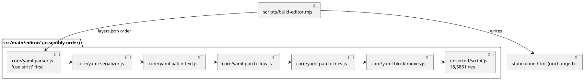

# Technical Design: the YAML layer as six parts of the editor (W-6)

# Summary

Run 0184 is W-6 of wave 024, the second run of phase P3 and the first that moves script text. It carries out step 6.1 to 6.6 of `0182 DEC-9`: the first six parts of the accepted cut, rows 1 to 6 of `0182 DEC-4`, leave `src/main/editor/unsorted/script.js` and become files of layer `core`. Together they are the YAML reader, its serializer, and the line-preserving save: 3,546 lines, 137 top-level declarations. "The design" below is `tdd-0182-editor-modules-design.md` (decisions cited as `0182 DEC-n`); "the tools" are those built by run 0183 (`tdd-0183-...md`, cited as `0183 DEC-n`). This document does not redesign the cut; it says how the six moves are made here, what each must prove, and what is checked at the end.

Nothing changes in what the editor does. Every commit is a move (`0182 DEC-5`): the assembled `src/main/resources/editor-webapp/standalone.html` stays byte for byte the page of today (23,170 lines, sha256 starts `a653717d5564c237`), so the jar, the native image, the website, the harness, the coverage script and the Java tests are not touched and are not changed by this run. The run's one addition is a small test that holds the six parts to the rule of layer `core` where the ratchet cannot (DEC-5).

# Scope

In scope: the six moves (6.1 to 6.6); `src/main/editor/layers.json` (six entries added before `unsorted/script.js`); the test of DEC-5; the evidence of each move and of the end of the run in the run document and the prg; the sentence of `CLAUDE.md` that says how many lines `unsorted/script.js` and the parts hold, if the file states it (it states neither today; the edit is none unless the executor finds a number to update).

Out of scope: the 62 other parts (W-7, W-8); `model/ui-state.js` and the relocations (W-7); the redraw notification (W-11); formatting and linting the parts, `--same-ast`, `.prettierignore`, coverage areas by part (W-9); any rename; a change to `names.json`, `java-names.json`, `ratchet.max`, `package.json`, the workflow, `embed.sh`, `pom.xml` or any Java file.

# PRD Traceability

TDD+pln run: there is no PRD, so traceability to requirement IDs is incomplete. The requirements are sourced from the wave row W-6, the P3 gate and the accepted design, and named `W6-n`:

- `W6-1` (row W-6, focus): the YAML layer and the line-preserving save are files of their own.
- `W6-2` (row W-6, exit evidence): each move passes its byte check against its parent (`--check-identical`).
- `W6-3` (row W-6, exit evidence): the node suite is green at the end of each step (RFC-003), `save-generator.js` and the comparison with the released pages unchanged.
- `W6-4` (P3 gate, items W-6 feeds): no file of the editor sources is over 3,000 lines (the largest part here has 1,343); the ratchet count is not above `ratchet.max`; the assembled page equals the committed one; `embed.sh --check` passes.
- `W6-5` (wave Non-Goals, CON-5 of `0183`): no change of behaviour, no rename of a function a Java comment names.
- `W6-6` (added by this design, DEC-5): the six parts name nothing outside `core`, said by a test and not only by the count.

Addressed: all six. Mismatches settled in favour of the design:

- The row says "the YAML layer and the line-preserving save". The design's table (`0182 DEC-4`) puts the save logic in two places: the text-patching functions are the YAML parts 3 to 6 (`yaml-patch-text`, `yaml-patch-flow`, `yaml-patch-lines`, `yaml-block-moves`, W-6), while `persistence/save.js` (row 31, 700 lines, "Save (TDD-0010 DEC-7") is the writing of files and goes in W-7. This run cuts rows 1 to 6 only. The coverage area `yaml-and-save` of `editor-coverage.mjs` spans both and is not touched.
- The wave's exit evidence names "`save-generator.js` and the comparison with `archicode-0.17.0` unchanged". The tests that compare the save with a released page read tags 0.17.0, 0.18.0 and 0.19.0 (`save-keeps-quotes-and-comments.test.js`, `save-keeps-anchors-in-brackets.test.js`, `save-keeps-the-brackets.test.js` and others); all are run as part of the node suite and none is edited.

# Technical Goals

- TG-1: `src/main/editor/core/yaml-parser.js`, `yaml-serializer.js`, `yaml-patch-text.js`, `yaml-patch-flow.js`, `yaml-patch-lines.js` and `yaml-block-moves.js` exist with the lines of rows 1 to 6 and nothing else, and `npm run editor:build` writes the page that is committed (`W6-1`, `W6-2`).
- TG-2: each of the six moves passes `--check-identical` against its parent before it is committed, and is its own commit when the run commits (DEC-4, first path) (`W6-2`).
- TG-3: the node suite passes after the sixth move, as `0182 DEC-9` says; per move the byte check, `--map` and `--layers` are the proof (DEC-3) (`W6-3`).
- TG-4: a test fails if a YAML part names a declaration outside the six, other than `parseYamlAsModel` (DEC-5) (`W6-6`).
- TG-5: the run ends with the checks of `0182 DEC-6` for the end of a run, with their results in the prg (`W6-3`, `W6-4`).

# Non-Goals

- Editing a character of the six ranges, including the `'use strict';` line and the comment blocks. A moved text that Prettier would change stays as it is (W-9).
- Splitting a range further than the design does, or merging ranges. The six ranges are `0182 DEC-4` rows 1 to 6 as written.
- Moving `parseYamlAsModel` (row 21, `core/read-schema.js`, W-7), though the parts name it (Current State).
- Making the Java comments or the tests name a part.

# Assumptions

- ASM-1: the page is unchanged since the measure of run 0182. Re-verified while drafting: `build-editor.mjs --check` prints "standalone.html is the assembly of src/main/editor (23170 lines)" and `check-editor.mjs --layers` prints 1,331 names equal to `names.json`, the Java names, "load order: holds" and `upward pairs: 0 (max 162)`. Validation: task 1 of the plan repeats both and stops if the page differs.
- ASM-2: **the work of run 0183 is committed before the first move of this run, by the main agent or the author, by path; the run does not commit it, and if it is not committed the run stops (it does not degrade to DEC-4's second path, which covers only the case of a tracked tree without authority to commit the moves).** At drafting time `git status` shows it as modified and untracked files (`scripts/build-editor.mjs`, `scripts/check-editor.mjs`, `scripts/check-editor-moves.sh`, `src/main/editor/`, `src/test/javascript/editor-build/`, `package.json`, `CLAUDE.md`, the workflow, `embed.sh`), and `HEAD` (`a8b2ed1`) holds the old page and none of the sources. A move commit of this run is checked against its parent's page, and the commit also has to stay a pure move, so it must not be the commit that first adds the sources. Validation: task 1 runs `git status --short -- scripts src/main/editor src/test/javascript/editor-build package.json` and stops if it lists anything (the run document then says it waits for the commits of W-5). If the sources are committed as one commit, that is `0183`'s business, not this run's.
- ASM-3: cutting rows 1 to 6 out of the head of `script.js` is a pure move under the assembler: parts are written before `unsorted/script.js` in `layers.json` and joined in order. Checked while drafting in a scratch copy of the tree (not in the repository): the six ranges cut at the lines of `editor-cut.json` (1030, 2373, 2527, 3086, 3580, 4273; the last ends at 4575) gave seven parts, the assembly was `cmp`-identical to the committed page, `check-editor.mjs --layers` passed (`load order: holds`, `upward pairs: 0 (max 162)`), and `unsorted/script.js` was left with 18,586 lines (22,132 minus 3,546).
- ASM-4: the boundaries are blank lines before a heading, not the middle of a construct. Checked: the line before each of the five later starts is a blank line after a closing `}`; row 1 starts at `'use strict';` (page line 1030), row 2 at `// ======` of "YAML serializer", rows 3 to 5 at a `/**` block, row 6 at a `/**` block.
- ASM-5: the hooks of `0183` (`prelint`, `pretest:unit`, `pretest:coverage`) rewrite the page only when its bytes differ, so a correct cut leaves `git status` for `standalone.html` empty.

# Constraints

- CON-1: the parts are classic-script text, one global scope: no `export`, no `import`, no wrapper (`0182 DEC-4`). A part is the text of its range, whole lines, ending with the newline that ends its last line, so that the join of the assembler adds nothing and drops nothing (ASM-3).
- CON-2: `'use strict';` is the first statement of the assembled script. `core/yaml-parser.js` begins with it, so it stays first in `layers.json` ahead of every other part. Moving another part before it, or removing the line, changes the semantics of the whole script (strict mode) and the bytes.
- CON-3: a move commit changes only files under `src/main/editor/` (the new part, `unsorted/script.js`, `layers.json`). The committed page, `names.json`, `java-names.json`, the coverage floor, the Java sources and the tests of the node suite do not change in a move.
- CON-4: the page keeps CON-2 and CON-3 of `0183`: the first bare `<script>` and the kernel block are matched by `harness.js`; none of the parts adds `<script>` text.
- CON-5: Prettier and ESLint do not read `src/main/editor/` yet (W-9); the new test (DEC-5) is a file of `src/test/javascript/` and passes `format:check` and `lint --max-warnings 0`.
- CON-6: no subagent chooses a name: the part names, paths and ranges are those of `editor-cut.json`; a part with another name is a different design.
- CON-7: the Native job cannot run here. This run changes nothing the image holds (`src/main/editor/` is outside `src/main/resources`), so no claim about Native is made beyond the pull request run.

# Current State

- `src/main/editor/` (from run 0183): `page.html`, `style.css`, `theme-boot.js`, `codemirror-loader.mjs`, `layers.json`, `names.json`, `java-names.json`, `unsorted/script.js` (22,132 lines, equal to lines 1030-23161 of the page). `layers.json` is `{ layers: [core, model, persistence, application, presentation, composition], parts: [{ file: "unsorted/script.js", layer: "unsorted" }], ratchet: { max: 162 } }`.
- `scripts/build-editor.mjs` (`--check`, `--check-identical <rev>`, `--where`, `--map`), `scripts/check-editor.mjs` (`--layers`, `--list`, `--cut`, `--statements`, `--write-names`), `scripts/check-editor-moves.sh <base> <head>` (checks `refactor: move` and `refactor: relocate` commits), and the tests in `src/test/javascript/editor-build/` (`build-editor`, `check-editor`, `check-editor-layers`, `check-editor-moves`, `check-editor-statements`). `check-editor.mjs` exports `analyse` and `countUpward`; `build-editor.mjs` exports `mapOf`.
- The six ranges (lines of the page; sizes and declaration counts from `0182 DEC-4`): `core/yaml-parser.js` 1030-2372 (1,343 lines, 68 declarations: the YAML 1.1 reader, numbers, tags, anchors), `core/yaml-serializer.js` 2373-2526 (154, 10), `core/yaml-patch-text.js` 2527-3085 (559, 19: `patchYamlText`, decorations), `core/yaml-patch-flow.js` 3086-3579 (494, 15: brackets), `core/yaml-patch-lines.js` 3580-4272 (693, 14: the line-by-line save), `core/yaml-block-moves.js` 4273-4575 (303, 11: cut and paste of a block, stray comments).
- Who names whom (from `check-editor.mjs --list` on the scratch cut of ASM-3): 49 names of the six parts are used by other parts (parser 17, serializer 9, block-moves 7, lines 6, flow 5, text 5, the full list in `--list`); the six parts name one declaration outside themselves, `parseYamlAsModel` (page line 8775, in the range of row 21, `core/read-schema.js`, cut in W-7). It is in `unsorted` today and in `core` then, so the pair is never upward; but while it is in `unsorted` the count leaves it out on both sides, which is the gap DEC-5 fills.
- Tests that read the save: the generator `src/test/javascript/viewpoint-kernel/save-generator.js` (seeded, 2,000 cases) used by `save-keeps-quotes-and-comments.test.js`; `save-keeps-the-brackets.test.js`, `save-keeps-anchors-in-brackets.test.js`, `save-keeps-bom-and-trailing-comment.test.js`, `anchors-tags-save.test.js`, `faithful-saves.test.js`, `yaml.test.js`, `yaml-preserve.test.js`, `yaml-numbers.test.js` and 45 files that load the page through `harness.js`. Seven files compare with a released page through `git show archicode-0.1x.0:...` (the Page job has `fetch-depth: 0`).
- `.prettierignore` lists the generated page and not `src/main/editor/`; no tool formats or lints the parts.

The reviewer should check that the part order of `layers.json` is the page order of the table above, that `'use strict'` is in the first part, and that the page is written by the assembler and is the same file as before.

# Proposed Design

DEC-1 — six moves out of the head of `script.js`, in page order, one commit each
- Decision: for k = 1..6, take the k-th range from the head of `unsorted/script.js` (it is the head after the (k-1) earlier cuts), write it unchanged to `src/main/editor/<path>` of `0182 DEC-4`, delete it from `unsorted/script.js`, add `{ "file": "<path>", "layer": "core" }` to `layers.json` after the previous part and before `unsorted/script.js` (so the list is parser, serializer, patch-text, patch-flow, patch-lines, block-moves, `unsorted/script.js`), run `npm run editor:build` (a no-op on the page), run the checks of DEC-3, and commit with the subject `refactor: move yaml-parser to src/main/editor/core/yaml-parser.js` (the part name differs by commit).
- Rationale: the ranges are contiguous from the first line of the script, so each cut is a prefix removal of the unsorted part and the join order is the page order; the byte check is exact and costs nothing (`0182 DEC-5`).
- Alternatives considered: one commit with the six files (a reviewer cannot tell which range holds what; `check-editor-moves.sh` would pass but the bisect is coarser); cutting from the end (every part would need to be listed after `unsorted`, then moved again); rejected.
- Tradeoffs: six commits, six runs of the quick checks.
- Linked PRD IDs: `W6-1`, `W6-2`.

DEC-2 — a cut is made by line numbers on the script, not by hand editing
- Decision: the executor cuts with the line counts of the table (1,343; 154; 559; 494; 693; 303), taken from the head of the current `unsorted/script.js`, using `sed`/`head`/`tail` or a small throwaway script in the scratchpad (not committed). The first line of each cut part is checked against the first line the cut table gives (`'use strict';`, `// =====`, `/**`, `/**`, `/**`, `/**`) and the last line is the closing `}` or blank line before the next heading; after each cut, `build-editor.mjs --map` gives the first and last page line of each part and they equal the table (1030-2372, 2373-2526, 2527-3085, 3086-3579, 3580-4272, 4273-4575).
- Rationale: the text is not edited, so a tool that copies lines cannot introduce a difference; the map check catches a cut that is one line off before the byte check does, with a clearer message.
- Alternatives considered: cutting with an editor (risk of a changed trailing newline); cutting by looking for heading comments (the headings are what the table was built from, but a line count is exact).
- Tradeoffs: none that matter.
- Linked PRD IDs: `W6-2`.

DEC-3 — the check of each move, and the check at each step
- Decision: before each of the six commits: `node scripts/build-editor.mjs --check`, `node scripts/build-editor.mjs --check-identical HEAD` (HEAD is the parent of the commit being made), `node scripts/check-editor.mjs --layers` (names equal, Java names, load order, `upward pairs: 0 (max 162)`), `npm run lint` and `npm run format:check`. No node test runs per move: the node suite reads the committed `standalone.html`, not the built page, so it cannot see a bad cut (Q-2); no per-move test file is named. The step (6.1 to 6.6 as one step: "the YAML layer is cut") ends with the whole node suite, `npm run test:unit`, after the sixth move (`0182 DEC-9`: "node suite after 6.6"). The commit is made only when every check passes; a failing check reverts the cut, not patches it (RFC-003): restore `src/main/editor/unsorted/script.js` and `src/main/editor/layers.json` from `HEAD` and delete the new part file, each by path.
- Rationale: the byte check proves the page did not move, `--map` and `--layers` prove the cut and the order; `0182 DEC-6` lets the whole suite wait for the step's end.
- Alternatives considered: the whole suite after each move (about 8 minutes extra, adds no information over the byte check, and `0182 DEC-6` already decided it need not); a few named save tests per move (rejected, review finding R-2: they read the committed page and cannot see a cut).
- Tradeoffs: a broken environment is found at the end of the step, not at the first move.
- Linked PRD IDs: `W6-2`, `W6-3`.

DEC-4 — the commits are made by the run, by path; if it cannot commit, the cuts are verified in the working tree
- Decision: the run makes the six commits itself, adding only the files of the move by name (`git add src/main/editor/core/<part>.js src/main/editor/unsorted/script.js src/main/editor/layers.json`), never `git add -A`: the tree may hold other uncommitted files (ASM-2). If the executor has no authority to commit, it does the six cuts in the working tree, one after the other, with the same checks against `HEAD` (the page is the same at every point, so `--check-identical HEAD` is the right check at every point), records each result in the prg, and says in the run document that `scripts/check-editor-moves.sh <merge-base> HEAD` is to be read when the commits exist. Both paths give the same evidence for the page; only the second leaves the commit kind to be checked later, as in `0183`.
- Rationale: the harness needs the parent's page for `--check-identical`; since W-6 never changes the page, `HEAD` serves for both.
- Alternatives considered: stage everything and commit at once (loses the per-move bisect); amend a growing commit (rewrites history, not allowed).
- Tradeoffs: the second path leaves a pending item for the author.
- Linked PRD IDs: `W6-2`.

DEC-5 — a test holds the six parts to the rule of `core`
- Decision: add `src/test/javascript/editor-build/yaml-parts.test.js` as its own commit (`test: the YAML parts name nothing outside core`), after the sixth move, never mixed with a move (RFC-003). It calls a function of its own over a root folder: `mapOf(root)` and `assemble(root)` of `scripts/build-editor.mjs` and `analyse(html)` of `scripts/check-editor.mjs`, run on the repository and, to be shown to fail, on a temporary copy of the tree where a YAML part names a function of `unsorted`. It takes the declarations of the six parts and asserts that every top-level name they reference is declared in one of the six, or is `parseYamlAsModel` (the one expected exception, with the comment that it lives in the range of `core/read-schema.js` and goes to `core` in W-7). Once W-7 has moved it, the test may drop the exception; until then the exception is the list. It also asserts that the six files exist in the expected order in `layers.json`, each with layer `core`, that `core/yaml-parser.js` is first and starts with `'use strict';`, and that no part is over 3,000 lines.
- Rationale: the count of `check-editor.mjs` leaves `unsorted` out on both sides (`0182 DEC-3`), so a YAML part that named a function still in `unsorted` would pass `--layers` today and become a `core`-to-`model` pair when that function is cut. The test turns what the scratch measurement shows (one name outside, and it is in `core`) into a fact that stays. It also pins CON-2.
- Alternatives considered: extend `check-editor.mjs` with a per-layer rule (a change to the tool for one run; W-8 may want it; deferred, DEF-1); no test (the property is true now and nothing keeps it true until W-7).
- Tradeoffs: one test file with an exception that W-7 edits.
- Linked PRD IDs: `W6-6`.

# Repository Impact

- IMP-1 — `src/main/editor/core/`
  - Path(s): `yaml-parser.js`, `yaml-serializer.js`, `yaml-patch-text.js`, `yaml-patch-flow.js`, `yaml-patch-lines.js`, `yaml-block-moves.js`
  - Change type: additive (new files; text moved from `unsorted/script.js`)
  - Why impacted: `W6-1`.
  - Linked PRD IDs: `W6-1`, `W6-2`
  - Risks / notes: the text is exactly the lines of the ranges; a trailing newline mistake shows in the byte check.
- IMP-2 — `src/main/editor/unsorted/script.js`
  - Path(s): `src/main/editor/unsorted/script.js`
  - Change type: modify (loses its first 3,546 lines; 18,586 remain)
  - Why impacted: the ranges leave it.
  - Linked PRD IDs: `W6-1`
  - Risks / notes: its first line afterwards is the heading "IndexedDB: the remembered folders", the first line of row 7.
- IMP-3 — `src/main/editor/layers.json`
  - Path(s): `src/main/editor/layers.json`
  - Change type: modify (six entries inserted before `unsorted/script.js`; `layers` and `ratchet` unchanged)
  - Why impacted: the order of `parts` is the load order.
  - Linked PRD IDs: `W6-1`, `W6-4`
  - Risks / notes: contract CTR-1.
- IMP-4 — `src/test/javascript/editor-build/yaml-parts.test.js`
  - Path(s): the new file
  - Change type: additive
  - Why impacted: `W6-6`.
  - Linked PRD IDs: `W6-6`
  - Risks / notes: uses the exported `mapOf` and `analyse`; if W-7 renames them it follows.
- IMP-5 — files that must not change, shown by `git diff --stat`
  - Path(s): `src/main/resources/editor-webapp/standalone.html`, `src/main/editor/names.json`, `src/main/editor/java-names.json`, `scripts/**`, `package.json`, `.github/**`, `scripts/editor-coverage-floor.json`, `src/main/java/**`, the existing tests.
  - Change type: none
  - Why impacted: CON-3.
  - Linked PRD IDs: `W6-4`, `W6-5`
  - Risks / notes: the diff of the whole run, against its first parent, lists only IMP-1 to IMP-4 and the run's documents.
- IMP-6 — the run's documents
  - Path(s): `docs/wav/wav-024-fixes-and-editor-modules/run/run-0184-editor-extract-yaml-and-save/**`
  - Change type: additive
  - Why impacted: the evidence of each move (command, exit code, the line printed) goes to the prg; the run document cites it and does not copy it (as run 0183 did).
  - Linked PRD IDs: `W6-2`, `W6-3`

# Canonical Impact

Not applicable — no canonical registers declared (`docs/` holds fixtures, run and wave documents only; there is no `docs/CLAUDE.md`, as `0182` found).

# Data Model and Contracts

- CTR-1 — `src/main/editor/layers.json`
  - Current contract: `parts` is the load order; each part has `file` and `layer`; `unsorted` parts are left out of the layer count on both sides; the first path segment of a file must equal its layer; `ratchet.max` is the committed maximum.
  - Proposed contract: the same. After the run, `parts` is, in order: the six `core/yaml-*` files, then `unsorted/script.js`. `core/yaml-parser.js` is first (CON-2). `ratchet.max` stays 162; the printed count stays 0 until a part has an upward neighbour.
  - Affected files: `layers.json`.
  - Migration or compatibility notes: no `area` key yet (W-9). A tool that reads `parts` in order sees the same page text.
  - Linked PRD IDs: `W6-1`, `W6-4`
- CTR-2 — the assembled page
  - Current contract: `standalone.html` is the output of the assembler; its bytes are the page of `af1ed2d`.
  - Proposed contract: unchanged, byte for byte. This is the contract of the whole run.
  - Affected files: none.
  - Migration or compatibility notes: the harness's regexes (`<script>` first block, the kernel block), the coverage markers (`SECTIONS`, each matching once) and the Java reads see the same file.
  - Linked PRD IDs: `W6-2`, `W6-5`
- CTR-3 — the names the Java side and the node tests depend on
  - Current contract: `names.json` (1,331 names, 18 unnamed), `java-names.json` (21 names).
  - Proposed contract: unchanged. None of the 21 Java names is in the six ranges (they are in rows 8-21, 46, 49 and 50-57; checked in `java-names.json` against the table).
  - Affected files: none.
  - Linked PRD IDs: `W6-5`

# Interfaces and Behavior

- IF-1: the editor's behaviour, files it reads and writes, and its save are those of today; the node suite, the Java tests and the end-to-end suite show it.
- IF-2: `npm run editor:build` and `npm run editor:check` have the interface of `0183`; they now read seven files for the main script instead of one. A part that is missing, listed twice or not listed fails with a one-line error (`build-editor.mjs`, tested by `build-editor.test.js`).
- IF-3: errors in this run are the tools' errors: `standalone.html is generated: edit src/main/editor and run npm run editor:build`; `--check-identical` names the first differing line.

# Flows and Processing Logic

- FLOW-1 — one move
  - Trigger: task k of 6.
  - Steps: (1) `git status --short -- src/main/editor` is clean of anything but the moves already committed (DEC-4); (2) cut the k-th range from the head of `unsorted/script.js` into its file (DEC-2); (3) insert the part in `layers.json`; (4) `npm run editor:build`; (5) `--map` equals the table; (6) the checks of DEC-3; (7) commit by path with the subject `refactor: move <part> to src/main/editor/core/<part>.js` (first path of DEC-4; on the second path no commit, the result is recorded); (8) append the evidence line to the prg.
  - Branches / failure paths: a check fails: revert the move (restore `unsorted/script.js` and `layers.json` from `HEAD`, delete the new part file, by path), do not edit the text to fit, log the failing command and its first line, and stop the run (a cut that fails the byte check means the lines were wrong; there is no content to fix). `--map` differs from the table: the page has changed since ASM-1; stop.
  - Final output / rendered result: part k exists, the page is unchanged.
  - Linked PRD IDs: `W6-1`, `W6-2`
- FLOW-2 — the step and the end of the run
  - Trigger: after move 6.
  - Steps: `npm run test:unit`; the test of DEC-5 added and committed; then the end-of-run set of `0182 DEC-6`: `npm run test:coverage` (the floor file unchanged and holding), `./mvnw verify -DskipITs=false` (the Java tests read the page; PMD runs), `npm run test:e2e`, `src/main/rust/viewpoint-kernel/embed.sh --check`, `npm run editor:check`, `npm run lint`, `npm run format:check`; `git diff --stat` against the first parent of the run for IMP-5; `scripts/check-editor-moves.sh <merge-base> HEAD` when the commits exist.
  - Branches / failure paths: a test of the node suite fails: the run re-runs that file alone on the parent's tree (a scratch copy or a detached worktree; `git stash` is not used) to tell; if it passes there, the failure is the cut's and the step is reverted (RFC-003); if it also fails there, it is a flake or an environment fault, named in the prg and re-run once.
  - Final output / rendered result: the results of each command in the prg, cited by the run document.
  - Linked PRD IDs: `W6-3`, `W6-4`

# Reliability, Performance, and Scalability

- The assembly reads seven files for the script instead of one; the time of `editor:build` is unchanged for practical purposes (it is a file concatenation).
- The checks of `0183` parse the assembled page once per run (acorn on 23,000 lines took about two seconds in `0183`'s measure; not re-measured here).
- The node suite takes about 76 s here; with coverage 40 to 50 % more (`CLAUDE.md`). The end-of-run set takes several minutes (`./mvnw verify -DskipITs=false` took 5:54 on the P1 gate, e2e a few more); these are run once.
- Testability: the six parts can be tested by loading the assembled page as today; testing a part alone is W-9's work.

# Security and Privacy

Not materially affected: no input, no secret, no network. The pages loaded from `esm.sh` (CodeMirror) are in `codemirror-loader.mjs`, untouched. No file that the run writes is outside the repository.

# Observability and Verification

The chain of evidence, all commands run from the repository root with JDK 25 for the Java ones (`JAVA_HOME` of sdkman, as `CLAUDE.md` says):

- Per move: DEC-3's list; `--check-identical HEAD` prints no difference, `--layers` prints `upward pairs: 0 (max 162)`.
- After the sixth: `npm run test:unit` green (the number of tests is read from the output, not asserted here), then the new test of DEC-5 green, then `npm run test:coverage` green with `scripts/editor-coverage-floor.json` byte-identical (`git diff --stat` shows nothing), `./mvnw verify -DskipITs=false`, `npm run test:e2e` (38 tests on Chromium and Firefox in `0183`'s evidence), `embed.sh --check`.
- The identity of the page: `sha256sum src/main/resources/editor-webapp/standalone.html` starts `a653717d5564c237` before the first move and after the last (a human-readable line in the prg).
- Shown to fail, once: the function of DEC-5's test takes a root folder; it is run on a temporary copy of the tree where a YAML part names a function of `unsorted`, and the failure is quoted in the prg.
- Pending, as in `0183`: the pull request run (Page, Java, Kernel, E2E, Native, Build); nothing here claims it green.

# Deployment and Rollout

Code-only, development-side. The shipped page is the same file. Rollback is a revert of the commits (each move is independent in effect, but in order; reverting the last k moves in reverse order restores the previous page text, and the byte check passes at every point). Native: no change to the image; the run's pull request run is the evidence. This section gives no permission to merge or release.

# Risks and Tradeoffs

- RISK-1: the working tree of run 0183 is uncommitted (ASM-2). If W-6 starts with it so, a move cannot be a pure move in the parent's sense and a `git add -A` would sweep W-5's files into a move commit. Mitigation: task 1 stops; commits by path (DEC-4).
- RISK-2: a hook of npm rewrites the page during the run (`pretest:unit`), hiding a wrong cut by correcting the page. It cannot: the hook writes the assembly, and the committed page is the thing under check; but the check order matters: `--check-identical HEAD` is run before any `npm run test:*` of the move, and `git status` for `standalone.html` is empty after them.
- RISK-3: `'use strict'` (CON-2): a mistake in the order of `layers.json` changes the script's mode and the page; the byte check sees the order, the test of DEC-5 pins it.
- RISK-4: the part names are final for the wave (the Java comments of later runs, `--where` output and the coverage areas of W-9 use them); a wrong name costs a rename commit later. They are those of the accepted design.
- RISK-5: a reviewer of the pull request sees six large additions and six large deletions; the commit subjects, the byte check in CI (`Check the move commits`, `0183`) and `git diff --color-moved` are the aids; nothing is reformatted.
- RISK-6: the new test depends on `analyse`'s output shape; a change to the tool breaks it loudly in W-7 or W-8, which is intended.

# Open Questions

- Q-1: does the executor have authority to commit? Decision: work either way (DEC-4); not a blocker. Resolved by design.
- Q-2: are the four named save test files (DEC-3) the right quick subset? Decision (Stage 6, review finding R-2): none; the harness reads the committed `standalone.html`, which a move never changes, so per-move node tests prove nothing the byte check, `--map` and `--layers` do not; the whole suite runs once at the end of the step (`0182 DEC-6`, `DEC-9`). DEC-3 amended to match. Resolved.
- Q-3: should the end-of-run set include `./mvnw verify -DskipITs=false` and e2e when the page is provably the same bytes? Decision: yes, as `0182 DEC-6` states for the end of every P3 run and as the P3 gate lists them; the cost is accepted by the author's acceptance of the design. The author may drop them for this run only; nothing else changes. Resolved.

No question is left open as a blocker. ASM-2 is a precondition, not a question: the run stops at task 1 if it does not hold.

# Deferred Work

- DEF-1: a per-layer rule in `check-editor.mjs` ("a part of layer L names nothing in a layer above L, `unsorted` included"), which would make DEC-5's test unnecessary. For W-8's end (8.3) or W-9.
- DEF-2: formatting, linting and a coverage area per part (W-9); `--same-ast` (W-9).
- DEF-3: dropping the `parseYamlAsModel` exception from the test of DEC-5 when W-7 moves `core/read-schema.js`.
- DEF-4: the rows 7 and after (W-7, W-8), `model/ui-state.js` and the redraw notification (W-7, W-11).

# File Placement and Frontmatter

This file is `docs/wav/wav-024-fixes-and-editor-modules/run/run-0184-editor-extract-yaml-and-save/tdd-0184-editor-extract-yaml-and-save.md`, with `type: tdd`, `run: 0184`, `wave: 024`, as `tdd-0183-...` and `tdd-0182-...` in the sibling run folders. The execution plan `pln-0184-editor-extract-yaml-and-save.md` is written in Stage 8.
