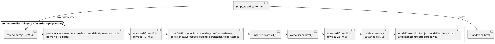

# Technical Design: file access, the plateau and layer model, the read schema and the kernel bridge as parts of the editor (W-7)

# Summary

Run 0185 is W-7 of wave 024, the third run of phase P3 and the first that cuts stateful code. It carries out steps 7.1 and 7.2 of `0182 DEC-9`: the twenty parts of rows 7 to 14, 20 to 23, 25, 29, 31, 33, 46, 47, 49 and 54 of `0182 DEC-4` (5,125 lines) leave `src/main/editor/unsorted/` for files of the layers `core`, `model` and `persistence`, and the 59 top-level variables of the `relocate` list that `model/ui-state.js` holds (194 lines) move there. One more declaration, `REMOVED_PLATEAUS_KEY`, goes to `core/read-schema.js`. "The design" is `tdd-0182-editor-modules-design.md` (cited `0182 DEC-n`), "the tools" are those of run 0183 (`0183 DEC-n`), and run 0184 is W-6 (`0184 DEC-n`). This document does not redesign the cut. It says how the twenty cuts and the relocations are made here, and it records four things that the accepted design did not see and that a trial on a scratch copy of the tree showed (DEC-1, DEC-4, DEC-5, DEC-6).

Nothing changes in what the editor does. The twenty cuts are pure moves: the assembled `src/main/resources/editor-webapp/standalone.html` stays byte for byte the page of today (23,170 lines, sha256 starts `a653717d5564c237`) through all of them. The relocations of step 7.2, and the one of `REMOVED_PLATEAUS_KEY`, change the order of the page and nothing else; they are proved by `check-editor.mjs --statements`. The jar, the native image, the website, the Java sources and the harness are not touched.

# Scope

In scope: the twenty moves, one relocation for `REMOVED_PLATEAUS_KEY`, `model/ui-state.js` and five relocation groups, three changes to existing tests that the relocations make necessary (DEC-5 and DEC-7: a test commit each, never mixed with a move), `src/main/editor/layers.json`, the evidence in the run document and the prg.

Out of scope: the 42 parts of W-8; the redraw notification (W-11, `0182 DEC-8`); formatting and linting the parts, `--same-ast`, `.prettierignore`, coverage areas by part (W-9); any rename of a top-level name; a change to `names.json`, `java-names.json`, `ratchet.max`, `package.json`, the workflow, `embed.sh`, `pom.xml`, `scripts/**` or any Java file; the sentence of `CLAUDE.md` that says "today one part, `unsorted/script.js`" (stale since W-6; W-9 rewrites the paragraph).

# PRD Traceability

TDD+pln run: there is no PRD, so traceability to requirement IDs is incomplete. The requirements are sourced from the wave row W-7, the P3 gate and the accepted design, and named `W7-n`:

- `W7-1` (row W-7, focus): file reading and writing, the plateau and layer model, the read schema and the kernel bridge are files of their own.
- `W7-2` (row W-7, exit evidence, by reference to W-6): each move passes its byte check against its parent (`--check-identical`) and each relocation passes `--statements`.
- `W7-3` (row W-7, exit evidence): the node suite is green at the end of each step (RFC-003, `0182 DEC-6`), plus `EditorReadSchemaTest` and the discovery tests (`discovery.test.js`, `ManifestDiscoveryTest`).
- `W7-4` (P3 gate): every part this run creates is under 3,000 lines (the largest is `persistence/save.js`, 700); the 3,000-line gate for the unsorted pieces (`from-55.js`, `from-34.js`, IMP-2) is W-8's (DEF-4); the ratchet count is not above `ratchet.max`; the assembled page equals the committed one; `embed.sh --check` and `node scripts/editor-coverage.mjs` pass, the floor unchanged.
- `W7-5` (wave Non-Goals, `0183 CON-5`): no change of behaviour, no rename of a function a Java comment names.
- `W7-6` (added by this design, `0182 DEC-9` step 7.2): `model/ui-state.js` exists and holds the relocated variables, so that no part of a lower layer reads a variable declared in a part of a higher layer.

Addressed: all six. Mismatches between the design and the repository, settled in favour of the repository:

- `0182 DEC-9` lists 7.1 as twenty moves, each checked by `--check-identical`. Only the contiguous ones can be: rows 7 to 14 are the head of `unsorted/script.js`, but rows 20 to 23, 25, 29, 31, 33, 46, 47, 49 and 54 lie among the rows of W-8. Cutting one of them to a file placed before `unsorted/script.js` reorders the page, which the byte check refuses and which breaks `scripts/editor-coverage.mjs` (its area markers must stay in page order; trial, DEC-1). The design is kept in intent and changed in mechanics: the leftover of `unsorted/script.js` becomes several files that stay in page order (DEC-1).
- `0182 DEC-4` puts `REMOVED_PLATEAUS_KEY` in `model/ui-state.js` (the `relocate` list) while `0182 DEC-3` says it "would go to `core/read-schema.js` rather than `ui-state`", because `core/read-schema.js` reads it. The second is right: a constant in `model` read from `core` is an upward pair. DEC-4 follows DEC-3, so the list for `ui-state` has 59 names, not 60.
- `0182 DEC-4` says `model/ui-state.js` is "placed after `model/app-state.js`". Placed there, the lines of the variables leave the coverage area `pages` and `diagram` and join `layers-and-plateaus`; the figure of `pages` falls from 83.88 % to 83.77 %, below its floor (83.8), and `node scripts/editor-coverage.mjs` fails. DEC-6 gives it another place.

# Technical Goals

- TG-1: the twenty parts exist under `src/main/editor/{core,model,persistence}/` with the lines of their rows and nothing else; the page is the committed page after each move (`W7-1`, `W7-2`).
- TG-2: `model/ui-state.js` holds the 59 variables and `core/read-schema.js` holds `REMOVED_PLATEAUS_KEY`; each relocation group passes `--statements` (`W7-2`, `W7-6`).
- TG-3: the node suite is green after step 7.1, after each relocation group, and after each test commit (`W7-3`).
- TG-4: `node scripts/check-editor.mjs --layers` prints `upward pairs: 0 (max 162)` after every commit, and `node scripts/editor-coverage.mjs` holds the unchanged floor at the end (`W7-4`).
- TG-5: the run ends with the end-of-run checks of `0182 DEC-6`, with their results in the prg (`W7-3`, `W7-4`).

# Non-Goals

- Editing a character of a moved or relocated range, including its comments, headings and the `// READ_SCHEMA begin` / `end` markers. A text that Prettier would change stays as it is (W-9).
- Splitting a row further than the design does, or merging rows. The twenty ranges are the rows of `editor-cut.json`; the 59 names are its `relocate.names` less one.
- Cutting any row of W-8 (rows 15 to 19, 24, 26 to 28, 30, 32, 34 to 45, 48, 50 to 53, 55 to 68). They stay in `unsorted/` files.
- Lowering `ratchet.max`, changing the coverage floor, or adding `area` to `layers.json` (W-8 8.3 and W-9).
- Making the Java comments or the tests name a part.

# Assumptions

- ASM-1: the page is unchanged since run 0182 and W-6. Re-verified while drafting: `node scripts/build-editor.mjs --check` prints "standalone.html is the assembly of src/main/editor (23170 lines)"; `check-editor.mjs --layers` prints 1,331 names equal to `names.json`, the Java names, "load order: holds" and `upward pairs: 0 (max 162)`; `build-editor.mjs --map` gives the six `core/yaml-*` parts at page lines 1030-4575 and `unsorted/script.js` (18,586 lines) from 4576. Validation: task 1 repeats it and stops if the page differs.
- ASM-2: **the work of W-6 (run 0184) is committed before the first move of this run, by the main agent or the author, by path; the run does not commit it, and if it is not committed the run stops.** At drafting time `git status` lists `src/main/editor/core/` and `src/test/javascript/editor-build/yaml-parts.test.js` as untracked and `src/main/editor/layers.json` and `src/main/editor/unsorted/script.js` as modified, and `HEAD` (`2784716`) holds the sources of run 0183 and none of the six YAML parts (run 0184's prg: "the six moves are uncommitted"). A move commit of this run is checked against its parent, and it must not be the commit that first adds W-6's parts. Validation: task 1 runs `git status --short -- src/main/editor src/test/javascript/editor-build` and stops if it lists anything but the files of this run.
- ASM-3: the twenty cuts are pure moves under the assembler once the leftover of `unsorted/script.js` is held in files that stay in page order. Checked in a scratch worktree of `HEAD` with the sources overlaid (not in the repository): all twenty ranges cut at the lines of `editor-cut.json` (page lines, `last` of a row being the line before the next row's `first`), the leftover written as nine files, gave 35 parts, `build-editor.mjs --check-identical HEAD` printed "the assembly is the page of HEAD, byte for byte", and `check-editor.mjs --layers` passed (`names` 1,331 equal, Java names, `load order: holds`). The unsorted leftover was 13,461 lines, the sum of W-8 in `0182 DEC-4`.
- ASM-4: the relocations of step 7.2 are accepted by `--statements`. Checked in the same scratch tree: the 59 declarations (each with the comment lines directly above it) taken out of their parts in one relocation and written to `model/ui-state.js`, plus `REMOVED_PLATEAUS_KEY` and its comment appended to `core/read-schema.js`, gave "the assembly has the declarations and the comments of the page of HEAD, and its load order holds" and `upward pairs: 0 (max 162)`. Before the key moved, the pair was 1 (`workspaceProblem` names `REMOVED_PLATEAUS_KEY`, core to model), which is the "core to model 1" of `0182 DEC-3`. Per group the check is run again by the executor (a subset of a passing relocation can still fail on the load order: DEC-4).
- ASM-5: the trial's final layout passes the whole node suite (2,672 tests, 1 skipped, the timing test) and `node scripts/editor-coverage.mjs` with the floor unchanged, once the two tests of DEC-5 are changed and `model/ui-state.js` is where DEC-6 puts it. It also passes four Java classes that read the page (`EditorReadSchemaTest` 6, `GuideViewPropertiesTest` 5, `NativeReflectionConfigTest` 3, `ShippedFilesTest` 6) on a close variant of the layout (ui-state after `model/app-state.js`, the leftover as one file); these read text by marker and the markers are inside moved parts unchanged. Validation: the end-of-run set.
- ASM-6: the hooks of `0183` (`prelint`, `pretest:unit`, `pretest:coverage`) write the page only when its bytes differ, so after a move `git status` for `standalone.html` is empty; after a relocation it shows the page as modified and the commit includes it.

# Constraints

- CON-1: the parts are classic-script text, one global scope: no `export`, no `import`, no wrapper (`0182 DEC-4`). A part is the text of its range, whole lines, ending with the newline that ends its last line, so that the join of the assembler adds nothing and drops nothing.
- CON-2: `core/yaml-parser.js` keeps `'use strict';` as the first statement; nothing is placed before it in `layers.json` (`0184 CON-2`).
- CON-3: a move commit changes only files under `src/main/editor/` (the new part, the piece it leaves, `layers.json`). The committed page, `names.json`, `java-names.json`, the coverage floor and the tests do not change in a move. A relocation commit changes the page (the order) and the same files under `src/main/editor/`.
- CON-4: `harness.js` matches the first bare `<script>` of the page and the kernel block; `EditorReadSchemaTest` reads `// READ_SCHEMA begin` and `// READ_SCHEMA end`, `GuideViewPropertiesTest` reads `const VIEW_PROPERTY_ORDER = [`, `const MAP_PARTS = [` and `const DIAGRAM_SHOW_NAMES = [` (`0182 CON-2`, `CON-3`). The first pair stays inside `core/read-schema.js`, the second and third inside `model/ui-state.js` after DEC-4. Their text is not edited.
- CON-5: Prettier and ESLint do not read `src/main/editor/` yet (W-9). The test files this run changes pass `npm run format:check` and `npm run lint` (`--max-warnings 0`).
- CON-6: no subagent chooses a name: part names, paths and ranges are those of `editor-cut.json`; the unsorted files are named by DEC-1; a different name is a different design.
- CON-7: the Native job cannot run here. This run changes nothing the image holds (`src/main/editor/` is outside `src/main/resources`, and the page keeps its path). The pull request run is the evidence.
- CON-8: `scripts/editor-coverage.mjs` finds its areas by 19 marker lines, which must match once each and stay in page order (`SECTIONS`). This run edits none of them and none of their lines; it keeps their order (DEC-1, DEC-4).

# Current State

- `src/main/editor/`: `page.html`, `style.css`, `theme-boot.js`, `codemirror-loader.mjs`, `layers.json`, `names.json`, `java-names.json`, `core/yaml-*.js` (six files, W-6, not yet committed, ASM-2) and `unsorted/script.js` (18,586 lines, equal to page lines 4576-23161). `layers.json` is `{ layers: [core, model, persistence, application, presentation, composition], parts: [the six core/yaml-* files, unsorted/script.js], ratchet: { max: 162 } }`.
- The tools (`0183`): `scripts/build-editor.mjs` (`--check`, `--check-identical <rev>`, `--where`, `--map`, `--root`, exports `assemble` and `mapOf`), `scripts/check-editor.mjs` (`--layers`, `--list`, `--cut`, `--statements <rev>`, `--write-names`; exports `analyse`, `countUpward`, `cutCounts`, `loadOrderProblems`, `statementProblems`), `scripts/check-editor-moves.sh <base> <head>` (a `refactor: move` commit must be byte-identical to its parent, a `refactor: relocate` commit must pass `--statements`), and the tests of the tools in `src/test/javascript/editor-build/`.
- The twenty ranges (page lines at `af1ed2d`, equal to the page today; sizes and declarations from `0182 DEC-4`):

| Row | Part | Page lines | Lines | Declarations | Kind of cut |
|-----|------|-----------|-------|--------------|-------------|
| 7 | `persistence/remembered-folders.js` | 4576-5005 | 430 | 29 | move |
| 8 | `model/app-state.js` | 5006-5108 | 103 | 13 | move |
| 9 | `model/settings.js` | 5109-5410 | 302 | 35 (-1) | move |
| 10 | `core/manifest-kinds.js` | 5411-5438 | 28 | 3 | move |
| 11 | `model/element-index.js` | 5439-5561 | 123 | 6 | move |
| 12 | `model/plateau-tree.js` | 5562-5826 | 265 | 14 | move |
| 13 | `model/layer-loader.js` | 5827-6417 | 591 | 34 | move |
| 14 | `model/origin-and-cascade.js` | 6418-6491 | 74 | 5 | move |
| 20 | `model/index-builder.js` | 8201-8380 | 180 | 8 | move |
| 21 | `core/read-schema.js` | 8381-8822 | 442 | 28 | move |
| 22 | `persistence/workspace-loading.js` | 8823-9074 | 252 | 6 | move |
| 23 | `persistence/folder-access.js` | 9075-9437 | 363 | 24 | move |
| 25 | `core/escape-html.js` | 9571-9582 | 12 | 1 | move |
| 29 | `model/record-lookup.js` | 10003-10136 | 134 | 12 | move |
| 31 | `persistence/save.js` | 10626-11325 | 700 | 27 | move |
| 33 | `model/form-validation.js` | 11791-12145 | 355 | 18 | move |
| 46 | `model/kernel-bridge.js` | 15921-16060 | 140 | 9 | move |
| 47 | `model/comparison.js` | 16061-16333 | 273 | 16 | move |
| 49 | `model/styles.js` | 16534-16727 | 194 | 20 | move |
| 54 | `model/stories-model.js` | 19085-19248 | 164 | 26 | move |

  After the relocation of the key (DEC-2), row 9 is 297 lines (5109-5405) and rows 10 to 14 and row 20 are 5 lines earlier than the table says; rows 21 to 23 and the rows before 9 are not changed.

  They add up to 5,125 lines (W-7 in `0182 DEC-4`). Rows 15 to 19, 24, 26 to 28, 30, 32, 34 to 45, 48, 50 to 53 and 55 to 68 are W-8's and stay.
- The 59 names for `model/ui-state.js` (`relocate.names` of `editor-cut.json` less `REMOVED_PLATEAUS_KEY`), all in rows of W-8 (`NO_PLATEAU` in row 15; the others in rows 26, 28, 35, 36, 40 to 42, 44, 45, 48, 51 to 53, 57 and 58), 194 lines with their comment lines, 252 as a file with a blank line between declarations. Of them, 50 are `let` and 9 are `const`.
- Who names whom: with all twenty parts cut, 1 upward pair (`workspaceProblem` names `REMOVED_PLATEAUS_KEY`); `unsorted` is left out of the count on both sides, so the variables that lower parts read from W-8 rows are not counted until they move (they are the 162 of `0182 DEC-3`).
- Tests that read the page text and see the order: `src/test/javascript/editor-build/check-editor.test.js` (`--cut on the real page prints the 311, 162 and 100`: it runs `--cut` on the page of the repository, and the table is for the page of `af1ed2d`), `src/test/javascript/viewpoint-kernel/editor-odds-and-ends.test.js` (`#37: the key of the drawing ... the source says so` slices the page from `function diagramCacheKey(` to `let treeQuietCache`), `src/test/javascript/editor-build/yaml-parts.test.js` (W-6, the exception `parseYamlAsModel`). A trial that ran the whole node suite after a reordering cut found exactly the first two failing, no other.
- `scripts/editor-coverage.mjs` and `scripts/editor-coverage-floor.json`: nine areas found by the markers of `SECTIONS`; the floor is 90 for each area but `pages` (lines 83.8) and `other` (lines 88.1, functions 75). The figures of `target/editor-coverage/report.txt` on the working tree of today: `pages` 83.88 %, `diagram` 91.85 %, `stories` 97.00 %, `layers-and-plateaus` 98.09 %, total 92.67 % of 16,693 lines.

The reviewer should check that the order of `layers.json` after the run is the order of the diagram, that `unsorted/from-26.js` and `model/record-lookup.js` are the neighbours of `model/ui-state.js` (DEC-6), and that the page is written by the assembler as before.

# Proposed Design

DEC-1 — the leftover of `unsorted/script.js` stays in page order, in files named by the row they start at
- Decision: every cut of step 7.1 is a pure move. To make that true for the rows that lie among W-8's, `unsorted/script.js` is cut where a row is cut: the text before the row stays in the file, the text after it goes to a new file `src/main/editor/unsorted/from-<N>.js`, N being the first row of that text (`from-24.js` starts at row 24, whose first page line is 9438). The part is listed in `layers.json` between the two, so the order of `layers.json` is the order of the page and the assembled page is the page of the parent. A file that becomes empty (every row of it is cut) is deleted, and its entry leaves `layers.json`. The layer of these files is `unsorted`. The cuts are made in descending page order (DEC-2), so that a file keeps the row it is named after until it is deleted; at the end of 7.1 the leftover is `from-15.js`, `from-24.js`, `from-26.js`, `from-30.js`, `from-32.js`, `from-34.js`, `from-48.js`, `from-50.js` and `from-55.js` (nine files, 13,461 lines), and `script.js` is gone. W-8 cuts them as it cut `script.js` in W-7, a row at a time.
- Rationale: a cut that reorders the page is not a move (`0182 DEC-5`), and the trial showed what it costs: `--check-identical` fails at the first reordering part (`model/index-builder.js`, page line 6492), and `node scripts/editor-coverage.mjs` stops with "the area markers are not in the order of the script: `/^\/\/ Save \(TDD-0010 DEC-7/`" as soon as `persistence/save.js` moves before the markers that precede it. With the order kept, none of the 111 test processes, the markers or the floor sees a difference.
- Alternatives considered: the design's own text (parts before `unsorted/script.js`, checked by `--statements`; rejected: the coverage run fails and `--cut`'s test fails at the first one, and every cut would be a relocation with the weaker check); cutting only rows 7 to 14 in W-7 and leaving the rest to W-8 (rejected: it leaves `persistence`, `core/read-schema` and `model/kernel-bridge` out of this run, which is the wave's row); changing `editor-coverage.mjs` to take areas from parts (that is W-9's work, and a change to a tool in a move run); one unsorted file per row of W-8 (rejected: 42 more files for nothing the checks need).
- Tradeoffs: nine temporary files until W-8; a reader of `layers.json` sees `unsorted/from-N.js` entries between real parts. The names are fixed by the row, so W-8's plan can address them.
- Linked PRD IDs: `W7-1`, `W7-2`, `W7-4`.

DEC-2 — the twenty moves are made in descending page order, and `REMOVED_PLATEAUS_KEY` moves between two of them
- Decision: for each row in the order 54, 49, 47, 46, 33, 31, 29, 25, 23, 22, 21, 20, 14, 13, 12, 11, 10, 9, 8, 7 (twenty commits, `refactor: move <part> to src/main/editor/<path>`), the executor takes the lines of the row from the unsorted file that holds it, by the line numbers of the table above shifted to that file (the first line of the file is the first line of its first row; see DEC-3), writes them unchanged to the part, leaves the rest in one or two unsorted files (DEC-1), inserts the part into `layers.json` at the place of the page, runs the checks of DEC-8 and commits. **After row 21 and before row 9** a relocation commit (`refactor: relocate REMOVED_PLATEAUS_KEY to core/read-schema.js`) takes the declaration `const REMOVED_PLATEAUS_KEY = '...'` with the `/** ... */` line directly above it out of the unsorted file that holds row 9 (five lines: the comment and four of the `const`, page lines 5126-5130 at `af1ed2d`) and appends it to `core/read-schema.js` after a blank line. Row 9 is then cut without it.
- Rationale: the only upward pair after 7.1 is the one between `core/read-schema.js` and `model/settings.js`. A test pins the printed count to zero (`check-editor-layers.test.js`, `--layers passes on the repository`: `/upward pairs: 0 \(max 162\)/`). If row 9 were cut before the key left it and row 21 after, every commit between them would print 1 and that test would fail. In descending order `core/read-schema.js` exists when row 9 is still in `unsorted`, which the count leaves out, and the key is gone from row 9 before the part exists. A pair never exists between two cut parts at any commit, because the pairs of any subset of parts are among those of the whole (here, one).
- Order of the commits, in full: moves of rows 54, 49, 47, 46, 33, 31, 29, 25, 23, 22, 21; test commit (DEC-7, `yaml-parts.test.js`); test commit (DEC-5 a, the `--cut` test); the relocation of the key; moves of rows 20, 14, 13, 12, 11, 10, 9, 8, 7; the node suite for step 7.1; test commit (DEC-5 b, the #37 test); the five groups of DEC-4; the end set (FLOW-4).
- Alternatives considered: ascending order, which gives the pair at the cut of row 21 (rejected); changing the pinned number of the test to a bound (rejected: it weakens a test for a transient); moving the key at the cut of row 21 inside the same commit (a relocation commit that also cuts a part; rejected: `0182 DEC-5` keeps a commit to one kind).
- Tradeoffs: the order of the commits is not the order of the page, which a reader of the history has to know; the subjects name the part.
- Linked PRD IDs: `W7-2`, `W7-4`.

DEC-3 — a cut is made by line counts on the unsorted file, not by hand editing
- Decision: the executor cuts with the counts of the table (the "Lines" column), taken from the first line of the part's range in the unsorted file that holds it, using `sed`/`head`/`tail` or a small throwaway script in the scratchpad (not committed). The first line of each cut part is checked against the first line the table gives (a `// ====` or `/**` or `// ----` heading, as `editor-cut.json` was built), the line before the next row is blank or the closing `}` of the last declaration, and after each cut `node scripts/build-editor.mjs --map` gives the first and last page line of each part and they equal the table (rows 7 to 14 at 4576 to 6491, row 20 to 23 at 8201 to 9437 and so on); after the relocation of the key, row 9 is cut with 297 lines and the counts and ranges of rows 10 to 14 and 20 are those of the table shifted by 5 lines earlier. For a part cut from a file that is not the head of the page (every cut but the last), the executor takes the line numbers inside the file as page line minus the page line of the file's first line, from `--map`.
- Rationale: the text is not edited, so a tool that copies lines cannot introduce a difference; the map check catches a cut that is one line off before the byte check does, with a clearer message.
- Alternatives considered: cutting with an editor (risk of a changed trailing newline); cutting by looking for heading comments (the table was built from the headings, but a count is exact).
- Tradeoffs: none that matter.
- Linked PRD IDs: `W7-2`.

DEC-4 — `model/ui-state.js` takes 59 variables in five relocation groups; the key goes to `core`
- Decision: after step 7.1 and the two test changes (DEC-5, DEC-7), create `src/main/editor/model/ui-state.js` and relocate the 59 names in five commits (`refactor: relocate <group> to model/ui-state.js`), each taking the declaration with the comment lines directly above it, in page order within the group, one blank line between declarations, from the unsorted file that holds it; `layers.json` lists the part at the place DEC-6 gives. The groups follow the files the declarations come from:
  1. page registry and shell (rows 26 and 28; 11 names): `treeExpandedApplications`, `treeExpandedEnvironments`, `DEFAULT_PERSPECTIVE`, `currentPerspective`, `panelSizeStorage`, `rawYamlEditDraft`, `activeFileEditorView`, `activeJsonEditorViews`, `lastRenderedViewKey`, `pendingDeleteConfirmation`, `saveStatus`. This commit creates the file.
  2. panels (rows 35, 36, 40, 41, 42, 48, 53, 57; 11): `filesFolded`, `filesFoldsOwner`, `filesSelectionSeen`, `helpOpen`, `removedPick`, `candidateMessage`, `changesTabPick`, `headerMenuOpen`, `libraryPick`, `treeQuietCache`, `viewEditNotice`.
  3. diagram (rows 44, 51, 52; 20): `elementTab`, `diagramFacet`, `diagramMaximized`, `diagramHideUnlinked`, `DIAGRAM_SHOW_NAMES`, `DIAGRAM_SHOW_DEFAULTS`, `diagramScale`, `diagramSeq`, `diagramCache`, `diagramScene`, `diagramShownView`, `diagramCenter`, `viewpointKernelPromise`, `elkPromise`, `diagramHost`, `parkedDiagramHost`, `KERNEL_CONTRACT_VERSION`, `LEAF_KINDS`, `diagramKeyOpen`, `diagramLinkStop`.
  4. map (row 45; 10): `mapOpened`, `mapPinned`, `mapHidden`, `technologyMapState`, `MAP_PARTS`, `technologyMapParts`, `navActiveKey`, `scrollNavToSelection`, `mapSelectionCheck`, `kernelWarningsShown`.
  5. dialogs and the plateau constant (rows 15 and 58; 7): `NO_PLATEAU`, `appDialog`, `storyBarEditing`, `storyBarNotice`, `removedStep`, `pendingFocusSelector`, `keptElementForm`.

  That is 59 names (11 + 11 + 20 + 10 + 7). The design names seven groups (diagram, map, shell, dialogs, story, page registry, consts); the names are the design's, and here they are grouped by the rows they come from (Q-2). `REMOVED_PLATEAUS_KEY` is not among them: it moves in DEC-2. The grouping is a convenience; if a group fails its check (a `let` read at load before it would be declared), the executor moves the failing names to a later group or alone and says so in the prg; it does not edit an initializer.
- Rationale: the 59 variables are what keeps lower parts pointing at higher ones (`0182 Current State`: 50 `let` read from a part that must sit lower, 10 `const`); moving them into the model layer is what takes the count from 311 to 162 once the rest is cut. Five commits of 7 to 20 declarations are small enough to read in the diff and few enough to run the suite after each.
- Alternatives considered: all 59 in one commit (a failure cannot be placed); one commit per variable (59 runs of the suite); keeping `REMOVED_PLATEAUS_KEY` in `ui-state` as the cut table has it (an upward pair `core` to `model` that stays until someone notices, and `0182 DEC-3` already says where it goes).
- Tradeoffs: the five commits reorder the page and are checked by `--statements`, which proves the declarations and comments are equal and the load order holds, not that every reader finds its variable; the node suite after each group is the guard for that.
- Linked PRD IDs: `W7-1`, `W7-2`, `W7-6`.

DEC-5 — two existing tests are changed before the relocations that would break them, each as a test commit
- Decision: (a) before the relocation of the key (DEC-2), `src/test/javascript/editor-build/check-editor.test.js`: the test `--cut on the real page prints the 311, 162 and 100 of run 0182` reads the page of `af1ed2d` with `git show af1ed2d:src/main/resources/editor-webapp/standalone.html` (`execFileSync('git', [...], { cwd: REPO, encoding: 'utf8', maxBuffer })`, no shell), calls `cutCounts(html, cut)` of `check-editor.mjs` and asserts `[asCut.upward, moved.upward, noRender.upward]` equals `[311, 162, 100]`, and is renamed to say the page of `af1ed2d`. The other `--cut` tests (the refusal of another page, the synthetic page) stay. (b) before group 2 of DEC-4, `src/test/javascript/viewpoint-kernel/editor-odds-and-ends.test.js`: in `#37: the key of the drawing is not the kernel input ...`, the slice of the page for `diagramCacheKey` ends at the end of the function (`HTML.indexOf('\n}\n', start) + 3`) and no longer at `let treeQuietCache`, which group 2 moves above it. Both commits are `test:` commits (a change, `0182 DEC-5`), pass `npm run format:check` and `npm run lint`, and are run on the page before and after the relocation they prepare.
- Rationale: a trial that applied every cut and relocation and then ran the node suite failed exactly these two tests and no other; (a) fails from the first relocation (the page is no longer the page of `af1ed2d`, and the tool answers exit 2), (b) from group 2. The first test's purpose is to pin the design's numbers on the design's page, which `git show` gives for ever; the second's is that the cache key does not build a kernel input, which is a property of the function and not of what follows it.
- Alternatives considered: skip or delete the tests (rejected: they guard W-4's numbers and issue #37); keep the relocation from reordering by leaving `treeQuietCache` in place (it is one of the 59 and it is read from a lower layer; rejected); fix the tests in the relocation commit (rejected: a change is never mixed with a relocation, RFC-003).
- Tradeoffs: the first test now needs `af1ed2d` in the clone; the Page job has `fetch-depth: 0` and seven other tests already read tags with `git show`.
- Linked PRD IDs: `W7-3`, `W7-5`.

DEC-6 — `model/ui-state.js` sits between `unsorted/from-26.js` and `model/record-lookup.js`
- Decision: in `layers.json` the part `model/ui-state.js` (layer `model`) is listed after `unsorted/from-26.js` (rows 26 to 28) and before `model/record-lookup.js` (row 29). In the page it is therefore at line 10003 of today's numbering, in the area `pages` of the coverage script (the marker `// Real three-panel read-only UI` is the second line of row 25, page line 9572, above it).
- Rationale: the coverage script finds the area of a line by the last marker above it. The 59 declarations leave `pages` (22 covered lines), `diagram` (36) and `stories` (7), all covered lines of code, and 65 covered lines of code are added to whatever area the part falls in. After `model/app-state.js` (the design's place) they go to `layers-and-plateaus`: `pages` falls from 83.88 % (2,862 of 3,412 lines) to 83.77 % (2,840 of 3,390), under its floor of 83.8, and the run's own coverage check fails; the trial showed it. After `unsorted/from-26.js` they stay in `pages`: 84.08 % (2,906 of 3,456), `diagram` 91.73 %, `stories` 96.99 %, `layers-and-plateaus` 98.08 %, the others as they were, total 92.67 %, "the figure holds the floor of scripts/editor-coverage-floor.json". Load order allows it: the part must come before row 57 (`VIEW_PROPERTY_ORDER` reads `MAP_PARTS` and `DIAGRAM_SHOW_NAMES` at load) and a trial with the part at the end of the page failed on exactly that. Nothing is lost: the floor is not lowered, no marker is edited.
- Alternatives considered: after `model/app-state.js` as the design says, and lower the floor of `pages` by a tenth with `--lower` (rejected: the wave's gate and W-9's row say the floor is not lowered, and the lowering would record a loss that did not happen); change `editor-coverage.mjs` to give a part its own area (W-9's work, a tool change in this run); put the part at the end (fails the load order).
- Tradeoffs: the part is in a place that its layer does not suggest, and its lines count in the area `pages` though they belong to several. W-9 gives each part an `area` and removes the artefact; until then `layers.json` is the only place that says where it is, and DEF-2 carries the note.
- Linked PRD IDs: `W7-4`, `W7-6`.

DEC-7 — `yaml-parts.test.js` loses its exception once `core/read-schema.js` exists
- Decision: after the cut of row 21 (`core/read-schema.js`), a `test:` commit changes `src/test/javascript/editor-build/yaml-parts.test.js` (W-6's test, `0184 DEC-5`): the exception of `parseYamlAsModel` is removed at its four places (the `EXCEPTIONS` set and its use at line 43, the comment at line 2, the title of the first test at line 51, and `d.names[0] !== 'parseYamlAsModel'` at line 84; the first test is renamed) and the rule becomes "every top-level name that the six YAML parts name outside themselves is declared in a part of layer `core`" (the layer of each part read from `layers.json`). The test that the check fails on a copy where a YAML part names a function of `unsorted` stays, but its probe no longer reads `.first` of `unsorted/script.js` (that part is gone after the cut of row 7, DEC-1): it finds the target among the functions declared in any part of `layers.json` whose layer is `unsorted`. It is committed with its W-6 version (ASM-2) and before the first relocation of DEC-4.
- Rationale: `0184 DEF-3` and the comment in that file say W-7 drops the exception; the real rule of the design is that the YAML parts name only `core`, which the count does not say while `unsorted` is outside it.
- Alternatives considered: leave the exception (a name in the test that no longer needs it); a per-layer rule in `check-editor.mjs` (`0184 DEF-1`, W-8 or W-9).
- Tradeoffs: none.
- Linked PRD IDs: `W7-5`, `W7-6`.

DEC-8 — the checks of each commit, and of each step
- Decision: before each commit, **move**: `npm run editor:build` (no change to the page), `node scripts/build-editor.mjs --check`, `node scripts/build-editor.mjs --check-identical HEAD`, `node scripts/check-editor.mjs --layers` (must print `upward pairs: 0 (max 162)`), `npm run lint`, `npm run format:check`. **Relocate**: `npm run editor:build`, `node scripts/check-editor.mjs --statements HEAD`, `--layers`, lint, format check, and the node suite (`npm run test:unit`, about 80 s), because a relocation can fail where only a test loads the script (`0182 DEC-6`). **Test commits**: the node suite and, for the tests of DEC-5, the same test run on the page before and after. The step 7.1 ends with the whole node suite after the last move and the key relocation, and with `EditorReadSchemaTest` and `GuideViewPropertiesTest` in one `./mvnw -Dtest=EditorReadSchemaTest,GuideViewPropertiesTest test` (JDK 25), which is `0182 DEC-9` ("node suite and `EditorReadSchemaTest` after the step"); the same command runs after groups 3 and 4 of DEC-4 (the groups that move `DIAGRAM_SHOW_NAMES` and `MAP_PARTS`), so a broken marker (`// READ_SCHEMA begin`, `const MAP_PARTS = [`, `const DIAGRAM_SHOW_NAMES = [`) is found at once; the other Java tests that read the page run in the end-of-run `./mvnw verify -DskipITs=false`, which includes `ManifestDiscoveryTest`; `discovery.test.js` is in the node suite. A failing check reverts the commit's change (restore the unsorted files and `layers.json` from `HEAD` and delete the new part file, each by path; never `git checkout -- src/main/editor`, `git stash` or `git add -A`) and stops the run for a move; a failing group of DEC-4 is regrouped, not patched.
- Rationale: the byte check proves a move, `--statements` a relocation, `--layers` the order and the names; the suite runs where it can say something.
- Alternatives considered: the whole suite after each move (about 20 runs, no information over the byte check: `0182 DEC-6`).
- Tradeoffs: a broken environment is found at the end of the step.
- Linked PRD IDs: `W7-2`, `W7-3`.

DEC-9 — the commits are made by the run, by path; if it cannot commit, the work is verified in the working tree
- Decision: as `0184 DEC-4`: the run commits with `git add <the files of the commit>` by name, never `git add -A`, because the tree may hold other uncommitted files (`jacoco-quarkus.exec`, the documents of the wave). If the executor has no authority to commit, it does the cuts in the working tree one after the other with the same checks against `HEAD`; since a move leaves the page unchanged, `HEAD` is the right parent for every move; for a relocation the page differs from `HEAD` after the first one, so on that path each relocation is checked against the page of the previous state, saved in the scratchpad (`standalone.html.<n>`) and handed to `--statements` through a worktree of `HEAD` that holds it, and the prg says so. The result of each commit goes to the prg; `scripts/check-editor-moves.sh <merge-base> HEAD` is read when the commits exist.
- Rationale: the checks need a parent; the second path leaves a pending item for the author, as in 0184.
- Alternatives considered: one commit for all moves (loses the per-move proof and the bisect).
- Tradeoffs: the second path is less exact for relocations.
- Linked PRD IDs: `W7-2`.

# Repository Impact

- IMP-1 — `src/main/editor/{core,model,persistence}/`
  - Path(s): `persistence/remembered-folders.js`, `model/app-state.js`, `model/settings.js`, `core/manifest-kinds.js`, `model/element-index.js`, `model/plateau-tree.js`, `model/layer-loader.js`, `model/origin-and-cascade.js`, `model/index-builder.js`, `core/read-schema.js`, `persistence/workspace-loading.js`, `persistence/folder-access.js`, `core/escape-html.js`, `model/record-lookup.js`, `persistence/save.js`, `model/form-validation.js`, `model/kernel-bridge.js`, `model/comparison.js`, `model/styles.js`, `model/stories-model.js`, and `model/ui-state.js`
  - Change type: additive (new files; text moved from `unsorted/`)
  - Why impacted: `W7-1`, `W7-6`.
  - Linked PRD IDs: `W7-1`, `W7-2`, `W7-6`
  - Risks / notes: `core/read-schema.js` gains `REMOVED_PLATEAUS_KEY` (five lines) after its last line; `model/settings.js` loses them.
- IMP-2 — `src/main/editor/unsorted/`
  - Path(s): `script.js` (deleted at the end of 7.1), `from-15.js`, `from-24.js`, `from-26.js`, `from-30.js`, `from-32.js`, `from-34.js`, `from-48.js`, `from-50.js`, `from-55.js` (new), and the relocated declarations leaving them in 7.2
  - Change type: modify, remove (`script.js`)
  - Why impacted: DEC-1, DEC-4. The leftover is 13,461 lines before 7.2 and 13,267 after (194 lines leave it); every file of it is W-8's.
  - Linked PRD IDs: `W7-1`
  - Risks / notes: the largest unsorted file after 7.1 is `from-55.js` (3,913 lines) and then `from-34.js` (3,775), over the 3,000 of the gate; the gate is judged at the end of P3 and `script.js` was 18,586 lines before this run.
- IMP-3 — `src/main/editor/layers.json`
  - Path(s): `src/main/editor/layers.json`
  - Change type: modify (twenty parts, `model/ui-state.js` and nine unsorted files inserted in page order; `layers` and `ratchet` unchanged)
  - Why impacted: the order of `parts` is the load order and the page order.
  - Linked PRD IDs: `W7-1`, `W7-4`
  - Risks / notes: contract CTR-1.
- IMP-4 — tests
  - Path(s): `src/test/javascript/editor-build/check-editor.test.js`, `src/test/javascript/viewpoint-kernel/editor-odds-and-ends.test.js`, `src/test/javascript/editor-build/yaml-parts.test.js`
  - Change type: modify (one test each)
  - Why impacted: DEC-5, DEC-7.
  - Linked PRD IDs: `W7-3`, `W7-5`
  - Risks / notes: three `test:` commits; the page text each reads is the page after the relocation it prepares.
- IMP-5 — the page
  - Path(s): `src/main/resources/editor-webapp/standalone.html`
  - Change type: modify (generated), only by the relocation commits (the key and the five groups); not by any move
  - Why impacted: a relocation changes the order of declarations.
  - Linked PRD IDs: `W7-2`
  - Risks / notes: the six commits that change it are committed with the page they build (CLAUDE.md: "a change to a part is committed with the page it builds").
- IMP-6 — files that must not change, shown by `git diff --stat` against the first parent of the run
  - Path(s): `src/main/editor/names.json`, `src/main/editor/java-names.json`, `scripts/**`, `package.json`, `package-lock.json`, `.github/**`, `scripts/editor-coverage-floor.json`, `src/main/java/**`, `src/main/rust/**`, every test but the three of IMP-4.
  - Change type: none
  - Why impacted: CON-3.
  - Linked PRD IDs: `W7-4`, `W7-5`
  - Risks / notes: the diff of the run lists only IMP-1 to IMP-5 and the run's documents.
- IMP-7 — the run's documents
  - Path(s): `docs/wav/wav-024-fixes-and-editor-modules/run/run-0185-editor-extract-model-and-kernel/**`
  - Change type: additive
  - Why impacted: the evidence of each commit (command, exit code, the line printed) goes to the prg; the run document cites it and does not copy it.
  - Linked PRD IDs: `W7-2`, `W7-3`

# Canonical Impact

Not applicable — no canonical registers declared (`docs/` holds run and wave documents and fixtures only; there is no `docs/CLAUDE.md`, as `0182` and `0184` found).

# Data Model and Contracts

- CTR-1 — `src/main/editor/layers.json`
  - Current contract: `parts` is the load order; each part has `file` and `layer`; `unsorted` parts are left out of the layer count on both sides; the first path segment of a file equals its layer; `ratchet.max` is the committed maximum (162).
  - Proposed contract: the same. After 7.1, `parts` is the six `core/yaml-*` files, then in page order the twenty parts and the nine `unsorted/from-<N>.js` files (DEC-1); after 7.2 `model/ui-state.js` sits between `unsorted/from-26.js` and `model/record-lookup.js` (DEC-6). More than one file may have layer `unsorted`; none of them is named `script.js`. `ratchet.max` stays 162; the printed count is 0 at every commit.
  - Affected files: `layers.json`.
  - Migration or compatibility notes: no `area` key yet (W-9). W-8 deletes the `unsorted` files as it cuts them.
  - Linked PRD IDs: `W7-1`, `W7-4`
- CTR-2 — the assembled page
  - Current contract: `standalone.html` is the output of the assembler; its bytes are the page of `af1ed2d` (sha256 `a653717d5564c237...`).
  - Proposed contract: unchanged byte for byte through the twenty moves; changed in the order of declarations only by the six relocation commits (`--statements` proves the declarations and comments are equal), and the harness's regexes, the coverage markers (`SECTIONS`, in order, once each) and the Java reads see the same text.
  - Affected files: none but the page.
  - Linked PRD IDs: `W7-2`, `W7-5`
- CTR-3 — the names the Java side and the node tests depend on
  - Current contract: `names.json` (1,331 names, 18 unnamed), `java-names.json` (21 names, each with the Java files that name it).
  - Proposed contract: unchanged. `--layers` checks it. Of the 21 names, those in rows of this run now live in parts (for the reader; the per-part list repeats `java-names.json`): `READ_SCHEMA`, `dottedIdProblem`, `plateauShapeProblem`, `parseManifestText` in `core/read-schema.js`; `REMOVED_PLATEAUS_KEY` moves from `model/settings.js` to `core/read-schema.js`; `facetNameProblem`, `manifestsPathSentence` in `model/settings.js`; `buildPlateauTree` in `model/plateau-tree.js`; `horizonPeriod`, `layerProblemsOf`, `entryProblemsOf`, `rootProblem`, `foldParentProblems`, `stepPlateauProblems` in `model/layer-loader.js`; `duplicateReferenceMessage` in `model/index-builder.js`; `readManifestFolder`, `FORMER_WORKSPACE_FILE_SENTENCE` in `persistence/workspace-loading.js`; `MAP_PARTS` and `DIAGRAM_SHOW_NAMES` in `model/ui-state.js` (still `const NAME = [`). `diagramHasNothingToDraw` and `VIEW_PROPERTY_ORDER` stay in W-8 rows. No Java comment or test names a part, so none changes.
  - Affected files: none.
  - Linked PRD IDs: `W7-5`
- CTR-4 — the three tests of IMP-4
  - Current contract: `--cut` is tested on the page of the repository; the #37 test slices the page to `let treeQuietCache`; `yaml-parts.test.js` excepts `parseYamlAsModel`.
  - Proposed contract: `--cut` is tested on the page of `af1ed2d` from git; the #37 test slices the function to its closing brace; `yaml-parts.test.js` requires the names to be declared in a part of layer `core`.
  - Affected files: the three test files.
  - Linked PRD IDs: `W7-3`, `W7-5`

No change to the manifests, `.archicode.yaml`, the CLI, the schemas or the kernel contract.

# Interfaces and Behavior

- IF-1: the editor's behaviour, the files it reads and writes, and its save are those of today; the node suite, the Java tests and the end-to-end suite show it.
- IF-2: `npm run editor:build` and `npm run editor:check` have the interface of `0183`; they read 35 files for the main script after 7.1 (six YAML, twenty, nine unsorted) and 36 after 7.2 (`model/ui-state.js`) instead of seven. A part missing, listed twice or not listed fails with a one-line error (`build-editor.mjs`, tested by `build-editor.test.js`).
- IF-3: errors in this run are the tools' errors: `standalone.html is generated: edit src/main/editor and run npm run editor:build`; `--check-identical` names the first differing line and its part; `--statements` names the declaration that differs; the load-order check names the statement and the declaration it reads too early.

# Flows and Processing Logic

- FLOW-1 — one move (the twenty)
  - Trigger: task for row r of the descending list of DEC-2.
  - Steps: (1) `git status --short -- src/main/editor` shows only the files of the commits already made or of this run (ASM-2); (2) cut the lines of row r from the unsorted file that holds it into its part, leaving one or two unsorted files, naming the one after the cut `unsorted/from-<next row>.js`, deleting an emptied file (DEC-1, DEC-3); (3) insert the part and the new unsorted file in `layers.json` in page order; (4) `npm run editor:build`; (5) `--map` equals the table, shifted by 5 lines earlier for row 9 (297 lines) and rows 10 to 14 and 20 after the relocation of the key; (6) the checks of DEC-8 (move); (7) commit by path with `refactor: move <part> to src/main/editor/<path>`; (8) append the evidence line to the prg.
  - Branches / failure paths: a check fails: revert (DEC-8), do not edit the text to fit, log the failing command and its first line, stop the run (a cut that fails the byte check means the lines were wrong). `--map` differs from the table: the page changed since ASM-1; stop.
  - Final output / rendered result: part r exists, the page is the committed page.
  - Linked PRD IDs: `W7-1`, `W7-2`
- FLOW-2 — the key
  - Trigger: after the move of row 21 (and the commit of DEC-7), before the move of row 9; after the test commit (a) of DEC-5.
  - Steps: take `/** ... */` and `const REMOVED_PLATEAUS_KEY = ...` (page lines 5126-5130) out of the unsorted file that holds row 9, append them after a blank line to `core/read-schema.js`; `npm run editor:build`; `--statements HEAD`; `--layers` (0 pairs); lint, format check; the node suite; commit `refactor: relocate REMOVED_PLATEAUS_KEY to core/read-schema.js` with the page.
  - Branches / failure paths: `--statements` fails (a declaration is not equal): the extraction took a line too many or too few; revert and take the exact lines with `check-editor.mjs`'s ranges (`analyse(html).decls`).
  - Final output / rendered result: no pair between `core/read-schema.js` and `model/settings.js` ever exists.
  - Linked PRD IDs: `W7-2`, `W7-4`
- FLOW-3 — the relocation groups
  - Trigger: after step 7.1 and the test commit (b) of DEC-5.
  - Steps: for each group in order, take each name's declaration and the comment lines directly above it from its unsorted file (the ranges are `analyse(html).decls` of the page, with comment lines up to a blank line), write them to `model/ui-state.js` (create the part and its `layers.json` entry on the first group, DEC-6), then the checks of DEC-8 (relocate), plus `EditorReadSchemaTest` and `GuideViewPropertiesTest` after groups 3 and 4; commit.
  - Branches / failure paths: the load order fails for a name: leave the name out, put it in a later group or alone, record why; do not edit an initializer. The node suite fails: re-run the failing file on the parent in a scratch worktree (not `git stash`); if it passes there, the relocation is wrong and is reverted; if it fails too, it is a flake or an environment fault, named in the prg and run once more.
  - Final output / rendered result: `model/ui-state.js` of 59 declarations (252 lines with blank separators).
  - Linked PRD IDs: `W7-2`, `W7-3`, `W7-6`
- FLOW-4 — the end of the run
  - Trigger: after the last relocation group.
  - Steps: `npm run test:unit`; `npm run test:coverage` (the floor file byte-identical, `git diff --stat` shows nothing for it; figures as DEC-6); `./mvnw verify -DskipITs=false` (JDK 25; Java tests read the page; PMD runs); `npm run test:e2e`; `src/main/rust/viewpoint-kernel/embed.sh --check`; `npm run editor:check`; `npm run lint`; `npm run format:check`; `git diff --stat` against the first parent of the run for IMP-6; `scripts/check-editor-moves.sh <merge-base> HEAD` when the commits exist.
  - Branches / failure paths: a test of the node suite fails: as FLOW-3. The coverage floor fails: first compare the figures with DEC-6's; a part in another place than DEC-6 says is the usual cause; do not lower the floor in this run.
  - Final output / rendered result: the results of each command in the prg, cited by the run document.
  - Linked PRD IDs: `W7-3`, `W7-4`

# Reliability, Performance, and Scalability

- The assembly reads 35 files for the script after 7.1 and 36 after 7.2 instead of seven; it is a concatenation, milliseconds.
- The checks parse the assembled page (22,000 lines) with acorn: about two seconds per run of `check-editor.mjs` in `0183`'s measure; `--statements` parses two pages. Twenty-nine commits (twenty moves, the key, five groups, three test commits) at one to three runs of the checks each: minutes.
- The node suite takes about 80 s here (the trial: 83 s; the coverage run 207 s). It runs about ten times in this run (key, five groups, three test commits, end of step 7.1), plus the end set: `./mvnw verify -DskipITs=false` took 5:54 on the P1 gate, e2e a few minutes more.
- Testability: the parts can be tested by loading the assembled page as today; a part alone is W-9's work.

# Security and Privacy

Not materially affected: no input, no secret, no network. The one `git show` of DEC-5 uses `execFileSync('git', [...])` with no shell, as the other tests do. The CodeMirror loader loaded from `esm.sh` is in `codemirror-loader.mjs`, untouched. No file the run writes is outside the repository (the trial used a scratch worktree under the scratchpad, since removed).

# Observability and Verification

The chain of evidence, all commands from the repository root with JDK 25 for the Java ones (`JAVA_HOME` of sdkman, as `CLAUDE.md` says):

- Per move (DEC-8): `--check-identical HEAD` prints "the assembly is the page of `HEAD`, byte for byte"; `--layers` prints `upward pairs: 0 (max 162)`; `--map` equals the table.
- Per relocation: `--statements HEAD` prints "the assembly has the declarations and the comments of the page of HEAD, and its load order holds"; `--layers` as above; the node suite green.
- After step 7.1 (twenty moves and the key): `npm run test:unit` green (the number of tests is read from the output; the trial's count was 2,672 with one skipped). After the groups: the same, and `npm run test:coverage` green with the figures of DEC-6 (the pages figure may differ by a hundredth; it must hold the floor), `./mvnw verify -DskipITs=false`, `npm run test:e2e`, `embed.sh --check`.
- The identity of the page: `sha256sum src/main/resources/editor-webapp/standalone.html` starts `a653717d5564c237` before the first commit and after the twentieth move; it differs after the key and the groups, and `git status` for the page shows it modified with each such commit.
- Shown to fail, once each: (a) a copy of the tree where a part of the twenty has one character changed fails `--check-identical` (quoted in the prg); (b) a copy where one relocated declaration is edited fails `--statements`. Both can use the throwaway copy of the trial method; the tools' own tests (`build-editor.test.js`, `check-editor-statements.test.js`) already show it, so this is one command each, not a new test.
- Pending, as in `0183` and `0184`: the pull request run (Page, Java, Kernel, E2E, Native, Build); nothing here claims it green.

# Deployment and Rollout

Code-only, development-side. The shipped page is the same file through the moves and the same declarations in another order after the relocations. Rollback is a revert of the commits in reverse order; each commit is independent in effect but ordered, and the checks pass at every point. Native: no change to the image; the pull request run is the evidence. This section gives no permission to merge or release.

# Risks and Tradeoffs

- RISK-1: W-6 is not committed (ASM-2). If W-7 starts so, a move cannot be a pure move in the parent's sense and `git add -A` would sweep W-6's parts into a move. Mitigation: task 1 stops; commits by path (DEC-9).
- RISK-2: the unsorted files are named by a row and a later cut changes what is at the head of a file. Mitigation: descending order (DEC-2) cuts from the tail of a file, so a file's first row never changes before it is deleted.
- RISK-3: a relocated `let` is read at load by a statement that runs before the new place (TDZ). Mitigation: `--statements` checks the load order exactly, per group; the node suite loads the script in about a hundred files; DEC-4 regroups instead of patching. The trial passed with all 59 at once, which does not prove each subset.
- RISK-4: other tests that slice the page between two names and are broken by a relocation. Mitigation: the trial ran the whole suite and found two (DEC-5); a third found by the executor is a test commit of the same kind, recorded in the prg, never a reason to leave a declaration in place.
- RISK-5: the coverage figure of `pages` is a hundredth from its floor in some other arrangement (DEC-6); a change of the place of `model/ui-state.js` in a later run (W-8 cuts the pieces around it) moves lines between areas. Mitigation: the end set runs `test:coverage`; DEF-2 tells W-8 to keep it between the rows of the pages area or to take W-9's change first.
- RISK-6: the part names are final for the wave (Java comments of later runs, `--where` output, coverage areas of W-9); a wrong name costs a rename commit later. They are those of the accepted design.
- RISK-7: `check-editor.mjs --statements` takes "the comment lines directly above" a declaration as part of it; a heading comment that sits directly above a relocated `let` goes with it and leaves the section without its heading, which would also move a coverage marker out of order. Mitigation: before group 1 to 5 the executor checks that none of the 19 markers of `SECTIONS` is among the lines taken (`node scripts/editor-coverage.mjs --reuse` prints "the area markers ..." error otherwise); the trial's selection took none.
- RISK-8: a reviewer of the pull request sees twenty large additions and deletions and six reorderings. The subjects, the byte check in CI (`Check the move commits`) and `git diff --color-moved` are the aids.

# Open Questions

- Q-1: does the executor have authority to commit? Decision: work either way (DEC-9). Not a blocker.
- Q-2: should the grouping of DEC-4 follow the design's seven groups (diagram, map, shell, dialogs, story, page registry, consts)? Decision: five, by the files the names come from, because the design's "story", "page registry" and "consts" groups would have members in the same rows as the others and the node suite runs after each; the set of names is the design's. Resolved.
- Q-3: should `ui-state` stay between `unsorted/from-26.js` and `model/record-lookup.js` after W-8? Decision: W-8 keeps the neighbours it has while the area markers are the coverage areas, and W-9 puts the part at the place of its layer with an `area` (DEF-2). Resolved for this run.

No question is left open as a blocker. ASM-2 is a precondition, not a question: the run stops at task 1 if it does not hold.

# Deferred Work

- DEF-1: `0182 DEF-2` (the 100 pairs left after W-11) and `0184 DEF-1` (a per-layer rule in `check-editor.mjs`) are as they were.
- DEF-2: at W-9, give `model/ui-state.js` and each part an `area` and drop the dependence of its place on the coverage markers (DEC-6); note in W-8's plan that the unsorted files around `model/ui-state.js` are cut with the area markers in mind.
- DEF-3: rewrite the paragraph of `CLAUDE.md` that says "today one part, `unsorted/script.js`" (stale since W-6; W-9 9.3).
- DEF-4: the 3,000-line gate for the unsorted pieces still over it after this run (`from-55.js`, `from-34.js`), rows 15 to 19, 24, 26 to 28, 30, 32, 34 to 45, 48, 50 to 53 and 55 to 68 (W-8), the redraw notification (W-11), formatting and the areas by part (W-9).
- DEF-5: raise the floor of `pages` (84.08 % against 83.8 after this run: "it could be raised"): not in this run, a floor only goes up by `--write-floor` and the figure is the arrangement's artefact until W-9.

# File Placement and Frontmatter

This file is `docs/wav/wav-024-fixes-and-editor-modules/run/run-0185-editor-extract-model-and-kernel/tdd-0185-editor-extract-model-and-kernel.md`, with `type: tdd`, `run: 0185`, `wave: 024`, as `tdd-0184-...` and `tdd-0182-...` in the sibling run folders. The execution plan `pln-0185-editor-extract-model-and-kernel.md` is written in Stage 8.

# Review pass

Review pass: dispatched (Stage 5, KDMLLC, `review-kdmllc-content`, standard tier) on 2026-10-27 to the agent of Stage 5, a fresh context that is not the agent that drafted the TDD (Stage 4), so the review is independent of the drafting (the leaf agent has no Agent tool and did the review itself). Referent read: the 20 ranges and the 60 names against `editor-cut.json` and the page (`analyse`: rows, `let`/`const` counts 50 and 9, 194 lines, no coverage marker among the lines taken), `layers.json`, `build-editor.mjs --check`, `check-editor.mjs --layers` (0 pairs, max 162), the sha256 prefix and 23,170 lines of the page, `af1ed2d`'s page, `java-names.json`, `scripts/editor-coverage.mjs` (19 markers) and `target/editor-coverage/report.txt` (`pages` 83.88 %, 2,862 of 3,412, total 92.67 %), `check-editor.test.js`, `editor-odds-and-ends.test.js`, `yaml-parts.test.js`, `0182 DEC-9`. Not re-run: the trial of the cut (ASM-3 to ASM-5) and DEC-6's 84.08 % figure, which rest on the author's scratch worktree. Verdict: Acceptable; every checked descriptive claim holds but the ones below. Findings at S2 and above, left to the main agent to apply:

- R-1 (S2, DEC-7): the exception of `yaml-parts.test.js` is in four places, not one (the `EXCEPTIONS` set and its use at line 43, the comment at line 2, the title of the first test at line 51, and `d.names[0] !== 'parseYamlAsModel'` at line 84). The probe test finds `unsorted/script.js` in the map and reads `.first` of it: after the cut of row 7 that part is gone (DEC-1) and the test throws, which the node suite of the end of 7.1 would show. Fix: DEC-7 says the test finds the `unsorted` functions from the parts of `layers.json` whose layer is `unsorted` (target any function declared in one of them), drops the exception at all four places, and renames the first test.
- R-2 (S2, DEC-3, FLOW-1 step 5): after the relocation of the key, row 9 has 297 lines, not 302, and every range after page line 5130 is five lines earlier (rows 10 to 14 and 20); DEC-3 says "the counts of the table" and FLOW-1 step 5 says "`--map` equals the table" with no exception, so the cut of row 9 (the last text of its file) taken by count would swallow five lines, and the map check would fail for rows 20 to 10. Fix: a note under the table (after the key: row 9 is 297 lines, 5109-5405, and the rows 10 to 14 and 20 are 5 lines earlier) and FLOW-1 step 5 "equals the table, shifted by 5 after the relocation of the key".
- R-3 (S2, W7-4 and "Addressed: all six"): W7-4 says "no file over 3,000 lines at the end of P3 (see Constraints: the unsorted pieces are W-8's)"; Constraints says nothing of the sort, and IMP-2 states that `from-55.js` (3,913) and `from-34.js` (3,775) stay over 3,000, so a requirement listed as addressed is knowingly not met by this run. Fix: W7-4 keeps what this run proves (ratchet not above max, page equal to the committed one, `embed.sh --check`, coverage floor) and says the 3,000-line gate for the unsorted pieces is W-8's (add it to DEF-4); the new parts are all under 3,000 (largest `persistence/save.js`, 700).
- R-4 (S2, DEC-8 against `0182 DEC-9`): `0182 DEC-9` row 7.1 says "node suite and `EditorReadSchemaTest` after the step", and W7-3 repeats it, but DEC-8 puts every Java test in the end-of-run `./mvnw verify`, and ASM-5 ran those classes only on a close variant of the layout. A broken marker (`// READ_SCHEMA begin`, `const MAP_PARTS = [`, `const DIAGRAM_SHOW_NAMES = [`) would be found after 29 commits. Fix: DEC-8 and FLOW-3 run `EditorReadSchemaTest` and `GuideViewPropertiesTest` (one `./mvnw -Dtest=... test`, JDK 25) after step 7.1 and after groups 3 and 4.

S1 findings, applied if cheap: IF-2 and the Reliability section say 36 files "after 7.1 (six YAML, twenty, nine unsorted)", which is 35; 36 holds after 7.2 (C-DOC). The checks of a commit are said in DEC-8, FLOW-1 to FLOW-3 and Observability, and FLOW-4 repeats Observability's end set; the per-part list of CTR-3 repeats `java-names.json` (DRY: the flows should cite DEC-8, FLOW-4 the Observability bullet, CTR-3 say "unchanged, `--layers` checks it").
