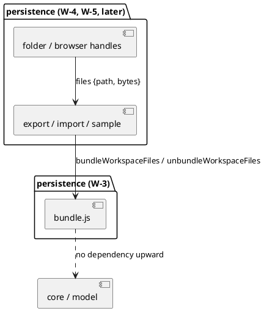
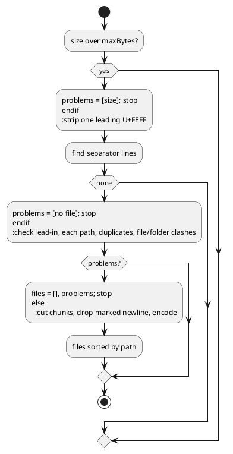

# Bundle codec

# Summary

A whole workspace becomes one YAML text, and one YAML text becomes the same files again, byte for byte (#162, proposal 1; wave 025 manifest id W-3). This design adds two pure functions, `bundleWorkspaceFiles` and `unbundleWorkspaceFiles`, in one new part of the `persistence` layer, a cases file shared by the node tests, and a round-trip test over every shipped workspace. Nothing calls the functions yet: export, import and the sample (W-5) and the browser store (W-4) come later. There is no PRD: the run profile is TDD+pln, the sources are issue #162 and the wave plan, so traceability is incomplete (see PRD Traceability).

# Scope

In scope: the new part `src/main/editor/persistence/bundle.js`, its entries in `layers.json` and `names.json`, the rebuilt page, `src/test/resources/editor-bundle/bundle-cases.json`, the node tests `src/test/javascript/viewpoint-kernel/bundle-cases.test.js` and `bundle-roundtrip.test.js`. Out of scope: reading a folder or a handle (the caller hands over the files), the IndexedDB store, any button or dialog, the sample and its check, the command line reading a bundle, TOML and JSON manifests, zip.

# PRD Traceability

No PRD. The requirements are taken from the proposal 1 of #162 ("Bundle codec"), its "Decisions" (separator `--- # file: <path>`, import limited to about 10 MB) and the P2 gate of the wave; they are labelled here so that the plan can cite them:

- `REQ-1` (#162 proposal 1): `bundle` and `unbundle` are pure functions of the page, and `unbundle(bundle(files))` gives back the files byte for byte.
- `REQ-2` (#162 point 3): only the lines `--- # file: <path>` separate; no parse and re-emit; a `---` inside a file stays what it is.
- `REQ-3` (#162 point 3): a file the bundle cannot carry (not YAML, not UTF-8) is listed in a message, never dropped silently.
- `REQ-4` (#162 point 3, P2 gate): import refuses `..`, an absolute path, a hidden file other than `.archicode.yaml` at the root, a path twice, and a bundle over the size limit.
- `REQ-5` (P2 gate): a cases file covers the refused paths, a BOM, CRLF and a `---` inside a file; a node test round-trips every shipped example and fixture folder that holds a `.archicode.yaml`.
- `REQ-6` (wave Non-Goals, Risks): `ratchet.max` of `layers.json` stays at most 99, no file over 3,000 lines, `npm run editor:check` passes, no coverage floor is lowered.

All six are addressed. They are assumed rather than sourced from a PRD.

# Technical Goals

- TG-1: `unbundleWorkspaceFiles(bundleWorkspaceFiles(files).text).files` has the same paths and the same bytes as `files` for every file the bundle carries (REQ-1).
- TG-2: the split looks at separator lines only (REQ-2).
- TG-3: every file not carried is named, with its reason, in a returned list and a ready sentence (REQ-3).
- TG-4: every refusal of an import is a sentence; all of them are reported, not only the first; nothing is returned as files when there is one (REQ-4).
- TG-5: the part uses no DOM, no `AppState`, no name defined above `persistence`; the ratchet does not rise (REQ-6).
- TG-6: a cases file read by the node test gives the contract, so that a later reader (the Java side, W-5's sample check) can read the same cases (REQ-5).

# Non-Goals

- Walking a folder, reading handles, writing files: W-4 and W-5.
- Choosing which files of a folder to export: the codec decides per file only whether it can carry it.
- Parsing the YAML inside a file: the bundle is a transport; the editor's own reader still refuses a file with several documents.
- A header, a version marker or a table of contents in the bundle.
- Case-insensitive path comparison (see ASM-3).

# Assumptions

- ASM-1: the editor reads YAML manifests only, so a file is carried if its name matches the case-sensitive expression `/\.(ya?ml)$/` that `readManifestFolder` in `persistence/workspace-loading.js` uses, with no lowercasing, so `a.YAML` is not a manifest and is skipped as "not YAML". Validate: the part uses the same expression, and a case pins `.YAML`.
- ASM-2: the files of a workspace the editor can open are valid UTF-8; one that is not is the "cannot carry" case. Validate: `TextDecoder` with `fatal: true` is available in Node 22 and in every browser of the wave.
- ASM-3: two paths that differ only by case are two files (the codec compares exact strings). A folder that holds both is not portable to macOS and Windows, which is the user's concern, not the codec's. Validate: nothing shipped has such a pair (the round-trip test would not detect it; a test of the plan asserts that no two shipped paths of one folder are equal once lowercased).
- ASM-4: 10 MB in the issue means 10 MiB (`10 * 1024 * 1024` bytes of the bundle text in UTF-8), the size of the text handed to `unbundleWorkspaceFiles`. Validate: Brightcart is about 40 KB; the limit only guards a wrong file.
- ASM-5: `File.text()` and the response decoder drop a leading byte-order mark of the bundle file itself (the page already depends on this, `readTextAndMark`); the codec still removes one leading U+FEFF of the bundle text, for a caller that did not.

# Constraints

- CON-1: the page is one classic script in one global scope; the part is a run of whole top-level declarations with no `import` or `export`; a name is used by the parts after it in `layers.json` (CLAUDE.md, "The editor page is generated").
- CON-2: the part is in the `persistence` layer and may use `core` and `model` only; the pairs that go upward must not rise above `ratchet.max` 99.
- CON-3: `standalone.html` is generated; the sources and the page are committed together after `npm run editor:build`; `names.json` is rewritten with `node scripts/check-editor.mjs --write-names`; `java-names.json` is by hand and lists a name only if Java sources or tests name it (no Java names the new functions in this run).
- CON-4: the code is formatted by Prettier and passes ESLint (`no-shadow`, `eqeqeq`, `no-unused-vars`).
- CON-5: byte for byte means the bytes a file had, a BOM, CRLF, a lone CR and a missing final newline included; the codec operates on bytes in and bytes out, never on a text the page has already stripped of its mark.
- CON-6: the editor reads no TOML and no JSON manifest; those are not carried.

# Current State

- The editor's folder interface has three implementations on the way: `showDirectoryPicker` handles, `serverDirectoryHandle` (`persistence/folder-access.js`) and, in W-4, a browser one. Files are read with `readTextAndMark`, which strips a leading BOM and returns a `bom` flag; `withByteOrderMark` puts it back on write.
- `persistence/` holds `remembered-folders.js`, `workspace-loading.js`, `folder-access.js` and `save.js` (774 lines at most). `layers.json` lists each part with its layer; `ratchet.max` is 99.
- `readManifestFolder` decides which files below a folder are manifests (`discovery-cases.json`: hidden entries left out below a `/**` path, `.archicode.yaml` read as the workspace).
- `archicode guide` already uses the convention `# file: <path>` in its examples, as the first line of a `yaml` block.
- The node harness (`src/test/javascript/viewpoint-kernel/harness.js`) loads the page script in a `vm` sandbox (`createApp`) and exposes the page's top-level names to a test. Tests read cases files from `src/test/resources/**` (`yaml.test.js` reads `editor-yaml/emitter-cases.json`).
- No bundle code, no `bundle-cases.json` and no `samples/` folder exist.

# Proposed Design

One new part, `persistence/bundle.js`, placed after `persistence/save.js` in `layers.json`, holding:

- the constants `BUNDLE_SEPARATOR_PREFIX` (`'--- # file: '`), `BUNDLE_NO_FINAL_NEWLINE` (`' # no final newline'`) and `BUNDLE_MAX_BYTES` (10 MiB);
- `bundleSeparatorAt(line)` (the one test of a separator line, used by both functions);
- `bundlePathProblem(path)` (the path rules, used by both functions): it returns a reason phrase (a string, the words of DEC-3, listed there once) or `null` when the path is acceptable; export stores the phrase as `skipped.reason` and import puts it inside its sentence;
- `bundleWorkspaceFiles(files)`, `files` = `[{ path, bytes }]` with `bytes` a `Uint8Array`, returns `{ text, carried, skipped }` (`skipped` = `[{ path, reason }]`; `text` is `''` for an empty list);
- `unbundleWorkspaceFiles(text, options)`, `options.maxBytes` defaulting to `BUNDLE_MAX_BYTES`, returns `{ files, problems }` (`files` = `[{ path, bytes }]`, empty when `problems` is not empty; `problems` = sentences);
- `bundleSkippedSentence(skipped)`, the sentence for the message of an export.



The reviewer should check that `bundle.js` has no arrow towards a handle, `AppState` or the DOM: callers pass bytes and receive bytes, and the part is testable alone.

Format, decided in DEC-1 to DEC-4. A bundle is:

```
--- # file: .archicode.yaml
<bytes of the file>
--- # file: manifests/a.yaml # no final newline
<bytes of the file, then the newline the bundle added>
```

DEC-1 — Split on separator lines only
  - Decision: a separator is a whole line (starting after a `\n` or at the start of the text) that begins with `--- # file: `; the file is the text between a separator and the next one (or the end), byte for byte, with nothing parsed. Text before the first separator is ignored if it holds only blank lines and `#` comment lines, else it is a problem.
  - Rationale: REQ-2; the save is line-preserving, so a parse and re-emit would change comments, quotes, BOM, line endings.
  - Alternatives considered: a YAML parse of the stream (loses bytes); a length prefix per file (not human-readable, not pasteable); a trailing sentinel (adds a line to every file).
  - Tradeoffs: a file that holds a line starting with `--- # file: ` cannot be carried (DEC-3).
  - Linked PRD IDs: REQ-1, REQ-2

DEC-2 — A final newline is the file's own, a missing one is marked
  - Decision: a file ending in `\n` (or empty) is written as is, so the next separator starts a line. A non-empty file that does not end in `\n` is written followed by one `\n`, and its separator carries the marker ` # no final newline` after the path. On import, a separator with the marker makes the reader drop exactly one `\n` at the end of the chunk. A chunk ending in `\r\n` keeps the `\r\n`; a lone `\r` at the end is a missing final newline like any other byte.
  - Rationale: the common file (final newline) looks natural and needs no marker; the exact bytes still come back (CON-5). The marker stays inside the comment of a valid YAML document start, so any YAML tool reads the stream.
  - Alternatives considered: always add one `\n` and always strip one (a blank line after every file, uglier to read and to diff, no marker needed); refuse files with no final newline (loses user data silently from an export).
  - Tradeoffs: a path ending in ` #` followed by the marker text, or containing ` #`, is ambiguous, so DEC-3 refuses a path containing ` #`.
  - Linked PRD IDs: REQ-1

DEC-3 — What the bundle cannot carry, and what an import refuses
  - Decision: `bundleWorkspaceFiles` puts in `skipped`, with a reason and without throwing: a name that does not match the YAML expression of ASM-1 ("not YAML"), bytes that are not valid UTF-8 ("not UTF-8", a reason of the bundle side only), a path the import would refuse (any rule below, with that rule's reason phrase from `bundlePathProblem`, the one place the phrases are written), a path already carried ("path twice": the later one is skipped), a path that is a file while another carried path is inside it as a folder ("file and folder": the later path in the input is skipped), and a file with a line that is a separator ("holds a line that looks like a bundle separator"). So a bundle the codec writes is a bundle it reads. `unbundleWorkspaceFiles` reports as problems: a path that is empty, absolute (starts with `/`, or a drive letter and `:`), holds `\`, a NUL or another control character, ` #`, leading or trailing space, an empty segment, a segment `.` or `..`; a hidden segment (starting with `.`) unless the whole path is `.archicode.yaml`; a path twice; a path that is a file and also a folder of another path; a name that is not YAML; text before the first separator that is not blank or comment; no file at all; and a text over `maxBytes`. Content that is not UTF-8 is not an import problem: the bundle text is a string already (ASM-2). A bundle with no root `.archicode.yaml` is accepted (W-4 and W-5 decide what a missing workspace file means); an empty list exports to an empty text, which import refuses as "no file". Names that Windows refuses (`CON`, a trailing dot) are not refused by the codec: it writes no file, it carries the paths of a folder that exists or of a bundle its author wrote. Every problem is a sentence naming the path (or the line number of the separator); the sentences are collected for the whole text, in the order of the file, with no cap (the size limit bounds the list).
  - Rationale: REQ-3 and REQ-4; the rules are those of `manifests.paths` and of #162; a name check at import keeps a later W-4 store from holding files the editor will not read. The same path rules apply to both directions so that a bundle the codec writes is a bundle it reads (TG-1).
  - Alternatives considered: the first problem only (one round trip per mistake); dropping a bad file and importing the rest (a partial workspace that looks complete); throwing on the first problem (the caller needs the list to show).
  - Tradeoffs: a stricter export than strictly needed (a hidden file such as `.gitkeep` is listed, not carried), which is what the author asked for (a list in the message).
  - Linked PRD IDs: REQ-3, REQ-4

DEC-4 — Bytes in, bytes out; a BOM is content
  - Decision: `bundleWorkspaceFiles` decodes each file with `new TextDecoder('utf-8', { fatal: true, ignoreBOM: true })`, so a leading EF BB BF becomes U+FEFF in the text and stays there; `unbundleWorkspaceFiles` encodes with `TextEncoder`, which writes U+FEFF back as EF BB BF. The BOM of the bundle text itself (ASM-5) is removed once, before the split. The output is sorted by path in code point order (as `ManifestDiscovery` does; not the UTF-16 code unit order of `<`, which differs for an astral character), independent of the order given. The reader accepts the separators of a hand-edited bundle in any order and returns its files sorted the same way. The codec never tests its input with `instanceof Uint8Array` (the node harness runs the page in a `vm` context, so a `Uint8Array` made by a test is of another realm); it reads `bytes` as an array-like of numbers, and tests compare bytes with `Buffer.compare` or `Array.from`, never `assert.deepStrictEqual` on typed arrays of two realms.
  - Rationale: CON-5; a stable order makes the future committed sample deterministic (W-5's `--check`).
  - Alternatives considered: working on strings the page already read (the BOM flag is lost: the page strips it); keeping the input order (a different bundle for the same folder).
  - Tradeoffs: a CRLF file is carried with its CRLF; its separator lines are LF, so the bundle has mixed line endings, which is correct for byte exactness and read fine by YAML tools.
  - Linked PRD IDs: REQ-1

DEC-5 — The size limit is the caller's text, checked first
  - Decision: `unbundleWorkspaceFiles` measures the size as `new TextEncoder().encode(text).length`, encoded once, before anything else; over `options.maxBytes` it returns one problem and no work. Export does not apply the limit (a caller may show the size).
  - Rationale: a wrong 200 MB file must not be split in the page; the limit is a parameter so a test needs no 10 MB data.
  - Alternatives considered: a limit per file (not asked); a limit on export (the user would lose the ability to take their data out).
  - Tradeoffs: a legitimate workspace over 10 MiB cannot be imported until the limit is raised; none exists today.
  - Linked PRD IDs: REQ-4

# Repository Impact

- IMP-1 — The bundle part
  - Path(s): `src/main/editor/persistence/bundle.js`
  - Change type: additive
  - Why impacted: holds the two functions and their helpers (DEC-1 to DEC-5).
  - Linked PRD IDs: REQ-1 to REQ-4
  - Risks / notes: about 200 lines; no top-level name collides with `names.json` (task-004 of the plan greps `names.json` first); Prettier-formatted.
- IMP-2 — Layer list and name list
  - Path(s): `src/main/editor/layers.json`, `src/main/editor/names.json`
  - Change type: modify
  - Why impacted: the part is listed with layer `persistence` after `persistence/save.js`; `names.json` gains the new top-level names (`node scripts/check-editor.mjs --write-names`).
  - Linked PRD IDs: REQ-6
  - Risks / notes: `ratchet.max` unchanged; `java-names.json` unchanged (no Java source names these).
- IMP-3 — The generated page
  - Path(s): `src/main/resources/editor-webapp/standalone.html`
  - Change type: modify (generated)
  - Why impacted: `npm run editor:build` assembles the new part; committed with the sources.
  - Linked PRD IDs: REQ-6
  - Risks / notes: `npm run editor:check` must find it equal to the assembly; the page grows by about 200 lines; the coverage floors are measured on the whole page.
- IMP-4 — Cases file
  - Path(s): `src/test/resources/editor-bundle/bundle-cases.json`
  - Change type: additive
  - Why impacted: the contract of DEC-1 to DEC-5 as data (see CTR-2).
  - Linked PRD IDs: REQ-5
  - Risks / notes: file contents in the cases are JSON strings with escapes (`\r\n`, `\uFEFF`); bytes are given as UTF-8 text except in the not-UTF-8 case, which gives bytes as a list of numbers.
- IMP-5 — Node tests
  - Path(s): `src/test/javascript/viewpoint-kernel/bundle-cases.test.js`, `src/test/javascript/viewpoint-kernel/bundle-roundtrip.test.js`
  - Change type: additive
  - Why impacted: the cases file and the round trip on every shipped workspace (the folders found under `src` that hold a `.archicode.yaml`, the rule of `scripts/byte-identity.sh`).
  - Linked PRD IDs: REQ-5
  - Risks / notes: the round-trip test covers the files the codec carries and asserts `skipped` is exactly the files of the folder that are not YAML or hidden; it also checks that bundling the same files in another order gives the same text.
- IMP-6 — `CLAUDE.md` and the manual
  - Path(s): none in this run.
  - Change type: none
  - Why impacted: the codec is not user-visible until W-5; the paragraph on the bundle is written with the export (W-5) and the manual by W-6.
  - Linked PRD IDs: none
  - Risks / notes: a run that leaves `CLAUDE.md` unsaid for a part must not leave the names list wrong; `editor:check` guards that.

# Canonical Impact

Not applicable — no canonical registers declared (`docs/CLAUDE.md` does not exist in this repository).

# Data Model and Contracts

- CTR-1 — The bundle text format
  - Current contract: none.
  - Proposed contract: UTF-8 text. Zero or more leading blank or `#` lines. Then one or more groups: a separator line `--- # file: <path>` (LF or CRLF terminated; the `\r` of a CRLF is not part of the path) optionally followed on the same line by ` # no final newline`, then the bytes of the file. `<path>` is relative, uses `/`, and follows DEC-3. The files are sorted by path in code point order. A file ending in a newline, or empty, has no marker; any other has the marker and one added `\n`.
  - Affected files: `src/main/editor/persistence/bundle.js`; later W-5's `samples/brightcart.yaml`.
  - Migration or compatibility notes: new format, no version marker (if one is needed, it is a `# archicode bundle 2` comment line before the first separator, which readers already ignore). The `archicode guide` convention `# file: <path>` is a cousin, not the same: the guide's lines are comments inside a block, not document starts.
  - Linked PRD IDs: REQ-1, REQ-2
- CTR-2 — `bundle-cases.json`
  - Current contract: none.
  - Proposed contract: `{ "bundle": [ { "name", "files": [ { "path", "text" | "bytes" } ], "expect": { "text", "carried": [paths], "skipped": [ { "path", "reason" } ], "sentence" } } ], "unbundle": [ { "name", "text", "maxBytes"?, "expect": { "files": [ { "path", "text" } ] } | { "problems": [sentences] } } ] }`. A reason and a sentence are compared as written; `sentence` is the output of `bundleSkippedSentence` for the skipped list of the case.
  - Affected files: IMP-4, IMP-5.
  - Migration or compatibility notes: additive; a Java reader can use it later without change.
  - Linked PRD IDs: REQ-5
- CTR-3 — Page functions
  - Current contract: none.
  - Proposed contract: the top-level functions of IMP-1 with the signatures of "Proposed Design". `files`, `carried` and `skipped` hold `path` and `bytes` (`Uint8Array`) or `reason`; `bundlePathProblem(path)` returns a reason phrase or `null`. `problems` is a list of sentences; `files` is `[]` when `problems` is not empty.
  - Affected files: IMP-1, IMP-2.
  - Migration or compatibility notes: a signature change after W-4 and W-5 start to call them is a change to their code too.
  - Linked PRD IDs: REQ-1, REQ-3, REQ-4

No kernel contract, no command-line output and no saved file changes; `scripts/byte-identity.sh` must show nothing.

# Interfaces and Behavior

- IF-1: `bundleWorkspaceFiles(files)` never throws for a bad file; it lists it. It throws only for a bad call (not an array).
- IF-2: `bundleSkippedSentence(skipped)` returns the empty string for an empty list, else one sentence such as ``2 files were not exported: `notes.md` (not YAML), `.gitkeep` (hidden)`` (the exact words are in the cases file; backquotes around paths as everywhere in the sentences of the tools).
- IF-3: `unbundleWorkspaceFiles(text, options)` never throws for a bad text; it returns problems, each one sentence naming the path or the line of the separator: ``the bundle holds the path `../x.yaml`, which leaves the workspace folder`` (exact words in the cases file).
- IF-4: the functions are pure: same input, same output, no clock, no random, no storage.

# Flows and Processing Logic

- FLOW-1 — Bundle
  - Trigger: a caller (W-5 export, the sample script) passes `[{ path, bytes }]`.
  - Steps: for each file, in any order: path rules, name rule, UTF-8 decode, separator-line scan of the text; a file that fails any is added to `skipped`; the others are sorted by path; each is written as separator, optional marker, text, added newline if needed; the result is `{ text, carried, skipped }`.
  - Branches / failure paths: duplicate paths in the input: the second is skipped with the reason "path twice"; a file and a folder clash: the later path is skipped with "file and folder"; an empty list gives an empty text.
  - Final output / rendered result: one string.
  - Linked PRD IDs: REQ-1, REQ-3
- FLOW-2 — Unbundle
  - Trigger: a caller passes the text of a bundle file.
  - Steps: measure the size (over the limit: one problem, stop); remove one leading U+FEFF; find the separator lines; check the lead-in; for each chunk read the path (and marker), check the path with `bundlePathProblem` (DEC-3), drop one `\n` if the marker is there, record the chunk; check duplicates and file-and-folder clashes over all paths (all problems collected); encode each chunk to bytes; return files, or an empty list with all problems.
  - Branches / failure paths: no separator at all: one problem ("the bundle holds no file"); a separator with an empty path: a problem naming its line.
  - Final output / rendered result: `{ files, problems }`.
  - Linked PRD IDs: REQ-1, REQ-4



The reviewer should check that every branch that returns problems also returns `files = []`, and that the size test comes before any scan.

# Reliability, Performance, and Scalability

One pass over the text for separators, one decode per file; a 10 MiB text is a few tens of milliseconds. Problems are collected for the whole text with no cap: the 10 MiB limit bounds the list, so a text of bad separators cannot grow it without limit. The functions are pure, which is the testability.

# Security and Privacy

The import is the only place a hostile text reaches the editor in this wave. Defences: the path rules (no `..`, no absolute path, no hidden segment except the root `.archicode.yaml`, no backslash or control character), the size limit before work, the duplicate and file-and-folder checks. The codec writes nothing; W-4's store must still not trust a path (it receives only paths that passed). No data leaves the browser.

# Observability and Verification

- `npm run editor:build`, then `node --test src/test/javascript/viewpoint-kernel/bundle-cases.test.js src/test/javascript/viewpoint-kernel/bundle-roundtrip.test.js`.
- The cases test covers: a plain file, CRLF, a BOM, a missing final newline, an empty file, a file with `---` and a `--- # file` that is not at a line start, a file with a real separator line (skipped), a non-YAML name, bytes that are not UTF-8, a hidden file, every refused path form, a path twice, a file and a folder, a text over `maxBytes`, a lead-in comment and a bad lead-in, no file, a separator with an empty path, CRLF separators, a BOM of the bundle itself, the skipped sentence, and the order of the output (code point order with an astral character, separators given in any order).
- The round-trip test: it walks each shipped workspace folder recursively, files only, with relative paths using `/`; the nested workspace file of a nested workspace shows up in `skipped` as hidden. It bundles the files, unbundles, compares paths and bytes with `Buffer.compare` or `Array.from`; bundling in the reverse order gives the same text; the skipped list is the non-YAML and hidden files and nothing else. A hit on a shipped YAML with a separator-like line is fixed in that file, not in the assertion.
- To show the tests fail: change the marker handling (drop the `\n` always) and see the missing-final-newline case and the round trip fail; restore.
- `npm run test:unit`, `npm run lint`, `npm run format:check`, `npm run editor:check` (the ratchet at most 99), `npm run test:coverage` (no floor lowered; the new part is covered by the cases).
- `scripts/byte-identity.sh` is not run: the command line is untouched (state it in the run document).

# Deployment and Rollout

Code-only, additive, dead until W-4 and W-5 call it; the page is published with the next tag. Backward compatibility: nothing existing reads the new names. Rollback: revert the commit (sources and page together).

# Risks and Tradeoffs

- RISK-1: a hand-edited bundle with a trailing space after the path or a Windows-edited bundle with CRLF separators. Mitigation: the `\r` is dropped; a trailing space is a problem naming the line (DEC-3).
- RISK-2: the added newline and marker make the format a little less obvious than "just split on `---`". Mitigation: the format is in CTR-1 and in the cases file; the marker is a YAML comment.
- RISK-3: a new top-level name that a later part defines again; `editor:check` stops at the first of the lists, and names are unique by construction. Mitigation: name them with the `bundle` prefix and grep `names.json` first.
- RISK-4: the part is used before W-4/W-5 exist, so no integration test exists in this run. Mitigation: the round trip over every shipped folder is the integration; W-5 adds the page-level use.
- RISK-5: a file in a shipped workspace holds a line `--- # file: ...` (an example in documentation). Mitigation: the round-trip test would list it as skipped and fail its "skipped is only non-YAML and hidden" assertion, which shows it; none is expected.

# Open Questions

None. Choices that a later run could reverse are recorded as assumptions (ASM-1, ASM-3, ASM-4) and decisions (DEC-2, the marker).

# Deferred Work

- DEF-1: the command line reading and writing a bundle (a separate small issue once the format exists, #162 "Not in scope").
- DEF-2: a format version comment, if the format ever changes.
- DEF-3: a Java reader of `bundle-cases.json`, if W-5's sample check wants the Java side to unbundle (W-5's gate has `archicode views generate` on the unbundled sample, which only needs the files).

# File Placement and Frontmatter

Saved as `docs/wav/wav-025-hosted-editor/run/run-0191-bundle-codec/tdd-0191-bundle-codec.md`, following the layout of run 0189; frontmatter `title`, `type: tdd`, `status`, `run: 0191`, `wave: 025`, `owner`, `date`, `related`.
