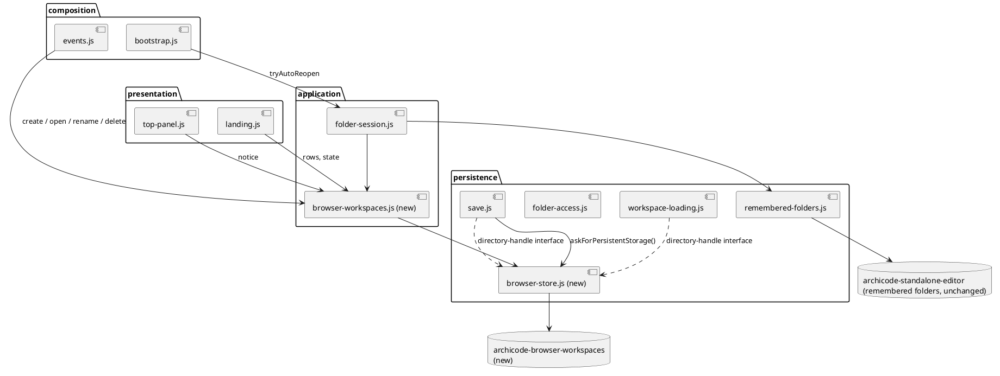
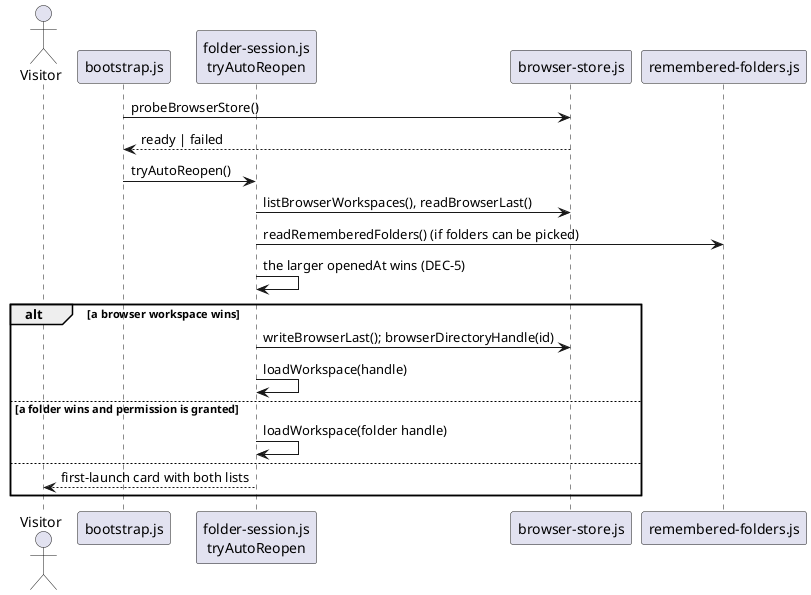

# Browser workspace

# Summary

A visitor in Chrome, Firefox or Safari opens the hosted editor and works in a workspace that the browser keeps for them, without choosing a folder (#162 proposal 2; wave 025 manifest id W-4). This design adds a third implementation of the File System Access directory-handle interface, `browserDirectoryHandle`, backed by IndexedDB; the store behind it (workspace records, file records, a "last opened" pointer); the flows that create, open, reopen, rename, close and delete a browser workspace; the landing card that lists them and no longer says "Firefox and Safari don't support it" where the store is available; the "lives in this browser" notice and the request for persistent storage at the first save; and a pass over the browser feature floors of the page (the one Chromium-only API found is `showDirectoryPicker`, DEC-10). Nothing in the editor below the handle changes: loading, the line-preserving save and the staleness check keep calling the interface they call today. There is no PRD: the run profile is TDD+pln and the sources are issue #162 and the wave plan, so traceability is incomplete (see PRD Traceability). The decisions that lose a visitor's work if wrong (delete, overwrite, a deleted workspace written to, the choice of what reopens on load) are DEC-5 to DEC-8.

# Scope

In scope: the new persistence part `src/main/editor/persistence/browser-store.js` (the database, the handle, the workspace and file records, the pointer, the persistence request); the new application part `src/main/editor/application/browser-workspaces.js` (the flows); edits to `application/folder-session.js`, `composition/bootstrap.js`, `composition/events.js`, `presentation/landing.js`, `presentation/top-panel.js`, `presentation/help-and-settings.js`, `persistence/save.js` (one call), `model/app-state.js` (state), `style.css`; `layers.json`, `names.json` and the rebuilt page; the node tests and the e2e spec of the Verification section; a hosted-style page server in the e2e harness; the paragraph of `CLAUDE.md` on the browser workspace; `model/settings.js` (the key of the remembered choices, IMP-12) and `application/browser-workspaces.js`. Note for the owner of the wave: the `likely_paths` of W-4 in the wave plan do not list `composition/bootstrap.js`, `composition/events.js`, `model/app-state.js`, `model/settings.js` and `application/browser-workspaces.js`, which this design touches, and list `package.json`, which it does not; this run does not edit the wave manifest.

Out of scope: Export, Import, the sample, `#sample=`, the button on the site and everything served by `editor serve` (W-5); the WebKit project and the manual (W-6); reading or writing a bundle (W-3 made the codec, W-5 calls it); sync between devices or tabs; the browser's own folder picker path and the served-folder path, which do not change.

# PRD Traceability

No PRD. The requirements are taken from proposal 2 and the "Decisions" of #162, from the W-4 row and the P2 gate of the wave, and labelled here so that the plan can cite them:

- `REQ-1` (#162 point 1 of Recommendation): the workspace is stored in IndexedDB as `{workspace, path, bytes, modified}` records behind a third directory handle that implements the interface the editor already uses; `serverDirectoryHandle` is the second.
- `REQ-2` (#162 proposal 2): the landing card lists browser workspaces and lets the visitor create one from nothing, open, rename and delete one.
- `REQ-3` (#162 point 2): the page asks `navigator.storage.persist()` when the first change is saved, says plainly that the workspace lives in this browser, and shows the time of the last export (the export itself is W-5).
- `REQ-4` (P2 gate): the card shows no "Firefox and Safari don't support it" sentence when `showDirectoryPicker` is absent and the browser workspace is available (a node test).
- `REQ-5` (W-4 row, #162 proposal 2): every use of a Chromium-only API in the page is checked for Firefox and Safari (dialogs, `inert`, fullscreen, CSS).
- `REQ-6` (W-4 row): node tests of the handle against an IndexedDB fake; an end-to-end spec in Chromium and Firefox that creates a browser workspace, edits it, reloads and finds the change; the saves of the existing tests are unchanged.
- `REQ-7` (wave delegation reason, `hard_judgment`): a browser workspace can be deleted, and the run must make losing a visitor's work hard: a deletion is confirmed by name, a workspace deleted elsewhere is never written to, a failed save leaves the previous bytes.
- `REQ-8` (wave Non-Goals, Risks, gate): no change to the folder-picker path or the served-folder path; the editor reads or writes no file of the user's disk unless a folder is picked; `ratchet.max` of `layers.json` stays at most 99; no file of `src/main/editor` over 3,000 lines; no coverage floor lowered; `npm run editor:check` passes; no dependency enters the page.
- `REQ-9` (wave dependency W-5 on W-4): the store offers what W-5 needs without a redesign: create a workspace from a list of files in one transaction, and a `lastExportAt` field.

All nine are addressed; none is unresolved. They are assumed rather than sourced from a PRD.

# Technical Goals

- TG-1: `browserDirectoryHandle` answers the calls the editor makes of a directory handle (the list in CTR-1) with the results a disk folder gives, so that the editor's loading and save code run on it unchanged (REQ-1).
- TG-2: a file written through the handle is stored whole or not at all, and reads back with the same bytes, a byte-order mark and CRLF included (REQ-1, REQ-7).
- TG-3: a visitor can create, list, open, rename and delete browser workspaces from the landing card, with a name that identifies one workspace (REQ-2, REQ-7).
- TG-4: after a reload the editor reopens what the visitor had open, whether a browser workspace or a remembered folder, without a click (REQ-6, DEC-5).
- TG-5: the card and the workspace say where the work lives (REQ-3), and the first save asks the browser to keep it.
- TG-6: Firefox and Safari reach the editor; the page's use of Chromium-only APIs is listed, checked and guarded against growing (REQ-4, REQ-5).
- TG-7: the new store is covered by node tests that do not print byte arrays and by an end-to-end spec in two browsers; coverage floors hold (REQ-6, REQ-8).

# Non-Goals

- Export, Import, the sample, `#sample=` and the site button (W-5); the card carries no button for them and the notice names no action that does not exist yet (DEC-8).
- Browser workspaces in a page served by `archicode editor serve`: that page opens the served folder at load as today and has no landing card; W-5 adds the way to a browser workspace there. The store and the handle do not assume the page is hosted.
- Telling a second tab about a change (`BroadcastChannel`, storage events): the staleness check of the save and the guard of DEC-6 are the protection (DEF-1).
- Folders inside a workspace that exist without a file (DEC-2), symbolic links, permissions other than `granted`, `isSameEntry`.
- Quota management beyond saying that the browser refused (RISK-2).
- Changing what the Settings page calls the workspace's name (`settings.name`): the browser workspace has its own name (DEC-9).

# Assumptions

- ASM-1: every browser of the wave (Chromium, Firefox, WebKit) supports IndexedDB with `ArrayBuffer`/`Uint8Array` values, `getAllKeys()` with no argument, and one object store in a transaction, and the page can create `File` objects (`new File([bytes], name, { lastModified })`). Validate: the e2e spec in Chromium and Firefox; WebKit is only exercised by W-6.
- ASM-2: `readTextAndMark` finds a byte-order mark from `file.slice(0, 3)`, so the `File` the handle returns must hold the stored bytes unchanged. Validate: a node test with a stored file that starts with `EF BB BF`.
- ASM-3: Firefox and Safari accept IndexedDB in a normal window. A private window may refuse it (an error on `open`); the page must show a card instead of failing (DEC-4, FLOW-1). Validate: a node test with `failOpen`.
- ASM-4: `navigator.storage.persist()` exists in Firefox and Safari and may show a permission prompt (Firefox) or answer `false` without one; the page must not wait on it. Validate: a node test with a stub that never settles, and the e2e spec, which must pass whether the answer is `true`, `false` or never comes (headless Firefox leaves it pending, Q-1).
- ASM-5: the editor uses on a directory handle only `kind`, `name`, `entries()`, `getDirectoryHandle`, `getFileHandle`, `removeEntry(name)` for a file, `queryPermission`, `requestPermission`; on a file handle only `getFile()` (with `lastModified`, `text()`, `slice().arrayBuffer()`) and `createWritable()` with `write` of a string and `close`; and `isSameEntry` only when it exists (`readManifestFolder`, `findSameFolder`). Validate: the list of CTR-1 is the result of the grep of the page for these names (recorded in the plan task), and the equivalence test of Verification runs the real loading and saving code on the handle.
- ASM-6: the browsers of the wave keep the IndexedDB data of a site until the visitor clears it or the browser evicts it, except Safari, which documents a cap on the script-writable storage of a site the visitor has not used for seven days (RISK-1). Not verifiable in a test; the notice and the export reminder (W-5) are the mitigation.
- ASM-7: the support floor the page needs is the oldest release that has every CSS and JavaScript feature in use: Firefox 121 (`:has`), Safari 16.2 (`color-mix`, container queries), Chromium 111 (`color-mix`). Validate: DEC-10 lists each feature with its first release; the scan test of IMP-9 pins the list.

# Constraints

- CON-1: the page is one classic script in one global scope; a part is whole top-level declarations with no `import` or `export`; a name is used by the parts after it in `layers.json` (CLAUDE.md, "The editor page is generated").
- CON-2: a layer uses the layers before it. `persistence/browser-store.js` may use `core`, `model` and the persistence parts before it (`WORKSPACE_FILE_NAME` of `workspace-loading.js`, `AppState`); `application/browser-workspaces.js` uses `persistence`; the card uses both. `ratchet.max` stays at most 99 (CLAUDE.md; wave gate).
- CON-3: `standalone.html` is generated; the sources and the page are committed together after `npm run editor:build`; `names.json` is rewritten with `node scripts/check-editor.mjs --write-names`; `java-names.json` is by hand and gains an entry only if a Java source or test names a new function (none is expected).
- CON-4: the existing IndexedDB database `archicode-standalone-editor` (version 1, store `handles`) is not changed: no version bump and no new store, because an older tab that holds it open would block an upgrade (the head comment of `persistence/remembered-folders.js`).
- CON-5: the redraw contract: a part below the composition calls `requestRedraw()`, never `render()` (RFC-002 rule 2); anything that changes a model ends in `modelsChanged()`. A browser workspace changes no model by itself; its flows redraw the landing card only.
- CON-6: formatting by Prettier and ESLint (`no-shadow`, `eqeqeq`, `no-unused-vars`, zero warnings); `src/test/e2e/**` is formatted and linted too.
- CON-7: no dependency enters the page. A dev dependency for the node suite needs the run to say why; this design needs none (DEC-11).
- CON-8: a node test never lets an assertion print a `Uint8Array` or a list of byte values: compare strings, lengths and hashes, with `Buffer.compare` for two byte arrays; the page builds its `Uint8Array` in the vm realm of the sandbox, so `deepStrictEqual` and `instanceof` on page bytes are never used (the failure of the first round-trip test of run 0191 exhausted the machine's memory and killed the desktop three times).
- CON-9: the test fake of IndexedDB is the existing `fakeIndexedDB` of `src/test/javascript/viewpoint-kernel/harness.js`. It has one object store per transaction, out-of-line keys, `get`, `getAll`, `getAllKeys` (no argument), `put`, `delete`, no key ranges, no indexes, no cursors; its `copy()` is shallow, so a stored `bytes` is the caller's array (DEC-2 copies on write). Readwrite transactions are serialised. The store design uses only those (DEC-1).
- CON-10: PMD and the Java side are untouched; the jar embeds the generated page, so `./mvnw verify` still has to pass at the gate, but no Java source is expected to change.

# Current State

- `persistence/folder-access.js` implements `serverDirectoryHandle` and `serverFileHandle` (the second implementation of the interface), `isFileSystemAccessSupported()` (`typeof window.showDirectoryPicker === 'function' && 'indexedDB' in window`), `isFolderAccessAvailable()` (served or supported), `readTextAndMark`, `withByteOrderMark`, and the folder flows: `openFolder`, `reopenFolder`, `openRememberedFolder`, `forgetFolder`, `showRememberedFolders`.
- `persistence/remembered-folders.js` keeps the folders the visitor picked, as handles, in `archicode-standalone-editor` (records `workspace` and `folder:<id>`), with merging of duplicates across tabs. Nothing in it reads files.
- `application/folder-session.js` holds `resetUiState`, `retryFolder`, `closeFolder` (it clears the last-folder pointer and falls back to `rememberFolder(folder.handle)` for a folder with no id) and `tryAutoReopen` (reads the remembered folders, queries the permission of the last one, opens it when `granted`).
- `composition/bootstrap.js`: in a served page it opens the served folder; if `!isFileSystemAccessSupported()` it draws the landing card and stops; else it calls `tryAutoReopen`.
- `presentation/landing.js`: `landingScreenConfig()` returns the `unsupported` card ("Use a recent Chrome, Edge, Brave or Opera — Firefox and Safari don't support it …") when `!isFolderAccessAvailable()`; `first-launch`, `reopen`, `error` and `busy` cards otherwise; `landingFolderRows()`; `renderLandingFoldersHtml`.
- `persistence/workspace-loading.js` (`readManifestFolder`, `loadWorkspace`) and `persistence/save.js` (`writeManifestFile`, `removeManifestFile`, `statManifestFile`, `statWorkspaceYaml`, `writeWorkspaceYaml`, `saveAllChanges`) reach files only through `AppState.folder.handle`; they compare `file.lastModified` before a write to notice a change made elsewhere; `getDirectoryHandleByRelativePath` (`model/index-builder.js`) walks `getDirectoryHandle`. A manifest folder that is absent is skipped (`folder.missing`), as for a disk folder with no `manifests/`.
- `AppState.folder` is `{ handle, name, id }`; `id` is the key of the remembered-folder record or null.
- The node harness has `fakeIndexedDB` (CON-9) with `seed`, `dump`, `failOpen`, `failPut`, `holdCommit` options, and `makeDirHandle` for disk folders (read-only: no `createWritable`, no `removeEntry`; `mem-folder.js` `memFolder` is the writable disk-like folder, strings only). It gives the sandbox a `File` only when a server token is set.
- The e2e harness starts `archicode editor serve` only (`src/test/e2e/harness.js`); the `pageErrors` fixture depends on `serve`. There is no spec for a page with no server.
- Part sizes: `save.js` 774 lines, `folder-access.js` 409, `landing.js` 243, `style.css` 954; nothing near 3,000.

# Proposed Design

One new persistence part holds everything that talks to IndexedDB for a browser workspace and nothing that draws. One new application part holds the flows. The editor's loading and saving are not edited except for one call after a successful save.

The reviewer should check that `browser-store.js` has no arrow to the application or presentation layers, that the second database is separate from the first, and that loading and saving reach the store only through the handle (dotted), plus the one `askForPersistentStorage()` call.

## DEC-1 — One new database, one object store, string keys

- Decision: `archicode-browser-workspaces`, version 1, one object store `records` with out-of-line string keys. Keys: `workspace:<id>` holds `{ kind: 'workspace', id, name, createdAt, openedAt, lastExportAt: null, origin }` (`origin` is `'blank'` now; W-5 adds `'sample'` and `'import'`); `file:<id>/<path>` holds `{ kind: 'file', workspace: id, path, bytes: Uint8Array, modified: <ms> }`; `last` holds `{ id, openedAt }`. A workspace id is `bw-` plus base36 time and eight random characters and never contains `/`. Listing a directory reads `getAllKeys()`, keeps the keys under `file:<id>/<dir>/` and takes the first path segment after the directory; a file's bytes are read only by `getFile()`.
- Rationale: CON-4 forbids touching the first database; CON-9 limits the design to what the existing fake does, which keeps the node suite free of a dependency; one store lets one transaction create or delete a workspace and all its files atomically (the fake and IndexedDB both support several records of one store in one transaction); the `{workspace, path, bytes, modified}` shape of the issue is kept. A listing reads keys only, so the cost is proportional to the number of files in the browser, not their bytes; a visitor holds a handful of workspaces of a few dozen files.
- Alternatives considered: a second object store `files` in a second database with an index on `workspace` (cheaper listing, but two stores in one transaction are not supported by the fake, and the delete would not be atomic in the tests); a new store in `archicode-standalone-editor` (blocked by CON-4); `localStorage` (rejected in #162); OPFS (rejected in #162 for `createWritable` support).
- Tradeoffs: listing is O(all files) in keys; acceptable at this size (RISK-6 notes the threshold to revisit). A compound key range would be better in IndexedDB and cannot be tested with the current fake.
- Linked PRD IDs: REQ-1, REQ-8, REQ-9.

## DEC-2 — `browserDirectoryHandle` follows the disk's semantics where the editor can see them

- Decision: `browserDirectoryHandle(workspaceId, path, name)` and `browserFileHandle(workspaceId, path, name)` return objects with the members of ASM-5, resolved as in CTR-1: directories are implicit (a directory exists while a file is under it, the root exists while the workspace record does), `getFileHandle(name, { create: true })` creates an empty file at once as a disk does and, when the file exists, returns its handle with its bytes and `modified` untouched (it never truncates), `getFile()` returns a `File` over a copy of the stored bytes (and `close()` stores a copy of the written bytes, because the test fake copies shallowly) with `lastModified` set to the stored `modified`, `createWritable()` collects `write` calls (a string is UTF-8 encoded, a `Blob`, `ArrayBuffer`, typed array and `{ type: 'write', data }` are taken as bytes) and stores the whole result in one transaction at `close()`, `modified` is `max(Date.now(), previous + 1)` so a rewrite always changes it, `removeEntry(name)` removes a file and throws `TypeMismatchError` for a directory, `queryPermission` and `requestPermission` answer `'granted'`, `isSameEntry` is not provided.
- Rationale: the editor decides "changed elsewhere" by comparing `lastModified`, so it must change on every write even inside one millisecond; creating the empty file at `getFileHandle(create)` keeps the semantics `existedOnDisk` assumes; an implicit directory means there is nothing to clean up and no empty-folder state to restore, and a deleted last manifest makes `manifests/` absent, which `readManifestFolder` already treats as an empty path (`folder.missing`); the editor never removes a directory, so refusing it is smaller than implementing recursion.
- Alternatives considered: explicit directory records (more state to keep in step, no gain for the editor); creating the file lazily at `close()` (a handle that has been created but not written would not be readable, unlike a disk); `isSameEntry` for loop detection (there are no links in this store).
- Tradeoffs: a file created and never written is an empty record, as on disk; `readManifestFolder` shows it as a manifest with an empty text and its usual reading error.
- Linked PRD IDs: REQ-1.

## DEC-3 — A write is one transaction; a refused write leaves the old bytes

- Decision: `close()` runs one `readwrite` transaction that reads the workspace record and the file's previous record, refuses (DEC-6) if the workspace record is gone, and `put`s the file record. The transaction helper aborts the transaction with the error raised in its callback and rejects with that error, name and message kept (the existing `withArchicodeStore` rejects with a generic `tx.error || new Error('the transaction was aborted')`), so DEC-6's `NotFoundError` comes out of `close()` as itself. A rejection (quota, abort) is thrown from `close()` with the browser's own name and a message that says the browser could not store the file and that nothing was changed; the transaction writes nothing. The editor's save then reports the error and keeps the file dirty, as it does for a disk error. Nothing in the store is deleted before the new bytes are written.
- Rationale: REQ-7; IndexedDB transactions are atomic, so the previous version of a file survives a failed write; the existing save already keeps a file dirty when the write throws.
- Alternatives considered: a journal or a copy of the previous version (not needed with atomic puts).
- Tradeoffs: a save of several files is several transactions, as it is several writes on a disk; a failure after the first leaves some files saved and the others dirty, which the page already shows file by file. No cross-file atomicity is promised (RISK-2).
- Linked PRD IDs: REQ-7.

## DEC-4 — The card is by capability; the store is probed once

- Decision: `probeBrowserStore()` is awaited once in `composition/bootstrap.js`, before `tryAutoReopen` (which does not call it), and sets `browserStoreState` to `'ready'` or `{ failed: <message> }`; `'unknown'` (before the probe ends) is the `busy` card, never `unsupported`, so Firefox does not flash the unsupported card. `isFolderAccessAvailable()` does not change (`server-mode.test.js` pins it `false` without a picker); the card asks a new `canKeepWorkspace()`: the picker exists, the store is `'ready'`, or the page is served. `landingScreenConfig()` returns `unsupported` only when `canKeepWorkspace()` is false after the probe (no `indexedDB`, or the probe failed) and tests `busy` before `unsupported`; the sentence for a failed probe says that the browser does not allow the editor to keep a workspace here (a private window may do that), and names `archicode editor serve` as the way out; the sentence about Firefox and Safari is removed from the card wherever the store is `'ready'`. The first-launch card shows, in this order: the actions *New workspace in this browser* and, only where `showDirectoryPicker` exists, *Open workspace folder*; the list *In this browser*; the list of remembered folders (empty and absent where folders cannot be picked). A page served by `editor serve` is unchanged.
- Rationale: REQ-4; the card must be a pure function of state so that a node test can check it (as `landingScreenConfig` is today); a browser that cannot keep data must say so instead of failing at the first save.
- Alternatives considered: probing at the first save (the failure would come after the visitor typed); offering the browser store only when no folder can be picked (Chrome would not get "try without choosing a folder", which the issue's acceptance wants).
- Tradeoffs: one extra IndexedDB open at load (the page already opens the first database at load).
- Linked PRD IDs: REQ-2, REQ-4.

## DEC-5 — What reopens on load is the most recent of the two pointers

- Decision: opening a browser workspace writes `last = { id, openedAt }` in the new database; closing it deletes `last` (the workspace stays). Opening a remembered folder is unchanged (it writes the `workspace` record and the folder's `openedAt` in the first database); closing a folder is unchanged. At load `tryAutoReopen` reads both: the browser `last` (when its workspace record exists) and the remembered `last` folder (when its permission is `granted`); the one with the larger `openedAt` opens; when the winner cannot open, the other is not tried and the card lists both.
- Rationale: no code writes to both databases, so neither can leave the other in a state the older code does not expect; a visitor who used a folder last gets the folder, one who used a browser workspace last gets it.
- Alternatives considered: a single pointer kept in the new database and written by the folder flows too (edits `openFolder`, `openRememberedFolder`, `closeFolder`: more risk to the folder path, which the wave says not to change); always the browser workspace first (surprising for someone who works on disk).
- Tradeoffs: two `openedAt` clocks on one device; a clock change could pick the older one, which only changes which card the visitor sees first. `readRememberedFolders` gives `openedAt: Date.now()` for a legacy or partly read last folder, so the folder wins in those two cases; this is acceptable.
- Linked PRD IDs: REQ-2, REQ-6.

## DEC-6 — A workspace that is gone is never written to

- Decision: every handle operation that writes (`getFileHandle` with `create`, `createWritable().close()`, `removeEntry`) checks the workspace record in the same transaction; if it is absent the operation throws an error named `NotFoundError` whose message is `The workspace “<name>” is no longer in this browser: it was deleted, possibly in another tab. Nothing was written.` Reads of a deleted workspace throw `NotFoundError` too. The page does not detect the deletion by itself; the next save or reload shows the sentence.
- Rationale: REQ-7; without the check a save from a tab that still shows a deleted workspace would write orphan file records that no list shows and that nothing deletes, and would let the visitor believe the work was kept.
- Alternatives considered: let the write recreate the workspace record (silently resurrects a workspace the visitor deleted); lock the workspace while a tab has it open (IndexedDB has no such lock; `navigator.locks` is left out because a lock cannot be tested with the fake and telling other tabs is DEF-1).
- Tradeoffs: a tab that has unsaved edits of a deleted workspace loses them on reload; the dirty-state warning (`beforeunload`) is unchanged and the sentence tells what happened.
- Linked PRD IDs: REQ-7.

## DEC-7 — Delete is confirmed by name, in the card, with the numbers

- Decision: the Delete button of a row turns the row into a question that names the workspace, the count of its files and the time of its last change, says that the deletion cannot be undone and that nothing on the disk is touched, and offers *Delete “name”* and *Cancel*; the focus is on *Cancel*, Escape cancels, and *Delete* is not the default action of Enter. The page never calls `confirm()` for this. Deleting runs one transaction that removes the workspace record, every file record of it and `last` if it points at it. Delete is offered only on the card (the workspace being open is closed first), never in the workspace; closing keeps the data. The name rule is owned by the store (`persistence/browser-store.js`): a name is trimmed, 1 to 80 characters, with no control character, and unique without case among the workspaces; it is one function with its sentences, which the flows call to show the problem under the field and which `createBrowserWorkspace` and `renameBrowserWorkspace` run again inside their readwrite transaction (they read the `workspace:` keys there and abort the transaction with the sentence), so two tabs cannot create or rename to one name; the default name is `Untitled workspace`, then `Untitled workspace 2`, and so on.
- Rationale: REQ-7; a row is the one place where the visitor sees which workspace they are acting on, and two workspaces with the same name would make "delete “Brightcart”" ambiguous, so names are unique; a native `confirm()` is blocked or suppressed in some embedded contexts and cannot be tested the way a card can; one transaction means a half-deleted workspace cannot exist.
- Alternatives considered: undo for a few seconds (a deleted workspace may be gone from another tab already, and a timer holds bytes in memory); a "trash" state (more states for a feature the issue lists as plain delete); typing the name to confirm (heavier than the count-and-name question for a store that will usually hold a sample).
- Tradeoffs: the confirmation does not mention Export because W-5 owns it; W-5 adds the line "Export it first" to this question (DEF-2).
- Linked PRD IDs: REQ-2, REQ-7.

## DEC-8 — The notice says where the work lives; persistence is asked once, after a save

- Decision: while a browser workspace is open the top bar shows a notice, `In this browser`, with a title that reads `This workspace is kept in this browser on this device. Clearing the site's data removes it.`, and the *Close folder* button reads *Close workspace* (the data stays; the title says so). The card repeats it for each row (`Kept in this browser`, IF-3) and replaces the save note "Nothing is written to disk until you click “Save all changes”." by `Nothing is stored in this browser until you click “Save all changes”.` The first successful save of a browser workspace in a page session (`browserStorageAsked` false, then set true) calls `askForPersistentStorage()`, which guards `typeof navigator`: if `navigator.storage.persist` exists it is called once, not awaited, and its answer is kept in `browserStoragePersisted` (`true`, `false`, or `null` before an answer); a `false` answer adds one sentence to the notice's title (`The browser may remove it when the device is short of space.`). The last export time (`lastExportAt`, null for now) is part of the record and shown as `Last exported: never` on the card row (the sentences of this decision are written here only; IF-1, IF-3 and CTR-3 point to it); W-5 writes it and adds the button.
- Rationale: REQ-3; #162 says the page must say plainly that the work lives in the browser, and asks `persist()` at the first save; not awaiting avoids blocking a save on a browser prompt (ASM-4); the notice promises no action that does not exist yet.
- Alternatives considered: asking at creation (a prompt before the visitor has anything to lose, and Firefox may refuse without engagement); a banner in the page body (takes room from the diagram; the top bar already carries the served-folder text).
- Tradeoffs: the line `Last exported: never` is a statement without a button until W-5; the wave ships as one pull request.
- Linked PRD IDs: REQ-3, REQ-9.

## DEC-9 — A browser workspace has its own name, and is created with a minimal `.archicode.yaml`

- Decision: the name in the list is the record's `name`, chosen by the visitor and changed by *Rename* in the card; it is independent of `settings.name`, which the Settings page edits and the remembered-folder list uses for folders. A workspace created from nothing holds one file, `.archicode.yaml`, whose text is `# A workspace kept in this browser.\nsettings:\n  name: <name as a JSON string>\n`, so that it opens, the Settings page has a name to edit, and creating the first element uses the first folder of `manifests.paths` (`manifests`) as for any workspace. `createBrowserWorkspace({ name, files, origin })` takes the files as `[{ path, bytes }]` and writes the record and all the files in one transaction (the call W-5 makes for the sample and an import).
- Rationale: the record name must exist before any file is read and rename must not rewrite a file the visitor edits; two names that diverge are a small cost against a landing screen that opens and parses every workspace to list it.
- Alternatives considered: showing `settings.name` and renaming by patching `.archicode.yaml` from the card (needs the line-preserving writer outside a loaded workspace); no rename.
- Tradeoffs: the Settings page can say "Corner shop" while the card says "My shop". The card shows only the record name; the title of the page is unchanged (`pageTitle`).
- Linked PRD IDs: REQ-2, REQ-9.

## DEC-10 — The Chromium-only pass is a list, a floor, a guard and a Firefox run

- Decision: the pass is recorded in the run document as a table of every feature found in `src/main/editor` (scripts, CSS, markup) that is not in all of Chromium, Firefox and Safari, with the first release that has it and what the page does where it is missing. Found by reading: `showDirectoryPicker` (Chromium only; used behind `isFileSystemAccessSupported()`, the card no longer depends on it); `document.fullscreenEnabled` and `requestFullscreen` (guarded in `story-player.js`; a refusal is a notice); `inert` on `#app` (Firefox 112, Safari 15.5); `:has` (Firefox 121, Safari 15.4); `color-mix` (Firefox 113, Safari 16.2); container queries `@container` (Firefox 110, Safari 16); `100dvh` (with a `100vh` fallback in the same rule); `:focus-visible`, `inset`, `scrollbar-width` (all current). The support floor is ASM-7. The deny list is derived from one rule: an API first released after the floor of ASM-7; the copying and searching array methods of ES2023, `structuredClone(` and `navigator.locks` all exist at the floor and are not listed (they would block a legitimate use). Release numbers are checked against MDN browser-compat-data when it can be reached; otherwise the list keeps only names known to be after the floor and the run document marks the rest C-UNCHECKED. `showDirectoryPicker` is the one Chromium-only API found; the other items above are version floors, not Chromium-only APIs. The pass adds a node test, `browser-apis.test.js`, that scans the editor sources and fails when a script names an API of a deny list (`showDirectoryPicker` outside `folder-access.js`, `showOpenFilePicker`, `showSaveFilePicker`, `FileSystemObserver`, `navigator.userAgentData`, `Array.fromAsync`, `Promise.withResolvers`, `Object.groupBy`, `Map.groupBy`, `Set.prototype.union` and its siblings, the Iterator helpers) or a stylesheet names a feature of a deny list (`@scope`, `@starting-style`, `anchor-name`, `field-sizing`, `text-wrap: balance`, `@property`, nesting with `&`), each with a one-line reason; adding one means editing the list on purpose. The e2e spec runs in Firefox for the dialogs, `inert`, layout and the console.
- Rationale: REQ-5; the grep found nothing that blocks Firefox or Safari today, so the lasting value is a record of the floor and a guard against drift, plus a real run; real Safari is not tested (D1: Playwright's WebKit is W-6).
- Alternatives considered: a polyfill layer (nothing to polyfill); raising the floor to the latest releases and deleting guards (the guards are cheap); a lint rule (ESLint has no per-browser rule here and a CSS linter would be a new dependency, CON-7).
- Tradeoffs: the deny list is a snapshot; it catches new uses, not an unlisted API.
- Linked PRD IDs: REQ-5, REQ-6.

## DEC-11 — The node suite extends the harness; the e2e suite serves the page without a server

- Decision: no fake-IndexedDB dependency; the existing `fakeIndexedDB` is used as it is (CON-9), and the harness gains one option (`withFile: true`, putting the host's `File` and a `navigator.storage` stub in the sandbox, as `serverToken` does for `File` today; the sandbox already has `Blob`, `TextEncoder` and `TextDecoder` and has no `navigator` otherwise, so `askForPersistentStorage()` guards `typeof navigator`; the stub counts its `persist` calls). The e2e harness gains `startHostedPage()`: a small Node `http` server on `127.0.0.1` and a free port that answers `GET /` with the committed `standalone.html` and nothing else (404 for the rest; the page has an inline icon), and a fixture `hosted` stops it. The `pageErrors` fixture lists `hosted` among its parameters as it lists `serve` (run 0181: the order of teardown, so that a request the page sends as the server stops is no error of the test); `serve` starts nothing unless a test calls it.
- Rationale: the wave plan leaves this choice to the run and asks for a reason for a dependency; the fake already models transactions, aborts and quota failures, so a dependency adds nothing; a page with no `<meta name="archicode-server">` is what the hosted site serves, and a static server is the nearest test of it without the JVM.
- Alternatives considered: `fake-indexeddb` (a new dev dependency, key ranges not needed); `file://` (Firefox gives each file an opaque origin; IndexedDB is not stable there); `archicode editor serve` (the page would carry the token and be in served mode).
- Tradeoffs: the e2e spec tests the committed page, so `npm run editor:build` must run first (CLAUDE.md says so for every e2e run).
- Linked PRD IDs: REQ-6, REQ-8.

## DEC-12 — Layers and names

- Decision: `persistence/browser-store.js` goes after `persistence/workspace-loading.js` and before `persistence/save.js` in `layers.json`; `application/browser-workspaces.js` goes right after `application/folder-session.js`. The state variables (`browserWorkspaces`, `browserStoreState`, `browserStoragePersisted`, `browserStorageAsked`, `landingPendingDelete`, `landingNameDraft`) are declared in `model/app-state.js` next to `rememberedFolders` and `landingBusy`. The ratchet is checked after each part; if a pair goes upward it is moved, not tolerated.
- Rationale: CON-2, REQ-8; `saveAllChanges` is in a later persistence part and may call `askForPersistentStorage()` defined earlier.
- Alternatives considered: putting the flows in `persistence` (they set `landingBusy` and redraw: application work); one big part (the 3,000-line rule is not at risk, but two layers are mixed).
- Tradeoffs: none beyond the number of parts (two more; `layers.json` lists 70 now).
- Linked PRD IDs: REQ-8.

# Repository Impact

- `IMP-1 — The store and the handle`
  - Path(s): `src/main/editor/persistence/browser-store.js` (new); `src/main/editor/layers.json`; `src/main/editor/names.json`
  - Change type: additive
  - Why impacted: DEC-1 to DEC-3, DEC-6, DEC-8 (`askForPersistentStorage`). Holds the database opener and a transaction helper written for one store (the pattern of `withArchicodeStore`: work queues requests only, the result is read after `oncomplete`; it aborts with the error raised in its callback and rejects with that error, DEC-3), the name rule of DEC-7, `browserDirectoryHandle`, `browserFileHandle`, `probeBrowserStore`, `listBrowserWorkspaces`, `createBrowserWorkspace`, `renameBrowserWorkspace`, `deleteBrowserWorkspace`, `readBrowserLast`, `writeBrowserLast`, `clearBrowserLast`, `markBrowserExport` (used by W-5), `askForPersistentStorage`. Names begin with `browser` to stay clear of the existing `folder` names.
  - Linked PRD IDs: REQ-1, REQ-3, REQ-7, REQ-9
  - Risks / notes: no use of `render`, `AppState` flows or the DOM; reads `WORKSPACE_FILE_NAME`. Roughly 400 lines.
- `IMP-2 — The flows`
  - Path(s): `src/main/editor/application/browser-workspaces.js` (new); `src/main/editor/application/folder-session.js`
  - Change type: additive; modify
  - Why impacted: `browser-workspaces.js` holds `newBrowserWorkspace`, `openBrowserWorkspace`, `renameBrowserWorkspaceRow`, `askToDeleteBrowserWorkspace`, `confirmDeleteBrowserWorkspace`, `cancelBrowserWorkspaceQuestion`, `refreshBrowserWorkspaces`; each sets `landingBusy`/`landingNotice`, redraws with `requestRedraw()` and keeps focus with `landingFocusSelector`. `folder-session.js` changes `tryAutoReopen` (DEC-5), `closeFolder` (a browser workspace clears the browser `last` and does not touch the remembered folders: it must branch before the `rememberFolder(folder.handle)` fallback), and `resetUiState` also clears `landingNameDraft`. `openBrowserWorkspace` sets `AppState.permissionState = 'granted'` as the served and picked flows do; `closeFolder` of a browser workspace calls `refreshBrowserWorkspaces` as well as `refreshRememberedFolders`. `AppState.folder` of a browser workspace is `{ handle, name, id: null, browserWorkspace: <id> }`.
  - Linked PRD IDs: REQ-2, REQ-6, REQ-7
  - Risks / notes: `retryFolder`, `noteWorkspaceName`, `showRememberedFolders` read `AppState.folder.id`; with `id` null they must do nothing wrong for a browser workspace; a node test pins each.
- `IMP-3 — The card`
  - Path(s): `src/main/editor/presentation/landing.js`; `src/main/editor/style.css`
  - Change type: modify
  - Why impacted: DEC-4, DEC-7, DEC-8. `landingScreenConfig` gains the new action, the list `browserRows` (the question and the rename field derive from `landingPendingDelete` and `landingNameDraft`), and loses the Firefox and Safari sentence where the store is ready; `renderLandingHtml` draws a row for a browser workspace (name, files, last change, `Kept in this browser`, `Last exported: never`, *Open*, *Rename*, *Delete*) and the delete question; the error card of a browser workspace offers *Back to the list* instead of *Choose another folder*. A few rules in `style.css` for the new rows reuse the classes of `landing-folder`.
  - Linked PRD IDs: REQ-2, REQ-3, REQ-4, REQ-7
  - Risks / notes: every new control has an accessible name that includes the workspace name; the 360 px layout (`editor-at-360-px.test.js`) must still pass.
- `IMP-4 — The bar and the help`
  - Path(s): `src/main/editor/presentation/top-panel.js`; `src/main/editor/presentation/help-and-settings.js`
  - Change type: modify
  - Why impacted: DEC-8: the notice and the label *Close workspace*; the help note names the browser as the place of the files for a browser workspace (`where`).
  - Linked PRD IDs: REQ-3
  - Risks / notes: the "Nothing is uploaded" sentence stays true and stays.
- `IMP-5 — The events and the bootstrap`
  - Path(s): `src/main/editor/composition/events.js`; `src/main/editor/composition/bootstrap.js`
  - Change type: modify
  - Why impacted: new `data-action` values `new-browser-workspace`, `open-browser-workspace`, `rename-browser-workspace`, `ask-delete-browser-workspace`, `delete-browser-workspace`, `cancel-browser-workspace-question`; the bootstrap no longer stops on `!isFileSystemAccessSupported()` but on "no folder access and no browser store", and awaits `probeBrowserStore()` once before `tryAutoReopen` (DEC-4); the synchronous branch for no picker is removed in favour of the awaited probe.
  - Linked PRD IDs: REQ-2, REQ-4
  - Risks / notes: the served branch is first and unchanged.
- `IMP-6 — State`
  - Path(s): `src/main/editor/model/app-state.js`
  - Change type: additive
  - Why impacted: DEC-12 variables, including `landingNameDraft` (CTR-4), each reset by `resetUiState` or by a new folder as the neighbours are.
  - Linked PRD IDs: REQ-2
  - Risks / notes: none of them is model state: no `modelsChanged()`.
- `IMP-7 — The save hook`
  - Path(s): `src/main/editor/persistence/save.js`
  - Change type: modify (one call)
  - Why impacted: after a successful `saveAllChanges` of a workspace whose `AppState.folder.browserWorkspace` is set and when `browserStorageAsked` is false, call `askForPersistentStorage()` (DEC-8). No other line of the save changes.
  - Linked PRD IDs: REQ-3, REQ-8
  - Risks / notes: the `saved` path of the existing tests must stay byte for byte; the call is after the status is set.
- `IMP-8 — Node tests and harness`
  - Path(s): `src/test/javascript/viewpoint-kernel/browser-store.test.js`, `browser-workspace-equivalence.test.js`, `browser-workspaces-flows.test.js`, `browser-landing.test.js`, `browser-apis.test.js` (all new, `browser-workspaces-flows.test.js` also pins the key of IMP-12); `src/test/javascript/viewpoint-kernel/harness.js`
  - Change type: additive; modify (harness, one option)
  - Why impacted: Verification. The harness gets `withFile` (CON-9, DEC-11).
  - Linked PRD IDs: REQ-4, REQ-5, REQ-6, REQ-7
  - Risks / notes: CON-8; the existing `folders.test.js` is not edited and is the proof the first database is untouched.
- `IMP-9 — End-to-end`
  - Path(s): `src/test/e2e/harness.js`; `src/test/e2e/fixtures.js` (`hosted` is a parameter of `pageErrors`); `src/test/e2e/browser-workspace.spec.js` (new)
  - Change type: additive
  - Why impacted: DEC-11; the spec of Verification, run in the `chromium` and `firefox` projects of `playwright.config.js` (unchanged).
  - Linked PRD IDs: REQ-6
  - Risks / notes: one worker, no retry; a failure keeps the trace; the spec uses `page.evaluate` to read the stored bytes back (the editor's output is its contract).
- `IMP-10 — The generated page`
  - Path(s): `src/main/resources/editor-webapp/standalone.html`
  - Change type: modify (generated)
  - Why impacted: `npm run editor:build`; committed with the sources (CON-3).
  - Linked PRD IDs: REQ-8
  - Risks / notes: `npm run editor:check` fails if it is stale.
- `IMP-11 — CLAUDE.md`
  - Path(s): `CLAUDE.md`
  - Change type: modify
  - Why impacted: one paragraph: the browser workspace (the database, the keys, the handle, the pointer rule, the delete rule), the support floor, `browser-apis.test.js`, and the hosted-style e2e harness. W-6 updates "what it does not test".
  - Linked PRD IDs: REQ-8
  - Risks / notes: keep it to one paragraph in the existing style.

- `IMP-12 — The remembered choices`
  - Path(s): `src/main/editor/model/settings.js`
  - Change type: modify
  - Why impacted: the remembered plateau, the compare choice and the per-folder flags are keyed `folder.id || 'name:' + folder.name`; a browser workspace has `id: null`, so its key would be `name:<record name>` and a rename would lose the choices while a same-named folder would inherit them. The three functions use one helper that returns `bw:<id>` for a folder with `browserWorkspace` set and the old key otherwise. Deleting a workspace does not need to clear them. A node test pins the key (rename keeps the choices, two workspaces and a folder with one name do not share them).
  - Linked PRD IDs: REQ-2, REQ-8
  - Risks / notes: the old key stays for every folder that is not a browser workspace, so remembered choices of folders are unchanged.

# Canonical Impact

Not applicable — no canonical registers declared (`docs/CLAUDE.md` does not exist in this repository, and the project instructions declare neither an `arc` nor a `dom` register).

# Data Model and Contracts

- `CTR-1 — The directory-handle interface the editor uses`
  - Current contract: implemented by the browser's handles (`showDirectoryPicker`) and by `serverDirectoryHandle` / `serverFileHandle`. Directory: `kind`, `name`, `entries()` (async iterator of `[name, handle]`), `getDirectoryHandle(name, { create })`, `getFileHandle(name, { create })`, `removeEntry(name)`, `queryPermission`, `requestPermission`, optional `isSameEntry` and `symbolicLink`. File: `kind`, `name`, `getFile()`, `createWritable()` with `write`/`close`.
  - Proposed contract: `browserDirectoryHandle` and `browserFileHandle` implement exactly that list with these results: `entries()` yields files and implicit directories of the immediate level, in key order; a missing entry without `create` throws `NotFoundError`; `getDirectoryHandle` with `create` on a directory with no file under it returns a handle without storing anything; `getFile()` returns a `File` with the stored bytes and `lastModified`; `createWritable().write` takes a string, `Blob`, `ArrayBuffer`, typed array or `{ type: 'write', data }`; `close()` stores all the written parts, in order, as one record (DEC-3); `removeEntry` of a file deletes its record, of a missing name throws `NotFoundError`, of a directory throws `TypeMismatchError`; the two permission calls resolve `'granted'`.
  - Affected files: `persistence/browser-store.js` (new); no change to `workspace-loading.js`, `save.js` (but IMP-7), `model/index-builder.js`.
  - Migration or compatibility notes: nothing changes for the other two implementations; the equivalence test of Verification runs the same loading and saving on a disk handle and a browser handle.
  - Linked PRD IDs: REQ-1
- `CTR-2 — The stored records`
  - Current contract: none (a new database).
  - Proposed contract: database `archicode-browser-workspaces`, version 1, object store `records`, no key path, no index. `workspace:<id>` → `{ kind: 'workspace', id: string, name: string, createdAt: number, openedAt: number, lastExportAt: number | null, origin: 'blank' | 'sample' | 'import' }`; `file:<id>/<path>` → `{ kind: 'file', workspace: string, path: string, bytes: Uint8Array, modified: number }` where `path` is relative to the workspace root, uses `/`, has no empty, `.` or `..` segment; `last` → `{ id: string, openedAt: number }`. An unknown `kind` or a record that does not parse is ignored by a listing, never deleted.
  - Affected files: `persistence/browser-store.js`.
  - Migration or compatibility notes: version 1 is final for this wave; a later field is an optional property of a record, so that an older tab reads a newer record without an upgrade (the same discipline as CON-4). The `origin` values `sample` and `import` are written by W-5 and read as plain text here.
  - Linked PRD IDs: REQ-1, REQ-9
- `CTR-3 — Landing configuration`
  - Current contract: `landingScreenConfig()` returns one of `unsupported`, `busy`, `error`, `first-launch`, `reopen`, or null, with `actions`, `folders`, `notice`, `note`.
  - Proposed contract: the same kinds. `first-launch` gains `browserRows: [{ id, title, files, changed, exported }]` (`exported` the text `never` or a time; the question and the rename field derive from `landingPendingDelete` and `landingNameDraft` of CTR-4; the sentences are DEC-8's) and its `actions` hold `new-browser-workspace` first; `unsupported` is returned only as DEC-4 says and its text no longer names Firefox or Safari as unsupported where the store is ready; `error` for a browser workspace has `actions` `Back to the list` (`show-folders`) and, when a workspace folder is known, `Try again`.
  - Affected files: `presentation/landing.js`.
  - Migration or compatibility notes: the existing tests on `landingScreenConfig` (`folders.test.js`, `editor-odds-and-ends.test.js`) read the existing keys and are expected to pass unchanged.
  - Linked PRD IDs: REQ-2, REQ-4
- `CTR-4 — Page state added`
  - Current contract: `AppState.folder = { handle, name, id }`.
  - Proposed contract: `AppState.folder.browserWorkspace` is the workspace id for a browser workspace and absent otherwise. Top-level variables: `browserWorkspaces` (the rows read from the store), `browserStoreState` (`'unknown'`, `'ready'`, `{ failed }`), `browserStoragePersisted` (`null`, `true`, `false`), `browserStorageAsked` (boolean, set once per page session at the first successful save, beside `browserStoragePersisted`, which stays `null` until the unawaited answer), `landingPendingDelete` (id or null), `landingNameDraft` (null or `{ for: 'new' | <workspace id>, text, problem }`: the open name field of *New workspace* or *Rename*, its typed text and the refusal sentence; a redraw keeps the text and the sentence; `resetUiState` clears it).
  - Affected files: `model/app-state.js`, `model/settings.js` (IMP-12), `folder-session.js`, `landing.js`, `top-panel.js`.
  - Migration or compatibility notes: none; not serialised.
  - Linked PRD IDs: REQ-2, REQ-3
- `CTR-5 — Addresses`
  - Current contract: the editor's hash (`#/timeline/applications` and parameters).
  - Proposed contract: unchanged. A browser workspace is not named in the address: the workspace is the one the page holds or reopens by DEC-5. `#sample=` is W-5.
  - Affected files: none.
  - Migration or compatibility notes: a link to a page address opens on whatever workspace reopens, as a link does for a remembered folder today.
  - Linked PRD IDs: REQ-8

# Interfaces and Behavior

- `IF-1 — Landing card, first launch.` Title `Open a workspace`. Text for a browser that cannot pick folders: `Edit the elements, relationships, views and settings of an ArchiCode workspace. Your workspaces are kept in this browser, on this device.` Where folders can be picked the existing text stays and a second sentence names the browser option. Actions: *New workspace in this browser* (primary where no folder can be picked), *Open workspace folder* (only where `showDirectoryPicker` exists). Lists: *In this browser* (rows of CTR-3) and *Remembered folders* (as today). Note under the card: the existing folder note where folders can be picked, the note of DEC-8 for the browser option; a card that offers both says both.
- `IF-2 — New workspace.` The button asks for a name inline (a text field with the default of DEC-7, *Create* and *Cancel*, Enter creates, Escape cancels; the state is `landingNameDraft`); a refused name is a sentence under the field (`problem`) and keeps the text. Creating stores `.archicode.yaml` (DEC-9), opens the workspace on the default page, writes `last`, and the card is replaced by the editor.
- `IF-3 — A row.` Name; `N files · changed <time>`; the two lines of DEC-8 (a time instead of `never` from W-5). Buttons *Open “name”*, *Rename “name”*, *Delete “name”*, each with the name in its accessible name. Rename turns the name into the field of IF-2; a refused name is a sentence and nothing is changed. Delete turns the row into the question of DEC-7.
- `IF-4 — Open.` Reads the workspace record (a missing record is a notice `“name” is no longer in this browser.` and a refreshed list), writes `last`, sets `AppState.folder` (CTR-4) and `AppState.permissionState = 'granted'` and calls `loadWorkspace(handle)`. A workspace whose `.archicode.yaml` is absent or unreadable shows the existing error card with the existing sentences.
- `IF-5 — In the workspace.` The top bar shows the notice of DEC-8 and *Close workspace*; *Save all changes* and every other control are those of today. A failed save shows the existing save error with the browser's sentence (quota) or DEC-6's sentence.
- `IF-6 — Errors.` The store cannot be opened: `unsupported` card with the reason (DEC-4). A record cannot be read: the row is shown with `could not be read` and only *Delete* works. A transaction aborts: the action's own sentence on the card (`could not be created: <message>`), no partial state.

# Flows and Processing Logic

- `FLOW-1 — Load`
  - Trigger: `DOMContentLoaded` of a page that is not served by `editor serve`.
  - Steps: render the busy card; bootstrap awaits `probeBrowserStore()` (`'unknown'` is the busy card); if `canKeepWorkspace()` is false, render `unsupported`; read the browser workspaces and the browser `last`; read the remembered folders and, if folders can be picked, the last folder and its permission; choose by DEC-5; open it (`loadWorkspace`), or render the first-launch card with both lists.
  - Branches / failure paths: the probe fails → `unsupported` with the reason, but remembered folders still work where folders can be picked (the card then shows only the folder action); the winner's workspace record is gone → the other pointer, then the card; the folder's permission is `prompt` → the existing `reopen` card, and the browser workspaces are listed on it too; `.archicode.yaml` unreadable → the existing error card.
  - Final output / rendered result: the editor on the last workspace, or the first-launch card.
  - Linked PRD IDs: REQ-2, REQ-4, REQ-6

The reviewer should check that no branch writes to both databases, and that every failure ends on a card, not a blank page.

- `FLOW-2 — Create`
  - Trigger: *New workspace in this browser*, then *Create*.
  - Steps: validate the name (DEC-7); `createBrowserWorkspace({ name, files: [.archicode.yaml], origin: 'blank' })` in one transaction; `openBrowserWorkspace(id)`.
  - Branches / failure paths: a name taken or invalid → a sentence under the field; the transaction fails → `could not be created: <message>` and the list is read again; nothing is half-created.
  - Final output / rendered result: the editor on an empty workspace.
  - Linked PRD IDs: REQ-2
- `FLOW-3 — Edit, save, reload`
  - Trigger: the visitor edits and presses *Save all changes*.
  - Steps: `ensureWritePermission` (granted at once); for each dirty file `statManifestFile` (the stored `modified`) → compare with `lastKnownDiskModified` → `writeManifestFile` (`getFileHandle`, `createWritable`, `write`, `close` = one transaction); the status shows `Saved.`; on the first success `askForPersistentStorage()`; on reload FLOW-1 opens the workspace and reads the stored bytes.
  - Branches / failure paths: the stored `modified` differs from what the editor read (another tab saved) → the existing "changed elsewhere" handling; the workspace was deleted (DEC-6) → the sentence, the file stays dirty; the quota is exceeded → the browser's error, the old bytes remain (DEC-3); `persist` unavailable or unanswered → nothing visible.
  - Final output / rendered result: the saved text on screen after a reload.
  - Linked PRD IDs: REQ-1, REQ-3, REQ-6, REQ-7
- `FLOW-4 — Rename and delete`
  - Trigger: *Rename* or *Delete* on a row.
  - Steps: rename: validate (DEC-7), one transaction rewrites the record's `name`; delete: the question (DEC-7), then one transaction removes the record, its files and `last` if it points at it; the list is read again and the focus goes to the next row or to *New workspace*.
  - Branches / failure paths: the record is already gone (another tab) → `“name” was already deleted.` and a refreshed list; the transaction fails → the sentence, nothing changed.
  - Final output / rendered result: the updated list; no file of the disk touched.
  - Linked PRD IDs: REQ-2, REQ-7

# Reliability, Performance, and Scalability

- A workspace of Brightcart's size (61 files, about 40 KB) lists and loads in a few transactions; a listing reads all keys of the database (DEC-1), a load reads each file once. Large workspaces and many workspaces degrade the listing linearly (RISK-6).
- Failure behaviour is in DEC-3 and DEC-6: a refused or aborted write changes nothing; a deleted workspace is never written to. A crash between two files of a save leaves a mix of old and new files, as a disk does (RISK-2).
- The two databases are independent; an error in one never affects the other. The first database is read as before; a page that cannot open the new database still works with folders.
- `modified` is monotonic per file, so the staleness check of the save is reliable inside one millisecond.

# Security and Privacy

- Nothing leaves the browser: the store is local to the origin, no network call is added, and the "Nothing is uploaded" help sentence stays true. The hosted origin is `tmorin.github.io`, shared with other project pages of that user: IndexedDB is per origin, not per path, so the database name must not clash with another page of that origin (a prefix `archicode-` is used; RISK-5).
- No file of the visitor's disk is read or written unless they pick a folder (REQ-8). The store holds only what the visitor typed or imported.
- Workspace names are shown through `escapeHtml` and put into attributes through the same escape; a name is data, never markup (a node test with `` in a name).
- A path that comes from a stored record is used as a key and as a name in the listing, never as a file system path.

# Observability and Verification

The unit suite and the e2e suite run on the committed page after `npm run editor:build`. Tests assert strings, lengths and hashes, never byte arrays (CON-8).

- `browser-store.test.js` (REQ-1, REQ-7): the handle contract of CTR-1 against `fakeIndexedDB`: list of a nested tree, a missing file and directory (`NotFoundError`), create then read an empty file, write a string, a `Blob`, an `ArrayBuffer` and `{ type: 'write' }` in several parts, a BOM and CRLF read back byte for byte (hash), `modified` strictly increases across two writes in one tick, a rewrite replaces, `removeEntry` of a file / of a missing name / of a directory, the last file removed makes its directory absent, two workspaces do not see each other's files, create on an existing file keeps its bytes and `modified`, two interleaved creates (and renames) of one name on the fake, which serialises readwrite transactions, leave one failing with the name sentence, the rejection of `close()` for a deleted workspace has the `name` and the message of DEC-6, a quota failure (`failPut`) leaves the old bytes and rejects `close()`, a write and a create after the workspace was deleted are refused with DEC-6's sentence and store nothing (the records of the fake are compared before and after), `createBrowserWorkspace` is atomic (fail the third `put`: no record), `deleteBrowserWorkspace` removes the record, every file and the pointer in one transaction and no other workspace's key, the records of the first database are untouched (`dump`).
- `browser-workspace-equivalence.test.js` (REQ-1, REQ-6): for the Brightcart layered fixture and two shipped examples, the same files are put in a disk folder (`memFolder` of `mem-folder.js`, which has `createWritable`, takes strings only and does not truncate on `getFileHandle` with create; `makeDirHandle` is read-only and is not used) and in a browser workspace, both fed the same strings, a byte-order mark as the first character of the string; `loadWorkspace` gives the same file list, texts and `bom` flags; the same edit saved through `saveAllChanges` writes the same bytes in both (compared by hash and by the changed lines); a file with a BOM keeps it. Bytes are compared with `Buffer.compare` or hashes, never `deepStrictEqual`.
- `browser-workspaces-flows.test.js` (REQ-2, REQ-3, REQ-6, REQ-7), none of which reads the drawn card or a key handler: create (default names, a name taken, empty, too long, control character, the text of `` stored as data), open (`permissionState` granted), rename, delete (*Delete* removes, a cancelled question changes nothing), the key of IMP-12 (`bw:<id>`), reload with a second `createApp` on the same fake database finds the saved change and not an unsaved one, DEC-5 with each combination of the two pointers, a pointer to a deleted workspace falls through, a folder win does not open a browser workspace, `closeFolder` of a browser workspace keeps its data and clears only `last`, `persist` is called once after the first successful save (the stub's call count, `browserStorageAsked`) and never for a folder workspace or a failed save, `closeFolder` also refreshes the browser list, `retryFolder`, `noteWorkspaceName` and `showRememberedFolders` do nothing wrong with `id` null, a `persist` that never settles does not block, `failOpen` gives the `unsupported` card with the reason while a picker-capable page still offers folders, the served page (`serverToken`) is unchanged and has no browser list.
- `browser-landing.test.js` (REQ-4): the cases that read the drawn card or a key handler: the delete question with its text, focus on *Cancel* and Escape, the name field kept across a redraw, the escaping of a name (`` in a name), the `In this browser` notice and the *Close workspace* label, the row of a record that cannot be read, the error card with *Back to the list*; with `showDirectoryPicker` absent and the store ready, an `unknown` store is the `busy` card, never `unsupported`, `landingScreenConfig()` is `first-launch`, its text and note contain no `Firefox and Safari` and no `File System Access`, and its actions are *New workspace in this browser* only; with it present both actions; the old `unsupported` text is returned only when neither is available.
- `browser-apis.test.js` (REQ-5): DEC-10's two deny lists over `src/main/editor`; `showDirectoryPicker` appears only in `folder-access.js`, behind `typeof`.
- Existing: `folders.test.js`, `editor-at-360-px.test.js`, `editor-structure.test.js`, `faithful-saves.test.js`, `editor-odds-and-ends.test.js` pass unchanged; `npm run test:coverage` keeps every floor of `scripts/editor-coverage-floor.json` (the store, the flows and the save hook fall in the area `workspace-and-files`, from the marker of the loading to the marker of the three-panel UI in `SECTIONS` of `scripts/editor-coverage.mjs`, and the card in `other`, both held at 90, so the tests above must cover the new functions; no new part may begin with a heading that matches a `SECTIONS` marker).
- `src/test/e2e/browser-workspace.spec.js`, in `chromium` and `firefox`, against `startHostedPage()`: the first-launch card has *New workspace in this browser*, has *Open workspace folder* in Chromium and not in Firefox, and in Firefox the page does not contain `Firefox and Safari`; create `e2e-browser`; the editor opens; seed a second workspace from `CORNER_SHOP` through `page.evaluate(createBrowserWorkspace)`, open it, edit a name and a description, *Save all changes*, `Saved.`, reload, the workspace reopens by itself with the change; read the stored `manifests/shop.yaml` through the handle and assert that two lines changed and the rest is as written (`changedLines`); *Close workspace* returns to the card listing both; rename; delete with the question (Cancel first, then Delete) and the row is gone; reload shows the remaining one and not the deleted one; the page says nothing on the console (the `pageErrors` fixture). The spec passes whether `navigator.storage.persist()` answers `true` or `false`.
- Mutation checks recorded in the run document: remove the workspace-record check of DEC-6 (the DEC-6 test fails); drop the `max(…, previous + 1)` of `modified` (the monotonic test fails); make `close()` write before it checks (the quota test fails).
- Commands: `npm run editor:build`; `node --test` on the five new files; `npm run test:unit`; `npm run test:coverage`; `npm run lint`; `npm run format:check`; `npm run editor:check` (ratchet at most 99); `./mvnw package -Dmaven.test.skip -Dplugin.asciidoctor.skip=true` then `npm run test:e2e`. `./mvnw verify` and `scripts/byte-identity.sh` are the wave gate's, not this run's (no Java file and no command-line behaviour changes).

# Deployment and Rollout

- Code-only, additive in storage: a new IndexedDB database that older pages never open. The page is published by the tag run (website) and by the jar; nothing publishes from a pull request.
- Backward compatibility: a visitor with remembered folders sees them as before; the first database and the folder flows are unchanged; the served page is unchanged.
- Rollback: reverting the page leaves the new database in the visitor's browser, unread and harmless; a later version reads it again (CTR-2 version 1 is final for the wave).
- Staging verification: the e2e spec in two browsers; a manual look in a real Safari is not made by the wave (D1).

# Risks and Tradeoffs

- `RISK-1` — Safari's documented cap on the script-writable storage of a site the visitor does not use for a week can remove a workspace, as can clearing site data, a private window and eviction under pressure. Mitigation: the notice (DEC-8), `persist()`, the last-export line, and W-5's Export. The page cannot prevent it, and the run document says what is not covered.
- `RISK-2` — Saves are not atomic across files and a quota error can stop a save half way. Mitigation: per-file atomicity (DEC-3), the dirty state, the error sentence.
- `RISK-3` — The wrong workspace is deleted. Mitigation: unique names, the question with the name and numbers, focus on *Cancel* (DEC-7); the node test checks the question names the row clicked when two names differ by case.
- `RISK-4` — A change in the shared loading or saving code regresses the folder path. Mitigation: only one line of `save.js` changes; the equivalence test and the whole existing suite run on the new page; the picker path is untested by the browser (as in wave 023).
- `RISK-5` — The origin `tmorin.github.io` is shared by other pages; a database name could clash. Mitigation: the `archicode-` prefix; the e2e page is on its own origin.
- `RISK-6` — Listing reads all keys of the database; many large workspaces make it slow. Mitigation: none now; revisit with an index when a real workspace has thousands of files (DEF-3).
- `RISK-7` — A Firefox prompt for `persist()` could cover the page in the e2e run. Mitigation: ASM-4; the spec does not depend on the answer. Measured (Q-1): in headless Firefox `persist()` stays pending and blocks nothing, and `grantPermissions(['persistent-storage'])` has no effect, so the spec does not try to grant it.
- `RISK-8` — Two parts are added to a generated page and the ratchet is at its maximum: any upward name fails `editor:check`. Mitigation: DEC-12 keeps the store free of upper names; the check runs after each part.

# Open Questions

- `Q-1` — RESOLVED (Stage 6, by experiment). Question: does Playwright's Firefox show or block on a `navigator.storage.persist()` prompt in headless mode? Answer: Playwright 1.64.1 with the installed Firefox (build 1555), headless, on `http://localhost` (a secure context): `persist()` never settles (still pending after 5 s), `persisted()` is `false`, and `context.grantPermissions(['persistent-storage'])` is accepted without an error and changes nothing (still pending after 3 s). Nothing blocks: `page.evaluate` returns and an IndexedDB write completes while the promise is pending. Chromium headless settles at once with `false`. Consequence: the e2e spec must not wait for `persist()` in Firefox and must not depend on its answer (ASM-4, RISK-7 hold as written); a node test with a stub that never settles is the same case as Firefox's (see Verification). The check was run from a scratch script outside the repository; it is repeatable by loading any page on a local server in `firefox.launch({ headless: true })` and racing `navigator.storage.persist()` against a timer.
- `Q-2` — RESOLVED (Stage 6, design judgment). Question: is the name on the card better kept in step with `settings.name` once W-5 imports a bundle whose `.archicode.yaml` already has a name? Decision: no, the two stay independent after creation (DEC-9: the card shows the record name only, *Rename* never rewrites a file, so no card action can disagree with a file the visitor is editing). The one link allowed is at creation: W-5 may pass `settings.name` of the imported `.archicode.yaml` (when it is a non-empty text that passes the name rules of DEC-7) as the `name` of `createBrowserWorkspace`, falling back to the default name of DEC-7 and making it unique as DEC-7 says; the call already takes a name, so this run builds nothing for it. Rationale: listing without opening every workspace is the reason for the record name (DEC-9), and keeping two names in step would need a write to a file from the landing card. Tradeoff: after a later edit in Settings the two names can differ, which DEC-9 already accepts. Left to W-5 as a default only, not an obligation.

# Deferred Work

- `DEF-1` — Telling other tabs that a workspace changed or was deleted (`BroadcastChannel` or a storage event), so a tab can say it at once instead of at the next save.
- `DEF-2` — Export and the export reminder in the delete question (W-5), *Reset* and the sample (W-5).
- `DEF-3` — Key ranges and an index for listing, if a real workspace grows large; needs an IndexedDB fake with ranges.
- `DEF-4` — A real Safari run and the WebKit project (D1, W-6); the manual's statement of the support floor (W-6).
- `DEF-5` — OPFS as a store behind the same handle, when `createWritable` is certain in the browsers of the wave (#162 alternative).

# File Placement and Frontmatter

This file is `docs/wav/wav-025-hosted-editor/run/run-0192-browser-workspace/tdd-0192-browser-workspace.md`, with frontmatter `title`, `type: tdd`, `status`, `run: 0192`, `wave: 025`, `owner`, `date` and `related`, as the TDD of run 0191.
