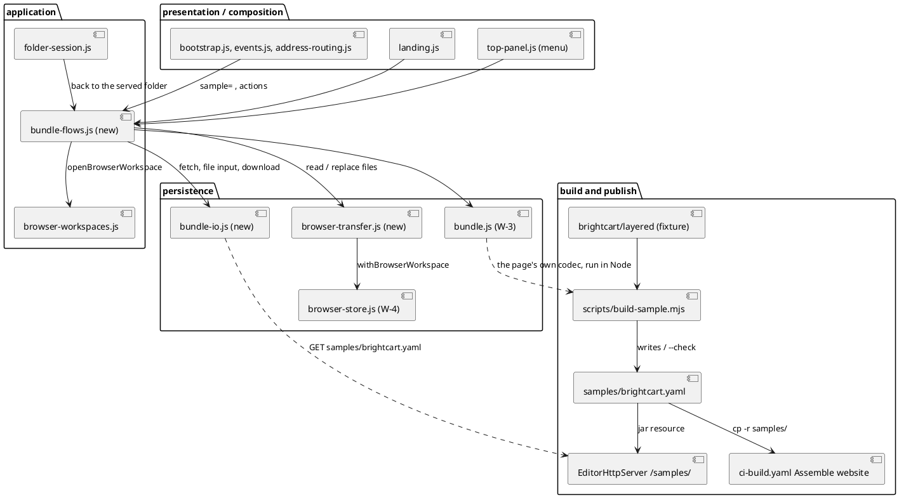
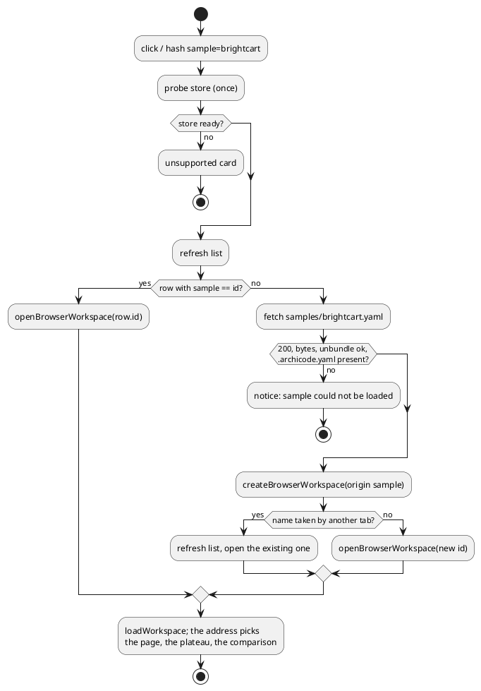

# Import, export and the sample

# Summary

A visitor clicks one button on the presentation page and lands in the editor on Brightcart, with their changes kept; a visitor can also take a workspace out of the browser as one YAML file and bring it back with the same bytes (#162 proposals 3 and 4; wave 025 manifest id W-5). The design adds: a generated, committed bundle of the Brightcart fixture, `samples/brightcart.yaml`, with a `--check` wired into CI (DEC-1); a route of `EditorHttpServer` that serves it, and a copy of it in the website assembly (DEC-2, DEC-3); *Export* of a browser workspace and *Import* of a bundle file as a new browser workspace (DEC-4, DEC-5); *Open sample*, reopening and *Reset* of the sample workspace, from the hosted page and from `archicode editor serve`, never into the served folder (DEC-6, DEC-8); the `sample=` part of the address read before anything is drawn (DEC-7); a small *Workspace* menu in the top bar that holds the actions that have no place on the landing card (DEC-9); the button on `src/site/index.html` and the page it lands on (DEC-10); and the additions to the landing card and to the store (DEC-11, DEC-12). The bundle codec (W-3) and the browser store (W-4) are used as they are; the one change to the store is additive. There is no PRD: the run profile is TDD+pln and the sources are issue #162 and the wave plan, so traceability is incomplete (see PRD Traceability). The decisions where a mistake loses a visitor's work or breaks the published site are DEC-3, DEC-4, DEC-5, DEC-6 and DEC-8.

# Scope

In scope: the files and sections listed under Repository Impact (IMP-1 to IMP-13), and nothing else. Note for the owner of the wave: the `likely_paths` of W-5 in the wave plan do not list `src/main/editor/layers.json`, `src/main/editor/model/**`, `src/main/editor/style.css`, `src/test/e2e/**`, `src/test/java/io/morin/archicode/brightcart/**`, `src/test/java/io/morin/archicode/cli/**` and `package.json`, all of which this design touches; this run does not edit the wave manifest.

Out of scope: the end-to-end spec of the whole acceptance of #162, the WebKit project, the manual and `CLAUDE.md`'s list of what the e2e suite does not test (W-6); reading or writing a bundle from the command line; export of a folder workspace or of the served folder; import into an existing workspace; any change to the folder-picker path or to `serverDirectoryHandle`; a second sample; an offline copy of the sample.

# PRD Traceability

No PRD. The requirements are taken from proposals 3 and 4 and the "Decisions" and "Still open" of #162, from the W-5 row and the P2 gate of the wave, and from the lessons of W-3 and W-4; they are labelled here so that the plan can cite them:

- `REQ-1` (#162 proposal 3, W-5 row): *Export* writes the files of a browser workspace as one YAML text made by `bundleWorkspaceFiles`, downloaded by the browser; a file the bundle cannot carry is listed in the message; the time of the export is recorded and shown (the card, the bar, the question of a delete).
- `REQ-2` (#162 proposal 3, W-5 row): *Import* reads one bundle file with `unbundleWorkspaceFiles` and makes a browser workspace of it; every refusal of the codec is told in a sentence; the size limit is 10 MB.
- `REQ-3` (P2 gate, #162 proposal 4): `samples/brightcart.yaml` is generated by a script from `src/test/resources/brightcart/layered`, committed, and a check fails when it differs; the check exits 0 on the tree and 1 on a copy with one byte of the file changed, and both outputs are recorded in the run document.
- `REQ-4` (P2 gate, #162 acceptance): the unbundled sample is loaded by the editor in a node test and by `archicode views generate` in a Java test.
- `REQ-5` (P2 gate, W-5 row): `EditorHttpServer` serves the sample, the site assembly copies it, the native resources include it, and `EditorServeIT` asserts it on the jar (and on the native runner in the Native job).
- `REQ-6` (#162 Decisions, P2 gate): *Open sample* and *Reset* always go to a browser workspace, also from `archicode editor serve`, and the served folder is left unchanged, asserted by a test.
- `REQ-7` (#162 proposal 4b): `#sample=brightcart` is read before anything is drawn; the first visit creates the workspace, later visits reopen it and do not duplicate it; if the sample cannot be fetched the card says so in one sentence and nothing else changes.
- `REQ-8` (#162 proposal 4b, wave "Left to the runs"): the button on `src/site/index.html` opens the editor on Brightcart in one click; the page and plateau it lands on are chosen and justified here (DEC-10).
- `REQ-9` (wave "Left to the runs"): the decision whether the browser workspace menu offers *Download a copy of the sample* (Q-1).
- `REQ-10` (wave delegation reason, `hard_judgment`): nothing in this run overwrites or deletes a visitor's work without saying which workspace and what is lost; *Reset* and *Import* are the two places where it could happen.
- `REQ-11` (wave Non-Goals, Risks, P2 gate): the command line is unchanged (`scripts/byte-identity.sh` shows no difference); `ratchet.max` of `layers.json` stays at most 99; no file of `src/main/editor` goes over 3,000 lines; no coverage floor is lowered; no dependency enters the page; the landing card's unsupported sentence stays gone where the store is available (W-4, kept).
- `REQ-12` (`help` sentence "Nothing is uploaded", W-4 REQ-8): the only request this run adds is a same-origin GET of the sample; nothing of the workspace leaves the browser.

All twelve are addressed; `REQ-9` is answered as "not offered" (Q-1). They are assumed rather than sourced from a PRD.

# Technical Goals

- TG-1: the sample file is a pure function of the fixture folder and of the page's codec; a change to either that is not committed with it fails a check in CI and in the unit suite (REQ-3, DEC-1).
- TG-2: the jar, the native runner and the website each serve the same bytes at the same relative address, so one relative fetch works everywhere (REQ-5, DEC-2, DEC-3).
- TG-3: export followed by import gives back every file the bundle carries byte for byte, a byte-order mark, CRLF and a `---` inside a file included (REQ-1, REQ-2, DEC-4, DEC-5).
- TG-4: opening the sample is idempotent (one workspace, however many clicks, tabs or visits) and a reset is a single transaction preceded by a successful fetch (REQ-6, REQ-7, REQ-10, DEC-6).
- TG-5: no action of this run writes to the served folder or to the visitor's disk; the only file the visitor receives is the download they asked for (REQ-6, REQ-12, DEC-8).
- TG-6: the link on the site, the address the editor reads and the page it draws are tested together (REQ-7, REQ-8, DEC-7, DEC-10).
- TG-7: the new code is covered by node tests that do not print byte arrays, and the browser-only parts (download, file input, the served page) by an e2e spec in two browsers (REQ-11, Verification).

# Non-Goals

- Reading a bundle from the command line (the format is now stable; a separate small issue, per #162 "Not in scope").
- Export of a folder workspace or of the served folder: they have a disk for a copy, and a recursive walk of a disk folder would read files the editor never opens (DEF-1).
- Import into an existing workspace, a merge, or a replace by import: Import always makes a new workspace (DEC-5).
- A drag-and-drop target for the file, a paste of the bundle text, an import from a URL.
- A service worker or an embedded copy of the sample for offline use (DEF-3): the sample is fetched when it is needed and the card says when it cannot be.
- *Download a copy of the sample* (Q-1).
- The end-to-end spec of the whole acceptance, WebKit, the manual (W-6).

# Assumptions

- ASM-1: `bundleWorkspaceFiles`, `bundleSkippedSentence` and `unbundleWorkspaceFiles` of `persistence/bundle.js` are final (W-3 closed: 103 cases and the round trip on 20 shipped workspace folders). They take and give `{ path, bytes }` with bytes built in the page's realm. Validate: `bundle-cases.test.js` and `bundle-roundtrip.test.js` run in the unit suite of this run.
- ASM-2: the Brightcart fixture is 61 files, about 40 KB, all YAML and none hidden but the root `.archicode.yaml`, so the bundle carries all of it and skips none. Validate: the script fails when `skipped` is not empty or `carried` is not the list of files of the folder (DEC-1); measured on 2026-10-28: 61 files, 40,249 bytes.
- ASM-3: a Blob URL followed by a click on an anchor with `download` starts a download in Chromium, Firefox and WebKit when it runs within the transient user activation of the click that started the export, which an IndexedDB read of a few milliseconds does not exhaust. Validate: the e2e spec in Chromium and Firefox (`page.waitForEvent('download')`); WebKit is W-6's run. If a browser refuses, the export reports "could not start the download" and records no export time (FLOW-1).
- ASM-4: `input.click()` on an `<input type="file">` opens the picker only when called synchronously in the click handler, and the input must outlive the redraws of `#app` that happen while the picker is open. Validate: the input is created outside `#app` and referenced from a top-level variable until its `change` (DEC-5); the e2e spec drives it with `setInputFiles`.
- ASM-5: a same-origin `fetch` of a relative URL reaches `/editor/samples/brightcart.yaml` on GitHub Pages (a static file next to `index.html`, no Jekyll exclusion for this name) and `/samples/brightcart.yaml` on `editor serve`. The page decodes the bytes itself, so the `Content-Type` the host sends does not matter. Validate: the e2e spec on the hosted-style server, which serves the page at `/editor/` and the sample at `/editor/samples/brightcart.yaml` as the site does, so that the spec proves the base path (IMP-12); the first proof on GitHub Pages is the tag run (RISK-2).
- ASM-6: the default port of `editor serve` is 48080 (`ServeEditorCommand`), so the origin `http://127.0.0.1:48080` is the same from one run to the next and the sample workspace of served mode is found again; a different `--port` or host name is another origin and another store (RISK-5).
- ASM-7: the draft the visitor has typed and not committed (`draftTyped`) counts as unsaved for Export, as it does for Cancel and Save (`countUnsavedChanges() > 0 || draftTyped`). Only the menu item and its handler (presentation and composition) make this test; no part of bundle-flows.js reads draftTyped (CON-2). Validate: a node test (DEC-4).

# Constraints

- CON-1: the page is one classic script in one global scope; a part is whole top-level declarations with no `import` or `export`; a name is used by the parts after it in `layers.json`, or inside a function at call time (CLAUDE.md, "The editor page is generated").
- CON-2: a layer uses the layers before it; `ratchet.max` stays at most 99 (wave gate). The new application part must not name a presentation function, and no part of bundle-flows.js reads draftTyped (a presentation name; the menu item decides, DEC-4): the menu's question is state in `model/app-state.js` and is drawn by `presentation/top-panel.js`, not an `appDialog` (`openAppDialog` is a presentation function; DEC-9).
- CON-3: `standalone.html` is generated and committed with its sources after `npm run editor:build`; `names.json` is rewritten with `node scripts/check-editor.mjs --write-names`; a name added to the page that a Java source or test names needs `java-names.json` (none is expected: the Java tests of this run name files and routes, not page functions).
- CON-4: the databases are not changed: `archicode-standalone-editor` is not opened by any new code, and `archicode-browser-workspaces` stays at version 1; a new property of a workspace record is optional and read as absent (CTR-1; the discipline of W-4 CTR-2).
- CON-5: the redraw contract: a part below the composition calls `requestRedraw()`, never `render()`; a flow of this run changes no model, so no `modelsChanged()`; it redraws the card or the bar only.
- CON-6: Prettier and ESLint cover `scripts/**/*.mjs`, `src/main/editor/**`, `src/test/**` (`no-shadow`, `eqeqeq`, `no-unused-vars`, zero warnings); the Java is formatted by Prettier and checked by PMD (`./mvnw test-compile pmd:check`).
- CON-7: no dependency enters the page or the build; `scripts/build-sample.mjs` uses Node's own modules and the harness of the unit suite, as `scripts/build-editor.mjs` needs no `npm install`.
- CON-8: a node test never lets an assertion print a `Uint8Array` or a list of byte values; it compares strings, lengths, hashes and `Buffer.compare`; the page builds its bytes in the vm realm, so `deepStrictEqual` and `instanceof` on page bytes are never used (the failure of run 0191 that exhausted the machine's memory).
- CON-9: the IndexedDB fake of `harness.js` has one object store per transaction, out-of-line keys, `get`, `getAll`, `getAllKeys` with no argument, `put`, `delete`, no ranges, no indexes, no cursors; it serialises readwrite transactions; its `failPut` and `holdCommit` options exist. The two new store functions use only those (DEC-12).
- CON-10: the e2e suite has one worker and no retry; the hosted-style server answers from the committed files, so a rebuilt page or sample is what the next test gets.
- CON-11: `src/test/javascript/editor-build/check-editor-statements.test.js` compares the page with `HEAD`; a run that edits `src/main/editor` has that test red until its work is committed (the finding of waves 024 and 025). The plan marks it as expected and does not count it as a failure of the task.
- CON-12: the step "Assemble website" (a step of the job `Build`, not of `Page`) runs on a tag only; nothing on a pull request or on main exercises it (memory: PR CI never publishes). The change is rehearsed locally (DEC-3) and its first real proof is the tag run.
- CON-13: the website and the jar serve one page; `editor-webapp/**` is already in `quarkus.native.resources.includes`, so the sample needs no property change; only the Native job proves the glob on the runner, and Mandrel is not available locally (wave 023).

# Current State

- `persistence/bundle.js` (221 lines, W-3): `bundleWorkspaceFiles(files)` → `{ text, carried, skipped }` (sorted by code point, `--- # file: <path>` separators, ` # no final newline` marker), `bundleSkippedSentence(skipped)`, `unbundleWorkspaceFiles(text, { maxBytes })` → `{ files, problems }` with one sentence per problem and nothing returned when there is one; `BUNDLE_MAX_BYTES` is 10 MB. Nothing calls it yet but its tests.
- `persistence/browser-store.js` (668 lines, W-4): `createBrowserWorkspace({ name, files, origin })` in one transaction, `listBrowserWorkspaces()` (rows with `id`, `name`, `createdAt`, `openedAt`, `lastExportAt`, `origin`, `fileCount`, `changedAt`, `problem`), `renameBrowserWorkspace`, `deleteBrowserWorkspace`, `readBrowserLast`, `writeBrowserLast`, `clearBrowserLast`, `markBrowserExport(id, at)` (written for W-5, called by nothing), `askForPersistentStorage`, `browserDirectoryHandle`, `browserWorkspaceNameProblem`, and the helpers `withBrowserStore` and `withBrowserWorkspace` (one transaction; the second fails with the "no longer in this browser" sentence when the record is gone). The `origin` contract names `'blank' | 'sample' | 'import'`; only `'blank'` is written.
- `application/browser-workspaces.js` (308 lines): `newBrowserWorkspace`, `openBrowserWorkspace(id)` (reads the list again, writes the pointer `last`, resets the page when the workspace is another one, sets `AppState.folder = { handle, name, id: null, browserWorkspace: id }`, loads), `renameBrowserWorkspaceRow`, `askToDeleteBrowserWorkspace`, `confirmDeleteBrowserWorkspace`, `refreshBrowserWorkspaces`, `defaultBrowserWorkspaceName`, `browserWorkspaceById`, `browserWorkspaceTitle`, `browserFailureText`; state of the card in `model/app-state.js` (`landingBusy`, `landingNotice`, `landingNameDraft`, `landingPendingDelete`, `landingFocusSelector`, `browserWorkspaces`, `browserStoreState`).
- `presentation/landing.js`: `landingScreenConfig()` gives the `first-launch` card with the actions *New workspace in this browser* and *Open workspace folder* by capability, `landingBrowserRows()` (with `exported` as `'never'` or a time), the rows with *Open*, *Rename*, *Delete* and the delete question (`Delete “name”? It holds N files, last changed …`). `browser = browserStoreState === 'ready' && !isServedByArchiCode()`: a served page never shows the list.
- `composition/bootstrap.js`: on `DOMContentLoaded` it calls `syncPerspectiveFromHash()`, then, for a served page (`isServedByArchiCode()`), strips the token and calls `openServedFolder()` and stops; otherwise `startPage()` probes the store and calls `tryAutoReopen()`. `presentation/top-panel.js` shows the notice `In this browser` and *Close workspace* for a browser workspace and no close button at all for a served page (`isServedByArchiCode()` decides, whatever folder is open). `presentation/help-and-settings.js` says what the files are by the same test.
- `persistence/folder-access.js`: `serverToken()`, `isServedByArchiCode()`, `serverFetch` (header `X-ArchiCode-Token`), `serverDirectoryHandle`, `openServedFolder()`.
- `EditorHttpServer`: two contexts, `/` (the page, for `/` and `/index.html` only, with the query token or the session cookie, the Host check; any other path is 404) and `/api/fs/` (the token header, the Host and Origin checks). The page is a resource, `/editor-webapp/standalone.html`. `EditorServeIT` starts the packaged application once and asserts the page, the icon and the refusal without a token. The default port is 48080.
- `.github/workflows/ci-build.yaml`: the job `Page` (Node 22, `npm ci`, `editor:check`, format, lint, coverage, timing); the job `Build` has, on a tag, the step "Assemble website", which copies the manual to `target/site/docs/`, stamps `src/site/index.html` and `standalone.html` into `target/site/index.html` and `target/site/editor/index.html`, greps the stamp and tests the manual's `index.html`.
- `src/site/index.html`: four links to `editor/` (the navigation, the hero's call to action, a closing block and the step 2 of the quick start), the hint "Pick a workspace folder (Chrome, Edge, Brave or Opera); your files are not uploaded." and the step "In a browser other than Chrome, Edge, Brave or Opera: `archicode editor serve`", both of which W-4 made untrue. `src/test/javascript/site.test.js` checks the stamp, the anchors and the links into the manual.
- The e2e harness has `startServer` (the jar) and `startHostedPage()` (W-4: `GET /` answers the committed page, everything else is 404); the fixture `hosted` starts it.
- The editor ends a hash at `?`: `#/timeline/applications?plateau=marketplace&compare=past` is the page, the plateau and the comparison; an unknown key is ignored and is gone from the address the page writes. Measured on 2026-10-28 in the node harness on the layered fixture: that address draws the plateau `marketplace` compared with its past `inhouse`, no fatal error, 65 changes in `comparisonState().changes` (Q-2).

# Proposed Design

Three new parts and a small set of edits. `persistence/browser-transfer.js` reads all the files of a workspace and replaces them in one transaction; `persistence/bundle-io.js` is the page's edge with the network, the file input and the download (nothing else touches `fetch`, `Blob` or `createElement` for a bundle); `application/bundle-flows.js` holds the flows (export, import, open, reset, back to the served folder). The sample is a file produced by a script from the fixture and the codec, served by the jar and by the site next to the page, fetched with a relative URL. The menu is a popup in the top bar patterned on the help menu.

The reviewer should check that `scripts/build-sample.mjs` reaches the codec only through the page (the dotted arrow), that nothing in `bundle-flows.js` points at `landing.js`, `top-panel.js` or `dialogs.js` (CON-2), that `browser-transfer.js` goes through `withBrowserWorkspace` so that a deleted workspace is never written to, and that the only network edge is `bundle-io.js`.

## DEC-1 — The sample is a generated, committed bundle; one script builds it and checks it

- Decision: `scripts/build-sample.mjs` reads the folder `src/test/resources/brightcart/layered` (every file, recursively, in bytes), calls `bundleWorkspaceFiles` of the page (the page's own script, run in Node through `createApp` of `src/test/javascript/viewpoint-kernel/harness.js`, given the page text as `options.html` so that `--root <dir>` can point at a copy), fails if `skipped` is not empty or if `carried` is not the list of files read, and writes `src/main/resources/editor-webapp/samples/brightcart.yaml` only when its bytes differ. `--check` writes nothing: it exits 1 with one line that names the first differing line and says "run `npm run sample:build`" when the committed file is not the bundle of a fresh build (or is missing), and 0 otherwise. The npm scripts are `sample:build` and `sample:check`. CI runs `npm run sample:check` as a step of the job `Page`, after "Check the editor page is the assembly of its parts" and before the format check. A node test, `sample-brightcart.test.js`, makes the same comparison in the unit suite so that `npm run test:unit` fails on a stale sample before CI does. The pretest hooks do not rewrite the sample (the page is rewritten by a hook because tests read it; the sample is committed on purpose and a silent rewrite would hide the stale commit).
- Rationale: the codec that makes the sample is the one the editor uses to read it, so a change to either shows at once; the pattern is `embed.sh --check` and `build-editor.mjs --check`; Maven needs no new step.
- Alternatives considered: generate it in `generate.mjs` of the fixture (couples the fixture generator to the editor page); generate it in the Maven build (Maven would need Node); extract `bundle.js` alone with a prelude that defines `WORKSPACE_FILE_NAME` (forks the constant; the harness is the one way the tests already load the page); a hand-kept copy (the issue forbids it).
- Tradeoffs: a script in `scripts/` reads the harness in `src/test/`; accepted because `editor-coverage.mjs` already runs the unit suite, and because the alternative is a second loader of the page.
- Linked PRD IDs: REQ-3, REQ-4, REQ-11

## DEC-2 — The jar serves the sample at `/samples/brightcart.yaml`, with the rules of the page

- Decision: `EditorHttpServer.start` adds a context `/samples/`. It answers `GET` on exactly `/samples/brightcart.yaml` with the resource `/editor-webapp/samples/brightcart.yaml`, `200`, `text/yaml; charset=utf-8`, `Cache-Control: no-store`, `X-Content-Type-Options: nosniff`; any other path under `/samples/` is `404`; any other method is `405`. It applies the Host check of the page and accepts the same proofs as the rest of the server: the `X-ArchiCode-Token` header or the `archicode-session` cookie (never the query, which is the first request's only), else `403`. The route list in the class Javadoc gains the line. The sample is a table of one entry in the code (`SAMPLES`), not a directory listing, so a request cannot name another resource.
- Rationale: one relative URL, `samples/brightcart.yaml`, works from the site (`/editor/samples/brightcart.yaml`) and from the server (`/samples/brightcart.yaml`); the sample is public content, but "nothing is served without the token or the cookie" is the one rule the server has and the one its tests pin; a table of one entry has no path to traverse.
- Alternatives considered: serve it under `/api/fs/` (that is the workspace folder's API and would suggest the sample is in the folder); serve it with no check (a second rule to explain and to test); a query token (tokens stay out of URLs after the first request).
- Tradeoffs: the page must send the token header in a served page (it does, `serverToken()`); a bookmarked sample URL opened by hand in a served browser works through the cookie only.
- Linked PRD IDs: REQ-5, REQ-6

## DEC-3 — The website assembly copies the folder; the step is rehearsed, not hoped for

- Decision: in "Assemble website", after the line that writes `target/site/editor/index.html`, add `mkdir -p target/site/editor/samples`, `cp -r src/main/resources/editor-webapp/samples/. target/site/editor/samples/` and `test -f target/site/editor/samples/brightcart.yaml`, and a `cmp` of that file with the source. The run extracts the `run:` block of the step from the workflow, runs it in a scratch copy with a stand-in `target/generated-docs/index.html` and `GITHUB_REF_NAME=archicode-0.0.0-rehearsal`, and records the output and the listing of `target/site/editor/` in the run document. The step is in the job `Build`. The hosted-style server of the e2e harness (`startHostedPage()`) serves the page at `/editor/` and the sample at `/editor/samples/brightcart.yaml`, the layout this assembly produces, and `hosted.url` carries the base, so the e2e spec proves the base path; only the GitHub Pages configuration is left to the tag run (RISK-2). The first proof on the real site is the tag run; the plan says so and does not mark the criterion as met by the rehearsal alone.
- Rationale: the step runs on a tag only (CON-12); a typo would be found on the day of a release. The rehearsal runs the same shell text. Nothing in the pull request's own run can prove it.
- Alternatives considered: move the assembly to a script under `.github/scripts/` with a fake-based test in `test-release-scripts.sh` (right in the long run, a larger change to a published pipeline than this run needs, DEF-2); also assemble the site on pull requests without publishing (needs the manual artifact and changes the cost of every run).
- Tradeoffs: a mistake that the rehearsal cannot see (the repository layout of a tag run) is found on the tag; the page then still works because a failed fetch of the sample is one sentence on the card (DEC-6) and everything else is as before.
- Linked PRD IDs: REQ-5, REQ-8

## DEC-4 — Export: a browser workspace's stored files, bundled and downloaded, never while changes are unsaved

- Decision: *Export* is offered for a browser workspace only: as a button on its row of the landing card, and as an item of the *Workspace* menu while it is open. It reads the stored files of the workspace in one read-only transaction (`readBrowserWorkspaceFiles`, DEC-12), calls `bundleWorkspaceFiles`, and starts a download with the text as a Blob (UTF-8, no byte-order mark, `text/yaml`) through an anchor with `download`. The file name is `<slug>-bundle.yaml`, the slug being the workspace name lowercased with every run of characters outside `a-z0-9` replaced by `-`, trimmed of `-`, cut at 60 characters, `workspace` when nothing is left. After the download has been started it calls `markBrowserExport(id)` and tells the visitor, in `landingNotice` on the card or in the bar's status line while a workspace is open: `Exported N files as <name>.` followed by `bundleSkippedSentence` when a file was skipped. A workspace whose carried list is empty downloads nothing and says `Nothing to export: this workspace has no YAML file.` The test `countUnsavedChanges() > 0 || draftTyped` is made by the menu item (its disabled state in `presentation/top-panel.js`, its click handler in `composition/events.js`), which calls `exportOpenBrowserWorkspace()` only when it is clear; no part of bundle-flows.js reads draftTyped. From the bar, when it is true, the menu item is `aria-disabled="true"` with the visible line `Save your changes first: the file holds what is saved.`, and a click says the same sentence in the status line and exports nothing. The recorded time is the time the download was started (the page cannot know when the visitor saves the file), and the card says `Last exported`, never `Saved`.
- Rationale: the file always equals what the store holds, so a visitor can reason about it; the alternatives either silently leave edits out or write to the store without being asked. One `Blob` and one anchor work in the three engines; `showSaveFilePicker` would be a Chromium-only second path.
- Alternatives considered: export the unsaved edits too (the page would need to render files it has not written: a second source of truth); save then export (a write the visitor did not ask for); a dialog with three buttons (more state for the same outcome).
- Tradeoffs: a visitor with unsaved changes needs two clicks; the sentence names the neighbouring button.
- Linked PRD IDs: REQ-1, REQ-10

## DEC-5 — Import: always a new browser workspace, refused whole or made whole

- Decision: *Import a workspace file* is a button of the first-launch card (when the store is ready and the page is not served). A click calls `bundleFilePicker(onFile)` synchronously: it creates an `<input type="file" accept=".yaml,.yml,text/yaml,text/plain">` outside `#app`, keeps it in a top-level variable until its `change`, and clicks it. On `change`: refuse a file over `BUNDLE_MAX_BYTES` by `file.size` before reading it; read `arrayBuffer()` and decode with `new TextDecoder('utf-8', { fatal: true })` (not `file.text()`, which replaces invalid bytes silently) and refuse with `The file is not UTF-8 text.`; call `unbundleWorkspaceFiles`; refuse when it has problems, with `The file cannot be imported: ` plus the first three sentences of the codec joined by `; ` and ` (and N more)` when there are more; refuse when no file is `.archicode.yaml` at the root, with `The file holds no .archicode.yaml, so it is not a workspace.` Otherwise choose the name: `settings.name` of the root `.archicode.yaml` read with `parseYaml` (an error of `parseYaml` on that file falls back to the file name, it is not a refusal) when it is a non-empty text that passes `browserWorkspaceNameProblem` (W-4 Q-2), else the file's name without its extension, else `Imported workspace`; made unique by appending ` 2`, ` 3`, … against the names in the list now; then `createBrowserWorkspace({ name, files, origin: 'import' })` and `openBrowserWorkspace`. A refusal or a failure of the store is `landingNotice`; no workspace is created and none is changed. Import never writes to an existing workspace, whatever its name.
- Rationale: creating is the one write that cannot destroy anything; the codec's sentences are the same words the tests pin; the new workspace is opened at once like *New workspace*.
- Alternatives considered: replace a workspace of the same name (loses work); a dry-run parse of every manifest before creating (the editor's own error card already tells an unreadable workspace and offers *Delete*; a second validator would disagree with it); `file.text()` (hides a corrupt file).
- Tradeoffs: a bundle whose `.archicode.yaml` is not valid YAML creates a workspace that opens to the error card and has to be deleted from the list; stated in the manual by W-6.
- Linked PRD IDs: REQ-2, REQ-10

## DEC-6 — The sample workspace is found by what it is, opened without a fetch when it exists, replaced only after a fetch

- Decision: a workspace made from a sample has `origin: 'sample'` and the optional property `sample: '<id>'` (`'brightcart'`; the catalog `BROWSER_SAMPLES` in `bundle-io.js` maps the id to its name `Brightcart` and its relative URL).
  - Open: `openSample(id)` refreshes the list; if a row has `sample === id` it calls `openBrowserWorkspace(row.id)` and fetches nothing (the most recently changed one when several exist); otherwise it sets `landingBusy`, fetches the sample (`fetch('samples/brightcart.yaml', { cache: 'no-cache', headers })`, the token header only in a served page), decodes it as in DEC-5, unbundles it, and creates the workspace with the name `Brightcart`, unique as in DEC-5, then opens it. If `createBrowserWorkspace` fails with `InvalidNameError` (another tab created it a moment ago, or the visitor has a workspace of that name that is not the sample), the flow reads the list again and opens the row with `sample === id` if there is one; otherwise it retries once with the next free name (as FLOW-2: `Brightcart 2`); then the store's sentence. A failed fetch, a non-200 answer, an empty body or a bundle that does not unbundle is `The Brightcart sample could not be loaded: <reason>. Check your connection and try again.` in `landingNotice` (the card) or in the menu (served), with nothing created.
  - Reset: *Reset to the sample* is offered for a workspace with a `sample` property, in the *Workspace* menu: the item becomes a question that names the workspace, `Replace everything in “Brightcart” with the sample? Your changes in it are lost. Last exported: never.` with *Cancel* (focused) and `Reset “Brightcart”`; with unsaved changes the sentence adds `N unsaved changes are lost too.` The yes first fetches and unbundles the sample; only when that succeeds does `replaceBrowserWorkspaceFiles` (DEC-12) run, one transaction that removes every file of the workspace, writes the sample's files with `modified` now, keeps the record's `id`, `name`, `createdAt`, `lastExportAt` and `origin`, and sets `openedAt`; then the page drops its state (`AppState = createInitialAppState(); resetUiState()`) and loads the workspace again. A workspace deleted elsewhere in the meantime is the "no longer in this browser" sentence of W-4 DEC-6 and nothing is written.
- Rationale: a visitor who clicks the site button twice gets one workspace with their changes (acceptance of #162); the destructive step is never reached with a failed fetch, never without the name and the loss said, and is atomic.
- Alternatives considered: find the sample by the name `Brightcart` (a rename or an imported workspace of that name breaks it); reset into a new workspace `Brightcart 2` (safe, but the issue says Reset copies again, and the list would grow); fetch inside the transaction (an `await` inside an IndexedDB transaction ends it).
- Tradeoffs: a reset has no undo; the question says when the workspace was last exported, which is the only mitigation the page can give.
- Linked PRD IDs: REQ-6, REQ-7, REQ-10

## DEC-7 — `sample=` is a part of the address read once, at load, before anything is drawn

- Decision: `sampleFromHash()` (in `composition/address-routing.js`, beside `compareFromHash`) returns the value of `sample` in the query of the hash, or null. `DOMContentLoaded` reads it right after `syncPerspectiveFromHash()` and before the first `render()`, and `startPage()` receives it: after `probeBrowserStore()`, when the store is ready and the id is in the catalog, it calls `openSample(id)` in place of `tryAutoReopen()` (an explicit request wins over reopening the last workspace); an id that is not in the catalog leaves the card with `There is no sample “x”.` and then `tryAutoReopen()` as usual; a store that is not available leaves the `unsupported` card as it is. A served page ignores the key (the served folder opens as before; the sample is reached by the menu, DEC-8). The part of the address that is not `sample` (the page, `plateau`, `compare`) is applied by the loader exactly as for any link, and the address the page writes from its state has no `sample`, so a reload does not repeat it and Back does not reopen it. A `hashchange` that adds `sample` to an open editor is not acted on.
- Rationale: a hash never reaches a server and works from the site, the jar and any static host; one read at one place; the existing loader already honours `plateau=` and `compare=` (measured, Q-2).
- Alternatives considered: a query string (reaches the server; the jar would have to ignore it); acting on `hashchange` (a pasted link would replace the workspace under the visitor's hands, with unsaved changes).
- Tradeoffs: pasting the link into an editor that is already open does nothing; the visitor reloads or uses the card.
- Linked PRD IDs: REQ-7

## DEC-8 — In a served page the sample is a browser workspace of that address; the served folder is only left and come back to

- Decision: in a served page the store is probed at load without blocking (`probeBrowserStore().then(requestRedraw)`), and when it is ready the *Workspace* menu has *Open the Brightcart sample*. Choosing it while `hasUnsavedChanges()` or a typed draft is pending asks the same `confirm` as *Back to the served folder* (`hasUnsavedChanges() && !confirm(...)` before `openSample`), and nothing is opened when it is refused; the landing card never asks it, because nothing is open there. `isServedByArchiCode()` keeps meaning "this page has a server"; a new `workspaceIsServedFolder()` (`isServedByArchiCode() && !(AppState.folder && AppState.folder.browserWorkspace)`) replaces it where the question is what the open workspace is. `isServedByArchiCode()` is read in eleven places; each was reread in `src/main/editor`:

  | Site | Decision | Reason, and the node test that pins a replaced site |
  | --- | --- | --- |
  | `presentation/top-panel.js:225` (the close slot) | replace | a browser workspace opened in a served page needs *Back to the served folder*; `sample-served-mode.test.js` |
  | `presentation/help-and-settings.js:95` (the `where` sentence) | replace | the help must say the files are in this browser; `sample-served-mode.test.js` |
  | `persistence/folder-access.js:49` (`isFolderAccessAvailable`) | keep | a served page has folder access whatever is open |
  | `application/folder-session.js:87` (`closeFolder`) | keep | the branch runs after `wasBrowserWorkspace` is handled, so replacing it would be dead code |
  | `composition/bootstrap.js:7` (the served branch of load) | keep | it runs first, before anything is open |
  | `presentation/landing.js:69`, `:118`, `:280` | keep | a served page shows no list of workspaces or folders |
  | `persistence/remembered-folders.js:315`, `:358`, `:398` | keep | a served page has no remembered folders, and a browser workspace has `id` null |

  While a browser workspace is open in a served page the close slot reads *Back to the served folder* (action `back-to-served-folder`): after the same `confirm` that `closeFolder` asks for unsaved changes, `backToServedFolder()` runs the clearing steps of `closeFolder` through one shared function extracted from it (`closeFolder` itself is not changed in behaviour and is not a site of this decision), then calls `openServedFolder()`; it does not copy those steps. The landing card still lists no browser workspaces in a served page (the sample is the only one that can exist there, reopened by the menu item), `landingFolderRows()` and the remembered folders stay empty, and `writeBrowserLast` is harmless (a served page never reads `last`). The flows of this run send no `PUT` or `DELETE` to `/api/fs/` and no `GET` of a file: opening, exporting and resetting the sample read the sample and the browser store only. The menu item's title says `A copy kept in this browser for this address (host and port). The served folder is not touched.`
- Rationale: the acceptance says the sample opened from `editor serve` leaves the served folder untouched; the server's folder and the browser's store are two places and the page now knows which one is open.
- Alternatives considered: no sample in served mode (against the issue's decision); import the sample into the served folder (writes to the disk); a landing card in served mode (a second first screen for a page that opens a folder by itself).
- Tradeoffs: the sample workspace of served mode lives under the origin `http://127.0.0.1:48080`; another port is another store (RISK-5).
- Linked PRD IDs: REQ-6, REQ-10

## DEC-9 — A *Workspace* menu in the top bar, patterned on the help menu; the reset question lives inside it

- Decision: the top bar gets a *Workspace* button before the help button (`data-action="toggle-workspace-menu"`, `aria-expanded`, `aria-haspopup`), drawn only when the menu has an item: for a browser workspace *Export as a file* (with the line `Last exported: never` or a time) and, when it has a `sample`, *Reset to the sample…*; for the served folder, when the store is ready, *Open the Brightcart sample*; for a folder the visitor picked, no button. The popup is `
` of buttons, opened and closed without a redraw like `setHelpOpen` (a redraw would lose what the visitor has typed), closed by Escape (focus back on the button), by a click elsewhere and by choosing an item. State, all view state with no `modelsChanged()`, in `model/app-state.js`: `workspaceMenuOpen`, `workspaceMenuQuestion` (null or `'reset-sample'`), `bundleNotice` (the one-line result shown in the bar's status span with `role="status"`); `resetUiState()` clears all three. The notice `In this browser` keeps its place and its title gains `Last exported: …` and `Use Workspace › Export as a file to keep a copy.`
- Rationale: three actions would crowd the bar at 360 px (`editor-at-360-px.test.js`); the help menu is the pattern for a popup that closes on Escape and on a click elsewhere; putting the question in the menu avoids `openAppDialog`, a presentation function that an application part must not name (CON-2, RISK-7).
- Alternatives considered: buttons in the bar; the actions in the help menu (documentation, not actions); an `appDialog` for the reset (an upward name in an already full ratchet); the native `confirm()` for the reset question (Q-4: not chosen, see the next bullet).
- Why the question is in the menu and not a native `confirm()` (Q-4, resolved at Stage 6): a reset replaces a whole stored workspace with no undo, which is the case W-4 gave an in-page question to (`landingPendingDelete`: the workspace is named, the button repeats the name, focus starts on *Cancel*), while the page's native `confirm()` calls guard the removal of one item of a form or the loss of unsaved edits. A native `confirm()` focuses its OK button, so Enter confirms; it cannot name the action on its button; and a browser that lets the visitor suppress further dialogs makes it return false without a word, so the reset would silently do nothing. The in-menu question costs one view-state field (`workspaceMenuQuestion`), one render branch and three `data-action` values; it adds no Escape or outside-click rule, because the menu's own close rules clear the question (`setWorkspaceMenuOpen(false)` sets it to null). *Back to the served folder* keeps the native `confirm()` as `closeFolder` has it: it loses unsaved edits only, as that page already asks today.
- Tradeoffs: a new popup to keep accessible and tested (Verification); closing it by a click elsewhere cancels an open question, which is the safe direction.
- Linked PRD IDs: REQ-1, REQ-6, REQ-10

## DEC-10 — The site button lands on the Applications map of `marketplace` compared with its past

- Decision: the call to action is `editor/#/timeline/applications?plateau=marketplace&compare=past&sample=brightcart`. `src/site/index.html` gets a second button, `Try the editor on a realistic project`, secondary style, with that href, next to *Open the editor* in the hero's call to action and in the closing block; the four existing links keep `editor/`. The hint line and the step 2 text are rewritten so that they are true (`The editor runs in your browser, nothing to install: open the sample, create a workspace, or pick a folder where your browser allows it. Your files are not uploaded.`; step 2: `Open it in the online editor … or run archicode editor serve (how)`). The page ends the link at one address so that `site.test.js` can read it and a node test can open it.
- Rationale: it shows the most in one view: the application map of the last plateau of the fork, drawn with the comparison with the plateau it overrides (65 changes, measured), the Changes panel and the key. Alternatives measured in thought, not built: a bare `#sample=brightcart` lands on `baseline`, a flat map with nothing to compare; the Plateaus page lists the tree but draws nothing; a story needs a click on *Play* before it shows anything.
- Alternatives considered: `compare=future` or a named plateau (`compare=other:baseline`), which compare more distant plateaus and make the first view busier.
- Tradeoffs: a visitor lands in the middle of a comparison; the key under the diagram says what the colours are, and the button's text promises a realistic project, not a tour.
- Linked PRD IDs: REQ-8

## DEC-11 — The card gains the sample and the file; a row gains Export; the delete question offers it first

- Decision: the `first-launch` card's actions, in this order, when the store is ready and the page is not served: *Open the Brightcart sample*, *New workspace in this browser*, *Open workspace folder* (Chromium), *Import a workspace file*. The sample is the primary button when nothing is listed (no browser workspace and no remembered folder: a first visit); otherwise the primary stays as W-4 made it. Each browser row gains *Export* (`data-action="export-browser-workspace"`, accessible name `Export “name”`) between *Rename* and *Delete*; the row's second line reads `Kept in this browser · Last exported: <time>|never`, as W-4; a sample workspace's row says `Brightcart sample` in the first line's description. The delete question gains `Last exported: <time>|never.` and a button *Export first* (`data-action="export-browser-workspace-first"`, same flow, the question stays open and its line updates), placed before *Delete “name”*; focus still starts on *Cancel*. The `reopen` card lists the same rows as before.
- Rationale: the export reminder in the delete question is W-4's DEF-2 and the issue's "Export is the safety net"; the primary rule puts the best way in for a first-time visitor in front of them.
- Alternatives considered: the sample as a separate section of the card (more vertical space at 360 px for a one-time visitor); an automatic export before delete (a download the visitor did not ask for).
- Tradeoffs: four buttons on a card; they wrap at 360 px (tested).
- Linked PRD IDs: REQ-1, REQ-7, REQ-10

## DEC-12 — The store gains two functions and one optional property; nothing is renamed

- Decision: in `persistence/browser-transfer.js` (placed after `browser-store.js`): `readBrowserWorkspaceFiles(id, ownerName)` → `[{ path, bytes, modified }]` sorted by code point, in one `readonly` `withBrowserWorkspace` transaction that lists the keys under `file:<id>/` and reads each (no `getAll` of the whole database), with bytes copied by `browserBytesOf`; and `replaceBrowserWorkspaceFiles(id, files, ownerName)` → resolves when one `readwrite` transaction has deleted every file key of the workspace, put the new files (paths checked by `browserPathProblem` before the transaction, bytes copied, `modified` the same `Date.now()` for all) and set `openedAt` on the record; any failure aborts and leaves the old files. In `persistence/browser-store.js`: `createBrowserWorkspace` accepts `options.sample` (a string, stored as `sample` on the record only when `origin === 'sample'`) and `listBrowserWorkspaces` returns `sample` (a string or null) on each row; the record without the property reads as null. `markBrowserExport` is called as it is.
- Rationale: both operations need a snapshot or an atomic replacement, which only a single transaction gives; the property is additive so that an older tab reads a newer record (CON-4).
- Alternatives considered: read through `browserDirectoryHandle().entries()` and `getFile()` (one transaction per file: a save in another tab between two reads would give a mix); a delete and a create as two calls (a crash between them loses the workspace).
- Tradeoffs: two functions in a part of their own so that `browser-store.js` stays the handle and the records; they use only what the fake has (CON-9).
- Linked PRD IDs: REQ-1, REQ-6, REQ-10

## DEC-13 — Layers, names, and the two edge functions a test can replace

- Decision: `layers.json` gets `persistence/browser-transfer.js` after `persistence/browser-store.js`, `persistence/bundle-io.js` after `persistence/bundle.js`, and `application/bundle-flows.js` after `application/browser-workspaces.js`; names begin with `bundle`, `sample`, `browserTransfer`, `workspaceMenu` or the verb of the flow, and `names.json` is regenerated. The DOM and network are touched in four small top-level functions of `bundle-io.js`: `fetchSampleBundle(id)`, `bundleFilePicker(onFile)`, `startBundleDownload(fileName, text)`, `readBundleFile(file)`; a node test replaces them on the sandbox (a global function declaration is a writable property of the sandbox) and drives the flows, and the e2e spec runs the real ones. No part starts with a heading that matches a `SECTIONS` marker of `scripts/editor-coverage.mjs`.
- Rationale: the flows are testable without a DOM; the ratchet is held by using only lower layers; the coverage areas `workspace-and-files` and `other` are held at 90, so every new function is run by a test.
- Alternatives considered: extend the harness with `document.createElement`, `URL.createObjectURL` and a file input (a bigger fake of the DOM than the logic needs).
- Tradeoffs: the real edge is proved only by the e2e spec in two browsers, not WebKit (W-6).
- Linked PRD IDs: REQ-11

# Repository Impact

- `IMP-1 — The sample script and its npm scripts`
  - Path(s): `scripts/build-sample.mjs` (new); `package.json`; `src/main/resources/editor-webapp/samples/brightcart.yaml` (new, generated)
  - Change type: additive
  - Why impacted: DEC-1. The script (about 120 lines) has the options `--check`, `--root <dir>`; `package.json` gains `sample:build` and `sample:check`, and the format and lint globs already cover `scripts/**/*.mjs`.
  - Linked PRD IDs: REQ-3, REQ-4, REQ-11
  - Risks / notes: the harness loads the whole page script (about a second); the output is 40 KB plus 61 separator lines.
- `IMP-2 — The jar route and its tests`
  - Path(s): `src/main/java/io/morin/archicode/cli/EditorHttpServer.java`; `src/test/java/io/morin/archicode/cli/EditorHttpServerTest.java`; `src/test/java/io/morin/archicode/it/EditorServeIT.java`; `src/test/java/io/morin/archicode/brightcart/BrightcartSampleTest.java` (new)
  - Change type: modify; additive
  - Why impacted: DEC-2 (a context `/samples/`, a one-entry table, the class Javadoc). `EditorHttpServerTest` gets the cases of Verification; `EditorServeIT` asserts the sample inside its single process; `BrightcartSampleTest` splits the committed sample on the separator lines with an independent ten-line splitter, compares every file with the fixture folder byte for byte, writes them to a temporary folder and runs `plateau list`, `views generate --plateau marketplace` and `diff --plateau marketplace --against inhouse` on it, with the same output as on the fixture.
  - Linked PRD IDs: REQ-4, REQ-5, REQ-6
  - Risks / notes: PMD runs on the new Java (`./mvnw test-compile pmd:check`); no Java source names a page function, so `java-names.json` does not change.
- `IMP-3 — CI`
  - Path(s): `.github/workflows/ci-build.yaml`
  - Change type: modify
  - Why impacted: DEC-1 (one step in `Page`), DEC-3 (three lines and a `cmp` in "Assemble website").
  - Linked PRD IDs: REQ-3, REQ-5
  - Risks / notes: CON-12; the rehearsal is recorded in the run document.
- `IMP-4 — The store`
  - Path(s): `src/main/editor/persistence/browser-transfer.js` (new, about 120 lines); `src/main/editor/persistence/browser-store.js`
  - Change type: additive; modify (one option, one row field)
  - Why impacted: DEC-12.
  - Linked PRD IDs: REQ-1, REQ-6, REQ-10
  - Risks / notes: no use of `AppState` or the DOM; goes through `withBrowserWorkspace`.
- `IMP-5 — The edges`
  - Path(s): `src/main/editor/persistence/bundle-io.js` (new, about 180 lines)
  - Change type: additive
  - Why impacted: DEC-4 to DEC-6, DEC-13: `BROWSER_SAMPLES`, `fetchSampleBundle`, `bundleFilePicker`, `readBundleFile`, `startBundleDownload`, `bundleFileName`, `bundleProblemsSentence`, `bundleImportName`.
  - Linked PRD IDs: REQ-1, REQ-2, REQ-7, REQ-12
  - Risks / notes: the only `fetch` and `Blob` of a bundle; `fatal: true` on the decoder; a rejected `fetch` is turned into a sentence, never thrown at the flow.
- `IMP-6 — The flows and the state`
  - Path(s): `src/main/editor/application/bundle-flows.js` (new, about 280 lines); `src/main/editor/application/folder-session.js`; `src/main/editor/model/app-state.js`; `src/main/editor/persistence/folder-access.js`
  - Change type: additive; modify
  - Why impacted: `exportBrowserWorkspace(id)`, `exportOpenBrowserWorkspace()`, `chooseBundleFile()`, `importBundleFile(file)`, `openSample(id)`, `askToResetSample()`, `cancelWorkspaceMenuQuestion()`, `confirmResetSample()`, `backToServedFolder()`, `setWorkspaceMenuOpen(open, options)`. `folder-session.js`: `resetUiState` clears the three new variables, and the clearing steps of `closeFolder` move into one shared function that `closeFolder` and `backToServedFolder` both call; `app-state.js`: the variables; `folder-access.js`: `workspaceIsServedFolder()` beside `isServedByArchiCode()`.
  - Linked PRD IDs: REQ-1, REQ-2, REQ-6, REQ-7, REQ-10
  - Risks / notes: `retryFolder`, `noteWorkspaceName` and `showRememberedFolders` read `AppState.folder.id`; with a sample workspace opened in a served page they must do nothing wrong (a node test pins each).
- `IMP-7 — The card, the bar and the help`
  - Path(s): `src/main/editor/presentation/landing.js`; `src/main/editor/presentation/top-panel.js`; `src/main/editor/presentation/help-and-settings.js`; `src/main/editor/style.css`
  - Change type: modify
  - Why impacted: DEC-9, DEC-11, DEC-8 (the close slot and the `where` sentence use `workspaceIsServedFolder()`). `landing.js`: actions, `Export` on rows, the delete question's line and button, the sample row text; `top-panel.js`: the menu button and popup, the notice's title, the status span; `style.css`: the rules of `.workspace-menu` reusing the tokens of `.help-menu`.
  - Linked PRD IDs: REQ-1, REQ-6, REQ-7
  - Risks / notes: every new control has an accessible name with the workspace name; the 360 px layout test and `css-theme-audit.test.js` must pass.
- `IMP-8 — The events, the bootstrap, the address`
  - Path(s): `src/main/editor/composition/events.js`; `src/main/editor/composition/bootstrap.js`; `src/main/editor/composition/address-routing.js`
  - Change type: modify
  - Why impacted: new `data-action` values `open-sample`, `import-bundle`, `export-browser-workspace`, `export-browser-workspace-first`, `toggle-workspace-menu`, `workspace-export`, `workspace-open-sample`, `workspace-ask-reset`, `workspace-cancel-question`, `workspace-confirm-reset`, `back-to-served-folder`; Escape and outside click for the menu; `bootstrap.js` reads `sampleFromHash()` and passes it to `startPage`, and probes the store in a served page; `address-routing.js` has `sampleFromHash()`.
  - Linked PRD IDs: REQ-7, REQ-6
  - Risks / notes: the served branch of `DOMContentLoaded` stays first; a node test pins the order of the first `render()` and the read.
- `IMP-9 — The generated page and the lists`
  - Path(s): `src/main/resources/editor-webapp/standalone.html`; `src/main/editor/layers.json`; `src/main/editor/names.json`
  - Change type: modify (generated, lists)
  - Why impacted: `npm run editor:build`; DEC-13.
  - Linked PRD IDs: REQ-11
  - Risks / notes: `npm run editor:check` stops at the first failing list; the ratchet is read after each part.
- `IMP-10 — The site`
  - Path(s): `src/site/index.html`; `src/test/javascript/site.test.js`
  - Change type: modify
  - Why impacted: DEC-10: the button, the two sentences; the test reads the href, checks it starts with `editor/#`, carries `sample=` with an id of the catalog read from the page's source, and that the hint no longer promises Chromium only.
  - Linked PRD IDs: REQ-8
  - Risks / notes: the stamp `<meta name="archicode-version" content="dev">` stays once.
- `IMP-11 — Node tests`
  - Path(s): `src/test/javascript/viewpoint-kernel/sample-brightcart.test.js`, `build-sample-script.test.js`, `browser-transfer.test.js`, `bundle-io.test.js`, `bundle-flows.test.js`, `sample-served-mode.test.js`, `sample-landing.test.js` (all new)
  - Change type: additive
  - Why impacted: Verification.
  - Linked PRD IDs: REQ-1 to REQ-12
  - Risks / notes: CON-8 and CON-9; the existing `browser-*.test.js`, `bundle-*.test.js` and `server-mode.test.js` are not edited.
- `IMP-12 — End-to-end`
  - Path(s): `src/test/e2e/harness.js`; `src/test/e2e/sample.spec.js` (new)
  - Change type: modify; additive
  - Why impacted: `startHostedPage()` also answers `GET /samples/brightcart.yaml` from the committed file (and 404 for any other path), as the site does; the spec of Verification, in the `chromium` and `firefox` projects.
  - Linked PRD IDs: REQ-6, REQ-7, REQ-8
  - Risks / notes: W-6 reuses its helpers for the acceptance spec; this spec is not that spec (RISK-9).
- `IMP-13 — CLAUDE.md`
  - Path(s): `CLAUDE.md`
  - Change type: modify
  - Why impacted: one paragraph: the bundle I/O, the sample (script, check, route, assembly), the menu, the `origin` and `sample` of a record, the served-mode rule, and the new `Page` step; W-6 updates "what it does not test" and the manual.
  - Linked PRD IDs: REQ-11
  - Risks / notes: keep to one paragraph in the existing style.

# Canonical Impact

Not applicable — no canonical registers declared (`docs/CLAUDE.md` does not exist in this repository, and the project instructions declare neither an `arc` nor a `dom` register).

# Data Model and Contracts

- `CTR-1 — The workspace record of the browser store (additive)`
  - Current contract: `workspace:<id>` → `{ kind: 'workspace', id, name, createdAt, openedAt, lastExportAt: number | null, origin: 'blank' | 'sample' | 'import' }` (W-4 CTR-2); `origin` is written as `'blank'` only.
  - Proposed contract: unchanged, plus the optional `sample: string` present only when `origin === 'sample'` (`'brightcart'`). `listBrowserWorkspaces()` rows gain `sample: string | null`. `origin` is written as `'sample'` and `'import'` by this run. `lastExportAt` is written by `markBrowserExport` after a download has started.
  - Affected files: `persistence/browser-store.js`, `persistence/browser-transfer.js`, `application/bundle-flows.js`, `presentation/landing.js`
  - Migration or compatibility notes: no version bump; a record without `sample` reads as null; an older tab reads a newer record and ignores the property.
  - Linked PRD IDs: REQ-6, REQ-7
- `CTR-2 — The bundle file as the editor writes and reads it (unchanged format)`
  - Current contract: the format of W-3 (`--- # file: <path>` lines, UTF-8, sorted by code point, ` # no final newline`, 10 MB limit, the refusals of `bundlePathProblem`).
  - Proposed contract: unchanged. This run adds the rules around it: the file name `<slug>-bundle.yaml`; Import refuses a bundle that holds no root `.archicode.yaml`; Export hands over `text` as UTF-8 without a byte-order mark. The sample is such a file, produced by the same function.
  - Affected files: `persistence/bundle-io.js`, `application/bundle-flows.js`, `samples/brightcart.yaml`
  - Migration or compatibility notes: a bundle written by this run is read by any later one; a change to `bundle.js` that changes its output changes the sample and fails `sample:check` until the sample is rebuilt in the same commit.
  - Linked PRD IDs: REQ-1, REQ-2, REQ-3
- `CTR-3 — The HTTP route of the sample`
  - Current contract: `/` serves the page (query token or cookie); `/api/fs/` the folder (token header); nothing else.
  - Proposed contract: `GET /samples/brightcart.yaml` → `200`, `text/yaml; charset=utf-8`, `Cache-Control: no-store`, the bytes of the resource; `403` without the token header or the cookie or with a Host that is not allowed; `404` for any other path under `/samples/`; `405` for another method.
  - Affected files: `EditorHttpServer.java`
  - Migration or compatibility notes: additive; a client that never asks sees nothing.
  - Linked PRD IDs: REQ-5
- `CTR-4 — The address`
  - Current contract: `#/<page>?<keys>` with `ref`, `plateau`, `compare`, `story`, `step`, `play`, … ; unknown keys are ignored.
  - Proposed contract: `sample=<id>` is read once at load (DEC-7) and never written; the id is a key of `BROWSER_SAMPLES` (`brightcart`).
  - Affected files: `composition/address-routing.js`, `composition/bootstrap.js`, `src/site/index.html`
  - Migration or compatibility notes: a link to the editor that already exists is unaffected.
  - Linked PRD IDs: REQ-7, REQ-8
- `CTR-5 — The page's new state`
  - Current contract: view state of the card in `model/app-state.js` (W-4 CTR-4).
  - Proposed contract: `workspaceMenuOpen: boolean`, `workspaceMenuQuestion: null | 'reset-sample'`, `bundleNotice: null | string`, cleared by `resetUiState()`; none is model state.
  - Affected files: `model/app-state.js`, `application/folder-session.js`
  - Migration or compatibility notes: none.
  - Linked PRD IDs: REQ-1, REQ-10
- `CTR-6 — The npm scripts and the CI step`
  - Current contract: `editor:build`, `editor:check`; the job `Page` steps.
  - Proposed contract: `sample:build` = `node scripts/build-sample.mjs`; `sample:check` = `node scripts/build-sample.mjs --check` (exit 0 or 1, one line on the error output); the step "Check the Brightcart sample is the bundle of its fixture" in `Page`.
  - Affected files: `package.json`, `.github/workflows/ci-build.yaml`
  - Migration or compatibility notes: additive.
  - Linked PRD IDs: REQ-3

# Interfaces and Behavior

- `IF-1 — The first-launch card.` Buttons in the order of DEC-11; *Import a workspace file* opens the system picker; the notice line shows `Exported …`, a refusal sentence, or `The Brightcart sample could not be loaded: …`. Under the buttons the list *In this browser* as in W-4, a row with *Open*, *Rename*, *Export*, *Delete*.
- `IF-2 — The delete question.` `Delete “name”? It holds N files, last changed … Last exported: never. This cannot be undone. Nothing on your disk is touched.` Buttons *Cancel* (focus), *Export first*, `Delete “name”`.
- `IF-3 — The Workspace menu.` Items by mode (DEC-9); *Export as a file* reads `Last exported: …`; *Reset to the sample…* turns into the question of DEC-6 with *Cancel* and `Reset “name”`; an `aria-disabled` item keeps its focus and names why.
- `IF-4 — The bar.` `In this browser` as before; the status span shows `bundleNotice` for the next action; in a served page with a browser workspace open, *Back to the served folder* is the close slot.
- `IF-5 — The server.` As CTR-3; a served page's first request is unchanged.
- Error states: a store that fails mid-operation says `<action> failed: <sentence>` and changes nothing (W-4 DEC-3 and DEC-6); a download that cannot start says `The download could not be started.` and records no export time.

# Flows and Processing Logic

- `FLOW-1 — Export`
  - Trigger: *Export* on a row, *Export first* in the delete question, or *Export as a file* in the menu.
  - Steps: from the bar, stop with the sentence when changes are unsaved (DEC-4); `readBrowserWorkspaceFiles(id)`; `bundleWorkspaceFiles`; if nothing is carried, say so and stop; `startBundleDownload(fileName, text)`; `markBrowserExport(id)`; refresh the list; set the notice with the count, the name and the skipped sentence; keep the focus on the control.
  - Branches / failure paths: the workspace is gone → `“name” is no longer in this browser.`; the read fails → the store's sentence, no download; the download cannot start → the sentence, no time recorded; `markBrowserExport` fails after the download started → the download stands, the notice adds `The export time could not be saved.`
  - Final output / rendered result: one file in the visitor's downloads; `lastExportAt` on the record; no store file changed.
  - Linked PRD IDs: REQ-1, REQ-10
- `FLOW-2 — Import`
  - Trigger: *Import a workspace file*, then a file chosen.
  - Steps: size; `readBundleFile` (bytes, fatal UTF-8); `unbundleWorkspaceFiles`; the `.archicode.yaml` check; the name (DEC-5); `createBrowserWorkspace({ name, files, origin: 'import' })`; `openBrowserWorkspace(id)`.
  - Branches / failure paths: every refusal is a sentence in the notice and nothing is created; the picker cancelled does nothing; a name taken by another tab between the list and the transaction → the list is read again and the next free name is tried once; then the store's sentence.
  - Final output / rendered result: a new workspace in the list, open; the same bytes as the file's, file by file.
  - Linked PRD IDs: REQ-2, REQ-10
- `FLOW-3 — Open the sample (from the site, the card or the menu)`
  - Trigger: `sample=` at load, *Open the Brightcart sample*, or the menu item in a served page.
  - Steps: (served pages: the store is probed first, and the menu item asks the `confirm` of DEC-8 when changes or a draft are pending); refresh the list; a row with `sample` → `openBrowserWorkspace`; else `fetchSampleBundle` → unbundle → `createBrowserWorkspace({ origin: 'sample', sample })` → `openBrowserWorkspace`. The loader applies the page, plateau and comparison of the address.
  - Branches / failure paths: unknown id → the notice and the usual start; fetch or decode failure → the one sentence of DEC-6, nothing created; the name is taken (`InvalidNameError`: another tab, or a workspace of the visitor named Brightcart) → the list is read again, the row with `sample === id` is opened if there is one, else the create is retried once with the next free name, else the store's sentence; the store is unavailable → the `unsupported` card.
  - Final output / rendered result: the editor on Brightcart; the served folder and the disk untouched; a second visit reopens the same workspace with its changes.
  - Linked PRD IDs: REQ-6, REQ-7

The reviewer should check that the fetch is the only branch that can fail without touching the store, that a second visit never fetches, and that the two paths into `openBrowserWorkspace` are the only ones that load a workspace.

- `FLOW-4 — Reset to the sample`
  - Trigger: *Reset to the sample…*, then `Reset “name”` in the menu's question.
  - Steps: `fetchSampleBundle` and unbundle first; on success `replaceBrowserWorkspaceFiles(id, files)`; then `AppState = createInitialAppState(); resetUiState()` and `loadWorkspace` of the same handle.
  - Branches / failure paths: the fetch fails → the sentence in the menu, the question stays, nothing written; the transaction fails or the workspace is gone → the store's sentence, the old files remain; *Cancel*, Escape and a click elsewhere close the question and change nothing.
  - Final output / rendered result: the same record, the sample's files, `lastExportAt` kept.
  - Linked PRD IDs: REQ-6, REQ-10
- `FLOW-5 — Back to the served folder`
  - Trigger: the close slot of a browser workspace in a served page.
  - Steps: `confirm` when changes are unsaved; clear the state through the function shared with `closeFolder` (DEC-8); `openServedFolder()`.
  - Branches / failure paths: the server is gone → the error card of `openServedFolder` (`The editor server could not be reached …`).
  - Final output / rendered result: the served folder as at load, unchanged on disk.
  - Linked PRD IDs: REQ-6

# Reliability, Performance, and Scalability

- A bundle of Brightcart is 40 KB: the fetch, the unbundle and the creation (61 puts in one transaction) are a few tens of milliseconds; an import at the 10 MB limit holds the file as bytes, text and a copy at the same time, a few tens of MB, once (RISK-6).
- The failure behaviour is that of W-4 (a write is one transaction; a workspace that is gone is never written to) plus one rule of this run: a destructive replacement runs only after its input has been fetched and unbundled whole.
- The sample is fetched with `cache: 'no-cache'` so that a release that changes it is not hidden by the 10 minutes GitHub Pages lets a browser cache a file; `no-store` on the jar's answer does the same there.
- The flows are idempotent as far as the store allows: two tabs that click the site button together end with one sample workspace (FLOW-3), two exports are two files and two times.

# Security and Privacy

- Nothing leaves the browser: the one request added is a same-origin GET of a public file; the workspace, the export and the import are local (the help sentence "Nothing is uploaded" stays true). The page reads no file of the disk but the one the visitor chooses in the picker, and writes only the file the visitor asked to download (REQ-12).
- The new route serves a one-entry table, so no request can name another resource; it has the Host check and needs the token or the cookie like the page (DEC-2).
- An imported bundle is data: its paths pass `bundlePathProblem` (no `..`, no absolute path, no hidden file but the root workspace file) before any key is built; a path is a key and a name in the list, never a file system path. Names, file names and sentences are shown through `escapeHtml` (a test with `` in a workspace name and in a `settings.name`).
- A bundle is not executed or evaluated; `parseYaml` reads one `.archicode.yaml` for a name and its result is only checked as text.
- A served page's menu item cannot reach `/api/fs/` with a write: the flows hold no handle of the served folder while a browser workspace is open (a test asserts the request log).

# Observability and Verification

The unit suite and the e2e suite run on the committed page after `npm run editor:build`; the sample is rebuilt with `npm run sample:build` when the codec or the fixture changes. Tests assert strings, lengths and hashes, never byte arrays (CON-8).

- `sample-brightcart.test.js` (REQ-3, REQ-4; the P2 gate row "the unbundled sample is loaded by the editor in a node test and by `archicode views generate` in a Java test" is this test and `BrightcartSampleTest`): the committed sample equals a fresh bundle of the fixture; the unbundled files equal the files of `src/test/resources/brightcart/layered` one by one by hash, 61 of them, and `carried` and `skipped` of the build are 61 and 0; the unbundled sample, seeded into a browser workspace, is loaded by `loadWorkspace` with no fatal error, four plateaus, seven views and three stories (counts read from `expected/renditions.json`); the address of DEC-10 draws `marketplace` compared with `inhouse`, `comparisonState().changes` is not empty and the Applications diagram is not `diagramHasNothingToDraw`; the site's href (read from `src/site/index.html`) is that address.
- `build-sample-script.test.js` (REQ-3): `node scripts/build-sample.mjs --check` exits 0 on the tree; on a copy of the three paths it reads (the fixture, the sample, the page) with one byte of the sample changed it exits 1 and names the line; with a file added to the copy's fixture that the bundle skips (a `.md`) the build exits 1 and says why; `--check` writes nothing. The two outputs are recorded in the run document.
- `browser-transfer.test.js` (REQ-1, REQ-6, REQ-10): `readBrowserWorkspaceFiles` of a nested tree, an empty workspace, bytes with a BOM and CRLF by hash, the copy (a later change to the returned array does not reach the store), a deleted workspace has the sentence of W-4 DEC-6; `replaceBrowserWorkspaceFiles` removes the files not in the new set, keeps the record's `id`, `name`, `createdAt`, `lastExportAt` and `origin`, is all-or-nothing under `failPut` (the old files read back), refuses a bad path before the transaction, leaves another workspace untouched; `createBrowserWorkspace` with `sample` and a list row with and without the property.
- `bundle-io.test.js` (REQ-2, REQ-7, REQ-12): `bundleFileName` (accents, spaces, a name of only symbols, 60 characters); `readBundleFile` (over the limit by `size` without reading, invalid UTF-8, a BOM, a good file); `fetchSampleBundle` against a fake `fetch` (200, 404, a rejected promise, an empty body, a body that does not unbundle, no `.archicode.yaml`; the request is `samples/brightcart.yaml` with `cache: 'no-cache'` and the token header only when the page is served); `bundleProblemsSentence` with one, three and seven problems.
- `bundle-flows.test.js` (REQ-1, REQ-2, REQ-6, REQ-7, REQ-10), with the four edge functions replaced: export (bytes equal the bundle of the stored files; the name; `lastExportAt` set; the skipped sentence; an empty workspace; the workspace gone); import (a new workspace, never an existing one overwritten, same name gets ` 2`, `settings.name` used when it is valid and the file name when it is not, every refusal of the codec and the missing `.archicode.yaml`, the size and the UTF-8 refusals, nothing created on a refusal); export then delete then import gives the same bytes file by file for the sample and for a workspace with a BOM, CRLF and a `---` inside a file; open sample (created with `origin` and `sample`; reopened with no fetch; two parallel calls end with one workspace; a failing fetch leaves the list as it was); reset (the named question, *Cancel* and Escape change nothing, a failing fetch writes nothing, a failing transaction keeps the old files, the unsaved count in the sentence, the same record afterwards); the name race (a workspace named Brightcart made by the visitor, then the sample: it is created as `Brightcart 2`; a row with `sample === id` that appears between the list and the create is opened instead); the stale save after a reset (a reset in one tab while another has the same workspace open with unsaved edits: the save of the other tab meets W-4's stale check on `modified` and shows the conflict); the mutation checks below. The flows part names no presentation or composition function, so the cases that need one are in `sample-landing.test.js`.
- `sample-served-mode.test.js` (REQ-6, TG-5): a served sandbox (`serverToken`) with a fake `fetch` that logs every request: opening the sample, an edit saved in the browser workspace, an export, a reset and *Back to the served folder* send no `PUT`, no `DELETE` and no `GET` of a file to `/api/fs/` while the browser workspace is open; the close slot and the help sentence follow `workspaceIsServedFolder()` (the two replaced sites of the table of DEC-8, one case each), the other nine reads are unchanged; choosing the sample from the menu with unsaved changes or a typed draft asks the `confirm`: refused, nothing is opened and the served folder is still shown; accepted, the sample opens; `server-mode.test.js` passes unedited.
- `sample-landing.test.js` (REQ-7, REQ-10, REQ-11): the address (`sample=brightcart` read before the first `render()` and absent from the address the page writes, an unknown id, the store unavailable, a served page ignores it); Export refused from the menu while `countUnsavedChanges() > 0` or `draftTyped` and allowed from the card (ASM-7); the card's actions and the primary rule for a first visit and for a visitor with a workspace; the `unsupported` card is returned only when neither folders nor the store are available; the row's *Export* and its accessible name; the delete question with `Last exported`, *Export first* and the focus on *Cancel*; the menu by mode; Escape and outside click; the escaping of a name; the 360 px layout (`editor-at-360-px.test.js` and `css-theme-audit.test.js` unedited and passing).
- Java: `EditorHttpServerTest` (the sample with the token header: `200`, the exact bytes of the resource, `text/yaml`; with the session cookie; without a proof `403`; a Host that is not allowed `403`; `POST` `405`; `/samples/other.yaml`, `/samples/` and `/samples/../application.properties` `404`; the page's and the API's tests unedited); `EditorServeIT` (inside the one process it starts: the sample with the token header is `200` and equals `src/main/resources/editor-webapp/samples/brightcart.yaml`, without the header `403`; on the jar here, on the native runner in the Native job); `BrightcartSampleTest` (IMP-2).
- `src/test/e2e/sample.spec.js`, in `chromium` and `firefox`: against `startHostedPage()` open the address of DEC-10 with no folder chosen: the editor opens `Brightcart` on Applications with `marketplace` and the comparison on screen, no console error, the address no longer has `sample`; edit a description and save; reload and the change is there; open the same link again and the list has one `Brightcart` with the change; *Workspace › Export as a file* produces a download named `brightcart-bundle.yaml` whose first line is `--- # file: .archicode.yaml` and whose text, read back, equals the bundle of the files read from the store; *Reset to the sample…* with *Cancel* changes nothing, with the yes restores the sample's text; against `startServer('domain_workspace')` the page opens the served folder, *Workspace › Open the Brightcart sample* opens `Brightcart`, a change saved there leaves the served folder byte for byte as it was (hash of the tree before and after), and *Back to the served folder* shows it again. The harness answers `/samples/brightcart.yaml` from the committed file.
- Mutation checks recorded in the run document: change one byte of the committed sample (`sample:check` and the unit test fail); drop the token check of the new route (the `403` test fails); run `replaceBrowserWorkspaceFiles` before the fetch of the reset (the failing-fetch test fails); let Export run with unsaved changes (the refusal test fails); open the sample by name instead of by `sample` (the renamed-workspace test fails).
- Commands: `npm run editor:build`; `npm run sample:build` and `npm run sample:check`; `node --test` on the seven new files; `npm run test:unit` (`check-editor-statements.test.js` waits for a commit, CON-11); `npm run test:coverage` (no floor lowered); `npm run lint`; `npm run format:check`; `npm run editor:check` (ratchet at most 99); `./mvnw test-compile pmd:check`; `./mvnw verify -DskipITs=false` (runs `EditorServeIT` on the jar); `./mvnw package -Dmaven.test.skip -Dplugin.asciidoctor.skip=true` then `npm run test:e2e`; the rehearsal of DEC-3. `scripts/byte-identity.sh` is the wave gate's (no command-line behaviour changes).

# Deployment and Rollout

- Code, a generated file and a pipeline change: the page and the sample are in the jar (so also in the native runner and the container image) and, on a tag, in the website. Nothing publishes from a pull request or from this run.
- Backward compatibility: the folder path, the served-folder path and every existing address are unchanged; a record from W-4 reads as before; the store version stays 1.
- Staging verification: the e2e spec on the hosted-style server in two browsers; the rehearsal of the assembly; the first look at the real site is after the next tag, which the author decides.
- Rollback: reverting the commit removes the button, the menu and the route; workspaces created by it stay in visitors' browsers with `origin: 'sample'` or `'import'`, which the W-4 code reads as plain text; a revert of the assembly lines alone leaves a page whose sample button shows the one-sentence failure.

# Risks and Tradeoffs

- `RISK-1` — A *Reset* or an *Import* loses a visitor's work. Mitigation: Import only creates (DEC-5); Reset names the workspace and the loss, fetches first and replaces in one transaction (DEC-6); the focus starts on *Cancel*; mutation checks pin the order.
- `RISK-2` — The step "Assemble website" is wrong and is found on a tag. Mitigation: the rehearsal (DEC-3); the page's failure for the sample is one sentence; a revert is a one-file change. Not met until the tag run: the e2e spec proves the base path at `/editor/`, so what the tag run alone proves is the step in the job `Build` and the GitHub Pages configuration.
- `RISK-3` — Download or file-input behaviour differs in Safari. Mitigation: the standard anchor and input only; Chromium and Firefox in the e2e spec; WebKit is W-6's project and the real Safari is not tested, which the manual says (D1).
- `RISK-4` — Two tabs create the sample, or reset it, at once. Mitigation: the name check inside the transaction and the re-list (FLOW-3); a reset in a tab whose workspace was deleted elsewhere is refused by W-4 DEC-6; a reset in one tab while another tab has the same workspace open with unsaved edits is met by the stale check of W-4's save on `modified`, which shows the conflict (a test in `bundle-flows.test.js`).
- `RISK-5` — In served mode the sample workspace is under an origin that includes the port; `--port` other than 48080 or another host name is another store and the visitor sees a new sample. Mitigation: the menu item's title says it; documented in the manual by W-6.
- `RISK-6` — A large import (10 MB) uses a few tens of MB at once and the listing reads all keys of the database (W-4 RISK-6). Mitigation: the limit; nothing more now (DEF-4).
- `RISK-7` — The ratchet is at its maximum: any name of a higher layer used by `bundle-flows.js` fails `editor:check`; `draftTyped` is such a name, so no part of bundle-flows.js reads draftTyped. Mitigation: DEC-4, DEC-9 and CON-2; the check runs after each part.
- `RISK-8` — A committed sample goes stale when the codec or the fixture changes. Mitigation: `sample:check` in `Page`, the unit test, and the script's `--check`.
- `RISK-9` — This run's e2e spec and W-6's acceptance spec overlap. Mitigation: this spec covers what only a browser can show about this run's code (the address, the download, the file input, the served folder); W-6 composes the issue's acceptance in the issue's order and adds WebKit; W-6 may reuse the helpers.
- `RISK-10` — `isServedByArchiCode()` is read in eleven places; two of them (the close slot and the help sentence) mean "the open workspace is the served folder" and take `workspaceIsServedFolder()`, the other nine are kept with a reason (the table of DEC-8). Mitigation: `server-mode.test.js` and `sample-served-mode.test.js` pin both modes.
- `RISK-11` — Coverage floors of the areas `workspace-and-files` and `other` are held at 90 and the new code is mostly flows and DOM edges. Mitigation: DEC-13 keeps the DOM in four functions; a test runs each flow and each edge in the sandbox.

# Open Questions

- `Q-1` — RESOLVED (Stage 4, design judgment). Question: does the menu offer *Download a copy of the sample*? Decision: no. The file would be a bundle, which the command line cannot read yet (a separate issue), so the visitor could not use it for what the issue names (trying the command line); the fixture is in the repository, and *Open the Brightcart sample* then *Export as a file* gives the same file. Revisit with the issue that lets the command line read a bundle (DEF-5).
- `Q-2` — RESOLVED (Stage 4, by experiment). Question: does the address of DEC-10 draw something worth a first view? Answer: in the node harness on `src/test/resources/brightcart/layered` with `location.hash = '#/timeline/applications?plateau=marketplace&compare=past&sample=brightcart'`, `loadWorkspace` ends with no fatal error, `AppState.layers.current` is `marketplace`, the comparison is `{ mode: 'past', other: 'inhouse' }` and `comparisonState().changes` has 65 entries; the unknown key is ignored. The test of Verification keeps it true.
- `Q-3` — RESOLVED (Stage 4, design judgment). Question: should *Export* ask the visitor for the file name rather than use `<slug>-bundle.yaml`? Decision: no. The name is a default, the browser's own save step lets the visitor rename the file, and a `prompt` would be a second dialog in the editor for a choice the browser already offers; a name field stays a deferred improvement (DEF-6).

- `Q-4` — RESOLVED (Stage 6, design judgment; raised as F-5 of the Stage 5 review). Question: should the *Reset to the sample* question be a state of the *Workspace* menu (DEC-9 as drafted) or the native `confirm()` that `closeFolder` and *Back to the served folder* use? Decision: keep it in the menu. The loss is the whole workspace with no undo, the same stake as the delete question of W-4, which is in the page with focus on *Cancel* and the workspace named on the button; the native box defaults to OK, cannot name the action, and can be suppressed by the browser, which would make a reset do nothing without a word. The extra code is small (DEC-9, third bullet). The Stage 5 findings F-1 to F-4 and F-6 to F-9 are not questions and are not decided here.

# Deferred Work

- `DEF-1` — Export of a folder workspace or of the served folder (needs a rule for which files of a disk folder count: the files the editor reads, not the whole tree).
- `DEF-2` — Move the website assembly to a script under `.github/scripts/` with a test with fakes, as the release scripts have, so that it is proved on a pull request.
- `DEF-3` — An offline copy of the sample (service worker or embedded in the page).
- `DEF-4` — Index and key ranges for listing and export when a real workspace is large (W-4 DEF-3).
- `DEF-5` — Reading a bundle from the command line, and then *Download a copy of the sample* (Q-1).
- `DEF-6` — A name field for the exported file.
- `DEF-7` — A second sample, which would put the id in the catalog, the address and the card.

# File Placement and Frontmatter

This file is `docs/wav/wav-025-hosted-editor/run/run-0193-import-export-and-sample/tdd-0193-import-export-and-sample.md`, with frontmatter `title`, `type: tdd`, `status`, `run: 0193`, `wave: 025`, `owner`, `date` and `related`, as the TDDs of runs 0191 and 0192.
