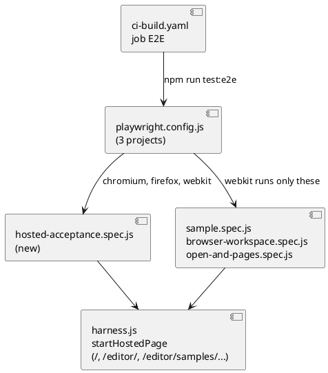

# The hosted editor, tested and told

# Summary

Runs 0191 to 0193 built the bundle codec, the browser workspace, the sample, *Export* and *Import*. This run (wave 025 manifest id W-6, #162 proposal 4) closes the wave: the acceptance of #162 becomes one end-to-end spec that runs in Chromium, Firefox and WebKit (DEC-1, DEC-2); the website's button is clicked in a test (DEC-3); the manual, `CLAUDE.md` and the presentation page say what the editor now is and what is still not tested (DEC-5, DEC-6, DEC-7). No product behaviour changes: if a test finds a defect in the page, the fix is a small `refactor: change` commit of the part concerned (DEC-4). There is no PRD (profile TDD+pln), so traceability is incomplete; the requirement labels REQ-1 to REQ-9 below are taken from #162's "Acceptance", the W-6 row of the wave plan, the P2 gate and decision D1 (WebKit accepted by the author on 2026-10-27).

# Scope

In scope: `src/test/e2e/**` (a new spec, the hosted server's routes, fixtures), `playwright.config.js`, the job `E2E` of `.github/workflows/ci-build.yaml`, `src/doc/README.adoc` (`[[editor-open]]` and a new section), `CLAUDE.md`, and `src/site/index.html` only if the test of the button shows a defect. Out of scope: the real Safari, the browser's own folder picker, GitHub Pages itself (first seen on the tag run), any new feature of the editor, the command line, `scripts/byte-identity.sh` input (unchanged by this run, but it stays a wave-gate check).

Note for the owner of the wave: the `likely_paths` of W-6 do not list `src/test/e2e/**`'s neighbours that this design may need (`src/main/editor/**` and `src/main/resources/editor-webapp/standalone.html` for a defect the WebKit project finds, DEC-4; `src/site/index.html`). This run does not edit the wave manifest.

# PRD Traceability

No PRD. Labels used by the plan:

- `REQ-1` (#162 Acceptance 1, P2 gate): one spec, in Chromium, Firefox and WebKit, opens the page without choosing a folder, opens the Brightcart sample, changes an element, reloads and finds the change, exports, deletes the browser workspace, imports the file and finds the same bytes; the spec is named in the run document.
- `REQ-2` (Acceptance 2): Chromium offers the same without a folder; the same flow with `showDirectoryPicker` removed (what Firefox and Safari have) does not show the unsupported-browser card (title `This browser isn’t supported`, `landingScreenConfig` in `landing.js`) and offers the button *Open the Brightcart sample*.
- `REQ-3` (Acceptance 4): the site's button opens the editor on Brightcart in one click; a second click reopens the same workspace with its changes.
- `REQ-4` (Acceptance 5): no file of the visitor's file system is read or written unless a folder is picked; the test shows `showDirectoryPicker` is never called and that, over the whole flow, the page sends no POST, PUT or PATCH and no request to another origin except GETs to the hosts the page names for the CDN (a `page.on('request')` listener records them).
- `REQ-5` (D1): a WebKit project exists in `playwright.config.js` and CI installs it.
- `REQ-6` (W-6 row): `[[editor-open]]` is true again, `[[editor-open]]` and the new section of the manual link to the sample, `CLAUDE.md` describes the editor's distribution and the e2e suite's "what it does not test".
- `REQ-7` (wave Risks): Playwright's WebKit is not Safari; the manual and `CLAUDE.md` say it, and say what is covered by which browser.
- `REQ-8` (existing rules): no flake is retried (`retries: 0`); a flow that cannot be made stable is dropped with its reason, not retried; the spec reads files back from the store and from the download, not from the page's words.
- `REQ-9` (P2 gate): the manual builds; `npm run lint`, `format:check`, `editor:check` and `test:e2e` pass; `scripts/byte-identity.sh` shows no difference; the CI run of the pull request has `Java`, `Page`, `Kernel`, `E2E` and `Native` green.

All nine are addressed. `REQ-4` is addressed only up to what a test can observe (Verification).

# Technical Goals

- TG-1: the whole acceptance of #162 is one readable spec whose steps are the issue's sentences (REQ-1, DEC-1).
- TG-2: the three engines run the specs that concern the hosted editor and nothing more (REQ-5, DEC-2).
- TG-3: the call to action is tested from the presentation page itself, not from a copied address (REQ-3, DEC-3).
- TG-4: the manual no longer says that Firefox and Safari need the command line (REQ-6, DEC-5).
- TG-5: what the suite does not prove is written down in one place (REQ-7, DEC-6).

# Non-Goals

- Re-testing what `sample.spec.js` and `browser-workspace.spec.js` already prove (Reset with Cancel, the file input, the served folder's hash): they stay and run in the extra project where DEC-2 says so.
- A visual test, a performance test, or a test of the real GitHub Pages.
- A new `upgrade-0-xx` block of the manual (Q-2).

# Assumptions

- ASM-1: `startHostedPage` in `src/test/e2e/harness.js` serves `/editor/` and `/editor/samples/brightcart.yaml` as the site does, and nothing else; adding `GET /` with `src/site/index.html` makes the site's relative link `editor/#...` resolve to the same server (the file has two external links, GitHub and ghcr, which the test never follows). Validate: the spec of DEC-3.
- ASM-2: `npx playwright install webkit` works on the developer machine and on `ubuntu-latest` (the CLAUDE.md note says "three more system libraries"; `--with-deps` installs them with apt). Not validated by this run on the developer machine before implementation: `~/.cache/ms-playwright` holds Chromium and Firefox only. Validate: the first task of the plan installs it and runs `npx playwright test --project=webkit --list`; if the install is refused the plan stops with the reason (RISK-1).
- ASM-3: Playwright's WebKit supports IndexedDB, `Blob` downloads (`page.waitForEvent('download')`), `setInputFiles` and `localStorage` on `http://127.0.0.1`, which are the browser features the hosted flow needs. `navigator.storage.persist()` may answer false or not exist; the existing specs do not depend on it (run 0192 ASM-4).
- ASM-4: the current specs `sample.spec.js` (3 cases) and `browser-workspace.spec.js` (1 case) pass in Chromium and Firefox today (46 passed at the end of run 0193) and none uses an API missing from WebKit. Validate: DEC-2's first run; a failure there is a finding, not a surprise to hide (DEC-4).
- ASM-5: the working tree holds uncommitted changes to `src/test/e2e/sample.spec.js` (steps adapted to the inherited-write dialog and to the combobox `Compare with`) and to `CLAUDE.md` (the paragraph of run 0193). They are the previous run's; this run builds on them and does not revert them.

# Constraints

- CON-1: one worker, no retry, `forbidOnly` in CI (`playwright.config.js`); a failing test keeps trace, screenshot and video under `target/e2e`.
- CON-2: the specs talk to the application through its page and its HTTP port; files are read back from the store, from the download or from the disk of the copy (CLAUDE.md, end-to-end suite).
- CON-3: the fixture `pageErrors` fails a test whose page logs a console error or throws, so a failed external request (the CDN for `elkjs` and CodeMirror, fonts) must not log an error. Those requests go to their own hosts and never reach the hosted server, which answers only `/`, `/editor/` and the sample; the page falls back or loads the CDN, and `pageErrors` judges the console. The spec for the site page (DEC-3) must not trigger a failing request either (RISK-3).
- CON-4: `ratchet.max` in `layers.json` stays at most 99 and no file of `src/main/editor` goes over 3,000 lines (wave gate); a defect fix (DEC-4) obeys both.
- CON-5: `src/doc/README.adoc` is built by the Asciidoctor plugin of `./mvnw`; a cross-reference to a missing anchor fails or warns, and `ManualExamplesTest` and `ShippedFilesTest` load what the manual quotes. Prose, not examples, changes here.
- CON-6: `CLAUDE.md` is edited with `Edit` on the text as it stands (it holds uncommitted work of run 0193, ASM-5); the file is not rewritten.
- CON-7: a WebKit failure that comes from Playwright's WebKit and not from the page is not hidden by a retry or by a skip without a reason written next to it (DEC-4).

# Current State

- `playwright.config.js` has two projects, `chromium` and `firefox`, and a comment saying WebKit is "one more entry here, and `webkit` in the install command, when the hosted editor (#162) needs it".
- `src/test/e2e/` has `address`, `browser-workspace`, `diagram-and-compare`, `edit-and-save`, `open-and-pages`, `sample`, `story-player` and `teardown` specs, `fixtures.js` (`serve`, `hosted`, `pageErrors`), `harness.js` (`startServer`, `startHostedPage`, `HOSTED_ROUTES` with two routes) and `workspace.js`.
- `sample.spec.js` proves, against the hosted-style server: the link opens Brightcart on Applications with `plateau=marketplace` compared with its past, a change is saved and kept across a reload, the same link reopens the one workspace, *Export as a file* downloads `brightcart-bundle.yaml` equal to the bundle of the stored files, *Reset to the sample* with Cancel and with the yes; a bundle chosen in the file input is imported as `Brightcart 2`; against `archicode editor serve` the sample is a browser workspace and the served folder's hash does not move. Its head comment says "W-6 composes the issue's acceptance; this is not that spec". What is not yet in any spec: deleting the browser workspace and importing the exported file back to find the same bytes; the landing card without `showDirectoryPicker`; the click on the site button; the proof that no folder picker is used; WebKit.
- `.github/workflows/ci-build.yaml`, job `E2E`: caches `~/.cache/ms-playwright` under the key `...-playwright-<version>-chromium-firefox`, installs `chromium firefox` with `--with-deps`, runs `npm run test:e2e`, uploads `target/e2e` on failure.
- The manual: `[[editor-open]]` (line 1629 of `src/doc/README.adoc`) still says "That needs the File System Access API, which Chrome, Edge, Brave and Opera have and Firefox and Safari do not: with one of those, use the command above instead", which is false since run 0192. No section tells the browser workspace, *Export*, *Import*, the sample, *Reset*, or the rule "nothing is uploaded". `[[editor-folders]]` tells the remembered folders only.
- `CLAUDE.md` paragraph "End-to-end suite" says WebKit "is not one" project, lists the specs of wave 023, and lists "What it does not test" (the folder picker and what hangs on it, the real Safari and the stock Firefox, Windows and macOS, the native runner). The paragraph "Bundle I/O and the Brightcart sample" (run 0193, uncommitted) tells the sample, the bundle and the routes.
- `src/site/index.html` already has the button *Try the editor on a realistic project* (twice) linking to `editor/#/timeline/applications?plateau=marketplace&compare=past&sample=brightcart`, pinned by `site.test.js` and `sample-brightcart.test.js`.

# Proposed Design

Three changes to the suite, one to the config and CI, three to the documents.

The reviewer should check that the new spec uses only the hosted server (no JVM), that the WebKit project's `testMatch` lists exactly the specs that need no `archicode editor serve` features beyond the page, and that CI installs the browser the config names.

- DEC-1 — One acceptance spec, named for the issue
  - Decision: add `src/test/e2e/hosted-acceptance.spec.js` with one `test` per sentence of #162's "Acceptance" that is not already one flow of `sample.spec.js`, in this order: (a) *visitor with no folder picker*: `showDirectoryPicker` is removed by `page.addInitScript` (`delete window.showDirectoryPicker`) in every project, so the same flow is what Firefox and Safari see; the landing card is not the unsupported-browser card (the title `This browser isn’t supported` is absent) and shows the button *Open the Brightcart sample*; the visitor opens the sample from the card (not from the address), changes the description of Back office (the helper of `sample.spec.js`, moved to `src/test/e2e/workspace.js` or a new `hosted.js` so both specs use it), reloads and finds the change in the store, exports (download read from disk), deletes the browser workspace (the card's *Delete*, then its in-page question), imports the downloaded file with `setInputFiles`, and asserts that the imported workspace's stored files, read back as bundle text, equal the downloaded text byte for byte (`Buffer.compare` / string equality, never a printed byte array); (b) *Chromium-style visitor*: the same hosted page with the real `showDirectoryPicker` replaced by a stub that counts calls and throws, the flow of (a) up to the reload, then `expect(calls).toBe(0)`; a `page.on('request')` listener records every request of the flow and the test asserts that none is a POST, PUT or PATCH and that every request to another origin is a GET to a CDN host the page names (`hosted.requests` lists what reached the hosted server, which sees `/editor/` and the sample only, and cannot see other origins); (c) a folder is still opened by the picker as before is NOT tested (CLAUDE.md, it cannot be).
  - Rationale: the issue's acceptance reads as these steps; today the delete-then-import-back step and the absence of the picker are in no test (Current State). The picker stub is how a test can show "no file of the user's file system is read or written unless the user picks a folder" for the page's own code path.
  - Alternatives considered: extending `sample.spec.js` (its head says it is not the acceptance, and its first test is already long); a spec per sentence (more start-up for no new coverage).
  - Tradeoffs: (a) and (b) repeat the first steps; accepted because a spec is a flow a person can read top to bottom and each starts from a clean browser context. `Delete` on the card is the visible control of run 0192; the spec uses `getByRole` names, not CSS, wherever the page gives one.
  - Linked PRD IDs: REQ-1, REQ-2, REQ-4, REQ-8.

- DEC-2 — A WebKit project that runs the hosted specs only
  - Decision: add `{ name: 'webkit', use: { ...devices['Desktop Safari'] }, testMatch: /(sample|open-and-pages|browser-workspace|hosted-acceptance)\.spec\.js$/ }` (anchored, so a future file whose name merely contains one of the words does not run in WebKit) to `playwright.config.js`; the other specs keep running in Chromium and Firefox. Change the comment of the config to say WebKit is a project now and why only these four (they are the ones the hosted editor and its Safari claim depend on; the rest test the served-folder path, which is the same code in every engine). CI: `npx playwright install --with-deps chromium firefox webkit`, the cache key `...-chromium-firefox-webkit`, and the comment of the step "Run the end-to-end tests" (Chromium, Firefox, then WebKit). `package.json` is unchanged (`test:e2e` runs all projects).
  - Rationale: D1 (accepted 2026-10-27) wants the Safari claim tested; running every spec in WebKit triples CI time for specs that do not touch the browser workspace, and the served-folder specs need the JVM per test (about 2 minutes of the 46-test run today).
  - Alternatives considered: all specs in WebKit (cost, more false failures from Playwright's WebKit in diagram and story-player specs); WebKit for `hosted-acceptance` only (misses the six-page console-error sweep of `open-and-pages`, which is the best Safari pass over the whole page).
  - Tradeoffs: `open-and-pages.spec.js` starts a JVM; it is kept in the list for the sweep of the six pages. If its time in WebKit is the problem it can move out; it is a one-line change.
  - Linked PRD IDs: REQ-5, REQ-7.

- DEC-3 — The site's button is clicked
  - Decision: add the route `GET /` → `src/site/index.html` to `HOSTED_ROUTES` (read at each request, like the page), and a test in `hosted-acceptance.spec.js`: `page.goto(hosted.siteUrl)`, click *Try the editor on a realistic project* (first match), expect the editor to open on Brightcart (`Applications`, `plateau=marketplace` in the address, the band list *Compare with* showing `past`), assert one browser-workspace row with `sample === 'brightcart'`, change an element, go back to the site page (`page.goBack()` twice or `goto`), click the button again, and assert still one row and the change present. `startHostedPage` also returns `siteUrl` (`http://127.0.0.1:<port>/`). External requests of the site page (links only, no scripts or stylesheets, checked by `grep` in the plan) are not followed; if one is found the spec routes it to an empty 204 with `page.route`.
  - Rationale: the link is the acceptance's "one click"; `site.test.js` pins the address as text, not that it works from the page that carries it.
  - Alternatives considered: only unit-test the link (already done, proves nothing about the relative path `editor/`).
  - Tradeoffs: the served `/` page is the presentation page as in the repository, not as the tag run assembles it (`ci-build.yaml` copies it to `target/site`); the difference is only the folder layout, which `editor/` relative resolution is the same in.
  - Linked PRD IDs: REQ-3.

- DEC-4 — What a failing project means
  - Decision: a new spec or the WebKit project may fail on first run. Order of reading a failure: (1) a defect in the spec, fix the spec; (2) a defect in a part of `src/main/editor` (a Chromium-only API the W-4 static pass missed, a CSS rule), fix the part with a `refactor: change ...` commit that regenerates the page, adds a node test that fails before the fix where the node harness can show it, and obeys CON-4; (3) a limit of Playwright's WebKit (an API missing in that build), skip that one test in the `webkit` project with `test.skip(browserName === 'webkit', '<reason>')` and the reason stated in the manual's list of what is not tested (DEC-6). A retry, a longer timeout added to hide a failure, or a skip without a written reason is not an outcome. A defect of kind (2) that needs more than one part, or changes behaviour in Chromium, stops the plan and is reported as Q-1 (deferred, not guessed).
  - Rationale: the wave's risk "Firefox and Safari differences are found late"; W-4's pass was by reading, and this is the first run of the page in WebKit.
  - Alternatives considered: declaring all WebKit failures out of scope (loses the point of D1); fixing at any size (risks a second wave inside this run).
  - Tradeoffs: the run's size is open at the top; bounded by the stop rule.
  - Linked PRD IDs: REQ-5, REQ-8.

- DEC-5 — The manual
  - Decision: rewrite the second bullet of `[[editor-open]]` ("From the published page") to say: the page works in Chrome, Edge, Brave, Opera, Firefox and Safari; with no folder it keeps a workspace in the browser; a folder can still be picked where the browser allows it. Add a section `[[editor-browser-workspace]]` after `[[editor-folders]]` that tells, in the manual's style: where a browser workspace lives and that it can be lost (site data cleared, a private window, eviction; `storage.persist()` is asked at the first save), the card (New, Open, Rename, Delete), the sample (*Open the Brightcart sample* on the card and the *Workspace* menu, *Reset to the sample* and what it loses, the address `#sample=brightcart` and the link on the site, which opens the same workspace the second time), *Export as a file* and *Import a workspace file* (one YAML file, `--- # file: <path>` separators, what the bundle cannot carry is listed, the limits of the import: no `..`, no absolute path, no hidden file other than `.archicode.yaml`, no path twice, 10 MB), and that nothing is uploaded; the same menu from `archicode editor serve` never writes to the served folder. State the test coverage in one sentence: Chromium, Firefox and Playwright's WebKit, not the real Safari. The sample is linked from `[[editor-open]]` and from the new section as `link:../editor/#/timeline/applications?plateau=marketplace&compare=past&sample=brightcart[the editor on the Brightcart sample]` (the manual is at `/docs/`, the editor at `/editor/`). No `upgrade-0-xx` block (Q-2). Every number and sentence quoted from the page (button names, the 10 MB, the export file name `brightcart-bundle.yaml`) is read from the sources of the editor, not recalled.
  - Rationale: REQ-6; `[[editor-open]]` is wrong today.
  - Alternatives considered: a separate manual page (the manual is one `README.adoc`); mentioning it in the release notes only (the repository keeps none).
  - Tradeoffs: one more section of the manual; no new example, so `ManualExamplesTest` is untouched.
  - Linked PRD IDs: REQ-6, REQ-7.

- DEC-6 — CLAUDE.md
  - Decision: edit the paragraph "End-to-end suite": three projects (Chromium, Firefox, WebKit), the install line `chromium firefox webkit`, the sentence about WebKit being one more entry replaced by the DEC-2 rule (which specs run in WebKit and why), the new spec in the list of flows, and "What it does not test" reworded: the browser's own folder picker is replaced in the acceptance by a stub that proves it is not called, the real Safari (Playwright's WebKit is not Safari), the stock Firefox, Windows and macOS, the packaged native runner, and the real GitHub Pages (the tag run is the first proof of the base path and of the assembly of the website). Add one clause to the CI paragraph: the `E2E` job installs three browsers and the cache key names them. Do not touch the paragraph of run 0193 except to cross-reference the spec.
  - Rationale: the file is the contract the next agent reads; it says WebKit is not a project.
  - Alternatives considered: a new paragraph (duplicates the end-to-end one).
  - Tradeoffs: the paragraph grows; accepted, it is where this knowledge lives.
  - Linked PRD IDs: REQ-6, REQ-7.

- DEC-7 — The presentation page
  - Decision: no edit planned. `src/site/index.html` already has the button and the sentence "The editor runs in your browser, nothing to install". The run reads it once against the manual's new text (names of the controls, "your files are not uploaded") and edits a sentence only if they disagree or the click test (DEC-3) finds that it does not work.
  - Rationale: REQ-3 asks the page to tell the flow; it does; adding words is not a goal.
  - Alternatives considered: adding a paragraph on export (the manual's job).
  - Tradeoffs: none.
  - Linked PRD IDs: REQ-3, REQ-6.

# Repository Impact

- IMP-1 — The acceptance spec
  - Path(s): `src/test/e2e/hosted-acceptance.spec.js` (new), `src/test/e2e/workspace.js` or a new `src/test/e2e/hosted.js` (the helpers `editShopDescription`, `openWorkspaceMenu`, `storedSample`, `waitForEditor` moved from `sample.spec.js`)
  - Change type: additive (helpers moved)
  - Why impacted: DEC-1, DEC-3.
  - Linked PRD IDs: REQ-1 to REQ-4.
  - Risks / notes: `sample.spec.js` is edited only to import the helpers; its assertions do not change; the `/* global ... */` comment for the page's top-level names is repeated where `page.evaluate` uses them.

- IMP-2 — The hosted server
  - Path(s): `src/test/e2e/harness.js`, `src/test/e2e/fixtures.js`
  - Change type: modify
  - Why impacted: the route `/` and `siteUrl` (DEC-3); the head comment of `fixtures.js` lists the `hosted` fixture's value.
  - Linked PRD IDs: REQ-3.
  - Risks / notes: `/` is read from `src/site/index.html` at each request; a missing file answers 404 as for the other routes.

- IMP-3 — The Playwright config
  - Path(s): `playwright.config.js`
  - Change type: modify
  - Why impacted: DEC-2, the comment.
  - Linked PRD IDs: REQ-5.
  - Risks / notes: `testMatch` entries are regular expressions on file names, kept in step with the spec list by a check in the plan's last task, which lists the project's tests with `--list` and compares.

- IMP-4 — CI
  - Path(s): `.github/workflows/ci-build.yaml` (job `E2E`: cache key, install line, comments)
  - Change type: modify
  - Why impacted: DEC-2.
  - Linked PRD IDs: REQ-5, REQ-9.
  - Risks / notes: proved only by the pull request's run (`E2E` job); a bigger browser cache (about 1.3 GB) and one more apt install; the `Build` job's gate still needs all four jobs.

- IMP-5 — The manual
  - Path(s): `src/doc/README.adoc` (`[[editor-open]]`, new `[[editor-browser-workspace]]`)
  - Change type: modify and additive
  - Why impacted: DEC-5.
  - Linked PRD IDs: REQ-6, REQ-7.
  - Risks / notes: the Asciidoctor build is the check (CON-5); sentences come from the sources.

- IMP-6 — CLAUDE.md
  - Path(s): `CLAUDE.md`
  - Change type: modify
  - Why impacted: DEC-6.
  - Linked PRD IDs: REQ-6, REQ-7.
  - Risks / notes: CON-6.

- IMP-7 — A defect fix, only if DEC-4 (2) happens
  - Path(s): one part of `src/main/editor/**` and the generated `src/main/resources/editor-webapp/standalone.html`, a node test under `src/test/javascript/viewpoint-kernel/`
  - Change type: modify
  - Why impacted: a WebKit-only defect.
  - Linked PRD IDs: REQ-5.
  - Risks / notes: `npm run editor:build`; `names.json` / `java-names.json` only if a top-level name changes; `ratchet.max` at most 99.

# Canonical Impact

Not applicable — no canonical registers declared (no `docs/CLAUDE.md` and no `arc` or `dom` register exist in this repository).

# Data Model and Contracts

- CTR-1 — The hosted test server
  - Current contract: `startHostedPage()` resolves `{ url, requests, stop }`; `url` is `http://127.0.0.1:<port>/editor/`; two routes.
  - Proposed contract: also `siteUrl` (`http://127.0.0.1:<port>/`), and the route `/` serving `src/site/index.html`; `requests` lists `/` too.
  - Affected files: `harness.js`, `fixtures.js` (comment), specs that assert `hosted.requests`.
  - Migration or compatibility notes: additive; `sample.spec.js` asserts `toContain`, not equality, so it holds.
  - Linked PRD IDs: REQ-3.

- CTR-2 — The Playwright projects
  - Current contract: projects `chromium`, `firefox`; every spec runs in both.
  - Proposed contract: project `webkit` with a `testMatch` list of four specs; `chromium` and `firefox` unchanged.
  - Affected files: `playwright.config.js`, `ci-build.yaml`, `CLAUDE.md`.
  - Migration or compatibility notes: a contributor installs `webkit` once (`npx playwright install --with-deps webkit`) or runs `--project=chromium`.
  - Linked PRD IDs: REQ-5.

# Interfaces and Behavior

- IF-1: `npm run test:e2e` runs three projects and exits 1 on any failure; `npx playwright test hosted-acceptance --project=firefox` runs one spec in one engine.
- IF-2: the manual's new section is addressed as `<<editor-browser-workspace>>`; `[[editor-open]]` links to it.
- IF-3: no behaviour of the editor, the command line or the site changes (except IMP-7, if it happens, and then only for the engine concerned).

# Flows and Processing Logic

- FLOW-1 — The acceptance, as the spec plays it (DEC-1 (a))
  - Trigger: `page.goto(hosted.url)` with `showDirectoryPicker` removed.
  - Steps: the card shows no unsupported sentence; click *Open the Brightcart sample*; the editor draws; edit a description and save (with the inherited-write confirmation when it appears, as `sample.spec.js` does); reload; read the stored files; export and read the download; delete the workspace from the card; import the downloaded file with `setInputFiles`; compare the imported files' bundle with the download.
  - Branches / failure paths: a download that does not start (ASM-3 of run 0193) fails the test with Playwright's timeout; the helper waits for the card, not for a fixed time.
  - Final output / rendered result: one workspace named `Brightcart` (the old one was deleted, so the import takes the name without a number), whose bundle equals the file byte for byte.
  - Linked PRD IDs: REQ-1, REQ-2.

- FLOW-2 — The click on the site (DEC-3)
  - Trigger: `page.goto(hosted.siteUrl)`.
  - Steps: click the button; the editor opens at the address in the link; one sample row; edit and save; return to the site page; click again.
  - Branches / failure paths: the second click must not create a second row nor lose the edit.
  - Final output / rendered result: one row, the change in the stored files.
  - Linked PRD IDs: REQ-3.

# Reliability, Performance, and Scalability

The new spec adds three browser starts to each of three engines but no JVM (hosted server only); about 1 minute in all, estimated, to be measured by the plan. The WebKit project adds the `open-and-pages` and `browser-workspace` JVM-backed runs; measured time goes in the run document. The suite stays at one worker and no retry (CON-1).

# Security and Privacy

REQ-4 is the privacy claim of the wave. The test observes: the picker stub is never called, and the hosted server sees no request for the workspace's files; it cannot show that the page never reads the user's disk through another API, which is why the manual says "nothing is uploaded" and "the browser asks before it opens a folder", not more. The stub does not weaken the page: it only counts.

# Observability and Verification

- `npm run test:e2e` (needs `./mvnw package -Dmaven.test.skip -Dplugin.asciidoctor.skip=true` first, and `npx playwright install --with-deps chromium firefox webkit` once): all three projects green; the new spec is `src/test/e2e/hosted-acceptance.spec.js`.
- Show the spec fails: in a scratch copy, break one thing (the sample route removed from `HOSTED_ROUTES`; the delete button's handler; the import's name rule) and run the spec; record each red result in the run document, then restore. A spec that cannot fail is not an acceptance.
- `npx playwright test --list --project=webkit` shows exactly the four specs.
- `npm run lint`, `npm run format:check` (it covers `src/test/e2e/**` and `playwright.config.js`), `npm run editor:check`, `npm run test:unit` (unchanged unless IMP-7).
- `./mvnw verify -DskipITs=false` or at least the Asciidoctor build for the manual: `JAVA_HOME=$HOME/.sdkman/candidates/java/25.0.4-tem ./mvnw generate-resources` (the Asciidoctor execution `convert-to-html` is bound to that phase, `plugin.asciidoctor.skip` is false by default, the output is `target/generated-docs/index.html`) builds the manual; grep it for the `editor-browser-workspace` anchor and for the absence of "Firefox and Safari do not".
- `scripts/byte-identity.sh`: no difference expected (no Java or command-line change); run as the wave gate.
- The CI run of the pull request: `Java`, `Page`, `Kernel`, `E2E`, `Native` green, recorded by its run id in the wave prg (the main agent's, not this run's).

# Deployment and Rollout

Code-only for tests, config and documents; the page changes only in the case of IMP-7. The `E2E` job's cache key changes, so the first CI run downloads the browsers once. Rollback: remove the `webkit` project and the spec (one commit). The manual is published by the tag run, so the first reader of the new section sees it at the next release.

# Risks and Tradeoffs

- RISK-1: Playwright's WebKit may not install or may not start in the developer's environment (system libraries) or may behave differently from Safari. Mitigation: ASM-2 is checked first; if the local install fails the plan records it, writes the config and CI, and leaves the WebKit proof to the pull request's `E2E` job, saying so in the run document and in `CLAUDE.md` (not claiming a result it did not see).
- RISK-2: the first WebKit run finds several page defects (DEC-4). Mitigation: the stop rule; a list of findings goes to the run's prg and, if not fixed here, to a GitHub issue (the repository's rule for deferred items).
- RISK-3: the site page triggers a console error (a blocked external request) and `pageErrors` fails the test. Mitigation: DEC-3's route stub; checked by running the test.
- RISK-4: CI time and cache size grow (three browsers). Mitigation: the `testMatch` of DEC-2; measure.
- RISK-5: the manual states a behaviour that the page does not have (wording drift). Mitigation: DEC-5's rule that every sentence is read from the sources, and the spec for the same flow.
- RISK-6: the uncommitted work of run 0193 (ASM-5) is lost or overwritten by a careless edit. Mitigation: CON-6 and `Edit` only.

# Open Questions

- Q-1: if a defect found by WebKit needs a change larger than one part or changes Chromium behaviour, is it fixed in this run? Decided now: no, it is filed as an issue and the test for that engine is skipped with the reason (DEC-4). Not a blocker.
- Q-2: does the release need an `upgrade-0-xx` block of the manual? Decided: no; the change is additive and breaks nothing (no key, route or output changes), so there is no `upgrade-0-20` block: `[[upgrade-0-19]]` (what changes for a reader who knows 0.19.0) is the block of the release before this one and stays the last. The new section of the manual is the notice. Not a blocker.

# Deferred Work

- DEF-1: the real Safari and the real Firefox (stock builds) on a schedule (needs a service or a Mac runner).
- DEF-2: a test of the real GitHub Pages address after a tag (a post-release smoke, like the release `Smoke` job).
- DEF-3: the rest of the suite (served-folder specs) in WebKit, if the cost is judged worth it later.

# File Placement and Frontmatter

This file is `docs/wav/wav-025-hosted-editor/run/run-0194-hosted-editor-tests-and-docs/tdd-0194-hosted-editor-tests-and-docs.md`, with `type: tdd`, `run: 0194`, `wave: 025`, in the naming of the sibling runs.
