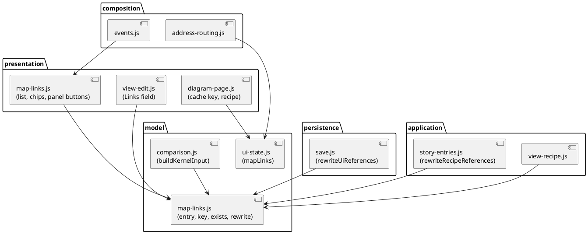
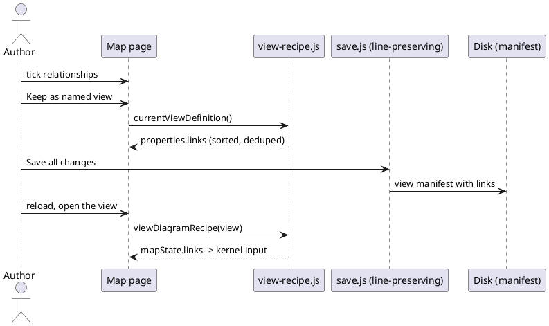

# Pick the relationships of a Map in the editor

# Summary

The editor learns the `links` property of a Map view of the application layer, which the kernel and the command line read since run 0197. An author ticks relationships in a list on the page Applications, or clicks a link on the diagram and keeps the relationships it stands for; the kernel (the same wasm, the same input key `links`) draws the ends of the ticked relationships and what encloses them; the choice is kept in a saved view (the form of a view, "Keep as named view"), in a step that carries its own recipe, and in the address; and a rename or a move of an element rewrites the entries that name it, in every view and step, as it rewrites `pinned`. The editor also keeps a `highlight` it did not write: it does not read or draw it (W-6), it rewrites its entries on a rename or a move and never drops it from an edit in place. Every view and Map without `links` is drawn and saved as before. There is no PRD (profile TDD+pln): the sources are #143 (decision D11), the wave plan (W-5 and its open question on the rename follow-up), the TDDs of runs 0197 and 0198 and the code of `src/main/editor` read for this design, so traceability is incomplete (see PRD Traceability).

# Scope

In scope:

- State, list, chips and click handling of the Map of the application layer (`src/main/editor/model/ui-state.js`, `presentation/map-state.js`, `presentation/diagram-page.js`, `presentation/right-panel.js`, `composition/events.js`), a new pure part `model/map-links.js` and a new view part `presentation/map-links.js`.
- Reading `links` in the recipe of a diagram (`viewDiagramRecipe`, `applySavedView`, `currentViewDefinition`, `canonicalViewProperties`, `viewProblem`), in the kernel input (`buildKernelInput`), in the diagram cache key and the view key (`diagramCacheKey`, `diagramPage`), in the story scene (`story-scene.js`) and in the address (`address-routing.js`).
- The form of a saved view (`presentation/view-edit.js`, `presentation/stories-pages.js`): a Links field with pills.
- The follow-up of a rename and a move (`application/story-entries.js`: `rewriteRecipeReferences`, `rewriteSavedViewReferences`, `recipeNamedReferences`; `persistence/save.js`: `rewriteUiReferences` for the live `mapLinks`; `application/move.js` only calls the rewrite on copies).
- Tests in node and end to end, the manual's editor sections, `CLAUDE.md` (one paragraph), the regenerated page.

Out of scope: any Java, Rust or kernel change (the kernel is read as W-3 built it); the editor's drawing and the player of a highlight (W-6); the technology layer; a load check of `links` in a layered workspace (DEC-10); a wildcard or a qualifier in an entry; a shipped example, fixture or story that uses `links` (DEC-9, W-6).

# PRD Traceability

There is no PRD. The requirements are labelled here from #143 decision D11, the wave purpose and the focus of W-5 ("an author ticks relationships in a list or clicks them on the diagram, the boxes follow, and the saved view keeps them through a rename or a move"), and the P3 gate. Every REQ is an assumption sourced from those documents, so traceability is incomplete.

- `REQ-1` (W-5 focus, wave plan): the author picks relationships in a list, searchable by source, destination, kind and text.
- `REQ-2` (W-5 focus): the author picks relationships by clicking a link on the diagram.
- `REQ-3` (P3 gate): the boxes and links the editor draws for a Map with `links` equal those the command line writes (a shared contract file in the style of `expected-boxes.json`).
- `REQ-4` (W-5 focus, wave open question 3): a rename or a move of an element rewrites the `links` entries that name it in every saved view and every step with its own recipe; what the command line says of an entry that names nothing is what the editor says.
- `REQ-5` (W-5 focus): the saved view keeps the choice: the form of a view, "Keep as named view", the address and the cache key carry it; a view without `links` is read, drawn and written as before; `highlight` is neither read nor lost.
- `REQ-6` (wave Non-Goals, P3 gate): `ratchet.max` of `layers.json` does not rise above 99, no file under `src/main/editor` goes over 3,000 lines, no coverage floor of `scripts/editor-coverage-floor.json` is lowered.
- `REQ-7` (P3 gate): an end-to-end spec in Chromium and Firefox picks relationships in the list and on the diagram, saves the view, reloads and finds the same boxes, and the file on disk holds `links`.
- `REQ-8` (P3 gate): the manual and `CLAUDE.md` describe what the editor does with `links` (the guide, which tells the command line, is not changed by this run).

Addressed: REQ-1 to REQ-8. Partially addressed: none. Unresolved: the load check in a layered workspace (DEF-1 of run 0197), moved to DEF-1 of this run with its reason (DEC-10).

# Technical Goals

- TG-1: one pure model of an entry (its key, its normal label, its existence in a model, its rewrite), shared by the list, the click, the view, the address and the rename, so that the editor has one reading of "which relationship".
- TG-2: what the kernel is given is `links` only when the author ticked something that exists, so the kernel's own sentences are never the editor's way of saying a plateau lacks a relationship.
- TG-3: the editor equals the command line box by box on Maps with `links` (REQ-3), and says the same words for the same mistakes.
- TG-4: no output, no file and no address moves for anything that has no `links` (REQ-5).
- TG-5: no new upward pair between the layers of the page (REQ-6).

# Non-Goals

- No highlight in the editor (W-6) and no new viewpoint; no change to the kernel contract number.
- No relationship of the technology layer; the page Environments has no list and no chip for links.
- No wildcard label, no `qualifiers`, no `tags` in an entry (DEF-2 of run 0197 stays).
- No change to what a plateau delete says about the views it affects (DEF-3).

# Assumptions

- ASM-1: the model record of an element (`AppState.index[layer].get(ref).relationships`) lists each relationship with `destination`, the label as written (`rawLabel`) and a display `label`, `qualifiers`, `tags` and `fileIndex` (read in `presentation/element-form.js`, `persistence/save.js`). An entry is built from the record, not from the kernel's link, so the editor does not depend on how the kernel words the label of a relationship it groups. Validated by the node test of the entry model against the `exists` flags of `map-links-cases.json`.
- ASM-2: the kernel the page embeds is the one of run 0198 (`links` and `highlight` read, `highlighted` written), so `buildKernelInput` may send `links` as it sends `pinned`. Validated by `embed.sh --check` (CI) and by the shared contract test (DEC-8).
- ASM-3: the line-preserving save writes a list of small mappings as it writes `relationships` (block or flow), keeps the comments and quotes around it, and writes `label` only when present. Validated by a save test on a view with `links` (DEC-7).
- ASM-4: the biggest layered workspace the repository ships (the layered Brightcart) has fewer than 500 relationships in one layer, so the list is cheap to build. Validated when the list is built in the node test; the row cap of DEC-3 is the guard if not.
- ASM-5: `links` is read in the Map of the application layer only (run 0197 DEC-6 (c)). The editor mirrors it for the technology layer in `viewProblem`, not in the kernel call.

# Constraints

- CON-1: the page is generated (`CLAUDE.md`): edit `src/main/editor`, run `npm run editor:build`, commit sources and page together; a new part goes in `layers.json` and `names.json` (`node scripts/check-editor.mjs --write-names`); no Java source names a new top-level name, so `java-names.json` is not touched.
- CON-2: the layer rule: a layer uses the layers before it; `modelsChanged()` bumps the version and draws nothing, a part below `composition/` asks `requestRedraw()`, `render()` is called in `composition/` only. A choice of links is view state (like `mapPinned`), so it calls neither `modelsChanged()` nor changes `AppState` models.
- CON-3: `ratchet.max` stays 99 or lower; the new parts add no upward pair (`node scripts/check-editor.mjs --list` before and after).
- CON-4: no file under `src/main/editor` over 3,000 lines (`composition/events.js`, 1,297 lines, and `presentation/diagram-page.js`, 1,216, are the largest files this run touches; the new code goes in the two new parts).
- CON-5: the editor's sentences for an entry equal the command line's words (run 0197 and 0198 sentence tables); a case added to `negative-cases.json` or `layer-checks-cases.json` would have to pass in both tools, and this run adds none (the load check is DEF-1).
- CON-6: every shipped file is loaded by both tools in a test (`CLAUDE.md`): this run ships no file that carries `links` (DEC-9); the tests build their views in temporary copies.
- CON-7: no coverage floor is lowered (`npm run test:coverage`), format and lint pass (`npm run format:check`, `npm run lint`).
- CON-8: Chromium and Firefox run the new e2e spec, one worker, no retry. WebKit runs the four anchored specs only, so a new spec stays out of it unless the plan adds it to the anchored list; this run does not.

# Current State

The Map of the application layer keeps three variables, `mapPinned`, `mapHidden` and `mapOpened` (`model/ui-state.js`), read and written through `mapStateOf(layer)` (`presentation/map-state.js`); the technology layer keeps a record. `currentMapState()` gives the kernel only references that exist. `buildKernelInput` (`model/comparison.js`) copies `opened`, `pinned` and `hidden` into the input of a Map, `applications` and `relationships` for the technology layer only; the kernel input has no `links`. `diagramCacheKey` and the view key of the drawing (`presentation/diagram-page.js`) hold the three lists. A saved view is read by `viewDiagramRecipe` and `applySavedView`, written by `canonicalViewProperties` (which keeps only keys it knows: `element`, the three lists, `facet`, `hide-unlinked`, `applications`, `relationships` and the texts) and edited in place by `setViewListItem` and its siblings (`presentation/view-edit.js`); `VIEW_PROPERTY_ORDER` says where a written key goes. The address carries `pin=` (`composition/address-routing.js`), the selected link as `link-from` and `link-to`.

A link of the drawing is a pair of boxes; the panel of a selected link (`renderLinkInspectionHtml`, `presentation/right-panel.js`) lists the declared relationships it stands for (`relationshipsOfPair`, each with `from`, `destination`, `label`). A rename calls `rewriteInboundReferences` and so `rewriteSavedViewReferences`, which rewrites the `element`, `pinned`, `hidden` and `opened` of every saved view and of every step that carries its own recipe (`rewriteRecipeReferences` and `rewriteSavedViewReferences`, `application/story-entries.js`; `rewriteInboundReferences` and `rewriteUiReferences`, the live `mapPinned`, are in `persistence/save.js`); `move.js` counts the same rewrite on copies; `recipeNamedReferences` (`application/story-entries.js`) lists what a recipe names for the dialog of sibling plateaus. A delete does not touch views. `viewProblem` says why a view cannot be drawn.

The command line (runs 0197, 0198) reads `links` and `highlight`; the editor does neither: `canonicalViewProperties` drops both on any rewrite from the screen, `viewDiagramRecipe` ignores them, so a saved view that has `links` is drawn by the editor as the whole map (ASM-3 of run 0197, a limit this run ends).

# Proposed Design

One new pure part and one new view part, small hooks in the existing parts that read a Map, no change to the kernel.

The reviewer should check that every arrow points to a part of the same layer or one before it in `layers.json` (`composition` uses `presentation`, `presentation` uses `application`, `persistence` and `model`), and that `model/map-links.js` uses only `core`.

DEC-1 — The state: `mapLinks`, view state of the Map of the application layer

- Decision: `mapLinks`, an array of entries `{ source, destination, label }` (`label` a string, or absent), next to `mapPinned` in `model/ui-state.js`, reset with the folder (`resetUiState`, `folder-session.js`) and snapshotted with `mapPinned` by `snapshotWriteState` (`application/layer-writes.js`) so a refused write puts it back. `mapStateOf('application')` gains `links`; the technology layer keeps a record with no `links` field, so `mapStateOf` answers `links: []` for it by a branch (no field is added to `technologyMapState`). The new view state variables, all view state (no `modelsChanged()`, none in `AppState`, none in the workspace), are: `mapLinks` (reset by `resetUiState`; snapshotted by `snapshotWriteState` and put back by `restoreWriteState`, both in `application/layer-writes.js`, so that a refused write gives the choice back; in the address as `rel=`, DEC-8; part of the cache key, DEC-6), `mapLinksListOpen` (whether the `
` is open; reset by `resetUiState`; not snapshotted, not in the address), and the three controls of the list, `mapLinksFilter` (the text), `mapLinksKind` (the kind select, "Any kind" at rest) and `mapLinksTickedOnly` (reset by `resetUiState`; not snapshotted, not in the address; a change redraws the list only, not the diagram, and is no entry of the history). Setting it never calls `modelsChanged()`; the redraw is `render()` in `composition/events.js`. `links` empty is the whole map (run 0197 DEC-4: `links: []` is no selection).
- Rationale: it is the same kind of state as the pins, so the history, the address, the snapshot of a write and the redraw already know how to treat it.
- Alternatives considered: a set of keys only (the entry is needed to write it and to say what is missing); keeping it in `AppState` (it is not a model).
- Tradeoffs: one more variable in the snapshot.
- Linked PRD IDs: REQ-1, REQ-5, REQ-6.

DEC-2 — One entry model: `model/map-links.js`

- Decision: a pure part of the `model` layer. `linkEntryOf(relationship, sourceReference)` builds `{ source, destination, label }` from a record's relationship, `label` the declared text trimmed and left out when it is empty (the rule of `RelationshipLabel.normalize` that run 0197 uses). `linkEntryKey(entry)` is `JSON.stringify([source, destination, normalLabel])`, `normalLabel` the trimmed label, `''` for none. `linkEntriesOf(value)` reads a `links` or `highlight` value as the kernel does (a list of mappings with text `source`, `destination` and an optional text `label`; a mapping with another key, a non-text or an empty-text field is not an entry) and returns `{ entries, problems }` with the CLI's shape sentence for the first entry that is not one (``the view v: `links[0]` is a mapping with `source`, `destination` and optionally `label`, and <entry> is not one`` is the command line's line; the editor says it without the prefix of the view and the word `error`, as it says every other view problem). `linkEntryExists(entry, index)` is true when the source has a relationship whose destination is equal and whose normal label is equal, in the model it is given (the plateau's index, or the elements of the comparison's union when a comparison is on, so a removed relationship can be ticked: run 0197 DEC-6 (e)). `rewriteLinkEntries(entries, rewrite)` rewrites `source` and `destination` with the function it is given (`rewriteReferenceValue` of `persistence/save.js`, which lives in a layer above `model`, so the part receives it as a parameter and names no persistence function) and returns whether anything changed. `canonicalLinkEntries(entries)` dedupes by key and sorts by key, as `canonicalViewProperties` sorts `pinned`.
- Rationale: TG-1. The five places that need to know "which relationship" must not each spell the label rule.
- Alternatives considered: matching on the kernel's link (its relationships may be grouped and its label a display fallback, ASM-1); a string form (the command line reads a mapping only, run 0197 DEC-1).
- Tradeoffs: the entry model repeats the label normalisation of Java and Rust, checked by the shared cases (DEC-8).
- Linked PRD IDs: REQ-1, REQ-3, REQ-4.

DEC-3 — Picking in a list: the left panel of the page Applications

- Decision: below the tree of the page Applications (application layer only; the page Environments has none) a section "Relationships" in a `
` that remembers if it was open (view state, `mapLinksListOpen`, never in the address). It lists the relationships of the model drawn (or of the union with a comparison on), one row each, sorted by source, destination, label (`compareUnits`): a checkbox, "source → destination", the label, and the kind of each end in muted text. Above the rows: a text filter (matches the source, the destination or the label, case-insensitive substring, and the kind of either end), a select of the kinds that exist among the ends ("Any kind" first) and a toggle "Ticked only". At most 200 rows are drawn; the rest are told ("200 of 1,240 shown: type to narrow"). A count of ticked entries sits in the summary. A ticked entry that names no relationship of the model drawn (a plateau that lacks it, a rename done outside) stays in the list with a muted "not in this plateau" (as `pill-missing`) and can be unticked. Ticking calls `toggleMapLink(entry)`; the redraw is the one of a pin (`pushDiagramHistory()`, `mapSelectionCheck = true`, `render()` in `events.js`, action `map-link-toggle`, `data-key` the entry key). The `data-key` of a row is the entry key (a `JSON.stringify`), put in the attribute through `escapeHtml`/the attribute escaping the page uses for every `data-*` value, so a label with a quote, an ampersand or a bracket is safe (a case of `map-links-list.test.js`). The rows are `role="group"` checkboxes in tab order, the filter has an `aria-label`, and a live region says "n relationships ticked". The whole map is back with "Clear" (a button in the summary and the chip of DEC-5, action `map-links-clear`).
- Rationale: REQ-1 asks for a list searchable by source, destination, kind and text; the left panel is where the Map already scopes what is drawn (`renderMapScopeHtml`, pin and hide).
- Alternatives considered: a dialog (hides the diagram while the author watches the boxes follow); a column in the tree rows (a relationship is not an element); no cap (a long list in a long page).
- Tradeoffs: the list is a second way to scope beside pin and hide; the hint under the tree says what each does.
- Linked PRD IDs: REQ-1, REQ-6.

DEC-4 — Picking on the diagram: the panel of a selected link

- Decision: the panel of a selected link (`renderLinkInspectionHtml`) gets, on the Map of the application layer only, two controls built from the entries of `relationshipsOfPair(pair)` found again in the model (DEC-2): when `mapLinks` is empty, "Draw only this link" (action `map-link-only`: `mapLinks` becomes the entries of the relationships of the selected pair, every relationship of the pair); when `mapLinks` is not empty, each relationship row of the panel has a checkbox, ticked when its entry is in `mapLinks`, with the same action as the list (`map-link-toggle`), so a drawn link can be taken out. There is no "Add this link" control: under a non-empty choice a drawn link stands only for ticked relationships, so no drawn link has none of its relationships ticked, and a link that is not drawn is added from the list (a third control for what N ticks already do is dropped). A relationship whose declaring element or label cannot be found in the model (a ghost, a removed relationship with no comparison) has no control. The selection stays, so the author sees the link and the box disappear or stay. No click on a box changes `links`; pin is the box's own control.
- Rationale: REQ-2. A drawn link is the one object the author points at; its relationships, not the grouped link, are what `links` names, and the panel already lists them one by one.
- Alternatives considered: a double click or a modifier on the link (no keyboard path, invisible); making a click toggle the pair at once (a grouped link stands for several relationships; the author must see which).
- Tradeoffs: two clicks (select, then the button) instead of one, and the panel is on the right, not on the link.
- Linked PRD IDs: REQ-2.

DEC-5 — A chip over the diagram, and what is drawn when nothing ticked exists

- Decision: `renderMapChipsHtml` adds one chip when `mapLinks` is not empty: "Relationships: n" with a Clear button (`map-links-clear`), beside the pin and hide chips; the "Clear all" of the chips clears links too when they are on screen. The kernel is given `links` (only the entries whose relationship exists in the model drawn, DEC-6) and, when the choice is not empty and none of its entries exists, no diagram is drawn: the condition and its sentence are the table of DEC-7 (f) (row "no ticked entry exists in the model drawn"), told by the scene with the chip's Clear (`nothingDrawnScene`, the way a comparison problem is told). A choice that is empty draws the whole map.
- Rationale: "no ticked relationship exists" must not silently become the whole map, which the command line never does (it skips the view, run 0197 DEC-5).
- Alternatives considered: draw the whole map (it hides the mistake); send the entries as they are and show the kernel's error (a sentence about a plateau in the words of an error).
- Tradeoffs: one more state of the diagram.
- Linked PRD IDs: REQ-3, REQ-5.

DEC-6 — What is sent to the kernel, and the cache

- Decision: The filter is made once, where `pinned` is filtered, and not in `buildKernelInput`: the recipe builders, `currentMapState()` (`presentation/map-state.js`) for the Map of the page and `viewDiagramRecipe` (`presentation/diagram-page.js`) for a view, put in `mapState.links` only the entries whose `linkEntryExists` is true against the model the drawing uses (the plateau drawn, the union with a comparison, `source.index` for a step); the story scene copies `recipe.mapState` (`story-scene.js`) and so inherits it. `buildKernelInput` (`model/comparison.js`) only copies `opts.links`, as it copies `opts.pinned`, and writes `input.links` for a Map of the application layer when the list is non-empty. An entry whose end or relationship the plateau lacks is dropped from the input and not from the state or the view (as `known(properties.pinned)`); the "none exists" test is made in that one place and its sentence is the table of DEC-7 (f). The facet is applied by the kernel before `map` (run 0197 DEC-6 (g)), so an entry a facet removed is the kernel's sentence, shown as the error of the diagram, not a dropped entry. `diagramCacheKey` and the view key gain `JSON.stringify(canonicalLinkEntries(links))` only when non-empty, so every key that existed is the same string. The address carries it (DEC-8 of this run is its test).
- Rationale: TG-2, TG-4; the key must hold what changes the drawing (issues #32 and #37).
- Alternatives considered: sending every entry and reading the kernel's sentence (the plateau case would be an error, run 0197 chose a warning for it).
- Tradeoffs: the editor and the adapter both filter (the adapter in Java, the editor here); the shared cases keep them equal.
- Linked PRD IDs: REQ-3, REQ-5.

DEC-7 — The saved view: read, write, form, order, `highlight`

- Decision: (a) read: `viewDiagramRecipe` puts `links` in `recipe.mapState` (entries of `linkEntriesOf(properties.links)`, filtered as DEC-6 says), `applySavedView` sets `mapLinks` for a map of the application layer, so a step that names a view or carries its own recipe is drawn with `links` (the story scene reads the recipe, `story-scene.js`); (b) write: `canonicalViewProperties` keeps `links` as `canonicalLinkEntries`, after `opened`, only for a Map of the application layer (`canonicalViewDefinition` takes it out for any other viewpoint and for `layer: technology`, as it takes `applications` and `relationships` out outside the technology Map), and keeps `highlight` verbatim after it for a Map of the application layer; `currentViewDefinition` puts `mapLinks` in; (c) form: the form of a saved Map view of the application layer has a Links field, pills "source → destination : label" (marked missing like a pill whose element is gone) with a remove button, and a select of the relationships of the model not yet there (`setViewLink(view, entry, add)` beside `setViewListItem`; the last one removed deletes the key); `highlight` has no field; (d) order: `VIEW_PROPERTY_ORDER` gets `links` after `opened`; `highlight` is not in it and goes last; (e) `setViewLayer` to technology and `setViewViewpoint` away from the map delete `links` and `highlight` with the Map's other keys; (f) problems: one table says each condition once; DEC-5 (the scene of the page) and DEC-6 (the filter) refer to it, and its "none exists" test is the command line's (run 0197 DEC-5: no entry of `links` names a relationship of the model drawn), made once, in the recipe builders of DEC-6. The sentences are the command line's without the prefix and the word `error`:

  | Condition | Where it applies | Sentence |
  | --- | --- | --- |
  | an entry of the wrong shape | any workspace | ``the view `v`: `links[0]` is a mapping with `source`, `destination` and optionally `label`, and <entry> is not one`` (DEC-2) |
  | an entry names a relationship that does not exist | a workspace with no plateau and no facet | ``the view `v`: `links[1]` names a relationship from `a` to `b` with the label `x`, which does not exist`` |
  | an entry names an unknown end | a workspace with no plateau and no facet | ``the view `v`: dangling reference: x`` |
  | a view of `layer: technology` has `links` | any workspace | ``the view `v`: links is read in the map of the application layer only`` |
  | an entry the plateau lacks | a workspace with plateaus or a facet | the entry is dropped (DEC-6), no sentence |
  | no ticked entry exists in the model drawn (a view or the page) | a workspace with plateaus or a facet | on a view's page: "None of the relationships it shows is in the plateau “p”." (as `viewLacksInPlateau` does for pins); on the page Applications: "Nothing is drawn: none of the relationships ticked is in this plateau." (DEC-5) |

  `highlight` entries are read by nothing.
- Rationale: REQ-5; the same functions already carry `pinned` through all of these places, and the command line's sentences are the contract (CON-5).
- Alternatives considered: sorting nothing (two equal diagrams would give different text and "Keep as named view" would duplicate); keeping `highlight` out of the canonical form (a second view that differs only by a highlight would be taken for the first one by `story-entries.js` and `story-actions.js`).
- Tradeoffs: a view with a `highlight` never "matches the screen", which is true, since the screen does not draw it (W-6). What the author sees: the callers that read the difference are `viewMatchesScreen` (`application/view-recipe.js`), `application/story-entries.js` and `application/story-actions.js`; the page of a view that carries a `highlight` shows the "unsaved changes" mark, as if the screen had moved, and "Keep as named view" with the screen equal to that view makes a second view without the `highlight` instead of finding the first one. This is accepted until W-6 draws the highlight, told in the manual, and pinned by `map-links-saved-view.test.js`.
- Linked PRD IDs: REQ-4, REQ-5.

DEC-8 — The address, and the contract the editor shares with the command line

- Decision: the address carries the choice as one `rel=` parameter per entry, its value `JSON.stringify([source, destination, label])` (`label` omitted when none), percent-encoded with `encodeURIComponent` as `address-routing.js` builds its other parameters (read back with `params.get`); the Map reads them back (entries that name no relationship of the model are dropped, like `pin`, as the address can be old), in `syncPerspectiveFromHash` and `currentRouteHash`. A JSON value is long but needs no escape rule for a label with a comma or a bar; `link-from` and `link-to` are the selected link and are unchanged. The shared contract is `src/test/resources/map-links/expected-boxes.json` in the style of `technology-map/expected-boxes.json`: a list of cases, each a shipped workspace (one of the shipped examples with application relationships, and the layered Brightcart with its plateau), saved views to add to a temporary copy (`links`, with `pinned`, `opened`, `hidden`, a comparison and a facet in some), and the sorted boxes and links expected, written from the command line. `MapLinksSharedTest` (Java, `src/test/java/io/morin/archicode/cli`) draws each case with `views generate -i` on the copy and compares; `map-links-shared.test.js` (node) draws the same cases in the editor (the page Applications with the view applied, the page of the view, and the story scene of a step that carries it) and compares; either drifting fails a test. The Rust and Java tests of run 0197 stay the kernel's own contract; this file is the one of the two hosts together.
- Rationale: REQ-3, P3 gate; the form of the file is the one the wave 015 and 016 technology Map already uses.
- Alternatives considered: a shipped example carrying a view with `links` (DEC-9); a string form in the address (ambiguous for labels).
- Tradeoffs: the Java test copies and edits a workspace at run time.
- Linked PRD IDs: REQ-3, REQ-5.

DEC-9 — No shipped example, fixture or story carries `links` in this run

- Decision: tests add their views to temporary copies (DEC-8). The shipped Brightcart and examples gain a saved view and a story that use `links` and `highlight` in W-6, which draws both. CON-6 holds: nothing shipped is read differently by the two tools.
- Rationale: W-6 owns the shipped story of a flow; a shipped view now would also move the counts that tests of the repository pin (`ManifestCorpus`, `expected/entries.json`, the fixture generator).
- Alternatives considered: one shipped view now (a larger diff in generated fixtures for no user gain).
- Tradeoffs: the editor-equals-command-line test builds its workspaces.
- Linked PRD IDs: REQ-3, REQ-6.

DEC-10 — Rename and move follow `links` and `highlight`; delete and the load check do not change

- Decision: `rewriteRecipeReferences` (`application/story-entries.js`, the `map` branch, with `rewriteSavedViewReferences` above it) rewrites `source` and `destination` of every entry of `links` and `highlight` of a Map view of the layer renamed or moved (`rewriteLinkEntries`, given `rewriteReferenceValue` of `persistence/save.js` by its caller: `application` is above `persistence`, so no upward pair is added), in saved views and in steps with their own recipe, in one pass with `pinned`; the live `mapLinks` is rewritten by `rewriteUiReferences` (`persistence/save.js`) like `mapPinned`; `move.js` counts it with the same function on copies, so the preview's count is right; `recipeNamedReferences` lists the ends of `links` and `highlight` for the dialog of sibling plateaus (a rename that a plateau beside keeps unrewritten names the views that would lose their entry). The label never changes with a rename. Nothing else: a delete leaves the views alone, as for `pinned`; an edit of a relationship's destination or label in the form of an element does not rewrite the views (the entry names nothing then, and `viewProblem` says it, DEC-7 (f); told in the manual, DEF-4); the load check of `links` in a layered workspace (`LayerLoader.entryProblems`, `entryProblemsOf`, DEF-1 of run 0197) is not built here: it is a change to the command line (Java, the cases of both tools), which the paths of this run do not include, and it would turn a view that loads today into a load error. A typo in a layered workspace stays a warning, as the manual already says. `namedByProperties` and `namedByView` are not changed.
- Rationale: REQ-4; this is the rename and move rule of `pinned`, applied to the two keys, and `highlight` rewritten now so that W-6 does not meet a stale one.
- Alternatives considered: rewrite on a relationship's own edit (a triple of two relationships may be shared, so an entry can stay valid; a rule to decide it is its own run); drop an entry whose end is deleted (it would turn a view into the whole map when it is the last, which is the wrong picture).
- Tradeoffs: a relationship edited in the form leaves a view that the command line refuses (`error:`) until it is fixed; the editor shows it as broken on the view's page.
- Linked PRD IDs: REQ-4.

# Repository Impact

- IMP-1 — The pure entry model
  - Path(s): `src/main/editor/model/map-links.js` (new), `src/main/editor/layers.json`, `src/main/editor/names.json`
  - Change type: additive
  - Why impacted: DEC-2; the part goes in the `model` folder, in `layers.json` before `model/comparison.js`, which calls it.
  - Linked PRD IDs: REQ-1, REQ-3, REQ-4
  - Risks / notes: uses `core` only; `rewriteReferenceValue` is in `persistence/save.js` (checked), so `rewriteLinkEntries` takes it as a parameter (DEC-2) and no upward pair is added.
- IMP-2 — State and snapshot
  - Path(s): `src/main/editor/model/ui-state.js`, `src/main/editor/presentation/map-state.js`, `src/main/editor/application/folder-session.js`, `src/main/editor/application/layer-writes.js`
  - Change type: modify
  - Why impacted: DEC-1.
  - Linked PRD IDs: REQ-1, REQ-5
  - Risks / notes: `snapshotWriteState` and `resetUiState` must both know the new variable or a refused write loses the choice.
- IMP-3 — The list, the chip, the panel buttons
  - Path(s): `src/main/editor/presentation/map-links.js` (new), `src/main/editor/presentation/diagram-page.js`, `src/main/editor/presentation/right-panel.js`, `src/main/editor/style.css`
  - Change type: additive / modify
  - Why impacted: DEC-3, DEC-4, DEC-5.
  - Linked PRD IDs: REQ-1, REQ-2
  - Risks / notes: `diagram-page.js` is long; hooks only. CSS for the list, the filter and the not-in-this-plateau row at desktop and at 360 px.
- IMP-4 — Events and address
  - Path(s): `src/main/editor/composition/events.js`, `src/main/editor/composition/address-routing.js`
  - Change type: modify
  - Why impacted: actions `map-link-toggle`, `map-link-only`, `map-links-clear`, `rel=`, the filter field; `render()` is called here only.
  - Linked PRD IDs: REQ-1, REQ-2, REQ-5
  - Risks / notes: the filter and the kind select are typed fields: they redraw the list without losing the focus (the pattern of `pendingFocusSelector`).
- IMP-5 — The kernel input, the cache key, the recipe
  - Path(s): `src/main/editor/model/comparison.js`, `src/main/editor/presentation/diagram-page.js`, `src/main/editor/presentation/story-scene.js`, `src/main/editor/application/view-recipe.js`
  - Change type: modify
  - Why impacted: DEC-6, DEC-7 (a), (b), (f).
  - Linked PRD IDs: REQ-3, REQ-5
  - Risks / notes: a key that did not exist before must give the same string as before for a view without `links`.
- IMP-6 — The form of a saved view
  - Path(s): `src/main/editor/presentation/view-edit.js`, `src/main/editor/presentation/stories-pages.js`
  - Change type: modify
  - Why impacted: DEC-7 (c), (d), (e).
  - Linked PRD IDs: REQ-5
  - Risks / notes: `VIEW_LISTS` and the pills are about references; the Links field has its own pill text.
- IMP-7 — Rename, move
  - Path(s): `src/main/editor/application/story-entries.js` (the `map` branch of `rewriteRecipeReferences`, and `recipeNamedReferences`), `src/main/editor/persistence/save.js` (`rewriteUiReferences` for the live `mapLinks` only), `src/main/editor/application/move.js` (no change expected: it calls `rewriteRecipeReferences` on copies)
  - Change type: modify
  - Why impacted: DEC-10.
  - Linked PRD IDs: REQ-4
  - Risks / notes: `recipeNamedReferences` and `rewriteRecipeReferences` must be kept in step (their comments say so).
- IMP-8 — The generated page
  - Path(s): `src/main/resources/editor-webapp/standalone.html`
  - Change type: modify (written by `npm run editor:build`)
  - Why impacted: CON-1; `check-editor-statements.test.js` compares the page with HEAD, so sources and page are committed together.
  - Linked PRD IDs: REQ-6
  - Risks / notes: none else of the page's inline blocks changes.
- IMP-9 — Tests
  - Path(s): `src/test/javascript/map-links-model.test.js`, `map-links-list.test.js`, `map-links-diagram.test.js` (with the address and the plateau cases), `map-links-saved-view.test.js`, `map-links-rename-move.test.js`, `map-links-shared.test.js` (new, node; six files, the small address and plateau files folded into the diagram one, which shares their fixtures); `src/test/resources/map-links/expected-boxes.json` (new); `src/test/java/io/morin/archicode/cli/MapLinksSharedTest.java` (new); `src/test/e2e/map-links.spec.js` (new)
  - Change type: additive
  - Why impacted: every DEC has a test (Observability and Verification).
  - Linked PRD IDs: REQ-1 to REQ-7
  - Risks / notes: the Java test must run on a copy of the layered Brightcart in a temp folder and not touch the fixture.
- IMP-10 — Documents
  - Path(s): `src/doc/README.adoc` (the editor sections: `[[editor-small-screen]]` for the list at 360 px, `[[editor-writing]]` or the Map's section for the list and the click, `[[editor-rename]]` for the rewrite, `[[map-links]]` for the limit now ended), `CLAUDE.md` (the paragraph of `links` and of `highlight`: the editor now reads `links`, keeps and rewrites `highlight`; the limits)
  - Change type: modify
  - Why impacted: REQ-8; the manual and `CLAUDE.md` still say "the editor does not send or read it until W-5".
  - Linked PRD IDs: REQ-8
  - Risks / notes: `src/main/resources/guide/guide.md` and `golden.md` are not changed (the guide tells the command line).

# Canonical Impact

Not applicable — no canonical registers declared (`docs/CLAUDE.md` does not exist in this repository; the `arc` and `dom` registers are not declared).

# Data Model and Contracts

- CTR-1 — The editor's reading of `properties.links` and `properties.highlight`
  - Current contract: the editor ignores both; `canonicalViewProperties` drops them on any rewrite from the screen (a view saved from the screen loses them).
  - Proposed contract: a Map view of the application layer has `links` read as a list of `{source, destination, label}` (run 0197 DEC-1), drawn through the kernel; written back sorted by key, deduped, `label` absent when none; `highlight` kept verbatim and rewritten on a rename or a move, never read.
  - Affected files: `application/view-recipe.js`, `presentation/view-edit.js`, `persistence/save.js` (`rewriteUiReferences`), `application/story-entries.js`, `model/map-links.js`.
  - Migration or compatibility notes: a view without `links` is read, drawn and written byte for byte as before; a view that has them was drawn by the editor as the whole map until now (ASM-3 of run 0197) and is drawn as the command line draws it.
  - Linked PRD IDs: REQ-3, REQ-5
- CTR-2 — The kernel input from the editor
  - Current contract: `buildKernelInput` sends `opened`, `pinned`, `hidden` (and the technology booleans).
  - Proposed contract: also `links` for a Map of the application layer, only when non-empty after the plateau filter (DEC-6); the contract number 5 is not changed (additive key already read by the kernel).
  - Affected files: `model/comparison.js`.
  - Migration or compatibility notes: an input without `links` is the input of before, key for key.
  - Linked PRD IDs: REQ-3
- CTR-3 — The address
  - Current contract: `pin=` and `link-from`, `link-to`.
  - Proposed contract: `rel=<JSON of [source, destination, label?]>`, repeated, on the page Applications; read back with unknown entries dropped; no `rel` when nothing is ticked.
  - Affected files: `composition/address-routing.js`.
  - Migration or compatibility notes: an address without `rel` is read as before; an old build reading a new address ignores `rel`.
  - Linked PRD IDs: REQ-5
- CTR-4 — The diagram cache key and the view key
  - Current contract: the key holds the three lists, the facet, the texts and the technology booleans.
  - Proposed contract: plus the canonical entries, only when non-empty.
  - Affected files: `presentation/diagram-page.js`.
  - Migration or compatibility notes: none; the cache is in memory.
  - Linked PRD IDs: REQ-5
- CTR-5 — The shared contract file
  - Current contract: `technology-map/expected-boxes.json` only.
  - Proposed contract: `map-links/expected-boxes.json`, written from the command line, read by both tests (DEC-8).
  - Affected files: `src/test/resources/map-links/expected-boxes.json`, the two tests.
  - Migration or compatibility notes: a test resource, not shipped; the corpus tests do not read it.
  - Linked PRD IDs: REQ-3

# Interfaces and Behavior

- IF-1 — The list: on the page Applications, a section "Relationships" under the tree (DEC-3); empty choice means the whole map; the summary says "n ticked" and has Clear; filter and kind select narrow the rows; typing never loses the focus.
- IF-2 — The link panel: "Draw only this link" and per-relationship checkboxes on the Map of the application layer (DEC-4); no control for a relationship that cannot be found in the model.
- IF-3 — The chip and the empty state: "Relationships: n" with Clear; "Nothing is drawn: none of the relationships ticked is in this plateau." (DEC-5).
- IF-4 — The saved view: a Links field on its page; "Keep as named view" writes `links`; a view that has them is drawn by the Map, the page of the view, and a story step; the sentences of DEC-7 (f) for a broken one.
- IF-5 — Rename and move: the entries follow; the move preview counts the views and steps; the sibling-plateau dialog names the views that would lose an entry.
- IF-6 — Errors and fallbacks: the kernel's sentence for a facet that removed an entry stays the error of the diagram; a refused write puts the choice back (`snapshotWriteState`).

# Flows and Processing Logic

- FLOW-1 — Tick a relationship in the list
  - Trigger: a click on a row's checkbox (`map-link-toggle`).
  - Steps: `events.js` takes the entry from the model by its key (`linkEntryOf` over the record), toggles it in `mapLinks`, `pushDiagramHistory()`, `mapSelectionCheck = true`, `render()`; `buildKernelInput` filters and adds `links`; the cache key changed, so the kernel is asked; the boxes are the ends of the ticked relationships and their ancestors; the address gains `rel=`.
  - Branches / failure paths: no entry exists in the model drawn: DEC-5's empty state; a facet removed one: the kernel's error panel; the choice becomes empty: the whole map, no `rel`.
  - Final output / rendered result: the diagram, the chip, the list with its count.
  - Linked PRD IDs: REQ-1, REQ-3
- FLOW-2 — Pick on the diagram
  - Trigger: a click on a link, then "Draw only this link" (or a relationship checkbox) in the panel.
  - Steps: the click selects the pair (`selectLink`); the button turns the relationships of the pair (`relationshipsOfPair`) into entries read from the model records, sets `mapLinks`, redraws; the link stays selected if its pair is still drawn, else `reconcileLinkSelection` drops it.
  - Branches / failure paths: a ghost or a removed relationship without comparison has no control; a grouped link adds one entry per relationship it stands for.
  - Final output / rendered result: only that link and its ends and ancestors.
  - Linked PRD IDs: REQ-2
- FLOW-3 — Keep as a view, reload, draw again

The reviewer should check that the entries written are the ones the screen had (sorted, `label` absent when none) and that a reload draws the same boxes, which `map-links.spec.js` asserts on the file on disk and on the boxes.

  - Trigger: "Keep as named view" on a Map with a choice, then a reload.
  - Steps: as drawn; the save writes `properties.links` with the quotes and comments of the file kept (ASM-3); the view's page applies it (`applySavedView`).
  - Branches / failure paths: a view whose entries the plateau lacks is dropped from the input (DEC-6) or says so (DEC-7 (f)); a refused write keeps the choice.
  - Final output / rendered result: the file on disk holds `links`; the reload draws the same boxes.
  - Linked PRD IDs: REQ-5, REQ-7
- FLOW-4 — Rename or move an end
  - Trigger: the rename or the move of an element named by an entry.
  - Steps: `rewriteInboundReferences` (`persistence/save.js`) calls `rewriteSavedViewReferences` (`application/story-entries.js`), which calls `rewriteRecipeReferences` (same file), which rewrites `links` and `highlight` of Map views of the layer and marks the entry changed; the live `mapLinks` is rewritten by `rewriteUiReferences` (`persistence/save.js`) like `mapPinned`; the move preview counts the same rewrite.
  - Branches / failure paths: a plateau beside keeps the old reference: the dialog of sibling plateaus names the view (`recipeNamedReferences`); a view of another layer is untouched.
  - Final output / rendered result: the saved views and steps name the new reference; `archicode views generate -i` draws them (a node test then runs the command line over the written files in the Java contract test of IMP-9).
  - Linked PRD IDs: REQ-4

# Reliability, Performance, and Scalability

The list is built from the model on each redraw of the Map and capped at 200 rows (DEC-3, ASM-4); the cache key adds one `JSON.stringify` of at most the ticked entries, and nothing when there are none, so a Map without `links` costs what it cost. The entry model is pure and tested on its own. A typed filter redraws the list only, not the diagram.

# Security and Privacy

No new input beyond the YAML of a workspace. Labels are text and are escaped in the list, the pills and the panel (`escapeHtml`, as every label of the page); the address carries references and labels of the open workspace as `pin` does and nothing else.

# Observability and Verification

- Node (`npm run test:unit`, then `npm run test:coverage` which must not lower a floor): `map-links-model.test.js` (the key, the label rule on the cases of `map-links-cases.json` including the `exists` flags, the shape sentences, rewrite and canonical order); `map-links-list.test.js` (rows, filter by source, destination, kind and text, the cap, ticked only, a missing entry kept and untickable by unticking, accessibility names, and a label with a quote, an ampersand and a bracket escaped in `data-key`); `map-links-diagram.test.js` (the panel buttons and checkboxes, the empty state, the chip, a grouped link adds each relationship, the address round trip with unknown entries dropped and no `rel` when empty, and the plateau cases: an entry the plateau lacks, a view whose entries all lack, a comparison that draws a removed relationship, a facet); `map-links-saved-view.test.js` (read, write, the order, "Keep as named view", the form pills, `setViewLink`, `setViewLayer` and `setViewViewpoint` dropping the keys, `highlight` kept through every edit in place and written verbatim, a view without `links` byte for byte as before, the line-preserving save keeping comments and quotes, and the effect of a `highlight` on `viewMatchesScreen` and "Keep as named view", DEC-7); `map-links-rename-move.test.js` (a rename and each of the four ways of a move rewrite `links` and `highlight` in views and in steps with a recipe, the preview count, the sibling dialog, no change for another layer); `map-links-shared.test.js` (DEC-8, REQ-3); `story-scene` draws a step with a view that has `links` as the editing walk does.
- Java: `MapLinksSharedTest` (the command line's side of `expected-boxes.json`, and the files after an editor-style rename read back through `views generate -i`); `./mvnw test-compile pmd:check`; `./mvnw verify -DskipITs=false`. No Java source under `src/main` changes (the one new Java file is the test), so the Java coverage figure does not move.
- Page: `npm run editor:build`, `npm run editor:check` (the ratchet printed with `node scripts/check-editor.mjs --list` before and after: 99 or lower), `npm run lint`, `npm run format:check`, `wc -l` on the touched parts (3,000).
- End to end (`npm run test:e2e`, Chromium and Firefox): `map-links.spec.js` opens a copy of a shipped example with application relationships, ticks two in the list, clicks a link on the diagram and keeps its relationships, checks the boxes and the address, keeps a named view, saves, reads the file on disk (`links` with the two entries), reloads, opens the view and finds the same boxes; renames an end and finds the entry rewritten on disk. The page's pageErrors fixture judges the console.
- Regression: `scripts/byte-identity.sh` shows no unexpected difference (no Java change expected); a grep shows no shipped file with `links` (DEC-9).
- One check by hand: the list at 360 px (`resize_window`), the focus order of the list, and the panel on a grouped link.

# Deployment and Rollout

Code and the generated page only. Backward compatible (CTR-1 to CTR-4): a workspace and an address without `links` behave as before. Rollback is a revert of the commit with the regenerated page. The tag run, the native runner and the real Safari are not proved by this run (WebKit does not run the new spec).

# Risks and Tradeoffs

- RISK-1: the list and the click are two ways to say one thing and the author may tick on a page where the whole map is drawn and not see why only some boxes remain. Mitigation: the chip, the summary count and the sentence of an empty choice (DEC-3, DEC-5).
- RISK-2: the editor's label rule drifts from Java's and Rust's. Mitigation: the shared cases, including a label with spaces and an empty label (DEC-2, DEC-8).
- RISK-3: a new top-level name in the page collides with an existing one, or a new part adds an upward pair. Mitigation: `check-editor.mjs` (names and ratchet) before the first commit of the part.
- RISK-4: `rewriteRecipeReferences` and `recipeNamedReferences` get out of step (their comments warn of it). Mitigation: one helper (`map-links.js`) and a test that runs both on the same views.
- RISK-5: a relationship edited in the form leaves a view the command line refuses (DEC-10). Accepted, told in the manual (DEF-4).
- RISK-6: the Java contract test edits a copy of a fixture and a change in the fixture breaks it far from the cause. Mitigation: the cases name the relationships by the references of the workspace they use, and the test fails with the case name.

# Open Questions

- Q-1 (resolved at drafting and confirmed at Stage 6, a tradeoff decided inline; run 0197 DEF-1 had given the owner as W-5, so the decline is a reassignment, recorded in DEF-1 and in the wave Findings): should this run build the load check of `links` in a layered workspace (DEF-1 of run 0197, owner W-5)? Decision: no (DEC-10). The check changes the command line, outside the paths of this run, and turns a loading workspace into an error; the manual already tells that a typo in a layered workspace is a warning. Left as DEF-1 with this reason.
- Q-2 (resolved, ASM-1): the label of a grouped link's relationship in the kernel output is not read; entries come from the model.

None blocks this run.

# Deferred Work

- DEF-1: the load check of `links` (and `highlight`) in a layered workspace, both tools, with cases in `negative-cases.json` and `layer-checks-cases.json`. Run 0197 (its DEF-1, and its DEF-2 for the wildcard to revisit with the editor's list) named W-5 as the owner; this run declines it, for the reasons of Q-1 and DEC-10 (a Java change outside the paths of this run, and a workspace that loads today becoming an error), which reassigns an owned item. The wave Findings record the decline so that the author may open the follow-up issue after #143 closes; it is not a blocker.
- DEF-2: a wildcard label, `qualifiers` or `tags` in an entry, to pick one of two same-triple relationships (the list shows both rows with the same key; ticking one ticks both).
- DEF-3: what a plateau delete says about a view whose `links` would lose their relationships (`namedByView` reads `pinned` only).
- DEF-4: following an edit of a relationship's destination or label in the form of an element into the entries that name it.
- DEF-5: a relationship list and `links` in the technology layer (out of the wave).
- DEF-6: the highlight's editor (W-6): list, drawing, player, and the shipped story of a flow.

# File Placement and Frontmatter

Saved as `docs/wav/wav-026-relationship-view/run/run-0199-editor-links/tdd-0199-editor-links.md`, `type: tdd`, `run: 0199`, `wave: 026`, status `draft`, the conventions of runs 0197 and 0198 (the repository has no `docs/CLAUDE.md`).

Review pass: dispatched. Stage 5 ran `review-kdmllc-content` over this TDD in an agent other than the drafter of Stage 4 (a leaf agent has no `Agent` tool, so the reviewer worked in its own fresh context; it is independent of the drafting). Referent read for C: `src/main/editor/layers.json`, `application/story-entries.js`, `application/view-recipe.js`, `application/layer-writes.js`, `application/folder-session.js`, `persistence/save.js`, `model/comparison.js`, `presentation/map-state.js`, `presentation/diagram-page.js`, `composition/address-routing.js`, `composition/events.js` (the symbols and line counts the TDD names), and the TDDs of runs 0197 and 0198 and the wave plan. Verdict: KISS 4, DRY 3, MECE 4, LEAN 3, LUCID 4, C 3 (Acceptable); 9 findings (1 S3, 5 S2, 3 S1), listed in the Findings of `prg-0199-editor-links.md`; applied to this text by task-001 of the plan (F1 to F9, no decision of DEC-1 to DEC-4 changed in its choice; the one control dropped, "Add this link", is the F8 simplification of DEC-4).
