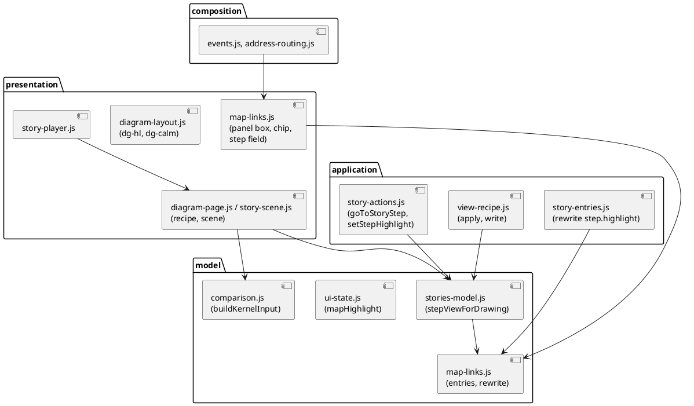
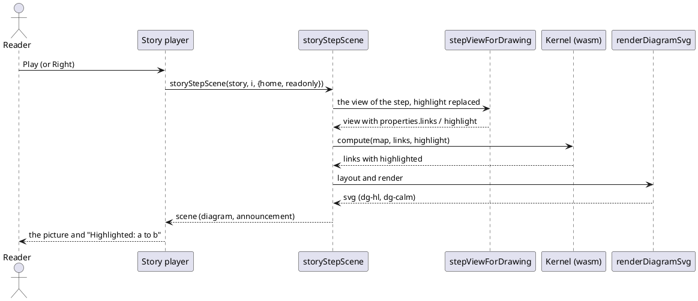

# Play a flow of relationships in the editor and the story player

# Summary

The kernel marks the links that a `highlight` names (`highlighted: true`, run 0198) and the command line draws them heavy; the editor, since run 0199, reads `links` but passes no `highlight` to the kernel and draws no mark. This run makes the editor and the story player draw the highlight and lets an author write it: the page keeps a `highlight` choice beside `links`, a step of a story keeps its own `highlight` key (replacing the view's, as the command line does), a highlighted link is drawn heavy with a `▶` and a bold caption while the other links are calmer, the player plays it with the editor untouched, and a step is announced with what it highlights. A shipped story of a flow (steps that carry the relationships so far in `links` and the newest in `highlight`) is added to the Brightcart fixture, so both tools load it, and the manual, the guide and `CLAUDE.md` tell how to write one. Every view, step and Map without `highlight` is drawn, saved and addressed as before. There is no PRD (profile TDD+pln): the sources are #143 (decision D11), the wave plan (W-6), the TDDs of runs 0197 to 0199 and the code of `src/main/editor` read for this design, so traceability is incomplete (see PRD Traceability).

# Scope

In scope:

- The live `mapHighlight` (`model/ui-state.js`, `application/folder-session.js`, `application/layer-writes.js`, `composition/address-routing.js`), its application by `applySavedView` and its write by `currentViewDefinition` / `canonicalViewProperties` (`application/view-recipe.js`), the kernel input (`model/comparison.js`) and the recipe (`presentation/diagram-page.js`, `presentation/story-scene.js`).
- The step's own key: `stepViewForDrawing` (new, `model/stories-model.js`), its use by `goToStoryStep`, `storyStepScene` and `stepProblem`; its field in the story editor (`presentation/stories-pages.js`, `application/story-actions.js`); its follow-up on a rename and a move (`application/story-entries.js`).
- The drawing: `renderDiagramSvg` and `diagramLabelLayout` (`presentation/diagram-layout.js`), the arrowhead markers, `style.css`, the Applications page's link panel (one more checkbox per relationship, `presentation/map-links.js`), the announcement (`presentation/story-scene.js`).
- The shipped story of a flow in the Brightcart fixture and its generated sample, the shared contract file, the byte-identity harness, the tests, the manual, the guide, `CLAUDE.md`, the regenerated page.

Out of scope: any kernel, Java or Rust source change (the kernel is read as run 0198 built it; no `src/main/java` file changes, only tests and fixtures); a highlight in the technology layer or in the overview, detailed and deep viewpoints; a load check of `links` / `highlight` in a layered workspace (DEF-1 of run 0199); a finer drawing of a grouped link than the kernel's one flag (Q-1 of run 0198); a new Playwright project for WebKit.

# PRD Traceability

There is no PRD. The requirements are labelled here from #143 decision D11, the wave purpose and the focus of W-6 ("a reader plays a story whose steps light up a sequence of relationships, in the editor and in the player, and the manual tells how to write one"), DEF-6 of run 0199, DEF-1 and DEF-2 of run 0198 and the P3 gate. Every REQ is an assumption sourced from those documents, so traceability is incomplete.

- `REQ-1` (W-6 focus, DEF-1 of run 0198): the editor draws the highlight the kernel marks: the link heavy with a mark in its caption, the others calmer, on every page that draws a Map of the application layer (Applications, the page of a view, a story step).
- `REQ-2` (P3 gate, W-6 focus): the story player plays a story whose steps show a growing set of relationships, with the highlighted link of each step drawn, and the editor is what it was, byte for byte, after the player closes.
- `REQ-3` (W-4 DEC-2): a step's own `highlight` replaces the view's (an empty list switches it off), in the editor as on the command line.
- `REQ-4` (W-6 focus): an author can write a highlight in the editor: on the Applications page, in a saved view, in a story step.
- `REQ-5` (DEC-10 of run 0199): a rename or a move rewrites the step's `highlight` too.
- `REQ-6` (DEF-2 of run 0198, W-6 focus): a story of a flow is shipped, loaded by both tools in a test, with the sentence of the manual that tells how to write one.
- `REQ-7` (P3 gate): the editor's boxes and links equal the command line's for Maps with `highlight`, link by link, highlighted or not (the shared contract file).
- `REQ-8a` (wave Non-Goals, P3 gate; the structural limits): `ratchet.max` stays at or under 99, no file under `src/main/editor` goes over 3,000 lines, no coverage floor is lowered.
- `REQ-8b` (wave Non-Goals, P3 gate; the regression guards): byte-identity shows no unexpected difference, the CI of the pull request is green.
- A bare `REQ-8` below means both `REQ-8a` and `REQ-8b`.
- `REQ-9` (P3 gate): the manual, `archicode guide` and `CLAUDE.md` describe the highlight in the editor and the player.

Addressed: REQ-1 to REQ-7, REQ-8a, REQ-8b, REQ-9. Partially addressed: none. Unresolved: nothing that blocks (see Open Questions).

# Technical Goals

- TG-1: one reading of "which links does this step highlight": a pure function used by the editing walk, the scene of the player, `stepProblem` and the announcement.
- TG-2: what the editor draws for a highlight is what the kernel says (`highlighted`); the editor adds no match of its own.
- TG-3: nothing that has no `highlight` moves: the SVG, the cache key, the address, the written files (REQ-8).
- TG-4: the player stays decoupled from the editor (wave 021): it draws with the same scene function and writes no state.
- TG-5: no new upward pair between the layers of the page.

# Non-Goals

- No change to the kernel, its contract number, or the command line's rendering.
- No finer drawing for a grouped link: it is drawn highlighted as a whole when the kernel flags it.
- No highlight chosen from the list of relationships (the list ticks `links`; the link panel and the form choose the highlight).
- No `highlight` in the address of the player beyond what the page address already carries.

# Assumptions

- ASM-1: the kernel the page embeds is the one of run 0198: an input `highlight` is read, an output link has `highlighted: true` when marked and no key otherwise; the link objects of `result.links` reach `renderDiagramSvg` unchanged. Validated by the shared contract test (DEC-9) and `embed.sh --check`.
- ASM-2: a step with `view` and one with its own recipe are the only two kinds of step (`stepView`); a step's `highlight` is a list read by `linkEntriesOf(value, 'highlight')`. Validated by the node tests of DEC-2.
- ASM-3: `READ_SCHEMA` already has `highlight: 'any'` on a step (run 0198 DEC-8), so no schema table changes.
- ASM-4: the layered Brightcart baseline holds the relationships of a shopper's path, as `description.mjs` declares them: `customer` to `shop.web` ("browses and buys with"), `shop.web` to `shop.app` ("calls") and `shop.app.payments` to `psp` ("authorises payments with"), the last one declared on a component, so the box `shop.app` must be opened for it to be drawn between the right boxes. Read in task-001 and confirmed there; a path of fewer relationships would make the story shorter, not different.
- ASM-5: `scripts/byte-identity.sh` compares written files, so a shipped story that uses keys the 0.19.0 jar ignores differs in its output files (DEC-8).

# Constraints

- CON-1: the page is generated (`CLAUDE.md`): edit `src/main/editor`, run `npm run editor:build`, commit sources and page together; this run adds no part, so `layers.json` is unchanged and `names.json` gains the new top-level names; `java-names.json` is not touched unless a Java source names a new top-level name.
- CON-2: layer rule and redraw contract (RFC-002): `modelsChanged()` bumps and draws nothing, parts below `composition/` call `requestRedraw()`, `render()` only in `composition/`. `mapHighlight` is view state like `mapLinks`: no `modelsChanged()`, not in `AppState`.
- CON-3: `ratchet.max` at or under 99 (`node scripts/check-editor.mjs --list` before and after); no file over 3,000 lines (`presentation/diagram-layout.js` is 1,229).
- CON-4: every shipped file is loaded by the command line and the editor in a test (`CLAUDE.md`); the new story is in `src/test/resources/brightcart/layered/shared`, generated by `generate.mjs`, and the sample bundle is regenerated (`npm run sample:build`).
- CON-5: the story player must not read or write the editor's state (wave 021): `story-player-modal.test.js` pins that the editor is byte for byte unchanged after close; the new test keeps that for a highlight.
- CON-6: no coverage floor is lowered; Prettier and ESLint pass; Chromium and Firefox run the new e2e spec (the anchored WebKit list is not changed).
- CON-7: the editor's sentences for a highlight that names nothing are the command line's (run 0198 table), with the key `highlight` in place of `links`.

# Current State

Run 0198 added to the kernel `Input.highlight` and `OutLink.highlighted`, to Java `Story.Step#highlight`, and to PlantUML the heavy `-[thickness=5,#D55E00]->` arrow, a `▶` and a bold caption for a highlighted link and a calm grey one for the others when the view has any highlighted link. Run 0199 made the editor read `links` (state `mapLinks`, `recipe.mapState.links`, `input.links`, the address `rel=`, the form of a view, the rewrite on rename and move) and keep `highlight` verbatim: `canonicalViewProperties` writes it last, `rewriteRecipeReferences` and `recipeNamedReferences` rewrite and list it, `viewLinksProblem` and the entry model (`model/map-links.js`, `linkEntriesOf(value, key)`) already take the key. Nothing sends it to the kernel (`buildKernelInput` copies `links`, `pinned`, `hidden`, `opened`), nothing draws `highlighted`, and a view with a `highlight` never matches the screen (`viewMatchesScreen` compares `canonicalViewDefinition(view)` with the live state, which has none).

The editor draws a link in `renderDiagramSvg` (`presentation/diagram-layout.js`): a `<g class="dg-link">` with a hit path and a `dg-edge` path (class `dg-chg-<state>` for a compared link, marker `dg-arrow` or `dg-arrow-<state>`), and a `dg-label` text from `diagramLabelLayout(link, ...)`; the style is in `style.css` (`.dg-edge`, `.dg-chg-*`, `.dg-link-selected`). `highlightDiagram` (`presentation/diagram-interaction.js`) dims the rest of the diagram on hover with `.dg-dim`. The editing walk of a story, `goToStoryStep` (`application/story-actions.js`), applies the view of the step to the live state (`applySavedView(stepView(step))`) and the page draws from that state; the player draws each step on the side through `storyStepScene` (`presentation/story-scene.js`), `viewDiagramRecipe(stepView(step), ...)` and `buildKernelInput`, and announces it through `storyStepAnnouncement`. The Brightcart fixture ships three stories in `shared/` (`order_journey`, `fork_tour`, `seller_journey`) and no file that carries `links` or `highlight` (DEC-9 of runs 0198 and 0199).

# Proposed Design

One live variable and one pure function carry the highlight to every place that draws a Map; the kernel's flag is drawn by one hook in the SVG renderer; `presentation/map-links.js` holds the panel control and the step field, and `presentation/story-scene.js` the announcement text.

The reviewer should check that every arrow points to the same layer or one before it in `layers.json`, that the player reaches the highlight only through `storyStepScene`, and that `diagram-layout.js` reads one field of the link and nothing of the editor's state.

DEC-1 — The live state `mapHighlight`

- Decision: `mapHighlight`, an array of entries `{ source, destination, label }` next to `mapLinks` in `model/ui-state.js`, reset with the folder (`resetUiState`), snapshotted and restored by `snapshotWriteState` / `restoreWriteState` (`application/layer-writes.js`), part of the diagram cache key and the view key only when non-empty (as `mapLinks`), and in the address as one `hl=` parameter per entry with the codec of `rel=` (`mapLinkParams`, `mapLinksFromParams`, factored over a parameter name; entries that name no relationship of the model are dropped when read, `rel=` and `link-from` are unchanged). `applySavedView` sets it from `properties.highlight` of the view it applies, or from the step's key (DEC-2), for a Map of the application layer; a view with none clears it. `currentViewDefinition` puts it in the definition, `canonicalViewProperties` writes `highlight` as `canonicalLinkEntries` (sorted, deduped) after `links` instead of verbatim, and `rewriteUiReferences` (`persistence/save.js`) rewrites the live entries like `mapLinks`. The technology layer has none (`canonicalViewDefinition` drops it there, as it does for `links`). Write places: *Keep as named view* writes the live entries as `properties.highlight` of the new view; *Add to story...* writes them as the step key `highlight` and the links as `properties.links` (DEC-5). Leaving a story (*Leave story*, *Back to this step*) keeps the last step's live `mapHighlight` and `mapLinks`, as run 0199 keeps `mapLinks` today, and restores only the plateau and the comparison (`storyHome`); `map-highlight-saved-view.test.js` has the case.
- Rationale: the editing walk draws from live state, so a highlight that is drawn on the Applications page and in the walk has to be live state; it is also what ends the limit of run 0199 (a view with a `highlight` never matches the screen): the screen can now say the highlight, so "Keep as named view" and the equality tests find it.
- Alternatives considered: draw the highlight in the recipe-based hosts only (the page of a view and the player) and leave the walk without it (the walk is the editor's story page and would disagree with the player); keep `highlight` verbatim and never live (the limit stays).
- Tradeoffs: one more variable in the snapshot and one more parameter in the address; `canonicalViewProperties` now sorts a `highlight` it used to keep as written, so a saved view whose `highlight` was written unsorted is rewritten sorted when the page re-saves it (CTR-1).
- Linked PRD IDs: REQ-1, REQ-4, REQ-8.

DEC-2 — The step's own `highlight` replaces the view's: `stepViewForDrawing`

- Decision: a pure function in `model/stories-model.js`, `stepViewForDrawing(step)`, returns what a step draws: `stepView(step)` when the step has no `highlight` key, else a shallow copy of that view whose `properties.highlight` is the step's list (an empty list included, which switches off the view's), the saved view itself untouched. It is the editor's twin of `GenerateStoriesCommand.viewOf` (run 0198 DEC-2): the step's key wins over a `properties.highlight` of the same step. `goToStoryStep` applies `stepViewForDrawing(step)`, `storyStepScene` draws `viewDiagramRecipe(stepViewForDrawing(step), ...)`, and `stepProblem` looks at it, so a step whose `highlight` is of the wrong shape or names nothing says the sentence of DEC-6. A step without the key behaves exactly as before.
- Rationale: TG-1; the three callers must not each spell the override.
- Alternatives considered: merge the step's list into the view's (the command line replaces; two tools must agree); a second step key (`highlights`).
- Tradeoffs: a copy is allocated per call for a step that has the key only.
- Linked PRD IDs: REQ-3.

DEC-3 — What reaches the kernel

- Decision: `viewDiagramRecipe` puts in `recipe.mapState.highlight` the entries of `linkEntriesOf(properties.highlight, 'highlight')` that exist in the model drawn (the plateau, or the union with a comparison: `drawnLinkEntries`, the filter of `links`); `currentMapState()` gives the live entries filtered the same way; `buildKernelInput` copies `opts.highlight` to `input.highlight` for a Map of the application layer when non-empty, as it does `links`. An entry the plateau lacks is dropped from the input (the command line draws without the highlight and warns, run 0198 DEC-6) and never makes "nothing is drawn" (unlike `links`). The kernel does the marking; the editor derives nothing from the entries.
- Rationale: TG-2; one filter in the place that already filters `links` and `pinned`.
- Alternatives considered: send every entry and show the kernel's error (a sentence about a plateau in the words of an error); mark the links in JavaScript (a second implementation of the match, the failure run 0197 DEC-6 avoided).
- Tradeoffs: a highlight that names an existing relationship the map does not draw marks nothing, as run 0198 DEC-4 says; a view that has one is drawn without a sign of it.
- Linked PRD IDs: REQ-1, REQ-3, REQ-7.

DEC-4 — The drawing: heavy, marked, and the rest calm

- Decision: `renderDiagramSvg` computes once per diagram `highlighting = links.some(l => l.highlighted)`. A link with `highlighted` gets `dg-hl` on its `dg-edge` path and on its label, the marker `dg-arrow-hl`, a `▶ ` prefix in the caption that the label layout measures (`diagramLabelLayout` takes the same text, so the label box is sized for it; the glyph alone when the link has no caption), `, highlighted` in the `aria-label` of the link group and in its `<title>`. When `highlighting`, a link that is not highlighted and has no compared state and is not aggregated-secondary gets `dg-calm` on its edge, its label and its arrowhead (lighter stroke, lower weight; the caption stays). A compared link keeps the colour and dash of its state with the heavier width when highlighted (`dg-chg-<state>.dg-hl`) and keeps its marker `dg-arrow-<state>` (the head gets the `.dg-hl` weight only); `dg-arrow-hl` is the marker of a highlighted link with no state, and it is added to the `<defs>` only when `highlighting`. A compared link that is not highlighted is drawn as without the highlight. `map-highlight-diagram.test.js` has the compared and highlighted case. The look is in `style.css`: `.dg-edge.dg-hl { stroke: var(--hl); stroke-width: 4.5 }`, `.dg-label.dg-hl { fill: var(--hl-text); font-weight: 700 }`, `.dg-edge.dg-calm`, `.dg-arrowhead.dg-hl`, with `--hl` and `--hl-text` defined for the light and dark themes (the vermilion of the command line's palette on light; a lighter one on dark, 3:1 against the diagram background, checked in the node test of the contrast the CSS tests already do). Colour is never alone: the weight, the `▶` and the bold caption tell the highlight, as in PlantUML. A selected or focused link keeps its own accent (`.dg-link-selected`, `:focus-visible` are declared after and win), and the hover dimming (`.dg-dim`) still applies. A diagram with no highlighted link has no `highlighting`, no new class and no new marker: its SVG is byte for byte the SVG of before.
- Rationale: REQ-1; the same rules as `HighlightMarks` (run 0198 DEC-5) so the two renderers say one thing.
- Alternatives considered: colour only (fails the colour rule); hiding the calm links (that is `links`); a legend row in the key (the key is a comparison's; the caption and the aria text carry the mark, DEF-3).
- Tradeoffs: the calm links lose contrast on purpose; a grouped link that stands for several relationships is drawn highlighted whole (Q-1 of run 0198, kept).
- Linked PRD IDs: REQ-1, REQ-7, REQ-8.

DEC-5 — Writing a highlight in the editor

- Decision: three places, one entry model. (a) The Applications page: in the panel of a selected link, each relationship row that has a `map-link-toggle` box (run 0199 DEC-4) gets a second box, "Highlight" (`map-link-highlight`, action toggles the entry in `mapHighlight`, `pushDiagramHistory()`, `mapSelectionCheck = true`), and the chip row gets "Highlight: n" with a Clear (`map-highlight-clear`) while the state is not empty; "Clear all" clears it too. (b) A saved view: its form gets a Highlight field with pills and a select of the relationships of the model not yet there (`setViewHighlight`, beside `setViewLink`; pills marked missing like `links`; the last one removed deletes the key). (c) A step: the story editor's step block gets the same field for the step's own key (`setStepHighlight(storyId, index, entry, add)` in `application/story-actions.js`, through `markEntryChanged`, no `modelsChanged()`; removing the last entry leaves `highlight: []` only when the view the step names has a highlight to switch off, else deletes the key), and a note under it says that the key replaces the view's. "Add to story..." writes the live `mapHighlight` as the step key `highlight` (the links stay in `properties.links`), and the story editor's step field edits that same key; "Keep as named view" writes it as `properties.highlight` of the view (DEC-1). One write place per kind of entry, so a step never holds two forms (a test named `map-highlight-saved-view.test.js` checks that the step field edits the place "Add to story..." wrote). The field and the control are offered for a Map of the application layer only.
- Rationale: REQ-4; an author writes a sequence by ticking the relationships so far, highlighting the newest and adding a step, or by pointing steps at one saved Map and changing each step's `highlight`; both forms are the ones the command line reads.
- Alternatives considered: a "story builder" that appends steps from a list (a second authoring path, not asked); highlighting from the list of relationships (the list is for `links`, and the panel already holds the per-relationship rows).
- Tradeoffs: three small UIs on one model; the sequence-of-steps authoring is by hand in the story editor.
- Linked PRD IDs: REQ-3, REQ-4.

DEC-6 — Problems and sentences

- Decision: `viewLinksProblem` (run 0199) is called for the key `highlight` too, with the same table and `highlight[n]` in the sentence: a shape mistake is told in any workspace; in a workspace with no plateau and no facet an entry that names no relationship is ``the view `v`: `highlight[1]` names a relationship from `a` to `b` with the label `x`, which does not exist`` and an unknown end is the `dangling reference` sentence; in a workspace with plateaus or a facet the entry is dropped (DEC-3) with no sentence on the page (the command line warns on its own error output); `highlight` in a view of `layer: technology` is ``highlight is read in the map of the application layer only``; `highlight` is read for `viewpoint: map` only, so a step of another viewpoint that has one ignores it. For a step, `step_NN` names an own-recipe step and the step's key is looked at after the replacement of DEC-2. No sentence is new: they are the command line's with the prefix of the view.
- Rationale: CON-7; one table, one function.
- Alternatives considered: silent drop everywhere (a typo hides, run 0198 rejected it).
- Tradeoffs: none new.
- Linked PRD IDs: REQ-3, REQ-7.

DEC-7 — Rename and move follow the step's own key

- Decision: `rewriteSavedViewReferences` (`application/story-entries.js`) rewrites `source` and `destination` of every entry of a step's `highlight`, for a step with `view:` as well as for one with its own recipe (run 0199 rewrote the entries inside `properties` of views and own-recipe steps only), with `rewriteLinkEntries` and `rewriteReferenceValue` as before; `recipeNamedReferences` (and its caller for steps) lists them for the sibling-plateau dialog; `move.js` counts them on copies; the label never changes. The layer of a step's highlight is the application layer, so it is rewritten when the renamed element is of that layer. A delete leaves it alone, as for `links` (DEF-3 of run 0199).
- Rationale: REQ-5; the same rule as the entries run 0199 already follows, extended to the one place a highlight lives that is not in `properties`.
- Alternatives considered: leave the step key stale (a rename would turn a shipped story into an error on the command line).
- Tradeoffs: one helper yields the entry lists of a recipe and of a step (the `links` and `highlight` of `properties` and the step key) and both `rewriteSavedViewReferences` and `recipeNamedReferences` use it, so they cannot get out of step; one test runs both on the same story.
- Linked PRD IDs: REQ-5.

DEC-8 — The shipped story of a flow, and the byte-identity harness

- Decision: one story, `order_flow`, is added to the Brightcart fixture (`src/test/resources/brightcart/description.mjs` `ENTRIES`, `generate.mjs`, folder `layered/shared`, `expected/entries.json`, and the regenerated sample `src/main/resources/editor-webapp/samples/brightcart.yaml`), told at `baseline` on every step, whose steps carry their own recipe: `viewpoint: map`, `layer: application`, `properties.opened` and `links` growing by one relationship per step along the shopper's path (the three relationships of ASM-4: `customer` to `shop.web`, `shop.web` to `shop.app`, `shop.app.payments` to `psp`, so three steps), each step opening `shop` and `shop.app` so that the last step draws its link, and a step key `highlight` with the newest one (the one write place of a step, F1; the manual section `[[story-of-a-flow]]` shows that form). `generate.mjs` learns to write `links` (and `highlight` on a step) in a recipe; `entries.json` records the story (the plateaus it can be drawn in and the warnings, which the generator works out). Every count that pins the fixture (the 61 files of the sample, the stories and manifests counted by `ManifestCorpus`, `BrightcartViewsAndStoriesTest`, `brightcart-views-and-stories.test.js`, `shipped-files.test.js`, `StoriesNotEmptyTest` and `story-steps-not-empty.test.js`) is found by search and updated in the same commit. Because `scripts/byte-identity.sh` compares written files and the jar of `archicode-0.19.0` ignores `links` and `highlight` (it draws the whole map), the files `stories generate` writes for `order_flow` differ from the base's by design: the harness gets a second accepted-differences list, `scripts/byte-identity-new-files.txt` (one extended regular expression per line on the path of a written file, with a comment naming the run), a file that matches is accepted when it exists in both copies and differs, any other difference is reported as before, and the self-check proves it by a scratch file that differs and is listed in neither. Nothing else of the harness changes.
- Rationale: REQ-6; the story is the oracle that a sequence of relationships can be written in the files, drawn by the command line and played by the editor; the harness cannot otherwise tell the new feature from a regression.
- Alternatives considered: a shipped example in `src/doc/examples` (also under the harness, and a new example for one story); no shipped story and tests that build it in a temporary folder (the wave plan asks for the shipped story, and CON-4 would not be exercised on a real file); excluding the folder from the harness (hides regressions).
- Tradeoffs: a larger diff in generated fixtures; the sample bundle visitors open gains a story; one more file list to maintain until the next base tag moves past the keys.
- Linked PRD IDs: REQ-6, REQ-8b.

DEC-9 — The player, the announcement, and the shared contract

- Decision: the player needs no code of its own for the drawing: it plays `storyStepScene`, which draws through DEC-2 and DEC-3, and its container markup keeps the classes of DEC-4. `storyStepAnnouncement(story, index)` appends ". Highlighted: <source> to <destination>, <label>." (the display names of the ends, the label when there is one, entries joined with a semicolon) when the step highlights something that exists, so the live region says what the picture shows; a step without a highlight is announced as before, word for word. The player's status line is not changed. The shared contract (`src/test/resources/map-links/expected-boxes.json`, run 0199 DEC-8) gains cases with `highlight` (a view, a step key replacing a view's, an empty step key, an entry the plateau lacks, a compared plateau, a grouped link) and a `highlighted` flag on each expected link; `MapLinksSharedTest` (Java) checks that the heavy arrow is on those links in the `.puml` of `views generate -i` and `stories generate`, and `map-links-shared.test.js` (node) that the editor's SVG has `dg-hl` on exactly those links, in the page Applications, the page of the view and the scene of the step.
- Rationale: REQ-2, REQ-7; the player's value is that it is the same scene; the announcement is the only thing a screen-reader user lacks when a colour and a weight carry the meaning.
- Alternatives considered: a text row under the player's diagram (duplicates the caption for sighted users); no announcement (colour and weight alone for a live region).
- Tradeoffs: the announcement text is new copy to keep in step with the manual.
- Linked PRD IDs: REQ-2, REQ-7.

# Repository Impact

- IMP-1 — State, cache key, address
  - Path(s): `src/main/editor/model/ui-state.js`, `application/folder-session.js`, `application/layer-writes.js`, `presentation/map-state.js` (`currentMapState`), `presentation/diagram-page.js` (cache key, view key, recipe), `composition/address-routing.js`, `persistence/save.js` (`rewriteUiReferences`), `presentation/map-links.js` (the `rel=` codec factored over a name).
  - Change type: modify
  - Why impacted: DEC-1, DEC-3.
  - Linked PRD IDs: REQ-1, REQ-4
  - Risks / notes: `snapshotWriteState` and `resetUiState` must both know the variable; every key that existed is the same string without a highlight.
- IMP-2 — The step's view and the walk
  - Path(s): `src/main/editor/model/stories-model.js` (`stepViewForDrawing`, `stepProblem`), `application/story-actions.js` (`goToStoryStep`, `setStepHighlight`), `application/view-recipe.js` (`applySavedView`, `currentViewDefinition`, `canonicalViewProperties`), `presentation/story-scene.js` (`storyStepScene`, `storyStepAnnouncement`).
  - Change type: modify
  - Why impacted: DEC-2, DEC-9.
  - Linked PRD IDs: REQ-2, REQ-3
  - Risks / notes: three callers share one function; a step without the key must take the old path (a test compares the scene with the page of 0.18.0 as `story-player-scene.test.js` does).
- IMP-3 — Kernel input
  - Path(s): `src/main/editor/model/comparison.js` (`buildKernelInput`).
  - Change type: modify (additive key)
  - Why impacted: DEC-3.
  - Linked PRD IDs: REQ-1
  - Risks / notes: an input without `highlight` is the input of before, key for key.
- IMP-4 — The drawing
  - Path(s): `src/main/editor/presentation/diagram-layout.js` (`renderDiagramSvg`, `diagramLabelLayout`, the arrowhead defs), `src/main/editor/style.css`.
  - Change type: modify
  - Why impacted: DEC-4.
  - Linked PRD IDs: REQ-1, REQ-8
  - Risks / notes: no SVG moves for a diagram with no highlighted link (a node test compares the SVG of every shipped Map before and after); dark theme and 360 px checked by hand.
- IMP-5 — The authoring controls
  - Path(s): `src/main/editor/presentation/map-links.js` (panel box, chip, Clear and the step-field helpers; no new part), `presentation/view-edit.js` (`setViewHighlight`, the field), `presentation/stories-pages.js` (the step field), `composition/events.js` (actions `map-link-highlight`, `map-highlight-clear`, the select handlers), `src/main/editor/names.json` (gains the new top-level names; `layers.json` is unchanged).
  - Change type: additive / modify
  - Why impacted: DEC-5.
  - Linked PRD IDs: REQ-4
  - Risks / notes: `map-links.js` is 311 lines, so there is no size reason for a part; `events.js` is 1,341 lines, hooks only.
- IMP-6 — Rename and move
  - Path(s): `src/main/editor/application/story-entries.js` (`rewriteSavedViewReferences`, `recipeNamedReferences` and the steps loop of `renameSiblingImpact`), `application/move.js` (counts only).
  - Change type: modify
  - Why impacted: DEC-7.
  - Linked PRD IDs: REQ-5
  - Risks / notes: only the shared helper keeps the two functions in step (no coupling by comment); one test.
- IMP-7 — The shipped story and the sample
  - Path(s): `src/test/resources/brightcart/description.mjs`, `generate.mjs`, `layered/shared/story.order_flow.yaml` (generated), `expected/entries.json`, `expected/README.md` and the fixture README if they list stories, `src/main/resources/editor-webapp/samples/brightcart.yaml` (generated by `npm run sample:build`), `scripts/build-sample.mjs` only if it pins the file count.
  - Change type: additive (generated files)
  - Why impacted: DEC-8, CON-4.
  - Linked PRD IDs: REQ-6
  - Risks / notes: the counts pinned by tests (see DEC-8); `sample:check` fails if the bundle is stale.
- IMP-8 — Byte-identity harness
  - Path(s): `scripts/byte-identity.sh`, `scripts/byte-identity-new-files.txt` (new).
  - Change type: modify / additive
  - Why impacted: DEC-8, ASM-5.
  - Linked PRD IDs: REQ-8b
  - Risks / notes: the self-check must show the new list has teeth; bash 3.2.
- IMP-9 — The generated page
  - Path(s): `src/main/resources/editor-webapp/standalone.html`.
  - Change type: modify (written by `npm run editor:build`)
  - Why impacted: CON-1; `check-editor-statements.test.js` compares the page with HEAD, so sources and page are committed together.
  - Linked PRD IDs: REQ-8a
  - Risks / notes: none else of the inline blocks changes (no kernel change, so `embed.sh` is not run).
- IMP-10 — Tests
  - Path(s): `src/test/javascript/map-highlight-model.test.js`, `map-highlight-diagram.test.js`, `map-highlight-saved-view.test.js`, `map-highlight-rename-move.test.js` (new, node) and `src/test/javascript/viewpoint-kernel/story-player-highlight.test.js` (new, node, beside `story-player-modal.test.js` and `story-player-page.js`); `map-links-shared.test.js` and `src/test/resources/map-links/expected-boxes.json` (extended); `src/test/java/io/morin/archicode/cli/MapLinksSharedTest.java` (extended); the fixture and shipped-file tests named in DEC-8 (the `shipped-files`, `brightcart-views-and-stories`, `story-steps-not-empty` and `sample-brightcart` tests are in `src/test/javascript/viewpoint-kernel/`); `src/test/e2e/story-flow.spec.js` (new).
  - Change type: additive / modify
  - Why impacted: every DEC has a test (Observability and Verification).
  - Linked PRD IDs: REQ-1 to REQ-7, REQ-8a, REQ-8b
  - Risks / notes: the Java test works on a copy of the fixture in a temporary folder.
- IMP-11 — Documents
  - Path(s): `src/doc/README.adoc` (`[[map-highlight]]` loses "the editor does not draw it"; `[[editor-map-links]]`, `[[editor-story-player]]`, `[[editor-stories]]` and the small-screen section gain the highlight; a new section `[[story-of-a-flow]]` that shows how to write a story of a flow with the shipped one as the example), `src/main/resources/guide/guide.md` (one convention paragraph: the relationships so far in `links`, the newest in `highlight`, one step each; `src/test/resources/guide/golden.md` regenerated in the same commit), `CLAUDE.md` (the paragraphs of W-4 and W-5 lose their limit; one paragraph for this run).
  - Change type: modify
  - Why impacted: REQ-9.
  - Linked PRD IDs: REQ-9
  - Risks / notes: `GuideTest` and `GuideViewPropertiesTest` must pass; the manual's examples are loaded by `ManualExamplesTest`.

# Canonical Impact

Not applicable — no canonical registers declared (`docs/CLAUDE.md` does not exist in this repository; the `arc` and `dom` registers are not declared).

# Data Model and Contracts

- CTR-1 — The editor's reading and writing of `highlight`
  - Current contract: kept verbatim after `links`, rewritten on rename and move inside `properties`, never read or drawn; a view with one never matches the screen.
  - Proposed contract: read as a list of `{source, destination, label}` (run 0198 DEC-1), filtered to the model drawn, sent to the kernel, drawn (DEC-4); written sorted and deduped after `links`; a step's own `highlight` replaces the view's (DEC-2) and is rewritten on rename and move (DEC-7); a view equal to the screen matches it.
  - Affected files: `application/view-recipe.js`, `model/stories-model.js`, `application/story-entries.js`, `presentation/view-edit.js`, `persistence/save.js`.
  - Migration or compatibility notes: a view or step without `highlight` is read, drawn and written byte for byte as before; a `highlight` written unsorted by hand is rewritten sorted when the page re-saves that view.
  - Linked PRD IDs: REQ-1, REQ-3, REQ-4, REQ-5
- CTR-2 — The kernel input from the editor
  - Current contract: `links`, `pinned`, `hidden`, `opened` (and the technology booleans).
  - Proposed contract: also `highlight` for a Map of the application layer when non-empty after the filter; the contract number stays 5.
  - Affected files: `model/comparison.js`.
  - Migration or compatibility notes: none.
  - Linked PRD IDs: REQ-1
- CTR-3 — The address
  - Current contract: `rel=`, `pin=`, `link-from`, `link-to`, `play=`, `step=`.
  - Proposed contract: `hl=<JSON of [source, destination, label?]>`, repeated, on the page Applications, read back with unknown entries dropped; none when empty.
  - Affected files: `composition/address-routing.js`, `presentation/map-links.js`.
  - Migration or compatibility notes: an address without `hl` is read as before; an older build ignores it.
  - Linked PRD IDs: REQ-4
- CTR-4 — The diagram's markup and cache key
  - Current contract: classes `dg-edge`, `dg-chg-*`, `dg-link-selected`, markers `dg-arrow*`; the key holds `links` when non-empty.
  - Proposed contract: classes `dg-hl`, `dg-calm`, marker `dg-arrow-hl`, only in a diagram with a highlighted link; the key holds the canonical `highlight` only when non-empty.
  - Affected files: `presentation/diagram-layout.js`, `presentation/diagram-page.js`, `style.css`.
  - Migration or compatibility notes: the cache is in memory; a diagram without a highlight is unchanged.
  - Linked PRD IDs: REQ-1, REQ-8
- CTR-5 — The shared contract file and the harness list
  - Current contract: `map-links/expected-boxes.json` with boxes and links; `byte-identity-exceptions.txt` for error sentences.
  - Proposed contract: a `highlighted` flag per expected link and highlight cases; `scripts/byte-identity-new-files.txt` for files whose difference is the feature (DEC-8).
  - Affected files: the two test files, `scripts/byte-identity.sh`.
  - Migration or compatibility notes: test resources and a script; nothing shipped.
  - Linked PRD IDs: REQ-7, REQ-8

# Interfaces and Behavior

- IF-1 — The diagram: a highlighted link is heavy with a `▶` and a bold caption, the others calmer; none highlighted, nothing changes; the link's accessible name says "highlighted".
- IF-2 — The Applications page: "Highlight" box per relationship in the link panel, a "Highlight: n" chip with Clear; the address carries `hl=`.
- IF-3 — Saved views and steps: a Highlight field (pills and a select) on the form of a Map view and on a step; a step's field replaces the view's, with a note.
- IF-4 — The player and the editing walk: each step is drawn with its highlight; the announcement names what is highlighted; closing the player leaves the editor as it was.
- IF-5 — Errors: the sentences of DEC-6, shown as the error of the view or the step; a highlight the plateau lacks is dropped without a sentence.

# Flows and Processing Logic

- FLOW-1 — Write a flow in the editor
  - Trigger: the author ticks the first relationship, highlights it in the link panel, "Add to story...", then ticks the next, moves the highlight, adds a step.
  - Steps: `mapLinks` and `mapHighlight` change, the diagram is drawn with the kernel's `highlighted` link; "Add to story" writes a step with its own recipe (`properties.links` sorted) and the step key `highlight`; the save writes the story file line by line.
  - Branches / failure paths: an entry the plateau lacks is dropped from the input; the author highlights an undrawn link: nothing is marked (run 0198 DEC-4).
  - Final output / rendered result: a story file whose k-th step has the first k relationships in `properties.links` and the newest in its step key `highlight`.
  - Linked PRD IDs: REQ-4, REQ-6
- FLOW-2 — Play the flow

The reviewer should check that the player reads the highlight only through the scene and that nothing in `AppState` changes between *Play* and *Close*, which `story-player-highlight.test.js` asserts.

  - Trigger: *Play* on a story, then the arrow keys or the menu.
  - Steps: as drawn; the step is announced through `#story-announcer`.
  - Branches / failure paths: a step whose highlight is of the wrong shape or names nothing in a plain workspace shows the sentence of DEC-6 as its problem; a step with no highlight is drawn as before.
  - Final output / rendered result: one highlighted link per step on a growing set of links; the editor is the same after close.
  - Linked PRD IDs: REQ-2, REQ-3
- FLOW-3 — Rename an end
  - Trigger: the rename or the move of an element that a step's highlight names.
  - Steps: `rewriteSavedViewReferences` rewrites the entries of views, own recipes and the step keys; `rewriteUiReferences` the live state; the move preview counts them; the sibling dialog lists the views and steps that would lose an entry.
  - Branches / failure paths: a plateau beside keeps the old reference: the dialog names the step.
  - Final output / rendered result: the written story names the new reference; `stories generate` draws it.
  - Linked PRD IDs: REQ-5

# Reliability, Performance, and Scalability

The drawing adds one pass over the links of a diagram (`some`) and, for a highlighted diagram, a few attributes; the cache key adds a `JSON.stringify` of the highlight entries only when there are any. A scene is still computed once per step and kept by the player. The new pure function allocates only for a step that has the key.

# Security and Privacy

No new input beyond the YAML of a workspace. Labels, references and the `aria-label` text are escaped as every label of the page (`escapeHtml`); the announcement is set as `textContent`; the address carries references and labels of the open workspace as `rel=` does and nothing else.

# Observability and Verification

- Node (`npm run test:unit`, then `npm run test:coverage`, which must not lower a floor): `map-highlight-model.test.js` (`stepViewForDrawing`: no key, a list, `[]` switching off, the saved view untouched, an own-recipe step; the filter; the cache key unchanged without a highlight); `map-highlight-diagram.test.js` (the classes, marker and glyph on exactly the highlighted links, the calm links, a compared link keeping its state, the aria text, selection and focus still win, the SVG of every shipped Map byte for byte as before, the label layout measuring the glyph, light and dark contrast of `--hl`); `map-highlight-saved-view.test.js` (read, write sorted, the form field and `setViewHighlight`, `setStepHighlight`, the live state applied and cleared, the address round trip with unknown entries dropped, a view equal to the screen matching it, the sentences of DEC-6 as the command line's); `map-highlight-rename-move.test.js` (a rename and the four ways of a move rewrite a step's key, the count of the preview, the sibling dialog); `viewpoint-kernel/story-player-highlight.test.js` in the style of `story-player-modal.test.js` (plays the Brightcart `order_flow` and a built story whose steps carry a growing set of links with one highlight each, asserts for every step by keys and by menu the highlighted link, the number of links and that the earlier ones are drawn, the announcement, and that the editor is byte for byte what it was after close); `map-links-shared.test.js` (DEC-9); `shipped-files.test.js`, `brightcart-views-and-stories.test.js`, `story-steps-not-empty.test.js` (the new story is loaded and every step draws something); `sample-brightcart.test.js` and `build-sample-script.test.js` (the bundle holds the story).
- Java: `MapLinksSharedTest` (the `.puml` side of the contract), `BrightcartViewsAndStoriesTest`, `StoriesNotEmptyTest`, `ManifestCorpus` tests (conformance of the new manifest to the schema), `BrightcartSampleTest`, `GuideTest` with the regenerated golden file, `GuideViewPropertiesTest`; `./mvnw test-compile pmd:check`; `./mvnw verify -DskipITs=false`. No `src/main/java` file changes, so the coverage figure does not move.
- Page: `npm run editor:build`, `npm run editor:check` (`node scripts/check-editor.mjs --list` before and after: 99 or lower), `npm run lint`, `npm run format:check`, `npm run sample:check`, `wc -l` on the touched parts.
- End to end (`npm run test:e2e`, Chromium and Firefox): `src/test/e2e/story-flow.spec.js` has two parts. The player part uses `startHostedPage()` on the sample (which holds `order_flow` after DEC-8; `harness.js` copies only a folder of `src/doc/examples` and `playwright.config.js` has no fixture path): it plays `order_flow` step by step, checks that each step has one `dg-hl` link and one more link than the last, and that Escape returns the focus to *Play*. The authoring part uses a `files` workspace the spec writes itself (as `map-links.spec.js` does): it ticks and highlights a relationship on the Applications page, adds a step, saves, reloads, finds the same highlight, and reads the file back from the disk of the copy. The `pageErrors` fixture judges the console.
- Regression: `scripts/byte-identity.sh` shows no unexpected difference (the files of `order_flow` are accepted by the new list and nothing else); `npm run test:timing` unaffected.
- By hand: the player at 360 px and in the dark theme, the focus order, a screen reader reading the announcement, the diagram at the sizes of the Brightcart map.

# Deployment and Rollout

Code, fixture and generated page; no kernel or Java change. Backward compatible (CTR-1 to CTR-4): a workspace, an address and a saved view without `highlight` behave as before; a build that predates this run draws a `highlight` as the whole map with the keys ignored. Rollback is a revert of the commit with the regenerated page and sample. The tag run, the native runner, WebKit and the real Safari are not proved by this run.

# Risks and Tradeoffs

- RISK-1: the new SVG classes change the markup of a diagram that has no highlight. Mitigation: the byte-for-byte comparison of every shipped Map's SVG (IMP-4); nothing is emitted when no link is highlighted.
- RISK-2: adding a story to the Brightcart fixture moves counts pinned in many tests and in the sample, and fails byte-identity. Mitigation: DEC-8 (a search for every pinned count, and the harness list with a self-check); the plan's first task lists them.
- RISK-3: `rewriteSavedViewReferences` and `recipeNamedReferences` get out of step for the step key. Mitigation: both use the one helper of DEC-7, and one test runs them over the same story.
- RISK-4: the contrast of the highlight or the calm links on the dark theme. Mitigation: the tokens are defined for both themes and checked in a test and by hand.
- RISK-5: `canonicalViewProperties` now sorts `highlight`, so a hand-written order changes on re-save. Accepted (CTR-1), told in the manual.
- RISK-6: the editor's cache key, the live state and the address are three more places that must agree. Mitigation: they reuse the helpers of `links` (DEC-1) and `map-highlight-saved-view.test.js` round-trips them.

# Open Questions

- Q-1 (resolved at drafting, a tradeoff decided inline): where does the shipped story of a flow live? Decision: the Brightcart fixture (DEC-8). The fixture already carries the stories every editor test plays and the sample visitors open; a manual example would need a new example folder for one story. The cost, the pinned counts and the harness, is DEC-8 and RISK-2.
- Q-2 (resolved at drafting, a tradeoff decided inline): live state or recipe-only for the highlight in the editor? Decision: live state (DEC-1), because the editing walk draws from it and it ends the "never matches the screen" limit of run 0199.
- Q-3 (resolved, run 0198 Q-1 kept): a grouped link is drawn highlighted whole; the label of the entry is in the announcement and the link's title.

None blocks this run.

# Deferred Work

- DEF-1: the load check of `links` and `highlight` in a layered workspace, both tools (DEF-1 of run 0199; the author may open the issue after #143 closes).
- DEF-2: a wildcard label, `qualifiers` or `tags` in an entry (DEF-2 of run 0197 and 0199).
- DEF-3: a legend row for the highlight in the key under the diagram, and a finer mark for one relationship of a grouped link.
- DEF-4: a story builder that appends steps from a list of relationships (the authoring of FLOW-1 is by hand).
- DEF-5: a relationship list, `links` and `highlight` in the technology layer.
- DEF-6: WebKit for the new spec, and the real Safari.

# File Placement and Frontmatter

Saved as `docs/wav/wav-026-relationship-view/run/run-0200-links-in-stories/tdd-0200-links-in-stories.md`, `type: tdd`, `run: 0200`, `wave: 026`, status `draft`, the conventions of runs 0197 to 0199 (the repository has no `docs/CLAUDE.md`).

Review pass: dispatched. Stage 5 ran `review-kdmllc-content` over this TDD in an agent other than the drafter of Stage 4 (a leaf agent has no `Agent` tool, so the reviewer worked in its own fresh context; it is independent of the drafting). Referent read for C: `src/main/editor/layers.json`, `model/stories-model.js`, `model/map-links.js`, `model/comparison.js`, `application/view-recipe.js`, `application/story-entries.js`, `presentation/map-state.js`, `presentation/map-links.js`, `presentation/diagram-layout.js`, `composition/events.js`, `src/test/e2e/harness.js`, `playwright.config.js`, `Story.java` (and its 0.19.0 version), `GenerateStoriesCommand`, the Brightcart fixture, `scripts/byte-identity.sh`, `src/doc/README.adoc`, and the TDD of run 0198 and the wave plan. Verdict: KISS 4, DRY 3, MECE 3, LEAN 4, LUCID 4, C 3 (Acceptable); 9 findings (0 S3, 6 S2, 3 S1), listed in the Findings of `prg-0200-links-in-stories.md`; applied to this text by task-001 of the implement plan.
