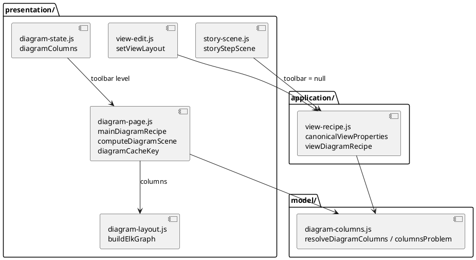

# layout.columns on every diagram of the editor

# Summary

An author sets `layout.columns` (a whole number of boxes per row to aim at) once for a workspace, per viewpoint, in `settings.views.properties.<viewpoint>.layout`; overrides it in a saved view (`properties.layout`); and changes it for the diagram on screen with a list in the diagram toolbar. One pure function resolves the value in force (toolbar, then view, then workspace, then none) for the page of an element (overview, detailed, deep), the Maps of both layers, the page of a saved view and a story step in the editor and in the player. `buildElkGraph` sets the ELK layer bound on the root and on every compound node, so wide diagrams stop being one long row. With nothing set, nothing moves. The command line ignores the key. There is no PRD; the requirements are those of RFC-001 (DEC-1, DEC-2 for the address which is W-3's, DEC-3 and the rules that follow) and of the W-2 focus and P2 gate of the wave.

# Scope

In scope:

- The resolver and the checking of a value: a new pure part `src/main/editor/model/diagram-columns.js`.
- `buildElkGraph` (`presentation/diagram-layout.js`): the layer bound on the root and on each compound node.
- The recipe of every diagram: `mainDiagramRecipe`, `viewDiagramRecipe`, `libraryDiagramRecipe` (`presentation/diagram-page.js`, `application/view-recipe.js`) get `columns` and `layoutProblem`; `diagramCacheKey` and `viewKey` carry it; `computeDiagramScene` passes it to `buildElkGraph` and says the sentence of an invalid value.
- The toolbar list (`renderDiagramToolsHtml`, `presentation/diagram-page.js`), its state `diagramColumns` (`presentation/diagram-state.js`), its handler (`composition/events.js`).
- The saved view: `canonicalViewProperties`, `canonicalViewDefinition`, `currentViewDefinition`, `VIEW_PROPERTY_ORDER`, `viewProblem`, `setViewLayout` (`application/view-recipe.js`, `presentation/view-edit.js`), the form of a view (`presentation/stories-pages.js`), *Keep as named view*.
- The story step: `storyStepScene` (`presentation/story-scene.js`) with the toolbar level `null`.
- The workspace level: the Settings page (`presentation/help-and-settings.js`, `model/form-validation.js`) refuses an invalid `layout` in `views.properties`.
- The guide (`src/main/resources/guide/guide.md`, `src/test/resources/guide/golden.md`), the manual (`src/doc/README.adoc`), `CLAUDE.md` (one paragraph), `names.json`, `layers.json`, the regenerated page.
- Node tests, one end-to-end spec, the record of the real diagram.

Out of scope: the address (`layout`, *Changes only*, the fold state are W-3: until W-3, the toolbar value is not in the address, and a reload loses it); `direction`, spacing, a hard cap on boxes per row (RFC-001 DEC-1); any Java, Rust or kernel change; the schema `workspace.schema.json`; the toolbar redesign (W-4).

# PRD Traceability

There is no PRD, so traceability is incomplete: the requirements below are labelled here from RFC-001, the W-2 row of the wave plan and the P2 gate, and each is an assumption sourced from them.

- `REQ-1` (RFC-001 DEC-1, W-2 focus): an author sets a whole number of columns for a diagram; empty means today's layout.
- `REQ-2` (RFC-001 rule 1): one pure function resolves the value, most specific first: toolbar, `view.properties.layout`, `settings.views.properties.<viewpoint>.layout`, none. The editor and `storyStepScene` both call it; the player passes `null` for the toolbar.
- `REQ-3` (RFC-001 DEC-1, P2 gate): the bound is set on the root and on every compound node; with no value it is set on none and the ELK graph is today's.
- `REQ-4` (RFC-001 rule 2): the value is view state, part of `diagramCacheKey`, never `modelsChanged()`.
- `REQ-5` (RFC-001 rule 3, P2 gate): the command line ignores the key; byte-identity shows no unexpected difference; `workspace.schema.json` is unchanged; the guide names `layout` among the keys the command line ignores, `GuideViewPropertiesTest` passes, `golden.md` is regenerated in the same commit.
- `REQ-6` (RFC-001 rule 4): an invalid value is an editor sentence, never a silent fallback; this run fixes the upper bound.
- `REQ-7` (P2 gate): a saved Map of every shipped example and fixture draws today's boxes and links with no `layout` (`technology-map/expected-boxes.json`, `map-links/expected-boxes.json`).
- `REQ-8` (P2 gate): the story player draws the same boxes as the editor for the same view with a `layout`.
- `REQ-9` (P2 gate): an end-to-end spec in Chromium and Firefox draws a Map of the layered Brightcart with `columns: 4` in `settings.views.properties.map.layout`, finds at most 5 boxes in a row in each container, overrides it in a saved view and with the toolbar, and removing the value restores today's boxes.
- `REQ-10` (P2 gate): the run records `columns: 4` on a real diagram of the layered Brightcart: the rows per container before and after, for the page of an element, a Map and a saved view.
- `REQ-11` (wave Completion Criteria): the manual and `CLAUDE.md` describe `layout.columns`; the guide names the key. The part about the address and the sticky bar is W-3's and W-1's.
- `REQ-12` (wave Non-Goals): `ratchet.max` of `layers.json` does not rise above 99, no coverage floor is lowered, no part passes 3,000 lines.

Addressed: REQ-1 to REQ-12 (REQ-11 for `layout.columns` only). Partially addressed: none. Unresolved: the address (W-3, DEF-1).

# Technical Goals

- TG-1: one reading of "the columns in force", pure and shared by the editor, the saved view, the story step and the player (REQ-2, REQ-8).
- TG-2: the ELK graph is the only place that knows the bound, so node tests assert it without running ELK (REQ-3).
- TG-3: no drawing, file, address or cache key moves for anything that sets no `layout` (REQ-7).
- TG-4: an invalid value is told once, in one sentence, wherever it is read (REQ-6).
- TG-5: no new upward pair between the layers (REQ-12).

# Non-Goals

- No `direction` or spacing option, no `max-per-row` that re-cuts the rows after ELK (RFC-001 DEC-1; the spike shows `RIGHT` makes one tall column).
- No way to switch off, for one view, a value the workspace sets (DEF-2).
- No reading of `layout` by the command line, no key in `workspace.schema.json`.
- No change to the address, zoom, the wording toggle, the key or *Changes only*.

# Assumptions

- ASM-1: `elkjs@0.9.3` honours `elk.layered.layering.strategy=COFFMAN_GRAHAM` and `elk.layered.layering.coffmanGraham.layerBound` on each compound node of an `INCLUDE_CHILDREN` graph. Validation: the spike (`rfc/spike/elk-layer-bound-1.mjs`, `-2.mjs`) and the end-to-end spec on the Brightcart. The spike showed 5 in a row for a bound of 4 once links joined containers.
- ASM-2: `settings.views.properties` is read by no Java code that acts on it (`Settings.Views.properties` is a `Map<String, ObjectNode>` the command line only carries), and the editor's read schema types `views` as `any` (`core/read-schema.js`), so a `layout` key there is accepted by both tools and ignored by the command line. Validation: `grep` of `getProperties` over `src/main/java` in this run, and the byte-identity script.
- ASM-3: the keys of `views.properties` are the viewpoint ids `overview`, `detailed`, `deep` and `map` (`VIEWPOINT_IDS` in `model/form-validation.js`), and a diagram of the editor knows its viewpoint (`recipe.viewpoint`; `'map'` for both Maps). Validation: node test of the resolver for the four.
- ASM-4: the editing walk of a story draws through the page's own diagram, so the toolbar applies to it; only the player and `storyStepScene` with `readonly` have no toolbar. Validation: `story-player-scene.test.js` extended.
- ASM-5: a number read from YAML by the page is a JS number when it is a whole number written plainly (`3`, `3.0`); a quoted `"3"` is a text and is refused. Validation: resolver test.

# Constraints

- CON-1: `src/main/resources/editor-webapp/standalone.html` is generated: edit `src/main/editor`, run `npm run editor:build`, commit both. Commit subjects follow the `refactor:`/`feat:` rules of `scripts/check-editor-moves.sh`; this run is `feat:` plus the guide/doc commit.
- CON-2: the parts share one global scope and a layer uses the layers before it; `render()` is called in `composition/` only (`requestRedraw()` elsewhere); `ratchet.max` stays 99.
- CON-3: no Java, Rust or kernel change; kernel contract 5. The golden `workspace.schema.json` and `manifest.schema.json` do not move.
- CON-4: view state never calls `modelsChanged()` (RFC-001 rule 2); a toolbar choice is not an input of the comparison.
- CON-5: ELK cannot run in the node suite (the page loads it from a CDN, `loadElk` in `model/kernel-bridge.js`); node tests assert the graph handed to ELK; the real layout is the end-to-end spec's.
- CON-6: the floors of `scripts/editor-coverage-floor.json` and the Java floors (0.90) do not go down; `format:check`, `lint`, `editor:check` pass.
- CON-7: `GuideViewPropertiesTest` holds the guide's table to the editor's `VIEW_PROPERTY_ORDER`, `MAP_PARTS` and `DIAGRAM_SHOW_NAMES`: a key added to `VIEW_PROPERTY_ORDER` must be in the guide.

# Current State

- `buildElkGraph(result, options)` (`presentation/diagram-layout.js`, about line 330) builds the graph: a box with children is a compound node with `elk.padding`, `elk.nodeSize.constraints` and `elk.nodeSize.minimum`; the root has `elk.algorithm: layered`, `elk.direction: DOWN`, `elk.hierarchyHandling: INCLUDE_CHILDREN`, `elk.edgeRouting: ORTHOGONAL` and the spacings. No layering option is set, so ELK puts unlinked boxes of a container in one row (12 boxes: 5,132 px wide; RFC-001 evidence).
- Its one caller for the editor and the player is `computeDiagramScene` (`presentation/diagram-page.js`, about line 600), which `mountDiagramIfNeeded` and `storyStepScene` (`presentation/story-scene.js`) both use.
- The texts of a diagram have the same shape of problem and solution: `diagramShow` (view state, `presentation/diagram-state.js`, a toggle of the toolbar), `shownTextsOf(view)` and `setViewShow` (the saved view, `presentation/view-edit.js`), `canonicalViewProperties` and `canonicalViewDefinition` (`application/view-recipe.js`, a value equal to the default is not remembered), `currentViewDefinition` (what *Keep as named view* writes), `diagramShowOverrides`. `layout` is modelled on them.
- `recipe` (`mainDiagramRecipe`, `viewDiagramRecipe`) carries `shows`; `diagramCacheKey(recipe, comparison, viewKey)` joins `JSON.stringify(shows)`.
- `settings.views.properties.<viewpoint>` is edited as JSON on the Settings page (`validateViewPropertiesJson`, `model/form-validation.js`) and is read by no diagram code: a workspace-level default of any diagram option does not exist in the editor today.
- The guide's table of view properties ends with: "The keys `facet`, `hide-unlinked`, `labels`, `qualifiers`, `descriptions` and `wrap` are written by the editor and ignored by the command line".
- The player has no toolbar (`story-player.js`); `storyStepScene` takes `options` and never reads the editor's toggles.

# Proposed Design



The reviewer checks that only `diagram-columns.js` knows the order of the four levels, and that only `buildElkGraph` knows the ELK keys.

**DEC-1 — The value is `layout: {columns: N}`, N a whole number from 1 to 20.**
- Decision: `layout` is a mapping with the one key `columns`; N is a whole number, `1 <= N <= 20`. In a view: `properties.layout`; in the workspace: `settings.views.properties.<viewpoint>.layout`. A `layout` that is not a mapping, a key other than `columns`, and a `columns` that is not a whole number in range are refused. The sentence names the place and the rule: ``the view `v` has an invalid `layout`: `columns` must be a whole number from 1 to 20 (found `0`)`` and ```settings.views.properties.map.layout` is invalid: `columns` must be a whole number from 1 to 20 (found `"3"`)``; for a `layout` that is not a mapping or has another key: ``... `layout` is a mapping with the key `columns` (found the key `direction`)``.
- Rationale: a mapping leaves room for a later key without a new top-level property; RFC-001 DEC-1 names `layout.columns`. 1 gives one column and is meaningful; 20 is above any row a panel can show (a row of 20 unlinked boxes is 2,956 px today) and keeps an absurd value from being passed to ELK.
- Alternatives considered: a bare `columns` property (no room to grow); no upper bound (a typo of `400` is silently the same as none); 12 (a Map of a wide layer can want more).
- Tradeoffs: 20 is a judgement, written in the guide and the manual; raising it later is additive.
- Linked PRD IDs: REQ-1, REQ-6.

**DEC-2 — One pure function resolves the level in force.**
- Decision: `resolveDiagramColumns({ toolbar, view, settings, viewpoint })` in `model/diagram-columns.js` returns `{ columns, from, problem }`: `columns` the whole number or `null`, `from` one of `'toolbar'`, `'view'`, `'workspace'`, `null`, `problem` the sentence of the first invalid value met, in the order toolbar (always valid, set by the list), view, workspace. The first valid value wins; an invalid value of a level is a `problem` and `columns: null` (the diagram is not drawn with a guess). `viewpoint` is `'map'` for both Maps. `columnsProblem(layout, where)` is the checking of one `layout` value, used by the resolver, by `viewProblem` and by the Settings save.
- Rationale: RFC-001 rule 1; one place for the order (TG-1). The checking is a function of its own because three places need the same sentence.
- Alternatives considered: resolving in each recipe builder (the order would be written four times); resolving in `buildElkGraph` (the ELK graph would read the settings).
- Tradeoffs: a new part in `model/` (about 80 lines), one new entry in `layers.json` and `names.json`.
- Linked PRD IDs: REQ-2, REQ-6, REQ-8.

**DEC-3 — The bound is set on the root and on each compound node, by `buildElkGraph`.**
- Decision: `buildElkGraph(result, options)` reads `options.columns` (a whole number or absent). When set, it adds to the `layoutOptions` of the root and of every compound node the pair `'elk.layered.layering.strategy': 'COFFMAN_GRAHAM'` and `'elk.layered.layering.coffmanGraham.layerBound': String(columns)` (the keys of the spike). When not set, no layering key is added and the graph is today's, key for key. The manual and the guide say that it aims at N boxes per row and that ELK may exceed it when links join boxes.
- Rationale: the spike: on the root alone the containers ignore the bound; on all of them a container of 12 unlinked boxes becomes 4+4+4 (1,772 × 268 instead of 5,132 × 108); with links between containers the rows reach 5.
- Alternatives considered: re-cutting rows after ELK (moves boxes, deforms links, no request for it, RFC-001); `direction: RIGHT` (one tall column).
- Tradeoffs: a tendency, not a cap (RISK-1).
- Linked PRD IDs: REQ-3, REQ-9.

**DEC-4 — The toolbar is a list; it edits the view on the page of a saved view.**
- Decision: the toolbar gets one `<select>` *Columns* (`data-action="set-columns"`, label "Columns") with the entry *Default* first (the value of the level below, said in the entry: "Default (4)" or "Default (none)") then 1, 2, 3, 4, 5, 6, 8 and 12. On the Map and the page of an element it sets `diagramColumns` (view state; `null` is the default entry; a choice equal to what the lower levels give is stored as `null`). On the page of a saved view (`recipe.host === 'library'`) it edits the view (`editSavedView` → `setViewLayout`), as the four texts do (`toggle-show`). It is placed in the *Show* neighbourhood, after the texts group, a place W-4 may move.
- Rationale: the wave's open question 4 ("follow the texts, say if it cannot"); a list, not a toggle, because the value is a number.
- Alternatives considered: a number input (a value out of range needs an error state on a control that has no form); a slider (poor on keyboard and 360 px).
- Tradeoffs: the values the list offers are a subset of 1 to 20; a view that says 7 is shown by an extra entry "7" (the current value is always an entry), so the list never lies.
- Linked PRD IDs: REQ-1, REQ-2.

**DEC-5 — The saved view keeps `layout` through the canonical form.**
- Decision: `canonicalViewProperties` keeps `layout` as `{columns: N}` when valid and whole; `canonicalViewDefinition` drops it for a value equal to what the workspace gives for that viewpoint (the default of the view is the workspace's, not 'none'); `VIEW_PROPERTY_ORDER` puts `layout` after `hide-unlinked` and `MAP_PARTS` and before the four texts; `currentViewDefinition` writes the toolbar's `diagramColumns` only (not the inherited value), so *Keep as named view* of a diagram that uses the workspace's value writes no `layout`; `viewMatchesScreen` compares canonical forms and so keeps working. `setViewLayout(view, columns)` removes the key (and an emptied `layout`) for a value equal to the workspace's, else writes `layout: {columns}` through `putViewProperty`. An invalid `layout` in a view is left as written by canonicalisation (it is not the editor's to rewrite) and is a `viewProblem`.
- Rationale: same rule as the texts (`setViewShow`); "a value equal to the default is not remembered" (RFC-001 rule 1).
- Alternatives considered: remembering a value equal to the workspace's (a later change of the workspace's value would not reach the view, which was not asked).
- Tradeoffs: two views drawn with the same columns by two different levels are the same canonical form only when the `layout` text is equal.
- Linked PRD IDs: REQ-2, REQ-5.

**DEC-6 — The cache key and the view key carry the resolved value.**
- Decision: `diagramCacheKey` joins `'cols:' + (recipe.columns || '')` only when `recipe.columns` is set, so that every key for a diagram with no value is the string it is today; `viewKey` is unchanged (it names the diagram, not the drawing). The cache is not touched by a workspace edit of `views.properties` other than through the key: a change of the setting changes `recipe.columns` and so the key.
- Rationale: RFC-001 rule 2; the key must not change for existing diagrams (TG-3).
- Alternatives considered: invalidating `diagramCache` on a settings save (a second mechanism for the same thing).
- Tradeoffs: none known.
- Linked PRD IDs: REQ-3, REQ-4.

**DEC-7 — The player and the scene of a step resolve with the toolbar level `null`; the sentence is told by `computeDiagramScene`.**
- Decision: `storyStepScene` calls the resolver through `viewDiagramRecipe(view, …)` with no toolbar (the recipe of a view never has one); the main recipe passes `diagramColumns`. `computeDiagramScene` begins with `recipe.layoutProblem` and returns the error scene (`<div class="error-panel">`, not cacheable) when set, so the editor, the page of a view and the player say the same sentence in the same place, as for a facet the kernel refuses.
- Rationale: one place that draws; `computeDiagramScene` is the function both draw through (run 0152).
- Alternatives considered: each host checks (three places, three wordings).
- Tradeoffs: a step whose view has an invalid `layout` shows the sentence in the player rather than a drawing; `stepProblem` also reports it through `viewProblem`, so the menu marks the step "cannot be shown".
- Linked PRD IDs: REQ-6, REQ-8.

**DEC-8 — The workspace level is checked on the Settings save, and read wherever a diagram is drawn.**
- Decision: `validateViewPropertiesJson` stays as it is (a JSON object), and the save of the Settings page (`model/form-validation.js`, the code at lines 300 to 337) also runs `columnsProblem` on the `layout` of each viewpoint's object and refuses with the sentence at the field. A file that already holds an invalid value (edited by hand in Files) draws no diagram of that viewpoint and says the sentence; the other levels are not consulted.
- Rationale: RFC-001 rule 4; a typo must not be a silent fallback.
- Alternatives considered: a load-time banner (the load reads `views.properties` as `any`; a new rule in the read schema would have to be mirrored in Java, which is out of scope).
- Tradeoffs: the sentence appears when a diagram is opened, not when the folder is opened. The command line says nothing, as it reads no `layout`.
- Linked PRD IDs: REQ-6.

# Repository Impact

- `IMP-1` — Resolver and checking
  - Path(s): `src/main/editor/model/diagram-columns.js` (new), `src/main/editor/layers.json`, `src/main/editor/names.json`
  - Change type: additive
  - Why impacted: DEC-2; a part of the `model` layer, listed after `model/map-links.js`; names `resolveDiagramColumns`, `columnsProblem`, `DIAGRAM_COLUMNS_MAX`, `DIAGRAM_COLUMNS_CHOICES`.
  - Linked PRD IDs: REQ-2, REQ-6
  - Risks / notes: it uses `isPlainObject` (core) only; no upward pair.
- `IMP-2` — The ELK graph
  - Path(s): `src/main/editor/presentation/diagram-layout.js`
  - Change type: modify
  - Why impacted: DEC-3; `buildElkGraph` reads `options.columns`.
  - Linked PRD IDs: REQ-3
  - Risks / notes: with no `columns` the returned object must be deep-equal to today's (test).
- `IMP-3` — Recipes, key, scene
  - Path(s): `src/main/editor/presentation/diagram-page.js`, `src/main/editor/application/view-recipe.js`, `src/main/editor/presentation/story-scene.js`
  - Change type: modify
  - Why impacted: DEC-2, DEC-6, DEC-7: `columns` and `layoutProblem` on the recipe, in `diagramCacheKey`, passed to `buildElkGraph`.
  - Linked PRD IDs: REQ-2, REQ-3, REQ-4, REQ-8
  - Risks / notes: `diagram-page.js` is also W-3's; the runs are serialised (wave Risks).
- `IMP-4` — Toolbar state and control
  - Path(s): `src/main/editor/presentation/diagram-state.js`, `src/main/editor/presentation/diagram-page.js` (`renderDiagramToolsHtml`), `src/main/editor/composition/events.js`, `src/main/editor/model/ui-state.js` (the reset with the folder), `src/main/editor/style.css`
  - Change type: additive
  - Why impacted: DEC-4; `diagramColumns` state, `set-columns` handler (a `change` event of a `<select>`, as `handleStoryPlayerChange` does), `snapshotWriteState`/`resetUiState` know it.
  - Linked PRD IDs: REQ-1
  - Risks / notes: the toolbar wraps at 360 px; the list is one more item in the `.diagram-tools` row, checked in the e2e spec at 360 px.
- `IMP-5` — Saved view
  - Path(s): `src/main/editor/application/view-recipe.js`, `src/main/editor/presentation/view-edit.js`, `src/main/editor/presentation/stories-pages.js`
  - Change type: modify
  - Why impacted: DEC-5; `layout` in the canonical form and the order; `setViewLayout`; a *Columns* field in the form of a view; `viewProblem` says an invalid `layout`.
  - Linked PRD IDs: REQ-1, REQ-5
  - Risks / notes: the follow-up of a rename or a move (`rewriteSavedViewReferences`) does not touch `layout`; a test asserts it is left alone.
- `IMP-6` — Workspace level
  - Path(s): `src/main/editor/model/form-validation.js`, `src/main/editor/presentation/help-and-settings.js`
  - Change type: modify
  - Why impacted: DEC-8; the Settings save refuses an invalid `layout`; the help text of `viewsProperties` names the key.
  - Linked PRD IDs: REQ-6
  - Risks / notes: nothing else of `views.properties` is validated; unchanged.
- `IMP-7` — Guide and golden
  - Path(s): `src/main/resources/guide/guide.md`, `src/test/resources/guide/golden.md`
  - Change type: modify
  - Why impacted: CTR-1; the table of view properties gets a row for `layout` (all viewpoints, "ignored by the command line"), the closing sentence lists it with the others; `golden.md` regenerated with `archicode guide | sed '1s/.*/archicode guide @VERSION@/' > src/test/resources/guide/golden.md`.
  - Linked PRD IDs: REQ-5
  - Risks / notes: `GuideViewPropertiesTest` (CON-7) fails until `layout` is in the guide; the guide stays under its 30 KB budget (`GuideTest`).
- `IMP-8` — Documentation
  - Path(s): `src/doc/README.adoc` (the diagram section of the editor, the settings section, the view properties, `[[editor-small-screen]]` for the toolbar at 360 px), `CLAUDE.md` (one paragraph in Architecture), `docs/wav/wav-027-editor-layout-and-walk/run/run-0202-diagram-layout-columns/` (the record of the run)
  - Change type: additive
  - Why impacted: REQ-11; the manual says that the value aims at N, the levels and their order, the range, the sentence, and that the command line ignores it.
  - Linked PRD IDs: REQ-11
  - Risks / notes: the address sentence is W-3's.
- `IMP-9` — Tests
  - Path(s): `src/test/javascript/viewpoint-kernel/diagram-columns.test.js` (new), `.../diagram-columns-elk.test.js` (new), `.../diagram-columns-view.test.js` (new), `.../story-player-scene.test.js` (extended), `src/test/e2e/diagram-columns.spec.js` (new), `scripts/editor-coverage-floor.json` (read, not lowered)
  - Change type: additive
  - Why impacted: the P2 gate.
  - Linked PRD IDs: REQ-3, REQ-7, REQ-8, REQ-9
  - Risks / notes: see Observability and Verification.
- `IMP-10` — Generated page
  - Path(s): `src/main/resources/editor-webapp/standalone.html`
  - Change type: modify (generated)
  - Why impacted: CON-1.
  - Linked PRD IDs: REQ-12
  - Risks / notes: committed with the sources; the first step of the `Page` job of CI checks it.

# Canonical Impact

Not applicable — no canonical registers declared (the repository has no `docs/CLAUDE.md` and no `arc` or `dom` register).

# Data Model and Contracts

- `CTR-1` — The `layout` key of a view and of the workspace views settings
  - Current contract: a view's `properties` has no `layout`; `settings.views.properties.<viewpoint>` is a free JSON object that no diagram reads; the guide says the command line ignores `facet`, `hide-unlinked`, `labels`, `qualifiers`, `descriptions` and `wrap`.
  - Proposed contract: `properties.layout` and `settings.views.properties.<viewpoint>.layout` are `{columns: <whole number 1..20>}`; read by the editor only; the command line ignores them (it reads `properties` by name, `KernelViewpointFactory`, and `views.properties` not at all, ASM-2). An invalid value is an editor sentence (DEC-1).
  - Affected files: `src/main/resources/guide/guide.md`, `src/test/resources/guide/golden.md`, `src/doc/README.adoc`, the editor parts of Repository Impact.
  - Migration or compatibility notes: additive; a workspace that has no `layout` draws as before; a workspace that has it, opened in an older editor or the command line, draws as before. `workspace.schema.json` and `manifest.schema.json` are unchanged (`properties` is `any`).
  - Linked PRD IDs: REQ-1, REQ-5
- `CTR-2` — The options handed to `buildElkGraph`
  - Current contract: `options` has `captions`, `qualifiers`, `descriptions`, `wrap`, `itemLayer`, `source`.
  - Proposed contract: plus `columns` (a whole number, or absent). The returned graph, with `columns`, has on the root and on each node with `children` the two layering keys of DEC-3.
  - Affected files: `presentation/diagram-layout.js`, `presentation/diagram-page.js`.
  - Migration or compatibility notes: internal to the page; the javascript tests that build the graph keep passing with no `columns`.
  - Linked PRD IDs: REQ-3
- `CTR-3` — The recipe of a diagram
  - Current contract: `{ host, view, isMap, reference, record, layer, viewpoint, facet, mapState, parts, hideUnlinked, shows }`.
  - Proposed contract: plus `columns` (whole number or null) and `layoutProblem` (sentence or null).
  - Affected files: `mainDiagramRecipe`, `viewDiagramRecipe`.
  - Migration or compatibility notes: internal.
  - Linked PRD IDs: REQ-2

# Interfaces and Behavior

- `IF-1` — The *Columns* list: on the Map, the page of an element and the page of a saved view, in the toolbar after the texts. *Default (n)* or *Default (none)*, then the numbers. A choice redraws the diagram (`render()`, as `toggle-show`); on a view's page it marks the view changed ("modified", saved with *Save all changes*). It is a `<select>` with an accessible name; `aria-pressed` does not apply (W-4 reviews the convention).
- `IF-2` — The form of a saved view has the same list (*Columns*) next to the four texts, with the same choices; an invalid existing value is shown as an extra entry "invalid" with the sentence under the field.
- `IF-3` — The story player draws each step with the value its view and the workspace give (never a toolbar), and says the sentence of an invalid value in place of the drawing.
- `IF-4` — Errors: the sentences of DEC-1; no console error; no `modelsChanged()`.
- `IF-5` — The command line: `views generate`, `stories generate`, `query graph`, `diff` and the others are unchanged byte for byte; a `layout` in a view or in `settings.views.properties` is read and dropped.

# Flows and Processing Logic

- `FLOW-1` — A diagram is drawn
  - Trigger: `mountDiagramIfNeeded` (editor) or `storyStepScene` (player).
  - Steps: (1) the recipe is built: `mainDiagramRecipe` calls `resolveDiagramColumns({ toolbar: diagramColumns, view: null, settings, viewpoint })`, `viewDiagramRecipe` calls it with `toolbar: null` and the view; (2) `diagramCacheKey` joins the value; (3) on a miss `computeDiagramScene` stops at `recipe.layoutProblem` or builds the kernel input and the ELK graph with `columns`; (4) `elk.layout` returns the boxes, `renderDiagramSvg` draws them.
  - Branches / failure paths: an invalid value at any level: `columns: null`, `layoutProblem` set, the error panel, not cached. ELK missing (`loadElk` returns null): the fallback list, as today, the value is unused.
  - Final output / rendered result: boxes in rows of about N inside each container.
  - Linked PRD IDs: REQ-2, REQ-3, REQ-8
- `FLOW-2` — The author changes the value on the diagram on screen
  - Trigger: the list *Columns* on the Map or the page of an element.
  - Steps: `set-columns` sets `diagramColumns` (null when equal to the lower levels); `render()`; the cache key changes; the diagram is laid out again. *Keep as named view* writes `properties.layout` through `currentViewDefinition` when the toolbar value is set.
  - Branches / failure paths: on the page of a saved view the same list calls `setViewLayout` through `editSavedView`; an invalid view keeps its sentence until fixed.
  - Final output / rendered result: the view in memory is marked changed; the file is written by *Save all changes*.
  - Linked PRD IDs: REQ-1, REQ-4
- `FLOW-3` — The author sets the workspace value
  - Trigger: the Settings page, `views.properties.map` JSON, or a hand edit of `.archicode.yaml`.
  - Steps: the save runs `validateViewPropertiesJson` then `columnsProblem` for the `layout` of each viewpoint; a refusal stays on the field; on success `settings.views.properties` is written by the line-preserving save as today.
  - Branches / failure paths: a hand-edited invalid value is told by FLOW-1.
  - Final output / rendered result: every diagram of that viewpoint without a view or toolbar value uses it.
  - Linked PRD IDs: REQ-1, REQ-6

# Reliability, Performance, and Scalability

- A row bound changes ELK's layering work; the spike graphs (3 × 12 boxes) laid out in a few tens of milliseconds. The end-to-end spec on the Brightcart Map records the time of the layout with and without the value; a figure above 2× is reported (RISK-2).
- With no value the code path is today's: `buildElkGraph` adds no key, `diagramCacheKey` adds no segment.
- The resolver is called once per recipe, not per box; it reads three small objects.

# Security and Privacy

Not materially relevant: the value is a number from the author's own files, checked before use, never put in HTML unescaped (the sentence goes through `escapeHtml` like the other error panels), never sent anywhere.

# Observability and Verification

Commands: `npm run editor:build`, `npm run test:unit`, `npm run test:coverage`, `npm run lint`, `npm run format:check`, `npm run editor:check`, `npm run test:e2e` (after `./mvnw verify`), `./mvnw verify -DskipITs=false`, `scripts/byte-identity.sh`.

- `VER-1` (REQ-7, REQ-3): `diagram-columns-elk.test.js` builds the ELK graph of the saved Maps of the shipped examples and fixtures (the cases of `technology-map/expected-boxes.json` and `map-links/expected-boxes.json`) with no `columns` and asserts it deep-equals the graph of the parent commit's function (a copy of the old body kept in the test as the reference) and that the boxes of the editor equal the contract files; with `columns: 4` it asserts the two keys on the root and on each node that has `children` and on no leaf.
- `VER-2` (REQ-2, REQ-6): `diagram-columns.test.js` asserts the order toolbar, view, workspace, none for each of `overview`, `detailed`, `deep`, `map`; that a toolbar value equal to the lower levels is stored as null; that `3.0` is 3, `"3"`, `0`, `21`, `1.5`, `true`, `[]` give the sentence; that `layout: 4` and `layout: {rows: 4}` give the sentence of the shape; that an invalid view value gives `columns: null` and the view's sentence while the workspace value is not used.
- `VER-3` (REQ-5): `diagram-columns-view.test.js` asserts `canonicalViewProperties` keeps `layout`, `setViewLayout` removes the key for the workspace's value and keeps the order of `VIEW_PROPERTY_ORDER`, `currentViewDefinition` writes the toolbar value only, `viewMatchesScreen`, the Settings save refuses an invalid value with the sentence, a rename and a move leave `layout` alone; the cache key of a diagram with no value equals the key of the parent function.
- `VER-4` (REQ-8): `story-player-scene.test.js` draws a step whose view has `layout` and asserts that the ELK graph of the player and of the editing walk (toolbar `null`) are equal, and that a toolbar value is ignored by the player.
- `VER-5` (REQ-5): `GuideViewPropertiesTest`, `GuideTest` (golden), the golden `src/test/resources/schemas/workspace.schema.json` unchanged; `scripts/byte-identity.sh` with no new line in `scripts/byte-identity-exceptions.txt`.
- `VER-6` (REQ-9): `src/test/e2e/diagram-columns.spec.js` (Chromium and Firefox; a copy of the layered Brightcart; the `serve` fixture): the Map with `columns: 4` in `settings.views.properties.map.layout` has at most 5 boxes in a row in each container (read from the `data-ref` boxes' `y` in the SVG); a saved view with `layout.columns: 2` overrides it; the toolbar list overrides both; the *Default* entry returns to the view's; removing the value from the file and reloading gives the box positions of the run before. It also opens the page at 360 px and finds the list inside the toolbar's box.
- `VER-7` (REQ-10): the run's record (`prg`, the status file) holds a table of rows per container before and after `columns: 4` for the page of an element, a Map and a saved view of the layered Brightcart, measured by the spec's helper.
- `VER-8` (REQ-12): `node scripts/check-editor.mjs` ratchet at or below 99; the coverage floors not lowered; `wc -l` of the new and edited parts under 3,000.
- Each test is shown to fail on purpose once (the bound not set on a compound node; the order of two levels swapped; the key left out of the cache key) and the three failures are recorded in the run's record, as earlier runs did.

# Deployment and Rollout

Code-only, additive and off by default. The page ships in the jar, the native image and the website with the next release. Backward compatible: a workspace with a `layout` opens in an older editor and draws as before. Rollback is reverting the commits and rebuilding the page. The tag run, the native runner, WebKit and the real Safari stay unproved. This section is planning guidance, not authority to publish.

# Risks and Tradeoffs

- `RISK-1`: ELK's bound is a tendency; with links between containers a bound of 4 gave rows of 5 (RFC-001). The acceptance says "at most 5" for 4; a case far above that is reported, not promised. The spike used synthetic graphs: VER-7 repeats it on the real diagram (ASM-1).
- `RISK-2`: a very large Map with a small bound has more layers, so a taller drawing and a slower layout. Mitigation: VER-6 records the time; the value is opt-in.
- `RISK-3`: `diagram-page.js`, `diagram-state.js` and `style.css` are shared with W-1 and W-3; the runs are serialised by the phases and the dependency W-2 to W-3 (wave Risks).
- `RISK-4`: the workspace level is checked only when a diagram is opened (DEC-8); an author who typos the value in a file sees the sentence at the first diagram of that viewpoint, not at the open of the folder.
- `RISK-5`: a view's `layout` cannot switch off the workspace's value (DEF-2); an author who wants one wide diagram sets a large number (20).
- `RISK-6`: the toolbar gains a control before W-4's review; W-4 may move or group it. Cheap to move: the control is one function.

# Open Questions

- `Q-1` — RESOLVED (2026-10-29, hard_judgment, the main stage agent). The list offers 1 to 6, 8 and 12, and always the value in force (DEC-4). Reason: the range 1 to 20 is typed in the files; the list is a convenience, and the common widths for a screen are covered; a fixed entry costs a line and none changes the contract. Revisit with W-4 if a user asks. Impact: none on the contract.
- `Q-2` — RESOLVED (2026-10-29, hard_judgment). No banner at the open of the folder: an invalid workspace `layout` is told by its sentence when a diagram of that viewpoint is drawn (DEC-8), as RISK-4 says. The Stage 5 review (F-1) sharpens the reason: `map` has no field on the Settings page (`VIEWPOINT_IDS` has three), so the sentence at draw time is the one check for the Map's workspace value, and a banner would need a rule mirrored in Java for four viewpoints. The Settings save still refuses a bad value for the three it edits. Impact: where the author learns of a typo; accepted.

No question is open and none blocks the plan. The Stage 5 findings F-1 to F-13 are not questions; the main agent applies them to the TDD.

# Deferred Work

- `DEF-1`: the address carries `layout` (and *Changes only*, the fold state): W-3 (RFC-001 DEC-2). Until then a reload or a copied link loses the toolbar value.
- `DEF-2`: a view that opts out of a workspace value (a value that means "no limit"): needs a spelling the reading rules allow (a null is absent); raise with W-4 if the use appears.
- `DEF-3`: `direction`, spacing, a hard `max-per-row` (RFC-001 DEC-1 rejected them).
- `DEF-4`: moving or grouping the control, and a *Reset to the view* action: W-4 (#178 toolbar review).

# File Placement and Frontmatter

This file is `docs/wav/wav-027-editor-layout-and-walk/run/run-0202-diagram-layout-columns/tdd-0202-diagram-layout-columns.md`, in the run folder with its status file and progress log, as runs 0195 to 0201 did. Frontmatter: `title`, `type: tdd`, `status`, `run: 0202`, `wave: 027`, `owner`, `date`, `related`.
