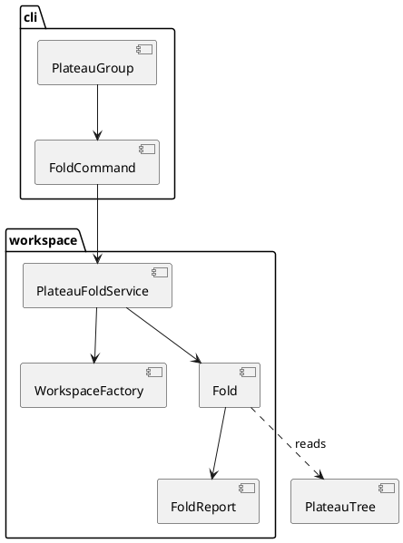

# Plateau fold dry-run

# Summary

`archicode plateau fold <id> --dry-run` tells an author what folding the plateau `<id>` into the plateau above it would do: the files it would rewrite (and that those lose their comments, quotes and layout), the file it would delete, the patches that move, the `replaces` entries to compose, or one `error:` line that says why the fold cannot be made. It writes nothing. The logic is a pure Java class with no Picocli and no CDI in its signature, so that the writer (run W-4) and a later `editor serve` endpoint call the same code. There is no PRD: the run profile is TDD+pln and the sources are the author's decisions D1 to D4 of wave 028, the P2 gate of the wave manifest, and run 0190's analysis, so traceability is incomplete (see PRD Traceability). One diagram is kept (the new boundary between the command, a service and the pure class); no flow diagram, the flow is a straight line with refusals before it.

# Scope

In scope: `plateau fold` with `--dry-run` as the only mode (`cli/`), the pure class and its report (`workspace/`), one public read method on `WorkspaceFactory`, the shared cases file `src/test/javascript/viewpoint-kernel/fold-cases.json`, the Java tests, one `*IT`, `reflect-config.json`, `src/main/resources/guide/guide.md` and its golden file, the first sentences of the manual (`[[fold-by-hand]]` and a short section for the command), `CLAUDE.md`.

Out of scope: any write, delete or copy of a workspace file (W-4); the check that the plateaus that stay read the same (W-4 runs it on a temporary copy, DEF-1); JSON output (DEF-2); an editor action or an HTTP endpoint (DEF-3); rewriting `settings.current`, the steps or any command line; moving files between folders.

# PRD Traceability

No PRD. The requirements below are assumed from the wave plan and are labelled `REQ-n` here; they are not sourced from a PRD ID.

- `REQ-1` (D4, P2 gate): `plateau fold <id> --dry-run` on a copy of the layered Brightcart prints the plan and writes nothing, proved byte for byte on the folder. Addressed.
- `REQ-2` (D2, P2 gate): five refusals of D2, each one `error:` line, exit 1, each a case of the shared cases file read by a Java test: several plateaus above, a step that names the plateau by `at` or `against`, `settings.current`, the root, a leaf. Addressed; the unknown id and the missing `--dry-run` make seven cases, and the loader's own line is not a case of this file (DEC-6).
- `REQ-3` (D3, P2 gate): the logic is a class that a test calls without a command line. Addressed (DEC-1).
- `REQ-4` (P2 gate): the plan names every file it would rewrite and says they lose their comments, quotes and layout. Addressed.
- `REQ-5` (P2 gate): `./mvnw verify` passes, `scripts/byte-identity.sh` shows no unexpected difference, `src/test/resources/guide/golden.md` is regenerated in the same commit. Addressed.
- `REQ-6` (wave open questions): settle patches below the folded plateau, which file takes an inherited element, JSON, the words of the refusals, the place of the cases file. Addressed: DEC-2, DEC-3, DEC-5, DEC-6, DEC-7.
- Partially addressed: D3 "the patches become direct values": see DEC-2 (the departure and the author's notice are stated there once).
- Unresolved: none that blocks the run.

# Technical Goals

- `TG-1`: a pure `Fold` class that, given a plateau id and the facts of a workspace, returns a `Plan` or throws `ArchiCodeException` with the sentence of a refusal (REQ-2, REQ-3).
- `TG-2`: a command `plateau fold <id> --dry-run` that loads the facts, calls `Fold`, prints the report, and leaves the folder untouched (REQ-1).
- `TG-3`: the refusals and the plan on the Brightcart are cases of one file, read by Java tests and by the command-line test (REQ-2).
- `TG-4`: the guide, the manual and `CLAUDE.md` say what the command does now and what it does not (REQ-5).

# Non-Goals

- No writer, no temporary copy, no state comparison: W-4. The report says the result is not checked here.
- No YAML text patcher; no change to the editor or to `standalone.html`.
- No `--archive`, no "make the future the new root", no rewrite of steps or of `settings.current`.
- No new dependency and no new engine: Jackson and the existing loader are enough.

# Assumptions

- `ASM-1`: `PlateauTree.Node` already gives what the plan needs about files: `headers()` (the manifests whose header names the plateau), `manifest()` (its `Kind: Plateau` file), `parent()` and `patches()`. The children of a node come from `PlateauTree.children(id)` (public, sorted by id, throws the unknown-plateau sentence). Checked on the code in task 1 (run 0207): the four accessors and `children` exist.
- `ASM-2`: the replaces of the elements the folded plateau declares, after its own patches, can be read from the load of the plateau above: `Workspace.getSteps()` returns one `PlateauStep` per plateau of the chain, with an `ElementIndex` per layer. Validate: a test on the Brightcart reads `commerce.search` in the step of `inhouse` and finds `shop.app.search`. `ElementIndex` does not expose `replaces` itself; it is read as `step.application().searchElement(ref).getReplaces()` (and `step.technology()`), `Element.getReplaces()` returning `Set<String>`. Checked on the code in task 1: the method exists; the fixture value is pinned by the plan's first test.
- `ASM-3`: the entries of the plateau above that need composing are in two places only: the `replaces` of elements that its manifests declare (`ManifestParser.Candidate` with `plateau` equal to the plateau above, its `source` the file; a nested element, such as `discovery.search` in `marketplace/application/discovery.yaml`, is found by walking the `elements` of the candidate's element, the file being the candidate's `source`) and the `value` of its patches that `SET` the field `replaces` (run 0190 found one entry on the fixture and none in patches). Checked on the fixture in task 1 (run 0207): the one entry is `discovery.search`, and no patch of `inhouse` or `marketplace` sets `replaces` (their fields are applications, description, name, qualifiers, relationships and tags); a case with a patch value covers the other form.
- `ASM-4`: a plateau above always has a `Kind: Plateau` manifest, since `override` is only written there. Validate: `PlateauTree` already refuses an `override` it cannot place.

# Constraints

- `CON-1`: the pure class has no Picocli, CDI or Lombok-generated command code in its signature (P2 gate). Lombok `val` and records are fine.
- `CON-2`: Java 25; PMD (`./mvnw test-compile pmd:check`) and the 0.90 JaCoCo floors on lines, instructions and branches stay; no `// NOPMD`.
- `CON-3`: every refusal is an `ArchiCodeException`: `ErrorOutput` prints `error: <one line>`, exit 1, no stack trace. Nothing uses `log.warn` for the user.
- `CON-4`: a new class the application reads by reflection goes to `src/main/resources/META-INF/native-image/io.morin.archicode/archicode/reflect-config.json` (the command; the pure class and its records are not read by reflection).
- `CON-5`: the existing commands write the same bytes (`scripts/byte-identity.sh`); only the help of `plateau` and the guide gain a line.
- `CON-6`: a test talks to the application through its command line only for the `*IT` and the command test; `FoldTest` (plain JUnit) calls `Fold.plan` with hand-made data; the cases that are whole workspaces go through `PlateauFoldService` (CDI).

# Current State

- `cli/PlateauGroup.java` has one subcommand, `ListPlateausCommand`, which asks `WorkspaceFactory.plateauTree(Path)` and prints the tree. The command is registered in `reflect-config.json` (line 2874).
- `resource/plateau/PlateauTree.java` holds the tree and its mistakes; `node(id)` already throws ``unknown plateau `x`: the plateaus of this workspace are ...``.
- `manifest/ManifestParser.Parsed` holds the elements per plateau (`Candidate` with `plateau` and `source`), the placed stories (`Placed<Story>` with the file) and the tree. It is built by a private `WorkspaceFactory.parse`; only the tree is public.
- `workspace/LayerLoader.stepPlateauProblems` reads `Story.Step#getAt()` and `#getAgainst()`.
- The author folds by hand with `[[fold-by-hand]]`. Run 0190 ran that recipe on the layered Brightcart: three things it got wrong (the `replaces`, two columns that change, the choice for steps) are the content of the plan.
- The command line has no YAML writer for manifests; this run needs none.

# Proposed Design

Three parts. `Fold` is pure: it takes data and returns a `Plan` or throws. `FoldCommand` (Picocli) parses the arguments and prints. `PlateauFoldService` (CDI) reads the facts through `WorkspaceFactory` and calls `Fold`; W-4 and a later endpoint call the service or `Fold` directly.



Reviewer checks: `Fold` and `FoldReport` import neither `picocli` nor `jakarta.inject`; only `PlateauFoldService` touches `WorkspaceFactory`; `FoldCommand` has no logic beyond printing and the `--dry-run` rule.

## Design decisions

- `DEC-1 — A pure class behind a thin service`
  - `Decision:` `workspace/Fold` has one entry, `static Plan plan(String id, PlateauTree tree, String current, List<StepNaming> steps, Supplier<Composition> composition)` (the records are those of CTR-1). It runs the refusals in a fixed order, calls `composition.get()` only when they all pass (so the loader runs once and only for a fold that can be made), and builds the `Plan`. `FoldReport.render(Plan)` returns the text. `PlateauFoldService.plan(Path workspaceFile, String id)` builds the arguments and returns the `Plan`.
  - `Rationale:` the P2 gate wants a class a test calls without a command line; the lazy supplier keeps the refusals cheap and testable with hand-made data.
  - `Alternatives considered:` one class that loads and plans (needs CDI in tests, fails CON-1); a plan built eagerly (loads the plateau above even for a leaf).
  - `Tradeoffs:` one more class and small records. The supplier exists so that a leaf or a root says its own sentence and not the loader's error on a plateau that cannot be loaded, and so that the loader runs only for a fold that can be made. `Entry` stays a record of its own (`ReplacesChange` is an output, `Entry` an input).
  - `Linked PRD IDs:` REQ-3.
- `DEC-2 — Patches stay patches`
  - `Decision:` the plan moves the patches of the folded plateau in front of those of the plateau above, in order, as step 2 of the recipe does, and does not turn any into a direct value. The plan prints the count (`26 ... 23 ... 49`).
  - `Rationale:` a patch that targets an element declared below the folded plateau cannot become a value of that element (its siblings read it); one rule for all patches is safe and keeps the state, and it is the only form the writer can get right without a text patcher. Turning the patches on elements the folded plateau declares into values would change where an effect lives and needs a second code path for a cosmetic gain.
  - `Alternatives considered:` split the patches (those on elements of the folded plateau become values, the rest stay): two paths, more risk, the same state; leave the patches in a block for the author to merge (run 0190's smaller design): the dry-run has less to say.
  - `Tradeoffs:` this departs from the sentence of D3 ("the patches become direct values"). It is the open question the wave left to this run; the author is told at close-out. Deferred as DEF-4.
  - `Linked PRD IDs:` REQ-6.
- `DEC-3 — No element changes file`
  - `Decision:` the elements that the folded plateau declares stay in the files that declare them; only the `plateau:` of their headers changes. The plan lists those files as rewritten.
  - `Rationale:` the wave's question "which file takes an element the plateau above inherited and now declares" has no case under DEC-2: nothing is inherited that was not already in a file of the folded plateau.
  - `Alternatives considered:` move files into the folder of the plateau above (tidying; the command line does not look at folders).
  - `Tradeoffs:` a folder named after a plateau that is gone keeps files of another plateau; the report says it in one line.
  - `Linked PRD IDs:` REQ-6.
- `DEC-4 — Compose the `replaces` in the plan`
  - `Decision:` for every entry of the plateau above that names a reference the folded plateau declares, the plan says the entry and what replaces it: the replaces of that element after the folded plateau's patches (found in the load of the plateau above, ASM-2), or none. An entry that names anything else is not listed.
  - `Rationale:` run 0190 showed the by-hand recipe leaves the entry ignored with a warning and exit 0, and the numbers of `diff` change. This is the only part of the plan a reader would otherwise miss.
  - `Alternatives considered:` leave it to the writer (the plan would be incomplete); use the kernel's `chain` (that composes at compare time, it does not tell what to write).
  - `Tradeoffs:` the plan reads one load of the plateau above.
  - `Linked PRD IDs:` REQ-4.
- `DEC-5 — Text only`
  - `Decision:` the dry-run prints text (the form of `plateau list` and `diff`). The `Plan` record is the structure a JSON form would serialise.
  - `Rationale:` the wave asked whether JSON is needed; nothing reads it yet.
  - `Alternatives considered:` `--format json` now.
  - `Tradeoffs:` a script cannot parse the plan; DEF-2.
  - `Linked PRD IDs:` REQ-6.
- `DEC-6 — Refusals and their order`
  - `Decision:` checked in this order, the first one found is the only line: (1) unknown plateau; (2) the root; (3) a leaf; (4) several plateaus above; (5) `settings.current`; (6) steps. The five refusals of D2 (root, leaf, several above, `settings.current`, steps), the unknown id and the missing `--dry-run` (DEC-7) are seven cases of the cases file; a workspace that does not load is the loader's own `error:` line, said before all of them, and is not a case of this file. The sentences are fixed in CTR-2 and in the cases file.
  - `Rationale:` the order goes from "this is not a fold at all" to "a thing in your files must change first"; one line each, as D2 decided.
  - `Alternatives considered:` list every problem (the steps may be many; the first line plus a list of steps is enough, and the command reports the first error everywhere else).
  - `Tradeoffs:` the author may fix one thing and meet the next.
  - `Linked PRD IDs:` REQ-2.
- `DEC-7 — `--dry-run` is required in this run`
  - `Decision:` `plateau fold <id>` without `--dry-run` is one `error:` line (``plateau fold does not write yet: add `--dry-run` to read the plan``), exit 1, nothing written. W-4 makes the option optional.
  - `Rationale:` a command that looks as if it could fold and silently only reads is a trap; W-4 changes the meaning of the plain form on purpose.
  - `Alternatives considered:` accept the option and ignore it (a script written now would start writing when W-4 lands); hide the command until W-4.
  - `Tradeoffs:` one line of code and one case.
  - `Linked PRD IDs:` REQ-1.
- `DEC-8 — The cases file is read by Java, beside the others`
  - `Decision:` `src/test/javascript/viewpoint-kernel/fold-cases.json`, as the wave proposed. Only Java reads it now (no editor action); the directory is where the shared cases already live.
  - `Rationale:` one place for cases, and W-4 and a later editor port find it.
  - `Alternatives considered:` `src/test/resources/fold/` (a new folder for one file).
  - `Tradeoffs:` a JSON file in a JavaScript folder that no JavaScript test reads; the first lines of the file say so.
  - `Linked PRD IDs:` REQ-2.

# Repository Impact

- `IMP-1 — The pure class and its report`
  - `Path(s):` `src/main/java/io/morin/archicode/workspace/Fold.java`, `FoldReport.java`, `PlateauFoldService.java`
  - `Change type:` additive
  - `Why impacted:` TG-1, DEC-1, DEC-4.
  - `Linked PRD IDs:` REQ-2, REQ-3, REQ-4
  - `Risks / notes:` the records `Plan`, `ReplacesChange`, `StepNaming`, `Composition` and `Entry` are those of CTR-1, which owns their fields.
- `IMP-2 — The command`
  - `Path(s):` `src/main/java/io/morin/archicode/cli/FoldCommand.java`, `PlateauGroup.java` (one more subcommand)
  - `Change type:` additive, modify
  - `Why impacted:` TG-2, DEC-7. The command prints with `System.out` like `ListPlateausCommand` (the log level hides the logger).
  - `Linked PRD IDs:` REQ-1
  - `Risks / notes:` `reflect-config.json` entry (IMP-6).
- `IMP-3 — One read method`
  - `Path(s):` `src/main/java/io/morin/archicode/workspace/WorkspaceFactory.java`
  - `Change type:` additive
  - `Why impacted:` `public Facts facts(Path workspaceFile)` where `Facts(ManifestParser.Parsed parsed, String current)`, built from the existing `read` and `parse` as `plateauTree(Path)` is (`read` holds the settings, so `settings.current` is read there and nowhere else); it returns the placed stories, the candidates and `settings.current` the service needs. No behaviour of `create` moves.
  - `Linked PRD IDs:` REQ-2
  - `Risks / notes:` the same `requireReadablePaths` and `requireNoPlateaus` checks as `plateauTree`.
- `IMP-4 — Tests`
  - `Path(s):` `src/test/java/io/morin/archicode/workspace/FoldTest.java` (plain JUnit, `Fold.plan` on hand-made data: the refusals and the plan; this is the P2 gate test), `src/test/java/io/morin/archicode/workspace/PlateauFoldServiceTest.java` (`@QuarkusTest`: the cases of the file that are whole workspaces, through the service), `src/test/java/io/morin/archicode/cli/PlateauFoldCommandTest.java` (CLI harness: the same cases through the command, the unchanged-folder test), `src/test/java/io/morin/archicode/it/PlateauFoldIT.java`, `src/test/javascript/viewpoint-kernel/fold-cases.json`
  - `Change type:` additive
  - `Why impacted:` REQ-1, REQ-2, REQ-5; the coverage floors.
  - `Linked PRD IDs:` REQ-1, REQ-2
  - `Risks / notes:` the Brightcart copy is made under a temp folder from `src/test/resources/brightcart/layered`.
- `IMP-5 — Guide and golden`
  - `Path(s):` `src/main/resources/guide/guide.md`, `src/test/resources/guide/golden.md`
  - `Change type:` modify
  - `Why impacted:` the command list is generated, so the golden file changes; one sentence in the plateaus convention of the guide says what the command reads and writes. Regenerate with `archicode guide | sed '1s/.*/archicode guide @VERSION@/' > src/test/resources/guide/golden.md` in the same commit.
  - `Linked PRD IDs:` REQ-5
  - `Risks / notes:` `GuideTest` has a 30 KB budget; check it.
- `IMP-6 — Native registration`
  - `Path(s):` `src/main/resources/META-INF/native-image/io.morin.archicode/archicode/reflect-config.json`
  - `Change type:` additive
  - `Why impacted:` CON-4: the entry for `io.morin.archicode.cli.FoldCommand`, copied from `ListPlateausCommand`'s.
  - `Linked PRD IDs:` REQ-1
  - `Risks / notes:` proved by the Native job only.
- `IMP-7 — Manual and CLAUDE.md`
  - `Path(s):` `src/doc/README.adoc`, `CLAUDE.md`
  - `Change type:` modify
  - `Why impacted:` `[[fold-by-hand]]` gets one sentence that points to the command for the plan; a short section `[[plateau-fold]]` says what `--dry-run` prints, the seven refusals with their sentences, that nothing is written and that the writer comes later; `[[upgrade-0-21]]`, the open block of the next release, gets one item ("New: `plateau fold --dry-run`"); `[[plateau-limits]]` is W-4's (P3 gate) and stays as it is, its bullet "folding is done by hand" being still true; `CLAUDE.md` names the command, the classes and the cases file in the layered-plateaus paragraph. The manual's examples run on `domain_plateaus`, whose `to-be` and `later` plateaus are the plateau and the one above.
  - `Linked PRD IDs:` REQ-5
  - `Risks / notes:` a manual test (`ManualExamplesTest`) loads the shipped examples; no new example is added.

# Canonical Impact

Not applicable — no canonical registers declared (`docs/CLAUDE.md` does not exist in this repository).

# Data Model and Contracts

- `CTR-1 — The plan and the facts`
  - `Current contract:` none.
  - `Proposed contract:` `Plan(String folded, String into, String newParent, List<String> rewritten, List<String> deleted, int foldedPatches, int intoPatches, List<ReplacesChange> replaces, List<String> stay)`. `newParent` is the parent of the folded plateau (`baseline` for the root). `rewritten` is sorted and distinct: the `headers()` of the folded node, the manifest of the plateau above, and the files of the elements of the plateau above that hold an entry to compose. `deleted` is the manifest of the folded plateau, or empty when only headers name it. `ReplacesChange(String where, String element, List<String> from, List<String> to)`; `where` is a file or ``patch n of `into` ``, with `n` the 1-based position in the `patches` of the plateau above, in the order of its manifest. `stay` is the other plateaus, sorted. Inputs: `StepNaming(String story, String source, int number, String at, String against)`; `Composition(Set<String> declaredByFolded, Map<String, List<String>> replacedByFolded, List<Entry> entriesOfInto)`, with `Entry(where, element, List<String> replaces)`.
  - `Affected files:` IMP-1.
  - `Migration or compatibility notes:` internal; W-4 adds fields (a write result), it does not change these.
  - `Linked PRD IDs:` REQ-3, REQ-4
- `CTR-2 — The words of the seven refusals and the report`
  - `Current contract:` the manual's recipe and the loader's sentences (``unknown plateau `x`: ...``, the step sentences of `LayerLoader`).
  - `Proposed contract:` (1) unknown: the sentence of `PlateauTree.node` unchanged. (2) root: ``the plateau `baseline` is the root of the plateaus: nothing is below it to fold it into``. (3) leaf: ``the plateau `marketplace` is not overridden by any plateau, so there is no plateau above it to fold it into: to remove it, use Delete in the editor``. (4) several: ``the plateau `inhouse` is overridden by `inhouse-alt` and `marketplace`, which do not stack: folding it into one would change the other. Keep it``. (5) current: ``` `settings.current` names the plateau `inhouse`: write another plateau in `.archicode.yaml` first (`marketplace` is the one above it) ``. (6) steps: ``the plateau `inhouse` is named by the story `fork_tour` (`shared/story.fork_tour.yaml`) step 3 (`at`), step 4 (`at`) and step 5 (`against`), and the story `seller_journey` (`...`) step 3 (`against`): change those steps first, none is rewritten for you``. (7) no `--dry-run`: DEC-7. The report is: a first line ``plateau fold inhouse into marketplace (dry run: nothing was written)``, then these blocks, each omitted when empty except the first two: `after:` (the new parent of the plateau above, the plateaus that stay), `files rewritten (they lose their comments, quotes and layout):` one per line, `files deleted:`, `patches:` (``the 26 patches of `inhouse` go in front of the 23 of `marketplace`: 49``), `replaces to compose:` (``discovery.search (marketplace/application/discovery.yaml): commerce.search -> shop.app.search``; `-> (none)` when the replaced element replaced nothing), `plateaus removed:` (``inhouse: a command line or a CI file that names it will fail`` and ``the default --against of `marketplace` changes from `inhouse` to `baseline```), and the closing sentence ``The result is not checked here: the plateaus that stay are compared before and after when the fold is written``. Same workspace, same bytes (sorted, no clock, no path of the machine).
  - `Affected files:` IMP-1, IMP-4, IMP-7.
  - `Migration or compatibility notes:` these sentences are the contract of the cases file; a change of wording is a change of the file in the same commit.
  - `Linked PRD IDs:` REQ-2, REQ-4
- `CTR-3 — The command line`
  - `Current contract:` `plateau list`.
  - `Proposed contract:` `archicode plateau fold <id> --dry-run` (`-w` from the top command, `--plateau` is not an option of this command). Exit 0 with the report on the standard output; exit 1 with `error:` on the error output; usage errors keep picocli's 2.
  - `Affected files:` IMP-2, IMP-5.
  - `Migration or compatibility notes:` additive.
  - `Linked PRD IDs:` REQ-1
- `CTR-4 — The cases file`
  - `Current contract:` none.
  - `Proposed contract:` `{"cases": [{"id": "F01", "what": "...", "base": "brightcart/layered" | null, "files": {"<path>": "<text>"}, "args": ["inhouse"], "expect": {"error": "<line>"} | {"output": ["<line>", ...]}}]}`. `base` names a folder of `src/test/resources` copied first; `files` adds or replaces files of the copy, so a case is a handful of lines. `PlateauFoldServiceTest` runs each case through the service; `PlateauFoldCommandTest` runs the same cases through the command and checks exit and stream; `FoldTest` holds its own hand-made data.
  - `Affected files:` IMP-4.
  - `Migration or compatibility notes:` read by Java only; W-4 adds cases for the writer to the same file.
  - `Linked PRD IDs:` REQ-2
- No change to a manifest, to `.archicode.yaml`, to the schema, to the kernel contract or to a file the existing commands write.

# Interfaces and Behavior

- `IF-1`: `Fold.plan(...)` and `FoldReport.render(Plan)` (IMP-1).
- `IF-2`: `PlateauFoldService.plan(Path, String)` returns a `Plan`, throws `ArchiCodeException`.
- `IF-3`: the command (CTR-3). On an error nothing is printed on the standard output.
- Error states: a workspace that does not load, a plateau tree with mistakes: the loader's line. The folder is never written, whatever the outcome.

# Flows and Processing Logic

- `FLOW-1 — Read the plan`
  - `Trigger:` `archicode plateau fold inhouse --dry-run`.
  - `Steps:` the command refuses a missing `--dry-run`; `PlateauFoldService` reads `Facts` through `WorkspaceFactory.facts` (`parsed.plateaus()` is the tree, `current` is `settings.current`; `plateauTree` is not called), builds the `StepNaming` list from the placed stories; `Fold.plan` checks the six refusals in order; it calls `composition.get()`: the service loads the plateau above once (`create(path, null, into)`), takes the declared references of the folded plateau from `Parsed` (candidates with `plateau` equal to the folded one), their resolved replaces from the step of the folded plateau (ASM-2), and the entries of the plateau above from its candidates and from its patches that `SET` a `replaces`; `Fold` builds the `Plan` (files, patches, replaces changes); the command prints `FoldReport.render(plan)`.
  - `Branches / failure paths:` any refusal stops before the load of the plateau above; a loader error ends with its own line; no branch writes.
  - `Final output / rendered result:` the report of CTR-2 and exit 0, or one `error:` line and exit 1.
  - `Linked PRD IDs:` REQ-1, REQ-2, REQ-4

# Reliability, Performance, and Scalability

A dry-run parses the manifests twice: once for the facts and the refusals, once more for the load of the plateau above (`create`), which only runs for a fold that can be made. The layered Brightcart loads in well under a second. The plan is deterministic: files sorted by path, plateaus by id, no map iteration order in the output. Nothing is cached.

# Security and Privacy

Read-only: the command opens the files the loader already opens and writes none. The report prints paths relative to the workspace folder, never an absolute path. No network, no secret.

# Observability and Verification

- `FoldTest` (plain JUnit, hand-made data) and the cases file (through the service): F01 unknown, F02 root, F03 leaf, F04 several above, F05 `settings.current`, F06 steps, F07 no `--dry-run`, F08 the plan on the Brightcart `inhouse` (26 and 23 patches, the 11 headers files, the manifest to delete, the one `replaces` change `discovery.search`: `commerce.search -> shop.app.search`), F09 an entry that names an element of the plateau below (not listed), F10 a folded plateau with no manifest (no deletion), F11 a patch that sets `replaces` (listed as `patch n`), F12 the fold into a plateau whose parent is the root.
- `PlateauFoldCommandTest`: the cases through the command with `CliHarness`; the unchanged-folder test snapshots every file (path, bytes, hidden ones too) of a copy of the layered Brightcart before and after a successful dry-run and after each refusal and compares them (REQ-1); the missing `--dry-run`; the report twice gives the same bytes.
- `PlateauFoldIT`: on the jar (and the native runner): the dry-run on a copy, exit 0, the first line, folder unchanged; one refusal, exit 1.
- `GuideTest` with the regenerated golden file; `ManualExamplesTest` if the manual quotes the output.
- Commands: `./mvnw verify`, `./mvnw verify -DskipITs=false`, `./mvnw test-compile pmd:check`, `scripts/byte-identity.sh`. Sabotage record in the run document: make the command write one byte (a touch of the manifest) and show the unchanged-folder test fail; drop the composition and show the case F08 fail.
- Coverage: the new code is covered by the tests above; no floor is lowered.

# Deployment and Rollout

Code-only, additive. Backward compatible: one new subcommand; `plateau --help` and `archicode guide` gain a line. Rollback: revert the commit. Proved only by CI: the native runner (`reflect-config.json`) and the tag run. Planning guidance only, no deployment is implied.

# Risks and Tradeoffs

- `RISK-1`: which step holds the replaces after the folded plateau's patches (ASM-2). Mitigation: read the step of the folded plateau (its index is the layer after its patches); a case pins `commerce.search`.
- `RISK-2`: the plan says what the fold would do but does not prove the result reads the same. The report says so (CTR-2); W-4 adds the check on a temporary copy and the dry-run then runs it (DEF-1).
- `RISK-3`: see DEC-2 (departure from D3's words).
- `RISK-5`: the sentences are a contract; a late change of words costs the cases file, the manual and the golden in one commit.

# Open Questions

None open.

Resolved in Stage 6:

- `Q-1` (patches stay patches or become values): resolved, DEC-2 stands. The wave manifest (open question on patches below the folded plateau) gives this run the decision and says the author is told if it changes D3; D3's sentence holds only for elements the folded plateau declares, and one rule for all patches keeps the state with no text patcher. The author is told in the run's close-out, not asked; DEF-4 keeps the other path.
- `Q-2` (a rewritten manifest keeps YAML, JSON or TOML): not a question of this run, the writer's (W-4). Moved to DEF-5.

# Deferred Work

- `DEF-1`: compare the plateaus that stay before and after on a temporary copy and run it in the dry-run too (W-4).
- `DEF-2`: a JSON form of the plan (`--format json`), when something reads it.
- `DEF-3`: an `editor serve` endpoint and an editor action that call `PlateauFoldService`.
- `DEF-4`: see DEC-2 (patches as values).

- `DEF-5`: for W-4, whether a rewritten manifest keeps its format (YAML, JSON, TOML) and extension.

# File Placement and Frontmatter

This file is `docs/wav/wav-028-fold-and-browser-menu/run/run-0207-plateau-fold-dry-run/tdd-0207-plateau-fold-dry-run.md`, with `type: tdd`, `run: 0207`, `wave: 028`, as `tdd-0205-workspace-menu-overflow.md` does.

Review pass: dispatched. The Stage 5 KDMLLC review ran in a separate leaf agent with a fresh context, not the drafter (no Agent tool is available to either, so the reviewer did the review itself); its findings (F-1 to F-10, none S3, four S2) are in the run's progress log and were applied by task-001.
