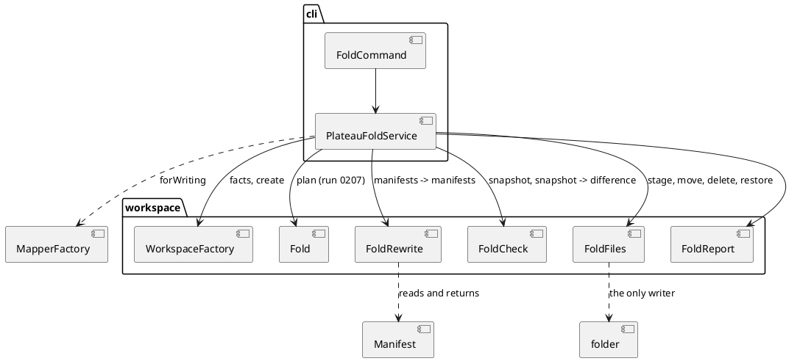
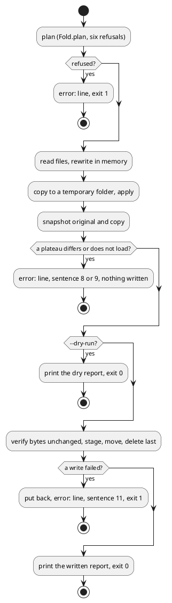

# Plateau fold writer

# Summary

`archicode plateau fold <id>` (without `--dry-run`) folds the plateau `<id>` into the plateau above it: it rewrites the manifests that name `<id>`, merges the `Kind: Plateau` manifest of `<id>` into the one above, composes the `replaces` entries the plan lists, and deletes the manifest of `<id>`. Before it touches the folder it proves, on a temporary copy, that every plateau that remains reads the same (its model, and its comparison with each other remaining plateau, but for the PLATEAU and PATCH columns of the cascade); if any plateau differs it writes nothing and says which. It writes all its files or none. `--dry-run` runs the same preparation and the same proof and stops before the first write, so the plan it prints is a plan that has been checked. This run builds on run 0207's pure `Fold` class (the plan and the five refusals of D2) and adds three more pure or seam classes: `FoldRewrite` (manifests in, manifests out), `FoldCheck` (compares two snapshots) and `FoldFiles` (the only class that touches the folder). There is no PRD: the run profile is TDD+pln and the sources are the author's decisions D1 to D4 of wave 028, the P3 gate of the wave manifest and runs 0190 and 0207, so traceability is incomplete (see PRD Traceability). Two diagrams are kept (the classes and their boundaries; the fold as one activity with its three exits).

# Scope

In scope: the writer and the check in `workspace/` (`FoldRewrite`, `FoldCheck`, `FoldFiles`, the service), the plain form of the command in `cli/`, the report in its two modes, additive changes to `Fold.Plan`, `WorkspaceFactory.Facts`, `MapperFactory`, `Manifest.Header` and `Warnings`, new cases in `src/test/javascript/viewpoint-kernel/fold-cases.json`, the Java tests, one node test that opens the folded workspace in the editor, `PlateauFoldIT`, the guide and its golden file, the manual (`[[plateau-fold]]`, `[[fold-by-hand]]`, `[[plateau-limits]]`, `[[upgrade-0-21]]`) and `CLAUDE.md`.

Out of scope: an editor action or an `editor serve` endpoint (DEF-1); moving files between folders; rewriting a step, `settings.current` or a command line; `--archive` and "make the future the new root"; a YAML text patcher (the rewritten files lose their comments, D3); a backup file written by the command (git is the safety net); JSON output of the report (DEF-2).

# PRD Traceability

No PRD. The requirements below are assumed from the P3 gate of the wave manifest, the wave's decisions and run 0207, and are labelled `REQ-n` here; they are not sourced from a PRD ID.

- `REQ-1` (P3 gate, first criterion): `./mvnw verify -DskipITs=false`, `npm run test:unit`, `npm run lint`, `npm run format:check` and `npm run editor:check` pass; no coverage floor is lowered; the jar and the editor open the folded workspace. Addressed (IMP-1 to IMP-9, DEC-10).
- `REQ-2` (P3 gate, second criterion): on a copy of the layered Brightcart (`inhouse` into `marketplace`) a test and the run document record `plateau list`, `diff` and `views generate` before and after, equal for every plateau that stays but for the PLATEAU and PATCH columns of the cascade; a second run on the same copy refuses the fold of a plateau that no longer exists. Addressed (DEC-4, DEC-9).
- `REQ-3` (P3 gate, third criterion): the fold writes all its files or none, and a test makes one write fail and shows the folder unchanged. Addressed (DEC-5).
- `REQ-4` (P3 gate, fourth criterion): the manual (`[[fold-by-hand]]`, a page for the command, `[[plateau-limits]]`), `archicode guide` and `CLAUDE.md` say what the command does, what it refuses and what the rewritten files lose. Addressed (IMP-8, IMP-9).
- `REQ-5` (wave decision D3 and non-goals): the rewrite is in Java only, from the manifests as the loader reads them; the logic is pure classes that a later endpoint can call; no YAML text patcher, no editor change; the rewritten files lose comments, quotes and layout and the plan says so. Addressed (DEC-1, DEC-2).
- `REQ-6` (wave open question): how the cascade table's PLATEAU and PATCH columns are compared in the oracle. Addressed (DEC-4).
- `REQ-7` (carried from run 0207: its DEC-7, DEF-1 and DEF-5): the plain form writes; the check of the result runs in the dry-run too; a rewritten manifest keeps its format. Addressed (DEC-2, DEC-4, DEC-6).
- `REQ-8` (D2): the refusals F01 to F06 of run 0207 stay as they are, word for word. Addressed (DEC-6).
- Partially addressed: D3 says "the patches become direct values"; run 0207's DEC-2 keeps them as patches, moved in front, and this run keeps that (DEC-3). The author is told at close-out, not asked.
- Unresolved: none that blocks the run.

# Technical Goals

- `TG-1`: a pure `FoldRewrite` that, given a `Fold.Plan` and the `Manifest` of each file the plan names, returns the manifests to write and the files to delete (REQ-5).
- `TG-2`: a pure `FoldCheck` that compares the snapshot of the plateaus that remain, taken before and after, and names the first difference (REQ-2, REQ-6).
- `TG-3`: a `FoldFiles` seam that writes all or none and puts the files back when a write fails (REQ-3).
- `TG-4`: `PlateauFoldService.fold(...)` and the command: prepare, check on a temporary copy, then write or stop (REQ-1, REQ-7).
- `TG-5`: the report in its two modes, and new cases in the shared file (REQ-4, REQ-8).
- `TG-6`: the proof the P3 gate asks for, recorded: before and after on the Brightcart through the command line, the failed-write test, the editor opening the result (REQ-1 to REQ-3).

# Non-Goals

- No change to the five refusals of D2 or to their sentences; they are checked before anything is read for the writer.
- No change to `Fold.plan`'s decisions (what is rewritten, what is composed): the writer carries out the plan.
- No new dependency, no new engine, no WASM; Jackson and the existing loader are enough.
- No change under `src/main/editor` or to `standalone.html`: the ratchet of `layers.json` (99) and every JavaScript coverage floor are untouched.

# Assumptions

- `ASM-1`: reading a manifest as the loader reads it (`Manifest`: a typed header and a `content` tree) and writing it back with the mapper of its extension keeps the model. Measured before this draft, on a scratch program with the repository's `MapperFactory` and the build's classes: a header `parent: yes` and `plateau: 010` come back as the texts `"yes"` and `"010"`; a content `n: 010` comes back as `8`, which is what the loader reads; and a tree read and written back in YAML, JSON and TOML is equal to the tree read, for the 62 files of the layered Brightcart, the 50 of `src/doc/examples`, and 8 of `viewpoint-kernel`. Validate: task 1 round-trips every manifest of `ManifestCorpus` (the 421 the repository ships, in `src/test/java/io/morin/archicode/doc`) and asserts `Manifest` equality, and the oracle (DEC-4) is the guard for anything the corpus does not hold.
- `ASM-2`: `Manifest.Header` has `@Builder` and no `toBuilder`, so the header is rebuilt field by field or `toBuilder = true` is added (additive). `reflect-config.json` already registers `Manifest`, `Manifest$Header` and their builders with all methods, so writing needs no new entry. Read in the code at Stage 6: `Manifest` is `@Builder(toBuilder = true)`, `Header` is `@Builder` alone. Validate: the Native job runs `PlateauFoldIT` on the runner; this is proved only there.
- `ASM-3`: the writer variant of the YAML mapper (document start marker off, array items indented under their key) writes a manifest in the style of the repository. Measured on the 11 manifests of `inhouse` that name the plateau: 56 of their 273 lines differ from the originals by a round trip alone, every one a flow list (`qualifiers: ["OpenSearch"]`) written as a block; none of the 11 has a comment. Validate: the plan's first task repeats the measure as a test on the fixture and the run document records the figure.
- `ASM-4` (settled while drafting): the canonical form of an element is its JSON as the mapper writes it, with object keys sorted and every array sorted by its text. Every collection of the element model is a `Set` or a `Map` (read in `resource/element`: `qualifiers`, `relationships`, `replaces`, `elements`, `uses`, `applications`, `tags`), so sorting loses no order that means anything. The concrete elements also have value `equals` (`@Value` with `lombok.equalsandhashcode.callsuper=CALL`), but the check compares lines, not objects, because the sentence of the refusal must print the line (DEC-4). Validate: `FoldCheckTest` builds two equal elements with their sets in two orders and gets equal lines.
- `ASM-5`: on the layered Brightcart, with the `discovery.search` entry composed, the oracle holds for `inhouse` into `marketplace` (run 0190 compared `plateau list`, `diff` and `views generate` by hand and found only the PLATEAU and PATCH columns different). Validate: the first test of the plan; it is also the red test that goes green when the composition is carried out (DEC-3).
- `ASM-6`: a `replaces` entry of the plateau above that names an element the folded plateau removes (not one it declares) is ignored with a warning before the fold and honoured after it, so the oracle sees a difference and the fold is refused. Validate in task 1 on a small hand-made workspace; if the kernel behaves otherwise, the case that shows the oracle refusing is a folded patch with a `json-path` that matches an element of the plateau above (the folded patches run before those elements are added today, and after the fold they run after).
- `ASM-7`: a file named `<manifest>.archicode-fold` is not read as a manifest (`MapperFormat.resolve` matches the extensions `.yaml`, `.yml`, `.toml` and `.json` with `endsWith`, and `ManifestDiscovery` keeps a file only when it finds a format for it: read in the code at Stage 6), so a staged file left by a crash is not a manifest. Validate: a test discovers a folder that holds one.
- `ASM-8`: the loads that the check makes on the temporary copy can be kept off the user's error output (new `Warnings` method, IMP-7). Validate: the report test asserts an empty error stream on the Brightcart fold, as the dry-run test of run 0207 does.

# Constraints

- `CON-1`: `Fold`, `FoldRewrite`, `FoldCheck` and `FoldFiles` have no Picocli, CDI or Lombok-generated command code in their signatures (P2 gate, still true). The service is CDI; it is the one class the command and a later endpoint call.
- `CON-2`: Java 25; PMD (`./mvnw test-compile pmd:check`) and the 0.90 JaCoCo floors on lines, instructions and branches stay; no `// NOPMD`.
- `CON-3`: every refusal is an `ArchiCodeException` (`error: <one line>`, exit 1, no stack trace); a failure of the file system during the write is told by one of our own sentences, never by a stack trace.
- `CON-4`: the folder is read before the check and written only after it; the check and the dry-run write nothing in the workspace folder (they write in the system temporary folder and remove what they wrote).
- `CON-5`: the existing commands write the same bytes (`scripts/byte-identity.sh`): no existing sentence changes except `plateau fold`'s and the guide's lines about it.
- `CON-6`: tests reach the application through its command line only in the `*IT` and in `PlateauFoldCommandTest`; `FoldRewriteTest` and `FoldCheckTest` are plain JUnit on hand-made data; the cases that are whole workspaces go through `PlateauFoldServiceTest` (`@QuarkusTest`).
- `CON-7`: no file under `src/main/editor`, `layers.json` or `standalone.html` changes; one new node test is added under `src/test/javascript/viewpoint-kernel/` (outside the wave's `likely_paths` for this run: stated here and in the run document; the P3 gate's first criterion, "the editor opens the folded workspace", needs it).

# Current State

- `workspace/Fold.java` (run 0207) is pure: `plan(id, tree, current, steps, composition)` checks the six refusals and returns a `Plan(folded, into, newParent, rewritten, deleted, foldedPatches, intoPatches, replaces, stay)`. `workspace/FoldReport.render(Plan)` words it. `workspace/PlateauFoldService.plan(Path, String)` reads `WorkspaceFactory.facts(Path)` (the parsed manifests and `settings.current`), builds the step list and the composition (one load of the plateau above) and calls `Fold.plan`. `cli/FoldCommand` requires `--dry-run`, else `error: plateau fold does not write yet: add `--dry-run` to read the plan`. `PlateauGroup` has `list` and `fold`.
- The command line has no writer of manifests: `InitCommand` writes fixed resources. `MapperFactory` hands out one mapper per format for reading (`create(MapperFormat)`), configured to read the way the loader reads; nothing is configured for writing.
- `ManifestParser.parse` reads each file with the mapper of its extension into `Manifest(header, content)`, then reads `content` again as JSON; `Manifest.Header` (`kind`, `version`, `parent`, `plateau`) holds its fields as text as written.
- `Workspace` carries `removals` and `steps`; `Removal.cascade(removals, base)` gives the cascade rows, each `Effect(plateau, rank, patch, effect, layer, element, detail)`; `GapReport` writes the PATCH column as `rank + " " + patch` and the PLATEAU column as `plateau`. `PlateauComparer.compare(base, target)` gives a `Comparison` with its rows and its `getWarnings()`.
- `Warnings` keeps the warnings of a command and prints them at the end; `drain()` empties it (and returns the lines with `warning: ` already in front).
- `src/test/java/.../it/PlateauFoldIT`, `PlateauFoldCommandTest`, `PlateauFoldServiceTest` and `FoldTest` exist (run 0207) and read `fold-cases.json` (F01 to F08; F07 is the missing `--dry-run`).

# Proposed Design

Four pieces under `workspace/`, one service, one command. The pieces that decide are pure: `FoldRewrite` and `FoldCheck` take data and return data. `FoldFiles` is the only class that touches the folder. The service reads the folder once, asks `Fold` for the plan, asks `FoldRewrite` for the new manifests, builds a temporary copy, takes two snapshots, asks `FoldCheck`, and only then (and only without `--dry-run`) calls `FoldFiles`.



Reviewer checks: `Fold`, `FoldRewrite` and `FoldCheck` import neither `picocli`, `jakarta.inject` nor `java.nio.file`; only `FoldFiles` writes into the workspace folder; the service holds no decision that the pure classes could hold; `FoldCommand` has no logic beyond the arguments and printing.

## Design decisions

- `DEC-1 — Four small pieces, two of them pure`
  - `Decision:` `FoldRewrite.apply(Fold.Plan, Map<String, Manifest>)` returns `Rewritten(Map<String, Manifest> written, List<String> deleted)`. `FoldCheck.firstDifference(Fold.Plan, Snapshot before, Snapshot after)` returns an `Optional<String>`, the sentence of the refusal. `FoldFiles` has the operations `stage`, `move`, `delete` and `restore` over paths and bytes, with `FoldFiles.disk()` as the production implementation, and `FoldFiles.commit(...)` is the sequence of DEC-5 over any implementation. The service takes a `FoldFiles` as a parameter of `fold(...)` (the command passes `disk()`; a test passes a failing one).
  - `Rationale:` the P2 gate's rule that the fold logic is callable without a command line (CON-1) extends to the writer, so that an `editor serve` endpoint calls the service and nothing else; the test that makes a write fail needs a seam, not a mock of the file system.
  - `Alternatives considered:` one `FoldWriter` class that reads, rewrites, checks and writes (needs the disk in every test, hides the order); a decorator on `java.nio.file.FileSystem` (a test double of the whole JDK for four operations).
  - `Tradeoffs:` three more files and a small interface. The seam is four methods.
  - `Linked PRD IDs:` REQ-3, REQ-5.
- `DEC-2 — Rewrite the manifest as the loader read it, in its own format`
  - `Decision:` each file the plan names is read as `Manifest` with the mapper of its extension (as `ManifestParser` reads it), changed in memory, and written with a writer variant of the same mapper (`MapperFactory.forWriting(MapperFormat)`: YAML without the document start marker and with array items indented under their key, which is the style of the repository's manifests; JSON indented; TOML as the TOML mapper writes). A file keeps its path, its extension and its format. A header field stays the text it was (`parent: yes` stays `yes`), `content` is written as the tree the loader reads. `forWriting` sets the inclusion to `NON_NULL`, not the `NON_EMPTY` of the reading mappers: measured on a scratch program with the build's classes, `NON_EMPTY` leaves out an empty top-level `content` in YAML, TOML and JSON (a key the reader requires) while `NON_NULL` writes `content: {}` (`content = {}` in TOML); empties inside the tree (a patch `value: []`, `{}`) are written as they are under both, and a null `parent` or `plateau` of the header is left out under both. What is lost is what the report already announces (comments, quotes, layout, flow lists written as blocks, anchors and aliases expanded, a byte-order mark, the spelling of a number such as `010`) and, for the deleted manifest, its `name` and `horizon` (DEC-7).
  - `Rationale:` the loader and the writer then share one representation, so the model cannot change by a difference of reading (the one hazard of a tree read that is not the loader's: `parent: yes` read as the boolean `true`); no second YAML implementation (D3, the wave's non-goal of a text patcher); measured in ASM-1 and ASM-3.
  - `Alternatives considered:` a plain `JsonNode` tree read (changes `parent: yes` into `true`, measured in ASM-1); the editor's line-preserving save ported to Java (a second implementation of what took waves to get right, rejected by D3); always YAML (turns a `.toml` manifest into YAML under a `.toml` name, or renames it).
  - `Tradeoffs:` a TOML or JSON manifest is rewritten in a style the repository has no sample of; the oracle (DEC-4) is what proves each result, and ASM-1's corpus test proves the three writers on everything the repository ships. DEF-5 of run 0207 is closed by this decision.
  - `Linked PRD IDs:` REQ-5, REQ-7.
- `DEC-3 — What the rewrite does, and nothing else`
  - `Decision:` `FoldRewrite` makes five edits, from the plan. Edit 1: in each file of `plan.headers()`, `header.plateau` becomes `plan.into()`. Edit 2: in the manifest of the plateau above (`plan.intoManifest()`), `content.override` becomes `plan.newParent()`, or is taken out when that is `baseline`. Edit 3: in the same manifest `content.patches` becomes the patches of the folded manifest followed by its own, in order (run 0207's DEC-2: patches stay patches; none is turned into a value); a folded plateau that no manifest declares adds none. Edit 4: each `ReplacesChange` of the plan is carried out where it lives: in the file, the entry of the element named `element` (found by its reference from `header.parent`, `content.id` and the nested `elements`) has each reference of `from` replaced in place by the references of `to` (distinct, none repeated), and the key `replaces` is taken out when nothing is left; in a patch (`where` is ``patch n of `into` ``) the `value` of the nth patch of the plateau above, before the concatenation, gets the same treatment (a text stays a text when one reference is left, else it is a list; an empty `value` is written as `[]`. Edit 5: the manifest of the folded plateau is returned in `deleted`. Nothing else in any file changes; a file the plan does not name is never read for writing.
  - `Rationale:` these are the four steps of `[[fold-by-hand]]` plus the `replaces` that run 0190 found missing from it; the plan of run 0207 already names exactly these files.
  - `Alternatives considered:` turn the patches on elements the folded plateau declares into direct values (D3's words): two paths for one effect, the elements declared below the folded plateau still need patches, and it needs the text patcher the wave excludes; this stays run 0207's DEC-2 and DEF-6 here.
  - `Tradeoffs:` the merged plateau has one long `patches` list; the folded plateau's own `name` and `horizon` are not kept.
  - `Linked PRD IDs:` REQ-2, REQ-5.
- `DEC-4 — Prove the result on a temporary copy before writing, and name the first difference`
  - `Decision:` the service builds a temporary folder holding `.archicode.yaml` and every manifest file the loader discovers (`Facts` carries that list, IMP-5), applies the rewrite to the copy, and takes a `Snapshot` of the original and of the copy for every plateau that remains (every plateau of the tree but the folded one, the plateau above included). A snapshot holds, for each remaining plateau P, the canonical model (one line per element and per relationship, sorted by reference; an element's line is its reference and its canonical JSON of ASM-4 without its `elements` and `relationships`, which have lines of their own), and for each ordered pair (P, Q) of remaining plateaus the comparison: the JSON text `GapReport.render(comparison, JSON, false, [])` without the cascade, the warnings of `comparison.getWarnings()` sorted, and the cascade rows with the plateau and the rank left out (a row compared by `patch`, `effect`, `layer`, `element` and `detail`, in order: the PLATEAU and PATCH columns are the only part of the cascade that may differ, run 0190). `FoldCheck.firstDifference` walks both snapshots in a fixed order (models by plateau id, then pairs by ids) and returns the sentence for the first line that differs, `Optional.empty()` when none does. A plateau that no longer loads on the copy is the sentence of the loader with a prefix. The views are not drawn by the check: the models and the comparisons are what they are drawn from, and the test of DEC-9 draws them.
  - `Rationale:` this is run 0190's oracle made code (the P3 gate asks for it as a record; a command that deletes manifests must also refuse when the result would differ); comparing the comparison with its cascade rows minus two columns answers the wave's open question; the warnings are in because the failure run 0190 found, a `replaces` entry ignored, shows up as a warning and a changed row, not as an error.
  - `Alternatives considered:` compare the text of `diff` and `views generate` byte for byte (the PLATEAU and PATCH columns differ by design, and the order of siblings in `query graph` is not stable, run 0190); check only the plateau above (misses a sibling changed through a shared ancestor); draw the views of every plateau in the check (slow, and adds nothing the model and the comparison do not already decide).
  - `Tradeoffs:` the fold loads each remaining plateau twice and compares every ordered pair: O(n squared) comparisons for n plateaus, which is small for the trees the repository ships (the Brightcart has three remaining plateaus and six pairs). A fold the check refuses cannot be forced (no `--force`): the author repairs the cause the sentence names. The check also runs in the dry-run (run 0207's DEF-1 is done), which makes the dry-run slower than run 0207's and gives it a new refusal beyond D2's list; the author is told at close-out.
  - `Linked PRD IDs:` REQ-2, REQ-6, REQ-7.
- `DEC-5 — All or nothing: stage, check, move, delete last, put back`
  - `Decision:` `FoldFiles.commit` does, in this order: Step a: re-read every file to be rewritten or deleted and compare with the bytes the service read first; any difference stops with sentence 10 of CTR-2 before anything is written. Step b: stage the new bytes of every rewritten file next to its target, named `<file>.archicode-fold`, with the permissions of the original; a failure removes what was staged and stops. Step c: move each staged file over its target (an atomic replace, in the order of the paths). Step d: delete the folded manifest last. A failure in step c or d puts back, from the bytes held in memory, every file already moved or deleted, removes the rest of the staged files, and stops with sentence 11 of CTR-2; if putting a file back fails too, the sentence lists the files that may be partly written. Each target is resolved with `toRealPath` first and its staged file is made beside the real file, so the atomic move replaces the file the link points to and leaves the link as it is. A `.archicode-fold` file left by an earlier crash is overwritten by the staging (create or truncate), never read.
  - `Rationale:` the folder is the same after any failure the process survives (REQ-3); the staged names end in an extension no format reads (ASM-7), so a crash leaves files that are not manifests.
  - `Alternatives considered:` write in place and rely on git (a failure leaves a half-folded workspace the loader may read); move the whole folder (the workspace may hold much besides manifests, and the folder may be a mount); a journal file (more machinery for what a process crash needs: not promised).
  - `Tradeoffs:` the guarantee is for a failure of a write, not for a killed process or a power cut during (c) and (d): the report and the manual say git is the safety net. The honest wording, "all of its files or none, unless the process is killed while it moves them", is used in the manual.
  - `Linked PRD IDs:` REQ-3.
- `DEC-6 — The plain form writes; `--dry-run` runs everything but the write`
  - `Decision:` `plateau fold <id>` without the option folds, as run 0207's DEC-7 announced; F07 of the cases file is replaced by a write case. With `--dry-run` the command prepares, checks and prints the report in dry mode, and stops. Without it the report is the same text in the past tense (CTR-2). No extra confirmation flag: the plan the dry-run printed and git are the guards.
  - `Rationale:` the wave's Vision, "runs it again without the option"; a flag that must be added to every real fold would be the trap run 0207 avoided in the other direction.
  - `Alternatives considered:` `--write` or `--yes` (the author decided the plain form in D4); a refusal when the git tree is dirty (the command does not know git; the manual advises a clean tree).
  - `Tradeoffs:` a script that already used `plateau fold X --dry-run` is unchanged; one that used the plain form got an error until now and gets a fold.
  - `Linked PRD IDs:` REQ-7, REQ-8.
- `DEC-7 — Say what the deleted manifest took with it`
  - `Decision:` the plan gains the `name` and `horizon` of the folded plateau, and the report says, on the line of the deleted file, that they are not kept (CTR-1, CTR-2). The plateau above keeps its own.
  - `Rationale:` they are the only content of the deleted file that no edit carries; a deletion should say what it deletes. Cheap: both are fields of `PlateauTree.Node`.
  - `Alternatives considered:` carry the name into the plateau above (a decision about the author's naming); say nothing (the loss is small but silent).
  - `Tradeoffs:` one more line in the report, one more field in the plan.
  - `Linked PRD IDs:` REQ-4.
- `DEC-8 — The cases file gains write cases and a files check`
  - `Decision:` `fold-cases.json` keeps F01 to F06, replaces F07 (the missing `--dry-run`) by a write case, updates F08 (its last line) and adds the cases of CTR-4. A case may carry `expect.files`: a map from path to the exact new text, to `null` for a deleted file, or to the marker `"changed"` for a file that must differ from the base and whose text the case does not pin (the oracle of DEC-4 and the test of DEC-9 judge its effect); every file not named must be byte-identical to the base. The cases run through the service and through the command, as before.
  - `Rationale:` one place for the expected words and files, read by Java and now by the node test that opens the folded workspace.
  - `Alternatives considered:` expected files as fixtures on disk (a second copy of the fixture to keep in step).
  - `Tradeoffs:` the Brightcart write case (F07) marks each file its report lists as `"changed"` and `null` for the deleted one, and pins the report; it does not hold the merged patches in full (the oracle and the before and after record of DEC-9 cover their effect); the hand-made cases hold exact texts.
  - `Linked PRD IDs:` REQ-2, REQ-8.
- `DEC-9 — The before and after record is a test, then a table in the run document`
  - `Decision:` `PlateauFoldBeforeAfterTest` (`@QuarkusTest`, `CliHarness`) copies the layered Brightcart, replaces the two stories that name `inhouse` (as F08 does), runs `plateau list`, `diff -f json` for every ordered pair of the plateaus that remain, `query graph --plateau P` (sorted), and `views generate` for each remaining plateau and for `marketplace` against `baseline`, folds `inhouse` into `marketplace` through the command, and runs the same again. It asserts equality but for the cascade rows of `diff` and `gap.json` without their plateau and rank, the same rows of `gap.md` with their first two cells blanked, and the rows of `plateau list`. It then runs the fold again and asserts the sentence of F01 (the plateau no longer exists). The run document records the commands and the figures.
  - `Rationale:` the gate asks for a record; the in-code oracle (DEC-4) judges models and comparisons, this test judges the files the author's tools write.
  - `Alternatives considered:` the record by hand in the run document only (not repeatable).
  - `Tradeoffs:` a slow test (three loads and a `views generate` per plateau); one class, in the unit suite since it is a `@QuarkusTest`.
  - `Linked PRD IDs:` REQ-2.
- `DEC-10 — The editor test reads the cases file`
  - `Decision:` `src/test/javascript/viewpoint-kernel/fold-workspace.test.js` builds the folded workspace in memory from the base folder, the case's `files` and its `expect.files`, opens it in the editor harness as `init-workspace.test.js` opens the workspace `init` writes, and asserts no error, the plateaus `baseline`, `marketplace` and `saas`, and `inhouse` gone.
  - `Rationale:` the P3 gate says the editor opens the folded workspace; CLAUDE.md requires that every form the repository ships is opened by both tools in a test.
  - `Alternatives considered:` an end-to-end spec (a JVM and a browser for a check the harness does in a second).
  - `Tradeoffs:` the Brightcart case has no exact texts (DEC-8), so the node test opens the small hand-made write cases; the folded Brightcart itself is opened by the loader (`PlateauFoldBeforeAfterTest`, REQ-1's "the jar") and not by the editor. Stated as RISK-6.
  - `Linked PRD IDs:` REQ-1.

# Repository Impact

- `IMP-1 — The rewrite`
  - `Path(s):` `src/main/java/io/morin/archicode/workspace/FoldRewrite.java`
  - `Change type:` additive
  - `Why impacted:` TG-1, DEC-3.
  - `Linked PRD IDs:` REQ-5
  - `Risks / notes:` pure; takes and returns `Manifest`; `content` is an `ObjectNode` edited in place on a copy (`deepCopy`), the argument is never changed.
- `IMP-2 — The check`
  - `Path(s):` `src/main/java/io/morin/archicode/workspace/FoldCheck.java`
  - `Change type:` additive
  - `Why impacted:` TG-2, DEC-4. Holds `Snapshot` and the canonical forms.
  - `Linked PRD IDs:` REQ-2, REQ-6
  - `Risks / notes:` pure; the sentences are those of CTR-2 and are fixed by the cases file.
- `IMP-3 — The files seam`
  - `Path(s):` `src/main/java/io/morin/archicode/workspace/FoldFiles.java`
  - `Change type:` additive
  - `Why impacted:` TG-3, DEC-5. The interface, `disk()` and `commit`.
  - `Linked PRD IDs:` REQ-3
  - `Risks / notes:` PMD `CloseResource` and the 0.90 branch floor: every failure branch is reached by the failing test double (a test that fails at each operation in turn).
- `IMP-4 — The service, the report and the plan`
  - `Path(s):` `src/main/java/io/morin/archicode/workspace/PlateauFoldService.java`, `FoldReport.java`, `Fold.java`
  - `Change type:` modify
  - `Why impacted:` TG-4, TG-5. The service gains `fold(Path, String, boolean write, FoldFiles)` returning `Folded(Plan plan, Check check, boolean written)` with `Check(int plateaus, int comparisons)`; `plan(Path, String)` stays for the callers of run 0207. `FoldReport.render(Folded)` words both modes. `Fold.Plan` gains `headers`, `intoManifest`, `foldedName` and `foldedHorizon` (CTR-1); `Fold.build` fills them.
  - `Linked PRD IDs:` REQ-2, REQ-7
  - `Risks / notes:` `FoldTest` and `PlateauFoldServiceTest` construct or compare a `Plan`; they change with it.
- `IMP-5 — Facts and the writer mapper`
  - `Path(s):` `src/main/java/io/morin/archicode/workspace/WorkspaceFactory.java`, `src/main/java/io/morin/archicode/MapperFactory.java`, `src/main/java/io/morin/archicode/manifest/Manifest.java`
  - `Change type:` additive
  - `Why impacted:` `Facts` gains `List<Path> manifestFiles` (the files `ManifestDiscovery.discover` returns, which `parse` already computes; the workspace file is not one); `MapperFactory.forWriting(MapperFormat)` returns a copy of the mapper of the format with the writing features and the `NON_NULL` inclusion of DEC-2; `Manifest.Header` gains `toBuilder = true` (ASM-2).
  - `Linked PRD IDs:` REQ-5, REQ-7
  - `Risks / notes:` nothing the existing commands call changes; `scripts/byte-identity.sh` confirms (CON-5).
- `IMP-6 — The command`
  - `Path(s):` `src/main/java/io/morin/archicode/cli/FoldCommand.java`
  - `Change type:` modify
  - `Why impacted:` DEC-6: the refusal of the plain form goes; the description says the fold writes. It prints with `System.out`.
  - `Linked PRD IDs:` REQ-7
  - `Risks / notes:` already in `reflect-config.json`; no new class is read by reflection.
- `IMP-7 — Warnings kept off the user`
  - `Path(s):` `src/main/java/io/morin/archicode/Warnings.java`
  - `Change type:` additive
  - `Why impacted:` ASM-8: `silently(Supplier<T>)` runs the supplier and forgets the sentences it added, leaving the ones already kept.
  - `Linked PRD IDs:` REQ-7
  - `Risks / notes:` the loads of the original keep their warnings (they are what any command would print); the loads of the copy do not.
- `IMP-8 — Tests and cases`
  - `Path(s):` `src/test/java/io/morin/archicode/workspace/FoldRewriteTest.java`, `FoldCheckTest.java`, `FoldFilesTest.java`, `PlateauFoldServiceTest.java`, `FoldTest.java`; `src/test/java/io/morin/archicode/cli/PlateauFoldCommandTest.java`, `PlateauFoldBeforeAfterTest.java`; `src/test/java/io/morin/archicode/doc/ManifestRoundTripCorpusTest.java`; `src/test/java/io/morin/archicode/it/PlateauFoldIT.java`; `src/test/javascript/viewpoint-kernel/fold-cases.json`, `fold-workspace.test.js` (outside `likely_paths`, CON-7)
  - `Change type:` additive and modify
  - `Why impacted:` REQ-1 to REQ-3, REQ-8.
  - `Linked PRD IDs:` REQ-1, REQ-2, REQ-3
  - `Risks / notes:` the base of every case is a copy of `src/test/resources/brightcart/layered` or a small workspace the case writes.
- `IMP-9 — Guide, golden, manual, CLAUDE.md`
  - `Path(s):` `src/main/resources/guide/guide.md`, `src/test/resources/guide/golden.md`, `src/doc/README.adoc`, `CLAUDE.md`
  - `Change type:` modify
  - `Why impacted:` REQ-4. The guide's plateau paragraph says the command folds and refuses (it says "without `--dry-run` it is an `error:`" today), and the command help changes, so `golden.md` is regenerated in the same commit (`archicode guide | sed '1s/.*/archicode guide @VERSION@/' > src/test/resources/guide/golden.md`; 26,183 of 30 KB used). The manual: `[[plateau-fold]]` becomes the page of the command (the dry run and the fold, the order of the refusals, the three new sentences, what is checked, what the rewritten files lose, the guarantee and its limit, git); `[[fold-by-hand]]` says the command does the recipe and checks it, and keeps the recipe for a plateau the command refuses; `[[plateau-limits]]` loses "folding is done by hand" and gains the limits (comments, quotes and layout; the name and horizon of the folded plateau; one plateau above only; a killed process); `[[upgrade-0-21]]` has its item for `plateau fold` say that the plain form folds. `CLAUDE.md` names the command, the classes, the check, the guarantee and the cases file in the layered-plateaus paragraph, replacing run 0207's sentence that the plain form refuses.
  - `Linked PRD IDs:` REQ-4
  - `Risks / notes:` `GuideTest` has a 30 KB budget; `ManualExamplesTest` loads the shipped examples (no new example is added).

# Canonical Impact

Not applicable — no canonical registers declared (`docs/CLAUDE.md` does not exist in this repository).

# Data Model and Contracts

- `CTR-1 — The plan, the snapshot and the outcome`
  - `Current contract:` `Fold.Plan(folded, into, newParent, rewritten, deleted, foldedPatches, intoPatches, replaces, stay)` and its records (run 0207, CTR-1 there).
  - `Proposed contract:` `Plan` gains `List<String> headers` (the manifests whose header names the folded plateau, sorted: the files of edit 1; a subset of `rewritten`, kept as a field because `FoldRewrite` must tell which files get edit 1), `String intoManifest` (the file of the plateau above; never null: the folded plateau is not the root, so the plateau above it overrides a plateau other than the root and has a `Kind: Plateau` manifest to say so; `Fold.build`'s `if (into.manifest() != null)` stays as run 0207 wrote it and is not reached), `String foldedName` and `String foldedHorizon` (null when the manifest gives none, or when no manifest declares the plateau). `rewritten` and `deleted` are as they were. New records, all in `workspace/`: `Rewritten(Map<String, Manifest> written, List<String> deleted)`; `Snapshot(Map<String, List<String>> models, Map<String, ComparisonLines> comparisons)` with `ComparisonLines(List<String> rows, List<String> warnings, List<String> cascade)` (not `Comparison`, which is `viewpoint.kernel.Comparison` in the classes that use both) keyed by `P` and by `P -> Q` (every value a sorted or fixed-order list of lines); `Check(int plateaus, int comparisons)`; `Folded(Plan plan, Check check, boolean written)`.
  - `Affected files:` IMP-1, IMP-2, IMP-4.
  - `Migration or compatibility notes:` internal; run 0207's `Fold.plan` signature is unchanged.
  - `Linked PRD IDs:` REQ-2, REQ-5
- `CTR-2 — The words`
  - `Current contract:` the seven sentences of run 0207's CTR-2 and its report.
  - `Proposed contract:` sentences 1 to 6 of run 0207 (the refusals) are as they were, word for word; its sentence 7 (the plain form is refused) is gone. The new sentences are numbered on from 6, in the order they can happen. Sentence 7: a plateau that remains does not load on the original: the loader's own line, as for every command. Sentence 8: a plateau does not load on the copy: ``the fold of `inhouse` into `marketplace` would leave the plateau `saas` unreadable: <the loader's sentence>: no file is written``. Sentence 9: the check differs, for a model: ``the fold of `inhouse` into `marketplace` would change the plateau `saas`: before the fold it has <line>, after it <line or nothing>: no file is written``; for a comparison: ``the fold of `inhouse` into `marketplace` would change how the plateau `marketplace` compares with `baseline`: <line> becomes <line or nothing>: no file is written``; a line is the canonical line of the snapshot (an element or a relationship, or a row of the table, as `GapReport` prints it); the cases file fixes the exact words. Sentence 10, at the write: ``` `marketplace/plateau.yaml` changed while the fold was prepared: no file is written, run the command again ```. Sentence 11, a failure while writing: ``the fold stopped at `<path>` (<the file system's reason>): every file is as it was``, or, when putting back failed too, ``the fold stopped at `<path>` (<reason>) and could not put back `a`, `b`: they may be partly written, restore them with git``. The report: first line ``plateau fold inhouse into marketplace (dry run: nothing was written)`` or ``plateau fold inhouse into marketplace (written)``; the blocks of run 0207 in the same order; the block title ``files rewritten (they lose their comments, quotes and layout):`` becomes ``files rewritten (they lost their comments, quotes and layout):`` when written; the deleted file's line gains `` (its name "Build commerce services" and its horizon "2026-Q4" are not kept)`` (only the parts it has); the last line ``The result is not checked here: ...`` is replaced by ``checked on a temporary copy before writing: the models of the 3 plateaus that remain and the 6 comparisons between them are the same before and after, but for the PLATEAU and PATCH columns of the cascade`` (the numbers are the counts of `Check`), and, when written, a final line ``Read what changed with `git diff`, and run `archicode plateau list` and `archicode diff` ``. Same workspace, same bytes: sorted, no clock, no path of the machine.
  - `Affected files:` IMP-2, IMP-4, IMP-9, `fold-cases.json`.
  - `Migration or compatibility notes:` the sentences are the contract of the cases file; a change of wording is a change of the file, the manual and the golden file in one commit.
  - `Linked PRD IDs:` REQ-2, REQ-4, REQ-8
- `CTR-3 — The command line`
  - `Current contract:` `archicode plateau fold <id> --dry-run` (run 0207, CTR-3 there); the plain form is an `error:`.
  - `Proposed contract:` `archicode plateau fold <id> [--dry-run]`. Without the option it folds and prints the report, exit 0; with it, it writes nothing in the folder and prints the report, exit 0; any refusal or failure is one `error:` line on the error output, exit 1, nothing on the standard output. Usage errors keep picocli's 2.
  - `Affected files:` IMP-6, IMP-9.
  - `Migration or compatibility notes:` additive for the dry run; the plain form changes from an error to the fold, announced by run 0207.
  - `Linked PRD IDs:` REQ-7
- `CTR-4 — The cases file`
  - `Current contract:` cases with `id`, `what`, `base`, `files`, `args`, `scope` and `expect.error` or `expect.output` (F01 to F08).
  - `Proposed contract:` the same, with `expect.files` (path to exact text, `null` for a deleted file, or the marker `"changed"` for a rewritten file whose text is not pinned; every other file of the base is checked unchanged) beside `expect.output` for a case that writes. F07 becomes the plain form on the Brightcart with the two stories replaced (it writes; `expect.output` is the written report). F08's last line is the new closing line. New cases, F20 to F27 (the ids F09 to F12 stay with the hand-made data of `FoldTest`, as run 0207's comment says): F20 the fold of `inhouse` on a small workspace with exact `expect.files` (header changed, `override` taken out, patches in order); F21 the plateau above overrides a plateau that is not the root (`override` becomes that plateau); F22 the folded plateau has no manifest (nothing deleted, nothing merged); F23 a `replaces` entry in a patch `value` is composed; F24 an entry that names an element the folded plateau removes: the check refuses (ASM-6); F25 a manifest in TOML and one in JSON keep their format; F26 a kept plateau is unreadable on the original: the loader's line; F27 the dry run of F20 prints the dry report and writes nothing. The failing-write cases are `FoldFilesTest`'s (a test double), not this file's.
  - `Affected files:` IMP-8.
  - `Migration or compatibility notes:` the comment at the top of the file (it says only Java reads it) is updated: the node test reads it too (DEC-10).
  - `Linked PRD IDs:` REQ-2, REQ-8
- No change to a manifest, to `.archicode.yaml`, to the schema, to the kernel contract (`compare` and its `chain` are read, not changed) or to a file the existing commands write.

# Interfaces and Behavior

- `IF-1`: `FoldRewrite.apply(Plan, Map<String, Manifest>)`; `FoldCheck.firstDifference(Plan, Snapshot, Snapshot)`; `FoldFiles` (`stage`, `move`, `delete`, `restore`, `disk()`, `commit`). All throw `ArchiCodeException` or return a value; none prints.
- `IF-2`: `PlateauFoldService.fold(Path workspaceFile, String id, boolean write, FoldFiles files)` returns `Folded`, throws `ArchiCodeException`. `plan(Path, String)` of run 0207 stays.
- `IF-3`: the command (CTR-3). A refusal or a failure prints nothing on the standard output.
- Error states: a workspace that does not load, a tree with mistakes: the loader's line, before the refusals. The folder is never changed by a refusal, by the dry run, or by a write that fails (DEC-5). The system temporary folder is cleaned in a `finally`, whatever the outcome.

# Flows and Processing Logic

- `FLOW-1 — Fold, or read the plan of a fold`
  - `Trigger:` `archicode plateau fold inhouse` (or with `--dry-run`).
  - `Steps:` step 1: the service reads `facts`, the step list and the plan (`Fold.plan`: the six refusals, then the composition from one load of the plateau above). Step 2: it reads the bytes and the `Manifest` of every file the plan names (`headers`, `intoManifest`, `deleted`, the files of the `replaces` changes). Step 3: `FoldRewrite.apply` returns the manifests to write; the service renders each with `forWriting`. Step 4: it copies `.archicode.yaml` and the discovered manifests into a temporary folder, applies the new texts and the deletion there. Step 5: it takes the snapshot of the original and of the copy (the loads of the copy under `Warnings.silently`). Step 6: `FoldCheck.firstDifference`. Step 7: with `--dry-run` it returns; otherwise `FoldFiles.commit` (DEC-5), which begins with its own re-read of the files (step a of DEC-5). Step 8: the temporary folder is removed; the report is printed.
  - `Branches / failure paths:` a refusal of the plan stops at step 1 before any load of the plateau above; a plateau that does not load stops at step 5 with sentence 7 or 8; a difference stops at step 6 with sentence 9; a changed file stops inside step 7 with sentence 10; a failed write is put back and stops with sentence 11. In every branch the workspace folder holds what it held, except in the success of a plain fold.
  - `Final output / rendered result:` the report of CTR-2 and exit 0, or one `error:` line and exit 1.
  - `Linked PRD IDs:` REQ-1, REQ-2, REQ-3, REQ-7



The reviewer checks that every exit before the last two leaves the folder as it was, and that the dry run and the write share every step up to the check.

# Reliability, Performance, and Scalability

A fold parses the manifests of the workspace several times: once for the facts, once for the load of the plateau above (the composition), then one load for each remaining plateau on the original and one on the copy. The layered Brightcart loads in well under a second per plateau; the whole fold is a few seconds at most. The comparisons are n times n minus one for n remaining plateaus. Nothing is cached between runs. The write is described in DEC-5; its limit (a killed process) is the one failure mode that leaves partial state, and `*.archicode-fold` files are the trace of it. The plan, the snapshots and the report are deterministic: files sorted by path, plateaus by id.

# Security and Privacy

The command opens the files the loader opens and the ones it writes; it writes only the files of the plan, next to their targets, and the temporary copy in the system temporary folder (created with the default permissions of `Files.createTempDirectory`, removed in a `finally`). The report prints paths relative to the workspace folder, never an absolute path. A path of the plan is a path the loader discovered below the workspace folder (`..` and absolute paths are refused by the loader), so the writer cannot write outside it. No network, no secret.

# Observability and Verification

- `FoldRewriteTest` (plain JUnit): each of the five edits on hand-made `Manifest`s, including a nested element, a patch `value` that is a text and a list, a `replaces` that becomes empty, a folded plateau with no manifest, a plateau above whose new parent is not the root, a header that stays as written (`yes`), and that the argument is not changed.
- `FoldCheckTest` (plain JUnit): equal snapshots, a changed model line, a missing element, a changed comparison row, a changed warning, a cascade that differs only in its plateau and rank (equal), a cascade that differs in its element (different), and the order of the walk (the first difference is the one of the first plateau by id).
- `FoldFilesTest`: `commit` on a temporary folder with a failing double at each operation in turn (stage 1, stage 2, ..., move 1, ..., delete) and after each the folder is byte for byte the folder before (the snapshot of `PlateauFoldCommandTest`, hidden files included); a changed file between the read and the commit stops before the first write; a failure of the restore lists the files; a target that is a symbolic link stays a link and the file it points to has the new bytes (DEC-5); a stale `.archicode-fold` file is overwritten by the staging; a staged file is not discovered as a manifest (ASM-7).
- `ManifestRoundTripCorpusTest` (package `doc`, beside `ManifestCorpus`): every manifest the repository ships is read, written with `forWriting` in its own format, read again, and equal (ASM-1); a header with `yes` and `010` is a case of its own.
- `PlateauFoldServiceTest` and `PlateauFoldCommandTest`: the cases of the file (F01 to F08 and F20 to F27) through the service and the command, with `expect.files`, the stream, the exit code, and, for every refusal, the folder unchanged; the dry run leaves the folder unchanged byte for byte and its report twice gives the same bytes; the error stream is empty on the Brightcart fold (ASM-8).
- `PlateauFoldBeforeAfterTest` (DEC-9) and the table of its figures in the run document; `PlateauFoldIT` on the jar (and on the native runner in the Native job): fold on a copy, `plateau list` without `inhouse`, `views generate`, the second fold refused with the sentence of F01.
- `fold-workspace.test.js` (DEC-10): `npm run test:unit` covers it; `npm run lint` and `npm run format:check` cover the file.
- Commands: `./mvnw test-compile pmd:check`, `./mvnw verify -DskipITs=false`, `scripts/byte-identity.sh`, `npm run test:unit`, `npm run lint`, `npm run format:check`, `npm run editor:check`. The coverage floors stay (the new code is covered by the tests above, including every failure branch of `FoldFiles`).
- Sabotage record in the run document, each restored from a copy and shown by its failing test: sabotage 1, the composition of `replaces` left out of `FoldRewrite`: the oracle refuses the Brightcart fold (and F08/F07 fail); sabotage 2, the check made to skip the warnings: F24 stops failing as it should and the test fails; sabotage 3, `FoldFiles.commit` made to delete before it moves: the folder-unchanged test fails at the failing move; sabotage 4, the stale-read check removed: the changed-file test fails.

# Deployment and Rollout

Code-only, additive, with one change of behaviour announced by run 0207: the plain form of the command stops being an error. Backward compatible for every other command (`scripts/byte-identity.sh`). Rollback: revert the commit. Proved only by CI: the native runner (writing `Manifest` in native mode, `PlateauFoldIT` in the Native job), the tag run. Planning guidance only; nothing is deployed by this document.

# Risks and Tradeoffs

- `RISK-1`: data loss. The command deletes a manifest and rewrites others; the comments, quotes and layout of the rewritten files are gone, as are the deleted file's name and horizon. Mitigation: the report names every file before the fold, the check proves the result before the first write, the write is all or nothing, git holds the old files, and the manual says to fold on a clean tree. The author decided the loss (D3).
- `RISK-2`: the write is not atomic across files for a killed process (DEC-5). Mitigation: stated in the manual; staged files are not manifests (ASM-7), so a crash does not leave a workspace the loader reads wrongly, but a half-moved set is possible.
- `RISK-3`: the check can refuse a fold that a human would accept (a difference that is only wording). Mitigation: it is the strict form of the gate's own oracle; the sentence names the line, and the manual says to repair the cause (for example a `replaces` entry that names a removed element) and run again. No `--force`.
- `RISK-4`: the check can miss a difference the models and comparisons do not show (an order, a style value). Mitigation: the models include every field the loader reads; the before and after test draws the views (DEC-9); a view's drawing depends on nothing else.
- `RISK-5`: tree warnings (a horizon earlier than the parent's) may appear after the fold and are not compared. Mitigation: they are the author's to read at the next command; not a state difference.
- `RISK-6`: the editor check (DEC-10) opens small hand-made workspaces, and the Brightcart result is opened by the loader only. Mitigation: the Java `PlateauFoldBeforeAfterTest` loads and draws every remaining plateau of the folded Brightcart; the editor and the loader read the same files by the same cases (`init-workspace.test.js` is the precedent); a node test that reads a folder written by the Java test would couple the two suites and is not built.
- `RISK-7`: native serialisation of `Manifest` was never exercised (the native image only reads it today). Mitigation: `Manifest` and its builders are registered with all methods; `PlateauFoldIT` is run on the runner by the Native job; if it fails there, the registration is the fix.
- `RISK-8`: a rewritten TOML manifest has no sample in the repository. Mitigation: ASM-1's corpus test and F25.

# Open Questions

None open. Three tradeoffs were settled while drafting and are for the author's notice at close-out, not blockers: the check runs in the dry run too, which adds a refusal beyond D2's list (DEC-4); the patches stay patches (DEC-3); a rewritten manifest keeps its extension and format (DEC-2). Stage 6 re-checked the facts these rest on against the code (see the run's progress log).

# Deferred Work

- `DEF-1`: an `editor serve` endpoint and an editor action that call `PlateauFoldService.fold` (wave non-goal; the service is the seam).
- `DEF-2`: a JSON form of the report (`--format json`), when something reads it.
- `DEF-3`: a fold that keeps comments (a text patcher in Java or the editor's save in a WASM build); only if the loss proves too costly in use.
- `DEF-4`: rewriting the steps that name the folded plateau, and `settings.current` (refused today, D2).
- `DEF-5`: a journal or a lock for a killed process (DEC-5, RISK-2).
- `DEF-6`: patches on elements the folded plateau declares as direct values (D3's words; run 0207's DEC-2 and DEF-4).

# File Placement and Frontmatter

This file is `docs/wav/wav-028-fold-and-browser-menu/run/run-0208-plateau-fold-writer/tdd-0208-plateau-fold-writer.md`, with `type: tdd`, `run: 0208`, `wave: 028`, as `tdd-0207-plateau-fold-dry-run.md` does.

Review pass: dispatched (Stage 5) and done, in a separate leaf agent with a fresh context, not the drafter (no Agent tool is available to the drafter, so the review is a different agent's work). Its findings R1 to R8 are in the run's progress log; they were applied at Stage 6 (the nested record renamed `ComparisonLines`, the new cases numbered F20 to F27, the parenthesised numbers written as `sentence n`, `step n` and `edit n`, the `"changed"` marker of `expect.files`, the symbolic-link and stale-file rules of DEC-5, the canonical form of ASM-4 decided, the `NON_NULL` inclusion of DEC-2, and the Open Questions section cut to one paragraph), and the Stage 6 re-check was done by the same agent that applied them, so it is not an independent review of those edits.
