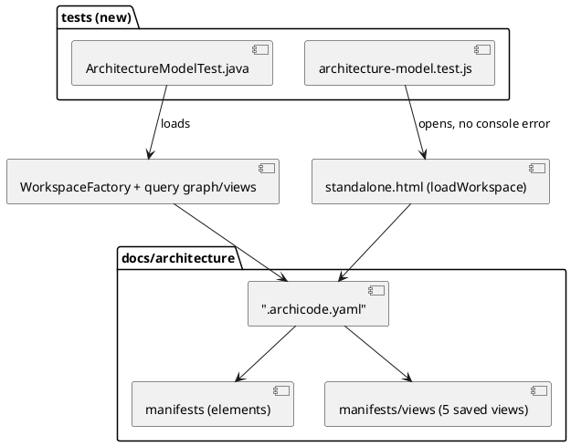
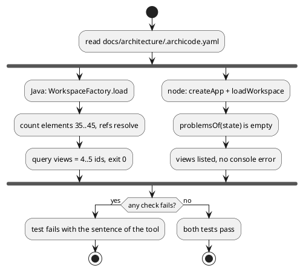

# ArchiCode model and saved views

# Summary

This run writes `docs/architecture/`, an as-is ArchiCode workspace (`.archicode.yaml` and manifests, no plateau) that models ArchiCode itself, shows it by five saved views, and proves that both tools load it: a Java test and a node test. The model is hand-written (wave 029, option 1 of the business case). It has 42 elements (36 application, 6 technology), with the paths of the code written in the free `tags` map of each element. No product code changes. There is no PRD: the profile is TDD+pln and the sources are the wave plan, its business case and the repository, so traceability is incomplete (see PRD Traceability). Two diagrams are kept: the components of the model, and the flow of the tests that load it.

# Scope

In scope: `docs/architecture/**` (workspace file, manifests, five saved views); two new tests (`ArchitectureModelTest` in Java, `architecture-model.test.js` in node); one line in `.gitignore`; the run record.

Out of scope (wave non-goals): plateaus, `replaces`, stories, generated or committed view files, metrics, a model of the 69 editor parts, a reverse completeness check, a rewrite of `CLAUDE.md` (W-2 adds one paragraph), a model of the wave and run process, any product change to remove a friction. The drift guard and the impact oracle are W-2.

# PRD Traceability

No PRD. Requirements are assumed from the manifest of wave 029 (the P1 gate and the W-1 row) and labelled `REQ-n`; they are not sourced from a PRD ID.

- `REQ-1` (P1 gate 1): `docs/architecture/.archicode.yaml` exists and `archicode query graph -w docs/architecture/.archicode.yaml` exits 0. Addressed (DEC-1, DEC-6, IMP-1, IMP-3).
- `REQ-2` (P1 gate 2): a Java test and a node test each load the workspace and pass. Addressed (DEC-5, IMP-2, IMP-3).
- `REQ-3` (P1 gate 3): 4 or 5 saved views, no generated folder in git. Addressed (DEC-4, DEC-7, IMP-1, IMP-4).
- `REQ-4` (P1 gate 4): no file under `src/` changes except tests for the model. Addressed (CON-1).
- `REQ-5` (W-1 scope): 35 to 45 elements; the CLI packages, the kernel with its entry points, `editor serve`, `guide`, `init`, the editor as its 6 layers with the rule "a layer uses the layers before it"; contracts as components with qualified relationships; a minimal technology layer; paths in `tags`. Addressed (DEC-1, DEC-2, DEC-3).
- `REQ-6` (W-1 scope): the upward pairs of the editor shown at the level of pairs of layers if `check-editor.mjs --list` allows it, else recorded as a friction. Addressed (DEC-8, Q-1).
- `REQ-7` (W-1 exit evidence): the saved views are listed by `archicode query views`; the editor opens the model in a test without a console error. Addressed (DEC-5, FLOW-1).
- Partially addressed: none. Unresolved: none (Q-1 and Q-2 are decisions left to the run, with a default).

# Technical Goals

- TG-1: a workspace under `docs/architecture/` that both tools load with no error, no warning and no dangling reference.
- TG-2: 35 to 45 elements, whose references and paths a later run can check mechanically (`tags.path`).
- TG-3: five saved views a human can open in the editor and read without scrolling a wall of boxes.
- TG-4: the model widens no existing test root (`MistakeSweepTest`, `ManifestCorpus`, `ShippedFilesTest`, `byte-identity.sh` all walk `src/`).
- TG-5: every friction met is written down in the run's progress log, for W-2 to turn into issues.

# Non-Goals

- No validation of the content of `tags.path` here (W-2's drift guard).
- No upward-pair counts in the model; they would go stale (wave non-goal on metrics).
- No attempt to make the model complete: code that is not modeled does not fail anything.

# Assumptions

- ASM-1: a manifest element accepts `tags` as `Map<String, String>` (`AbstractElement.tags`, checked in the sources) and the editor reads and keeps it. Validate by loading in both tests.
- ASM-2: `docs/` is outside every walked root, so `ManifestDiscovery` never reads these manifests as part of another workspace. Validate: `ShippedFilesTest.shouldFindTheWorkspacesOfTheRepository` still passes unchanged.
- ASM-3: relationship `qualifiers` and `label` are enough to say "mirror of", "generated from" and "validated by" (`relationships[].label` and `qualifiers`, as in `src/doc/examples/domain_plateaus`). Validate by drawing the contracts view with `views generate` once by hand (not committed).
- ASM-4: the saved `overview`, `detailed`, `deep` and `map` viewpoints exist and read `properties.element`, `pinned`, `hidden`, `opened` (CLAUDE.md and `GuideViewPropertiesTest`). A saved view without `properties` is an error, so every non-map view carries `element`.
- ASM-5: `.gitignore` of the repository has no `views*/` rule today (read: it holds `target/`, `.custom`, `node_modules` and the worktree line only). The wave plan says "git-ignored", so the run adds the rule (DEC-7).

# Constraints

- CON-1: nothing under `src/` is added or changed except test files for the model (P1 gate 4).
- CON-2: Java 25, `./mvnw`; PMD (`./mvnw test-compile pmd:check`) applies to the new Java test; no `NOPMD`, no `@SuppressWarnings("PMD...")`.
- CON-3: Prettier formats the new `.js` test (`npm run format:check`); the YAML under `docs/` is not covered by `format:check` (its globs are `src/**` and the editor sources) and is written in the style of the shipped examples (double quotes, two-space indent).
- CON-4: the Java test lives in `src/test/java/io/morin/archicode/doc/`, the node test in `src/test/javascript/` (both in `likely_paths` of W-1).
- CON-5: a node test cannot run ELK or the PlantUML renderer; the editor is opened in the harness without a DOM, so it proves loading, not the picture (same limit as `shipped-files.test.js`).
- CON-6: a reference is dotted, an element id has no dot (`dottedIdProblem`), and an element is declared once. Ids are lower snake case, as in the shipped examples.
- CON-7: the workspace file name is `.archicode.yaml`; the wave rule "every shipped file is loaded by both tools in a test" is satisfied by the two tests (the repository's own convention).

# Current State

- `docs/` holds `fixtures/`, `run/`, `wav/`; there is no `docs/architecture/` and no `docs/CLAUDE.md`, so no `arc` or `dom` register is declared.
- The architecture lives in the 60 KB `CLAUDE.md` and in lists: `src/main/editor/layers.json` (6 layers: `core`, `model`, `persistence`, `application`, `presentation`, `composition`; 69 parts), `names.json`, `java-names.json`, and `node scripts/check-editor.mjs --list` (upward pairs by pair of layers).
- Java packages under `src/main/java/io/morin/archicode/`: `cli`, `manifest`, `rendering`, `resource`, `viewpoint`, `workspace`, plus `ArchiCodeException`, `MapperFactory`, `Warnings`, `Utilities`. The kernel is `src/main/rust/viewpoint-kernel/` (`lib.rs`, `compare.rs`, `facet.rs`, `patch.rs`) embedded as `src/main/wasm/viewpoint_kernel.wasm`.
- Tests that load a whole workspace: `ShippedFilesTest.java` (Quarkus test, `WorkspaceFactory`) and `src/test/javascript/viewpoint-kernel/shipped-files.test.js` (`createApp`, `makeDirHandle`, `loadWorkspace`, `problemsOf`). `CliHarness` (package-private in `cli`) runs the command line with `ErrorOutput` installed.
- A saved view is a manifest of kind `view` or an entry of `views` in `.archicode.yaml` (as `src/doc/examples/domain_technology_map/.archicode.yaml`).

# Proposed Design

The model is a single no-plateau workspace in `docs/architecture/`: `.archicode.yaml` (settings with `name: "ArchiCode"` and `manifests.paths: ["manifests/**"]`) and the elements as manifests under `manifests/`, one file per system or environment. The five saved views are manifests of kind view under `manifests/views/` (`DEC-4`), so the editor lists them and the command line can draw them with `-i`.

Reviewer: check that the tests are the only new code, that both tools read the same folder, and that nothing under `src/main` appears.

## Elements (DEC-1, DEC-2, DEC-3)

Application layer, 36 elements (a system holds containers only and a container holds components, `Nesting.holds`, so the five couplings sit in one container):

| Reference | Kind | Notes (`tags.path` is the path written on the element) |
|---|---|---|
| `author` | person | the human who reads the model and writes the workspaces |
| `agent` | person | the AI agent that edits the code and queries the graph |
| `archicode` | solution | the whole product |
| `archicode.commandline` | system | Java 25, Quarkus, Picocli; `src/main/java/io/morin/archicode` |
| `archicode.commandline.commands` | container | package `cli` (Picocli commands, `ErrorOutput`) |
| `archicode.commandline.workspace` | container | package `workspace` (`WorkspaceFactory`, `LayerLoader`, `Fold*`) |
| `archicode.commandline.manifest` | container | package `manifest` (parser, discovery, `ManifestSchema`) |
| `archicode.commandline.resource` | container | package `resource` (elements, views, stories, plateaus) |
| `archicode.commandline.viewpoint` | container | package `viewpoint` (adapter around the kernel, `PlateauComparer`) |
| `archicode.commandline.rendering` | container | package `rendering` (PlantUML, gap tables) |
| `archicode.commandline.commands.editor_serve` | component | `editor serve`, `EditorHttpServer` |
| `archicode.commandline.commands.guide` | component | `archicode guide` |
| `archicode.commandline.commands.init` | component | `archicode init` |
| `archicode.kernel` | system | Rust compiled to WebAssembly, `src/main/rust/viewpoint-kernel` |
| `archicode.kernel.engine` | container | the Rust crate |
| `archicode.kernel.engine.compute` | component | `compute`, `lib.rs` |
| `archicode.kernel.engine.compare` | component | `compare`, `compare.rs` |
| `archicode.kernel.engine.facets` | component | `apply_facet`, `facet.rs` |
| `archicode.kernel.engine.patches` | component | `apply_patches`, `patch.rs` |
| `archicode.kernel.engine.states` | component | `states`, the seven state words said once, `lib.rs` |
| `archicode.kernel.engine.quiet` | component | `quiet`, the elements of a layer with nothing to draw, `lib.rs` |
| `archicode.editor` | system | the standalone editor, `src/main/editor` |
| `archicode.editor.core` | container | layer `core` |
| `archicode.editor.model` | container | layer `model` |
| `archicode.editor.persistence` | container | layer `persistence` |
| `archicode.editor.application` | container | layer `application` |
| `archicode.editor.presentation` | container | layer `presentation` |
| `archicode.editor.composition` | container | layer `composition` |
| `archicode.editor.page` | container | `src/main/resources/editor-webapp/standalone.html`, generated by `scripts/build-editor.mjs` |
| `archicode.contracts` | system | what couples the two tools |
| `archicode.contracts.couplings` | container | holds the five couplings below (a system cannot hold components) |
| `archicode.contracts.couplings.kernel_wasm` | component | `src/main/wasm/viewpoint_kernel.wasm` |
| `archicode.contracts.couplings.shared_cases` | component | `src/test/javascript/viewpoint-kernel/*-cases.json` |
| `archicode.contracts.couplings.read_schema` | component | `READ_SCHEMA` (`src/main/editor/core/read-schema.js`, owned by editor `core`) and the Java classes (`EditorReadSchemaTest`) |
| `archicode.contracts.couplings.manifest_schema` | component | `src/test/resources/schemas/manifest.schema.json` |
| `archicode.contracts.couplings.goldens` | component | byte-identity goldens: `scripts/byte-identity.sh`, `src/test/resources/guide/golden.md` |

Technology layer (environments and nodes, kinds `environment` and `node`): `workstation` (node `machine`), `github` (nodes `actions`, `pages`, `releases`): 2 environments and 4 nodes = 6. Total 42. The count is checked as 35 to 45 by the Java test, not as an exact number (DEC-5), so a later run can add an element without breaking it.

Qualified relationships (declared on the source element; `label` and `qualifiers`):

- the layers of the editor: each layer `uses` the one before it, qualifier `uses`, label "uses the layers before it" on `model` to `core`, `persistence` to `model`, `application` to `persistence`, `presentation` to `application`, `composition` to `presentation` (a chain of five links; the rule of the dependency is said once on the container `archicode.editor` in its description). The upward pairs are DEC-8.
- the editor system: `page` is `generated from` the layers (one relationship `page` to `composition`, qualifier `generated from`).
- the kernel callers (read from the code): `commandline.viewpoint` to `kernel.engine.compute`, `.compare`, `.facets` and `.states` (`KernelViewpointFactory`, `PlateauComparer`, `KernelStates`; qualifier `calls`); `commandline.workspace` to `kernel.engine.patches` and `.facets` (`LayerLoader`, `WorkspaceFactory`; qualifier `calls`). In the editor, `model` calls all six entry points (`kernel-bridge.js` exposes `states` and `quiet`, `layer-loader.js` applies the patches), `application` calls the kernel through `plateau-choice.js` (loads it before the patches are applied) and `presentation` calls it to draw (`diagram-layout.js`, `diagram-page.js`, `story-scene.js`); qualifier `calls`, one relationship per container to the components it uses.
- the six CLI containers (imports of the Java packages, `import io.morin.archicode.<package>`): `commands` uses `workspace`, `viewpoint`, `rendering`, `resource` and `manifest`; `workspace` uses `manifest`, `resource`, `viewpoint` and `rendering`; `manifest` uses `resource`; `viewpoint` uses `resource` and `workspace`; `rendering` uses `resource`, `viewpoint` and `workspace`; `resource` uses none. Qualifier `imports`; the cycles `workspace` and `viewpoint`, `workspace` and `rendering` exist in the code and are modeled as they are.
- contracts: `kernel_wasm` is `generated from` `kernel.engine`; `editor.page` is `mirror of` `commandline.manifest` through `read_schema` (`read_schema` to `commandline.resource`, qualifier `mirror of`; `editor.core` to `read_schema`, qualifier `owns`); `shared_cases` is `validated by` (qualifier) both `commandline.workspace` and `editor.application`; `manifest_schema` is `generated from` `commandline.manifest`; `goldens` is `validated by` `commandline.commands` and `commandline.rendering`.
- `editor_serve` serves `editor.page` (qualifier `serves`); `guide` and `init` read `manifest_schema`.
- people: `author` uses `archicode.editor` and `archicode.commandline`; `agent` uses `archicode.commandline` (qualifier `query graph`).
- technology: a relationship destination must be in the same layer as its source (`DanglingReferences`), so build and hosting are not relationships to applications; they are the `applications` list of the nodes: `workstation.machine` lists `archicode.commandline` and `archicode.editor`; `github.actions` lists `archicode.commandline` and `archicode.editor` (built there); `github.pages` lists `archicode.editor`; `github.releases` lists `archicode.commandline` (the packaged binaries). Nothing in the technology layer points at an application by a relationship.

## Saved views (DEC-4)

Five manifests of kind view, ids and viewpoints:

1. `archicode_overview` (`overview`, element `archicode`): the systems and the people.
2. `editor_layers` (`detailed`, element `archicode.editor`): the six layers and the page.
3. `commandline_and_kernel` (`detailed`, element `archicode.commandline`, with the kernel reached through its relationships).
4. `contracts` (`map`, application layer, `pinned` on the five components `archicode.contracts.couplings.*`, with `archicode.contracts.couplings` opened): what couples the tools.
5. `deployment` (`map`, layer `technology`): `workstation` and `github`, with `applications` on.

Whether a viewpoint can show relationships to an element outside the element drawn is an open point (Q-2); the fallback is two views or a `map`.

# Repository Impact

- IMP-1 — the model
  - Path(s): `docs/architecture/.archicode.yaml`, `docs/architecture/manifests/*.yaml`, `docs/architecture/manifests/views/*.yaml`
  - Change type: additive
  - Why impacted: the deliverable.
  - Linked PRD IDs: REQ-1, REQ-3, REQ-5
  - Risks / notes: one file per system or environment; hand-written, so the paths in `tags` can drift (W-2 guards them).
- IMP-2 — Java test
  - Path(s): `src/test/java/io/morin/archicode/doc/ArchitectureModelTest.java`
  - Change type: additive
  - Why impacted: the Java tool loads the model and lists its views.
  - Linked PRD IDs: REQ-2, REQ-7
  - Risks / notes: PMD applies; no new public class API.
- IMP-3 — node test
  - Path(s): `src/test/javascript/architecture-model.test.js`
  - Change type: additive
  - Why impacted: the editor opens the model with no problem and no console error.
  - Linked PRD IDs: REQ-1, REQ-2, REQ-7
  - Risks / notes: reuses `createApp` and `makeDirHandle` from `viewpoint-kernel/harness.js`; counts toward the editor coverage run (`npm run test:coverage`), which can only raise the figures.
- IMP-4 — ignore rule
  - Path(s): `.gitignore`
  - Change type: modify (one added line `/docs/architecture/views*/`)
  - Why impacted: `views generate -w docs/architecture/.archicode.yaml` writes `views/` beside the workspace file; nothing generated must be committed (REQ-3).
  - Linked PRD IDs: REQ-3
  - Risks / notes: P1 gate 3 counts `git ls-files docs/architecture | grep -c "views-"`; the manifests folder `manifests/views/` does not match `views-`. If the default folder is `views` (no dash), the pattern `views*/` covers both.
- IMP-5 — run record
  - Path(s): `docs/wav/wav-029-archicode-self-model/run/run-0209-archicode-model-and-views/` (prg, run file)
  - Change type: additive
  - Why impacted: frictions are logged (TG-5).
  - Linked PRD IDs: REQ-6

# Canonical Impact

Not applicable — no canonical registers declared (`docs/` has no `docs/CLAUDE.md`, no `arc` and no `dom` register). The new model is not a register: it is a product artefact the wave's W-2 guards.

# Data Model and Contracts

- CTR-1 — the workspace folder `docs/architecture/`
  - Current contract: none; the folder does not exist.
  - Proposed contract: a no-plateau workspace as the manual describes (`.archicode.yaml`, manifests of kind `archicode.morin.io/{person,solution,system,container,component,environment,node,view}`), elements 35 to 45, saved views 4 or 5, `tags.path` on every element that stands for code, no key the tools do not read.
  - Affected files: IMP-1.
  - Migration or compatibility notes: none; no tool reads it unless named with `-w` or opened as a folder. It adds no file to a walked root (ASM-2).
  - Linked PRD IDs: REQ-1, REQ-5
- CTR-2 — the `tags.path` convention
  - Current contract: `tags` is a free `Map<String, String>`.
  - Proposed contract: key `path`, a path from the repository root with `/`; several paths in one value separated by `, `. W-2's drift guard reads this convention; this run only writes it. A code element with no single path (a person, a solution) carries none.
  - Affected files: IMP-1.
  - Migration or compatibility notes: a later change of the key name is a change to the manifests and to the W-2 test together.
  - Linked PRD IDs: REQ-5
- No change to the schema of the manifests, the kernel, `READ_SCHEMA`, the guide, or any golden file.

# Interfaces and Behavior

- IF-1: `archicode query graph -w docs/architecture/.archicode.yaml` prints the resolved graph, exit 0, no `warning:` line.
- IF-2: `archicode query views -w docs/architecture/.archicode.yaml` lists the five view ids.
- IF-3: `archicode views generate -w docs/architecture/.archicode.yaml -i <id>` draws one view (a manual check, not a test: it writes files; Q-2).
- IF-4: the editor opens the folder `docs/architecture/`, lists the views on the page Stories, and draws no error.
- Failure: an unknown key or dangling reference is one `error:` line, exit 1 (the existing path); the tests fail with that sentence.

# Flows and Processing Logic

- FLOW-1 — loading the model in the tests
  - Trigger: `./mvnw test` (Java) or `npm run test:unit` (node).
  - Steps: (1) Java: `ArchitectureModelTest` loads `docs/architecture/.archicode.yaml` with `WorkspaceFactory`, counts the elements (35 to 45), asserts every reference a relationship names exists, reads the `views` through `query views` (via `CommandLine` and `ErrorOutput`, exit 0, 4 or 5 ids), and asserts that `git`-independent file listing of the folder holds no `views-*` folder and no file other than YAML. (2) Node: `architecture-model.test.js` opens the folder with `createApp` + `makeDirHandle`, `loadWorkspace`, `loadViewpointKernel`, asserts `problemsOf(state)` is empty (copied rule of `shipped-files.test.js`), that the saved views are listed, and that the console received no error. Mechanism (read from `harness.js`): the sandbox console of `createApp` forwards `warn` and `error` to the real `console`, at the time `createApp` runs, so the test replaces `console.error` and `console.warn` with `node:test` `mock.method` before `createApp` and asserts afterwards that neither was called; `problemsOf` and the errors thrown by `loadWorkspace` are the other checks. The list of views is read from the state the page holds after `loadWorkspace` (the saved views of `state`), not from the DOM.
  - Branches / failure paths: a missing file in the folder is a test failure with the path; a manifest the editor cannot read is a `problems` entry with its sentence.
  - Final output / rendered result: two green tests; no file written under `docs/architecture/`.
  - Linked PRD IDs: REQ-2, REQ-7

Reviewer: check that the two tests are independent of each other and that neither writes into `docs/architecture/`.

# Reliability, Performance, and Scalability

- Both tests read about 12 small YAML files; they add well under a second to the suites. The Java test is a `@QuarkusTest` like its neighbours, so it adds no startup.
- The tests do not depend on the order of the files or on git being available (they walk the folder, not `git ls-files`).

# Security and Privacy

Nothing materially relevant. The model contains no real workspace content, no secret and no path of the author's machine (memory rule: no real workspace content in the repository); every path in `tags.path` is a path of this repository.

# Observability and Verification

- `./mvnw test-compile pmd:check` and `./mvnw test -Dtest=ArchitectureModelTest`.
- `npm run test:unit` (or `node --test src/test/javascript/architecture-model.test.js`), `npm run format:check`, `npm run lint`.
- `./mvnw verify` once at the end: the jar/test floors do not move; `ShippedFilesTest` and `shipped-files.test.js` still pass (ASM-2).
- By hand, in the run record: `java -jar target/quarkus-app/quarkus-run.jar query graph -w docs/architecture/.archicode.yaml; echo $?` prints 0; `query views` lists the ids; `git status --short docs/architecture` shows no `views*` folder after one `views generate -i` run (IMP-4); `git status --short src` shows the two new test files only, untracked (`git diff --stat -- src` shows nothing, since they are new; CON-1).
- Check of the tests themselves: break the model in a copy (rename a destination) and see both tests fail with the tool's sentence (recorded in the run).

# Deployment and Rollout

Code-only (tests) and documentation. Nothing ships in the jar, the native image or the website. Compatible with every existing workflow. Rollback: revert the commit. This is planning guidance only.

# Risks and Tradeoffs

- RISK-1: the model goes stale (hand-written). Mitigated by W-2's guard and oracle, not by this run.
- RISK-2: granularity. 42 elements and 6 layers may make `detailed` views unreadable or too thin. Mitigation: a saved view may use `map` with `pinned`/`opened` (DEC-4); the run adjusts the model, not the oracle (wave risk).
- RISK-3: a viewpoint cannot draw cross-system relationships the way the contracts need (Q-2). Mitigation: `map` view; otherwise a friction issue.
- RISK-4: the node test does not draw the diagram (CON-5), so an unreadable picture is not caught by it; the run draws each view once by hand and records the result.
- RISK-5: the P1 gate 3 command `grep -c "views-"` counts file names containing `views-`; a manifest named `views-...yaml` would fail it. Mitigation: no manifest file name contains `views-` (view manifests are named `view.<id>.yaml`).

# Open Questions

- Q-1: RESOLVED (stage 6, by running `node scripts/check-editor.mjs --list`). The output has a header line per pair of layers, `<lower> to <higher>: <count>`, so it reads by pair. Today it prints 8 pairs: application to composition, application to presentation, model to application, model to presentation, persistence to application, persistence to composition, persistence to presentation, presentation to composition (99 upward in all). Resolution: DEC-8 holds; the run writes one `upward` relationship per header line, with no count, between the containers of those layers (reading the header lines, not the per-name lines). No friction to log for this question.
- Q-2: left to the implementation by design, not a blocker. It cannot be answered by reading: `detailed` is drawn from the focal element's neighbours and only drawing the real workspace shows whether the kernel's boxes appear. Default of DEC-4 stands: try `detailed`; if the kernel boxes are absent, use a `map` with `pinned` of both systems and log the missing capability as a friction. Static documentation (README.adoc, kernel README) states no rule that decides it.

# Deferred Work

- DEF-1: drift guard and impact oracle (W-2).
- DEF-2: a `tags.path` check and the `CLAUDE.md` paragraph (W-2).
- DEF-3: GitHub issues for the frictions (W-2 files them from the log).
- DEF-4: plateaus, history, stories, `plateau` of a future architecture (wave non-goals).

# Design Decisions

- DEC-1 — one hand-written workspace, 42 elements
  - Decision: hand-write a no-plateau workspace of 42 elements (36 application, 6 technology), checked as 35 to 45 by a test.
  - Rationale: the wave's option 1; the friction of writing it by hand is the point of the dogfooding.
  - Alternatives considered: generating it from `layers.json` and the packages (rejected in the business case); an exact element count in the test (breaks on every addition).
  - Tradeoffs: stale risk (RISK-1) against a model that says what the author chooses to show.
  - Linked PRD IDs: REQ-5
- DEC-2 — the editor as 6 containers plus the generated page
  - Decision: the 6 layers of `layers.json` are containers of `archicode.editor`, with a seventh container for the page; the 69 parts are not modeled.
  - Rationale: layers are the unit of the rule "a layer uses the layers before it"; the parts would make 69 boxes.
  - Alternatives considered: parts as components (too fine); one box for the editor (hides the rule).
  - Tradeoffs: the model says nothing about which part changes.
  - Linked PRD IDs: REQ-5
- DEC-3 — contracts are components with qualified relationships
  - Decision: the couplings between the tools (kernel wasm, shared cases, `READ_SCHEMA`, manifest schema, goldens) are components of the container `archicode.contracts.couplings`, and their relationships carry `qualifiers` (`mirror of`, `generated from`, `validated by`, `calls`, `serves`).
  - Rationale: an agent asks `query graph` which side of a twin to check; the qualifier says why they are coupled.
  - Alternatives considered: relationships only between the two systems (hides the contract); prose in descriptions (not queryable).
  - Tradeoffs: more elements and relationships (about a third of the model).
  - Linked PRD IDs: REQ-5
- DEC-4 — saved views as manifests, five of them
  - Decision: five manifests of kind view under `manifests/views/`, named `view.<id>.yaml`, ids as listed; the contracts and the deployment views are `map` views.
  - Rationale: the editor lists manifests and the CLI draws them with `-i`; five is within 4 to 5 and each answers one question.
  - Alternatives considered: `views:` in `.archicode.yaml` (also valid, but one file grows and the views are less discoverable); more views (the gate says 4 or 5).
  - Tradeoffs: the `detailed` views may need adjusting after drawing (Q-2).
  - Linked PRD IDs: REQ-3
- DEC-5 — two tests, tolerant of growth
  - Decision: `ArchitectureModelTest` (Java) and `architecture-model.test.js` (node) load the folder, check 35 to 45 elements, 4 to 5 views, no unresolved reference and no problem, not an exact list of ids.
  - Rationale: REQ-2 and the repository rule that both tools load every shipped file; W-2 adds the exact guards.
  - Alternatives considered: adding `docs/architecture` to `ShippedFilesTest` roots (widens the Java sweep and `exceptions.json`; the wave says the model stays outside them); a CLI-level IT (needs a packaged jar).
  - Tradeoffs: duplicates a little of `shipped-files.test.js` (the `problemsOf` rule); acceptable, it is test code and no helper is extracted (YAGNI, a later run may).
  - Linked PRD IDs: REQ-2, REQ-7
- DEC-6 — `query graph` is checked by hand and by the Java test
  - Decision: the Java test runs `query graph` and `query views` through the command line (the way `CliHarness` does, a copy in the `doc` package because `CliHarness` is package-private in `cli`), asserting exit 0 and an empty error output.
  - Rationale: the P1 gate names the command; running it in the test keeps it true.
  - Alternatives considered: moving the test to `io.morin.archicode.cli` (outside `likely_paths`).
  - Tradeoffs: a small copy of the harness.
  - Linked PRD IDs: REQ-1
- DEC-7 — ignore the generated folder
  - Decision: add `/docs/architecture/views*/` to `.gitignore`.
  - Rationale: the wave says generated files are git-ignored; the repository does not ignore them (ASM-5).
  - Alternatives considered: rely on discipline (a commit by `git add -A` would carry them).
  - Tradeoffs: a root file changes, outside `src/` (CON-1 allows it).
  - Linked PRD IDs: REQ-3
- DEC-8 — upward pairs as `upward` relationships, no counts
  - Decision: for each pair of layers `check-editor.mjs --list` prints as upward (for example `application to presentation`), one relationship with qualifier `upward` from the lower layer to the higher one is written, with no number.
  - Rationale: shows the debt of the ratchet without a metric that goes stale.
  - Alternatives considered: the count in the label (stale); leaving them out (hides the main architectural debt).
  - Tradeoffs: the pairs are a copy of a list that lowers over time (RISK-1); W-2 may guard it.
  - Linked PRD IDs: REQ-6
