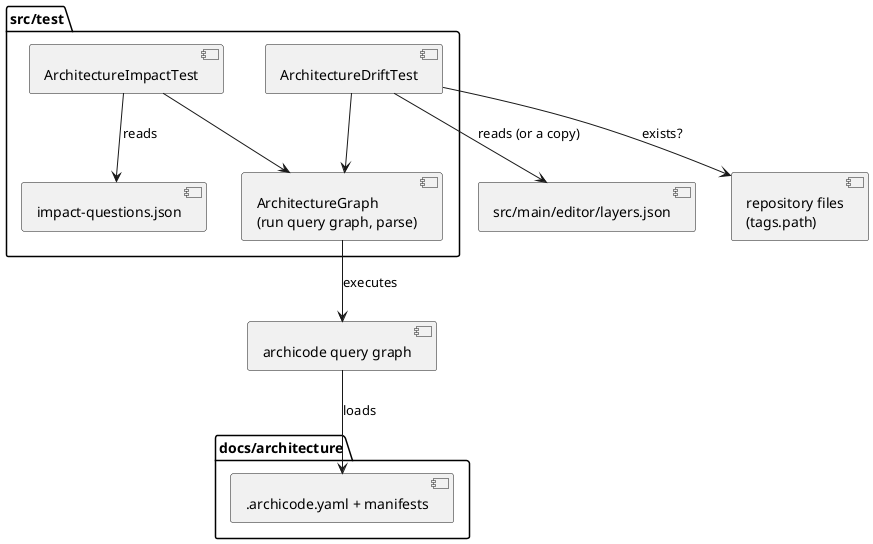
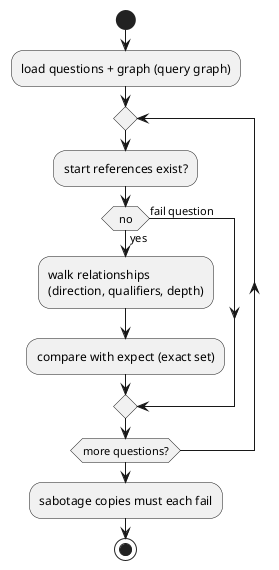

# ArchiCode model guards and way in

# Summary

Run 0209 wrote `docs/architecture/` (42 elements, the saved views of `manifests/views/`, loaded by `ArchitectureModelTest` and `architecture-model.test.js`). This run keeps it true and makes it usable by an agent: an impact oracle (seven fixed questions answered from the output of `archicode query graph`, with exact expected elements), a one-way drift guard (each modeled editor layer is in `src/main/editor/layers.json` in the same order, each `tags.path` exists), one paragraph in `CLAUDE.md` that names the folder and the command, and one GitHub issue per tool friction met while building the model. Only test files, `docs/architecture/**` (adjusted if the oracle shows the model wrong), `CLAUDE.md` and the run record change. No product code changes. There is no PRD (profile TDD+pln), so traceability is incomplete: requirements are labelled `REQ-n` from the manifest of wave 029. Two diagrams: the test components, and the flow of one oracle question.

# Scope

In scope: two Java test classes and a small shared helper in `src/test/java/io/morin/archicode/doc/`; one shared questions file in `src/test/javascript/architecture/`; edits to `docs/architecture/manifests/` that the oracle demands; one paragraph added to `CLAUDE.md`; GitHub issues on `tmorin/archicode`; the run record.

Out of scope (wave non-goals and decisions below): a reverse completeness check, metrics, plateaus, generated views, a model of the 69 editor parts, a rewrite of `CLAUDE.md`, any change to the product to remove a friction (including a `query impact` command, DEF-1), a node twin of the oracle (DEC-2).

# PRD Traceability

No PRD. Requirements assumed from the P2 gate and the W-2 row of the wave manifest.

- `REQ-1` (P2 gate 1): the impact oracle test lists 6 to 8 questions, each names its expected elements, and passes. Addressed (DEC-1, DEC-2, DEC-3, DEC-6, IMP-1, IMP-2).
- `REQ-2` (P2 gate 2): the drift guard fails when a modeled editor layer is renamed or reordered in a copy of `layers.json`, and passes on the repository. Addressed (DEC-4, IMP-3).
- `REQ-3` (W-2 scope): each element that carries a path in `tags` points to an existing path. Addressed (DEC-4, IMP-3).
- `REQ-4` (P2 gate 3): `CLAUDE.md` has a paragraph that names `docs/architecture` and the exact `query graph` command; the diff is additions only. Addressed (DEC-7, IMP-5).
- `REQ-5` (P2 gate 4): each friction in the progress log has a GitHub issue, or the log says there is none. Addressed (DEC-8, IMP-6).
- `REQ-6` (W-2 exit evidence): the two tests fail when the model or `layers.json` is made wrong in a copy. Addressed (DEC-5, FLOW-2).
- `REQ-7` (wave risk, granularity): if the oracle shows the model wrong, W-2 adjusts the model, not the questions. Addressed (DEC-6).
- Partially addressed: none. Unresolved: none (Q-1 resolved by DEC-2).

# Technical Goals

- TG-1: seven questions whose answers come from `query graph` output, not from the YAML, so the test reads what an agent reads.
- TG-2: an answer is an exact set; a widened or narrowed answer fails with the difference printed.
- TG-3: the guard and the oracle are pure functions over data, so a test can hand them a wrong copy and see them fail.
- TG-4: `CLAUDE.md` gains one paragraph and loses nothing.
- TG-5: every friction of the wave has an issue number, or a line that says there is none.

# Non-Goals

- No `query impact` or `query neighbours` command: the oracle traverses the graph in test code (DEF-1; it becomes an issue, DEC-8).
- No node twin of the oracle or the guard (DEC-2).
- No check that code absent from the model fails (reverse completeness).
- No lines, counts or upward-pair numbers in the model or the tests.

# Assumptions

- ASM-1: `query graph` prints `{"elements": [...], "relationships": [...]}`; `elements` is flat (one entry per element, nested ones included, with `reference`, `layer` and `element`; `element.tags` is present on 31 of the 42 and absent on the 11 technology ones, so an absent `tags` is no path), `relationships` is flat too (`source`, `layer`, `relationship.destination`, `.label`, `.qualifiers`). Checked on the packaged jar: 42 elements, 57 relationships. Validate: the helper fails on any other shape.
- ASM-2: a relationship destination is in the layer of its source (`DanglingReferences`), so the oracle never crosses from technology to application; deployment (`applications` lists of nodes) is not in `relationships`. Checked in 0209. The oracle questions are application-layer questions.
- ASM-3: tests run with the repository root as working directory (as `ArchitectureModelTest` assumes with `Path.of("docs/architecture")`).
- ASM-4: `gh` is logged in as `tmorin` with access to `tmorin/archicode` (checked: `gh auth status`, `gh issue list`). Creating issues is the author's wave plan (W-2 scope), not a new permission.
- ASM-5: the questions below return the sets in the table of DEC-3 on the model as it is plus the one relationship of DEC-6. I computed the first seven rows against `query graph` of the packaged jar before writing; the implementing task recomputes them and, if a row differs, reads the difference as the oracle intends (DEC-6) before editing anything.

# Constraints

- CON-1: P2 gate 4 of the wave, and the stage brief: only test files, `docs/architecture/**`, `CLAUDE.md` and run records change; nothing under `src/main`.
- CON-2: PMD (`./mvnw test-compile pmd:check`) applies to the new Java; no `NOPMD`, no `@SuppressWarnings("PMD...")`; Prettier (`npm run format:check`) covers `src/**/*.java`, not JSON.
- CON-3: Java 25; the shell's `java` may be older, so `JAVA_HOME` names JDK 25 (`.sdkmanrc`).
- CON-4: `CLAUDE.md` diff is additions only (`git diff --numstat -- CLAUDE.md` prints 0 deletions).
- CON-5: the guard and oracle read `docs/architecture` and write nothing in it; copies for the sabotage tests are edited in memory (the graph and `layers.json` as `JsonNode`) or, for (e) only, go to a JUnit `@TempDir`.
- CON-6: the new test classes follow the repository convention: a comment says why a thing is as it is; an assertion says what the code returns.

# Current State

- `docs/architecture/` exists (run 0209): `.archicode.yaml`, `manifests/{archicode,author,agent,environment.github,environment.workstation}.yaml`, five view manifests under `manifests/views/`. Untracked at the start of this run (the working tree holds it, not yet committed).
- Tests of run 0209: `src/test/java/io/morin/archicode/doc/ArchitectureModelTest.java` (`@QuarkusTest`; a private `run(String...)` that executes the command line with `ErrorOutput` installed and returns exit, stdout and stderr; the element count 35 to 45; the saved views counted by entries with a `name`; YAML only and no `views*` folder) and `src/test/javascript/architecture-model.test.js`.
- The modeled editor layers are the containers `archicode.editor.{core,model,persistence,application,presentation,composition}`, each with `tags.path = src/main/editor/<layer>` and a `uses` relationship to the layer before it (composition to presentation, ..., model to core); `archicode.editor.page` is generated from composition. `src/main/editor/layers.json` holds `"layers": ["core","model","persistence","application","presentation","composition"]` and the parts.
- Every element with a path writes it in `tags.path`; a value may list several paths separated by `, ` (`goldens`, `editor_serve`, `guide`). No `tags.path` holds a wildcard (grep on the manifests).
- `READ_SCHEMA` is modeled as `contracts.couplings.read_schema` with `tags.path = src/main/editor/core/read-schema.js` and a `mirror of` relationship to `commandline.resource`; there is no relationship between editor `core` and `read_schema` yet (0209 TDD planned `editor.core` `owns` `read_schema`; the manifests do not have it).
- `CLAUDE.md` (165,804 bytes) describes the architecture in prose and has no pointer to the model. `docs/` has no `CLAUDE.md` and no `arc` or `dom` register.
- Open frictions are written in `prg-0209-...md` under Findings (DEC-8 turns them into issues).

# Proposed Design

Three test classes (`ArchitectureModelTest` of run 0209, `ArchitectureImpactTest`, `ArchitectureDriftTest`), one helper and one data file, all test-side:

- `ArchitectureGraph` (package-private helper in `src/test/java/io/morin/archicode/doc/`): runs `query graph -w <workspace>` (the `run` of `ArchitectureModelTest`, moved here so three classes share it), checks exit 0 and empty stderr, and returns the parsed `JsonNode`. Pure traversal and checks are static methods over a `JsonNode`, so they run on in-memory copies.
- `ArchitectureImpactTest`: reads `impact-questions.json`, asks `ArchitectureGraph` for the graph, answers each question, compares exact sets.
- `ArchitectureDriftTest`: the guard.
- `src/test/javascript/architecture/impact-questions.json`: the seven questions.

The reviewer checks that the oracle reads the CLI output rather than the YAML, that the guard takes `layers.json` and the graph as arguments (so a copy can be passed), and that no node file is added.

## The oracle (DEC-1, DEC-2, DEC-3)

A question has `id`, `ask` (the sentence an agent would ask), `start` (references; the element and everything under it, by reference prefix `ref.`), `direction` (`in`: elements whose relationship leads to the start; `out`: elements the start leads to; `both`), `qualifiers` (a relationship counts when it carries one of them), `depth` (a number of hops, or `null` for the transitive closure) and `expect` (the exact set of references answered; the answer excludes the starts and their descendants). An element reached in a later hop covers its descendants too. Answering walks `relationships` breadth first from the starts, one hop per round, never revisiting a reference. The relationship sits on a child element, so the answer names the child that holds it (for example `archicode.commandline.viewpoint`, not `archicode.commandline`).

DEC-3 questions, with the answers I computed on `query graph` of the current jar (ASM-5):

| Id | Ask | Start | Dir | Qualifiers | Depth | Expect |
|---|---|---|---|---|---|---|
| Q01 | I change the kernel contract: what changes with it? | `archicode.kernel.engine` | in | calls, generated from | 1 | `contracts.couplings.kernel_wasm`, `commandline.viewpoint`, `commandline.workspace`, `editor.model`, `editor.application`, `editor.presentation` |
| Q02 | I change a sentence both tools say: which side validates it? | `contracts.couplings.shared_cases` | out | validated by | 1 | `commandline.workspace`, `editor.application` |
| Q03 | I change `standalone.html`: who produces it and who serves it? | `editor.page` | both | serves, generated from | 1 | `editor.composition`, `commandline.commands.editor_serve` |
| Q04 | I change the editor `model` layer: which layers and what is generated from it? | `editor.model` | in | uses, generated from | null | `editor.persistence`, `editor.application`, `editor.presentation`, `editor.composition`, `editor.page` |
| Q05 | I change `READ_SCHEMA`: whose twin must follow? | `contracts.couplings.read_schema` | both | owns, mirror of | 1 | `editor.core`, `commandline.resource` |
| Q06 | I change the manifest classes: which schema, which packages? | `commandline.manifest` | in | generated from, reads, imports | 1 | `contracts.couplings.manifest_schema`, `commandline.commands`, `commandline.workspace` |
| Q07 | I change what the command line renders: which goldens, which callers? | `commandline.rendering` | in | validated by, imports | 1 | `contracts.couplings.goldens`, `commandline.commands`, `commandline.workspace` |

(`archicode.` is dropped from the table's references for width; the file writes full references.) Q04 shows by its answer that `editor.core` and the kernel are not touched; Q05 is the question the oracle answers wrongly today (ASM-5: on the current manifests it returns only `commandline.resource`, because the `owns` relationship is missing), which is the point of the oracle (DEC-6).

Seven is inside the 6 to 8 of the gate. The set mixes both tools and both kinds of coupling the wave names: the kernel contract (Q01), a sentence both tools say (Q02), `standalone.html` (Q03), a layer of the editor (Q04), and real couplings chosen from the model (Q05 to Q07).

## The drift guard (DEC-4, DEC-5)

`ArchitectureDriftTest.problems(graph, layersJson, root)` returns a list of sentences, empty when the model is true. Rules:

1. A modeled editor layer is an element `archicode.editor.<id>` whose `tags.path` is `src/main/editor/<id>`. At least one must exist (a guard that finds nothing must not pass).
2. Each modeled layer id is in `layers.json` `layers`.
3. For two modeled layers that are adjacent in `layers.json`, the later one has a relationship to the earlier one with the qualifier `uses` (the rule "a layer uses the layers before it").
4. Each entry of `tags.path` of each element (split on `,`, trimmed; an element with no `tags` or no `path` has no path) is relative, has no `..` segment and exists under the root (file or folder). At least one path must be checked.

`query graph` sorts `elements` by reference, so the guard never relies on the order of `elements`; the order is fixed by rule 3 over the order of `layers.json`.

It is one-way: a layer in `layers.json` that the model lacks is not a problem (wave non-goal).

# Repository Impact

- IMP-1 — shared helper
  - Path(s): `src/test/java/io/morin/archicode/doc/ArchitectureGraph.java` (new), `src/test/java/io/morin/archicode/doc/ArchitectureModelTest.java` (its private `run` is replaced by a call to the helper)
  - Change type: additive, modify (a test refactor with no change in what it asserts)
  - Why impacted: three classes need to run `query graph`; copying `run` three times breaks DRY.
  - Linked PRD IDs: REQ-1, REQ-2
  - Risks / notes: PMD; keep `ArchitectureModelTest` assertions byte for byte.
- IMP-2 — oracle
  - Path(s): `src/test/java/io/morin/archicode/doc/ArchitectureImpactTest.java` (new), `src/test/javascript/architecture/impact-questions.json` (new)
  - Change type: additive
  - Why impacted: REQ-1.
  - Linked PRD IDs: REQ-1, REQ-6, REQ-7
  - Risks / notes: the JSON is read by Java only; it lives under `src/test/javascript/` because that is where the repository keeps the case files its twins read, and the wave lists that path.
- IMP-3 — guard
  - Path(s): `src/test/java/io/morin/archicode/doc/ArchitectureDriftTest.java` (new)
  - Change type: additive
  - Why impacted: REQ-2, REQ-3, REQ-6.
  - Linked PRD IDs: REQ-2, REQ-3, REQ-6
  - Risks / notes: reads `src/main/editor/layers.json` read-only.
- IMP-4 — model adjustments
  - Path(s): `docs/architecture/manifests/archicode.yaml` (at least one relationship `editor.core` to `contracts.couplings.read_schema`, label "owns the schema", qualifier `owns`; others only if an oracle row differs, DEC-6)
  - Change type: modify
  - Why impacted: Q05 (REQ-7).
  - Linked PRD IDs: REQ-7
  - Risks / notes: a relationship from `core` to `read_schema` changes `query graph` (58 relationships); `ArchitectureModelTest` still passes; the views are not affected (`contracts` is a map pinned on the couplings; re-draw the five views in a scratch copy to check that they stay readable, as 0209 did: the new link adds a box and a link to `editor_layers` and maybe to the overview, not only to `contracts`).
- IMP-5 — pointer
  - Path(s): `CLAUDE.md`
  - Change type: additive (one section added before `## Architecture`)
  - Why impacted: REQ-4.
  - Linked PRD IDs: REQ-4
  - Risks / notes: no other line may change; no test pins `CLAUDE.md` text (grep: only `init-workspace.test.js` names the file, as a path).
- IMP-6 — issues and record
  - Path(s): GitHub `tmorin/archicode` (issues); `prg-0210-...md` (the list with numbers)
  - Change type: additive
  - Why impacted: REQ-5.
  - Linked PRD IDs: REQ-5
  - Risks / notes: publishing action, covered by the wave plan; see DEC-8 for how duplicates are avoided.

# Canonical Impact

Not applicable — no canonical registers declared (`docs/` has no `CLAUDE.md`, no `arc`, no `dom` register; checked in run 0209 and unchanged).

# Data Model and Contracts

- CTR-1 — impact questions file
  - Current contract: none.
  - Proposed contract: `src/test/javascript/architecture/impact-questions.json` is `{ "questions": [ { "id", "ask", "start": [ref...], "direction": "in"|"out"|"both", "qualifiers": [text...], "depth": integer|null, "expect": [ref...] } ] }`. References are full (`archicode.editor.model`). `expect` is the exact answer, starts excluded; an empty `qualifiers` is not allowed (a question must say which couplings it follows).
  - Affected files: the file, `ArchitectureImpactTest`.
  - Migration or compatibility notes: additive; a question is changed when a coupling changes on purpose, in the same commit as the model (DEC-3).
  - Linked PRD IDs: REQ-1
- CTR-2 — what the model promises about `tags.path`
  - Current contract: `tags.path` is free text written by hand (0209).
  - Proposed contract: `tags.path` is one or more repository-relative paths separated by commas; each exists. Tested by the guard.
  - Affected files: `docs/architecture/manifests/*.yaml`, `ArchitectureDriftTest`.
  - Migration or compatibility notes: no value changes today (all existed at the end of 0209).
  - Linked PRD IDs: REQ-3
- CTR-3 — shape of `query graph` as a dependency
  - Current contract: the output of `query graph` (ASM-1) is consumed by tools and tests (`GetGraphQuery`).
  - Proposed contract: unchanged. The helper depends on `elements[].reference|layer|element.tags` and `relationships[].source|relationship.{destination,qualifiers}`. A change of that shape fails the helper with a message that names the field.
  - Affected files: `ArchitectureGraph`.
  - Migration or compatibility notes: none.
  - Linked PRD IDs: REQ-1

# Interfaces and Behavior

- IF-1: `ArchitectureGraph.load(Path workspace, CommandLine.IFactory factory, ErrorOutput errorOutput)` returns the graph; fails if exit is not 0 or stderr is not empty. It is static, so the test classes keep the injection (`@Inject` of the factory and of `ErrorOutput`, as `ArchitectureModelTest` does) and pass both.
- IF-2: `ArchitectureGraph.impact(JsonNode graph, Question q)` returns a sorted set of references.
- IF-3: `ArchitectureDriftTest.problems(JsonNode graph, JsonNode layers, Path root)` returns sentences; the repository must give none.
- Failure sentences name the question id or the rule and print missing and unexpected references (for a question: ``Q05 `ask`: missing [x], unexpected [y]; if the coupling changed on purpose, change the model and this question together``).

# Flows and Processing Logic

- FLOW-1 — one oracle question
  - Trigger: `./mvnw test` (or `-Dtest=ArchitectureImpactTest`).
  - Steps: load questions; for each, check the starts exist in the graph; walk; compare with `expect`.
  - Branches / failure paths: a start that does not exist fails the question (not an empty answer); an empty `expect` fails the file check; a missing or extra element prints the difference.
  - Final output / rendered result: green test, or a sentence per wrong question.
  - Linked PRD IDs: REQ-1
- FLOW-2 — sabotage in a copy
  - Trigger: the same test classes.
  - Steps: (a) graph copy with the `owns` relationship removed (in memory): Q05 must fail; (b) graph copy with the `calls` relationships of `archicode.editor.presentation` towards `archicode.kernel.engine.*` removed (`kernel.engine` holds none, its callers do): Q01 must fail; (c) the `layers.json` node, edited in memory, with `core` renamed (`kernel`): the guard must fail (rule 2); (d) the `layers.json` node with `model` and `persistence` swapped: the guard must fail (rule 3, since `persistence` does not `uses` `core`); (e) copy of `docs/architecture` in a `@TempDir` with one `tags.path` changed to a missing path, then `query graph -w <copy>`: rule 4 fails; (f) the repository, unmodified: no problem.
  - Branches / failure paths: a sabotage that does not fail is a test failure (the guard is useless).
  - Final output / rendered result: the guard and the oracle are shown to bite.
  - Linked PRD IDs: REQ-2, REQ-6

The reviewer checks that a missing start is a failure and that the sabotage step uses copies, never the committed files.

# Reliability, Performance, and Scalability

Each `query graph` run is a few hundred milliseconds in a `@QuarkusTest`; the three classes run it at most five times in all (sabotage (e) adds one). The helper is plain code over `JsonNode`; no new dependency. Exact-set expectations make a deliberate change of the model a two-file edit (model and questions); that is the intended friction (DEC-3).

# Security and Privacy

None material. The issues contain no real workspace content (the model is of ArchiCode itself; the memory rule on real workspaces does not apply). No secret is read.

# Observability and Verification

- `./mvnw test -Dtest='Architecture*Test' -Djacoco.skip=true` (JDK 25): the three test classes (`ArchitectureModelTest`, `ArchitectureImpactTest`, `ArchitectureDriftTest`; `ArchitectureGraph` is the helper, not a test).
- `./mvnw test-compile pmd:check`; `npm run format:check`.
- `node --test src/test/javascript/architecture-model.test.js` (unchanged, still green after IMP-4).
- Gate checks: `git diff --numstat -- CLAUDE.md` shows additions and 0 deletions; the paragraph contains `docs/architecture` and `archicode query graph -w docs/architecture/.archicode.yaml`; `git status --short src` shows only the test files; `find docs/architecture -name 'views-*'` prints nothing; each friction line of the run's Findings has `#NNN` or the words "no issue" with a reason.
- Not run in this run (as in 0209): the full `./mvnw verify` with the coverage floors, unless time allows; the new classes are test code and `src/main` is untouched, so the floors cannot move.

# Deployment and Rollout

Code-only (tests) plus documentation and external issues. No staging. Compatible with everything: the tests read the repository. Rollback: delete the three test classes, the helper and the questions file, revert the `CLAUDE.md` paragraph; issues stay open on their own merit.

# Risks and Tradeoffs

- RISK-1: exact sets make the oracle fail on every legitimate coupling change, and an agent may "fix" it by pasting the new answer. Mitigation: the failure sentence says to change the coupling and the question together; the `CLAUDE.md` paragraph says the same. Accepted.
- RISK-2: the model is hand-written, so the oracle only guards the couplings its seven questions walk (wave accepts).
- RISK-3: Q05 (and any row ASM-5 gets wrong) may reveal more missing relationships; the run may end with more model edits than the one named. Mitigation: DEC-6 limits edits to relationships needed to make a question true as read from the code, each justified in the run record.
- RISK-4: `tags.path` can name a path that exists but is the wrong one; the guard only checks existence.
- RISK-5: the issues are public; wording must be neutral and reproducible (command, output, expected).
- RISK-6: a refactor of `ArchitectureModelTest` (IMP-1) could change what it asserts. Mitigation: only the `run` helper moves; assertions are untouched and the class is re-run.

# Open Questions

- Q-1: is a node-side oracle wanted for the editor's sake? Resolved (Stage 6, 2026-10-31): no. DEC-2 already decides it: the oracle judges the model and the output of `query graph`, the node test of run 0209 already loads the model in the editor, and a JavaScript traversal would be the same code twice. If an editor-side need appears, a twin is added later from the same questions file. No question is left open.

# Deferred Work

- DEF-1: a `query impact <reference>` (or `query neighbours`) command, so the traversal is the tool's, not the test's. Filed as an issue (DEC-8); not built.
- DEF-2: a reverse check (code areas that nobody models) and a cross-layer traversal (technology nodes that host an application); both wait for a decision on metrics and on the `applications` lists.
- DEF-3: `archicode validate` for `tags` keys (issue; #144 is closed and left `validate` unbuilt).

# Decisions

- DEC-1 — The oracle answers from `query graph`, not from the YAML
  - Decision: tests run `query graph -w docs/architecture/.archicode.yaml` and traverse the flat `relationships` list.
  - Rationale: that is what an agent will run (REQ-4); the test then proves the command and the answer an agent gets.
  - Alternatives considered: read the YAML in the test (a second parser, and it proves nothing about the command); use `WorkspaceFactory` objects (hides the shape an agent sees).
  - Tradeoffs: depends on the output shape (CTR-3).
  - Linked PRD IDs: REQ-1, REQ-4
- DEC-2 — Java only, no node twin
  - Decision: the oracle and the guard are Java; the node test of 0209 stays as it is.
  - Rationale: they judge the model and the CLI output, not a twin implementation; a second traversal in JavaScript would be the same code twice (DRY) and the editor adds nothing to the answer.
  - Alternatives considered: a node test reading the same questions file and calling the editor's graph (more code, and the editor's index is not the command output).
  - Tradeoffs: the "both tools load it" rule is already met by 0209.
  - Linked PRD IDs: REQ-1
- DEC-3 — Seven questions, exact expected sets, `start` by prefix
  - Decision: the table above; `expect` is exact; a start covers its descendants by reference prefix.
  - Rationale: exact sets catch a widened answer ("everything is touched", the wave's granularity risk) and a lost coupling in one assertion.
  - Alternatives considered: a subset check plus an `absent` list (two lists to keep, weaker); a count (names nothing).
  - Tradeoffs: RISK-1.
  - Linked PRD IDs: REQ-1, REQ-7
- DEC-4 — One-way guard of four rules, pure over data
  - Decision: rules 1 to 4, `problems(graph, layers, root)`.
  - Rationale: matches the wave scope (one-way, no reverse); rule 3 also catches a reordered `uses` chain, the usual way a layer model goes wrong; the at-least-one clauses keep the guard from passing on nothing.
  - Alternatives considered: also check that every `layers.json` layer is modeled (reverse; wave non-goal); read the parts (the 69 parts are not modeled).
  - Tradeoffs: a missing layer in the model goes unnoticed.
  - Linked PRD IDs: REQ-2, REQ-3
- DEC-5 — Prove that they bite, with copies
  - Decision: FLOW-2 (a) to (f).
  - Rationale: REQ-6; a guard never seen failing is not known to work.
  - Alternatives considered: sabotage by hand once and log it (0209's gap: results missing from the log).
  - Tradeoffs: a few more tests.
  - Linked PRD IDs: REQ-6
- DEC-6 — The oracle can change the model, never the questions
  - Decision: when a row of DEC-3 differs from the answer, I check the code; if the coupling is real, add the relationship (IMP-4, Q05); if the question is wrong, change the question and say why in the record.
  - Rationale: wave risk "granularity" and the W-2 text.
  - Alternatives considered: weaken the question (hides the gap).
  - Tradeoffs: more edits to the model files.
  - Linked PRD IDs: REQ-7
- DEC-7 — The pointer is a short section before `## Architecture`
  - Decision: add `## The model of ArchiCode` with one paragraph:

    > `docs/architecture/` is the ArchiCode model of ArchiCode, as it is (application layer: the command line by package, the kernel by entry point, the editor by its six layers, the contracts that couple them; a small technology layer; the saved views of `manifests/views/`; `tags.path` names the code of an element). To ask what a change touches, run `archicode query graph -w docs/architecture/.archicode.yaml` (from a build, `java -jar target/quarkus-app/quarkus-run.jar` stands for `archicode`) and follow the `relationships` whose `source` or `destination` is the element, with their `qualifiers` (the qualifiers the manifests use, such as `calls`, `generated from`, `validated by`, `mirror of`, `uses`, `imports`, `reads`, `serves`, `owns`). `ArchitectureImpactTest` fixes such questions in `src/test/javascript/architecture/impact-questions.json`, and `ArchitectureDriftTest` fails when a modeled editor layer is not in `src/main/editor/layers.json` in the same order or a `tags.path` does not exist. When a coupling changes on purpose, change the model and the question in the same commit.

  - Rationale: one paragraph, additions only, the exact command, the tests that keep it true.
  - Alternatives considered: appending at the end (agents read the top first); a longer description (CLAUDE.md is already about 166 KB).
  - Tradeoffs: the last sentence is a rule stated for the first time; the author sees it in the review of this run.
  - Linked PRD IDs: REQ-4
- DEC-8 — One issue per friction, checked for duplicates, listed with numbers
  - Decision: file an issue for each of: (1) `query views` lists derived views with saved ones and gives no way to tell them apart except `name`; (2) the technology Map shows the applications of a node only when the node is in `opened`, not obvious from the view; (3) `detailed` does not open a system's inside, so a view of the command line draws the kernel as one box; (4) no `query impact` or neighbours command: answering "what does this touch" means traversing `query graph` in client code; (5) `tags` is a free map no tool validates (nothing says a `path` must exist; `validate` still missing); (6) a technology node's `applications` list is not in `relationships`, so a graph query cannot cross from a node to the application it hosts. Not issues, said in the record: the shell's older `java` (environment), the TDD of 0209 breaking nesting rules (process, not tool), `views generate` writing beside the workspace (`-o` exists). Before each, `gh issue list -R tmorin/archicode -S "<words>" --state all` shows no duplicate (two searches I ran returned none); labels `enhancement` or `documentation` only (existing). The run's Findings list each with `#NNN`; the run's final report carries the list so the main agent can copy it to the wave's log.
  - Rationale: REQ-5 and the memory rule that deferred items go to GitHub issues.
  - Alternatives considered: one umbrella issue (hard to close); no issues, a list only (REQ-5).
  - Tradeoffs: six public issues; each short, with command, output and expectation.
  - Linked PRD IDs: REQ-5

# File Placement and Frontmatter

Saved at `docs/wav/wav-029-archicode-self-model/run/run-0210-archicode-model-guards-and-way-in/tdd-0210-archicode-model-guards-and-way-in.md`, frontmatter `title`, `type: tdd`, `status`, `run: 0210`, `wave: 029`, `owner`, `date`, `related`.
