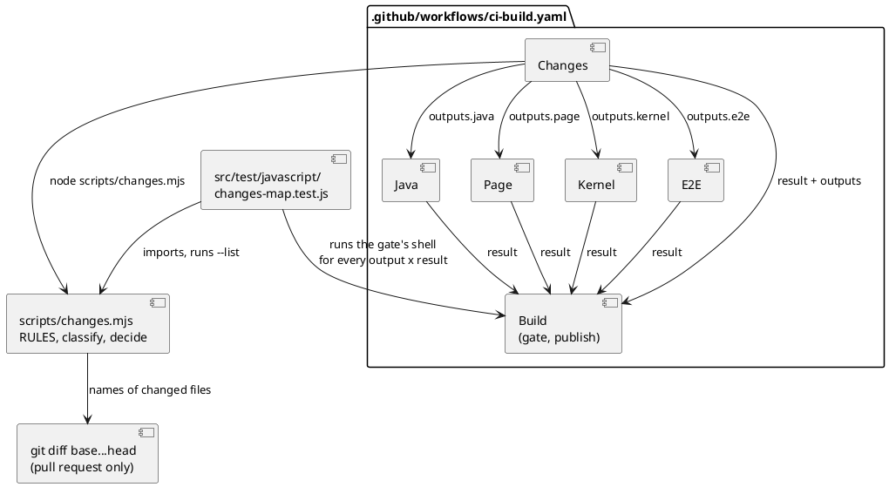
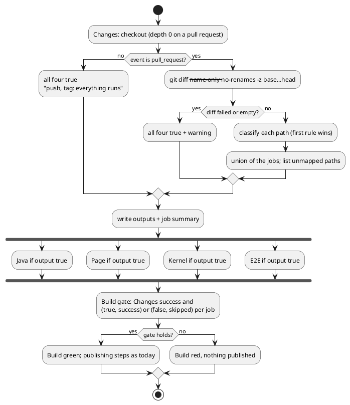

# CI changes filter

# Summary

A pull request that cannot reach the jar must not wait for the end-to-end suite (#192). This run adds a first job `Changes` to `.github/workflows/ci-build.yaml` that classifies the files of a pull request with a map kept in `scripts/changes.mjs`, publishes one output per job (`java`, `page`, `kernel`, `e2e`) and a job summary, and puts an `if` on each of the four jobs. `Build` takes `Changes` in its `needs` and accepts `skipped` for a job only when that job's output is `false`; it fails on `failure`, `cancelled` and on a job that was skipped without the filter having asked for it. A push, a tag and a `workflow_dispatch` run everything. A test, `src/test/javascript/changes-map.test.js`, fixes the map on example paths, lists every tracked path with its rule, audits the files that tests are known to read against the map, and runs the shell of the `Build` gate under every combination of output and result. No product code changes.

There is no PRD (profile TDD+pln), so traceability is incomplete: requirements are labelled `REQ-n` from the manifest of wave 030 (row W-1, the first two criteria of gate P1) and from the acceptance and rules written on #192 (with the author's correction of 2026-11-01). Two diagrams: the components, and the decision of the `Changes` job.

# Scope

In scope: `scripts/changes.mjs` (new), `src/test/javascript/changes-map.test.js` (new), `.github/workflows/ci-build.yaml` (the `Changes` job, the `needs` and `if` of the four jobs, the `needs` and the first step of `Build`, the comment of the header), `.github/CLAUDE.md` (the paragraph that describes the jobs), the run record.

Out of scope: the jobs `Targets`, `Native`, `Release`, `Smoke`, `Publish` (unchanged: a release tag has every output `true`); a path filter on the `on:` trigger (a required check that never starts stays pending); a third-party action for the map; the Pages publish step (W-2); any change to what a job does inside; a rule that makes the pipeline faster than the map allows (DEF-1, DEF-2).

# PRD Traceability

No PRD. Requirements assumed from the wave manifest and from #192.

- `REQ-1` (P1 gate 1): `node scripts/changes.mjs --list` exits 0 and prints, for every path of `git ls-files`, the rule it falls under; `changes-map.test.js` shows the five cases the gate names (`src/doc/README.adoc` runs Java and Page, not E2E or Kernel; `src/main/editor/page.html` and `.github/workflows/ci-build.yaml` run all four; `CLAUDE.md` runs none; a path with no rule runs all four; a push, a tag and a `workflow_dispatch` run all four). Addressed (DEC-1, DEC-2, DEC-3, DEC-4, CTR-1, CTR-2, IMP-1, IMP-2).
- `REQ-2` (P1 gate 2): the workflow has a job `Changes`, an `if` on each of `Java`, `Page`, `Kernel` and `E2E` that reads its outputs, and `Build` lists `Changes` in `needs` and fails on `failure` and `cancelled`. Addressed (DEC-8, DEC-9, CTR-1, CTR-4, IMP-3).
- `REQ-3` (#192, no false skip): a path that matches no rule runs everything; adding a folder must not silently drop a check. Addressed (DEC-4, DEC-5, DEC-6).
- `REQ-4` (#192, report): the report of the run says which jobs were skipped and why. Addressed (CTR-3, IMP-1).
- `REQ-5` (#192, the tag and the push): a tag, a push to `main` and a dispatch run everything; `Build` stays the one name a future required check would use. Addressed (DEC-2, DEC-8, FLOW-2).
- `REQ-6` (W-1 scope): `.github/CLAUDE.md` says it. Addressed (IMP-4).
- `REQ-7` (wave risk): the record says which part is proved on the pull request and which only on the run of `main` and on a tag. Addressed (Observability and Verification, Deployment and Rollout, RISK-2).
- Partially addressed: none. Unresolved: none (no open question, see Open Questions).

# Technical Goals

- TG-1: the rule of which job a path needs lives in one place, a pure function over a list of paths, testable without GitHub.
- TG-2: an unknown path, an empty diff, a failed `git diff` and any event but `pull_request` all end as *run everything*; the filter fails open.
- TG-3: `Build` stays red unless every job that had to run succeeded, and a job may be skipped only because the filter said so.
- TG-4: the map is held to what the tests really read, not only to what the author remembers (DEC-6).
- TG-5: a reader of a pull request sees in the job summary what was skipped and why.

# Non-Goals

- No saving beyond the map of #192 as corrected: a manual-only change still runs `Java` and `Page` (about 5 minutes each, in parallel); what it stops running is `E2E` (9 min 21 s) and `Kernel`, so the time of `Build` for a manual-only pull request goes from about 9.5 to about 5 minutes. That figure counts the four jobs and `Build` only: `Targets` and `Native` (native image, `timeout-minutes: 45`, on every pull request, not in the `needs` of `Build`) are not filtered by this run, so the time before the pull request is fully green may not change (DEF-5). The target is "no E2E for a change that cannot reach the jar", not "almost nothing runs" (review of 2026-10-31 on #192).
- No change to a job's steps, caches or commands.
- No label, comment or commit-message switch to force a full run (DEF-3).
- No `paths:` filter on the trigger, no `dorny/paths-filter` or similar.

# Assumptions

- ASM-1: `ubuntu-latest` has Node.js 20 or later on the path, so the job `Changes` needs no `setup-node` step (the script uses only `node:` built-ins). Validate: the first run of the pull request; the step fails loudly if not, and `Build` goes red (fail closed on infrastructure, not a false skip).
- ASM-2: on a `pull_request` event, `github.event.pull_request.base.sha` and `.head.sha` are both reachable after `actions/checkout` with `fetch-depth: 0` (the checked-out ref is the merge commit of the two, so both are its parents; the job `Page` already needs full history for `git show archicode-0.17.0:...`). Validate: the pull request of this wave prints a non-empty file list in its summary.
- ASM-3: no check is required today (`branches/main/protection` has no required status checks and there are no rulesets; #192, review of 2026-10-31). The design keeps `Build` as the one name a future rule would require, and a skipped `Build` would not occur (it runs under `!cancelled()`).
- ASM-4: no test reads `CLAUDE.md` or any `CLAUDE.md` (author's correction of 2026-11-01). I re-checked: the only hits in `src/test`, `scripts`, `.github` and `package.json` are a comment in `init-workspace.test.js`, a test and a line of `scripts/build-editor.mjs` that say a `CLAUDE.md` beside the parts of the editor is not a part. Validate: the audit of DEC-6 and the node suite (a rule that makes a `CLAUDE.md` run nothing is the one place this assumption lives).
- ASM-5: the files the four jobs read, found by reading the repository on 2026-11-01 (the basis of DEC-3), are: Kernel's `include_str!` of three files of `src/test/javascript/viewpoint-kernel/` (`patch-cases.json`, `facet-dialect-cases.json`, `map-links-cases.json`) and `embed.sh --check`, which reads `standalone.html`, the committed `.wasm` and runs `scripts/build-editor.mjs`; the Java tests' literal paths (`src/doc/examples`, `src/doc/README.adoc`, `docs/architecture`, `src/test/resources`, `src/test/workspaces`, `src/main/resources/editor-webapp/...`, and the 15 of the 16 JSON files of `src/test/javascript/`); the e2e harness (`src/doc/examples`, `src/test/resources/brightcart/layered`, `src/test/resources/replaces-large-pair`, `src/main/resources/editor-webapp/...`, `src/site/index.html`, the jar); Page's node tests (`src/doc/README.adoc`, `src/doc/examples`, `src/site/index.html`, `.github/workflows/ci-build.yaml`, `docs/fixtures`, `docs/architecture`, one file under `docs/wav/`, `scripts/`) and its Prettier check of `src/**/*.java`.

# Constraints

- CON-1: filter inside the workflow with skipped jobs, never on the `on:` trigger (#192).
- CON-2: a tag, a push to `main` and a `workflow_dispatch` run everything; only a pull request is filtered (#192). `main` and every tag keep running everything, so a false skip on a pull request ends as a red `main`, never as an unchecked release.
- CON-3: `Build` must keep failing on `failure` and `cancelled`, and a job skipped for another reason must not pass (#192).
- CON-4: the permissions of the jobs stay minimal: `Changes` has `contents: read` only.
- CON-5: the new `.mjs` and test are formatted by Prettier (`npm run format:check` covers `scripts/**/*.mjs` and `src/test/javascript/**/*.js`) and pass `npm run lint` with no warning (`--max-warnings 0`); no new dependency (`package.json` is not touched).
- CON-6: the change to `ci-build.yaml` must not touch the Pages publish step (W-2 edits it) nor `Targets` to `Publish`; `site.test.js` reads the strings `target/site/index.html`, `target/site/docs/` and `target/site/editor/index.html` of the workflow, which stay.
- CON-7: the wave pull request edits `.github/**`, so the filter runs everything on it (RISK-2).

# Current State

- `.github/workflows/ci-build.yaml` has four parallel jobs `Java`, `Page`, `Kernel`, `E2E`, each with `if: ${{ github.event_name != 'workflow_dispatch' }}`, and `Build` with `needs: [Java, Page, Kernel, E2E]`, `if: ${{ !cancelled() && github.event_name != 'workflow_dispatch' }}`. `Build`'s first step "Check that the four parts passed" reads `needs.<Job>.result` into four env variables and fails unless each is `success`; the steps after it publish (snapshot on `main`, release on a release tag, the website on a tag) and are guarded by `PUBLISHES`. `Release` accepts `Build` as `success` or `skipped`.
- Costs of the jobs on `f50757e` (`main`): `E2E` 9 min 21 s, `Java` 4 min 52 s, `Page` 4 min 51 s, `Kernel` 1 min 13 s.
- `Page` checks out with `fetch-depth: 0`; the others do not. `scripts/` holds `build-editor.mjs`, `check-editor.mjs`, `build-sample.mjs`, `extract-editor-script.mjs`, `editor-coverage.mjs` (ES modules run with `node`) and shell scripts; tests of scripts are CommonJS files in `src/test/javascript/` that `import()` the `.mjs` (`editor-build/check-editor.test.js`) or run a script in a temporary git repository (`editor-build/check-editor-moves.test.js`).
- `src/test/javascript/` has 169 `.js` files and 16 `.json` files of shared cases (every one read by a Java test; three also by the Rust kernel).
- There is no `docs/CLAUDE.md`, no `adr`, `arc` or `dom` register. `docs/architecture/` models ArchiCode itself; its `environment.github.yaml` names the nodes `actions`, `pages` and `releases` but no job.
- `.github/CLAUDE.md` describes the four jobs and `Build` in one paragraph ("CI jobs (wave 023, run 0176, W-14)") that says `Build` needs the four and fails unless every one is `success`.

# Proposed Design

One script, one test, one job, a changed gate.

- `scripts/changes.mjs`: an ES module that exports `JOBS`, `RULES`, `classify(path)`, `decide({ event, files })` and the CLI. `RULES` is an ordered list; the first rule whose pattern matches a path wins; the last rule is the default, which runs all four. `decide` is `{ java, page, kernel, e2e }` as booleans plus the reasons. The CLI has two modes: the default one (what the workflow runs) and `--list`.
- `src/test/javascript/changes-map.test.js`: the unit test.
- `.github/workflows/ci-build.yaml`: the job `Changes`, `needs: Changes` and an `if` on each of the four jobs, `Changes` in the `needs` of `Build` and a rewritten first step.



The reviewer checks that the only place that knows which path needs which job is `RULES`, that the workflow reads outputs and never paths, and that `Build` reads both the result and the output of the same job.

## DEC-1 to DEC-10

- `DEC-1 — The map is a script of the repository, run by a `Changes` job`
  - `Decision:` `scripts/changes.mjs` holds the map and runs on the names of the changed files; the job `Changes` runs it and exposes one output per job.
  - `Rationale:` the rule lives in one place and is testable (`changes-map.test.js`); the author accepted this design on #192 on 2026-10-31.
  - `Alternatives considered:` a third-party paths filter action (not testable here, a new supply-chain dependency for a map of 20 rules); `paths:` on the trigger (CON-1); the map as YAML in the workflow (not testable, drifts from the test).
  - `Tradeoffs:` the pull request waits for a job of about 10 to 20 seconds before the four start (RISK-3).
  - `Linked PRD IDs:` REQ-1, REQ-2, REQ-3.
- `DEC-2 — Only a pull request is filtered, and every failure fails open`
  - `Decision:` `decide` returns `true` for the four jobs when the event is not `pull_request` (a push, a tag, a `workflow_dispatch`, anything unknown), when the list of changed files is empty, and when `git diff` fails (the script prints `::warning::` and decides *all*). The default rule of the map is *all*.
  - `Rationale:` what is published or released is always checked in full; a doubt costs minutes, a false skip costs a red `main` at best.
  - `Alternatives considered:` fail closed on a failed `git diff` (a red `Changes` for an infrastructure hiccup; rejected: the gate would block a pull request that is fine, and `Build` would still catch the job's own failure); an empty list as *none* (an empty pull request has nothing to check, but "empty" is also what a broken diff prints).
  - `Tradeoffs:` an empty or unreadable diff runs everything, which is slower and safe.
  - `Linked PRD IDs:` REQ-3, REQ-5.
- `DEC-3 — The map, corrected where the repository disagrees with #192`
  - `Decision:` the first matching rule below wins; each rule names the jobs it runs. `J` is `java`, `P` is `page`, `K` is `kernel`, `E` is `e2e`.

    | Id | Pattern | Jobs | Reason read from the repository |
    |---|---|---|---|
    | R-01 | `**/CLAUDE.md` | none | notes for agents; no test reads one (ASM-4); placed first so `.github/CLAUDE.md` and `src/main/editor/CLAUDE.md` run nothing |
    | R-02 | `README.md`, `LICENSE`, `.claude/**`, `.idea/**`, `.vscode/**` | none | not read by a job |
    | R-03 | `docs/wav/wav-024-fixes-and-editor-modules/run/run-0182-editor-modules-design/editor-cut.json` | P | `check-editor.test.js` reads it; before R-04 |
    | R-04 | `docs/wav/**`, `docs/run/**` | none | the records of the waves |
    | R-05 | `docs/architecture/**`, `docs/fixtures/**` | J P | `ArchitectureModelTest` and friends; the sample check and `architecture-model.test.js`; `docs/fixtures/brightcart-spec.md` read by Java and node tests |
    | R-06 | `.github/**`, `scripts/changes.mjs` | J P K E | the workflow and the map itself |
    | R-07 | `src/main/rust/**`, `src/main/wasm/**`, `src/main/editor/**`, `src/main/resources/**` | J P K E | the WebAssembly is embedded in the page and the jar; `embed.sh --check` compares the page |
    | R-08 | `src/main/java/**` | J P E | the jar is what `E2E` runs; `src/**/*.java` is in `format:check` (Page) |
    | R-09 | `src/test/java/**` | J P | Java runs the tests; Page checks the format of `src/**/*.java`; `E2E` builds the jar with `-Dmaven.test.skip`, so a test class cannot reach it (deviation from #192, which says Java and E2E) |
    | R-10 | `pom.xml`, `lombok.config`, `.mvn/**`, `mvnw`, `mvnw.cmd`, `src/main/pmd/**` | J E | build of the jar; PMD |
    | R-11 | `src/doc/examples/**` | J P E | `harness.js` copies an example per test; Java and node tests load them |
    | R-12 | `src/doc/**` | J P | the manual is built by `./mvnw verify`; `ManualExamplesTest`, `PlateauComparisonTest`, `site.test.js` and `example-identity.test.js` read `README.adoc` |
    | R-13 | `src/site/index.html` | J P E | `harness.js` serves it as `GET /` for `hosted-acceptance.spec.js` (deviation from #192, which says Java and Page: it missed this reader); Java is kept as the author accepted |
    | R-14 | `src/site/**` | J P | the rest of the website: `robots.txt`, `sitemap.xml`, `llms.txt` |
    | R-15 | `src/test/e2e/**`, `playwright.config.js` | P E | lint and format (Page), the suite (E2E) |
    | R-16 | `package.json`, `package-lock.json` | P E | `npm ci` in both |
    | R-17 | `src/test/javascript/**/*.json` | J P K | shared cases: Java reads 15 of 16 and all are read by node tests; Rust reads three by `include_str!` (deviation from #192, which says Page and E2E for `src/test/javascript/**`: it missed Java and Kernel) |
    | R-18 | `src/test/javascript/**` | P | the node suite |
    | R-19 | `src/test/resources/**`, `src/test/workspaces/**` | J P E | Java and node tests; `E2E` copies `brightcart/layered` and `replaces-large-pair` |
    | R-20 | `scripts/**` | J P K | `build-editor.mjs` is run by `embed.sh --check` (Kernel); `ArchitectureDriftTest` checks `tags.path` exists, and a path of the model is `scripts/byte-identity.sh` (Java); the node suite and the lint read the rest; the jar does not read `scripts/` |
    | R-21 | `eslint.config.mjs`, `.prettierrc.yaml`, `.prettierignore` | P | lint and format |
    | R-22 | everything else (the default) | J P K E | the safe default |

  - `Deviations from #192` (the one list; RISK-6 and IMP-5 point here):

    | Id | Direction | Reason |
    |---|---|---|
    | R-03 | more (adds Page) | `check-editor.test.js` reads the one `editor-cut.json` under `docs/wav/` |
    | R-09 | less (drops E2E) | `E2E` builds the jar with `-Dmaven.test.skip`, so a test class cannot reach it |
    | R-13 | more (adds E2E) | `harness.js` serves `src/site/index.html` |
    | R-17 | more (adds Java and Kernel) and narrows E2E | Java and Rust read the shared cases; no e2e spec reads that folder |
    | R-18 | narrows E2E | no e2e spec reads `src/test/javascript/**` (the node suite is Page) |
    | R-20 | more (adds Java and Kernel) | `embed.sh --check` runs `build-editor.mjs`; a `tags.path` names `scripts/byte-identity.sh` |

  - `Rationale:` #192's map is the author's, accepted on 2026-10-31, and the review of 2026-11-01 corrected `CLAUDE.md`. I then read what the four jobs read (ASM-5) and found four paths the map would have skipped wrongly (`src/site/index.html` for `E2E`; `src/test/javascript/**/*.json` for `Java` and `Kernel`; `scripts/**` for `Java` and `Kernel`; the one `editor-cut.json` under `docs/wav/` for `Page`). Each is a row above with its reason. The deviations from #192 are listed once, below; the one to look at first is R-09, which runs less because of the `-Dmaven.test.skip` of the job `E2E`.
  - `Alternatives considered:` the map of #192 verbatim (four false skips); running `E2E` on `src/test/java/**` as #192 says (a safe choice that costs 9 minutes on the most frequent kind of test-only pull request; the reviewer may restore it by editing R-09, the test names the row).
  - `Tradeoffs:` more rows than the ticket. A row that narrows a job away from a path is the dangerous kind; each has a reason in the table and the audit of DEC-6.
  - `Linked PRD IDs:` REQ-1, REQ-3.
- `DEC-4 — First match wins, jobs are the union over the changed files, the default is `all``
  - `Decision:` `classify(path)` returns the first rule whose pattern matches, or the default; a pull request's jobs are the union over its files. Each pattern is a glob: `**` matches any number of segments, `*` anything but `/`; a leading `**/` also matches the root. Both sides of a rename and a deletion are paths (DEC-7). The reason of a job is the rule that first raised it and one example path.
  - `Rationale:` a flat ordered list is the smallest thing that can express "this file inside that folder is different"; it is read top to bottom in the review.
  - `Alternatives considered:` most specific match (needs a specificity order to be defined and tested); one rule per job (cannot say a path is read by Java and E2E but not Kernel without repeating).
  - `Tradeoffs:` the order of the rows matters (R-01, R-03, R-06 and R-13/R-17 precede the general rows); the test names each of those pairs.
  - `Linked PRD IDs:` REQ-1, REQ-3.
- `DEC-5 — No ratchet on the paths that fall to the default`
  - `Decision:` the test checks that the default is *all* and that `--list` classifies every tracked path; it does not fail when a tracked path falls to the default. The `Changes` summary lists the paths of the pull request that fell to the default (up to 20), so a reviewer sees an unmapped folder.
  - `Rationale:` the failure a ratchet prevents is a missed saving, not a false skip, and the default already prevents the false skip. A test that fails on every new top-level file would make the safe default feel like an error and invite a lazy rule.
  - `Alternatives considered:` an allowlist of the paths that may fall to the default (the literal reading of "adding a folder must not silently drop a check": rejected, since the folder is not dropped, it runs everything).
  - `Tradeoffs:` an unmapped folder runs everything until somebody notices the summary.
  - `Linked PRD IDs:` REQ-3, REQ-4.
- `DEC-6 — The map is audited against the readers the repository can name`
  - `Decision:` `changes-map.test.js` has an audit that reads the sources of the checks and fails when a file that a job reads is classified so that the job does not run. Four readers, each by a regular expression that resolves only what it can resolve: (A1) each `include_str!` / `include_bytes!` path in `src/main/rust/**/*.rs`, resolved against the folder of the file, must be a tracked file whose rule includes `kernel`; (A2) each string literal in `src/test/java/**/*.java` that starts with `src/`, `docs/`, `scripts/` or `.github/`, and each `Path.of` or `Paths.get` call whose arguments are all literals (joined with a slash, the split form `Path.of("src", "main", ...)` of `NativeReflectionConfigTest`): a tracked file must include `java`, a tracked folder is satisfied only when every tracked file under it includes `java` (this covers a Java test that walks a folder, such as `ShippedFilesTest` on `src/doc/examples` and `src/test/resources`); (A3) each `tags.path` value in `docs/architecture/manifests/**/*.yaml` (split on `, `) that is a tracked file includes `java` (`ArchitectureDriftTest` checks it exists); (A4) `path.resolve` / `path.join` calls whose arguments are string literals after `__dirname`, `REPO` or `ROOT`, resolved by one rule: `__dirname` is the folder of the file, `REPO` and `ROOT` the repository root, `..` is normalised, literals are joined with a slash (a literal may hold slashes, as in `path.join(REPO, 'docs/architecture')`, or be one per segment, as in `path.join(ROOT, 'src', 'test', 'resources', 'x')`, or start with `..`, as in `path.resolve(__dirname, '../../../main/resources/...')`), resolution stops at the first non-literal argument and keeps the prefix as a folder, and a path that leaves the repository is skipped; the calls are read in `src/test/javascript/**/*.js` (job `page`) and in `src/test/e2e/**/*.js` (job `e2e`), with the same file-or-folder rule. Whatever a pattern cannot resolve (a computed path, a variable) is skipped.
  - `Rationale:` the ticket's own challenge: "a hand-kept map goes stale in a way the default cannot catch: a test that starts to read a new folder". The audit catches the cases that a regular expression can name; it runs against the map as written, so a row of DEC-3 that is wrong fails it.
  - `Alternatives considered:` no audit, trust the table (the table was wrong four times before it was read); tracing real file reads with `strace` or the coverage of each job (heavy, not deterministic, not a unit test).
  - `Tradeoffs:` a net, not a proof: a reader the patterns cannot see passes silently. The proof is that `main` and the tags run everything (CON-2). If A4 reports more than a handful of false findings on the repository as it is (for instance literals that name a path in a temporary repository), drop A4 for the side that is noisy and record it as DEF-2; A1 to A3 stay.
  - `Linked PRD IDs:` REQ-3.
- `DEC-7 — The changed files are `git diff --name-only --no-renames -z base...head`, on a full clone`
  - `Decision:` on a `pull_request` the job checks out with `fetch-depth` `'0'` (otherwise `'1'`), written as the strings in `${{ github.event_name == 'pull_request' && '0' || '1' }}` because the number `0` is falsy in an Actions expression, so the unquoted form of that expression would always yield `1`: the checkout would be shallow, `git diff base...head` would lack the merge-base, the script would fail open to all four and the filter would never skip, with a green run that looks right (a non-empty string is truthy) and the script runs `git diff --name-only --no-renames -z <base.sha>...<head.sha>`; `-z` for names with spaces or quotes, `--no-renames` so that both the old and the new path of a move are classified (a file moved out of `src/main/editor/` into `docs/wav/` is a change to the page), three dots for the merge-base so that commits that landed on the base after the branch was cut are not counted.
  - `Rationale:` the same ASM-2 that `Page` relies on; no API call, no token, no limit of 3,000 files.
  - `Alternatives considered:` `gh api repos/.../pulls/N/files` (needs `pull-requests: read`, paginated, 3,000-file cap); `git diff` of the merge commit against its first parent (equivalent today, but depends on how GitHub builds the merge ref).
  - `Tradeoffs:` a full clone on a pull request (seconds on this repository; the tag and push runs keep depth 1 as `Java` does).
  - `Linked PRD IDs:` REQ-1, REQ-3.
- `DEC-8 — `Build` checks the result of each job against the output of the same job`
  - `Decision:` `Build` has `needs: [Changes, Java, Page, Kernel, E2E]`. Its first step ("Check that every part ran or was skipped by the filter") fails unless `Changes` is `success` and, for each of the four jobs, the pair `<output>/<result>` is `true/success` or `false/skipped`. Anything else (`true/skipped`, `true/failure`, `true/cancelled`, `false/success`, `false/failure`, an empty output) prints `::error::` naming the job, the output and the result, and fails. The step is the shell of the workflow, in the job's `run:` block, with the outputs and results passed as `env:`.
  - `Rationale:` a job that is skipped because `Changes` failed has an empty output and fails the gate; a job that the filter wanted and that did not run fails it; a job that ran against the filter's word is an anomaly worth a red. `Build` keeps `if: ${{ !cancelled() && ... }}`, so it runs and says so when a part failed (a job that needs a failed one is otherwise skipped, and a skipped job passes a required check).
  - `Alternatives considered:` accept `skipped` for any job when the event is a pull request (a job skipped for another reason, such as an `if` typo, would pass: rejected by #192); move the gate into `scripts/changes.mjs --check` (`Build` has no checkout on a pull request, and adding one only to read a script would put a clone on the path of every pull request).
  - `Tradeoffs:` the shell lives in YAML, so the test extracts it and runs it (DEC-10).
  - `Linked PRD IDs:` REQ-2, REQ-5.
- `DEC-9 — `Changes` runs on push, tag and pull request; each job's `if` adds its output`
  - `Decision:` `Changes` has `if: ${{ github.event_name != 'workflow_dispatch' }}` and `permissions: contents: read`. Each of the four jobs gets `needs: Changes` and `if: ${{ github.event_name != 'workflow_dispatch' && needs.Changes.outputs.<job> == 'true' }}`. On a push and a tag the script writes four `true` (DEC-2) so nothing changes for them; on a dispatch `Changes` and the four are skipped as the four were.
  - `Rationale:` one code path, one summary on every event; the summary says "push: everything runs".
  - `Alternatives considered:` skip `Changes` on a push and a tag and put the event test in each `if` (two code paths, and the test of "a push runs all four" would not exercise the workflow's own path).
  - `Tradeoffs:` `Changes` costs a checkout on a tag run too (depth 1: a second).
  - `Linked PRD IDs:` REQ-2, REQ-5.
- `DEC-10 — The script is an ES module with a guarded CLI; the test imports it, runs it, and runs the gate's shell`
  - `Decision:` `scripts/changes.mjs` exports `JOBS`, `RULES`, `classify` and `decide` (the audit helpers of DEC-6 are in the test, not the script); the CLI runs only when the file is the entry point (`import.meta.url === pathToFileURL(process.argv[1]).href`). The test (CommonJS, like its neighbours) loads the module with `import(pathToFileURL(SCRIPT))` as `check-editor.test.js` does, runs the CLI with `execFileSync`, builds a temporary git repository for the diff cases as `check-editor-moves.test.js` does, and extracts the `run:` block of the first step of `Build` from `ci-build.yaml` by text (the job `Build:`, then its first `run: |`) and runs it with `bash` under every output/result combination.
  - `Rationale:` no new dependency (CON-5); the repository already tests scripts this way; running the extracted shell proves the gate's behaviour, which a pull request cannot (RISK-2).
  - `Alternatives considered:` a YAML parser dependency (a new devDependency for one test); a text match on the workflow only (it would say the step is there, not what it does).
  - `Tradeoffs:` the extraction depends on the shape of the file (the step is the first of `Build`; the test fails with a clear message if it is not).
  - `Linked PRD IDs:` REQ-1, REQ-2.

# Repository Impact

- `IMP-1 — The map and the job's entry point`
  - `Path(s):` `scripts/changes.mjs`
  - `Change type:` additive
  - `Why impacted:` DEC-1 to DEC-4, DEC-7. Default mode: reads `--event`, `--base`, `--head` (the workflow passes `${{ github.event_name }}` and the two shas), prints the decision, appends `java=true|false` ... to the file named by `GITHUB_OUTPUT` and the table of CTR-3 to `GITHUB_STEP_SUMMARY` when those variables are set, exits 0. `--list` prints one line per `git ls-files` path and exits 0 (CTR-2). A tag run passes the event name `push`; the script treats any event other than `pull_request` as *all*.
  - `Linked PRD IDs:` REQ-1, REQ-3, REQ-4.
  - `Risks / notes:` about 120 lines (ticket's estimate); Prettier and ESLint cover it; its own path is R-06 (a change to the map runs everything).
- `IMP-2 — The unit test of the map and of the gate`
  - `Path(s):` `src/test/javascript/changes-map.test.js`
  - `Change type:` additive
  - `Why impacted:` REQ-1, REQ-2, REQ-3. Cases: see Observability and Verification.
  - `Linked PRD IDs:` REQ-1, REQ-2, REQ-3.
  - `Risks / notes:` run by `npm run test:unit` and so by the `Page` job; needs `git` and a checkout with `.git` (it is there, `fetch-depth: 0`). It must not depend on the number of tracked files.
- `IMP-3 — The workflow`
  - `Path(s):` `.github/workflows/ci-build.yaml`
  - `Change type:` modify
  - `Why impacted:` DEC-8, DEC-9. A job `Changes` before `Java`:

    ```yaml
      Changes:
        # Which of the four checks a pull request needs, from the files it changes (scripts/changes.mjs holds the map and its
        # reasons; `node scripts/changes.mjs --list` shows every tracked path with its rule). A push, a tag and a dispatch
        # never get here filtered: the script answers "everything" for any event but a pull request.
        if: ${{ github.event_name != 'workflow_dispatch' }}
        runs-on: "ubuntu-latest"
        permissions:
          contents: read
        outputs:
          java: ${{ steps.map.outputs.java }}
          page: ${{ steps.map.outputs.page }}
          kernel: ${{ steps.map.outputs.kernel }}
          e2e: ${{ steps.map.outputs.e2e }}
        steps:
          - uses: "actions/checkout@v7"
            with:
              # the merge-base of the pull request needs the history; the other events do not read it
              fetch-depth: ${{ github.event_name == 'pull_request' && '0' || '1' }}
          - name: "Work out which parts apply"
            id: map
            env:
              EVENT: ${{ github.event_name }}
              BASE_SHA: ${{ github.event.pull_request.base.sha }}
              HEAD_SHA: ${{ github.event.pull_request.head.sha }}
            run: node scripts/changes.mjs --event "$EVENT" --base "$BASE_SHA" --head "$HEAD_SHA"
    ```

    Each of `Java`, `Page`, `Kernel`, `E2E` gets `needs: Changes` and `if: ${{ github.event_name != 'workflow_dispatch' && needs.Changes.outputs.<job> == 'true' }}`; `Build` gets `Changes` in `needs`, step-level `env:` on its first step with the nine names of CTR-4 (`JAVA_WANTED: ${{ needs.Changes.outputs.java }}`, `JAVA_RESULT: ${{ needs.Java.result }}` and so on, `CHANGES: ${{ needs.Changes.result }}`), and the rewritten first step (CTR-4). The comments of the header of the `jobs:` block and of `Build` say what the filter is. The names of the jobs do not change.
  - `Linked PRD IDs:` REQ-2, REQ-5.
  - `Risks / notes:` the Pages publish step and `Targets` to `Publish` are not edited (CON-6). Each `if` of the four keeps the dispatch test they had.
- `IMP-4 — The CI paragraph`
  - `Path(s):` `.github/CLAUDE.md`
  - `Change type:` modify
  - `Why impacted:` REQ-6. The paragraph "CI jobs (wave 023, run 0176, W-14)" says `Build` needs the four and fails unless every one is `success`; it now says: the job `Changes` and what it outputs, that only a pull request is filtered and what the map does not skip, the rule of `Build` (`true/success` or `false/skipped`), where the map lives and that its test audits it, that the wave-030 pull request itself runs everything because it edits `.github/**`, and how to see a decision (`node scripts/changes.mjs --list`, `node scripts/changes.mjs --event pull_request --base <ref> --head <ref>`). The wording of the rest stays.
  - `Linked PRD IDs:` REQ-6.
  - `Risks / notes:` the root `CLAUDE.md` only points here; it is not edited.
- `IMP-5 — The run record`
  - `Path(s):` `docs/wav/wav-030-pages-ci-and-toolbar/run/run-0211-ci-changes-filter/` (the status file and the `prg-` log)
  - `Change type:` additive
  - `Why impacted:` REQ-7: says which part is proved on the pull request and which on `main` and on a tag (RISK-2), and copies the list of deviations of DEC-3 so the author can overturn one.
  - `Linked PRD IDs:` REQ-7.
  - `Risks / notes:` none.

# Canonical Impact

Not applicable — no canonical registers declared: `docs/` has no `CLAUDE.md` and no `arc` or `dom` register. For completeness: `CI-arc-1` None. `docs/architecture/` is the model of ArchiCode and not such a register; its `github` environment names `actions`, `pages` and `releases`, no job, so this run changes no element or relationship of it, the elements' `tags.path` keep existing, and `npm run sample:build` is not needed. `CI-dom-1` None.

# Data Model and Contracts

- `CTR-1 — The outputs of the job `Changes``
  - `Current contract:` none; the four jobs run on every pull request.
  - `Proposed contract:` four string outputs `java`, `page`, `kernel`, `e2e`, each exactly `true` or `false`, written as `name=value` lines to `$GITHUB_OUTPUT`. On any event but `pull_request`, on an empty or unreadable diff and on the default rule, all four are `true`. A job runs when its output is `true`.
  - `Affected files:` `scripts/changes.mjs`, `.github/workflows/ci-build.yaml`.
  - `Migration or compatibility notes:` additive; `Release` still reads `Build`'s result only.
  - `Linked PRD IDs:` REQ-2, REQ-5.
- `CTR-2 — The command line of `scripts/changes.mjs``
  - `Current contract:` none.
  - `Proposed contract:` `node scripts/changes.mjs --event <name> [--base <sha>] [--head <sha>]` decides and publishes as above, exit 0 (a diff that fails is a warning and *all*). `--event` is required unless `--list` is given (a default of `push` would be wrong for a contributor, a default of `pull_request` needs a base); an unknown option, a missing `--event`, or a `pull_request` event without `--base` or `--head`, exits 2 with one line on stderr. The decision is always printed on stdout as four `name=value` lines in the order `java`, `page`, `kernel`, `e2e` (for example `java=false`), the same lines that `GITHUB_OUTPUT` receives when it is set; `GITHUB_OUTPUT` and `GITHUB_STEP_SUMMARY` are written in addition when set. `none` is the word of the `jobs` column of `--list`, not of the decision. `node scripts/changes.mjs --list` prints on stdout one line per `git ls-files` path, `<path>` TAB `<rule id>` TAB `<jobs>` where `<jobs>` is a comma-separated subset of `java,page,kernel,e2e` or `none`, in the order of `git ls-files`, and writes to stderr a count per rule id; it exits 0. `RULES` carries, for each rule, `id`, `patterns`, `jobs` and `reason`.
  - `Affected files:` `scripts/changes.mjs`, `src/test/javascript/changes-map.test.js`.
  - `Migration or compatibility notes:` additive; the list format is read by the test and by a human, nothing else.
  - `Linked PRD IDs:` REQ-1, REQ-3.
- `CTR-3 — The job summary`
  - `Current contract:` none.
  - `Proposed contract:` to `$GITHUB_STEP_SUMMARY`, markdown: one line naming the event and the number of changed files (or "everything runs: <why>" for a push, a tag, an empty or unreadable diff); a table `Job | Runs | Why` with one row per job, where *Why* is the rule id that raised it and one example path, or `no changed file needs it` for a skipped job; and, when any, the changed paths that fell to the default rule (the first 20).
  - `Affected files:` `scripts/changes.mjs`.
  - `Migration or compatibility notes:` additive.
  - `Linked PRD IDs:` REQ-4.
- `CTR-4 — The gate of `Build``
  - `Current contract:` four results, each must be `success`.
  - `Proposed contract:` `Changes` must be `success`; for each of `Java`, `Page`, `Kernel`, `E2E`, `(<Changes output>, <result>)` must be `(true, success)` or `(false, skipped)`. Each failure is one `::error::` line naming the job, the output and the result; the exit status is 1 if any failed. The gate reads nine environment variables, all step-level `env:` of the first step of `Build` (as the four results are today, not job-level like `PUBLISHES`): `CHANGES`, `JAVA_WANTED`, `JAVA_RESULT`, `PAGE_WANTED`, `PAGE_RESULT`, `KERNEL_WANTED`, `KERNEL_RESULT`, `E2E_WANTED`, `E2E_RESULT`; the test sets exactly these.
  - `Affected files:` `.github/workflows/ci-build.yaml`.
  - `Migration or compatibility notes:` on a push, a tag and a pull request that changes `.github/**` every output is `true`, so the gate is what it was.
  - `Linked PRD IDs:` REQ-2, REQ-5.

# Interfaces and Behavior

- `IF-1 — A pull request` shows a job `Changes` with a summary, then the jobs the map asks for; the others show as skipped with the reason in the summary; `Build` is green when every asked job succeeded.
- `IF-2 — `node scripts/changes.mjs --list`` is the way a contributor learns the rule of a path before pushing; `node scripts/changes.mjs --event pull_request --base origin/main --head HEAD` shows what their branch would run (the same code as CI; the decision is always printed on stdout as the four lines `java=...`, `page=...`, `kernel=...`, `e2e=...` of CTR-2).
- `IF-3 — Errors:` an unknown option, a missing `--event`, a missing `--base` or `--head` on a `pull_request` event is a failure of the arguments (exit 2); a `git diff` that fails is *all* with a warning (DEC-2). The first is a mistake in the workflow and must be loud; the second is an environment fault and must be safe.

# Flows and Processing Logic

- `FLOW-1 — A pull request`
  - `Trigger:` `pull_request` (opened, synchronized, reopened).
  - `Steps:` `Changes` checks out with full history; the script lists `git diff --name-only --no-renames -z base...head`; each path is classified by the first matching rule; the jobs are the union; four outputs and the summary are written; `Java`, `Page`, `Kernel`, `E2E` whose output is `true` run, the others are skipped; `Build` compares each output with the result of its job.
  - `Branches / failure paths:` empty list, failed `git diff` or no `--base`: all (the last, an error); `Changes` fails: the four are skipped, their outputs are empty and `Build` fails on `Changes`; a job fails or is cancelled: `Build` fails; a job is skipped though its output is `true`: `Build` fails.
  - `Final output / rendered result:` a green or red `Build`, a summary that says what was skipped.
  - `Linked PRD IDs:` REQ-1, REQ-2, REQ-4.
- `FLOW-2 — A push to `main`, a tag, a `workflow_dispatch``
  - `Trigger:` `push` (branch `main` or a tag), `workflow_dispatch`.
  - `Steps:` push: `Changes` runs at depth 1, the script sees an event that is not `pull_request` and writes four `true`; the four run; `Build` publishes as before. Dispatch: `Changes`, the four and `Build` are skipped as the four and `Build` were; `Targets` to `Publish` run as before.
  - `Branches / failure paths:` none new.
  - `Final output / rendered result:` the pipeline of today.
  - `Linked PRD IDs:` REQ-5.



If the diagram is not rendered, FLOW-1 and FLOW-2 are the same flow in text.

# Reliability, Performance, and Scalability

- The filter fails open (DEC-2); the gate fails closed (DEC-8). `main` and tags run everything, so a map that is wrong costs a red `main`, not an unchecked release.
- `Changes` adds a checkout and a node start to the front of every run (RISK-3), against a saving of 9 min 21 s of `E2E` and 1 min 13 s of `Kernel` when the map allows.
- Maintainability: a rule is a row with an id, patterns, jobs and a reason; the audit of DEC-6 fails when a row narrows a job away from a file a known reader opens.

# Security and Privacy

- `Changes` has `contents: read` and no secret; it runs on pull requests from forks (the token there is read-only anyway). The script reads the names of the changed files and writes outputs and a summary; it runs no code from the pull request (it is the script of the checked-out merge commit, which is the case for every step that runs `npm` or `mvnw` in the other jobs).
- File names enter the shell only as `$EVENT`, `$BASE_SHA`, `$HEAD_SHA` through `env:`, never interpolated into the `run:` text. The script reads the names with `-z` and writes them only into the summary (markdown-escaped: a name with a `|` or a backtick must not break the table).

# Observability and Verification

All commands from the repository root; `JAVA_HOME` is not needed (no Java in this run).

- `node --test src/test/javascript/changes-map.test.js` (and `npm run test:unit`, which includes it). The cases:
  1. The map on example paths: the table of expected jobs for about 30 paths, including each row of DEC-3 at least once and the five cases of REQ-1 (`src/doc/README.adoc` → `java,page`; `src/main/editor/page.html` and `.github/workflows/ci-build.yaml` → all four; `CLAUDE.md` → none; a path with no rule, such as `some-new-folder/x.txt`, → all four).
  2. The order: `.github/CLAUDE.md` is none (R-01 before R-06); `src/site/index.html` runs E2E and `src/site/robots.txt` does not; `src/test/javascript/viewpoint-kernel/fold-cases.json` runs `java,page,kernel` and a `.js` beside it runs `page`; the `editor-cut.json` path runs `page` and another file of `docs/wav/` runs none.
  3. `decide`: a `pull_request` with a union of files; a push, a tag (event `push`), a `workflow_dispatch` and an unknown event run all four whatever the files; an empty list runs all four.
  4. `--list`: exit 0, one line per `git ls-files` path (the count equals that of `git ls-files`), three TAB-separated fields, every rule id is a rule of `RULES`; the default is the last rule and runs all four.
  5. A temporary git repository: a branch with a modified file, a deletion and a rename out of `src/main/editor/` into `docs/wav/` classifies both sides of the rename (so all four run); a commit that landed on the base after the branch was cut is not counted (three dots).
  6. `GITHUB_OUTPUT` and `GITHUB_STEP_SUMMARY` set to temporary files: four `name=true|false` lines; the summary names the skipped jobs and the rule that raised each run, and escapes a `|` in a path.
  7. The audit of DEC-6 (A1 to A4) on the repository as it is passes; handed a map in which `src/test/javascript/viewpoint-kernel/*.json` runs no `kernel`, the audit fails naming the Rust file and the path (the sabotage is done on a copy of `RULES` in memory).
  8. The workflow, read as text: a job `Changes`; each of `Java`, `Page`, `Kernel`, `E2E` has `needs` containing `Changes` and an `if` that contains `needs.Changes.outputs.<job> == 'true'` and still the `workflow_dispatch` test; `Build`'s `needs` lists `Changes`, `Java`, `Page`, `Kernel`, `E2E`; the `Changes` checkout line contains exactly `fetch-depth: ${{ github.event_name == 'pull_request' && '0' || '1' }}`.
  9. The gate: the first step of `Build` run with `bash` with the nine variables of CTR-4: one loop per job over its pair (the pair of a job is independent of the others, so there is no product of the four), plus one all-pass case and one mixed case. The pairs `true/success` and `false/skipped` pass; `true/skipped`, `true/failure`, `true/cancelled`, `false/success`, `false/failure`, an empty output and a failed `Changes` each fail with an `::error::` line naming the job.
- `node scripts/changes.mjs --list | wc -l` equals `git ls-files | wc -l`; `node scripts/changes.mjs --list 2>&1 >/dev/null` shows the count per rule (the first criterion of P1).
- `node scripts/changes.mjs --event pull_request --base main --head 9e7cca2`, where `9e7cca2` is the commit before the implementation (the diff `main...9e7cca2` holds only `docs/wav/` files, checked at planning time): prints the four lines `java=false`, `page=false`, `kernel=false`, `e2e=false`. It is run against that commit and not `HEAD` because once the run is implemented the branch holds `scripts/changes.mjs` and `.github/**`, which R-06 maps to all four (RISK-2). Run once and recorded in the run record: it shows the filter on a real diff, since the pull request itself cannot.
- The workflow file parses: `npx prettier --check .github/workflows/ci-build.yaml` is not required to pass (the file is not formatted by it today), but `npx prettier .github/workflows/ci-build.yaml > /dev/null` exits 0 (a YAML syntax error exits 2); if `actionlint` is on the path it is run too.
- `npm run format:check` and `npm run lint` exit 0 (CON-5).
- Proved where: the map, the audit, the diff handling and the gate's shell are proved by the node test in the pull request; the job `Changes` and `Build` with every output `true` are proved by the wave's pull request run (it edits `.github/**`); a pull request that really skips a job, the behaviour on a push to `main` (the publishing steps behind a `Build` that now needs `Changes`) and on a tag are proved only by the next pull request that skips, the run of `main` after the merge and the next release tag. The run record says so (REQ-7).

# Deployment and Rollout

- Kind of change: config-affecting CI (a workflow change) plus a script and its test; no product code. Live capability: `Build` gates the publish and release jobs.
- Staging verification: none beyond the pull request; GitHub offers no staging for a workflow. Before the merge: the node test, the dry run on this branch, the YAML parse.
- Backward compatibility: the names `Java`, `Page`, `Kernel`, `E2E`, `Build` are unchanged, so a required check named `Build` would keep working; a push and a tag behave as before (all outputs `true`).
- After the merge, the author watches the run of `main` (every job runs; `Build` green; the summary reads "everything runs") and the first pull request that skips a job. Guidance only: this document does not authorise a merge or a tag.
- Rollback: revert the commit (the workflow returns to four unconditional jobs). A faster remedy if only the map is wrong: add a row for the path above the one that is wrong, or make the default of a rule *all*, in `scripts/changes.mjs`.

# Risks and Tradeoffs

- `RISK-1` False skip. A row that omits a job a file needs, or a test that starts to read a new folder, leaves a job unrun on a pull request. Mitigations: the default is *all*; the readers audit of DEC-6; `main` and tags run everything so the miss ends as a red `main`; the table in DEC-3 gives a reason per row.
- `RISK-2` The pull request of the wave edits `.github/**`, so R-06 runs all four on it and the skipping path is not shown by it. The skipped path is proved by the test of the gate and the dry run; the first real skip is the next pull request that qualifies. The behaviour on `main` and tag is proved after the merge (REQ-7).
- `RISK-3` `Changes` is serial before the four: a checkout at depth 0 and `node` take about 10 to 20 seconds on every pull request, including the ones that skip nothing. Accepted: the saving is minutes.
- `RISK-4` The shell of the gate lives in YAML and the test finds it by text; a reshaping of the file breaks the test with a message, not the gate silently.
- `RISK-5` The regular expressions of the audit read the source of the tests; a refactor of a test (a literal moved into a constant in another file) can hide a reader. The audit is a net (DEC-6); the proof is the full run on `main`.
- `RISK-6` The rows that deviate from #192 (the list in DEC-3) are my readings of the repository (ASM-5). Overturning one is a one-row edit; R-09, R-17 and R-18 take a job away from a path, the others add one.
- `RISK-7` An unmapped new folder runs everything silently (DEC-5); the summary names it.

# Open Questions

No open question; none blocks the run. Each point was settled in the draft and re-checked against the repository at Stage 6: a path with no rule runs everything and is named in the summary (DEC-5); `src/test/java/**` without `E2E` rests on the one `mvnw` call of the job `E2E`, `./mvnw package` with `-Dmaven.test.skip`, at line 237 of `ci-build.yaml` (R-09 in DEC-3), and `src/site/index.html` with it on `src/test/e2e/harness.js` line 139 (R-13); the files of a pull request come from `git diff` on a full clone (DEC-7). The author may overturn R-09 at the plan review; it is a one-row edit.

- `ASM-1`, the one external fact (Node on `ubuntu-latest`), was checked against the runner-images readme of `ubuntu-24.04`: Node.js 22 is preinstalled, so `Changes` needs no `setup-node` step; the script uses only `node:` built-ins and runs on any Node 20 or later.

# Deferred Work

- `DEF-1` Tighten further: `src/main/java/**` for the jobs it can reach more finely (does `Page` need to run on every Java change? only for the Prettier check of `src/**/*.java`); `Kernel` on `src/main/editor/**`. Needs the per-job read list kept up to date; not worth the risk now.
- `DEF-2` Extend the audit to computed paths and to the other languages' readers, or drop A4's noisy side (DEC-6).
- `DEF-3` A way to force a full run on a pull request without touching `.github/` (a label, or `[ci full]` in the head commit message).
- `DEF-5` Filter `Native`, which may be the real wall-clock of a pull request if its duration exceeds that of `E2E`; to decide after reading its duration on the last run of `main`.
- `DEF-4` Show the time saved: the summary could name the estimated minutes skipped (the durations of the jobs above are those of one run).

# File Placement and Frontmatter

This file is `docs/wav/wav-030-pages-ci-and-toolbar/run/run-0211-ci-changes-filter/tdd-0211-ci-changes-filter.md`, with the frontmatter above (`title`, `type: tdd`, `status: draft`, `run: 0211`, `wave: 030`, `owner`, `date`, `related`), following `tdd-0209-...` and `tdd-0210-...` of wave 029.
