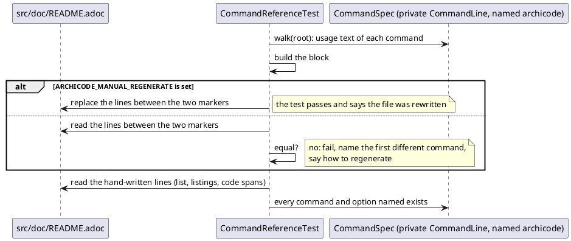

# Generated command reference

# Summary

Review pass: done (Stage 5, 2026-11-01), by a different agent from the drafter, so that the review is independent of the drafting. Its findings F-1 to F-5 (Findings section of the run's progress log) are applied in this text; Q-1 was settled at Stage 6 (Open Questions).

The Commands part of the manual (`== Commands` in `src/doc/README.adoc`, lines 2419 to 2967 of the working copy) is prose written by hand. Every fact it holds about the program (the list of commands, the options, their defaults) is a copy that nothing checks. One copy is already wrong: the listing at line 2606 shows `archicode views generate --properties='{ "key" : "value" }'`, and the program has no `--properties` option (it has `--properties-content`, `--properties-format` and `--properties-path`; found by reading the `--help` of every command on the packaged jar while this TDD was drafted).

This run settles Q3 of the wave manifest (where the generated reference lives and how it is built) and builds it. A block of the manual, between two comment markers, holds the usage message of the root command and of every command under it, as picocli prints it. A new Java test, `CommandReferenceTest`, builds that block from the live `CommandSpec` and fails when the manual has another one; run with an environment variable it writes the block instead of comparing. The same test holds the hand-written parts that name commands and options (the list at the top of `== Commands`, the listings, the inline options) to the same `CommandSpec`. The run fixes the one stale listing. No command, option, message or exit code changes.

There is no PRD (profile TDD+pln), so traceability is incomplete: requirements are labelled `REQ-n` from the manifest of wave 030 (row W-6, the fourth criterion of gate P2, decision Q3, the Non-Goal "the commands do not change").

One diagram: the flow of the test, which has a real branch (compare or write) and two failure paths.

# Scope

In scope:

- `src/doc/README.adoc`: one new section `[[command-reference]] === Every command and option` (the generated block), the rewrite of the sentence "ArchiCode has eight commands" and the correction of one listing.
- A new test `src/test/java/io/morin/archicode/doc/CommandReferenceTest.java`.
- The notes that tell a later author how to regenerate: `src/test/CLAUDE.md` and `src/main/java/io/morin/archicode/CLAUDE.md` (one paragraph each).
- The run record.

Out of scope: any change to a command, an option, a message or the name the usage shows (DEF-1); `pom.xml`, profiles and CI workflows; a second page or a second file for the reference (wave decision D2); the prose of the per-command sections beyond the one listing that is wrong; the generated guide (`archicode guide`), which already prints the commands from the same `CommandSpec` and has its own tests; `src/site/llms.txt` (already names the Reference part); the editor.

# PRD Traceability

No PRD. Requirements assumed from the manifest of wave 030.

- `REQ-1` (W-6 scope, gate P2 criterion 4): the command reference is generated from the real `--help` of every command, or checked against it, in a way Q3 settles in the run's design. Addressed (DEC-1, DEC-2, CTR-1).
- `REQ-2` (gate P2 criterion 4): a test fails when the reference of the manual and the `--help` of the application disagree; it names every command that `--help` lists, recursively, and the reference lists all of them. Addressed (DEC-2, DEC-3, FLOW-1, CTR-2).
- `REQ-3` (gate P2 criterion 4): the run edits a copy of the manual to show that the test fails, and `./mvnw test` exits 0. Addressed (DEC-6, Observability 3 and 4).
- `REQ-4` (W-6 scope and wave Non-Goal): no change to a command. Addressed (Scope, DEC-4, DEF-1); verified by Observability 6.
- `REQ-5` (wave decision D2 and the rule of `CLAUDE.md` "tested how the user will use it"): one file, and every `archicode` line a listing of the manual shows names a command and options the program has. Addressed (DEC-1, DEC-5). The fix of line 2606 is the proof that the check is not vacuous.
- `REQ-6` (constraint of the wave, W-3 and W-4 tests): every id of `git show ff3bacd:src/doc/README.adoc` stays defined, the filler and gate words stay out, the Asciidoctor warnings do not increase. Addressed (CON-1, CON-2, Observability 5).

No requirement is left unresolved.

# Technical Goals

- `TG-1` A reader of the Commands part finds, for each command and each group, the exact usage the program prints: synopsis, description, options with their defaults and whether they repeat.
- `TG-2` Adding, renaming or removing a command or an option, or changing a description or a default in the Java code, turns `./mvnw test` red with a message that says which block of the manual is out of date and how to regenerate it.
- `TG-3` A hand-written line of the manual cannot name a command or an option that does not exist.
- `TG-4` The check runs wherever the unit tests of the `Java` job run (a pull request that changes only `src/doc/**` already runs that job, see Current State), with no jar, no Maven plugin and no network.

# Non-Goals

- No new documentation of an option: the block repeats what the program says, and the sections of the prose keep their text.
- No change of the build: no Maven plugin, no `pom.xml` change, no generation step in `generate-resources` (DEC-1 explains why that cannot work).
- No generated Markdown or HTML copy of the usage in `src/site`.
- No check of the prose beyond command names and option names (a default or a behaviour told in a sentence is not compared, RISK-2).
- No fix of `Usage: <main class>` (DEF-1).
- No check of a code span outside `== Commands` (the tutorials and how-to pages): it is accepted as unchecked; the command lines of their listings are checked by (c), and the node test owns the shape of the two how-to pages (DEC-6).

# Assumptions

- `ASM-1` The usage message of a command is a function of the `CommandSpec` alone, so a `@QuarkusTest` that builds a `CommandLine` on `ArchiCode` with the injected factory gets the same text as `archicode <command> --help` on the jar, except for the name of the root command. Validate: Observability 2 compares the block with the saved `--help` output of every command from the packaged jar (the run saved them while drafting; the implementation task saves them again before its first edit). This is Q-1.
- `ASM-2` The usage width is 80 columns in a unit test and in a pipe, as it is in the saved outputs (a line of `views generate` wraps at 80). It is set by the system property `picocli.usage.width` and the terminal only when asked. Validate: the test asserts `spec.usageMessage().width() == 80` before it renders, so a change of the default is a failure with a clear message, not a diff of the whole block.
- `ASM-3` No command is hidden (`usageMessage().hidden()` is false for all of them), so the block is every command. Validate: the test walks `spec.subcommands()` without filtering and asserts that none is hidden; a hidden command added later is a decision to take then (the guide's walk skips hidden ones, `Guide.walk`).
- `ASM-4` The Java tests run with the repository root as working directory, as `ManualExamplesTest` does (`Path.of("src/doc/examples")`). Validate: the test reads `src/doc/README.adoc` relative to it.
- `ASM-5` The ids `command-reference` is free. Validate: `grep -n '\[\[command-reference\]\]' src/doc/README.adoc` prints nothing before the edit, and the ids of `src/site/index.html` do not contain it (`site.test.js` asserts that no id of the page is an id of the manual).
- `ASM-6` Asciidoctor reads a `//` line between two blocks as a comment, and a block title `.archicode views generate` before a `----` listing as the title of the listing. Validate: `./mvnw generate-resources` builds the manual with no new warning (Observability 5).

# Constraints

- `CON-1` The ids of `git show ff3bacd:src/doc/README.adoc` stay defined and `manual-skeleton.test.js` keeps its fixture of 91 ids and its assertion of that count: the new id is not added to the fixture; `manual-howto.test.js` is the place that pins ids added since (DEC-6 adds one assertion there).
- `CON-2` The voice of run 0214: `manual-voice.test.js` bans gate and filler words outside listings and code spans. The generated block is all listings, and the sentence added around it follows the voice (direct, second person, one word for one thing: command, option).
- `CON-3` One file for the manual (D2). The block is in `src/doc/README.adoc`, not in an included file: the node tests read that file as text, and the manual is read by Asciidoctor, the GitHub page and agents from that one path.
- `CON-4` Asciidoctor runs at `generate-resources`, before compilation, and the jobs of CI that package the jar skip it (`-Dplugin.asciidoctor.skip=true`). Nothing that needs the compiled application can run inside that build.
- `CON-5` The code the tests read is built with JDK 25 (`JAVA_HOME=/home/tibo/.sdkman/candidates/java/25.0.4-tem`; the shell's `java` is 21 and cannot load the classes). PMD runs on `src/test/java` (`./mvnw test-compile pmd:check`): the test follows the ruleset (`src/main/pmd/ruleset.xml`), with no `// NOPMD`.
- `CON-6` No command, option, message or exit code changes (wave Non-Goals). The usage text printed by the application is read, never written, by this run.
- `CON-7` Format: the Java is formatted as the repository's (Prettier with the Java plugin, `npm run format:check` covers `src/**/*.java`).

# Current State

Facts read on the working copy and on the packaged jar (`target/quarkus-app/quarkus-run.jar`, JDK 25) while drafting.

- Command tree, from the `@Command(subcommands = ...)` of `src/main/java/io/morin/archicode/cli/ArchiCode.java`, in declaration order: `views` (`generate`), `query` (`views`, `graph`, `schemas`), `editor` (`serve`), `plateau` (`list`, `fold`), `stories` (`generate`), `diff`, `guide`, `init`. That is the root, 8 commands of the first level and 8 under the five groups: 17 usage messages with the root (the saved `--help` outputs are 17 files); the test counts them from the spec, not this sentence. `query schemas` takes a positional `TYPE` (`workspace`, `manifest`), so `query schemas manifest` is a command line, not a command.
- `--help` of every command prints `Usage: <main class> ...` (the top command has no `name`, and the jar has no main class name). The `-h`/`-w` options are inherited by every command (`scope = INHERIT` in `ArchiCode.java`), `-V` is the root's alone. Width is 80.
- The manual has no generated part. `== Commands` opens with a list of "eight commands" (lines 2421 to 2430): name, the first paragraph of the description of the command (copied by hand and followed by ` (see ...)`; `DiffCommand` has five description paragraphs, `init` and `guide` use a description array too, and the bullet holds the first element only) and, for most bullets, a `<<id>>` link (the bullet of `query` names two sections and has no link). Each command then has a `===` section with an anchor (`version`, `guide`, `init`, `errors-and-warnings`, `serve-the-editor`, `generate-views`, `stories-generate`, `plateau-list`, `diff`, plateau fold, the schemas section) and prose that copies options and defaults by hand. `== Appendix` follows at line 2968.
- Wrong today: line 2606, `archicode views generate --properties='{ "key" : "value" }'`. Every other `archicode` line of a listing (48 of 49 at the time of drafting: `grep -c '^archicode '` on the file) and every option written in a code span in `== Commands` names something that exists; the one other hit of a scan (`-SNAPSHOT`, line 2441) is a version suffix, not an option. The scan was a script on the saved `--help` outputs, not repository code.
- Tests that read the manual: `src/test/java/io/morin/archicode/doc/ManualExamplesTest.java` (loads the example workspaces), the node tests `manual-skeleton.test.js` (parts, anchors), `manual-voice.test.js` (words), `manual-howto.test.js` (run 0215: ids and command lines of the two how-to pages; its `documented(option)` reads the whole Commands part as text, which is only as true as that part), `site.test.js` (the links of `llms.txt`). No test compares any text of the manual with the program.
- `archicode guide` prints "the commands and the options ... generated from the code" from the same `CommandSpec` (`Guide.commands`, `Guide.walk`: first sentence of each description, capped at 220 characters, alphabetical, `-h` and `-w` left out). `GuideCorpusTest` shows the pattern a doc test follows: `@QuarkusTest`, `@Inject CommandLine commandLine`, `commandLine.getCommandSpec()`.
- CI: `scripts/changes.mjs` maps `src/doc/**` to the jobs `Java` and `Page` (rule at line 83 of the script), so a pull request that changes only the manual runs `./mvnw verify`, which runs the new test. `src/test/java/**` is a `Java` path.

# Proposed Design

Three parts, all in tests and in the one manual file.

1. **The block** (CTR-1). In `README.adoc`, at the end of `== Commands`, before `== Appendix`: a section `=== Every command and option` with the id `command-reference`, two sentences of introduction, and between the lines `// BEGIN generated by CommandReferenceTest, do not edit` and `// END generated by CommandReferenceTest` one block per command: a title (`.archicode views generate`) and a `----` listing with the usage message of that command. Order: the root first, then each command depth-first in declaration order, which is the order of `--help`.
2. **The test** (CTR-2, FLOW-1). `CommandReferenceTest` walks the `CommandSpec` of its private `CommandLine`, builds the block text, and then, by environment variable, either writes it between the markers or compares it with what is there. Hand-written lines are checked in the same class against the same walk (DEC-3, DEC-4).
3. **The repairs.** The sentence "ArchiCode has eight commands" becomes a sentence with no count, and a link to the new section; the listing at line 2606 uses `--properties-content`.

The reviewer validates that the test has no path that writes the file without the variable, that the hand-written checks run in both modes, and that the walk is the only source of the facts.

Rendering the usage: `commandLine.getUsageMessage(CommandLine.Help.Ansi.OFF)` on the `CommandLine` of each command (`commandLine.getSubcommands()` recursively). The root has no name, so the test renders from its own private `CommandLine` (`new CommandLine(ArchiCode.class, factory)` with the injected `CommandLine.IFactory`, as `ArchitectureGraph.run` and `PlateauModelTest` do) on which it calls `setCommandName("archicode")`; the shared injected `CommandLine` is not touched (DEC-4). The text is stripped of trailing blanks at the end of each line and ends with one line feed.

# Repository Impact

- `IMP-1` — The manual
  - Path(s): `src/doc/README.adoc`
  - Change type: modify (additive section, two repairs)
  - Why impacted: holds the block (CTR-1), the sentence that counted the commands, the wrong listing.
  - Linked PRD IDs: REQ-1, REQ-2, REQ-5
  - Risks / notes: the block is about 300 to 350 lines of listing; it only grows the Commands part, no id of the old manual moves. The text of the block is written by the test, never by hand (a hand edit is a failure of the test). A rewrite of the file by an editor that normalises line ends would change the block: the test compares line by line after `\r\n` is read as `\n`.
- `IMP-2` — The test
  - Path(s): `src/test/java/io/morin/archicode/doc/CommandReferenceTest.java`
  - Change type: additive
  - Why impacted: it is the check (REQ-2) and the generator (REQ-1).
  - Linked PRD IDs: REQ-1, REQ-2, REQ-3, REQ-5
  - Risks / notes: `@QuarkusTest` (it injects the `CommandLine.IFactory`), so it starts the application like `GuideCorpusTest`; one new class adds a few seconds to `./mvnw test`. It writes a file only under `ARCHICODE_MANUAL_REGENERATE`.
- `IMP-3` — Manual-test additions
  - Path(s): `src/test/javascript/manual-howto.test.js`
  - Change type: modify (one assertion)
  - Why impacted: pins that `[[command-reference]]` is a `===` section of `== Commands`, that the two markers are present once each, in order, and that the block has the root title; no assertion on its content (the Java test owns that, and owns the check that an option written in `== Commands` exists).
  - Linked PRD IDs: REQ-6
  - Risks / notes: keeps the node suite able to catch a deleted block with no JVM. `manual-skeleton.test.js` is not touched (CON-1).
- `IMP-4` — Notes for later authors
  - Path(s): `src/test/CLAUDE.md` (a bullet under the integration or Java tests), `src/main/java/io/morin/archicode/CLAUDE.md` (a sentence next to the guide: a change to an option text or a command is a regeneration of the block, with the command)
  - Change type: modify
  - Why impacted: the next change to a command fails the new test; the note says why and what to run before the failure.
  - Linked PRD IDs: REQ-1
  - Risks / notes: both files are loaded by agents; keep to a few lines.
- `IMP-5` — Run record
  - Path(s): `docs/wav/wav-030-pages-ci-and-toolbar/run/run-0216-generated-command-reference/`
  - Change type: additive
  - Why impacted: records the decision of Q3, the mutation checks, the `<main class>` finding, the `--properties` fix.
  - Linked PRD IDs: REQ-3
  - Risks / notes: none.

No change under `src/main`, `pom.xml`, `.github`, `scripts`, `src/site`, `src/doc/examples`.

# Canonical Impact

Not applicable — no canonical registers declared (`docs/CLAUDE.md` does not exist in this repository; the model of ArchiCode in `docs/architecture` is a modeled product, not a register of the `arc` or `dom` kind). A check of the model: the change adds a test and a section of the manual and no element or relationship of `docs/architecture`; `ArchitectureDriftTest` has nothing to follow.

# Data Model and Contracts

- `CTR-1` — The generated block of the manual
  - Current contract: none. The Commands part is prose.
  - Proposed contract: in `src/doc/README.adoc`, one section `[[command-reference]]` with the title `Every command and option` at level 3, inside `== Commands`, after the last command section and before `== Appendix`. Its body is the introduction (two sentences, hand-written, stable), then exactly one occurrence of the line `// BEGIN generated by CommandReferenceTest, do not edit`, the blocks, and one line `// END generated by CommandReferenceTest`. A block is: a line `.archicode <path>` (`archicode` alone for the root), a line `----`, the usage text of that command (as printed by picocli with the root named `archicode`, ANSI off, 80 columns, trailing blanks removed), a line `----`, a blank line. The blocks are in the order root, then depth-first in declaration order. The text between the markers is a function of the `CommandSpec`: byte-identical to what the test builds.
  - Affected files: `src/doc/README.adoc`.
  - Migration or compatibility notes: the section is new; no old id moves. The anchor `command-reference` is new and can be linked (`docs/#command-reference`) by other pages. The hand-written list at the top of `== Commands` keeps its `<<id>>` links.
  - Linked PRD IDs: REQ-1, REQ-2.
- `CTR-2` — The contract between the manual and the program
  - Current contract: none.
  - Proposed contract: `CommandReferenceTest` fails when any of these is false, each with its own message: (a) the block equals the generated block (the message names the first command whose usage differs, or the missing or extra command, and says `run: ARCHICODE_MANUAL_REGENERATE=1 JAVA_HOME=<jdk 25> ./mvnw test -Dtest=CommandReferenceTest`); (b) the list at the top of `== Commands` names exactly the commands of the first level, each with the description the program gives (the text of the bullet before its last ` (see` equals the first element of `usageMessage().description()` of the command, whitespace normalised) and, for each `<<id>>` the bullet holds, an id that is defined; a bullet with no `<<id>>` is accepted (the bullet of `query` names two sections and links neither, so no id is added and CON-1 holds); (c) every line that starts with `archicode ` in a listing of the manual, and every `archicode ...` after `ghcr.io/tmorin/archicode` in a listing, names a command by its longest path of the tree (a first-level command or a command under a group) and uses only options that command has, `-h`, `-w`/`--workspace` and, on the root only, `-V`/`--version`; (d) every option written in a code span in `== Commands` outside the listings (`` `--name` ``, `` `-x` ``) is an option of some command, except a list `NOT_OPTIONS = {"-SNAPSHOT"}` in the test, where each entry has its reason.
  - Affected files: the test, the manual.
  - Migration or compatibility notes: (c) fails today on line 2606 and (d) passes today (Current State); the run fixes the line, so the test is green when it is committed.
  - Linked PRD IDs: REQ-2, REQ-5.
- `CTR-3` — Environment of the test
  - Current contract: none.
  - Proposed contract: `ARCHICODE_MANUAL_PATH` names the manual to read and, with the regenerate variable, to write (default `src/doc/README.adoc`); `ARCHICODE_MANUAL_REGENERATE` set to `1` writes the block instead of comparing. Neither is read by the application or by CI. Environment variables rather than `-D` properties: Surefire passes the environment of Maven to its fork with no configuration of `pom.xml` (the property route would need `systemPropertyVariables`), so the build stays untouched.
  - Affected files: the test.
  - Migration or compatibility notes: none; a run with neither variable never writes.
  - Linked PRD IDs: REQ-3.

# Interfaces and Behavior

- `IF-1` — What a reader sees: under Reference, Commands, a last section "Every command and option" with one titled listing per command, the same text `archicode <command> --help` prints, but with `archicode` where the program prints `<main class>` (DEF-1). The intro sentence says so in one sentence, and links the per-command sections that tell what each is for.
- `IF-2` — What an author sees when a command changes: `./mvnw test` fails in `CommandReferenceTest` with a message naming the command and the command to run. After the regeneration the diff of `README.adoc` shows only the block (and a hand-written line, if the check (b), (c) or (d) failed).
- `IF-3` — The text of a failure never prints the whole block: it names the first different command and shows its generated usage and the manual's, so that a failure fits in a terminal.

# Flows and Processing Logic

- `FLOW-1` — The test (see the diagram under Proposed Design)
  - Trigger: `./mvnw test` or `./mvnw verify` (job `Java`), or `-Dtest=CommandReferenceTest`.
  - Steps: (1) read the manual (`ARCHICODE_MANUAL_PATH` or the default), normalise `\r\n`; (2) assert the width and that no command is hidden (ASM-2, ASM-3); (3) build the private `CommandLine`, call `setCommandName("archicode")` on it, walk the tree and render each usage; (4) build the block; (5) with `ARCHICODE_MANUAL_REGENERATE=1`, replace the lines between the markers and write the file; else read the lines between the markers and compare. The section, its id and the two markers are written by hand once, by the implementation; the test never adds them; (6) run the checks (b), (c) and (d) on the hand-written lines, which are the lines outside the markers.
  - Branches / failure paths: markers absent or twice or out of order: a failure that names the marker, in the compare mode and in the regenerate mode alike. A command present in the program and absent in the block, or the reverse: a failure that names it. With the regenerate variable the checks (b), (c) and (d) still run and can fail: the test reports what must be fixed by hand and does not edit prose.
  - Final output / rendered result: a green test, or the failure messages above; with the variable, a rewritten file.
  - Linked PRD IDs: REQ-1, REQ-2, REQ-5.

# Reliability, Performance, and Scalability

- The walk and the render are in memory, a few milliseconds; the cost of the test is the start of Quarkus (about the time of `GuideCorpusTest`).
- The test is deterministic: the order is declaration order, the width is asserted, no clock, no network, no temp file. The one writer is the regenerate variable.
- `RISK-3` below covers the picocli upgrade that reflows a usage message.

# Security and Privacy

None materially: the test reads and writes one file in the repository, named by an environment variable that only a developer sets. It does not execute the content of the manual.

# Observability and Verification

All with `JAVA_HOME=/home/tibo/.sdkman/candidates/java/25.0.4-tem`.

1. Before the first edit save the `--help` output of the root and of the 16 other commands from `java -jar target/quarkus-app/quarkus-run.jar` (the jar of the current build; rebuild with `./mvnw package -Dmaven.test.skip -Dplugin.asciidoctor.skip=true` if `src/main` changed) into the scratchpad, and the `git status --short` and `git diff --stat` of the tree (the tree holds uncommitted work of runs 0213 to 0215).
2. Q-1 and ASM-1: after the first regeneration, compare each listing of the block with the saved output, replacing `<main class>` by `archicode` in the saved file and ignoring the indentation of the synopsis continuation (which the replacement shifts by three columns, because `archicode` is three characters shorter): the words must be identical, and the test's own render, which sets the name, must differ from the saved text by that indentation only. A difference in a description, an option or a default is a bug of the test.
3. Mutation checks on a copy (REQ-3), each with `ARCHICODE_MANUAL_PATH=<copy> ./mvnw test -Dtest=CommandReferenceTest` and the expected failure named: (a) delete one line of one listing of the block; (b) rename `--only-changes` in the block; (c) delete the block of `plateau fold`; (d) delete the bullet of `init` in the list; (e) change `--properties-content` back to `--properties` in the listing; (f) add `--nope` in a code span of `== Commands`; (g) delete the `// END` marker. Each must fail with the message of its check, and the untouched copy must pass.
4. A mutation on the program side (REQ-2), on a copy of the source in the scratchpad, not on the repository: not required; the test reads the live spec, so the symmetry of (3a) to (3c) shows the comparison works both ways. If a cheap form exists (a test of `CommandReferenceTest` that renders the block from a spec with one more option and compares it with the block, as a unit test of the generator), the run may add it; it is not a gate.
5. `./mvnw test` exits 0, `./mvnw generate-resources` exits 0 with the count of Asciidoctor warnings not greater than the one before (record both numbers), `node --test src/test/javascript/manual-skeleton.test.js src/test/javascript/manual-voice.test.js src/test/javascript/manual-howto.test.js src/test/javascript/site.test.js` exits 0, `npm run test:unit`, `npm run format:check` and `npm run lint` exit 0, `./mvnw test-compile pmd:check` exits 0.
6. REQ-4: `git diff --stat` against the baseline of step 1 shows only `src/doc/README.adoc`, the new test, `manual-howto.test.js`, the two `CLAUDE.md` and the run folder; no file of `src/main`, `pom.xml`, `.github`, `scripts`, `src/site`, `src/doc/examples`; and the saved `--help` outputs are identical to a fresh run of the jar after the work (`diff` of the 17 files).
7. The reader's check: open the built manual (`target/generated-docs/index.html`) at `#command-reference`, read the first and the last listing, follow the intro link, and check that the table of contents still has six parts.

# Deployment and Rollout

Code-and-docs only; nothing is deployed by this run. The manual is published by the tag run of CI. `pom.xml` and the workflows are not touched, so the rule "a pom change is proved only on `main`" does not apply, and the record says so. Backward compatibility: no id moves, no link breaks. Rollback: revert the commit; the manual returns to the prose.

# Risks and Tradeoffs

- `RISK-1` The block lengthens the manual by about 330 lines. Mitigation: it is the last section of the part, behind the prose that tells what each command is for; the table of contents (`toclevels: 1`) does not list it.
- `RISK-2` The check compares names, not sentences: a default told wrongly in the prose of a command section (`--host` default, `--port` default) passes. Mitigation: the block is the place that is always true, and the intro of the block says so; a later run can move the prose facts out. Accepted.
- `RISK-3` A picocli upgrade that reflows the usage (a different column or width rule) turns the test red without a change in the program. Mitigation: the failure names the cause as a difference of one command and the fix is one regeneration; the width assertion (ASM-2) separates a width change from a text change.
- `RISK-4` Removed at Stage 5 (F-3): the test renders from a private `CommandLine`, so no shared spec is renamed.
- `RISK-5` `@QuarkusTest` starts the application, so a failure of the startup (a bad bean) hides this test's message. Same as every test of the package; accepted.
- `RISK-6` The group sections add noise (`views`, `query`, `editor`, `plateau`, `stories` print only their option block and a list of commands). Tradeoff: kept, because the list of subcommands is the fact that goes stale when a command joins a group (DEC-2).

# Decisions

- `DEC-1` — Q3: the block is committed in `README.adoc`, written by the test, compared by the test
  - Decision: the reference lives in the manual file as a generated block between two comment markers. The test that compares it also regenerates it, selected by an environment variable.
  - Rationale: the constraint of Q3 is that the test fails when the page and the binary disagree; this is the only choice that needs no build change, runs in the unit tests the `Java` job already runs on a manual-only pull request, keeps one file (D2) readable as text by the node tests, GitHub and agents, and gives the author a one-line command to bring the file back in line.
  - Alternatives considered: (1) generate in the Asciidoctor build (`include::` of a file made at `generate-resources`): the manual is built before the application is compiled and some CI jobs skip it (CON-4), so it would need the jar built first, a pom change with exec or antrun that can be proved only on `main`; (2) a script (`scripts/*.mjs`) that runs the jar with `--help`: needs a packaged jar in the node suite, which has none in the `Page` job, and starts 16 JVMs; (3) check only, no generation: the author copies 330 lines by hand and a mismatch is a diff in a failure message; (4) an `include::commands.adoc[]` generated file committed: breaks D2 and hides the text from the node tests.
  - Tradeoffs: a generated block sits in a hand-written file, and its diff is large when a command changes; accepted, since the diff is the review of what the program now says.
  - Linked PRD IDs: REQ-1, REQ-2.
- `DEC-2` — The block is the usage of the root and of every command, groups included, in `--help` order
  - Decision: one titled listing per command, the usage message as picocli prints it; the order of declaration.
  - Rationale: it is "what the binary says", verbatim, so there is nothing to escape in AsciiDoc and no second formatting rule to keep true; the usage of a group carries the list of its commands, which is what the wave criterion ("every command that `--help` lists, recursively") asks the page to hold.
  - Alternatives considered: a table or a definition list built from the options (needs AsciiDoc escaping of `<`, `*`, `--`, `+` in the descriptions, and a layout of our own); the guide's walk (first sentence only, cut at 220 characters, `-h` and `-w` left out, so it is not the binary's text); leaf commands only (the lists of subcommands would be untested).
  - Tradeoffs: the reference looks like a man page and not like the prose of the manual; accepted, the prose sections stay above it.
  - Linked PRD IDs: REQ-1, REQ-2.
- `DEC-3` — The hand-written list of commands stays, and is checked
  - Decision: keep the list at the top of `== Commands` (it carries the links to the sections), drop the count ("eight commands") from the sentence, and check the names and descriptions (CTR-2 b).
  - Rationale: the list is what a reader scans first and its links are knowledge the program does not have; a count is a fact that goes stale; a check of the names and the descriptions is cheap and uses the same walk.
  - Alternatives considered: generate the list too, with a table in the test that maps a command to its anchor (a second place to keep true); delete the list (loses the links).
  - Tradeoffs: the description is copied by hand in the list and compared by the test; a change to a description is then two edits (the program, the list), both reported by the test.
  - Linked PRD IDs: REQ-2, REQ-5.
- `DEC-4` — Name of the root in the render, and no change to the program
  - Decision: the test builds its own `CommandLine` on `ArchiCode` with the injected `CommandLine.IFactory`, calls `setCommandName("archicode")` on it and renders from it; the shared injected `CommandLine` and its spec are left alone; the application keeps printing `<main class>` and the run records it as DEF-1.
  - Rationale: Non-Goal "the commands do not change" and CON-6; a usage with `<main class>` in a manual is wrong for a reader, and a text replacement would shift the continuation lines of the synopsis by three columns, and a private command line needs no rename of a shared spec.
  - Alternatives considered: rename the root spec of the injected `CommandLine` for the render and put it back afterwards (a shared spec changed for the tests that follow); replace the text after the render (misaligned continuation lines, or a second reflow rule); keep `<main class>` in the manual (looks like a bug); name the command in `ArchiCode.java` (changes the output of every `--help`, outside the wave).
  - Tradeoffs: the manual says `archicode` where the binary says `<main class>`; the intro sentence of the block says so, until DEF-1.
  - Linked PRD IDs: REQ-4.
- `DEC-5` — Hand-written lines are checked against the same walk
  - Decision: the checks (c) and (d) of CTR-2: the command lines of the listings, and the options in code spans of the Commands part.
  - Rationale: the block makes the reference true, but the sections around it and the tutorials still show command lines; `--properties` shows they are wrong in practice; the check is the point of "trust that the command reference of the manual is what the binary says". The scan on the current file finds exactly one fault in 49 lines and one false positive in the prose (`-SNAPSHOT`), so the check is neither vacuous nor noisy.
  - Alternatives considered: only the block (leaves the stale listing); check all the prose in the whole manual (the editor chapters write `--` in other senses; the Commands part is where the options are written); extend `manual-howto.test.js` (a JS copy of the walk, which would need the command list as data: two sources).
  - Tradeoffs: a word that looks like an option in a code span of the Commands part must be added to `NOT_OPTIONS` with a reason (one today).
  - Linked PRD IDs: REQ-2, REQ-5.
- `DEC-6` — The test is Java; the node suite pins only the shape
  - Decision: `CommandReferenceTest` in `src/test/java/io/morin/archicode/doc/`, a `@QuarkusTest`; one assertion in `manual-howto.test.js` pins the section and the markers. The Java test owns "the command or option exists" for the whole Commands part; the node test owns the shape of the two how-to pages and the presence of the block, and its `documented(option)` check, which reads the whole Commands part (now true for every real option through the block), no longer finds an option missing from the prose.
  - Rationale: the facts are in the Java classes (a `CommandSpec`), and `GuideCorpusTest` is the pattern; the node assertion keeps a deletion of the block visible to the suite that runs without a JVM.
  - Alternatives considered: a plain JUnit test with no Quarkus (needs a `CommandLine.IFactory` that builds the commands with their injected services, which is what the `@QuarkusTest` injects; so the test is a `@QuarkusTest` that injects the factory and builds its own `CommandLine`); a node test that reads a JSON dump of the spec (another generated file to commit).
  - Tradeoffs: the new test starts Quarkus.
  - Linked PRD IDs: REQ-2, REQ-3, REQ-6.

# Open Questions

None open.

Settled at Stage 6 (2026-11-01):

- `Q-1` Does the usage message of a `CommandLine` built on `ArchiCode` equal the text of `archicode <command> --help` on the jar? Yes. Checked on the packaged jar (`target/quarkus-app`, JDK 25): a throwaway program (scratchpad, not in the repository) built `new CommandLine(ArchiCode.class)`, walked `getSubcommands()` depth-first and printed `getUsageMessage(Ansi.OFF)` for the 17 commands; each text is byte-identical to the output of `java -jar target/quarkus-app/quarkus-run.jar <command> --help`, `<main class>` included (width 80, no terminal detection, no effect of the Quarkus factory). So ASM-1 and ASM-2 hold, the test renders with `getUsageMessage(Ansi.OFF)` and needs no `CommandLine.Help` with a fixed width, and the private `CommandLine` of DEC-4 (F-3 of Stage 5) gives the same text as the injected one. The contract CTR-1 does not change. The residual check stays in Observability 2 (compare the first regeneration with the saved outputs) as a guard, not as a question.

Settled while drafting: whether groups appear (DEC-2); where the generated reference lives (DEC-1, which closes Q3 of the manifest); whether the program changes (it does not, DEF-1).

# Deferred Work

- `DEF-1` The usage of every command starts with `Usage: <main class>` because the top command has no `name`. Setting `name = "archicode"` on the `@Command` of `ArchiCode.java` fixes it, changes the output of every `--help` (usage only, no file or exit code), and lets the test drop the `setCommandName` call (DEC-4). Out of scope (wave Non-Goal); to be filed as a GitHub issue on `tmorin/archicode` by the run, with `scripts/byte-identity.sh` noting that it runs no `--help`.
- `DEF-2` Defaults and behaviours told in the prose of the per-command sections (the `--host` and `--port` defaults, the folder names) are not compared with the program (RISK-2). A later run can shorten those sections to what the block cannot say and link to it.
- `DEF-3` `archicode guide` and the block are two renderings of the same `CommandSpec`; a test that holds them together (every command of the guide is a block title) is not needed while both read the spec.
