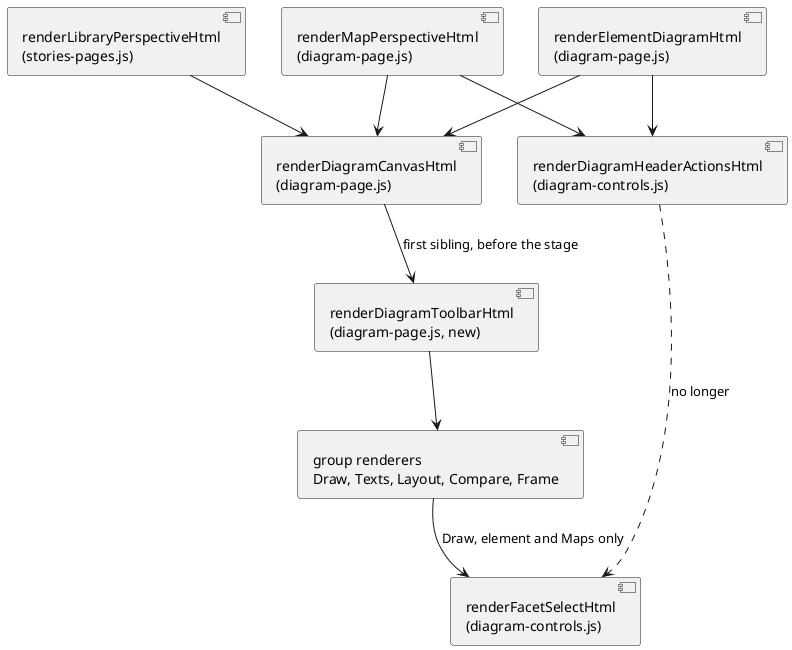

# The diagram toolbar, structure

# Summary

Review pass: dispatched (Stage 5, 2026-11-01, KDMLLC with the repository as referent; run by an agent other than the drafter, in its own context, and independent of the drafting for that reason). Its findings are returned to the main agent, which applies them.

The toolbar of a diagram in the editor floats over the bottom right of the canvas, comes after the canvas in the page, holds its controls in groups that are named by what earlier waves added and not by what a control acts on, has two buttons for one switch (*Everything* / *Changes only*), and uses three ways to say "on" (`aria-pressed`, `data-lit`, a label that changes). This run is the first half of #194: it docks the toolbar above the canvas on every surface, puts every control in one of five groups (Draw, Texts, Layout, Compare, Frame), replaces the pair by one *Changes only* toggle, gives every toggle a constant label and `aria-pressed` (no `data-lit` left in `src/main/editor`), writes titles that say what happens, and proves it with node tests per surface and an end-to-end spec in the three browsers. Run W-8 (`toolbar-state`) builds *Reset*, the "saved with the view" dot, the group buttons under 40 rem and *Fold all*, *Unfold all* and *Facet* on a saved view's page on top of the structure built here.

There is no PRD (profile TDD+pln), so traceability is incomplete: requirements are labelled `REQ-n` and taken from the manifest of wave 030 (row W-7, the first three criteria of gate P3 and the markup part of the sixth), decision Q1, RFC-002 (DEC-1, DEC-3; DEC-2, DEC-4 and DEC-5 are W-8's) and the scope and acceptance of issue #194 for run A.

One diagram: the markup of the toolbar, which is where the design adds a boundary (one function builds every toolbar, every surface calls it).

# Scope

In scope:

- `src/main/editor/presentation/diagram-page.js`: `renderDiagramCanvasHtml` returns three siblings (toolbar, stage, status line) instead of one stage that holds the toolbar; one new `renderDiagramToolbarHtml(record, host)` builds the toolbar from five group renderers; the Facet select moves in from the header.
- `src/main/editor/presentation/diagram-controls.js`: the header loses the Facet select; *Maximize* gets a constant label and `aria-pressed`.
- `src/main/editor/presentation/diagram-interaction.js`, `story-player.js`, `stories-pages.js`, `map-state.js`: the pressed convention (Center, Full screen, Edit text), the framing area of the canvas, the keyboard scope, the focus-restore selector.
- `src/main/editor/style.css`: the docked toolbar, the groups, the pressed style without `data-lit`.
- Tests: node tests per surface (new `toolbar.test.js` and a table `toolbar-controls.json` it reads), edits to the tests that assert the old markup, a new e2e spec `src/test/e2e/diagram-toolbar.spec.js`, `playwright.config.js` (the spec runs in WebKit too).
- `src/doc/README.adoc`: the sections with the anchors `[[editor-layout]]`, `[[editor-texts]]` and `[[editor-header]]`, and the three one-line mentions of *Everything | Changes only* (listed in IMP-8).
- The notes `src/main/editor/presentation/CLAUDE.md` and `src/test/CLAUDE.md` (one paragraph each), and the generated `standalone.html`.

Out of scope (W-8 or later, see Non-Goals and Deferred Work): *Reset*, the dot, group buttons under 40 rem, *Fold all* / *Unfold all* / *Facet* on the page of a saved view, *Open on diagram* remembering its view, `[[editor-small-screen]]`, direction and spacing presets (RFC-001), the lateral rail (#179), any change to the story player beyond the pressed convention, and any change to a command.

# PRD Traceability

No PRD. Requirements assumed from the manifest of wave 030, RFC-002 and issue #194 (run A: P-5, P-1, P-4, P-8).

- `REQ-1` (P-5, RFC-002 DEC-1, gate P3 criterion 3): on the page of an element (three viewpoints), both Maps, the page of a saved view and a story step, the toolbar comes before the canvas in the markup and in the Tab order; page order header, toolbar, chips, canvas, status. Addressed (DEC-1, DEC-2, CTR-1, FLOW-1).
- `REQ-2` (P-1, Q1, gate P3 criterion 3): five groups in the order Draw, Texts, Layout, Compare, Frame; each control belongs to exactly one. Addressed (DEC-3, DEC-4, CTR-1, CTR-2).
- `REQ-3` (P-4, RFC-002 DEC-3, gate P3 criterion 3): one *Changes only* toggle; the address key `changes-only=1` is as before. Addressed (DEC-5, CTR-3).
- `REQ-4` (P-4, gate P3 criteria 1 and 3): no `data-lit` in any file of `src/main/editor`; every toggle has a constant label and `aria-pressed`. Addressed (DEC-6, CTR-3).
- `REQ-5` (P-8, Q1): the title of every button of the toolbar says what happens (and names the key where one exists). Addressed (DEC-7, CTR-4).
- `REQ-6` (gate P3 criteria 1 and 2): `npm run test:unit` exits 0; `npx playwright test` exits 0 on Chromium, Firefox and WebKit with a spec for the toolbar of each surface; `diagram-address.spec.js` and `address.spec.js` have no removed line against `ff3bacd`. Addressed (DEC-8, Observability and Verification).
- `REQ-7` (gate P3 criterion 6, markup part): the manual describes the toolbar in `[[editor-layout]]`. Addressed (IMP-8). The `[[editor-small-screen]]` half is W-8.
- `REQ-8` (gate P3 criterion 5, completion criteria of the wave): `scripts/byte-identity.sh` exits 0 with no new declared difference, `npm run editor:build` leaves `git status --short` unchanged, `npm run format:check` and `npm run lint` exit 0. Addressed (Observability and Verification).
- `REQ-9` (wave Non-Goals): no change of behaviour of the tools beyond the toolbar; the story player has no toolbar of the editor and keeps its floating bar; the address contract of run 0203 is unchanged. Addressed (Scope, DEC-9, CON-2).

No requirement is left unresolved. The proposals P-1 and P-8 (Q1) are built as proposed; Q1 says the author may overturn them before the wave starts, and nothing in the wave record says so (ASM-1).

# Technical Goals

- `TG-1` One function, `renderDiagramToolbarHtml(record, host)`, builds the toolbar of every surface from five group renderers; a surface differs only by which controls are present.
- `TG-2` The toolbar is before the canvas in the markup, so the Tab order and the visual order agree, and it covers no part of the drawing.
- `TG-3` A test per surface names the groups, their order and each control's group, from one table that W-8 extends.
- `TG-4` One convention for "on": `aria-pressed` on a button whose label does not change. A disclosure keeps `aria-expanded`.
- `TG-5` The keys that titles name are keys that `handleDiagramKeydown` handles, and a test keeps it so.

# Non-Goals

- No *Reset*, no dot, no count, no group button under 40 rem, no panel (W-8). The structure leaves a visible group name and a stable group element for them (DEC-3).
- No *Fold all*, *Unfold all* or *Facet* on the page of a saved view (W-8, P-7): its Draw group has *Hide unlinked* and, on a technology Map view, the two Map parts, as today.
- No docking or regrouping of the story player's bar (`.player-tools`): it is a window of its own (run 0204, RFC-002 preamble). Only its pressed convention changes (DEC-6).
- No new shortcut, no roving tabindex, no arrow-key pattern for the toolbar (run 0204 answer 5): every control stays a tab stop.
- No change to the address: `layout=`, `changes-only=`, `frame=`, the show keys and the rest are written as before.
- No change to the chips, the left or right panels, the status line or the key of a comparison.

# Assumptions

- `ASM-1` The author has not overturned P-1 and P-8 (Q1). Confirmed in Stage 6 (Q-1).
- `ASM-2` `diagram-address.spec.js` clicks `[data-action="set-changes-only"][data-value="1"]` only while *Changes only* is off (lines 88 and 317 follow `compareWithPast` on a fresh page). With one toggle whose `data-value` is the value a click sets, the click selects the right state. Validate: read the two call sites (done while drafting) and run the spec in all projects.
- `ASM-3` The handler `set-changes-only` (`composition/events.js`, line 201) sets the state from `data-value` and does not toggle, so the old node tests that click `data-value` `0` or `1` stay valid against the new button when its attribute matches. Validate: the edits of IMP-9 only change assertions on the markup.
- `ASM-4` `diagramViewSize` subtracts `tools.offsetHeight + 16` because the toolbar floats over the canvas. With the toolbar docked the strip is no longer covered, so the framing math reads the whole canvas and the framed scale moves by at most the 16 pixels of margin. Validate: the node tests that fix `auto` and `fit` scales (`diagram.test.js`) and the e2e specs that read `data-scale` or the zoom label.
- `ASM-5` Playwright's WebKit can run one more spec of the same weight as `open-and-pages.spec.js` (it serves the packaged jar and opens a sample). Validate: the first WebKit run of the new spec.
- `ASM-6` `diagram-page.js` (1,304 lines) stays under the 1,600-line cap of a part with about 100 net added lines. The rule when it does not is Q-4.

# Constraints

- `CON-1` `standalone.html` is generated: edit `src/main/editor`, run `npm run editor:build`, commit both; `npm run editor:check` also checks `names.json` (a top-level name added, removed or renamed is a change to the list: `node scripts/check-editor.mjs --write-names`), `java-names.json` and the ratchet (`max` 99, may not rise).
- `CON-2` The address contract of run 0203 holds: `git diff ff3bacd -- src/test/e2e/diagram-address.spec.js src/test/e2e/address.spec.js` shows no removed line, so the data attributes those specs use (`set-changes-only` with `data-value`, `#diagram-columns`, `unfold-all`) are kept.
- `CON-3` No `data-lit` in any file of `src/main/editor` (`grep -rc 'data-lit' src/main/editor` prints 0 for every file), the player's `style.css` rule included.
- `CON-4` The three-browser run: `playwright.config.js` limits WebKit to a `testMatch` list of five specs; the gate needs the toolbar spec in all three projects.
- `CON-5` The editor runs from the committed page: `./mvnw`, `npm run test:e2e` and `node --test` by hand read `standalone.html` as it is, so `npm run editor:build` runs before each of them.
- `CON-6` Format and lint: Prettier covers `src/main/editor/**/*.{js,mjs}` and `style.css` (not `page.html`); format a part, then build, commit both. ESLint runs on the extracted page script with `--max-warnings 0`.
- `CON-7` The command line ignores the keys concerned, and `scripts/byte-identity.sh` compares what the program writes against the jar of `archicode-0.19.0`: nothing the CLI writes may change (JDK 25 in `JAVA_HOME`).
- `CON-8` Coverage floor: `scripts/editor-coverage-floor.json` only goes up; the new code is covered by the node tests of this run or the floor fails (`npm run test:coverage`).
- `CON-9` The text rules of the repository: English, no real workspace content in a fixture, no emoji.

# Current State

Read on the working copy while drafting.

- `renderDiagramCanvasHtml(record, overlayHtml, host)` (`presentation/diagram-page.js`, line 8) returns `
` holding the overlay (the Map's chips), the canvas `#diagram-canvas`, and `
`, then, after the stage, the status line. It is called by `renderElementDiagramHtml` (the element, line 831), `renderMapPerspectiveHtml` (both Maps, line 882) and `renderLibraryPerspectiveHtml` in `stories-pages.js` (the saved view, line 867, with `host`). A story step is drawn on the element or Map page, with the story bar (`renderStoryBarHtml`) over the header.
- The toolbar is `position: absolute; right: 1.5rem; bottom: 1.5rem` over the canvas (`style.css` line 534). It has no group names. Its controls, in markup order: *Fold all*, *Unfold all* (Map only, a group "Fold the boxes"), *Hide unlinked*, *Everything* and *Changes only* (a group `changes-switch`, only while `layerCompareOther()`), *Applications*, *Relationships* (technology Map and technology Map views, group "What the map draws"), *Columns* (a `select`, group "Boxes per row"), a rule, *Labels*, *Qualifiers*, *Descriptions*, *Wrap* (group "Show"), a rule, *Zoom out*, *100%*, *Zoom in* (group "Zoom"), *Center*, *Fit*.
- The Facet select is in the header: `renderDiagramHeaderActionsHtml` starts with `renderFacetSelectHtml()` (`presentation/diagram-controls.js`, line 90); it is absent when the workspace defines no facet. Its id is `diagram-facet-select`; `element-form.js` line 183 handles its change.
- Four ways to say "on": `aria-pressed` (*Hide unlinked*, the texts, the Map parts, *Fit*, the tabs), a pair of two `aria-pressed` buttons (*Everything* / *Changes only*), `data-lit` with no ARIA state (*Center*, in `diagram-page.js` line 67, `diagram-interaction.js` line 86, and the player's *Center*, `story-player.js` lines 349 and 565), and a label that changes (*Maximize* / *Restore* in `diagram-controls.js` line 47, *Edit text* / *Done* in `stories-pages.js` line 49, *Full screen* / *Exit full screen* in `story-player.js` line 332; the last two also carry `aria-pressed`). `data-lit` is written on five lines of `src/main/editor`, and nowhere else: `diagram-page.js` line 67, `diagram-interaction.js` line 86, `story-player.js` lines 349 and 565, and the rule at `style.css` line 566.
- `diagramViewSize(canvas)` (`diagram-interaction.js`, line 43) removes `tools.offsetHeight + 16` from the canvas height because the toolbar floats over it; `handleDiagramKeydown` (line 572) acts only when the event target is inside `.diagram-stage`.
- The e2e spec `diagram-columns.spec.js` (line 297) already looks for an ancestor with class `diagram-tools` or `diagram-toolbar`; the name `diagram-toolbar` is free in `src/main/editor`.
- WebKit runs five specs only (`playwright.config.js`, `testMatch`).
- The manual describes the toolbar in `[[editor-texts]]` ("the group *Show*", "a lit button"), `[[editor-layout]]` ("*Columns*, in the toolbar of a diagram", "A story step has no toolbar"), `[[editor-header]]` ("The facet list and *Maximize* stay in the header") and mentions *Everything | Changes only* at lines 2134 and 2291 (`[[editor-changes-only]]`).
- Run 0204's inventory (Tables A and B) is the list of controls per surface; this design adds no control.

# Proposed Design

Build one toolbar function and change what each surface hands it; touch no behaviour behind a control.

1. **Docking** (DEC-1). `renderDiagramCanvasHtml` returns `toolbar + stage + status`. The toolbar is a block in the flow of `.diagram-view` (a flex column), before the stage, full width like the status line (`margin: 0 -1.75rem`, the same padding), with `flex: none`. The stage keeps the overlay (chips) and the canvas, so the markup order is toolbar, chips, canvas, status. The class becomes `diagram-toolbar` and no longer positions itself; `.diagram-tools` stays the floating bar of the player.
2. **Groups** (DEC-3, DEC-4). `renderDiagramToolbarHtml(record, host)` concatenates five group renderers. A group is `
Draw…
`. A group with no control is not drawn. The controls and their order are the table of CTR-1.
3. **Facet** (DEC-4). `renderFacetSelectHtml()` is called by the Draw group of an element or a Map (not by the page of a saved view, which is W-8's) and no longer by the header.
4. **One *Changes only* toggle** (DEC-5). One button, `data-action="set-changes-only"`, `data-value` the value a click sets (`1` when off, `0` when on), `aria-pressed`. The handler is unchanged.
5. **One pressed convention** (DEC-6). *Center* gets `aria-pressed` in place of `data-lit`, on the page and in the player; *Maximize*, *Edit text* and *Full screen* get a constant label and `aria-pressed`; their titles stop naming the state.
6. **Titles** (DEC-7). Every button and select of the toolbar, *Maximize*, and the three buttons above get a title that says what happens, then the key in parentheses where one exists.
7. **Keyboard and framing** (DEC-2). `handleDiagramKeydown` acts for events inside the stage or the toolbar, as it did when the toolbar was in the stage; `diagramViewSize` stops removing a strip.

The reviewer validates that the three callers reach the one toolbar function, that the header no longer calls the Facet renderer, and that the story step has no caller of its own (it is drawn by the element and Map pages). Textual fallback: three page renderers call `renderDiagramCanvasHtml`, which emits the toolbar from `renderDiagramToolbarHtml` (five groups), then the stage, then the status line; `renderFacetSelectHtml` is called from the Draw group and not from the header.

## Decisions

- `DEC-1` — Dock the toolbar by returning three siblings.
  - `Decision:` `renderDiagramCanvasHtml` returns the toolbar, the stage and the status line in that order; the toolbar is not inside the stage and is not positioned absolutely. Class `diagram-toolbar`; `.diagram-tools` stays for the player.
  - `Rationale:` The page order of RFC-002 DEC-1 (header, toolbar, chips, canvas, status) needs the toolbar outside the stage, because the chips are the stage's overlay and come before the canvas in it. A new class lets the editor's toolbar and the player's floating bar keep different layout rules without a modifier on every selector; `diagram-columns.spec.js` already accepts the name.
  - `Alternatives considered:` keep `.diagram-tools` and add a `docked` modifier (every rule of the player and the editor would carry both); put the toolbar first inside the stage (the stage is `position: relative; flex: 1`, so the toolbar would then overlay or shrink the canvas by a margin hack, and the chips would still come after it).
  - `Tradeoffs:` the rules of lines 534 to 566 of `style.css` split; `css-theme-audit.test.js` (entries at lines 631 and 632) names the class and gets a second pair of entries. The canvas is `toolbar height` shorter than before on a short window, which is the point of the issue (13 % of the drawing at 1280 px, 32 % at 360 px were covered).
  - `Linked PRD IDs:` REQ-1, REQ-9.

- `DEC-2` — Keep the keyboard scope and fix the framing area.
  - `Decision:` `handleDiagramKeydown` tests `e.target.closest('.diagram-stage, .diagram-toolbar')`; `diagramViewSize` returns `{ width: canvas.clientWidth, height: canvas.clientHeight }` and drops its `tools` lookup.
  - `Rationale:` the zoom keys, `C`, `F`, `M` and `Esc` worked from a focused toolbar button because the toolbar was inside the stage; the scope keeps that. The strip subtracted for a floating bar no longer exists.
  - `Alternatives considered:` scope to `.diagram-view` (it also contains the header, whose controls have their own keys: `Esc` closes the header menu, so it would be a behaviour change); keep the 16-pixel margin (a margin for something that is gone).
  - `Tradeoffs:` the arrow keys on the *Columns* or *Facet* select, inside the scope, were already taken by the diagram handler when the toolbar was in the stage; this run keeps that and does not fix it (DEF-3).
  - `Linked PRD IDs:` REQ-1, REQ-6.

- `DEC-3` — Groups are `role="group"` elements with a visible name and a stable hook.
  - `Decision:` each group is `div.tool-group[role=group][aria-label][data-group]` with a visible `span.tool-group-name` (`aria-hidden`, since the group already has its `aria-label`) and a `span.tool-group-controls`; `data-group` is `draw`, `texts`, `layout`, `compare` or `frame`.
  - `Rationale:` the name gives a sighted reader what the groups are; W-8 needs a place for the dot in the name (P-2) and a button to replace the group under 40 rem (P-6), both of which hang on this element, so the structure W-7 ships is the one W-8 extends and not one it rewrites.
  - `Alternatives considered:` the existing `span.button-group` with an `aria-label` only (no visible name, so P-2's dot has nowhere to go); a `fieldset` (browser default styles and legend layout fight a toolbar).
  - `Tradeoffs:` a few extra characters of width per group; at 360 px the groups wrap (the toolbar stays a wrapping row until W-8).
  - `Linked PRD IDs:` REQ-2.

- `DEC-4` — The five groups, their order, and where the Facet goes.
  - `Decision:` Draw (*Fold all*, *Unfold all*, *Hide unlinked*, *Applications*, *Relationships*, then the Facet), Texts (*Labels*, *Qualifiers*, *Descriptions*, *Wrap*), Layout (*Columns*), Compare (*Changes only*, drawn only while `layerCompareOther()`), Frame (*Zoom out*, *100%*, *Zoom in*, *Center*, *Fit*). Maximize stays in the header, Download in the "…" menu, *Key* under the drawing. The Facet moves from the header into Draw on the element and Map pages and stays out of the page of a saved view (W-8 adds it there).
  - `Rationale:` P-1 of run 0204 (built as proposed, Q1). The Facet changes what is drawn, like *Hide unlinked*, and the header then holds only navigation and page actions. *Fold all* is first in Draw because it is the first control a Map reader reaches today.
  - `Alternatives considered:` leave the Facet in the header until W-8 (then "each control in exactly one group" has a control outside the groups for one run, and W-8 would do the P-1 move and the P-7 addition in one step); a sixth group "Facet" (a group of one).
  - `Tradeoffs:` the header's narrow states (`[[editor-header]]`) lose a control to handle (less to do), the manual sentence about the header changes, and `header.test.js` loses its Facet assertions; the facet list appears in the toolbar of a story step (a step is drawn on the page, so it follows the page).
  - `Linked PRD IDs:` REQ-2.

- `DEC-5` — One *Changes only* toggle whose `data-value` is the value a click sets.
  - `Decision:` `<button type="button" id="diagram-changes-only-button" data-action="set-changes-only" data-value="1|0" aria-pressed="true|false" title="…">Changes only</button>`; `data-value` is `1` while off and `0` while on; the id is the same in every state. The group Compare holds it alone and is absent when no comparison is drawn.
  - `Rationale:` RFC-002 DEC-3 (Q-C, recommended and accepted). Keeping `data-action` and a `data-value` keeps the handler, the node tests that click by attribute and the two e2e helpers that click `data-value="1"` on an off state (ASM-2, CON-2).
  - `Alternatives considered:` a new action name `toggle-changes-only` (the address specs, which cannot change, click `set-changes-only`); a constant `data-value="1"` with a toggling handler (the node tests that click `0` to turn it off would need rewriting for no gain).
  - `Tradeoffs:` the attribute changes with the state, so a test that finds the button by `data-value` must know the state; the e2e spec of this run finds it by role and `pressed`. The id exists for the focus restore: `headerControlSelector` (`map-state.js`) takes `#id` before `data-action` plus `data-value`, so without the id a press would flip `data-value`, the selector would look for the old value and the focus would be lost (Stage 5 F1).
  - `Linked PRD IDs:` REQ-3.

- `DEC-6` — `aria-pressed` and a constant label, everywhere a button toggles.
  - `Decision:` *Center* (page and player): `aria-pressed` is true while the framing is `auto`, no `data-lit`. *Maximize* (header): label and `aria-label` `Maximize`, `aria-pressed`, a constant icon. *Edit text* (story bar): label `Edit text`, `aria-pressed` as it has. *Full screen* (player): label `Full screen`, `aria-pressed` as it has. Titles of the four stop naming a state ("Bring back…", "Leave full screen") and say the action once, with the way back where it is a key ("… (M). Esc brings it back"). `style.css` selects `[aria-pressed="true"]` only, for `.diagram-toolbar`, `.diagram-tools` and the header's `.maximize-button`.
  - `Rationale:` a screen reader hears `aria-pressed` and never `data-lit`; a label that changes with the state says the state twice when `aria-pressed` is also there (run 0204 answer 4). The gate needs no `data-lit` in `src/main/editor`, and the player's *Center* is two of the five lines.
  - `Alternatives considered:` leave the player out of the change (the grep of the gate would still find its `data-lit`; the player's own toolbar is not redesigned, only its attribute); keep the *Maximize* icon swap (a second statement of the state that a sighted reader gets from the pressed colour).
  - `Tradeoffs:` the text of the player and the header changes for a reader used to "Restore" and "Exit full screen"; the manual says so in `[[editor-header]]` and `[[editor-story-player]]` is not edited (it names *Full screen*, which stays). `library-view-panels.test.js` (line 534), `header.test.js` (lines 292 to 295), `diagram.test.js` (line 377) and `story-player-modal.test.js` (line 756) change their assertions.
  - `Linked PRD IDs:` REQ-4.

- `DEC-7` — Titles say what happens, then the key.
  - `Decision:` each button and select of the toolbar gets a `title` that differs from its label, written as what happens, ending with the key in parentheses where `handleDiagramKeydown` has one: `(-)`, `(0)`, `(+)`, `(C)`, `(F)`, `(M)`, `(Esc)`. A test dispatches each key named by a title through `handleDiagramKeydown` and asserts it acts.
  - `Rationale:` P-8; the existing titles of the texts and the Map parts already say what happens, so the work is on the buttons whose title repeats the label or describes the state.
  - `Alternatives considered:` no test of the keys (a title that names a key the page does not handle is the failure P-8 exists to prevent); a table of keys exported from `diagram-interaction.js` (the handler is a chain of `if`; a table beside it would be a second source that drifts).
  - `Tradeoffs:` the test drives the real handler with a stub event, which needs a diagram on screen for `M` and `Esc`; the node harness opens the fixture and sets the perspective, as `header.test.js` does.
  - `Linked PRD IDs:` REQ-5.

- `DEC-8` — Tests: one table, one node test per surface, one e2e spec in three browsers.
  - `Decision:` `src/test/javascript/viewpoint-kernel/toolbar-controls.json` lists, for each surface, the groups in order and, in each, the controls (a key built from `data-action` plus `data-show`, `data-part`, `data-dir` or the id). `toolbar.test.js` renders each surface and asserts the order of the groups, that each control of the page is in exactly one group and that the set of controls equals the table. `src/test/e2e/diagram-toolbar.spec.js` checks the real page in Chromium, Firefox and WebKit (the checks are item 5 of Observability and Verification); `playwright.config.js` adds the spec to the WebKit `testMatch`.
  - `Rationale:` the gate says the node tests per surface name each check and that an e2e spec covers the toolbar of each surface in three browsers. A table is read once and extended by W-8 (it adds *Reset*, the dot, *Fold all* / *Facet* on the view page).
  - `Alternatives considered:` assertions inline in each test (the same list five times); a shared JSON read by Java too (the command line has no toolbar; the repository's rule for shared cases is about sentences both tools say).
  - `Tradeoffs:` WebKit gets a sixth spec: a longer run, and `src/test/CLAUDE.md` (the paragraph that says "five") is edited; RISK-4.
  - `Linked PRD IDs:` REQ-1, REQ-2, REQ-6.

- `DEC-9` — The player keeps its floating bar.
  - `Decision:` `story-player.js` keeps `div.diagram-tools.player-tools`, floating, with its Zoom group, *Center* and *Fit*; only `data-lit` goes (DEC-6). The step's own view decides the rest, as now.
  - `Rationale:` the player is a window, not a toolbar of the editor (run 0204, RFC-002 preamble, Non-Goals of the wave); regrouping it is not in P-1 to P-8.
  - `Alternatives considered:` give the player the five groups (it has three controls, and none of Draw, Texts, Layout or Compare).
  - `Tradeoffs:` the player's floating bar still covers part of the drawing; out of scope for #194 run A.
  - `Linked PRD IDs:` REQ-9.

# Repository Impact

- `IMP-1` — The toolbar markup
  - `Path(s):` `src/main/editor/presentation/diagram-page.js`.
  - `Change type:` modify.
  - `Why impacted:` `renderDiagramCanvasHtml` returns three siblings; new `renderDiagramToolbarHtml(record, host)` and five group renderers (the existing `renderMapPartsToolHtml`, `renderDiagramShowGroupHtml` and the fold and zoom markup are wrapped in them); one *Changes only* button; *Center* with `aria-pressed`; titles (DEC-1, DEC-3 to DEC-7).
  - `Linked PRD IDs:` REQ-1 to REQ-5.
  - `Risks / notes:` `diagram-page.js` has 1,304 lines (ASM-6): if the change pushes it past 1,600, the toolbar functions are cut to a new part in a first `refactor: move` commit (`scripts/check-editor-moves.sh` needs the page byte for byte the parent's), then the change is a `refactor: change` commit. New top-level names go in `names.json` (`node scripts/check-editor.mjs --write-names`).

- `IMP-2` — The header and the Facet
  - `Path(s):` `src/main/editor/presentation/diagram-controls.js`.
  - `Change type:` modify.
  - `Why impacted:` `renderDiagramHeaderActionsHtml` stops calling `renderFacetSelectHtml()`; `renderMaximizeButtonHtml` gets a constant label, `aria-pressed` and a constant icon; the comment "Facet and Maximize stay in the row at every width" and the header's doc comment change; `renderColumnsToolHtml` gets its group and a title on the select.
  - `Linked PRD IDs:` REQ-2, REQ-4.
  - `Risks / notes:` `element-form.js` (line 183) and `headerControlSelector` still use the id `diagram-facet-select`, which is kept.

- `IMP-3` — Framing and keyboard
  - `Path(s):` `src/main/editor/presentation/diagram-interaction.js`.
  - `Change type:` modify.
  - `Why impacted:` `diagramViewSize` no longer subtracts the toolbar; `handleDiagramKeydown` scope (DEC-2); the *Center* update at line 86 sets `aria-pressed` and drops its `data-lit` comment.
  - `Linked PRD IDs:` REQ-1, REQ-4.
  - `Risks / notes:` RISK-2 (a scale that depended on the 16 pixels).

- `IMP-4` — The pressed convention and the focus restore
  - `Path(s):` `src/main/editor/presentation/story-player.js` (lines 332, 349, 565), `src/main/editor/presentation/stories-pages.js` (line 49), `src/main/editor/presentation/map-state.js` (line 61: `.diagram-toolbar button, .diagram-toolbar select` added to the selector of the controls whose focus is put back; the *Changes only* button has the id `diagram-changes-only-button`, which `headerControlSelector` already prefers to `data-action` plus `data-value`, so the focus follows the button across a press).
  - `Change type:` modify.
  - `Why impacted:` DEC-6, DEC-9; the focus-restore list must name the new class, and *Changes only* needs its id, or a press in the toolbar loses the focus after a redraw (Stage 5 F1).
  - `Linked PRD IDs:` REQ-4.
  - `Risks / notes:` the player's `focus` helper (`player-center-button`) keeps its ids.

- `IMP-5` — Styles
  - `Path(s):` `src/main/editor/style.css` (lines 534 to 566 and the header rules for `.maximize-button`).
  - `Change type:` modify.
  - `Why impacted:` `.diagram-tools` keeps the floating rules for the player; `.diagram-toolbar` is a docked wrapping row (`flex: none`, `margin: 0 -1.75rem`, the padding of the status line, a bottom border); `.tool-group`, `.tool-group-name`, `.tool-group-controls`; the pressed rule `[aria-pressed="true"]` without `[data-lit]`; `.maximize-button[aria-pressed="true"]`.
  - `Linked PRD IDs:` REQ-1, REQ-2, REQ-4.
  - `Risks / notes:` colours come from the theme tokens already in use (`--bg`, `--border`, `--accent`, `--on-accent`); `css-theme-audit.test.js` is updated for the new class (its two entries at lines 631 and 632).

- `IMP-6` — The generated page and its lists
  - `Path(s):` `src/main/resources/editor-webapp/standalone.html`, `src/main/editor/names.json`, `src/main/editor/layers.json` (only if a part is cut, ASM-6).
  - `Change type:` modify (generated).
  - `Why impacted:` `npm run editor:build` after every change to a part; the lists of `editor:check`.
  - `Linked PRD IDs:` REQ-8.
  - `Risks / notes:` `java-names.json` is untouched unless a name a Java source cites is removed (none is: `renderFacetSelectHtml`, `renderDiagramCanvasHtml` and the ids stay).

- `IMP-7` — Tests of the new structure
  - `Path(s):` `src/test/javascript/viewpoint-kernel/toolbar.test.js` (new), `src/test/javascript/viewpoint-kernel/toolbar-controls.json` (new), `src/test/e2e/diagram-toolbar.spec.js` (new), `playwright.config.js`.
  - `Change type:` additive (and one edit of the WebKit `testMatch`).
  - `Why impacted:` DEC-8. The node test uses the openers of `header.test.js` (`elementsPage`, `mapPage`), `technology-map-parts.test.js` (`opened`) and `library-view-diagram.test.js` (`startPage`, `addView`, `openView`) for the six surfaces, and a story step through `goToStoryStep`; the e2e spec serves the layered Brightcart (`fixtures.js`) as `diagram-columns.spec.js` does.
  - `Linked PRD IDs:` REQ-1 to REQ-6.
  - `Risks / notes:` RISK-4 (WebKit weight), RISK-5 (rows drawn by ELK are only a tendency in a browser; the spec asserts structure and attributes, not positions of boxes).

- `IMP-8` — The manual
  - `Path(s):` `src/doc/README.adoc` (`[[editor-layout]]`, `[[editor-texts]]`, `[[editor-header]]`, and the lines that say *Everything | Changes only*: 809, 2134, 2291).
  - `Change type:` modify.
  - `Why impacted:` `[[editor-layout]]` gets the paragraph on the toolbar: it is docked above the diagram, five groups in order, each control in one, the pressed convention, the titles; "A story step has no toolbar" is reworded (it is true of the player, not of a step drawn in the editor); `[[editor-texts]]` says *Texts* and "pressed"; `[[editor-header]]` no longer keeps the facet list in the header; the three mentions say one *Changes only* toggle.
  - `Linked PRD IDs:` REQ-7.
  - `Risks / notes:` every anchor of `git show ff3bacd:src/doc/README.adoc` stays defined (`manual-skeleton.test.js`), the voice test bans four words outside listings (`manual-voice.test.js`), `ManualExamplesTest` must exit 0; no anchor is added or removed. `[[editor-small-screen]]` is W-8's.

- `IMP-9` — Tests whose assertions change
  - `Path(s):` `viewpoint-kernel/changes-panel.test.js` (lines 742 to 754: the pair and its group markup; the order of *Hide unlinked*, *Changes only* and the *Show* group becomes Draw, Texts, Compare order), `header.test.js` (Facet in the header, lines 100 to 198; *Restore*, lines 292 to 295), `diagram.test.js` (lines 284, 346, 377, 507 to 512, 829, 1232: the `data-lit` assertions become `aria-pressed`, the facet is in the toolbar), `library-view-panels.test.js` (line 534), `story-player-modal.test.js` (line 756), `css-theme-audit.test.js` in `viewpoint-kernel/` (lines 631 and 632), and the tests below, which do not assert the toolbar but depend on where the stage starts (Stage 5 F2, F3, Stage 9 gap-007), plus any other file the first run of `npm run test:unit` names. Task 007 greps `src/test` for `diagram-stage`, `diagram-tools`, `diagram-facet-select`, `set-changes-only` and `data-lit` and lists every file it edits in the record.
  - `story-player-scene.test.js` compares two things with the page of archicode-0.18.0: `renderDiagramCanvasHtml(null, "")` (the toolbar was inside the stage) and `renderShellHtml` (whose header loses the Facet select and changes the *Maximize* label). The toolbar is now a sibling before the stage, so both comparisons differ on purpose: the test cuts the old `div.diagram-tools` and the new toolbar out before it compares the stage and the status line, and filters the Facet select and the *Maximize* button of both pages from the shell comparison, each filter with its reason in a comment. `renderDiagramCanvasHtml(null, "")` keeps working with no record and no host (IF-1).
  - The stubs whose `closest` answers the exact selector `.diagram-stage` and so fail to match the widened scope of DEC-2 (`closest('.diagram-stage, .diagram-toolbar')`): `diagram-box-tab-stops.test.js` (line 236), `diagram-link-tab-stops.test.js` (line 337) and `inspection-links.test.js` (lines 626 and 647); they answer the new selector without weakening what they assert. `library-view-panels.test.js` (lines 395 and 436) and `library-view-diagram.test.js` (lines 549 and 867) have the same stub and are edited the same way if the grep shows it.
  - The tests that slice the markup at the stage: `diagram.test.js` (lines 1090, 1097 and 1539 slice at `
`, and a header or a stage read before it now includes the toolbar) and `library-view-diagram.test.js` (lines 409 and 410: header, stage and status order, which becomes header, toolbar, stage, status).
  - `Change type:` modify.
  - `Why impacted:` they assert the markup this run changes on purpose.
  - `Linked PRD IDs:` REQ-2 to REQ-4.
  - `Risks / notes:` `library-view-diagram.test.js` line 380 asserts the page of a saved view has no `diagram-facet-select`, `fold-all` or `unfold-all`: it stays true in W-7 and is the assertion W-8 reverses.

- `IMP-10` — Notes for the next author
  - `Path(s):` `src/main/editor/presentation/CLAUDE.md`, `src/test/CLAUDE.md`.
  - `Change type:` modify.
  - `Why impacted:` the first gets one paragraph on the toolbar (where it is built, the five groups, `data-group`, `toolbar-controls.json` as the table a new control is added to, the pressed convention); the second says WebKit runs six specs and which.
  - `Linked PRD IDs:` REQ-2, REQ-6.
  - `Risks / notes:` none beyond the rule that the notes say what is, not the history.

# Canonical Impact

- `CI-arc-1` None. The model in `docs/architecture/` names the editor by its six layers and by contracts between them; the toolbar is inside `presentation/`, and this run adds no coupling between layers: `ArchitectureDriftTest` (layers) and `ArchitectureImpactTest` (`impact-questions.json`) are expected unchanged, and `grep -rn -i toolbar docs/architecture` found no element or relationship that names it. If `layers.json` gains a part (ASM-6), the part is inside the `presentation` layer, so the order of layers does not change. No sample bundle changes (`npm run sample:check` stays green).
- `CI-dom-1` None. No domain invariant is enforced by this run.

# Data Model and Contracts

- `CTR-1` — The markup contract of the toolbar
  - `Current contract:` a floating `div.diagram-tools[role=toolbar][aria-label="Diagram tools"]` inside `.diagram-stage`, after the canvas; groups named "Fold the boxes", "What the diagram draws of the comparison", "What the map draws", "Boxes per row", "Show", "Zoom"; *Facet* in the header.
  - `Proposed contract:` `div.diagram-toolbar[role=toolbar][aria-label="Diagram tools"]` before `.diagram-stage`, holding in order the groups below, each `div.tool-group[role=group][aria-label=<Name>][data-group=<name>]`; a group with no control is absent. Controls, by surface (a control marked * is present only when its condition holds: the workspace defines a facet for Facet, `layerCompareOther()` for *Changes only*; "Map views" are the saved views whose viewpoint is `map`):

    | Group | Element (3 viewpoints) | Map, application | Map, technology | Saved view page |
    | --- | --- | --- | --- | --- |
    | Draw | *Hide unlinked*, Facet* | *Fold all*, *Unfold all*, *Hide unlinked*, Facet* | *Fold all*, *Unfold all*, *Hide unlinked*, *Applications*, *Relationships*, Facet* | *Hide unlinked*; *Applications*, *Relationships* on a technology Map view |
    | Texts | *Labels*, *Qualifiers*, *Descriptions*, *Wrap* | same | same | same |
    | Layout | *Columns* | same | same | same |
    | Compare | *Changes only** | same | same | same |
    | Frame | *Zoom out*, *100%*, *Zoom in*, *Center*, *Fit* | same | same | same |

    The story step is the element or Map column, with the story bar over the header. The ids `diagram-columns`, `diagram-zoom-label`, `diagram-center-button`, `diagram-fit-button` and `diagram-facet-select` and the `data-action` values are kept; `diagram-changes-only-button` is new (DEC-5). *Columns* stays a `span.button-group.diagram-columns[role=group][aria-label="Boxes per row"]` and sits, as that nested group, inside the `span.tool-group-controls` of the Layout group; a run of buttons that had a `span.button-group` (*Fold all* and *Unfold all*, the two Map parts, the Texts, the Zoom) keeps it inside the `span.tool-group-controls` of its group, so the fused edges of `.button-group` (`style.css` lines 692 to 697) still apply; the *Changes only* pair had one and the single toggle has none.
  - `Affected files:` IMP-1, IMP-2, IMP-5, `toolbar-controls.json`, `toolbar.test.js`, `diagram-toolbar.spec.js`.
  - `Migration or compatibility notes:` nothing is persisted by the markup; the address and the files are untouched. A bookmark or a saved view is read as before.
  - `Linked PRD IDs:` REQ-1, REQ-2.

- `CTR-2` — The table of controls
  - `Current contract:` none; run 0204's Table A and B are prose in a run record.
  - `Proposed contract:` `src/test/javascript/viewpoint-kernel/toolbar-controls.json`: `{ "surfaces": { "<surface>": { "groups": [ { "name": "Draw", "controls": ["fold-all", "unfold-all", "toggle-hide-unlinked", "diagram-facet-select"] }, … ] } } }` with the surfaces `element`, `map-application`, `map-technology`, `view-element`, `view-map-application`, `view-map-technology`; controls are named by `data-action` (plus `data-show`, `data-part` or `data-dir` where the action is shared) or by id for a `select`. W-8 adds *Reset* and the dot to the same table.
  - `Affected files:` the new JSON and `toolbar.test.js`.
  - `Migration or compatibility notes:` read by a node test only; it is a test fixture, not a shipped example.
  - `Linked PRD IDs:` REQ-2, REQ-6.

- `CTR-3` — The state attributes of a toggle
  - `Current contract:` four ways (see Current State).
  - `Proposed contract:` a toggle is a `<button type="button">` with a label that does not change and `aria-pressed="true|false"` set on every redraw and by the live updaters (`diagram-interaction.js` for the page's *Center* and *Fit*, `story-player.js` for the player's); a disclosure is `aria-expanded`; no `data-lit` in any file of `src/main/editor`. *Changes only* is one button (DEC-5): `id="diagram-changes-only-button"` (kept in every state), `data-action="set-changes-only"`, `data-value` the value a click sets.
  - `Affected files:` IMP-1 to IMP-5.
  - `Migration or compatibility notes:` the address key `changes-only=1` is read and written as before (`changesOnlyFromParams`, `pushShowParams`); the remembered flag `changes-only` in `localStorage` is untouched.
  - `Linked PRD IDs:` REQ-3, REQ-4.

- `CTR-4` — The title convention
  - `Current contract:` a title is free text; some repeat the label, some describe the state.
  - `Proposed contract:` a title says what happens when the button is pressed and ends with the key in parentheses where one exists; the keys that may appear are the ones `handleDiagramKeydown` handles: `-` (the hyphen-minus, the one `handleDiagramKeydown` tests), `0`, `+`, `C`, `F`, `M`, `Esc`; a title is never equal to the label.
  - `Affected files:` IMP-1, IMP-2, IMP-4.
  - `Migration or compatibility notes:` none (titles are not read by any tool).
  - `Linked PRD IDs:` REQ-5.

No configuration file, no file format, no command-line output and no external service changes.

# Interfaces and Behavior

- `IF-1` `renderDiagramCanvasHtml(record, overlayHtml, host)`: same arguments and same callers; returns the toolbar, the stage and the status line as three siblings (the caller embeds the string as before).
- `IF-2` `renderDiagramToolbarHtml(record, host)`: new; `host` is the object of the page of a saved view (`{ view, isMap, layer, parts, hideUnlinked, shows }`) or undefined; it reads the same state the old inline code read (`diagramHideUnlinked`, `AppState.changesOnly`, `diagramScale`, `diagramShows`, `diagramColumns`, `layerCompareOther()`, `mapLayer()`).
- `IF-3` The header actions: `renderDiagramHeaderActionsHtml` yields the "…" menu and *Maximize* only (the Facet is gone from it).
- Behavior: a press does what it did. *Changes only* on a page with a comparison turns the flag on and the button pressed; pressed again, off. Keys act from the canvas and from any control of the toolbar. At 360 px the toolbar wraps its groups over more than one row and the page is not wider than the window; nothing is scrolled sideways. With no comparison the Compare group is absent; with no facet defined, the Facet select is absent.
- Failure and fallback: a surface with no controls for a group omits the group; there is no error state.

# Flows and Processing Logic

- `FLOW-1` — A page is drawn with its toolbar
  - `Trigger:` `render()` for the page of an element, a Map, a saved view or a story step.
  - `Steps:` (1) the page function builds its header (with the actions of IF-3 where it has them); (2) it calls `renderDiagramCanvasHtml`; (3) that calls `renderDiagramToolbarHtml`, which asks each group renderer for its controls from the current state; (4) the toolbar, the stage (overlay then canvas) and the status line are returned in this order; (5) `mountDiagramIfNeeded` fills `#diagram-canvas` and the live updaters set `aria-pressed` on *Center* and *Fit* and the zoom label as the scale changes.
  - `Branches / failure paths:` no comparison: no Compare group; no facet: no Facet; element page: no *Fold all*, *Unfold all* and no Map parts; application Map: no Map parts; page of a saved view: no Facet, no fold buttons (W-8), `host` decides the state shown; the story player does not take this path (DEC-9).
  - `Final output / rendered result:` the markup of CTR-1 in the page, with the toolbar before the canvas.
  - `Linked PRD IDs:` REQ-1, REQ-2.

- `FLOW-2` — A key or a press from the toolbar
  - `Trigger:` a key pressed with the focus on a toolbar button, or a click.
  - `Steps:` `handleDiagramKeydown` accepts the event (target inside `.diagram-stage` or `.diagram-toolbar`, DEC-2) and acts for `+`, `-`, `0`, `F`, `C`, `M`, `Esc` as before; a click goes to `handleAppClick`, which dispatches on `data-action` as before; `render()` or the live updaters redraw and `map-state.js` puts the focus back on the control by the selector that now includes `.diagram-toolbar`.
  - `Branches / failure paths:` a key with a modifier is ignored; `Esc` acts only while maximized or with a link selected; a redraw that removes the focused control (the Compare group when the comparison is switched off) falls back to the nearest control, as the focus helper already does.
  - `Final output / rendered result:` the same state change as before, with the focus where it was.
  - `Linked PRD IDs:` REQ-1, REQ-5.

# Reliability, Performance, and Scalability

- The markup is built from state already computed for the old toolbar; no new work per redraw. The page gains about 300 bytes of markup per group.
- A docked toolbar takes the canvas height it used to cover; the layout engine's input is the canvas size, so the drawing is laid out as before and only the visible area shrinks. `diagramCacheKey` is untouched (no kernel input changes).
- Testability: one table drives the node test per surface and is the table W-8 extends (TG-3).

# Security and Privacy

Not applicable beyond the existing rule that every label, title and name inserted in the markup goes through `escapeHtml`; the new group names are constants and the facet names are escaped as before. No data leaves the page and nothing is stored.

# Observability and Verification

JDK 25 for any Maven step (`JAVA_HOME` of sdkman 25). Run `npm run editor:build` before `node --test` by hand, `./mvnw` or `npm run test:e2e` (CON-5).

1. `npm run editor:build` then `git status --short`: only the intended files; run it again, no change (REQ-8).
2. `npm run editor:check`: the page is the assembly, the lists (`names.json`) and the ratchet hold.
3. `npm run test:unit` exits 0, and `grep -rc 'data-lit' src/main/editor` prints 0 for every file (gate P3 criterion 1; REQ-4). `toolbar.test.js` names one test per check: (a) per surface, the groups present are a subsequence of Draw, Texts, Layout, Compare, Frame in that order; (b) each control of the toolbar is in exactly one group, and the set equals `toolbar-controls.json`; (c) the toolbar is before the chips and before `id="diagram-canvas"` in the markup of each surface, and the status line is after; (d) every toggle has `aria-pressed`, no label of a toggle is in a state pair (`Restore`, `Done`, `Exit full screen`), no `data-lit`; (e) *Changes only* is one button with the id `diagram-changes-only-button` in both states, `data-value` flips with the state, `headerControlSelector` returns `#diagram-changes-only-button` for it in both states, and the click sets the flag and the address key `changes-only=1` is as before; (f) every button of the toolbar has a title that is not its label, and every key named in a title is handled by `handleDiagramKeydown`; (g) the header of an element and of a Map has no Facet select; (h) the Facet is in Draw on an element and a Map and not on the page of a saved view.
4. `npm run test:coverage` meets the floor (CON-8).
5. `npm run test:e2e` after `./mvnw package -Dmaven.test.skip -Dplugin.asciidoctor.skip=true` (or `verify`) and `npx playwright install` of the three browsers: exits 0 on Chromium, Firefox and WebKit. `diagram-toolbar.spec.js` (DEC-8) has one test per surface (element, application Map, technology Map, saved view, story step): the groups are found by role in order; the toolbar's bounding box is above the canvas's; from the header, Tab reaches the first toolbar control before the canvas; `getByRole('button', { name: 'Fit', pressed })`, the same for Center and *Changes only*; a key (`F`) pressed with the focus on a toolbar button acts; at 360 by 740 the document is not wider than 360 and every control is inside the window's width.
6. `git diff ff3bacd -- src/test/e2e/diagram-address.spec.js src/test/e2e/address.spec.js` shows no removed line, and both specs pass in all projects they run in (CON-2).
7. `JAVA_HOME=<jdk 25> scripts/byte-identity.sh` exits 0 with no new declared difference (CON-7).
8. `./mvnw test -Dtest=ManualExamplesTest` exits 0; `node --test src/test/javascript/manual-skeleton.test.js src/test/javascript/manual-voice.test.js` pass (IMP-8).
9. `npm run format:check` and `npm run lint` exit 0.
10. `./mvnw test-compile pmd:check` is not needed (no Java source changes); `./mvnw verify` stays the CI command and is run once at the end of the run.

Not proved by these checks: the look of the docked toolbar at each width (judged in a browser by the run and recorded as a finding, as run 0204's measure was), and rows drawn by ELK, which are a tendency in a browser only (RISK-5).

# Deployment and Rollout

- Kind of change: code-only, editor page; no configuration, data or external service.
- Staging: the hosted editor at `/editor/` is published by a tag run; this run is proved by the pull request's CI and the local runs above, and says so in its record. The jar embeds the page; the native image includes `editor-webapp/**` as before.
- Compatibility: no file, address or saved view changes; a link copied before this run opens the same diagram. W-8 builds on the structure and must not start before this run's commit.
- Rollback: revert the run's commit(s); `standalone.html` is regenerated by the revert of the sources plus `npm run editor:build`. Planning guidance only; no deployment is authorized here.

# Risks and Tradeoffs

- `RISK-1` The docked toolbar at 360 px: with groups wrapping and the Facet and Columns selects, it can be taller than the 164 px the floating bar had, and eat the canvas until W-8 collapses the groups. Mitigation: groups wrap, the spec asserts no sideways overflow, and the height at 360 and 1280 is recorded; W-8's gate (a toolbar at most 20 % of the window) is the real bar. Accepted for one run.
- `RISK-2` `diagramViewSize` change moves the `auto` and `fit` scales by the margin that was subtracted (ASM-4). A node test that fixes a scale at a fake canvas size, or an e2e that reads the zoom label, may move by a few percent. Mitigation: update the expectation with the reason, and name it in the run's record; never loosen a tolerance silently.
- `RISK-3` Keyboard scope: widening it to the toolbar keeps the old behaviour, and keeps the arrow-key capture on the selects (DEF-3). Narrowing it would stop `F` and `C` from a focused button, which a keyboard user may rely on.
- `RISK-4` WebKit has run five specs for a reason (Playwright's WebKit needs more system libraries, and is not Safari). A sixth spec adds time and a possible flake; CON-4 says the gate needs it. If it flakes, the spec is made stable or reduced, never retried (the repository rule), and the record says which.
- `RISK-5` A browser proves structure and attributes here, not the position of ELK's rows; the e2e spec asserts the toolbar's box against the canvas's and nothing about the drawing.
- `RISK-6` Moving the Facet out of the header changes where a reader finds it. The manual and the title say where it is; the page's own header test is rewritten, so the move is guarded.
- `RISK-7` `diagram-page.js` approaches its part cap (ASM-6, Q-4); a cut forces a two-commit sequence by the move commit rule (`check-editor-moves.sh`).
- Tradeoff: one function builds every toolbar, so a surface-specific need (the page of a saved view) is a condition inside a group renderer and not a template of its own; W-8 adds three such conditions.

# Open Questions

No question is left open. Resolved in Stage 6 (2026-11-01), each with its evidence:

- `Q-1` Resolved: yes. Decision D3 of the author (`prg-030-pages-ci-and-toolbar.md`, 2026-11-01) says the toolbar builds P-1, P-2, P-7 and P-8 as proposed. ASM-1 is confirmed, and DEC-3, DEC-4 and DEC-7 stand.
- `Q-2` Resolved: the titles are a wording choice made by the implementing agent under CTR-4 (shape fixed by test (f) of the verification list, not the words); the author reads them in the run's record. No decision is owed before implementation.
- `Q-3` Resolved: the visible name of a group is its aria name, the five words of P-1 (Draw, Texts, Layout, Compare, Frame), with no separate aria text. A different wording is a later copy change that touches IMP-1 and IMP-8 only.
- `Q-4` Resolved as a rule, not as a number (the size after the change cannot be known before it): IMP-1 is one commit; `diagram-page.js` is 1,304 lines today against the 1,600-line cap in `src/main/editor/CLAUDE.md`. If the measure (`node scripts/build-editor.mjs --map`) shows more than 1,600, the sequence of RISK-7 applies (a `refactor: move` commit, then the change).

# Deferred Work

- `DEF-1` *Reset*, the dot, the group buttons under 40 rem, *Fold all*, *Unfold all* and *Facet* on the page of a saved view, *Open on diagram* remembering its view, `[[editor-small-screen]]`: W-8 (`toolbar-state`).
- `DEF-2` Direction and spacing presets (RFC-001), the lateral rail (#179): not planned.
- `DEF-3` The arrow keys on the *Columns* and *Facet* selects are taken by the diagram's handler (inherited from the toolbar being inside the stage). Not fixed here; to be filed as an issue on `tmorin/archicode` if the e2e spec confirms it.
- `DEF-4` A browser workspace's top bar at 360 px (finding of run 0204, not the toolbar's): the author's to open as an issue.

# File Placement and Frontmatter

This file is `docs/wav/wav-030-pages-ci-and-toolbar/run/run-0217-toolbar-structure/tdd-0217-toolbar-structure.md`, beside the run's status file `run-0217-toolbar-structure.md` and its progress log `prg-0217-toolbar-structure.md`, with the frontmatter `title`, `type: tdd`, `status`, `run: 0217`, `wave: 030`, `owner`, `date` and `related`, as the sibling TDD of run 0216.
