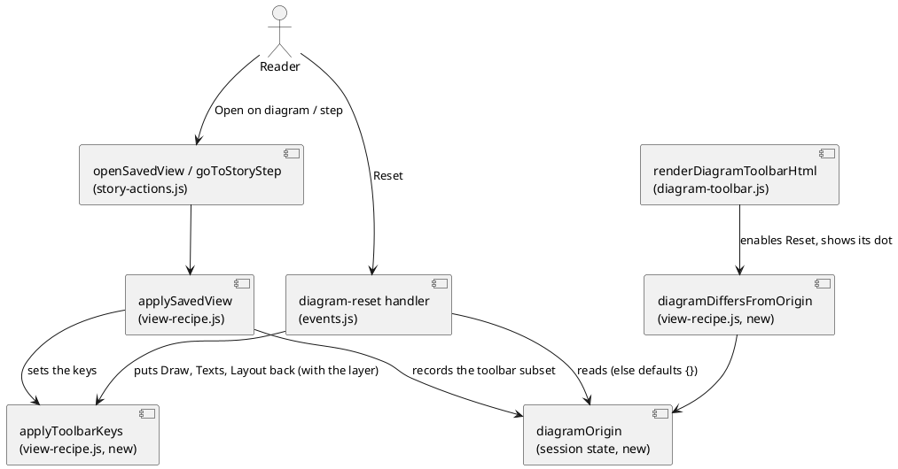

# The diagram toolbar, state

# Summary

Review pass: dispatched (Stage 5, KDMLLC review by a leaf agent in a fresh context, independent of the drafter; the findings are in the Findings of `prg-0218-toolbar-state.md` and are applied by the main agent).

Run 0217 docked the toolbar above the canvas and put every control in one of five named groups (Draw, Texts, Layout, Compare, Frame). The toolbar still does not say what a saved view keeps, cannot undo the reader's changes to the view's own settings, takes about 40 % of a 360 px window, and the page of a saved view lacks three controls that apply to its diagram. This run is the second half of #194 (run B): it adds a dot on the groups a view keeps (P-2), one *Reset* button (P-3, RFC-002 DEC-2, DEC-5), one button per group with a count under 40 rem, except Compare whose one control stays a button inline (P-6, RFC-002 DEC-4) and *Fold all*, *Unfold all* and *Facet* on the page of a saved view (P-7). It proves them with node tests per surface (extending `toolbar-controls.json`), an end-to-end spec in three browsers, and the manual (`[[editor-toolbar]]` is not added: the gate names `[[editor-small-screen]]` and `[[editor-layout]]`).

There is no PRD (profile TDD+pln), so traceability is incomplete: requirements are labelled `REQ-n` and taken from the manifest of wave 030 (row W-8, the last three criteria of gate P3), decision Q1 (P-2 and P-7 built as proposed), RFC-002 (DEC-2, DEC-4, DEC-5) and run 0204's proposals P-2, P-3, P-6 and P-7.

One diagram: the flow of *Reset* and of the origin of a diagram, the one new piece of state of the run.

# Scope

In scope:

- `src/main/editor/presentation/diagram-page.js` and a new part `presentation/diagram-toolbar.js` (the toolbar renderers move there first, IMP-1): the dot, the group buttons and their count, *Reset*, the three controls of the page of a saved view.
- `src/main/editor/application/view-recipe.js`: the origin of a diagram, `applySavedView` records it, one function applies the toolbar's keys (shared by `applySavedView` and *Reset*), one function says whether the diagram differs from its origin; `presentation/map-state.js` (the confirmation of *Unfold all* takes the sets it counts as a parameter).
- `src/main/editor/composition/events.js`, `presentation/element-form.js`, `presentation/view-edit.js`, `presentation/diagram-interaction.js`: the actions `diagram-reset` and `toggle-tool-group`, the branches of `fold-all`, `unfold-all` and the facet change for the page of a saved view, the keys, the live zoom in the Frame button.
- `src/main/editor/style.css`: the dot, the group button under 40 rem, the panel, the *Reset* dot.
- Tests: `toolbar-controls.json` and `toolbar.test.js` extended, new node tests for the origin and for the page of a view, `src/test/e2e/diagram-toolbar.spec.js` extended (the file is run 0217's, in the working copy).
- `src/doc/README.adoc`: the sections `[[editor-layout]]` and `[[editor-small-screen]]`.
- The notes `src/main/editor/presentation/CLAUDE.md` and `src/test/CLAUDE.md`, `src/main/editor/layers.json`, `names.json`, and the generated `standalone.html`.

Out of scope: direction and spacing presets (RFC-001), the lateral rail (#179), the player's floating bar, any new shortcut, any change to a command or to a saved view's file format (see Non-Goals).

# PRD Traceability

No PRD. Requirements assumed from the manifest of wave 030, RFC-002, run 0204 and issue #194 (run B: P-3, P-2, P-6, P-7).

- `REQ-1` (P-3, RFC-002 DEC-2, gate P3 criterion 4): *Reset* is disabled when the diagram equals its origin; it restores Draw, Texts and Layout only; it is absent on the page of a saved view. Addressed (DEC-1, DEC-2, CTR-2, FLOW-1).
- `REQ-2` (RFC-002 DEC-2, DEC-5): the origin is the view or step the diagram came from, else the defaults; *Open on diagram* remembers its view; session state only, nothing written. Addressed (DEC-3, CTR-3).
- `REQ-3` (P-2, Q1, gate P3 criterion 4): the dot is on exactly the groups whose keys are in `VIEW_PROPERTY_ORDER`, with `aria-label="Saved with the view"`. Addressed (DEC-4, CTR-1).
- `REQ-4` (P-6, RFC-002 DEC-4, gate P3 criterion 4): under 40 rem Draw, Texts, Layout and Frame are each one button with its count, opening its controls in a panel; Compare has no group button (its one control, *Changes only*, stays a button inline), *Reset* stays a button, Frame shows the zoom; the toolbar is at most 20 % of the window height at 360 by 740 (the bar of run 0204, named in RISK-1 of run 0217). Addressed (DEC-5, DEC-6, CTR-1).
- `REQ-5` (P-7, Q1, gate P3 criterion 3): the page of a saved view has *Fold all*, *Unfold all* (Map views) and *Facet* (every view), which edit `opened` and `facet`; a control is absent only when it can never apply. Addressed (DEC-7, CTR-5).
- `REQ-6` (gate P3 criteria 1, 2): `npm run test:unit` exits 0; `npx playwright test` exits 0 on Chromium, Firefox and WebKit with the spec extended for each surface; `diagram-address.spec.js` and `address.spec.js` have no removed line against `ff3bacd`. Addressed (DEC-8, Observability and Verification).
- `REQ-7` (gate P3 criterion 5): `scripts/byte-identity.sh` exits 0 with no new declared difference; `npm run editor:build` leaves `git status --short` unchanged. Addressed (CON-1, CON-7, Observability and Verification).
- `REQ-8` (gate P3 criterion 6): the manual describes the toolbar in `[[editor-small-screen]]` and `[[editor-layout]]`; `ManualExamplesTest`, `format:check` and `lint` exit 0. Addressed (IMP-9).
- `REQ-9` (wave Non-Goals): no change to a command, to the address contract of run 0203, to the story player's floating bar. Addressed (CON-2, Non-Goals).

No requirement is left unresolved. The criterion of gate P3 says the dot is on the groups "whose keys are in `VIEW_PROPERTY_ORDER`": checked while drafting, the constant lists the Map parts, `layout` and the four texts as well as `opened`, `facet` and `hide-unlinked` (`presentation/view-edit.js`, line 66), so Draw, Texts and Layout qualify and Compare and Frame do not; no mismatch.

# Technical Goals

- `TG-1` The origin of a diagram and the test "differs from its origin" are one function each, with one comparison (`canonicalViewDefinition` subsets), so the button, the dot on it and the node test cannot disagree.
- `TG-2` *Reset* and `applySavedView` share the code that sets the toolbar's state, so what a view opens with and what *Reset to "name"* restores cannot drift.
- `TG-3` A group is the same element at every width; only CSS and one session flag decide whether it is a label with controls or a button with a panel.
- `TG-4` The state of every control is readable without opening anything: a group button carries its count, *Reset* its dot, Frame the zoom.
- `TG-5` The toolbar of the page of a saved view obeys the rule "absent only when it can never apply", stated in one table (`toolbar-controls.json`) that the node test reads and the manual repeats.

# Non-Goals

- No new key in a saved view, in the address or in a manifest; no change to `canonicalViewProperties`. The origin is not written anywhere (RFC-002 DEC-5).
- No *Reset* of Compare or Frame (*Changes only*, zoom, Center, Fit are the session's), none of the pins, hidden boxes, `links` or `highlight` (chips and panels of a Map, not controls of the toolbar).
- No "Tools" menu (RFC-002 DEC-4 rejects it), no roving tabindex, no new shortcut.
- No regrouping of the story player's floating bar.
- No `[[editor-toolbar]]` section and no `src/test/resources/toolbar/controls.json`: run 0204 proposed them, but run 0217 chose `toolbar-controls.json` beside the node tests and the gate names the two existing anchors. The table is extended, not moved.

# Assumptions

- `ASM-1` Run 0217's structure is committed before this run starts (its `standalone.html`, `diagram-toolbar.spec.js`, the group markup of `renderToolGroupHtml`). Validate: `git log` shows the commit; `grep -c 'tool-group' src/main/editor/presentation/diagram-page.js` is not 0.
- `ASM-2` `diagramScene.expandable` on the page of a saved view lists the boxes that *Unfold all* may open, as on a Map, because `diagramScene` follows `useDiagramHost` and the library canvas is drawn by the same `computeDiagramScene`. Validate: a node test on a saved Map view presses *Unfold all* and sees `opened` grow by the scene's `expandable`.
- `ASM-3` Playwright accepts `aria-disabled="true"` as disabled for `toBeDisabled()`. Validate: the first run of the spec (DEC-2).
- `ASM-4` `diagram-page.js` (1,349 lines) plus the run's additions would pass the 1,600-line cap of a part; the move of IMP-1 removes the whole prefix, about 225 lines, first. Validate: `node scripts/build-editor.mjs --map` after IMP-1 and after the run.
- `ASM-5` The count of a group, computed from its own markup (DEC-5), is the number the e2e spec reads: node and browser read the same attribute. Validate: the node check (c) of the verification list and the spec at 360 px.

# Constraints

- `CON-1` `standalone.html` is generated: edit `src/main/editor`, run `npm run editor:build`, commit both; `npm run editor:check` also checks `names.json` (`node scripts/check-editor.mjs --write-names` after a top-level name is added, removed or renamed), `java-names.json` and the ratchet (`max` 99, may not rise). A new part is an entry of `layers.json` (`parts`).
- `CON-2` The address contract of run 0203 holds: `git diff ff3bacd -- src/test/e2e/diagram-address.spec.js src/test/e2e/address.spec.js` shows no removed line. *Reset* writes the address only through the keys the toolbar already writes (`layout=`, `hide-unlinked=`, `show` keys, `facet=`), no new key.
- `CON-3` No `data-lit` in any file of `src/main/editor` (gate P3 criterion 1).
- `CON-4` The three-browser run: the toolbar spec is already in the WebKit `testMatch` (run 0217); this run adds tests to it, not a file.
- `CON-5` The editor runs from the committed page: `npm run editor:build` before `node --test` by hand, `./mvnw` or `npm run test:e2e`.
- `CON-6` Format and lint: Prettier covers the editor sources, ESLint the extracted page script with `--max-warnings 0`; format a part, then build, commit both. A move of code is its own commit, `refactor: move <part> to <path>`, which leaves the page byte for byte (`scripts/check-editor-moves.sh`).
- `CON-7` The command line ignores the keys concerned, and `scripts/byte-identity.sh` compares against the jar of `archicode-0.19.0` (JDK 25 in `JAVA_HOME`): nothing the CLI writes may change.
- `CON-8` The coverage floor (`scripts/editor-coverage-floor.json`) only goes up; the new code is covered by node tests.
- `CON-9` English, no emoji, no real workspace content in a fixture.

# Current State

Read on the working copy while drafting; run 0217's changes are in it.

- `renderDiagramToolbarHtml(record, host)` (`presentation/diagram-page.js`, line 63) joins five `renderToolGroupHtml(name, controlsHtml)` calls: `div.tool-group[role=group][aria-label][data-group]` holding `span.tool-group-name` (`aria-hidden`) and `span.tool-group-controls`. `host` is only given by the page of a saved view in the Library (`{ view, isMap, hideUnlinked, shows, layer, parts }`, from `viewDiagramRecipe`). The toolbar renderers are `renderDrawToolsHtml`, `renderCompareToolsHtml`, `renderFrameToolsHtml`, `renderMapPartsToolHtml`, `renderDiagramShowGroupHtml` and `renderColumnsToolHtml`, lines 43 to 225; with `renderDiagramCanvasHtml` before them and `renderDiagramDownloadHtml` after them they are the prefix of the file that DEC-9 moves.
- Draw is *Fold all* and *Unfold all* (only when neither `record` nor `host`, so a Map), *Hide unlinked*, the technology Map parts, and the Facet select (not when `host`). The Facet select is `renderFacetSelectHtml()` (`presentation/diagram-controls.js`, line 232), `id="diagram-facet-select"`, selected from the global `diagramFacet`; its change is handled in `presentation/element-form.js` line 183 (`pushDiagramHistory`, set `diagramFacet`, redraw).
- The state a toolbar control edits is global to the editor: `diagramHideUnlinked`, `diagramFacet`, `diagramShow` (`setDiagramShow`), `diagramColumns`, `technologyMapParts` and the Map's `opened` (`mapStateOf().opened`). Its canonical view form is `currentViewDefinition()` (`application/view-recipe.js`, line 57), which drops a text equal to its default and a column count equal to the workspace's; `viewMatchesScreen(view)` compares it with `canonicalViewDefinition(view)` as JSON text. `applySavedView(view)` (line 265) sets all of it from a view, plus the pins, hidden, `links` and `highlight`, the page and the selection; it is called by `openSavedView` (*Open on diagram*, `saved-view-open`, `application/story-actions.js` line 494) and by `goToStoryStep` through `stepViewForDrawing`.
- There is no *Reset*, no origin and no mark of what a view keeps. The only return to a view is *Back to this step* (`story-restore`, `renderStoryBarHtml`, drawn while `viewMatchesScreen` is false), which also redraws the plateau and the pins.
- The page of a saved view (`renderLibraryPerspectiveHtml`, `presentation/stories-pages.js`) calls `renderDiagramCanvasHtml(record, overlay, host)`. Its toolbar has *Hide unlinked*, the technology parts, the texts, *Columns* (edits the view, `setViewLayout`), and Frame; *Hide unlinked*, the parts and the texts edit the view through `editSavedView(change)` (`events.js` lines 623 to 650). It has no *Fold all*, *Unfold all* or Facet: `opened` and `facet` are fields of the form (`handleViewFieldChange`, field `facet`, line 350; `setViewListItem`, `setViewFacet`, `view-edit.js`).
- `VIEW_PROPERTY_ORDER` (`view-edit.js`, line 66) is `element, pinned, hidden, opened, links, facet, hide-unlinked`, the Map parts, `layout`, then the four texts.
- Under 40 rem the regions stack (`style.css`, `@media (max-width: 40rem)`, line 993) and the toolbar is a wrapping row of five visible groups. Run 0217 measured it at 360 by 740: 301 px on a Map and 269 px on an element, 41 % and 36 % of the window (`prg-0217`, Findings), over the 20 % bar of run 0204; this run cuts it.
- `applyDiagramScale` (`presentation/diagram-interaction.js`, line 71) rewrites `#diagram-zoom-label` on every zoom without a redraw; `headerControlSelector` (`map-state.js`, line 57) keeps the focus of a toolbar control across a redraw by its id or its `data-action` and attributes.
- `toolbar-controls.json` (`src/test/javascript/viewpoint-kernel/`) lists the controls of six surfaces and a story step by group; `toolbar.test.js` renders each and checks order, membership, the table, titles and keys (checks a: to h: and the older `check i (F1)`). `src/test/e2e/diagram-toolbar.spec.js` (run 0217, five tests per browser) checks the real page.

# Proposed Design

Build on the structure of run 0217 with three additions, none of which changes what a control does:

1. **The origin** (DEC-3). `applySavedView` records `diagramOrigin = { perspective, element, name, properties }`, where `properties` is the toolbar subset of the view's canonical properties. A diagram with no origin has the defaults as its origin (empty subset). `diagramDiffersFromOrigin()` compares the toolbar subset of `currentViewDefinition()` with the origin's, as JSON text, as `viewMatchesScreen` does.
2. **Reset** (DEC-1, DEC-2). One button after Layout, `data-action="diagram-reset"`, `aria-disabled="true"` while the diagram equals its origin, a dot when it differs, the name `Reset to "name"` or `Reset to defaults`. It calls `applyToolbarKeys(properties, layer)`, the function `applySavedView` now also uses for the keys of the toolbar, with the origin's subset (or `{}`) and the layer the page draws, after `pushDiagramHistory()`. It is absent on the page of a saved view.
3. **Groups as buttons** (DEC-5, DEC-6). Each group but Compare gets a header `div.tool-group-head` with the name, the dot (a group a view keeps) and, under 40 rem only, `button.tool-group-button` showing the name and the count and opening `span.tool-group-controls` as a panel. Compare keeps its one control inline. The state "open" is one session variable.
4. **The page of a saved view** (DEC-7). *Fold all*, *Unfold all* (Map views) and *Facet* (every view) are drawn from `host` and their handlers edit the view with `editSavedView` as the neighbours do.

The reviewer validates that `applySavedView` and the *Reset* handler both go through `applyToolbarKeys`, that the origin is read in two places only (`diagramDiffersFromOrigin` and the handler) and written in one (`applySavedView`), and that nothing is persisted. Textual fallback: opening a view or a step records the toolbar keys of that view as the origin and sets the toolbar through `applyToolbarKeys`; the toolbar compares the live keys with the origin to enable *Reset*; pressing it calls `applyToolbarKeys` with the origin's keys, or with none.

## Decisions

- `DEC-1` — *Reset* sits after Layout, outside the five groups, and is the only such control.
  - `Decision:` `<button type="button" id="diagram-reset-button" class="tool-reset" data-action="diagram-reset" …>` is a direct child of `.diagram-toolbar`, between the Layout and Compare groups, on the pages that draw a diagram of the session (element, both Maps, a story step) and not on the page of a saved view. `toolbar-controls.json` gets a per-surface `actions: ["diagram-reset"]` outside `groups`; the node test says every control is in exactly one group or is a listed action.
  - `Rationale:` RFC-002 DEC-2 and P-3 put it after Layout. It acts on three groups, so it belongs to none of them; placing it in Layout would say it resets only the columns, and a sixth group would hold one button.
  - `Alternatives considered:` inside the Layout group (wrong scope, and the group button under 40 rem would hide it, against DEC-4 of RFC-002); a sixth group "Reset" (a group of one, `each control in exactly one group` kept by a trick); the header (far from what it resets).
  - `Tradeoffs:` the rule "each control is in exactly one group" of run 0217's test (b) gains one named exception; the test lists it so a second exception fails.
  - `Linked PRD IDs:` REQ-1, REQ-4.

- `DEC-2` — *Reset* is disabled with `aria-disabled`, not `disabled`, and puts back three groups through one function.
  - `Decision:` while the diagram equals its origin the button has `aria-disabled="true"`, a muted style and no effect on click; when it differs it has no such attribute and carries `span.reset-dot` (`aria-hidden`; the button's title says "The diagram differs from …"). Pressing it runs `pushDiagramHistory()`, `applyToolbarKeys(origin ? origin.properties : {}, layer)`, `mapSelectionCheck = true`, render. The focus stays on the button (it is not disabled, so it keeps it; `headerControlSelector` returns `#diagram-reset-button`). It restores Draw (`opened` on a Map, `facet`, `hide-unlinked`, the technology Map parts), Texts (the four `show` keys) and Layout (`layout.columns`); it never touches `diagramScale`, `diagramCenter`, `AppState.changesOnly`, pins, hidden, `links`, `highlight` or the selection.
  - `Rationale:` a native `disabled` button loses the focus when it becomes disabled, which is what happens the moment *Reset* is pressed and the diagram equals its origin; `aria-disabled` is announced as disabled, is read by Playwright's `toBeDisabled()` (ASM-3) and keeps the keyboard reader where they are. The history entry makes the browser's Back undo a reset, like every other control of the toolbar.
  - `Alternatives considered:` `disabled` plus a `pendingFocusSelector` to the first toolbar control (the focus jumps to something the reader did not choose); hiding the button while equal (the toolbar would change width at each press, and the gate says disabled).
  - `Tradeoffs:` the click handler must ignore `aria-disabled` itself (one line, tested); the node test of the gate reads the attribute `aria-disabled`.
  - `Linked PRD IDs:` REQ-1.

- `DEC-3` — The origin is a snapshot of the toolbar's keys, recorded by `applySavedView`, valid for one page and one element.
  - `Decision:` `diagramOrigin = { perspective, element, name, properties }` (session state, `model/ui-state.js` or `application/view-recipe.js` beside the other `let`s), written by `applySavedView` after the state is set: `perspective` is the page it drew, `element` the selected element key for an element view (else `''`), `name` is `viewLabel(view)`, `properties` is `toolbarKeysOf(canonicalViewDefinition(view).properties)` (the keys `opened`, `facet`, `hide-unlinked`, the Map parts, the four texts and `layout`). One rule clears it: the lazy comparison on read. `currentDiagramOrigin()` returns the origin only while `currentPerspective` and the selected element still equal the recorded ones and clears it otherwise, and it is called at the start of every render, so a page change is seen by the next render whoever made it. `currentPerspective` is set in two places, `setPerspective` (`composition/address-routing.js`) and `applySavedView` itself; neither clears the origin (no explicit clear in `setPerspective` or in the address sync), the comparison covers both. The one other clear is `folder-session.js`, with the rest of the session state. A diagram with no origin has `{}` as its origin and the name "defaults".
  - `Toolbar keys:` `applyToolbarKeys(properties, layer)` takes the canonical toolbar subset and the layer of the page (`mapLayer()` for the session's Map, the view's layer in `applySavedView`), because the Map's `opened` and the technology parts are per layer (`mapStateOf(layer)`) and the origin records the perspective only; a *Reset* with no origin passes `{}` and the layer of the page, and clears that layer's `opened`. It sets `opened`, `facet`, `hide-unlinked`, the Map parts, the four texts and `layout`. `applySavedView` keeps setting `pinned`, `hidden`, `links`, `highlight`, the page and the selection itself, outside the shared function.
  - `Rationale:` RFC-002 DEC-5 says *Open on diagram* remembers its view as session state, reset with the folder; a story step carries its own recipe that may have no id (`stepViewForDrawing`), so a snapshot works for both where a view id would not, and it keeps meaning if the view is edited afterwards (the reference is what was opened). Comparing subsets of the canonical definitions makes "differs" immune to defaults and to the workspace's inherited columns, which the canonical form already drops.
  - `Alternatives considered:` store the view id (a step without an id has none, and editing the view changes the reference under the reader); store the whole definition (pins and links would make a pin on the Map count as a difference, which *Reset* does not restore); clear in `setPerspective` and the address sync as well (a third mechanism, and it misses `applySavedView`).
  - `Tradeoffs:` a view edited on the Library page after *Open on diagram* does not move the reference of the open diagram; the title of *Reset* names the view as it was opened. The origin is lost when the reader leaves the page and comes back, as RFC-002 asks. The origin has no viewpoint: changing the element tab (overview, detailed, deep) keeps it, so `Reset to "name"` stays named after a view of another viewpoint; accepted, because the toolbar subset is viewpoint-independent.
  - `Linked PRD IDs:` REQ-1, REQ-2.

- `DEC-4` — The dot is data-driven from the table, drawn in the group header, and its truth is audited.
  - `Decision:` a group Draw, Texts or Layout carries `span.tool-group-dot[role="img"][aria-label="Saved with the view"]` in its header; Compare and Frame carry none and their group `title` is "Not part of a view". The one fact is `key` in the table: each control of `toolbar-controls.json` carries `key` (the view property it edits: `opened` for *Fold all* and *Unfold all*, `facet`, `hide-unlinked`, `applications`, `relationships`, `labels`…, `layout`) or null. `diagram-toolbar.js` draws the dot from a constant `SAVED_GROUPS = ['Draw', 'Texts', 'Layout']`, and the node test asserts that `SAVED_GROUPS` is equal to the groups that have a keyed control, that those keys are all in `VIEW_PROPERTY_ORDER` and kept by `canonicalViewProperties`, and that the Compare and Frame controls have no `key`. *Name view…* is checked in the e2e spec: after a change in each saved group, the view written has the keys of those groups and no other.
  - `Rationale:` P-2 says the dot is true exactly when a view keeps the control's key; a constant asserted equal to the keyed groups of the table, plus an audit that reads the real lists makes a new control without a key, or a key a view stops keeping, fail a test and not a reader.
  - `Alternatives considered:` derive the dot at render time from `canonicalViewProperties` (a render per control for a fact that does not change within a session); a dot per control (twelve dots; the group is the unit the reader reads).
  - `Tradeoffs:` a constant to keep equal to the table; the assertion is the guard. The one-line note of P-2 is not a row of its own (RISK-4, Q-1).
  - `Linked PRD IDs:` REQ-3.

- `DEC-5` — Under 40 rem a group is a button with a count and a panel; the count is read from the group's own markup.
  - `Decision:` every group but Compare is drawn as `div.tool-group[data-group][data-open]` > `div.tool-group-head` (name, dot, and `button.tool-group-button[data-action="toggle-tool-group"][data-group][aria-expanded][aria-controls]` holding the name and `span.tool-group-count`) + `span.tool-group-controls#tool-panel-<group>`. Compare is one control, *Changes only*, a button that stays inline under 40 rem, and has no group button, no count and no panel; its group keeps `div.tool-group[data-group]` with the name hidden under 40 rem. Above 40 rem CSS hides the button and shows the name; under it CSS hides the name and the controls, and shows the button and, when `data-open="true"`, the controls as a panel under the toolbar (`position: absolute` from the toolbar, full width, above the canvas). The count is the number of controls of the group that are on: a button with `aria-pressed="true"`, a select that carries `data-on="true"` (the Facet when one is chosen, *Columns* when a number is chosen). It is computed once by `countOnControls(controlsHtml)` from the markup the renderer returned. Frame's button shows `Frame <zoom>` and `applyDiagramScale` updates it with `#diagram-zoom-label`. `toggleToolGroup` sets one session variable `toolPanelOpen` (null or `{ group, perspective, element }`), redraws, and the focus goes back to the group button; like the origin (DEC-3) it is read through one function that compares the recorded perspective and element with the current ones and clears it on a mismatch, and `folder-session.js` clears it with the rest.
  - `Rationale:` RFC-002 DEC-4 and P-6: the state is never hidden, a group button carries its count, Reset its dot; the group element is the same as the wide one (TG-3), so there is no second toolbar to keep equal. Reading the count from the same markup that holds the pressed states is what lets the node check (c) and the e2e spec assert the same number the reader sees (ASM-5).
  - `Alternatives considered:` a count computed from the state variables (a second list of what is on, and a toggle added later would be missed); render two toolbars and show one by CSS (duplicate ids, duplicate tab stops); a `
` per group (native, but not a toolbar button and no count in its summary without script).
  - `Tradeoffs:` the panel's controls are `display: none` while closed under 40 rem, so a test or a reader reaches a control by opening its group first; `toolPanelOpen` survives a resize to the wide layout, where it has no effect; Compare has no panel, so *Changes only* is one tap.
  - `Linked PRD IDs:` REQ-4.

- `DEC-6` — The collapsed toolbar fits the 20 % bar and the panel keeps the keyboard.
  - `Decision:` under 40 rem the toolbar row holds four group buttons (Draw, Texts, Layout and Frame with its zoom), *Reset* and *Changes only* (Compare's one control, inline), six items; at 360 by 740 it is at most 148 px (20 %). Opening a panel does not move the canvas (it overlays it). `Escape`, with the focus inside the toolbar and a panel open, closes the panel and puts the focus on its group button (handled first in `handleDiagramKeydown`, before all three existing `Escape` branches, so `Esc` out of Maximize is unchanged when no panel is open). A second press of the group button closes it, opening another group replaces it. The panel is closed whenever the page or the element changes, by the same lazy comparison on read as the origin (DEC-3), not by an explicit clear.
  - `Rationale:` the 20 % is the bar of P-6 in run 0204's mock-up (79 px, two rows) and the number W-8 inherits from RISK-1 of run 0217. Overlaying keeps the drawing stable while a text toggle is tried.
  - `Alternatives considered:` a panel in the flow (the canvas jumps at every press and the bar grows past 20 % while open); closing on a click outside (an extra document listener and a focus rule; deferred, DEF-2).
  - `Tradeoffs:` an overlaying panel covers part of the drawing while it is open; the reader closes it with the button or `Esc`.
  - `Linked PRD IDs:` REQ-4.

- `DEC-7` — The page of a saved view gets *Fold all*, *Unfold all* and *Facet* by one rule.
  - `Decision:` a control is absent only when it can never apply to that kind of diagram, and present and working wherever it applies, on every page; on the page of a view it edits the view. So `renderDrawToolsHtml` draws *Fold all* and *Unfold all* when the diagram is a Map (`!record` or `host.isMap`), and the Facet select on every surface, with `host` carrying the view's facet name. The handlers get a `currentPerspective === 'library'` branch, as `toggle-hide-unlinked` has: *Fold all* removes `opened` from the view, *Unfold all* adds `diagramScene.expandable` to `opened` (the same one-level step and the same confirmation above `MAP_UNFOLD_CONFIRM_BOXES`; `mapBoxesIfOpened` reads the session today (`currentMapOpened()`, `mapStateOf().hidden`, `mapLayer()`), so it takes the view's `opened` and `hidden` sets and its layer as a parameter, the session's being the default, and the library branch passes the view's), the facet change calls `setViewFacet` through `editSavedView`. One press is one `editSavedView` call: the view changes, the session does not (`diagramFacet`, `mapStateOf().opened` untouched). The table `toolbar-controls.json` is the statement of the rule, with the rows that are absent on a surface and why in a `why` field, and the manual repeats it in `[[editor-layout]]`.
  - `Rationale:` P-7 and Q1. `setViewFacet` and `editSavedView` exist, and `setViewListItem` adds or removes one element of `opened`; *Fold all* and *Unfold all* write the whole list, so `setViewOpened(view, references)` is new in `view-edit.js` (it sets or deletes `opened` through `putViewProperty`, as `setViewFacet` does for `facet`, and is not built on `setViewListItem`, whose per-element checks and refusal of a duplicate do not apply to a set computed from the scene).
  - `Alternatives considered:` leave the form as the only way (the toolbar then looks inconsistent between pages); a new `view-fold` action (a second name for the same control, and the keys and titles tested twice).
  - `Tradeoffs:` the facet name written by the toolbar goes through `setViewFacet`'s existing checks, so a facet the workspace does not define is refused with the form's message; `Unfold all` on a view needs the scene (`ASM-2`), and does nothing before the first drawing.
  - `Linked PRD IDs:` REQ-5.

- `DEC-8` — Tests extend the table and the spec; the new code is covered.
  - `Decision:` `toolbar-controls.json` gains, per control, `key` (DEC-4), per surface the `actions` of DEC-1, the three new controls on the surfaces of DEC-7, and per absent control a `why`. The eight checks of run 0217 are `check a:` to `check h:` and stay, as does the older test `check i (F1):` (Changes only through the click handler); `check b:` gets the table with keys and the one named exception of DEC-1, and `check h:` is rewritten to DEC-7 (the Facet is on every surface, the page of a saved view included). `toolbar.test.js` gains one test per new check, named `check i:` to `check o:`: i: the dot is on exactly the groups of `SAVED_GROUPS` and the audit of DEC-4; j: the count of each group equals the controls on in its own markup, on each surface and after a toggle, and Compare has no group button; k: *Reset* is present on each surface but the page of a saved view, `aria-disabled` while the diagram equals its origin, and its name (`Reset to defaults`, or `Reset to "name"` after `openSavedView` and after a step); l: after a change in each of Draw, Texts and Layout, *Reset* is enabled, pressing it restores the origin's keys and the address is that of the first drawing, with Changes only, zoom, pins and selection untouched; m: the origin is cleared by leaving the page, by selecting another element and by closing the folder; n: the page of a Map view has the three controls, one press changes the view and not the session (`diagramFacet`, `opened`); o: *Escape* closes an open group panel and focuses its button. The helper `groupsOf` ignores the group button, which is not a control. A new `toolbar-origin.test.js` holds the pure part (`diagramDiffersFromOrigin`, `applyToolbarKeys`). The e2e spec gets the narrow-width tests (Verification, item 5).
  - `Rationale:` the gate says the specs assert the dot, the count, *Reset* and the 360 px bar; one table read by every test keeps the surfaces equal (TG-5).
  - `Alternatives considered:` assertions per test with their own lists; a shared JSON read by Java (the command line has no toolbar).
  - `Tradeoffs:` more rows in the table to keep in step with the markup, which is the cost TG-5 accepts.
  - `Linked PRD IDs:` REQ-1, REQ-3, REQ-4, REQ-5, REQ-6.

- `DEC-9` — Move the toolbar renderers to a part of their own first.
  - `Decision:` a commit `refactor: move the toolbar renderers to presentation/diagram-toolbar.js` moves the whole prefix of `diagram-page.js` (`renderDiagramCanvasHtml`, `renderToolGroupHtml`, `renderDiagramToolbarHtml`, the group renderers and `renderDiagramDownloadHtml`, about 225 lines) out of it, because the page is a concatenation of the parts and a byte-for-byte move is only possible for a contiguous run of lines at the start of a part, adds the entry to `layers.json` immediately before `diagram-page.js`, leaves the page byte for byte the page of its parent, and is followed by the commits of the change.
  - `Rationale:` ASM-4: 1,349 lines plus the run's additions would leave `diagram-page.js` near the cap and make a later cut forced; the repository rule for a move is its own commit, checked by `scripts/check-editor-moves.sh`.
  - `Alternatives considered:` add the code in place and cut later if the measure says so (as run 0217's Q-4); put the new code in a new part and leave the renderers (the group and its header would then be built in two files); move the toolbar renderers alone (they are not contiguous with the start of the file, so the page would not stay byte for byte).
  - `Tradeoffs:` one extra commit and a `names.json` regeneration; no behaviour change; the canvas function and the download renderer travel with the toolbar renderers, so the new part is named for the diagram's chrome as a whole.
  - `Linked PRD IDs:` REQ-7.

# Repository Impact

- `IMP-1` — Move of the prefix of `diagram-page.js` (canvas, toolbar renderers, download)
  - `Path(s):` `src/main/editor/presentation/diagram-page.js`, new `src/main/editor/presentation/diagram-toolbar.js` (about 225 lines, listed in `layers.json` immediately before `diagram-page.js`), `src/main/editor/layers.json`, `names.json`, `standalone.html`.
  - `Change type:` modify (a move; no new text).
  - `Why impacted:` DEC-9.
  - `Linked PRD IDs:` REQ-7.
  - `Risks / notes:` `check-editor-moves.sh` must pass on the move commit; `css-theme-audit.test.js` and the node tests read the assembled page, not the file, so none of them changes.

- `IMP-2` — Origin, shared key setter, differ test
  - `Path(s):` `src/main/editor/application/view-recipe.js`, `src/main/editor/model/ui-state.js` (the session variable), `src/main/editor/application/folder-session.js` (clears the origin and the panel flag).
  - `Change type:` additive and modify (`applySavedView` is rewritten around `applyToolbarKeys(properties, layer)`).
  - `Why impacted:` DEC-2, DEC-3, TG-1, TG-2.
  - `Linked PRD IDs:` REQ-1, REQ-2.
  - `Risks / notes:` `applySavedView` is called by stories and the Library; the node tests that apply views (`library-view-*.test.js`, `story-*.test.js`) are the guard that its behaviour is unchanged.

- `IMP-3` — Group markup, dot, group button, Reset
  - `Path(s):` `src/main/editor/presentation/diagram-toolbar.js`.
  - `Change type:` modify (`renderToolGroupHtml` gains the header, none for Compare; `renderDiagramToolbarHtml` gains Reset and `SAVED_GROUPS`; `countOnControls`, `renderResetHtml`).
  - `Why impacted:` DEC-1, DEC-2, DEC-4, DEC-5.
  - `Linked PRD IDs:` REQ-1, REQ-3, REQ-4.
  - `Risks / notes:` a new `data-on` attribute on the Facet and *Columns* selects (`renderFacetSelectHtml`, `renderColumnsToolHtml`).

- `IMP-4` — Handlers and keys
  - `Path(s):` `src/main/editor/composition/events.js` (`diagram-reset`, `toggle-tool-group`, the library branches of `fold-all` and `unfold-all`), `src/main/editor/presentation/element-form.js` (the facet change on a view page), `src/main/editor/presentation/diagram-interaction.js` (`Escape`, the live Frame label), `src/main/editor/presentation/view-edit.js` (`setViewOpened`, new, for *Fold all* and the union for *Unfold all*; not built on `setViewListItem`), `src/main/editor/presentation/map-state.js` (`mapBoxesIfOpened` takes the view's `opened` and `hidden` sets and layer as a parameter, the session's by default). `address-routing.js` is not changed: the origin and the panel flag are cleared by the lazy comparison on read (DEC-3).
  - `Change type:` modify.
  - `Why impacted:` DEC-2, DEC-5, DEC-6, DEC-7.
  - `Linked PRD IDs:` REQ-1, REQ-4, REQ-5.
  - `Risks / notes:` `presentation/shell.js` keeps a list of actions that need no scroll or focus work (line 132 names `saved-view-open`); the two new actions are added where the list requires.

- `IMP-5` — Styles
  - `Path(s):` `src/main/editor/style.css` (the `.diagram-toolbar` block, lines 561 to 573, and a block in or beside `@media (max-width: 40rem)`).
  - `Change type:` modify.
  - `Why impacted:` the dot, the head, the group button, the panel, the muted `aria-disabled`, the `Reset` dot; light and dark tokens only (`var(--accent)`, `--muted`).
  - `Linked PRD IDs:` REQ-3, REQ-4.
  - `Risks / notes:` `css-theme-audit.test.js` names the classes and gets the new ones.

- `IMP-6` — The page of a saved view
  - `Path(s):` `src/main/editor/presentation/stories-pages.js` (`host` gains the facet name and `canFold`), `src/main/editor/presentation/diagram-page.js` (`viewDiagramRecipe` returns the facet name for the toolbar).
  - `Change type:` modify.
  - `Why impacted:` DEC-7.
  - `Linked PRD IDs:` REQ-5.

- `IMP-7` — Tests
  - `Path(s):` `src/test/javascript/viewpoint-kernel/toolbar-controls.json`, `toolbar.test.js`, new `toolbar-origin.test.js`, the tests that assert the group markup (`header.test.js`, `library-view-diagram.test.js`, `library-view-panels.test.js`), `src/test/e2e/diagram-toolbar.spec.js`.
  - `Change type:` modify and additive.
  - `Why impacted:` DEC-8.
  - `Linked PRD IDs:` REQ-1 to REQ-6.
  - `Risks / notes:` the group header adds elements: tests that count `[role=group]` or slice at `tool-group-name` are found with `grep -n 'tool-group' src/test`.

- `IMP-8` — Notes
  - `Path(s):` `src/main/editor/presentation/CLAUDE.md` (the toolbar paragraph of run 0217: the origin, Reset, the panel), `src/test/CLAUDE.md` (the toolbar tests), `src/main/editor/CLAUDE.md` only if the part list is described there.
  - `Change type:` modify.
  - `Why impacted:` the conventions of the repository: a note of what the code does, with no run id (history is in the progress log).
  - `Linked PRD IDs:` REQ-8.

- `IMP-9` — The manual
  - `Path(s):` `src/doc/README.adoc`, sections `[[editor-layout]]` (the dot, *Reset*, the rule of DEC-7 and its table of absent controls) and `[[editor-small-screen]]` (the group buttons, the count, the panel, `Escape`; the measure at 360 px updated).
  - `Change type:` modify.
  - `Why impacted:` REQ-8; the examples test reads the file.
  - `Linked PRD IDs:` REQ-8.
  - `Risks / notes:` voice rules of W-4 (`manual-voice.test.js`): the four filler words are absent.

# Canonical Impact

- `CI-arc-1` None. `docs/architecture/` models the editor by its six layers (`ArchitectureDriftTest` checks them against `layers.json`) and not by part; a part added inside `presentation` changes no element and no relationship. If the model has an element that lists parts of the presentation layer, its `tags.path` still exists. Verified by `ArchitectureDriftTest` (`./mvnw test -Dtest=ArchitectureDriftTest`) and by `grep -rn 'diagram-page' docs/architecture`, which printed nothing while drafting.
- `CI-dom-1` Not applicable: the repository declares no `dom` register.

# Data Model and Contracts

- `CTR-1` — The markup of a group
  - `Current contract:` `div.tool-group[role=group][aria-label][data-group]` > `span.tool-group-name[aria-hidden]` + `span.tool-group-controls`.
  - `Proposed contract:` `div.tool-group[role=group][aria-label][data-group][data-open="true|false"]` > `div.tool-group-head` (`span.tool-group-name[aria-hidden]`, `span.tool-group-dot[role=img][aria-label="Saved with the view"]` in Draw, Texts and Layout only, `button.tool-group-button[type=button][data-action="toggle-tool-group"][data-group][aria-expanded][aria-controls][title="Show the <name> controls"]` > the name and `span.tool-group-count`; the title is not the button's label, so the control has two names and `groupsOf` of the test can tell a button of a group from a control; Frame's button shows the zoom) + `span.tool-group-controls[id="tool-panel-<group>"]`. Compare has neither head button nor panel id: `div.tool-group[data-group="Compare"]` > `span.tool-group-name` + `span.tool-group-controls` holding *Changes only*, which stays inline under 40 rem. Compare and Frame carry `title="Not part of a view"`. The dot stays in `div.tool-group-head` beside the button under 40 rem (the name and the controls are hidden, the dot is not). `span.tool-legend[aria-hidden="true"]` (text "● kept in a named view") is a direct child of `.diagram-toolbar` after *Reset*, hidden under 40 rem (Q-1). `aria-label` of the group is unchanged.
  - `Affected files:` `presentation/diagram-toolbar.js`, `style.css`, `toolbar.test.js`, `toolbar-controls.json`, the e2e spec.
  - `Migration or compatibility notes:` additive inside the group; the roles and names the spec finds by role (the group by its name) are unchanged.
  - `Linked PRD IDs:` REQ-3, REQ-4.

- `CTR-2` — The *Reset* button
  - `Current contract:` none.
  - `Proposed contract:` `button#diagram-reset-button.tool-reset[type=button][data-action="diagram-reset"]`, a direct child of `.diagram-toolbar` after the Layout group, label `Reset to defaults` or `Reset to "name"` (the name cut to 24 characters with `diagramTruncate`, whole in the title), `aria-disabled="true"` while equal, `span.reset-dot[aria-hidden]` while it differs; title: what it restores ("Put Draw, Texts and Layout back to …; Changes only, the zoom and the pins stay") and, when enabled, that the diagram differs. Absent when `host` is given.
  - `Affected files:` `presentation/diagram-toolbar.js`, `composition/events.js`, `style.css`.
  - `Migration or compatibility notes:` additive; `headerControlSelector` already returns `#diagram-reset-button`.
  - `Linked PRD IDs:` REQ-1.

- `CTR-3` — The origin (session state, not a file)
  - `Current contract:` none.
  - `Proposed contract:` `diagramOrigin = null | { perspective: string, element: string, name: string, properties: object }`, `properties` ⊂ `{ opened, facet, 'hide-unlinked', applications, relationships, labels, qualifiers, descriptions, wrap, layout }` in canonical form. Written by `applySavedView` only; read by `diagramDiffersFromOrigin()` and the *Reset* handler, both through `currentDiagramOrigin()`, which clears it when the page or the selected element no longer equals the recorded one (the one rule, DEC-3); also cleared by `folder-session.js`. Never written to a manifest, the address, `localStorage` or IndexedDB.
  - `Affected files:` `application/view-recipe.js`, `model/ui-state.js`, `application/folder-session.js`.
  - `Migration or compatibility notes:` nothing persisted, so nothing to migrate.
  - `Linked PRD IDs:` REQ-2.

- `CTR-4` — `toolbar-controls.json`
  - `Current contract:` `groupOrder` and, per surface, groups with a list of control keys (run 0217, CTR-2).
  - `Proposed contract:` each control is `{ "id": "<key as before>", "key": "<view property>" | null }`; each surface gains `"actions": ["diagram-reset"]` (not on the three library surfaces) and, for a control absent where it could be expected, `"absent": [{ "id": "…", "why": "…" }]`; `groupOrder` is unchanged (there is no `saved` list: `key` is the one fact, DEC-4). The three controls of DEC-7 are added to the library surfaces of the Map views (*Fold all*, *Unfold all*, Facet) and of the element view (Facet).
  - `Affected files:` `toolbar-controls.json`, `toolbar.test.js`.
  - `Migration or compatibility notes:` the test is the only reader; the old string form is migrated in the same commit.
  - `Linked PRD IDs:` REQ-3, REQ-5.

- `CTR-5` — The toolbar of the page of a saved view
  - `Current contract:` Draw has *Hide unlinked* and, on a technology Map view, the two parts; no Facet, no fold.
  - `Proposed contract:` Draw has, on a Map view, *Fold all*, *Unfold all*, then *Hide unlinked*, the parts, and the Facet on every view. *Fold all* removes `opened`; *Unfold all* writes `opened` as the union of the view's and the scene's `expandable`, after the confirmation of `mapBoxesIfOpened` given the view's `opened` and `hidden` (DEC-7); the Facet writes `facet`. Each is one `editSavedView` call (the entry is marked changed, *Save all changes* writes it); none changes `diagramFacet` or the Map's `opened` of the session.
  - `Affected files:` `presentation/diagram-toolbar.js`, `composition/events.js`, `presentation/element-form.js`, `presentation/view-edit.js` (`setViewOpened`, new), `presentation/map-state.js`, `presentation/stories-pages.js`.
  - `Migration or compatibility notes:` the file format of a view is unchanged; `opened` and `facet` were already keys.
  - `Linked PRD IDs:` REQ-5.

# Interfaces and Behavior

- `IF-1` *Reset* (see CTR-2, FLOW-1): enabled only when the toolbar's keys differ from the origin; one history entry; the focus stays; absent on a view's page.
- `IF-2` The group button under 40 rem (Draw, Texts, Layout, Frame; Compare has none): name and count ("Texts 2"), `aria-expanded`; Frame "Frame 100%"; `Escape` closes, a second press closes, another group replaces.
- `IF-3` The dot: a visible mark and an accessible name on Draw, Texts and Layout; none on Compare and Frame; its `title` says "Kept when you name the view" and a legend (CTR-1) says it in words on a window of 40 rem or more (Q-1).
- `IF-4` The three controls of a view's page: *Fold all*, *Unfold all* and *Facet* edit the view; *Unfold all* asks above `MAP_UNFOLD_CONFIRM_BOXES` as on a Map; with no drawing yet it does nothing.
- Error states: `setViewFacet` refusing a facet shows the form's message where the form shows it today; *Reset* with an origin that names a facet the workspace has since lost applies the other keys and drops the facet (as `applySavedView` does: the facet is kept only if it is defined).

# Flows and Processing Logic

- `FLOW-1` — Open a view, change a setting, reset
  - `Trigger:` the reader presses *Open on diagram* (or walks to a story step), then changes *Hide unlinked*, then presses *Reset to "name"*.
  - `Steps:` (1) `openSavedView` → `applySavedView` sets the state through `applyToolbarKeys` and records `diagramOrigin` with the view's toolbar keys; (2) the toolbar renders `Reset to "name"` with `aria-disabled="true"` because `diagramDiffersFromOrigin()` is false; (3) *Hide unlinked* toggles the global; the toolbar is rendered again with `Reset` enabled and its dot, and the Draw count changed; (4) *Reset* → `pushDiagramHistory()`, `applyToolbarKeys(origin.properties, layer)`, `mapSelectionCheck = true`, render; the keys equal the origin's, the address is the address of step 1, `Reset` is `aria-disabled` again and keeps the focus.
  - `Branches / failure paths:` no origin (a diagram opened from the address or the Map): the origin is `{}`, the label is `Reset to defaults`, and the defaults are the empty subset; the reader left the page and came back: the lazy comparison cleared the origin at the render made while away, the label is `Reset to defaults`; an origin whose facet is gone: the facet is dropped.
  - `Final output / rendered result:` the toolbar's state equals the origin's; Changes only, zoom, Center, Fit, the pins and the selection are as before.
  - `Linked PRD IDs:` REQ-1, REQ-2.

- `FLOW-2` — A group panel under 40 rem
  - `Trigger:` the reader presses the *Texts 2* button in a 360 px window.
  - `Steps:` `toggle-tool-group` sets `toolPanelOpen = 'texts'`, render, the panel `#tool-panel-texts` shows under the toolbar, `aria-expanded="true"`, focus on the button; a text toggle inside redraws with the panel still open (`toolPanelOpen` unchanged) and the count updated; `Escape` sets it to null, render, focus back on the button.
  - `Branches / failure paths:` a window widened past 40 rem: the panel is the inline group, the flag has no effect; a page or element change: the flag no longer matches and is cleared on read.
  - `Final output / rendered result:` a toolbar of one or two rows, the state visible on the buttons.
  - `Linked PRD IDs:` REQ-4.

- `FLOW-3` — *Unfold all* on the page of a Map view
  - `Trigger:` the reader presses *Unfold all* on a saved Map view.
  - `Steps:` the handler sees `currentPerspective === 'library'`, takes `diagramScene.expandable`, asks if the boxes exceed the threshold (`mapBoxesIfOpened` counted on the view's `opened` and `hidden`, not the session's), then `editSavedView` writes `opened` = sorted union; the page redraws with the view marked as modified.
  - `Branches / failure paths:` no scene yet or nothing to open: no edit; the reader says no to the confirmation: no edit.
  - `Final output / rendered result:` the view's `opened` grows by one level; the session's own Map is untouched.
  - `Linked PRD IDs:` REQ-5.

# Reliability, Performance, and Scalability

- The differ test is two canonical definitions and a `JSON.stringify` per render of the toolbar (as `viewMatchesScreen` already does for the story bar); no kernel input changes and `diagramCacheKey` is untouched.
- The panel and `toolPanelOpen` add no work to a drawing: the toolbar markup is rebuilt as before.
- The origin is session state held in memory: nothing to corrupt, nothing to migrate.
- Testability: one table, one origin function and one key setter, each tested without a browser.

# Security and Privacy

Not applicable beyond the existing rule that every view name inserted in the markup (the label of *Reset to "name"*, its title) goes through `escapeHtml`. No data leaves the page and nothing is stored: the origin is deliberately not written anywhere.

# Observability and Verification

JDK 25 for any Maven step. Run `npm run editor:build` before `node --test` by hand, `./mvnw` or `npm run test:e2e` (CON-5).

1. `npm run editor:build` then `git status --short`: only the intended files; again, no change (REQ-7). The move commit of IMP-1: `scripts/check-editor-moves.sh <base> <head>` passes.
2. `npm run editor:check` exits 0 (names, ratchet, `layers.json`).
3. `npm run test:unit` exits 0 and `grep -rc 'data-lit' src/main/editor` prints 0 for every file (REQ-6). The checks of DEC-8 (`check a:` to `check o:`, `check i (F1):` and the rewritten `check b:` and `check h:` included) pass on each surface, and `toolbar-origin.test.js` the pure functions.
4. `npm run test:coverage` meets the floor (CON-8).
5. `npm run test:e2e` after `./mvnw package -Dmaven.test.skip -Dplugin.asciidoctor.skip=true`: exits 0 on Chromium, Firefox and WebKit. `diagram-toolbar.spec.js` adds, per surface that applies (the tests of DEC-8 are not repeated): `Reset` is `toBeDisabled()` on opening, enabled after *Hide unlinked*, restores and the address equals the one before; after *Name view…* from a change in each group, the written view has the keys of Draw, Texts and Layout and none of Compare or Frame; the dot is found by role (`img`, name "Saved with the view") on exactly three groups; on the page of a Map view *Unfold all* edits the view; at 360 by 740 the document is 360 px wide, the toolbar is at most 148 px high, each group button's name includes its count (Compare has no button, *Changes only* is visible inline), `Escape` closes a panel and focuses its button, and Frame's button shows the zoom after a zoom key.
6. `git diff ff3bacd -- src/test/e2e/diagram-address.spec.js src/test/e2e/address.spec.js` shows no removed line, and both specs pass in every project that runs them (CON-2).
7. `JAVA_HOME=<jdk 25> scripts/byte-identity.sh` exits 0 with no new declared difference (CON-7).
8. `./mvnw test -Dtest=ManualExamplesTest` exits 0; `node --test src/test/javascript/manual-skeleton.test.js src/test/javascript/manual-voice.test.js` pass; `./mvnw test -Dtest=ArchitectureDriftTest` exits 0 (CI-arc-1).
9. `npm run format:check` and `npm run lint` exit 0; `./mvnw verify` is the CI command and is run once at the end of the run.

Not proved by these checks: the look of the collapsed toolbar at each width in light and dark (judged by eye in a browser and recorded as a finding, as run 0217 did), the panel over rows drawn by ELK (a tendency in a browser only), Firefox and WebKit by eye (their widths are asserted).

# Deployment and Rollout

- Kind of change: code-only, editor page; no configuration, data or external service.
- Staging: the hosted editor at `/editor/` is published by a tag run; this run is proved by the pull request's CI and the local runs above, and says so in its record.
- Backward compatibility: no file, address or saved view changes; a link copied before this run opens the same diagram, with *Reset* disabled and labelled `Reset to defaults`.
- Rollback: revert the run's commits (the move commit last); `standalone.html` is regenerated from the sources. Planning guidance only; no deployment is authorized here.

# Risks and Tradeoffs

- `RISK-1` The 20 % bar at 360 by 740 may not be met by two rows of buttons if the browser wraps *Reset* and *Changes only* onto a third row; the measure is the e2e assertion and the record. Mitigation: group buttons are compact (name and count, one line), and the six items (four group buttons, *Reset*, *Changes only*) are allowed to wrap into a second row only; if it still fails, the buttons shrink their padding under 40 rem; the bar is never raised.
- `RISK-2` `applySavedView` is rewritten around `applyToolbarKeys`; stories, *Open on diagram* and the Library all pass through it. Mitigation: the existing story and Library tests are the guard, and the refactor is a separate commit before *Reset* is added.
- `RISK-3` The origin snapshot can be stale after the view is edited on its own page and the diagram is opened again from another route without `applySavedView`; the origin then falls back to defaults. Accepted: the title names the reference, and *Open on diagram* writes a fresh one.
- `RISK-4` The one-line note of P-2 ("kept when you name the view") costs height under 40 rem. Resolved by Q-1: the title of the dot, plus a legend on a wide window only.
- `RISK-5` `aria-disabled` is not a native state: a script that clicks it in a test must be told it is ignored (tested in k). Keyboard `Enter` on it does nothing (handler guard).
- `RISK-6` The panel overlays the drawing and, with an open panel, a reader on a phone may take the dot or the count for a button. Mitigation: only the group button is a control; the dot and the count are inside the head and the button.
- `RISK-7` `diagram-page.js` passes the cap if IMP-1 is skipped (ASM-4). Mitigation: DEC-9 is the first commit.
- `RISK-8` Rows drawn by ELK are a tendency in a browser, not proved by an assertion; a text toggle under an open panel is judged by eye.
- Tradeoff: one function builds every toolbar and a group is one element at every width; the price is CSS that hides what the other width shows, and a few conditions on `host` for the page of a saved view.

# Open Questions

- `Q-1` Resolved (Stage 6, run 0218): no separate line. The note of P-2 is the `title` of each dot ("Kept when you name the view") and, on a window of 40 rem or more, the text of one legend `span.tool-legend[aria-hidden]` ("● kept in a named view") at the end of the toolbar row, after *Reset*, hidden under 40 rem where the dot's title and accessible name remain. Why: under 40 rem the height is the constraint (RISK-1), the dot keeps its accessible name, and a legend that is `aria-hidden` adds nothing to a screen reader that the dot's name does not say. CTR-1 and IF-3 carry the span; IMP-3 (markup) and IMP-5 (style) are where it is built; the node test names the title.
- `Q-2` Resolved (Stage 6, run 0218): no. A click outside an open panel does not close it; the group button and `Escape` close it (DEC-6), another group's button replaces it. Why: one document listener and a focus rule are a cost the PRD-level requirements (REQ-4) do not ask for, the keyboard path is complete, and a reader who wants it is DEF-2.

# Deferred Work

- `DEF-1` Direction and spacing presets (RFC-001), the lateral rail (#179): not planned.
- `DEF-2` Closing a panel by a click outside it, and keeping the panel open across a page change if a reader asks for it.
- `DEF-3` The arrow keys on the *Columns* and *Facet* selects are taken by the diagram's handler (run 0217's DEF-3); to be filed as an issue on `tmorin/archicode` if the spec confirms it.
- `DEF-4` A browser workspace's top bar at 360 px (finding of run 0204): the author's to open as an issue.
- `DEF-5` A `[[editor-toolbar]]` section and `src/test/resources/toolbar/controls.json`, as proposed by run 0204: not in the gate, the table and the two anchors carry the same facts.

# File Placement and Frontmatter

This file is `docs/wav/wav-030-pages-ci-and-toolbar/run/run-0218-toolbar-state/tdd-0218-toolbar-state.md`, beside the run's status file `run-0218-toolbar-state.md` and its progress log `prg-0218-toolbar-state.md`, with the frontmatter `title`, `type: tdd`, `status`, `run: 0218`, `wave: 030`, `owner`, `date` and `related`, as the sibling TDD of run 0217.
