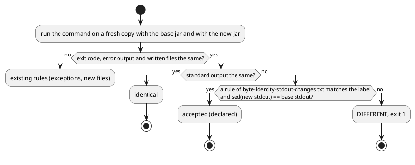

# Saved marker on query views and a declared change of standard output in the byte-identity harness

# Summary

`archicode query views` lists the saved views of a workspace and, with them, the views the tool derives for every element (overview, detailed, deep, map). Nothing in the output tells them apart except that a saved view usually has a `name`; `ArchitectureModelTest` relies on that (`view.has("name")`). This run adds a boolean `saved` to every entry, built in `GetViewsQuery` from two lists (the saved views of the workspace, the derived ones) before `-q` is applied, so it holds in JSON, YAML, TOML, a custom template and with JSONPath. The output of the command changes on every shipped workspace, so the run also teaches `scripts/byte-identity.sh` to accept a declared change of standard output: a new file `scripts/byte-identity-stdout-changes.txt` holds rules `LABEL_REGEX<TAB>SED_SCRIPT`; a pair is accepted when the script, run on the new standard output, gives the base standard output byte for byte. A self-check shows that an undeclared change is reported and a declared one accepted. The manual, the notes of the release, the test of the model and the goldens move in the same commit.

There is no PRD (profile TDD+pln), so traceability is incomplete: requirements are labelled `REQ-n` from the manifest of wave 031 (row W-1 and the first, second, fourth, fifth and seventh criteria of gate P1) and from #184. One diagram: the decision of the harness for one pair of runs.

# Scope

In scope:

- `src/main/java/io/morin/archicode/cli/GetViewsQuery.java` (the marker, the sort tie-break).
- `src/test/java/io/morin/archicode/cli/GetViewsQueryTest.java` (new cases) and `src/test/java/io/morin/archicode/doc/ArchitectureModelTest.java` (`shouldListFourOrFiveSavedViews`).
- Tests and goldens whose assertion reads a whole `query views` output (to be found by running the suite; see IMP-5).
- `scripts/byte-identity.sh`, `scripts/byte-identity-stdout-changes.txt` (new), `src/test/CLAUDE.md` (the harness section).
- `src/doc/README.adoc`: "Query views", and a block of notes for the release that carries the change (see DEC-6).
- The run record.

Out of scope: `query graph` and `deployments` (W-2, which reuses the mechanism of DEC-3); `query impact` (W-3); any field on `View` (wave non-goal, it would move the manifest schema and the golden of the workspace schema); the editor (it does not read `query views`); a `--saved` option (the author's fallback, see DEC-7).

# PRD Traceability

No PRD. Requirements assumed from the wave manifest and #184.

- `REQ-1` (P1 gate 1): `query views -w docs/architecture/.archicode.yaml` prints a boolean `saved` on every entry, true on exactly the 5 saved views of `docs/architecture/manifests/views` and false on every other; `-q '$[?(@.saved==true)]'` prints only those 5. Addressed (DEC-1, DEC-2, CTR-1, FLOW-1).
- `REQ-2` (P1 gate 2): the same on `src/doc/examples/domain_workspace/.archicode.yaml` and on a workspace made by `archicode init`; a test covers a saved view named like a derived id (both entries kept). Addressed (DEC-1, DEC-4, IMP-2).
- `REQ-3` (P1 gate 4): `scripts/byte-identity.sh` exits 0; its output shows that an undeclared change of standard output is reported by the self-check and a declared one accepted. Addressed (DEC-3, DEC-5, CTR-2, FLOW-2, IMP-3).
- `REQ-4` (P1 gate 5): `./mvnw test` exits 0 and `grep -c 'has("name")' src/test/java/io/morin/archicode/doc/ArchitectureModelTest.java` prints 0. Addressed (IMP-4).
- `REQ-5` (P1 gate 7, the part of this run): the manual says `saved` in its section on `query views`; `./mvnw test -Dtest=ManualExamplesTest` exits 0. Addressed (DEC-6, IMP-6).
- `REQ-6` (W-1 scope): no field on `View`; the sort order unchanged; goldens in the same commit. Addressed (DEC-1, DEC-2, IMP-5).
- `REQ-7` (W-1 scope, wave risk): the harness keeps comparing with the jar of `archicode-0.19.0`, built by the script into `~/.cache/archicode-byte-identity/archicode-0.19.0` with a JDK 25. Addressed (DEC-3, Observability and Verification).
- Partially addressed: none. Unresolved: none that blocks (Q-1 is a recommendation).

# Technical Goals

- TG-1: `saved` is a property of the output, decided where the two lists are known, before any filter or format, and identical in every format.
- TG-2: the harness accepts a declared change of standard output precisely: the base output must be recoverable from the new one by the declared script, nothing else passes.
- TG-3: the declaration lives in one file, readable and commented with the run that made it, as the exceptions and the new files are.
- TG-4: the harness proves it has teeth for this mechanism too (self-check).
- TG-5: the order of the entries, and everything else in an entry, stay as they were.

# Non-Goals

- No `saved` on `View`, nor in the manifest schema.
- No change to which views are listed, to their order or to the other fields.
- No acceptance of a changed error output through this mechanism (the exceptions file keeps that).
- No generic diff-based acceptance ("any change of standard output"): a rule names a command and a script.

# Assumptions

- ASM-1: `workspace.getViews()` holds exactly the saved views, and `getBuiltinViews` the derived ones (read in `GetViewsQuery.run`). Validate: the criterion of REQ-1 on `docs/architecture` (5 saved).
- ASM-2: the harness runs `query views` with the default format (YAML), so a new key shows as one line `saved: true|false` per entry in the new output. Validate: `byte-identity.sh --only domain_workspace` shows the rule accepting.
- ASM-3: `sed -E` with a plain `/regex/d` is available and behaves the same on Linux and macOS (the script is Bash 3.2 compatible). Validate: no GNU extension in the rule of this run; the rule is checked on Linux only here (RISK-3).
- ASM-4: the `properties` key of a derived view may be absent or null in the JSON; `saved` is appended after it whatever it holds. Validate: a case in `GetViewsQueryTest` on a derived and a saved view without properties.
- ASM-5: the `View` equality used by the `HashSet` holds all fields, so a saved view named like a derived id with different fields is already two entries; one with identical fields would be one entry today and must stay two once the marker exists. Validate: the case of REQ-2 (DEC-4).

# Constraints

- CON-1: the JDK is 25 (`export JAVA_HOME=$(ls -d ~/.sdkman/candidates/java/25* | head -1)`); the harness builds offline from `~/.m2`.
- CON-2: the harness is Bash 3.2 compatible (no associative arrays, no `mapfile`).
- CON-3: PMD (`./mvnw test-compile pmd:check`) and Prettier (`npm run format:check`) pass; no `// NOPMD`.
- CON-4: Lombok conventions of the package; the command keeps injecting its services into fields.
- CON-5: the sentence of the output is the same for the editor and the command line only where they share cases; the editor does not read `query views`, so no cases file is involved.
- CON-6: no real workspace content in the repository (memory rule); the scratch workspaces of the tests are synthetic.
- CON-7: CLAUDE.md files state what is true now: no wave, run or issue ids in `src/test/CLAUDE.md`.

# Current State

- `GetViewsQuery.run` collects `workspace.getViews()` and the derived views of both layers in one `HashSet<View>`, sorts with `VIEW_ORDER` (id, layer, viewpoint, name, description, properties), serializes the `List<View>` to JSON, applies the JSONPath `-q` on that JSON string, then writes it as JSON-tree to the chosen format (TOML wraps a non-object under `views`).
- A saved view and a derived one share the shape of `View`; only `name` tends to differ. `ArchitectureModelTest.shouldListFourOrFiveSavedViews` (line 91) counts the entries that `has("name")`.
- `scripts/byte-identity.sh` compares exit code, standard output (after replacing the copy folder by `<WS>`), error output and written files. It accepts error sentences through `scripts/byte-identity-exceptions.txt` and written files through `scripts/byte-identity-new-files.txt`. It has no way to accept a changed standard output (`src/test/CLAUDE.md`, "The byte-identity harness").
- The manual's "Query views" (`src/doc/README.adoc`, `=== Query views`) lists the behaviors of the command; the latest upgrade block is `[[upgrade-0-23]]` (release 0.24.0); the development version is `0.25.0-SNAPSHOT`.

# Proposed Design

DEC-1 — The marker is added to the JSON of each entry in `GetViewsQuery`

- Decision: build the list as entries of (view, saved). Serialize each view with the JSON mapper to an `ObjectNode`, then `put("saved", boolean)` as the last field; the array of these nodes is what `-q` reads and what every format writes. `View` does not change.
- Rationale: the two lists exist only here, and the JSON string is the one source for the query and all formats, so the marker holds everywhere with no per-format code (REQ-1, TG-1).
- Alternatives considered: a `saved` field on `View` (moves the manifest schema and the golden of the workspace schema, wave non-goal); inferring from `name` (the current fragile heuristic); a `--saved` option only (DEC-7).
- Tradeoffs: every entry of the output changes (declared in the harness, DEC-3); the field comes last, so a consumer that read the old keys by position of key is unaffected.
- Linked PRD IDs: REQ-1, REQ-2, REQ-6.

DEC-2 — The sort order keeps `VIEW_ORDER`; `saved` is its last tie-break

- Decision: sort the entries by `VIEW_ORDER` on the view, then by `saved` (saved first). `sortViews` keeps its signature (a collection of `View` in, a `List<View>` out, called by `SortedQueryOutputTest`) and is not changed; the tie-break is applied on the entries, after or around it, so no caller of `sortViews` moves. The tie-break only orders two entries that every other key leaves equal, which could not both exist before (DEC-4), so no existing order moves.
- Rationale: the output must stay deterministic (`SortedQueryOutputTest`); the input is a hash set, so an entry pair that ties would otherwise be in hash order.
- Alternatives considered: no tie-break (nondeterministic on a tie); `saved` earlier in the order (would move existing outputs).
- Tradeoffs: none for existing workspaces.
- Linked PRD IDs: REQ-6.

DEC-3 — A declared change of standard output is a sed script per command

- Decision: add `scripts/byte-identity-stdout-changes.txt`, one rule per line, `LABEL_REGEX<TAB>SED_SCRIPT` (`#` starts a comment, as in the exceptions file). The label is the one the script prints (`<name>: query views`, with or without ` --plateau <id>`), and the regex is matched on that full label (`grep -E` on the whole label, not on a part of it). A pair is accepted when the exit codes are the same, the error outputs are the same, the written files are the same, and for some rule whose label matches, `sed -E "<SED_SCRIPT>"` run on the new normalized standard output equals the base normalized standard output byte for byte. The first rule of this run: `: query views( --plateau .+)?$` with `/^  saved: (true|false)$/d`, anchored on exactly two spaces: the YAML writer puts the keys of an entry at two spaces under the list dash, so a `saved:` key nested deeper (inside the `properties` of a view) and a list item line are never removed; the expression is fixed against the YAML the command writes (a list item whose first key is `saved` does not occur, since `saved` comes last).
- Rationale: the base output must be recoverable from the new one, so what the rule declares is exactly what was added; any other change (a moved line, a changed value of another key) leaves a difference (REQ-3, TG-2). A script also covers W-2's multi-line block of `deployments` (a range delete) with no change of the mechanism.
- Alternatives considered: a line regex only (cannot delete a block); a regex on the new output that skips lines when comparing (accepts a changed order or a changed value of the removed key's neighbors less strictly); a second golden per workspace (about 40 files, moves with every fixture); the `--saved` fallback (DEC-7).
- Tradeoffs: the value of `saved` is not checked by the harness (the Java tests check it); a rule of this kind is trusted when it is read, hence the comment with the run on each line (TG-3).
- Linked PRD IDs: REQ-3, REQ-7.

DEC-4 — A saved view named like a derived id keeps both entries

- Decision: the two lists are never merged through `View` equality. The saved list and the derived list are mapped to entries separately and then concatenated; a case gives a workspace whose saved view has the id, layer and viewpoint of a derived one (an element `shop`, saved view `shop` of viewpoint `overview`, no name) and expects two entries, one `saved: true`, one `saved: false`.
- Rationale: with a hash set of `View` a saved view equal in every field to a derived one would be listed once and the marker would be wrong for it (ASM-5); the gate asks for both entries kept.
- Alternatives considered: de-duplicating and preferring the saved view (hides a derived view the user can still ask for by id).
- Tradeoffs: a workspace that had such a pair printed one entry before and prints two now; it changes the output only for a case that is rare, and the harness reports it on any shipped workspace where it occurs (none known).
- Linked PRD IDs: REQ-2.

DEC-5 — The self-check of the new mechanism mirrors the one of the new files

- Decision: a function `stdout_accepted base_out new_out rules label` does the comparison of DEC-3; the self-check feeds it scratch files: (1) a new output that adds a `saved:` line and a base without it is accepted with the real rules; (2) the same pair with an empty rules file is reported; (3) a new output that adds the line and also changes another line is reported with the real rules; (4) the same pair under a label no rule matches is reported. Failures set `SELF_FAIL` with a sentence beginning `SELF-CHECK FAILED:`.
- Rationale: REQ-3 asks that the output shows both cases; the existing checks work the same way.
- Alternatives considered: run two real jars on a scratch workspace (cannot make the base differ).
- Tradeoffs: the scratch pair is written by hand, so it proves the comparison, not the sed expression on real YAML; the real YAML is proved by the run on every shipped workspace.
- Linked PRD IDs: REQ-3.

DEC-6 — The manual says it in "Query views" and in a block for the next release

- Decision: add a bullet "Saved or derived" to the behaviors of `=== Query views` (what `saved` is, that it is in every format and in front of `-q`, a JSONPath example `$[?(@.saved==true)]`), and an `[[upgrade-0-24]]` block for the release that carries it, stating that `query views` prints one more key on every entry, that a script that read a whole entry now sees `saved`, and that every other command writes what 0.23.0 wrote. The version in the block title is checked against the `pom.xml` at write time.
- Rationale: the manual is the notes of the release; the byte change must be told once (REQ-5).
- Alternatives considered: no block (an output change would be silent).
- Tradeoffs: W-2 and W-3 add to the same block; they depend on this run, so the block exists when they start.
- Linked PRD IDs: REQ-5.

DEC-7 — The author's fallback `--saved` is not taken

- Decision: do the full marker and the harness mechanism. The mechanism is a function and a file, not heavy, so the fallback condition of the manifest does not hold. If the implementation proves otherwise the run logs it and falls back to `--saved` alone (a filter option that leaves the default output byte for byte), and says why in its progress log and on #184.
- Rationale: wave 031 needs the mechanism anyway for `deployments` (W-2).
- Alternatives considered: fallback now (leaves W-2 without a mechanism).
- Tradeoffs: more change in this run.
- Linked PRD IDs: REQ-3, REQ-6.

The reviewer should check that a declared change needs equality of everything but the standard output, and that the acceptance compares the base output with the transformed new one, never a transformed pair.

# Repository Impact

- IMP-1 — The command
  - Path(s): `src/main/java/io/morin/archicode/cli/GetViewsQuery.java`
  - Change type: modify (output-affecting)
  - Why impacted: entries with `saved`, tie-break (DEC-1, DEC-2, DEC-4).
  - Linked PRD IDs: REQ-1, REQ-2, REQ-6
  - Risks / notes: the JSON of an entry gains a last key; TOML keeps `views = [...]` as the wrapper.
- IMP-2 — The command's tests
  - Path(s): `src/test/java/io/morin/archicode/cli/GetViewsQueryTest.java`, `src/test/java/io/morin/archicode/cli/SortedQueryOutputTest.java`
  - Change type: modify and additive
  - Why impacted: cases for the marker in JSON, YAML, TOML and custom, for `-q '$[?(@.saved==true)]'`, for `docs/architecture` (5 saved), `src/doc/examples/domain_workspace` and a workspace made by the `init` command, and for the saved view named like a derived id (DEC-4).
  - Linked PRD IDs: REQ-1, REQ-2
  - Risks / notes: `GetViewsQueryTest` runs the command through fields; the new cases use `CliHarness` as `SortedQueryOutputTest` does, to read the output.
- IMP-3 — The harness
  - Path(s): `scripts/byte-identity.sh`, `scripts/byte-identity-stdout-changes.txt` (new)
  - Change type: modify and additive
  - Why impacted: `--stdout-changes FILE` option (default the new file), `stdout_accepted`, the branch in `compare`, the self-check, the usage header (DEC-3, DEC-5).
  - Linked PRD IDs: REQ-3, REQ-7
  - Risks / notes: the acceptance branch must require files, error output and exit code identical; Bash 3.2 syntax.
- IMP-4 — The test of the model
  - Path(s): `src/test/java/io/morin/archicode/doc/ArchitectureModelTest.java`
  - Change type: modify
  - Why impacted: `shouldListFourOrFiveSavedViews` counts `view.get("saved").asBoolean()` instead of `has("name")`; the comment about names goes; the assertion becomes exactly 5.
  - Linked PRD IDs: REQ-4
  - Risks / notes: the gate counts `has("name")` and expects 0 in the file.
- IMP-5 — Goldens and whole-output assertions
  - Path(s): `src/test/java/io/morin/archicode/brightcart/BrightcartStableOutputTest.java`, `src/test/java/io/morin/archicode/it/ViewsAndQueriesIT.java`, `src/test/resources/**` (any golden of a `query views` output), `src/test/javascript/site.test.js` (only if it reads the output)
  - Change type: modify
  - Why impacted: a test that compares a whole `query views` output moves in the same commit; found by running `./mvnw test` and `./mvnw verify -DskipITs=false` and fixing each failure, not by guessing (the wave names about 31 call sites).
  - Linked PRD IDs: REQ-6
  - Tests that read a field or a count and need no change (found by a grep of `src/test` for `query views`): `SortedQueryOutputTest` (order and shape, through `sortViews` and the formats), `PlateauCliTest`, `CleanFailuresTest`, `RemovedPlateausKeyTest` (errors and exit codes), `BrightcartStableOutputTest` (two runs equal), `GetViewsQueryTest`; a failure in one of them is a real change, not a golden to move. `ArchitectureModelTest` changes by IMP-4.
  - Risks / notes: `src/test/resources/guide/golden.md` holds only the one-line description of the command today; it moves only if the description of the command changes, which it does not here.
- IMP-6 — The manual
  - Path(s): `src/doc/README.adoc` ("Query views", `[[upgrade-0-24]]`)
  - Change type: modify
  - Why impacted: DEC-6.
  - Linked PRD IDs: REQ-5
  - Risks / notes: `ManualExamplesTest` runs the shell blocks of the manual; a new example block with `-q` runs on the manual's workspace and must succeed; `manual-howto.test.js` pins the shape of the command-reference block only.
- IMP-7 — The harness notes
  - Path(s): `src/test/CLAUDE.md` ("The byte-identity harness")
  - Change type: modify
  - Why impacted: the last bullets say the harness has no way to accept a changed standard output; they now describe the new file and its rule format (present tense, no ids).
  - Linked PRD IDs: REQ-3
  - Risks / notes: keep the other bullets as they are.

# Canonical Impact

The repository declares no `docs/CLAUDE.md` with registers; the model of ArchiCode is `docs/architecture/`. `CI-arc-1`: None. No element, relationship or responsibility changes: `docs/architecture/manifests/archicode.yaml` mentions `scripts/byte-identity.sh` and `src/test/resources/guide/golden.md` only as paths (line 387), and both still exist. `docs/architecture` is not edited, so `npm run sample:build` has nothing to rebuild; the run checks it leaves `git status --short` unchanged. `CI-dom-1`: Not applicable — no domain register is declared.

# Data Model and Contracts

- CTR-1 — The entry of `query views`
  - Current contract: an entry holds the keys of `View` (`id`, `viewpoint`, `layer`, `name`, `description`, `properties`, those that are not null); nothing says if it is saved.
  - Proposed contract: an entry has one more key, `saved`, a boolean, last, on every entry, in JSON, YAML, TOML and as `$.saved` for a custom template; the JSONPath `-q` reads it. A saved view is `true`, a view derived by the tool `false`.
  - Affected files: `GetViewsQuery.java`, the manual, the tests and goldens of IMP-2 and IMP-5.
  - Migration or compatibility notes: additive for a reader that ignores unknown keys; a script that compared a whole entry changes once, told in the notes of the release.
  - Linked PRD IDs: REQ-1, REQ-2
- CTR-2 — The file of the declared changes of standard output
  - Current contract: none.
  - Proposed contract: `scripts/byte-identity-stdout-changes.txt`, UTF-8 text, one rule per line, `LABEL_REGEX` (extended regular expression, matched on the full label the harness prints, as `<name>: query views`) a tab, `SED_SCRIPT` (one `sed -E` script, no tab; the first rule is `/^  saved: (true|false)$/d`); empty lines and lines starting with `#` are ignored; each rule is preceded by a comment that names the run that makes it.
  - Affected files: `scripts/byte-identity.sh`.
  - Migration or compatibility notes: a missing or empty file means no change is accepted; W-2 appends its rule.
  - Linked PRD IDs: REQ-3

# Interfaces and Behavior

- IF-1: `archicode query views [-f FORMAT] [-q JSONPATH] [-t TEMPLATE] [--plateau ID]`: same options; each entry has `saved`; `-q '$[?(@.saved==true)]'` selects the saved views; an error output and exit codes do not change.
- IF-2: `scripts/byte-identity.sh [--stdout-changes FILE] ...`: a new option beside `--exceptions` and `--new-files`; the summary line counts a declared change as accepted; the exit code is 0 when there is no unexpected difference and the self-check holds.

# Flows and Processing Logic

FLOW-1 — `query views`

- Trigger: the command is run.
- Steps: load the workspace (with `--plateau` if given); map `workspace.getViews()` to nodes with `saved: true`; map the derived views of both layers to nodes with `saved: false`; concatenate; sort by `VIEW_ORDER` then `saved`; serialize to the JSON array; apply `-q` if present; write in the format (custom template, YAML, JSON, TOML).
- Branches / failure paths: an unknown plateau, a dangling reference and the other failures keep their one `error:` line (nothing changes before the workspace is loaded).
- Final output / rendered result: the entries with `saved`.
- Linked PRD IDs: REQ-1, REQ-2

FLOW-2 — The harness on one pair

- Trigger: `compare` for a workspace and a command.
- Steps: as the diagram above: the existing checks, then, when only the standard output differs, the declared-change check.
- Branches / failure paths: no matching rule, or a sed result unequal to the base, ends as `DIFFERENT` with the first lines of the diff (so a wrong rule is visible).
- Final output / rendered result: the report line `ACCEPTED  <label> (declared change of standard output)` and the counts.
- Linked PRD IDs: REQ-3

# Reliability, Performance, and Scalability

The marker is built in one pass over lists already in memory. The harness runs the same commands as before; it adds one `sed` per accepted pair. A rule that matches a label but does not recover the base output cannot pass silently: the pair is reported.

# Security and Privacy

No input, network or secret is added. The sed script of a rule is read from a file of the repository and run on text the harness produced itself.

# Observability and Verification

Run with `export JAVA_HOME=$(ls -d ~/.sdkman/candidates/java/25* | head -1)`:

- `./mvnw -o package -DskipTests -DskipITs`, then `java -jar target/quarkus-app/quarkus-run.jar query views -w docs/architecture/.archicode.yaml -f json -q '$[?(@.saved==true)]'` prints 5 entries and the unfiltered output has `saved` on each (REQ-1); the same on `src/doc/examples/domain_workspace/.archicode.yaml` and on a workspace made by `archicode init` (REQ-2).
- `./mvnw test` (REQ-4), `./mvnw test -Dtest=ManualExamplesTest` (REQ-5), `./mvnw verify -DskipITs=false`, `./mvnw test-compile pmd:check`.
- `grep -c 'has("name")' src/test/java/io/morin/archicode/doc/ArchitectureModelTest.java` prints 0.
- `scripts/byte-identity.sh` exits 0; its report lists the `query views` pairs as `ACCEPTED ... (declared change of standard output)` and nothing as `DIFFERENT`; the self-check says `ok` (REQ-3). The base jar is built from `archicode-0.19.0` by the script itself (REQ-7); the first run takes several minutes.
- `npm run format:check`, `npm run lint`, `npm run test:unit`, and `npm run sample:build` leaves `git status --short` unchanged.
- Not verified by this run: the harness on macOS (ASM-3), the native image (the record `GetViewsQuery$Entry` is a new class: `reflect-config.json` names it, and the Native job of CI proves the image).

# Deployment and Rollout

Code and documentation only, one commit with the goldens and the declaration. No staging. Backward compatibility: the output of `query views` gains a key (told in the notes). Rollback: revert the commit; the harness rule goes with it.

# Risks and Tradeoffs

- RISK-1: a golden or assertion on a whole `query views` output is missed and fails later. Mitigation: the full suite and the integration tests run before the commit (IMP-5).
- RISK-2: the sed expression removes a line that is not the marker (a `saved:` key inside `properties` of a view). Mitigation: the sed expression is anchored on exactly two spaces of indentation (`^  saved:`), the indentation of an entry key, so a nested key is never matched; the harness compares the result with the base, so a wrongly removed line would make the pair differ and be reported.
- RISK-3: `sed -E` differs on macOS or BusyBox. Mitigation: plain constructs only; validated on Linux (ASM-3).
- RISK-4: the base build needs git, the offline Maven repository and a JDK 25; a stale `~/.cache/archicode-byte-identity/archicode-0.19.0` is reused. Mitigation: the gate names the folder; the script rebuilds when `quarkus-run.jar` is missing.
- RISK-5: TOML writes a boolean inline; a JSONPath filter over TOML is not a thing (the query runs on the JSON), so no TOML-specific risk is known. Validated by a TOML case in IMP-2.

# Open Questions

- Q-1 (resolved): should the harness base move from `archicode-0.19.0` to a later tag? Resolution: no, keep the tag. The gate of wave 031 names `archicode-0.19.0` and its cache folder, the script takes `--base-tag` with that default (`scripts/byte-identity.sh`), and `scripts/byte-identity-exceptions.txt` is written against that base; a nearer base would shrink the exceptions but is another run. No open question remains.

# Deferred Work

- DEF-1: `deployments` in `query graph` and its rule in the harness file (W-2).
- DEF-2: `query impact` (W-3).
- DEF-3: a `--saved` filter option, only if DEC-7's fallback is needed.

# File Placement and Frontmatter

Saved as `docs/wav/wav-031-graph-answers-impact/run/run-0219-views-saved-marker-and-stdout-harness/tdd-0219-views-saved-marker-and-stdout-harness.md`, with `type: tdd`, `run: 0219`, `wave: 031`.

# Review

Review pass: dispatched. KDMLLC review run in stage 5 by an agent other than the drafter (independent of the drafting). Referent read: `GetViewsQuery.java`, `SortedQueryOutputTest.java`, `ArchitectureModelTest.java`, `scripts/byte-identity.sh`, `src/test/CLAUDE.md`, `src/doc/README.adoc` (upgrade blocks, "Query views"), the manifest of wave 031, and the real YAML the command writes. Findings F-1 to F-8 are returned to the main agent, who applies them; the findings are applied in DEC-2, DEC-3, CTR-2, IMP-5 and RISK-2 (the sed expression anchored on two spaces, the full-label match, `sortViews` unchanged, the list of tests that need no change).
