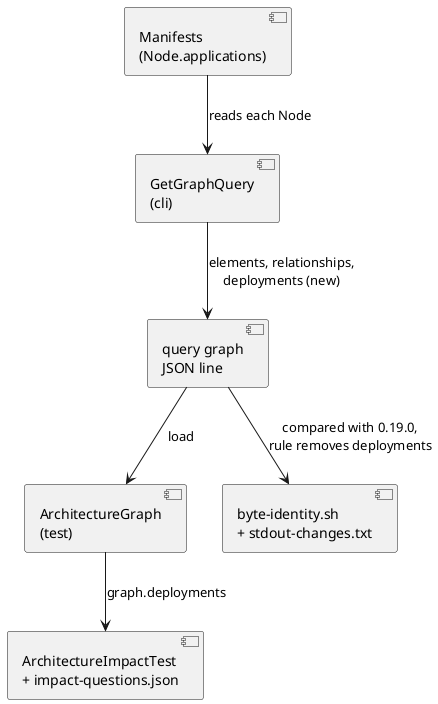

# Deployments in query graph, and the oracle that crosses them

# Summary

`archicode query graph` prints `{"elements":[...],"relationships":[...]}`. The applications a node hosts are inside the serialised node (`applications`), not an edge, so a client that asks "which applications does `github.pages` take down" or "where is `archicode.editor` deployed" must walk the nested elements itself. This run adds a top-level `deployments` list, `[{"node": "<reference>", "application": "<reference>"}]`, after `relationships`: one entry per application of each technology node, nodes in the order of their references, applications as written, and the key absent when the list is empty, so a workspace without a deployment prints the same bytes as before. The change of standard output is declared in `scripts/byte-identity-stdout-changes.txt` with the mechanism run 0219 built. `ArchitectureGraph` and `ArchitectureImpactTest` read `deployments`; the oracle crosses them only for a question that asks (`"through": ["deployments"]`) and gets two questions, Q08 and Q09. The manual's "Query graph" and the notes of the release say it.

There is no PRD (profile TDD+pln), so traceability is incomplete: requirements are labelled `REQ-n` from the manifest of wave 031 (row W-2, the third, fifth and sixth criteria of gate P1, the seventh in part) and from #189.

# Scope

In scope: `GetGraphQuery` (the `Graph` record and its collection); `GetGraphQueryTest` and the tests that read the whole graph; the `deployments` rule of the harness; `ArchitectureGraph`, `ArchitectureImpactTest` and `impact-questions.json` (Q08, Q09, the new key `through`); the manual's "Query graph" and an upgrade note; `reflect-config.json` for the new record; the sentence of the shape in `src/main/resources/guide/guide.md` and its golden.

Out of scope: any `deployments` entry among `relationships`, any change to `Node.applications` or to the manifests (wave non-goal, the author refused it); the derived dependencies between environments; the editor; `query impact` and `--through` of the command (W-3, DEF-1).

# PRD Traceability

No PRD exists. Sources: the manifest of wave 031 and #189.

- `REQ-1` (P1 gate 3): `query graph -w docs/architecture/.archicode.yaml` has a top-level `deployments` that holds `{"node":"github.actions","application":"archicode.commandline"}` and `{"node":"github.actions","application":"archicode.editor"}`; the output for a workspace made by `archicode init` has no `deployments` key. Addressed (DEC-1, DEC-2, CTR-1).
- `REQ-2` (P1 gate 4, the part of this run): `scripts/byte-identity.sh` exits 0 with the change declared; an undeclared one stays reported. Addressed (DEC-4, IMP-3).
- `REQ-3` (P1 gate 6): `impact-questions.json` holds 9 questions, Q08 and Q09 asking about deployment, each with an exact `expect` list; `ArchitectureImpactTest` passes. Addressed (DEC-5, DEC-6, IMP-4).
- `REQ-4` (P1 gate 7, the part of this run): the manual says `deployments` in its section on `query graph`; `./mvnw test -Dtest=ManualExamplesTest` exits 0. Addressed (IMP-6).
- `REQ-5` (P1 gate 5): `./mvnw test` exits 0. Addressed (IMP-2, IMP-5).
- `REQ-6` (W-2 scope): sorted by node then as written; omitted when empty; `GetGraphQueryTest` pins the shape, the order and the empty case; `BrightcartStableOutputTest` is unchanged. Addressed (DEC-2, IMP-2). Mismatch with the wave text, which says the Brightcart goldens move: see ASM-3 (no Brightcart golden holds a graph).
- `REQ-7` (W-2 scope): the oracle crosses `deployments` only for a question that asks. Addressed (DEC-5).
- `REQ-8` (wave non-goals): no `deployments` among `relationships`, no change to `element.applications`, no editor change, no new question beyond Q08 and Q09. Honoured (Non-Goals).

Unresolved: none.

# Technical Goals

- `TG-1`: a client reads which nodes host which applications from one flat list of `query graph` (REQ-1).
- `TG-2`: a workspace with no deployment prints the bytes it printed before (REQ-1, REQ-2, REQ-6).
- `TG-3`: the oracle answers two deployment questions from that list and from nothing else (REQ-3, REQ-7).
- `TG-4`: the change of output is declared in the harness and told in the manual (REQ-2, REQ-4).

# Non-Goals

- No `--through` option and no `Impact` class: W-3 builds them and moves Q08 and Q09 to the command.
- No new field on `Element`, `Node` or `Relationship`; no schema change of the manifests or of the workspace.
- No resolution of the hosted applications (DEC-3), no new error.
- No change to the editor, to `query views`, or to the order of `elements` and `relationships`.

# Assumptions

- `ASM-1`: `ElementIndex.listAllElementReferences` lists every element of the layer, nested ones too, with their reference (`github.pages`, `workstation.machine`). Validated by the current output (`elements` holds `github.actions` and `workstation.machine`) and by `GetGraphQueryTest` (IMP-2).
- `ASM-2`: the JSON mapper of `MapperFactory` (`jsonMapper`, line 78) has `NON_EMPTY` inclusion, so an empty list is not written. Validated by the test of the empty case (IMP-2).
- `ASM-3`: no golden file holds the output of `query graph` of a workspace; `BrightcartStableOutputTest.queryGraphIsTheSameEveryTime` compares two runs, `SortedQueryOutputTest` reads `elements` and `relationships` by key, `guide/golden.md` holds the text of the guide. The wave says the Brightcart goldens move; the repository says they do not need to (see Current State). Validated by running the suite after the change.
- `ASM-4`: the output of `query graph` stays one line of JSON, so the sed rule of the harness may be one `s` command (DEC-4). Validated by the self-check of the harness and the run on every shipped workspace.
- `ASM-5`: in a workspace with no plateau, the hosted application of a node may be dangling without `query graph` failing (`src/main/java/io/morin/archicode/CLAUDE.md`: `GetGraphQuery.collect`, "a hosted application [is] not read"); with plateaus `LayerLoader` checks a hosted application at the load and ends with its sentence (`src/main/java/io/morin/archicode/workspace/CLAUDE.md`), which this run does not touch. Validated by a case of `GetGraphQueryTest` on a workspace with no plateau (IMP-2).

# Constraints

- `CON-1`: Java 25 for every build (`export JAVA_HOME=$(ls -d ~/.sdkman/candidates/java/25* | head -1)`; the shell's `java` is 21).
- `CON-2`: `scripts/byte-identity.sh` compares with the jar of `archicode-0.19.0`; a change of standard output is accepted only through a rule of `scripts/byte-identity-stdout-changes.txt`.
- `CON-3`: no command that succeeds starts to fail (the rule of `src/main/java/io/morin/archicode/CLAUDE.md`).
- `CON-4`: the Native image reads classes by reflection: a new record of the output is in `reflect-config.json`; a Lombok builder too.
- `CON-5`: the sorted output is a promise (manual, "Sorted Output"): two runs give the same bytes.
- `CON-6`: Prettier on `src/**/*.java` and `src/test/javascript/**`; PMD on `src/main/java` and `src/test/java`; a rule is never silenced with an annotation.
- `CON-7`: the model of ArchiCode (`docs/architecture`) and the samples are not touched; if they are, `npm run sample:build` follows.

# Current State

- `GetGraphQuery.buildGraph` builds `Graph{elements, relationships}` by calling `collect` once for the application index and once for the technology index; `collect` walks `new TreeSet<>(index.listAllElementReferences(e -> true))` and, for each element, adds an `ElementEntry` and one `RelationshipEntry` per relationship, failing with the dangling sentence when a destination is missing. The `Graph`, `ElementEntry` and `RelationshipEntry` are `@Value @Builder` public static classes, each with its builder in `reflect-config.json`.
- A `Node` (`resource/element/technology/Node.java`) has `Set<String> applications` (a `LinkedHashSet`, so the author's order, `@Reference(ELEMENT)`), and nested `elements`. The environments `github` and `workstation` of `docs/architecture/manifests` host `archicode.commandline` and `archicode.editor` on `github.actions`, `archicode.editor` on `github.pages`, `archicode.commandline` on `github.releases`, and both on `workstation.machine`.
- The oracle (`ArchitectureImpactTest`) walks the flat `relationships` by hand: breadth first, a start covers its descendants by reference prefix (`covers`: equal, or `ancestor + "."` prefix), the answer leaves out the starts and their descendants; `check` fails when `qualifiers` is empty. `impact-questions.json` holds Q01 to Q07, each with `start`, `direction`, `qualifiers`, `depth`, `expect`; `shouldAskSixToEightQuestionsWithDistinctIds` asserts 6 to 8 questions. `ArchitectureGraph.load` runs `query graph` through the command line and requires `elements` and `relationships`.
- The output of `query graph` is one line of JSON (`-f` does not apply to it). `scripts/byte-identity.sh` runs it on every shipped workspace and, since run 0219, reads `scripts/byte-identity-stdout-changes.txt` (`LABEL_REGEX<TAB>SED_SCRIPT`, `sed -E` of the new output must equal the base output; a self-check shows the mechanism accepts the declared change and nothing beyond it). The file holds one rule, for `query views`.
- The manual's "Query graph" (`=== Query graph`, `src/doc/README.adoc`) says the command prints elements and relationships and lists "Sorted Output". The latest upgrade block is `[[upgrade-0-24]]` (release 0.25.0, written by run 0219). `src/main/resources/guide/guide.md` line 19 gives the shape `{"elements":[...],"relationships":[...]}`.

# Proposed Design

The reviewer validates that `deployments` is produced in one place (`GetGraphQuery`), consumed by the oracle through `ArchitectureGraph`, and that the harness removes exactly that key to recover the base bytes.

DEC-1 — `deployments` is a list of the graph, built from the nodes `collect` already visits

- Decision: add `List<DeploymentEntry> deployments` to `Graph`, after `relationships`, with `record`-like `@Value @Builder DeploymentEntry {String node; String application;}` in `GetGraphQuery`. In `collect`, when the element of a reference is a `Node` (technology layer), append one entry per application of `node.getApplications()`, in iteration order.
- Rationale: `collect` already walks every reference in sorted order, so nodes come in the order of their references and applications as the author wrote them, with no second walk or sort (REQ-1, REQ-6, TG-1). Nested nodes (`workstation.machine`) are covered because the index lists nested references (ASM-1).
- Alternatives considered: entries among `relationships` (refused by the author, wave non-goal); a `hosts` map node to list (the filed shape on #189 is a flat list, and a flat list is what a `jq` filter and the oracle read best); walking `Element.getElements()` recursively in a second pass (duplicates the index).
- Tradeoffs: `Graph` has one more field, so `reflect-config.json` has two more entries (IMP-5).
- Linked PRD IDs: REQ-1, REQ-6.

DEC-2 — Empty is absent

- Decision: the field is omitted when the list is empty (the mapper's `NON_EMPTY`, ASM-2), so a workspace with no deployment (every workspace made by `archicode init`, the application-only examples) prints the bytes of 0.24.0.
- Rationale: `TG-2`, and it keeps the harness rule a no-op where nothing changed (REQ-1, REQ-2).
- Alternatives considered: always write `"deployments":[]` (changes every output of every workspace and needs a rule everywhere).
- Tradeoffs: a reader tests for the key before reading it; the manual says so.
- Linked PRD IDs: REQ-1, REQ-6.

DEC-3 — The hosted application is written as the author wrote it, not resolved

- Decision: `deployments` copies `node.getApplications()` as they are; it does not check that the application exists and adds no error.
- Rationale: today `query graph` succeeds on a workspace with no plateau that has a dangling hosted application (ASM-5, CON-3); resolving it would make a succeeding command fail. With plateaus the load already fails with its sentence, unchanged. The oracle and any client may still look the reference up in `elements`.
- Alternatives considered: fail with the dangling sentence (breaks CON-3); skip a dangling entry silently (hides the author's mistake from a command whose purpose is to show the graph).
- Tradeoffs: a `deployments` entry can name an element the graph lacks. Pinned by a test on a workspace with no plateau so that it is a decision, not an accident.
- Linked PRD IDs: REQ-1.

DEC-4 — The harness declares the change with one rule on the label of `query graph`

- Decision: append to `scripts/byte-identity-stdout-changes.txt`, with its comment (run, reason), the rule `: query graph( --plateau .+)?$<TAB>s/,"deployments":\[.*\]\}$/}/`. The regex is the label form `<name>: query graph` with or without `--plateau`, as the `query views` rule is; the sed script removes the key, which is the last of the one-line object.
- Rationale: the base output is the new output without the key (ASM-4); the script is anchored on the end of the line and on `]}`, so a `deployments` text inside a description cannot match (a JSON string escapes its quotes, so an unescaped `,"deployments":[` can only be the key) (REQ-2, CON-2).
- Alternatives considered: a new-files style list (files, not output); making the harness ignore the key with `jq` (a new dependency).
- Tradeoffs: the rule depends on `deployments` being last (a test pins the order, IMP-2); a workspace with no deployment is accepted as identical, not by the rule.
- Linked PRD IDs: REQ-2.

DEC-5 — The oracle crosses `deployments` only for a question that says `"through": ["deployments"]`

- Decision: `impact-questions.json` gets an optional key `through` (a list; the only value is `deployments`). When present, the walk also follows the entries of `graph.deployments`, `node` as the source and `application` as the destination, in the directions of the question and with the same containment and visited rules. Relationships are followed only for the `qualifiers` of the question. `check` requires `qualifiers` or `through` to be non-empty. Q01 to Q07 have no `through`, so their answers cannot change.
- Rationale: W-3 gives the command `--through deployments` (wave Q1) and moves Q08 and Q09 to it; the key and the direction of the edge are fixed here so that the move changes the caller, not the questions (REQ-7, TG-3). The nodes host applications, so a node out is "hosts" and an application in is "hosted on".
- Alternatives considered: deployments always followed (would move Q01 to Q07, which the gate holds to the commit `ff3bacd`); a `qualifier` named `deploys` over a synthetic relationship (invents an edge the author refused).
- Tradeoffs: the test code has a third kind of edge until W-3 deletes the walk.
- Linked PRD IDs: REQ-3, REQ-7.

DEC-6 — Q08 and Q09, with the answers computed from the model

- Decision, Q08: `ask` "I take github.pages down: which applications go with it?"; `start` `["github.pages"]`; `direction` `out`; `qualifiers` `[]`; `through` `["deployments"]`; `depth` 1; `expect` `["archicode.editor"]`.
- Decision, Q09: `ask` "I move archicode.editor: where is it deployed and what shares those nodes?"; `start` `["archicode.editor"]`; `direction` `both`; `qualifiers` `[]`; `through` `["deployments"]`; `depth` 2; `expect` `["github.actions", "github.pages", "workstation.machine", "archicode.commandline"]` (hop 1: the three nodes that host the editor; hop 2: what else they host, the editor itself being a start).
- Rationale: the expected lists are what the model says (`environment.github.yaml`, `environment.workstation.yaml`) and each is exact, as the oracle requires. Q09 uses depth 2 and `both` so that the walk shows both edge directions; it must not reach `archicode.commandline` by containment of another element (checked in the run).
- Alternatives considered: more questions (wave non-goal: only these two).
- Tradeoffs: if the deployment model of ArchiCode changes, Q08 and Q09 change in the same commit, as Q01 to Q07 do.
- Linked PRD IDs: REQ-3.

DEC-7 — The shape is told where an agent reads it

- Decision: the manual's "Query graph" gets a bullet on `deployments` (its entries, the order, the absence) and `[[upgrade-0-24]]` a numbered change; `guide.md` line 19 adds `"deployments":[...]` to the shape (optional, with its meaning) and `src/test/resources/guide/golden.md` is regenerated; `@Command(description)` of `GetGraphQuery` is left as it is (a changed description is in the generated list of commands and moves nothing else but is not needed to find the key).
- Rationale: the guide is what an agent that has only the program reads (REQ-4, TG-4); the byte budget of `GuideTest` (30 KB) is respected by one sentence.
- Alternatives considered: leave the guide for W-3, which writes the `query impact` text (an agent would then read a shape that omits a key the command prints).
- Tradeoffs: W-3 rewrites that sentence again when it points to `query impact`.
- Linked PRD IDs: REQ-4.

# Repository Impact

- `IMP-1` — The command
  - Path(s): `src/main/java/io/morin/archicode/cli/GetGraphQuery.java`
  - Change type: modify (additive output key)
  - Why impacted: `Graph` gets `deployments`; `DeploymentEntry` is new; `collect` adds the entries (DEC-1); the Javadoc of the class and of `collect` says that a hosted application is copied, not resolved (DEC-3), and the one of `Graph` the order. The mapper's inclusion is read first (ASM-2).
  - Linked PRD IDs: REQ-1, REQ-6
  - Risks / notes: `collect` is shared by both layers; only the technology index has `Node` elements, so the test is on the element's type, not on the layer.
- `IMP-2` — The tests of the command
  - Path(s): `src/test/java/io/morin/archicode/cli/GetGraphQueryTest.java` (`SortedQueryOutputTest` and `BrightcartStableOutputTest` are read and run, not changed)
  - Change type: modify
  - Why impacted: `GetGraphQueryTest` pins the shape (an entry has exactly `node` and `application`), the order (nodes by reference, applications as written, on a fixture with two nodes and a nested one and a node whose applications are in non-alphabetical order), the empty case (no key, and the printed text does not contain `deployments`), the last position of the key (the rule of DEC-4 relies on it), the dangling hosted application on a workspace with no plateau (exit 0, the entry present, DEC-3) and `buildGraph` without writing. `GetGraphQueryTest` is the one place that asserts the order of `deployments`, with one determinism check (two runs, same bytes). `SortedQueryOutputTest` and `BrightcartStableOutputTest.queryGraphIsTheSameEveryTime` are not changed: the latter already runs on nodes that have applications and compares two runs.
  - Linked PRD IDs: REQ-1, REQ-6
  - Risks / notes: ASM-3 says no whole-output golden exists; the full suite is run to prove it (RISK-1).
- `IMP-3` — The declared change
  - Path(s): `scripts/byte-identity-stdout-changes.txt`, `scripts/byte-identity.sh` (the self-check)
  - Change type: additive
  - Why impacted: DEC-4.
  - Linked PRD IDs: REQ-2
  - Risks / notes: the self-check of run 0219 uses a `query views` label and sample; a `query graph` sample is added to it (base without the key, new with it, new with a changed `elements`) is added so that the rule has teeth: the first is accepted, the second refused.
- `IMP-4` — The oracle
  - Path(s): `src/test/java/io/morin/archicode/doc/ArchitectureGraph.java`, `src/test/java/io/morin/archicode/doc/ArchitectureImpactTest.java`, `src/test/javascript/architecture/impact-questions.json`
  - Change type: modify
  - Why impacted: `load` is unchanged and reads `deployments` as optional (a graph without a deployment has none); `Question` gets `through`; the walk with `through` fails with a message that says so when the key is missing (FLOW-2), and Q08 and Q09 carry the assertion that the model has deployments; the walk follows deployments (DEC-5); `check` accepts `qualifiers` empty only with `through`; `shouldAskSixToEightQuestions...` becomes 9 questions (`shouldAskNineQuestionsWithDistinctIds`, the gate); a sabotage test removes `deployments` from a deep copy of the graph and shows that Q08 and Q09 then fail; Q01 to Q07 are not touched (`git diff ff3bacd -- src/test/javascript/architecture/impact-questions.json` has no changed line inside them); Q08 and Q09 are appended (DEC-6).
  - Linked PRD IDs: REQ-3, REQ-7
  - Risks / notes: Q09's depth 2 must not be reached by a path outside `deployments`; qualifiers are empty so no relationship is followed.
- `IMP-5` — Native image
  - Path(s): `src/main/resources/META-INF/native-image/io.morin.archicode/archicode/reflect-config.json`
  - Change type: additive
  - Why impacted: `GetGraphQuery$DeploymentEntry` and `GetGraphQuery$DeploymentEntry$DeploymentEntryBuilder`, with the six keys of the neighbours (CON-4).
  - Linked PRD IDs: REQ-1
  - Risks / notes: proved by the Native job of CI, not by this run.
- `IMP-6` — The manual, the guide and the notes
  - Path(s): `src/doc/README.adoc` (`=== Query graph`, `[[upgrade-0-24]]`), `src/main/resources/guide/guide.md`, `src/test/resources/guide/golden.md`
  - Change type: modify
  - Why impacted: DEC-7. The intro of `[[upgrade-0-24]]` says the one output that grows is `query views` and that "every other command writes what 0.24.0 wrote for it"; it now says `query views` and `query graph` grow, restricts the second sentence to the other commands (and to `query graph` on a workspace with no deployment), and numbers the new change (a script that read a whole `query graph` output now sees one more key when the workspace has a deployment; the elements and the relationships did not change). The README anchors `[[query-graph]]` is added as `[[query-views]]` was, for the cross reference.
  - Linked PRD IDs: REQ-4
  - Risks / notes: `ManualExamplesTest` runs the examples of the manual; the guide golden is regenerated with the way `GuideTest` documents (`@VERSION@`).

# Canonical Impact

None. `docs/architecture` models the command line by package and its couplings (`query graph` is a qualifier of the relationship from `agent`); no element, relationship or responsibility of it is made stale by one more key in the output. The pre-existing `ArchitectureDriftTest` is not affected. `CI-dom-1`: not applicable, no domain register is declared.

# Data Model and Contracts

- `CTR-1` — The output of `query graph`
  - Current contract: one line of JSON, `{"elements":[{reference, layer, element}],"relationships":[{source, layer, relationship}]}`.
  - Proposed contract: the same, then `,"deployments":[{"node":"<reference of a technology node>","application":"<reference as the node wrote it>"}]` as the last key, only when there is at least one. Order: by the reference of the node (natural text order, the order of `elements` for the technology layer), then the order of `applications` as the author wrote them. A node and an application appear once per pair the author wrote. A nested node has its full reference (the case of `workstation.machine`, a node nested in an environment; a node nested in a node is not tested, so nothing is promised for it). An environment is not a node and has no entry.
  - Affected files: `GetGraphQuery.java`, the manual, `guide.md`, the harness rule, `GetGraphQueryTest`.
  - Migration or compatibility notes: additive; a reader that reads `elements` and `relationships` by key is not affected; a reader that compares the whole line is told in the notes of the release. With `--plateau`, the list is that of the plateau read.
  - Linked PRD IDs: REQ-1, REQ-6
- `CTR-2` — The file of the questions of the oracle
  - Current contract: each question has `id`, `ask`, `start`, `direction`, `qualifiers` (non-empty), `depth`, `expect`.
  - Proposed contract: an optional `through` (a list, `["deployments"]` the only value); `qualifiers` may be empty when `through` is not.
  - Affected files: `impact-questions.json`, `ArchitectureImpactTest.java`; W-3 reads the same file.
  - Migration or compatibility notes: Q01 to Q07 unchanged; a question without `through` is read as before.
  - Linked PRD IDs: REQ-3, REQ-7
- `CTR-3` — The declared change of standard output
  - Current contract: one rule, for `query views`.
  - Proposed contract: a second rule, for `query graph` (DEC-4).
  - Affected files: `scripts/byte-identity-stdout-changes.txt`.
  - Migration or compatibility notes: none; a line is added with its comment.
  - Linked PRD IDs: REQ-2

# Interfaces and Behavior

- `IF-1` — `archicode query graph [--plateau <id>] [-w <file>]`: options unchanged, output as CTR-1, exit 0, same error cases as before (a dangling relationship destination is the one `error:` line). In a workspace with no plateau, a dangling hosted application is not an error (DEC-3); with plateaus the load fails with its sentence, as before.
- `IF-2` — The harness: `scripts/byte-identity.sh` exits 0 on the shipped workspaces; its report lists the `query graph` pairs that have deployments as `ACCEPTED ... (declared change of standard output)` and the others as identical.
- `IF-3` — The oracle: `ArchitectureImpactTest` answers 9 questions; a missing coupling or a missing deployment makes the question that depends on it fail with the message that names what is missing and unexpected.

# Flows and Processing Logic

- `FLOW-1` — Build the deployments
  - Trigger: `archicode query graph`.
  - Steps: the workspace loads; `collect` walks the references of an index in sorted order; for each element it adds the `ElementEntry` and the `RelationshipEntry`s as today; if the element is a `Node`, it adds one `DeploymentEntry(reference, application)` for each application; `buildGraph` returns the `Graph`; the mapper writes it.
  - Branches / failure paths: no `Node` or no application: the list is empty and the key is not written; a dangling relationship destination throws before (unchanged); a dangling hosted application is copied (DEC-3).
  - Final output / rendered result: the JSON line of CTR-1.
  - Linked PRD IDs: REQ-1, REQ-6
- `FLOW-2` — Walk with `through`
  - Trigger: a question with `"through": ["deployments"]`.
  - Steps: at each hop, for each `deployments` entry, `out` follows an entry whose `node` is covered by the frontier to its `application`, `in` follows an entry whose `application` is covered by the frontier to its `node`; the reached reference is added unless it is covered by a visited one; the starts and their descendants are left out of the answer; relationships follow only the `qualifiers`.
  - Branches / failure paths: a start the graph does not have fails the question; empty `expect` fails; a missing key `deployments` with `through` fails with a message that says so.
  - Final output / rendered result: the sorted set of references compared with `expect`.
  - Linked PRD IDs: REQ-3, REQ-7

# Reliability, Performance, and Scalability

The work is one pass added to a pass that exists; no measurable cost. The output stays sorted and deterministic (CON-5): `deployments` follows the TreeSet order and a `LinkedHashSet` order, neither of which depends on the hash order. The self-check of the harness keeps the declared change from hiding another one.

# Security and Privacy

Not applicable beyond what is already true: the output is read-only data of the user's own workspace.

# Observability and Verification

Run with the JDK 25 of CON-1:

- `./mvnw -o package -DskipTests -DskipITs`, then `java -jar target/quarkus-app/quarkus-run.jar query graph -w docs/architecture/.archicode.yaml`; piped to `jq -c '.deployments'` the list holds `{"node":"github.actions","application":"archicode.commandline"}` and `{"node":"github.actions","application":"archicode.editor"}` (REQ-1); the same command on a workspace made by `archicode init` prints no `deployments` (`grep -c deployments` prints 0).
- `./mvnw test -Dtest='GetGraphQueryTest,SortedQueryOutputTest,BrightcartStableOutputTest,ArchitectureImpactTest,GuideTest,ManualExamplesTest'`, then `./mvnw test` (REQ-5), `./mvnw verify -DskipITs=false`, `./mvnw test-compile pmd:check`.
- `scripts/byte-identity.sh` exits 0, with 0 `DIFFERENT` and the self-check `ok`, including the `query graph` sample (REQ-2). The base is built by the script from `archicode-0.19.0` into `~/.cache/archicode-byte-identity/archicode-0.19.0`; the first run takes minutes.
- `git diff ff3bacd -- src/test/javascript/architecture/impact-questions.json` shows no changed line inside Q01 to Q07; the file holds 9 questions (REQ-3).
- `npm run test:unit`, `npm run format:check`, `npm run lint`, and `npm run sample:build` leaves `git status --short` unchanged.
- Not verified by this run: the native image (IMP-5: the Native job of CI proves it), the harness on macOS.

# Deployment and Rollout

Code, test and documentation only, one commit with the harness rule and the goldens in it. No staging. Compatibility: the output of `query graph` gains a key on workspaces that have a deployment (told in the notes of the release); the other outputs are the same bytes. Rollback: revert the commit; the rule goes with it.

# Risks and Tradeoffs

- `RISK-1`: a test or script that compares a whole `query graph` output of a workspace with deployments is missed. Mitigation: the full suite and the integration tests (`ViewsAndQueriesIT`, `AgentWalkIT`) run before the commit; ASM-3 lists what was read.
- `RISK-2`: the sed rule removes more than the key. Mitigation: it is anchored on `,"deployments":[` and `]}` at the end of the line; the harness compares the result with the base, so an excess removal makes the pair differ and be reported; the self-check proves a change of `elements` is not accepted.
- `RISK-3`: `deployments` is not last (a later key is added, or the mapper reorders). Mitigation: a test pins the last position; DEC-4 says the rule depends on it.
- `RISK-4`: a dangling hosted application gives an entry the oracle cannot look up. Mitigation: DEC-3 says so; the oracle only reads the references.
- `RISK-5`: Q09's expected list is wrong by containment (a node covers its children by prefix, so an environment start would cover its nodes). Mitigation: starts are an application and a node, not an environment; the expected list is checked by running the test red first (an empty `expect` is refused, a wrong one fails with the difference printed).
- `RISK-6`: the wave says goldens of `BrightcartStableOutputTest` move; the repository has none (ASM-3). The mismatch is harmless; the plan lists the files that were read and the suite proves it.

# Open Questions

- `Q-1` (resolved): should a dangling hosted application fail `query graph`? Resolution: no, for a workspace with no plateau, where `src/main/java/io/morin/archicode/CLAUDE.md` says the command does not read it today and CON-3 forbids a command that succeeds from starting to fail (with plateaus `LayerLoader` already checks a hosted application at the load and ends with its sentence, which this run does not touch); the entry is copied (DEC-3) and pinned by a test on a workspace with no plateau. Another run may resolve it as a load error for every command.
- `Q-2` (resolved): the key `through` or a qualifier for the oracle? Resolution: `through` (DEC-5), the name that W-3 gives the option of the command, so the move is a change of caller.

No open question remains.

# Deferred Work

- `DEF-1`: `query impact` and its `--through deployments` option, which moves Q08 and Q09 from the walk of the test to the command (W-3).
- `DEF-2`: the application-to-application links between environments (`derived_dependencies` of the kernel): another question (wave non-goal).
- `DEF-3`: a change to the `description` of `GetGraphQuery` to name the key in `--help` and in the generated commands of the guide (DEC-7 leaves it).

# File Placement and Frontmatter

Saved as `docs/wav/wav-031-graph-answers-impact/run/run-0220-graph-deployments/tdd-0220-graph-deployments.md`, with `type: tdd`, `run: 0220`, `wave: 031`.

# Review

Review pass: dispatched. KDMLLC review of this TDD (stage 5), done by an agent other than the drafter, so that the review is independent of the drafting. Referent read: `GetGraphQuery.java`, `MapperFactory.java`, `Node.java`, `Environment.java`, `docs/architecture/manifests/environment.*.yaml`, `impact-questions.json`, `ArchitectureGraph.java`, `scripts/byte-identity-stdout-changes.txt`, `src/test/CLAUDE.md`, the `CLAUDE.md` of `cli` and `workspace`, `guide.md`, the manual's upgrade block, the wave manifest.

Verdict: KISS 4, DRY 4, MECE 4, LEAN 4, LUCID 4, C 4. Overall acceptable, no S3. Checked and sound: the `deployments` entries and the order (the three nodes of `github` and `workstation.machine`), the expected lists of Q08 and Q09 (hop by hop, no path outside `deployments`), the guide line, `guide/golden.md`, the `[[upgrade-0-24]]` block, the four Brightcart plateaus and `staging.vm`, the `JsonMapper` inclusion.

Findings, to be applied by the main agent (F1, F2, F3 at S2; the others at S1):

- F1 (C-DOC, S2): ASM-5, DEC-3, IF-1 and Q-1 say a dangling hosted application never fails `query graph`. That is true only without plateaus. With plateaus `LayerLoader` checks a hosted application at the load and ends with the sentence (`src/main/java/io/morin/archicode/workspace/CLAUDE.md` line 23; `src/main/java/io/morin/archicode/CLAUDE.md` lines 72 and 74). Scope the claim to a workspace with no plateau, and say that the test of DEC-3 uses such a workspace.
- F2 (C-DOC, S2): REQ-6 says `BrightcartStableOutputTest` "moves where it asserts", while ASM-3 and RISK-6 say no golden holds a graph (the test compares two runs). Reword REQ-6 to the added assertion, or to nothing.
- F3 (DRY, S2): IMP-4 gives `load` a check for `deployments` "when asked (a flag or a check in the impact test)" and FLOW-2 gives the walk the same check. Keep FLOW-2 only: the walk with `through` fails with the message; delete the alternative in `load`; Q08 and Q09 carry the assertion that the model has deployments.
- F4 (KISS, S1): IMP-3 hedges ("self-check only if...", a line of `src/test/CLAUDE.md` "if the section lists the rules"). The section describes the mechanism without listing rules, and a CLAUDE.md states what is true now: leave `src/test/CLAUDE.md` out, and state the `query graph` sample of the self-check as decided.
- F5 (LUCID, S1): DEC-4 argues that a description "would be followed by more keys". The sound argument is that a JSON string escapes its quotes, so an unescaped `,"deployments":[` can only be the key. Say that.
- F6 (LEAN, S1): the order of `deployments` is asserted in `GetGraphQueryTest`, in a new case of `SortedQueryOutputTest` and in a new assertion of `BrightcartStableOutputTest`. Keep `GetGraphQueryTest` for the order and one determinism check (the existing `queryGraphIsTheSameEveryTime` already runs on nodes that have applications); drop the other additions or say what each proves that the others do not.
- F7 (C-DOC, S1): the intro of `[[upgrade-0-24]]` also says "every other command writes what 0.24.0 wrote for it", which becomes false for `query graph` on a workspace with a deployment. IMP-6 changes that sentence, not only the "one output that grows".
- F8 (LEAN, S1): ASM-2 is a fact, `MapperFactory.jsonMapper` has `NON_EMPTY` (line 78). Make it a statement, and drop the per-field inclusion fallback and the "read in IMP-1" step.
- F9 (C-UNCHECKED, S0): ASM-1 is validated on nodes nested in an environment; a node nested in a node is not read. CTR-1 says "a nested node has its full reference": keep it only if the test of IMP-2 has such a case, or drop the sentence.

Applied: F1 to F9 were applied by the main agent as stated above. F1: ASM-5, DEC-3, IF-1, IMP-2 and Q-1 are scoped to a workspace with no plateau. F2: REQ-6 says `BrightcartStableOutputTest` is unchanged. F3: the check lives in FLOW-2 only; `load` is unchanged. F4: IMP-3 no longer lists `src/test/CLAUDE.md` and states the `query graph` sample of the self-check. F5: DEC-4 argues from the escaping of JSON strings. F6: only `GetGraphQueryTest` asserts the order, with one determinism check. F7: IMP-6 rewrites both sentences of the intro of the upgrade block. F8: ASM-2 is a statement and the fallback is gone. F9: CTR-1 limits the full-reference sentence to a node nested in an environment.
