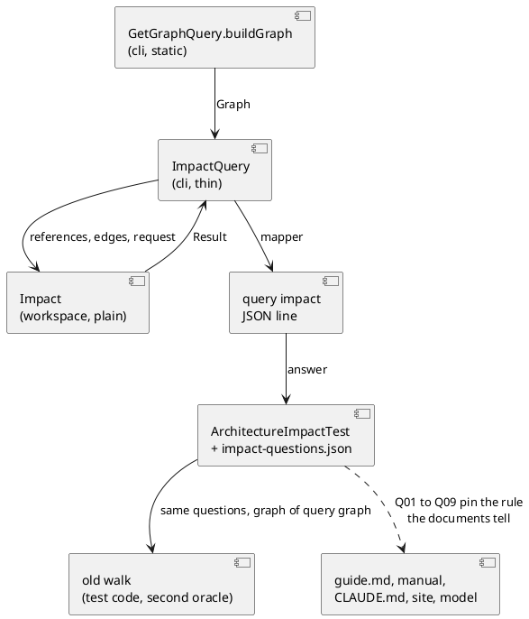
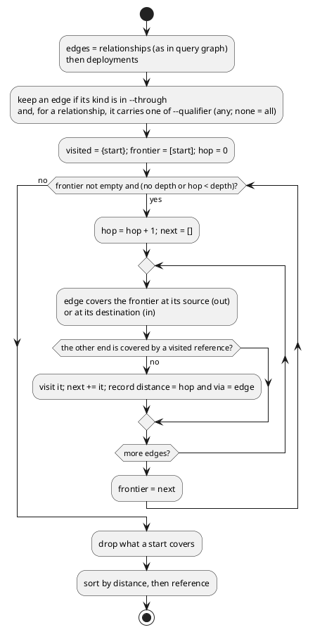

# archicode query impact, the traversal in the tool

# Summary

Today the question "what does a change to X touch" is answered by a walk written in test code (`ArchitectureImpactTest.impact`), over the flat lists of `query graph`. Each client (a test, a script, an agent) that wants the answer writes its own walk. This run puts the walk in the product: `archicode query impact <reference> [--direction in|out|both] [--depth n] [--qualifier Q]... [--through relationships|deployments]... [--plateau id]` prints `{start, direction, depth, reached: [{reference, distance, via}]}` on one line of JSON. The traversal is a plain Java class, `workspace/Impact` (no Picocli, no CDI, like `Fold`); `cli/ImpactQuery` is thin and builds on the graph that `query graph` already builds (`GetGraphQuery.buildGraph`). The oracle calls the command for its nine questions and keeps the old walk as a second oracle for this run. `--through deployments` is the last task (the author answered the wave's Q1 with yes): it lets Q08 and Q09 use the command. The guide, the manual, `CLAUDE.md`, the section "For agents" of the site, `llms.txt` and the model `docs/architecture` say it.

There is no PRD (profile TDD+pln), so traceability is incomplete: requirements are labelled `REQ-n` from the manifest of wave 031 (row W-3, the seven criteria of gate P2, the wave's Q1) and from #187.

# Scope

In scope: `workspace/Impact` and its tests; `cli/ImpactQuery` (new), `cli/QueryGroup` (the subcommand), `cli/GetGraphQuery` (`buildGraph` made static so that the command can reuse it); `reflect-config.json`; `guide.md` and its golden; `ArchitectureImpactTest`, `ArchitectureGraph` and a new integration test `ImpactIT`; the manual (a section, the how-to "Work with an agent", an upgrade note, the generated command reference); `CLAUDE.md` (one paragraph), `src/main/java/io/morin/archicode/workspace/CLAUDE.md` (one rule); `src/site/index.html` and `src/site/llms.txt`; `docs/architecture` (one qualifier) and the sample bundle.

Out of scope: the editor (it does not read `query` outputs); a `deployments` entry among `relationships`; the `derived_dependencies` of the kernel; a change to `query graph` or `query views` output; the byte-identity harness (a new command has no base output to compare with, see DEC-10); a new oracle question beyond the nine; the removal of the old walk (DEF-1).

# PRD Traceability

No PRD exists. Sources: the manifest of wave 031, the Scope of W-3, the wave's Q1 and #187.

- `REQ-1` (P2 gate 1): `query --help` lists `impact`; `archicode guide` names the command, every option of it and the containment rule; `GuideTest` passes with `src/test/resources/guide/golden.md` regenerated. Addressed (DEC-8, IMP-6).
- `REQ-2` (P2 gate 2): `ArchitectureImpactTest` answers Q01 to Q07 through `query impact`; their `expect` lists equal those of the commit `ff3bacd`. Addressed (DEC-2, DEC-4, IMP-5).
- `REQ-3` (P2 gate 3): `query impact nowhere -w docs/architecture/.archicode.yaml` is one line starting `error:` on the error output and exit 1; `--depth 0` and `--depth -1` are refused the same way. Addressed (DEC-6, FLOW-2).
- `REQ-4` (P2 gate 4): `reflect-config.json` names the class of the command; an integration test next to `AgentWalkIT` runs `query impact` on the packaged jar. Addressed (IMP-4, IMP-7).
- `REQ-5` (P2 gate 5): the section `agents` of `src/site/index.html` and `src/site/llms.txt` (next to "Work with an agent") name `archicode query impact`. Addressed (IMP-9).
- `REQ-6` (P2 gate 6): `CLAUDE.md` tells to run `archicode query impact` and no longer tells to follow the relationships by hand; its diff for the wave touches only that paragraph. Addressed (IMP-8).
- `REQ-7` (P2 gate 7): `src/doc/README.adoc` has a section for `query impact`; `./mvnw verify -DskipITs=false`, `npm run test:unit`, `npm run format:check`, `npm run lint` exit 0; `npm run sample:build` leaves `git status --short` unchanged. Addressed (IMP-10, Observability and Verification).
- `REQ-8` (W-3 scope, the semantics): `workspace/Impact` is a plain class and `cli/ImpactQuery` is thin, built on a graph builder shared with `query graph`; `--direction`, `--depth` (unbounded by default), `--qualifier` (repeatable, any of), `--plateau` through the mixin; containment (a reached element covers its descendants by reference prefix, `ref` or `ref.`; the start and its descendants are left out); each element once at its shortest distance; JSON `{start, direction, depth, reached: [{reference, distance, via: {source, destination, qualifiers, label}}]}`, sorted by distance then reference, `via` the first path found. Addressed (DEC-1 to DEC-5, CTR-1).
- `REQ-9` (wave Q1, W-3 last task): `--through deployments` of `query impact`; Q08 and Q09 of the oracle use the command. Addressed (DEC-3, DEC-4, IMP-5).
- `REQ-10` (W-3 scope, the documents): the manual's how-to "Work with an agent" and a note of the release; `docs/architecture` kept true (`npm run sample:build` if it changes). Addressed (IMP-10, IMP-11, CI-arc-1).
- `REQ-11` (wave non-goals): no change to the editor, no `deployments` among `relationships`, no new oracle question. Honoured (Non-Goals).

Unresolved: none.

# Technical Goals

- `TG-1`: one traversal, in the product, whose answer is the same for every client (REQ-8).
- `TG-2`: the seven answers of the oracle that exist today do not change when they are asked of the command (REQ-2).
- `TG-3`: the traversal is testable without the command line, the workspace loader or CDI (REQ-8).
- `TG-4`: a mistake in the call is one `error:` line, never a trace (REQ-3).
- `TG-5`: an agent that has only the binary finds the command and its rule in the guide and in `--help` (REQ-1, REQ-5, REQ-6).
- `TG-6`: the oracle can cross deployments through the command (REQ-9).

# Non-Goals

- No new field on `Element`, `Node`, `Relationship`, `View`; no schema change of the manifests or of the workspace.
- No `-f`, `-q` or `-t` on the command: like `query graph`, it prints one line of JSON.
- No several starts, no `--to` (a path between two elements): one start, as the wave says.
- No link between applications of two environments (`derived_dependencies`).
- No change to the output of `query graph` or `query views`; no declared change in `scripts/byte-identity-stdout-changes.txt`.
- No change to the editor; no JSON cases file shared with the page: the root `CLAUDE.md` wants a cases file when a Java and a node test read it, and the editor does not read `query impact`, so `ImpactTest` holds its cases inline (DEC-9).
- No change to `scripts/byte-identity.sh` or `scripts/byte-identity-stdout-changes.txt`: the command does not exist in `archicode-0.19.0`, so there is no base output, and the plan runs the harness once after the last task to see that it still exits 0 (DEC-10).

# Assumptions

- `ASM-1`: the `elements` list of `query graph` holds one entry for every element of a layer, nested ones included, each with its full reference (`archicode.editor.model`, `workstation.machine`), because `ElementIndex.listAllElementReferences` lists them (ASM-1 of the TDD of run 0220). The oracle today re-derives nested references from the element tree; the command takes the references of the entries. Validated by a test of `Impact` against the graph of `docs/architecture` (the nine questions give the same answer by both ways, DEC-4).
- `ASM-2`: a relationship's `destination` and a deployment's `application` are full references as the index knows them (`index.searchElement` resolves the destination by exact key, and `query graph` fails for a relationship whose destination is not one). A deployment's application is not resolved (DEC-3 of run 0220): the walk reaches it as written. Validated by a case of `ImpactTest` with a dangling hosted application.
- `ASM-3`: a reference is unique across the two layers, so one set of references and one list of edges serve both. The index of each layer is a map by reference and the manifests of one workspace share one namespace; a collision would already confuse `query graph` readers. Validated by reading `WorkspaceFactory`/`LayerLoader` in the run; a set of references deduplicates, so the command has no failure branch for it.
- `ASM-4`: Picocli reads `--depth -1` as the value of the option, not as an option (`-1` is not a known option), so the refusal is ours and not a usage error. Validated by `ImpactQueryTest` with `--depth -1` and `--depth=-1`; if Picocli refuses first, the test pins the exit it gives and DEC-6 documents `--depth=-1`.
- `ASM-5`: the JSON mapper of `MapperFactory` has `NON_EMPTY` inclusion (ASM-2 of run 0220). It drops a null `depth`, an empty `reached` and an empty `qualifiers`, and it does not drop a `false` primitive, so a `deployment` of `false` would be written, and an enum is written as its constant name (`IN`), not as `in`. The output records say otherwise: `depth` and `reached` carry `@JsonInclude(ALWAYS)`; `deployment` is a `Boolean` that is null when false (or carries an annotation that drops the default), so that it is written only when true; `direction` is written as `in`, `out` or `both` (a `@JsonValue` or a lowercase mapping on `Impact$Direction`). Validated by `ImpactQueryTest`, which pins all four.
- `ASM-6`: guide `guide.md` is 17,315 bytes of a 30 KB budget (`GuideTest.BUDGET`), so about 13 KB are left; the new text is under 2 KB.

# Constraints

- `CON-1`: Java 25 for every build (`export JAVA_HOME=$(ls -d ~/.sdkman/candidates/java/25* | head -1)`; the shell's `java` is 21).
- `CON-2`: no command that succeeds starts to fail; the new command fails only for what it is asked (an unknown start, a refused depth), and `query graph` still fails or succeeds as before (`src/main/java/io/morin/archicode/CLAUDE.md`).
- `CON-3`: the Native image reads classes by reflection: the command and the records of its output are in `reflect-config.json`.
- `CON-4`: the output is sorted and deterministic (the promise of "Sorted Output" in the manual): two runs give the same bytes, which follows from the sort by distance then reference and from the fixed order of the edges (DEC-2).
- `CON-5`: `ArchitectureImpactTest` Q01 to Q07 keep their `expect` lists of the commit `ff3bacd` (gate P2); the file `impact-questions.json` is read by the test only.
- `CON-6`: Prettier on `src/**/*.java` and `src/test/javascript/**`; PMD on `src/main/java` and `src/test/java`; a rule is never silenced with an annotation or `// NOPMD`.
- `CON-7`: after any change under `docs/architecture`, `npm run sample:build`; the manual's command reference is generated (`CommandReferenceTest`), so the new command's `--help` is written into `src/doc/README.adoc` by the test's generator, not by hand.
- `CON-8`: a `CLAUDE.md` states what is true now, with no wave, run or issue id and no date; the root one gets only a rule that crosses areas (a change of its one paragraph).

# Current State

- `cli/QueryGroup` has the subcommands `GetSchemasQuery`, `GetViewsQuery`, `GetGraphQuery`. Each command is a Picocli `Runnable` with `@Inject` fields (`QueryOutputWriter`, `MapperFactory`, `WorkspaceFactory`), a `PlateauOption` mixin and the parent `QueryGroup` for the workspace path.
- `GetGraphQuery.buildGraph(Workspace)` is public, an instance method that touches no field, and builds `Graph{elements, relationships, deployments}` (run 0220): elements and relationships by layer then by reference, relationships by source and then as written, deployments by node then as written. A relationship `RelationshipEntry` holds `source`, `layer`, and the `Relationship` (`destination`, `label`, `qualifiers`, `tags`). A dangling relationship destination throws the dangling sentence. `GetGraphQueryTest` calls `getGraphQuery.buildGraph(workspace)` once (line 179).
- `workspace/` holds plain classes with no Picocli and no CDI (`Fold`, `DanglingReferences`, `FoldCheck`); `cli/` commands are the only Picocli code. `FoldCommand` is the example of a thin command over a plain class.
- The oracle `ArchitectureImpactTest.impact(graph, q)` walks `graph.relationships` and, for a question with `through: ["deployments"]`, `graph.deployments`: a breadth-first walk by hops; at each hop, for each edge in order, `out` follows an edge whose source is covered by the frontier (equal or `ancestor + "."` prefix) to its destination, `in` the reverse; a reached reference is dropped when covered by a visited one, else it is visited and put on the next frontier; it is answered unless covered by a start. `depth` null is unbounded. `impact-questions.json` holds Q01 to Q09 (`start`, `direction`, `qualifiers`, `through`, `depth`, `expect`). Three sabotage tests mutate a deep copy of the graph and run the walk.
- `guide.md` line 19 says what `query graph` prints, and the guide has a `sh` block with the commands to start with; `GuideTest` compares the guide with `golden.md` (`@VERSION@` for the version) and holds a 30 KB budget; `AgentWalkIT` reads the `sh` block of the guide and runs it on the packaged application. The manual's "Work with an agent" says "Ask the tool before the code" and shows a `jq` line over `query graph`. The section `agents` of `src/site/index.html` and `src/site/llms.txt` (line 20, "Work with an agent") are read by `src/test/javascript/site.test.js` and `manual-howto.test.js`.
- `CLAUDE.md` (root), paragraph "The model of ArchiCode of ArchiCode", says to run `query graph` and follow the `relationships` by their `source`, `destination` and `qualifiers`. `docs/architecture/manifests/agent.yaml` gives the person `agent` one relationship to `archicode.commandline`, label "asks the graph of", qualifier `query graph`.

# Proposed Design

The reviewer validates that the traversal exists once in the product (`Impact`), that `ImpactQuery` only maps the graph to its inputs and the result to JSON, and that the oracle compares the command with the old walk on the same nine questions.

The reviewer validates that this is the walk of `ArchitectureImpactTest.impact` (same edge order, same coverage and visited rules) with two additions: the record of the first edge that reached a reference (`via`) and the filters `--qualifier` and `--through`.

DEC-1 — The traversal is `workspace/Impact`, a plain class over plain inputs

- Decision: `workspace/Impact` is a final class with a static `walk(Set<String> references, List<Edge> edges, Request request)` returning a `Result`. Nested records: `Edge(source, destination, qualifiers, label, deployment)`, `Request(start, direction, depth, qualifiers, through)`, `Result(start, direction, depth, reached)`, `Reached(reference, distance, via)` where `via` is an `Edge`, and the enum `Direction {IN, OUT, BOTH}`. One record `Edge` is both the input edge and the `via` of a `Reached`; there is no second record for the `via`. It throws `ArchiCodeException` for an unknown start; for a depth of 0 or less it exposes a static `requireDepth(Integer)` that throws `ArchiCodeException` with the sentence of DEC-6 (a null depth passes), the one owner of that sentence, which `walk` calls too (DEC-6). It knows no `Workspace`, no Picocli, no mapper.
- Rationale: the wave asks for a plain class like `Fold`, which a test, a later endpoint and the command call alike (TG-3, REQ-8). Inputs are lists of values, so `ImpactTest` builds graphs by hand with no workspace.
- Alternatives considered: the walk inside `ImpactQuery` (untestable without Quarkus and not reusable); `Impact` taking a `Workspace` and an `ElementIndex` (ties the traversal to the loader, and the technology layer's deployments are not in the index as edges); moving the `Graph` records into `workspace` (changes eight class names of `reflect-config.json` for no gain, DEC-2).
- Tradeoffs: `ImpactQuery` maps `Graph` to `Edge`s (a dozen lines).
- Linked PRD IDs: REQ-8.

DEC-2 — The shared graph builder is `GetGraphQuery.buildGraph`, made static

- Decision: `buildGraph` and `collect` of `GetGraphQuery` become `public static` and `private static`; `ImpactQuery` calls `GetGraphQuery.buildGraph(workspace)`, then takes `references` from `elements[].reference`, and the edges in this order: every `relationships` entry as it comes (source, destination, qualifiers, label), then every `deployments` entry as a deployment edge (`source` the node, `destination` the application, no qualifiers, no label). `GetGraphQueryTest` calls the static method by its class.
- Rationale: one builder, one order, one dangling sentence: `query impact` fails exactly where `query graph` fails (CON-2), and the edge order is the order the output of `query graph` already promises, so `via` is the same for every client (CON-4). A static method is the smallest change: the method already touches no field, and the existing Javadoc says it is "kept apart ... so that the graph can be built without writing it out".
- Alternatives considered: instantiate `GetGraphQuery` in `ImpactQuery` (a Picocli command used as a service; its injected fields stay null); extract `workspace/ImpactGraph` with the records (more churn, `reflect-config.json` names change; the glob `workspace/Impact*.java` of the wave would also hold it, but the move buys nothing the static method does not); build a second, smaller graph from the indexes (duplicates `collect`, and the order and the failures could diverge).
- Tradeoffs: `ImpactQuery` depends on a sibling command's nested records in `cli`; both are in the same package and the dependency is one way.
- Linked PRD IDs: REQ-8.

DEC-3 — Containment, distance and the first path are the rules of the oracle, now said

- Decision: `Impact.walk` is the walk of `ArchitectureImpactTest.impact`, line for line, with `via` and the filters added. Rules: (1) an element covers itself and its descendants (`reference` equals `e` or starts with `e + "."`); (2) at each hop the frontier covers the descendants of the elements on it, so an edge from `a.b.c` leaves a frontier that holds `a.b`; (3) a reference reached is dropped when a visited reference covers it (the same element, or a descendant of a visited one) and else it is visited, so an element is reached once, at the first hop that reaches it, the shortest distance; an ancestor of a visited element is still reached; (4) the start and its descendants are never answered, which follows from (3) because the starts are in `visited`; (5) within a hop the edges are read in their order, so when two edges reach the same reference in one hop the first one is `via`; (6) `distance` is the number of the hop; (7) `reached` is sorted by distance, then by reference (natural text order); (8) `--direction in` follows the edges that end at the frontier (the answer is their source), `out` those that start there (the answer is their destination), `both` both (for each edge, `out` is tried first, then `in`, as the oracle does). A cycle ends because a visited reference is never visited again.
- Rationale: these rules produced the answers Q01 to Q07 fix at `ff3bacd`; any other rule would move them (CON-5, TG-2). The manual says them in the section of the command.
- Alternatives considered: no containment (a client would ask for every descendant by hand, and the answers of Q01 to Q07 would move); shortest path over hops of containment as well (invents a distance for a parent-child step).
- Tradeoffs: within a hop the answer depends on the order of the edges: `via` is the first edge that reached a reference, and when two edges reach `a` and `a.b` in one hop, the one read first decides which of the two is reached; `ImpactTest` pins this case so that it is a rule and not an accident (RISK-2).
- Linked PRD IDs: REQ-8, REQ-2.

DEC-4 — The options, and `--through`

- Decision: `archicode query impact <reference>` with:
  - `--direction in|out|both`, default `in` (DEC-7);
  - `--depth <n>`, a whole number of 1 or more, default unbounded;
  - `--qualifier <q>`, repeatable; a relationship is followed when it carries any of them; with none given every relationship is followed;
  - `--through relationships|deployments`, repeatable, default `relationships`; `relationships` follows the relationships (filtered by `--qualifier`), `deployments` follows the deployments of the technology layer (`node` out to `application`, `application` in to `node`, the entries `query graph` prints); `--through deployments` alone follows no relationship, which is how Q08 and Q09 ask; `--qualifier` filters relationships only, so with `--through deployments` alone it is ignored, with no error: there is no relationship to filter, and a call that succeeds does not start to fail (CON-2); the manual says it and a case of `ImpactTest` and of `ImpactQueryTest` pins it;
  - `--plateau` through the `PlateauOption` mixin.
- Rationale: the wave names the option `--through deployments` (the wave's Q1, #189, #187). Making `--through` the list of the couplings followed, with `relationships` the default, keeps the oracle's `through` key (CTR-2 of run 0220) and the command one-to-one: a question with no `through` is a call with none; `through: ["deployments"]` with empty `qualifiers` is `--through deployments`; with `qualifiers` it is `--through relationships --through deployments --qualifier ...` (DEC-5).
- Alternatives considered: `--through deployments` added to the relationships (Q08 and Q09 have empty `qualifiers` in the oracle, and with no `--qualifier` every relationship would be followed, moving their answers); a flag `--deployments` (a second spelling of the same idea, and no room for a later coupling); deployments always followed (moves Q01 to Q07).
- Tradeoffs: `--through relationships` is the default spelled out only to add the other one; the manual shows both calls.
- Linked PRD IDs: REQ-8, REQ-9.

DEC-5 — The oracle asks the command and keeps the walk as a second oracle for this run

- Decision: `ArchitectureImpactTest` runs `query impact` for each question through `ArchitectureGraph.run` (a new helper `impact(...)` next to `load`), with the arguments built from the question (`start`, `--direction`, `--depth` when not null, one `--qualifier` per entry, `--through` per the rule of DEC-4), and compares the set of `reached[].reference` with `expect`. The same test compares it with the answer of the old walk on the same graph (`impact(graph, q)`), so the two implementations agree on the nine questions, and keeps the three sabotage tests on the walk: they mutate a copy of the graph, which the command cannot be given. The question file is unchanged: Q01 to Q07 byte for byte (`git diff ff3bacd` shows no changed line inside them), Q08 and Q09 as run 0220 wrote them. A question with several starts is not possible (`start` has one entry in each of the nine; the test asserts it).
- Rationale: the wave scope says the walk stays "as a second oracle for one run"; two independent implementations agreeing on nine questions is the strongest evidence that the port kept the rules (TG-2). The wave's Q1 says the walk "can go"; it goes in a later run (DEF-1), after this one has proved the command.
- Alternatives considered: delete the walk now (the proof of the port is then only the `expect` lists, which a wrong port could satisfy by the same mistake as the question); keep only the walk and test the command separately (the oracle would not call the command).
- Tradeoffs: the test file holds two implementations of one rule until DEF-1.
- Linked PRD IDs: REQ-2, REQ-9.

DEC-6 — Refusals are one `error:` line, before the workspace is loaded where they can be

- Decision: the sentence of the depth is owned once, by the static `Impact.requireDepth(Integer)` (DEC-1). `ImpactQuery.run` calls it first (0 or negative: ``the depth must be 1 or more: `0` ``), then loads the workspace, builds the graph and calls `Impact.walk`, which calls `requireDepth` again for a caller that did not (a null depth passes; `ImpactTest` pins the call from `walk`, `ImpactQueryTest` pins that the check comes before the load) and throws for a start that is no element ("the element `nowhere` does not exist: `archicode query graph` lists the references" as the base, the exact words fixed in the plan). All are `ArchiCodeException`, so `ErrorOutput` prints one `error:` line and exits 1. A value that Picocli refuses itself (a `--direction` that is none of the three, a `--depth` that is not a number, a `--through` of another value) is a usage error, exit 2, as for every command.
- Rationale: TG-4, REQ-3; the author's refusals are exit 1 with no trace, and Picocli's usage errors are exit 2, as `src/main/java/io/morin/archicode/CLAUDE.md` says.
- Alternatives considered: Picocli's own `IParameterConsumer` or a custom converter for `--depth` (a usage error with exit 2, which the gate does not accept).
- Tradeoffs: the depth message is checked before the workspace loads, so a bad depth with a broken workspace reports the depth.
- Linked PRD IDs: REQ-3.

DEC-7 — The default direction is `in`

- Decision: `--direction` defaults to `in`: the elements that point at the start (that call it, use it, own it, validate it), those a change to the start can break.
- Rationale: the question the command answers, "what does a change to X touch", is the dependents of X; in the model of ArchiCode four of the seven questions that exist are `in`, and the `both` ones name couplings that run the other way (`serves`, `owns`, `mirror of`).
- Alternatives considered: `both` (a change to X would list what X depends on, which a change to X does not touch; the answer grows past what an agent can read); `out`.
- Tradeoffs: a relationship whose meaning is "X owns Y" (`owns`) is followed by `in` from Y; the manual says that direction is the direction of the arrow, and that `--direction both` asks for both.
- Linked PRD IDs: REQ-8.

DEC-8 — The command is told where an agent and a person read

- Decision: `guide.md` gets a short paragraph (under 2 KB, ASM-6) that names `archicode query impact`, each of its options (`--direction`, `--depth`, `--qualifier`, `--through`, `--plateau`), the containment rule and the output keys, and line 19's "It is the cheapest check" is kept; `golden.md` is regenerated; `GuideTest` gets a case that reads the options of the command from the Picocli spec and fails when the guide does not name one of them or the command. The manual gets `=== Query impact` (with `[[query-impact]]`), after "Query graph": the `--help` block, the rules of DEC-3 and DEC-4 as bullets, one call on the model of ArchiCode with its answer, the errors; the how-to "Work with an agent" replaces the `jq` line of "Ask the tool before the code" with `archicode query impact PaymentGateway`; `[[upgrade-0-24]]` gets a numbered change (New); the generated command reference gets the `--help` of the command through `CommandReferenceTest`.
- Rationale: REQ-1, REQ-10, TG-5; the guide is what an agent that has only the binary reads; a test that checks the guide against the options keeps it true.
- Alternatives considered: leave the guide for the next wave (the gate asks for it); copy the rules in the guide and the manual in full (the guide is short, the manual holds the full rules).
- Tradeoffs: the guide's budget shrinks by about 2 KB.
- Linked PRD IDs: REQ-1, REQ-10.

DEC-9 — No JSON cases file shared with the editor

- Decision: see Non-Goals; `ImpactTest` (JUnit, plain) holds its cases inline: a chain, a cycle, a diamond (shortest distance), two edges to one reference in one hop (the first is `via`), an ancestor reached after its descendant, a descendant reached after its ancestor (dropped), the start's descendants left out, each direction, depth 1 and 2 and unbounded, `--qualifier` any-of and none, deployments out and in, `--through` without relationships, `--qualifier` ignored with `--through deployments` alone, a dangling hosted application, an unknown start, a depth of 0, and a start that is a nested element.
- Linked PRD IDs: REQ-8.

DEC-10 — The harness does not learn the command

- Decision: see Non-Goals; nothing in `scripts/` changes.
- Linked PRD IDs: REQ-7.

DEC-11 — The model says the agent asks for impact

- Decision: `docs/architecture/manifests/agent.yaml` gets the qualifier `query impact` next to `query graph` on its one relationship, so the model of ArchiCode keeps saying how the agent asks the command line; the qualifier list of the paragraph of the root `CLAUDE.md` follows (`query impact` added, `query graph` kept). `npm run sample:build` follows, so that the sample bundle is the bundle of its folder.
- Rationale: wave scope "docs/architecture kept true"; CI-arc-1.
- Alternatives considered: a new element for the command (the model is by package; `commands` already is the package, so no element is stale).
- Tradeoffs: the bundle of the sample changes with it.
- Linked PRD IDs: REQ-10.

# Repository Impact

- `IMP-1` — The traversal
  - Path(s): `src/main/java/io/morin/archicode/workspace/Impact.java` (new)
  - Change type: additive
  - Why impacted: DEC-1, DEC-3.
  - Linked PRD IDs: REQ-8, REQ-3
  - Risks / notes: a port of `ArchitectureImpactTest.impact`; the Javadoc of the class says the rules (containment, distance, first path, order) as the manual does.
- `IMP-2` — The command
  - Path(s): `src/main/java/io/morin/archicode/cli/ImpactQuery.java` (new), `src/main/java/io/morin/archicode/cli/QueryGroup.java`, `src/main/java/io/morin/archicode/cli/GetGraphQuery.java`, a converter for `--direction` and `--through` only if lowercase values are not already accepted for enums: read `CommandLineConfiguration` and `OutputFormatConverter` first, reuse what accepts lowercase, else write a converter in the pattern of `OutputFormatConverter`, and say the choice in the Javadoc of `ImpactQuery`, `src/test/java/io/morin/archicode/cli/GetGraphQueryTest.java`
  - Change type: additive (the command, the subcommand), modify (`buildGraph` and `collect` static, one call in the test)
  - Why impacted: DEC-2, DEC-4, DEC-6.
  - Linked PRD IDs: REQ-8, REQ-3, REQ-9
  - Risks / notes: `GetGraphQuery.buildGraph` is called by the test only; no output of `query graph` changes (a test and the harness say so).
- `IMP-3` — The tests of the traversal and of the command
  - Path(s): `src/test/java/io/morin/archicode/workspace/ImpactTest.java` (new), `src/test/java/io/morin/archicode/cli/ImpactQueryTest.java` (new)
  - Change type: additive
  - Why impacted: DEC-9 for the first (it also pins the call of `requireDepth` from `walk`); the second pins the options, the JSON shape (key order, `depth` null written, `reached` empty written, `deployment` written only when true, `direction` in lowercase), `--qualifier` ignored with `--through deployments` alone, the errors (the unknown start, `--depth 0`, `--depth -1`, a wrong `--direction` exit 2), the order of the depth check before the load, the plateau option, and a determinism check (two runs, same bytes). The output of `query graph` is not re-tested here: `GetGraphQueryTest` and the byte-identity harness hold it.
  - Linked PRD IDs: REQ-3, REQ-8
  - Risks / notes: ASM-4 is tested here.
- `IMP-4` — Native image
  - Path(s): `src/main/resources/META-INF/native-image/io.morin.archicode/archicode/reflect-config.json`
  - Change type: additive
  - Why impacted: `io.morin.archicode.cli.ImpactQuery`, the records and the enum of the output (`Impact$Result`, `Impact$Reached`, `Impact$Edge`, `Impact$Direction`), each with the six keys of their neighbours (CON-3).
  - Linked PRD IDs: REQ-4
  - Risks / notes: proved by the Native job of CI, not by this run; `ImpactIT` runs under `-Dnative` there.
- `IMP-5` — The oracle
  - Path(s): `src/test/java/io/morin/archicode/doc/ArchitectureImpactTest.java`, `src/test/java/io/morin/archicode/doc/ArchitectureGraph.java`, `src/test/javascript/architecture/impact-questions.json` (read, not changed)
  - Change type: modify
  - Why impacted: DEC-5; the Javadoc of the class says the command is the first oracle and the walk the second.
  - Linked PRD IDs: REQ-2, REQ-9
  - Risks / notes: `git diff ff3bacd -- src/test/javascript/architecture/impact-questions.json` shows no changed line inside Q01 to Q07 (RISK-1).
- `IMP-6` — The guide
  - Path(s): `src/main/resources/guide/guide.md`, `src/test/resources/guide/golden.md`, `src/test/java/io/morin/archicode/cli/GuideTest.java`
  - Change type: modify
  - Why impacted: DEC-8.
  - Linked PRD IDs: REQ-1
  - Risks / notes: the golden is regenerated the way `GuideTest` documents; the `sh` block that `AgentWalkIT` runs is not changed unless the plan keeps a command the walk can run on the workspace it builds.
- `IMP-7` — The integration test
  - Path(s): `src/test/java/io/morin/archicode/it/ImpactIT.java` (new, next to `AgentWalkIT.java`)
  - Change type: additive
  - Why impacted: REQ-4; runs `query impact` on the packaged application on a copy of a shipped workspace (`Shipped`): an answer with `reached`, `--through deployments`, an unknown reference (`error:` on the error output, exit 1) and `--depth 0`.
  - Linked PRD IDs: REQ-4, REQ-3
  - Risks / notes: run by `./mvnw verify -DskipITs=false`.
- `IMP-8` — The pointers in the code's documents
  - Path(s): `CLAUDE.md` (the one paragraph), `src/main/java/io/morin/archicode/workspace/CLAUDE.md` (one rule)
  - Change type: modify
  - Why impacted: REQ-6; the root paragraph says to run `archicode query impact <reference>` (with `--direction`, `--depth`, `--qualifier` and the qualifiers the manifests use) in place of following the relationships by hand, and keeps the sentences on `ArchitectureImpactTest`, `ArchitectureDriftTest` and the sample. The `workspace` file gets one bullet: `Impact` is plain, the containment rule, and `ImpactTest` and `ArchitectureImpactTest` pin it. No id, no date (CON-8).
  - Linked PRD IDs: REQ-6
  - Risks / notes: `git diff` of the root `CLAUDE.md` is that paragraph only (a check in the plan).
- `IMP-9` — The site
  - Path(s): `src/site/index.html` (section `agents`), `src/site/llms.txt`
  - Change type: modify
  - Why impacted: REQ-5; one sentence and one line of the code block in the section, and a mention in the line "Work with an agent" of `llms.txt` (or a line next to it).
  - Linked PRD IDs: REQ-5
  - Risks / notes: `site.test.js` and `manual-howto.test.js` read both; `npm run test:unit` runs them.
- `IMP-10` — The manual
  - Path(s): `src/doc/README.adoc` (`=== Query impact`, "Work with an agent", `[[upgrade-0-24]]`, the generated block between `:command-reference-begin:` and `:command-reference-end:`)
  - Change type: modify
  - Why impacted: DEC-8.
  - Linked PRD IDs: REQ-7, REQ-10
  - Risks / notes: `ManualExamplesTest` runs the examples of the manual: a `query impact` call on a shipped example must succeed with the answer it prints; `CommandReferenceTest` rewrites the generated block (never by hand).
- `IMP-11` — The model and its sample
  - Path(s): `docs/architecture/manifests/agent.yaml`, the bundle `src/main/resources/editor-webapp/samples/archicode.yaml` that `npm run sample:build` writes
  - Change type: modify
  - Why impacted: DEC-11.
  - Linked PRD IDs: REQ-10
  - Risks / notes: `ArchitectureModelTest` and `ArchitectureImpactTest` run on the model; no question uses the qualifier.

# Canonical Impact

The repository declares no registers: there is no `docs/CLAUDE.md`, and `docs/` holds `architecture`, `fixtures`, `run` and `wav` only. The canonical description of the architecture is the model of ArchiCode (`docs/architecture`), which the root `CLAUDE.md` names.

- `CI-arc-1` — structure changed, one coupling: the relationship of `agent` to `archicode.commandline` (label "asks the graph of") now also carries the qualifier `query impact`. No element is added: the command is one more class of the package `archicode.commandline.commands` and `archicode.commandline.workspace` gains `Impact`, neither of which the model lists by class. Verified by inspection of `agent.yaml` and by `ArchitectureModelTest` and `ArchitectureDriftTest` passing; the sample bundle is rebuilt (DEC-11).
- `CI-dom-1`: not applicable, no domain register is declared.

# Data Model and Contracts

- `CTR-1` — The output of `query impact`
  - Current contract: none (the command is new).
  - Proposed contract: one line of JSON, keys in this order: `start` (the reference as written), `direction` (`in`, `out` or `both`), `depth` (the number, or `null` when unbounded), `reached`: a list, always written, empty when nothing is reached, of `{"reference": "<reference>", "distance": <n>, "via": {"source": "<reference>", "destination": "<reference>", "qualifiers": [...], "label": "..."}}`, sorted by `distance` then `reference`. `via` is the first edge that reached the element (an `Impact$Edge`), written as the edge is stored (source then destination), whatever the direction of the walk; `qualifiers` and `label` are written only when the relationship has them. `depth` and `reached` are always written, `direction` is `in`, `out` or `both` in lowercase, and `deployment` is written only when true (ASM-5). For a deployment `via` is `{"source": "<node>", "destination": "<application>", "deployment": true}`, which is the one key this shape adds to the filed one, so that a client can tell a deployment from a relationship (an `archicode query graph` client knows no deployment qualifier, and the author refused a synthetic relationship). `deployment` is written only when true.
  - Affected files: `Impact.java` (the records), `ImpactQuery.java`, `reflect-config.json`, the manual, the guide.
  - Migration or compatibility notes: additive; a new command, no existing output changes.
  - Linked PRD IDs: REQ-8, REQ-9
- `CTR-2` — The command line
  - Current contract: `query` has `schemas`, `views`, `graph`.
  - Proposed contract: `query impact <reference> [--direction in|out|both] [--depth n] [--qualifier Q]... [--through relationships|deployments]... [--plateau id]`; exit 0 with an answer (possibly empty), exit 1 with one `error:` line, exit 2 for a usage error of Picocli.
  - Affected files: `QueryGroup.java`, `ImpactQuery.java`, the generated command reference, the guide.
  - Migration or compatibility notes: additive.
  - Linked PRD IDs: REQ-1, REQ-8
- `CTR-3` — The file of the questions of the oracle
  - Current contract: `id`, `ask`, `start` (a list), `direction`, `qualifiers`, `through` (optional), `depth` (null or a number), `expect`.
  - Proposed contract: unchanged. The command reads a question as in DEC-4/DEC-5.
  - Affected files: `ArchitectureImpactTest.java` reads it; nothing changes in the file.
  - Migration or compatibility notes: Q01 to Q07 unchanged at `ff3bacd`.
  - Linked PRD IDs: REQ-2, REQ-9

# Interfaces and Behavior

- `IF-1` — `archicode query impact <reference> ...` as CTR-2: prints CTR-1; the start must be a reference of `archicode query graph` (any layer, nested ones included); an element that nothing reaches gives `"reached": []`; with plateaus the plateau read is chosen by `--plateau` as for the other queries.
- `IF-2` — Errors: an unknown start (one line, exit 1), `--depth` of 0 or below (one line, exit 1), a relationship whose destination does not exist (the dangling sentence of `query graph`, exit 1, because the graph is built the same way), a missing or broken workspace (the sentences that every command gives). A hosted application that does not exist is reached as written and is no error in a workspace with no plateau (as in `query graph`).
- `IF-3` — The oracle: `ArchitectureImpactTest` asks the command for Q01 to Q09, compares with `expect` and with the old walk; the sabotage tests stay on the walk.

# Flows and Processing Logic

- `FLOW-1` — Answer a question
  - Trigger: `archicode query impact <reference> ...`.
  - Steps: Picocli parses the options; `ImpactQuery.run` checks the depth; loads the workspace (`WorkspaceFactory.create` with the plateau); `GetGraphQuery.buildGraph` builds the graph; the references and the edges (relationships, then deployments) are taken from it; `Impact.walk` runs the walk of the diagram above; the mapper writes the `Result`; `QueryOutputWriter` prints the line.
  - Branches / failure paths: a depth below 1 fails before loading; an unknown start fails in `Impact.walk`; a dangling relationship fails in `buildGraph`; a start with no edge gives an empty `reached`.
  - Final output / rendered result: the JSON line of CTR-1.
  - Linked PRD IDs: REQ-8, REQ-3
- `FLOW-2` — Refuse a call
  - Trigger: `query impact nowhere` or `--depth 0`, `--depth -1`.
  - Steps: `ArchiCodeException` thrown by `ImpactQuery` or `Impact`; `ErrorOutput` writes `error: <sentence>` on the error output; exit 1, no standard output.
  - Branches / failure paths: a usage error of Picocli (an unknown option, a bad enum value) is exit 2 with its own usage text.
  - Final output / rendered result: one line starting `error:`.
  - Linked PRD IDs: REQ-3
- `FLOW-3` — Ask the oracle
  - Trigger: `ArchitectureImpactTest`.
  - Steps: for each question of `impact-questions.json` run the command on `docs/architecture/.archicode.yaml`, read `reached[].reference`, compare with `expect`, then with the answer of the old walk on the graph of `query graph`.
  - Branches / failure paths: a question the command answers differently from the walk or from `expect` fails with the missing and the unexpected sets and the line "if the coupling changed on purpose, change the model and this question together".
  - Final output / rendered result: nine green questions.
  - Linked PRD IDs: REQ-2, REQ-9

# Reliability, Performance, and Scalability

The graph is built once, as `query graph` builds it, and the walk is `O(hops x edges x frontier)` with prefix tests: the model of ArchiCode has about 40 elements and about 60 edges, the largest shipped workspace a few hundred; the cost is below the load of the workspace. The output is sorted and deterministic (CON-4); `ImpactQueryTest` runs the command twice and compares the bytes. A cycle ends because a visited reference is never visited again; a bounded `--depth` ends it earlier.

# Security and Privacy

Not applicable beyond what is already true: the command reads the user's own workspace and prints to the standard output; it writes no file.

# Observability and Verification

Run with the JDK 25 of CON-1:

- `./mvnw -o test -Dtest='ImpactTest,ImpactQueryTest,GetGraphQueryTest,ArchitectureImpactTest,ArchitectureModelTest,GuideTest,CommandReferenceTest,ManualExamplesTest'`, then `./mvnw test`, `./mvnw verify -DskipITs=false` (runs `ImpactIT` and `AgentWalkIT` on the packaged jar), `./mvnw test-compile pmd:check` (REQ-4, REQ-7).
- `./mvnw -o package -DskipTests -DskipITs`, then `java -jar target/quarkus-app/quarkus-run.jar query --help` lists `impact`; `... guide | grep -c 'query impact'` is not 0 and every option of the command is in it (REQ-1); `... query impact nowhere -w docs/architecture/.archicode.yaml` prints one line starting `error:` on the error output and exits 1; the same with `--depth 0` and `--depth -1` (REQ-3); `... query impact archicode.kernel.engine -w docs/architecture/.archicode.yaml --depth 1 --qualifier calls --qualifier 'generated from'` reaches the six references of Q01 (REQ-2).
- `git diff ff3bacd -- src/test/javascript/architecture/impact-questions.json` shows no changed line inside Q01 to Q07 (REQ-2).
- `git diff -- CLAUDE.md` shows the one paragraph only (REQ-6); `grep -c 'query impact' src/site/index.html src/site/llms.txt` is not 0 in both (REQ-5).
- `npm run test:unit`, `npm run format:check`, `npm run lint`; `npm run sample:build` and `git status --short` is the same before and after the second run (REQ-7).
- `scripts/byte-identity.sh` exits 0 with 0 `DIFFERENT` and the self-check `ok`: no existing output moved (DEC-10). The base is built by the script from `archicode-0.19.0`.
- Not verified by this run: the native image (IMP-4: the Native job of CI proves it, and a pull request does not run it the way a tag does), the end-to-end browser suite (the editor is untouched).

# Deployment and Rollout

Code, test and documentation only, one commit with the goldens, the generated command reference and the sample bundle in it. Compatibility: a new command, no option or output of another command changes; the notes of the release say it (New). Rollback: revert the commit.

# Risks and Tradeoffs

- `RISK-1`: the port moves an answer of Q01 to Q07. Mitigation: the oracle compares the command with the old walk on the same nine questions, `ImpactTest` pins each rule, and the gate checks the `expect` lists against `ff3bacd`.
- `RISK-2`: the rule "within a hop the first edge wins" (DEC-3) lets the order of the edges decide a set in a corner (an ancestor and a descendant reached in one hop). Mitigation: the order is that of `query graph` (sorted, then as written), the case is pinned by `ImpactTest`, and the manual says "each element once, at its shortest distance".
- `RISK-3`: `--depth -1` is read by Picocli as an option (ASM-4). Mitigation: a test pins the exit and the sentence; the manual writes `--depth=-1` if needed.
- `RISK-4`: Jackson drops a key the shape promises (`depth` null, `reached` empty) or writes one it should not (`deployment` of `false`, `direction` as `IN`) under `NON_EMPTY` (ASM-5). Mitigation: `@JsonInclude(ALWAYS)` on the two, `deployment` null when false, a lowercase `direction`, and `ImpactQueryTest` on all four.
- `RISK-5`: the native image misses a record and the command prints nothing useful. Mitigation: CON-3, IMP-4; the Native job proves it; the plan says it is not proved in this run.
- `RISK-6`: the guide's budget (ASM-6) or the golden drifts. Mitigation: `GuideTest` holds both; the new text is short.
- `RISK-7`: a client reads `via.qualifiers` of a deployment and finds none. Mitigation: `deployment: true` (CTR-1), said in the manual.
- `RISK-8`: `GetGraphQuery.buildGraph` becomes the shared builder and a later change to `query graph` moves `query impact`. Mitigation: that is the intent (one graph); `ImpactQueryTest` and the oracle fail if the order or the content moves.

# Open Questions

- `Q-1` (resolved): which direction is the default? Resolution: `in` (DEC-7).
- `Q-2` (resolved): how does `via` say a deployment, with no synthetic relationship? Resolution: `deployment: true`, written only when true (CTR-1).
- `Q-3` (resolved): is the old walk removed now, as Q1's text says, or kept, as the scope says? Resolution: kept this run as the second oracle (DEC-5), removed later (DEF-1).
- `Q-4` (resolved): how does the oracle's `through` map to the command? Resolution: `--through` lists the couplings followed, `relationships` by default (DEC-4).

No open question remains.

# Deferred Work

- `DEF-1`: delete the old walk and its helpers from `ArchitectureImpactTest`, keeping the sabotage tests on a graph the command can read (a copy of the workspace with a coupling removed): a run after this one has proved the command.
- `DEF-2`: several starts and a path between two elements (`--to`): another question.
- `DEF-3`: the application-to-application links between environments (`derived_dependencies` of the kernel): another question (wave non-goal).
- `DEF-4`: a `-f` and `-q` on the command, if a client needs them: none does today.

DEF-1 to DEF-4 are kept here; filing them as GitHub issues is an external write that this run does not make, so the author files them, and the run record carries the four texts ready to paste.

# File Placement and Frontmatter

Saved as `docs/wav/wav-031-graph-answers-impact/run/run-0221-query-impact/tdd-0221-query-impact.md`, with `type: tdd`, `run: 0221`, `wave: 031`.
