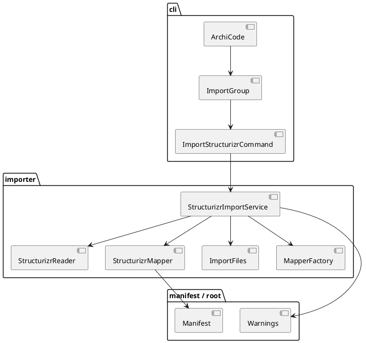
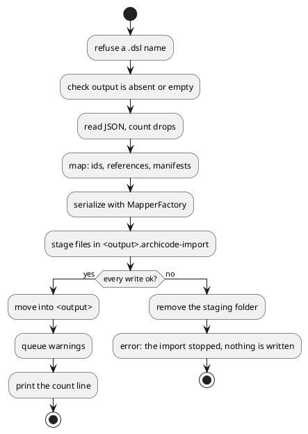

# Import a Structurizr workspace

# Summary

`archicode import structurizr <workspace.json> --output <folder>` reads the JSON export of a Structurizr workspace (people, software systems, containers, components and the relationships between them) and writes an ArchiCode workspace in `<folder>`: a `.archicode.yaml` and one manifest per element.

What it says and refuses: every part of the export that v1 does not carry (views, deployment, styles, documentation, properties, implied relationships) and every rewritten id (defined once, DEC-4) is said as one `warning:` line, and the exit code stays 0. A `.dsl` file, a file that is not a Structurizr workspace, an element with no name and a non-empty output folder are each one `error:` line, exit 1, and the folder is not changed. The files are written all or none.

Design: a new package `io.morin.archicode.importer` (reader, model, mapper, files seam, service) behind a thin command `cli/ImportStructurizrCommand` in a new group `cli/ImportGroup`. The reader and the mapper are pure: the mapper returns `Planned(path, Manifest)` entries and the workspace file as a typed object, the service serializes them with `MapperFactory.forWriting(YAML)`, and `ImportFiles` only writes bytes.

Proof: a Structurizr sample from the open-source repository is committed with its licence and provenance and is the oracle; the output is loaded by the command line and by the editor in tests. There is no PRD (profile TDD+pln): the sources are issue #135, its author's decision of 2026-10-31 and the gate of phase P1 of wave 033, so traceability is incomplete (see PRD Traceability).

# Scope

In scope: the package `importer/` (reader of the JSON, mapping, id rewriting, writer, report), `cli/ImportGroup` and `cli/ImportStructurizrCommand` registered in `cli/ArchiCode.java`, the sample and its licence and provenance under `src/test/resources/structurizr/`, the goldens of the output, the Java tests, one `*IT`, one node test that opens the output in the editor, the entries of `reflect-config.json`, the manual (`src/doc/README.adoc`), `src/main/java/io/morin/archicode/CLAUDE.md`, the model `docs/architecture/` and the generated sample bundle.

Out of scope: see Non-Goals and Deferred Work.

# PRD Traceability

No PRD. The requirements are assumed from issue #135, the author's decision on it and the P1 gate of wave 033 (criteria 1 to 4 and 7 concern this run), and are labelled `REQ-n`; they are not sourced from a PRD id.

- `REQ-1` (gate 1): `src/test/resources/structurizr/` holds a JSON file whose name contains `big-bank`, the Apache-2.0 text and a provenance text with `github.com/structurizr/structurizr` and a 40-hex commit SHA. Addressed (DEC-8, IMP-7).
- `REQ-2` (gate 2): on the packaged application the command exits 0, prints at least one warning per dropped part present in the sample (views, deployment), and `query graph` on the output has as many elements as the sample's people, systems, containers and components together. Addressed (DEC-1 to DEC-5, DEC-9).
- `REQ-3` (gate 3): a `.dsl` input and a non-empty output folder are each one `error:` line, no stack trace, exit 1, and the folder is unchanged. Addressed (DEC-6, DEC-7).
- `REQ-4` (gate 4): a test of `src/test/java/io/morin/archicode/it` runs the import on the packaged application; an editor test loads the output; `reflect-config.json` names at least two `io.morin.archicode.cli.Import` classes. Addressed (IMP-5, IMP-6, IMP-9).
- `REQ-5` (gate 7, part): PMD, `./mvnw verify -DskipITs=false`, `scripts/byte-identity.sh` (no new exception), `npm run test:unit`, `format:check`, `lint`, and `editor:build` and `sample:build` leaving `git status --short` unchanged. Addressed (IMP-6, IMP-10, IMP-11).
- `REQ-6` (decision on #135): JSON only; CLI only; v1 = people, systems, containers, components and relationships; a `group` becomes a tag; views, deployment, styles, documentation and properties are reported as dropped, exit 0; ids rewritten to `[a-z0-9_-]` with a suffix on collision, each rewrite said once (a rewritten id is defined in DEC-4), and the original id kept in a tag; a non-empty output refused. Addressed (DEC-1 to DEC-7).
- `REQ-7` (decision on #135, first task): check the current way to produce the JSON for the `.dsl` sentence, and check for a per-path licence notice, the existence and path of the Big Bank export in `structurizr/structurizr`, and its element count. Partially addressed: Q-1 and Q-2 hold answers found by search, and the first task of the plan confirms them against the commit it records.
- `REQ-8` (wave manifest scope): the sample, the output goldens, the manual and the model of ArchiCode. Addressed (IMP-7 to IMP-11).
- `REQ-9` (decision on #135): build only what this importer needs; the part shared with #134 is extracted when #134 arrives. Addressed (DEC-2, DEF-1).
- Unresolved: REQ-7 only, partially (Q-1 and Q-2 are resolved by search and read; the plan's first task confirms them); none blocks the run.

# Technical Goals

- `TG-1`: a pure reader of the Structurizr JSON that keeps the four element kinds and the relationships, and counts what it ignores (REQ-2, REQ-6).
- `TG-2`: a pure mapper from that model to `Manifest` objects with resolved references and rewritten ids (REQ-6).
- `TG-3`: a writer that makes the folder all or nothing and refuses a non-empty folder (REQ-3).
- `TG-4`: a report in `Warnings` for each drop and each rewritten id, in the sense of DEC-4 (REQ-2, REQ-6).
- `TG-5`: the proof: the packaged application imports the sample, the output loads in the command line and in the editor, a golden pins it (REQ-2, REQ-4).

# Non-Goals

- No LikeC4 importer, no shared model of the two importers, no DSL parser, no editor action (wave non-goals; REQ-9).
- No deployment, views, styles, documentation, properties or perspectives in the output: reported as dropped.
- No plateaus in the output: one layer, one plateau (the baseline).
- No new dependency: Jackson (already used for manifests) reads the JSON.
- No change to an existing command's output: `scripts/byte-identity.sh` stays green with `scripts/byte-identity-exceptions.txt` unchanged.

# Assumptions

- `ASM-1`: the JSON export of a Structurizr workspace has `model.people[]`, `model.softwareSystems[]` each with `containers[]` each with `components[]`, and relationships under `relationships[]` of each element, with `id`, `sourceId`, `destinationId`, `description`, `technology`, `tags` (one comma-separated string) and optionally `linkedRelationshipId`; element ids are strings of digits. Validated by the sample itself and by the first test (the reader fails with one sentence on a missing `model`).
- `ASM-2`: the Structurizr ids are not usable as ArchiCode ids (they are numbers, and `layer.parent.child` references need meaningful levels), so ArchiCode ids derive from names (DEC-4). Validated on the sample.
- `ASM-3`: the loader accepts a relationship between an element and one of its own descendants or ancestors, and a `header.parent` chain three levels deep (system, container, component). Validated by loading the golden output (`ShippedFilesTest` picks up the folder).
- `ASM-4`: the sample is licensed Apache-2.0 for its path (Q-2). Validated by the first task of the plan.
- `ASM-5`: `Warnings` printed on the error output at the end of the command (`ErrorOutput`) is the right channel for the report, as for every other warning of the command line.

# Constraints

- `CON-1`: Java 25, Quarkus, Picocli, Lombok conventions of `CLAUDE.md`; PMD ruleset unchanged, no `NOPMD`.
- `CON-2`: the native image reaches classes by reflection only when they are in `reflect-config.json`; `NativeReflectionConfigTest` fails when one is missing. The Native job of CI is the proof and does not run on a branch (RISK-4).
- `CON-3`: one `error:` line and exit 1 for a mistake of the author (`ArchiCodeException`, `ErrorOutput`); no stack trace.
- `CON-4`: every file the repository ships is loaded by the command line and by the editor in a test (`CLAUDE.md`, Conventions): the output golden is a workspace under `src/test/resources/`, so `ShippedFilesTest` and `shipped-files.test.js` load it with no entry of `exceptions.json`.
- `CON-5`: no real workspace content in the repository: the sample is the public Big Bank export, never the author's own model.
- `CON-6`: the third-party file keeps its licence next to it and its provenance (REQ-1).
- `CON-7`: adding commands moves `--help` and the generated command listing of the manual: `HelpIT`, `GuideTest` (golden `src/test/resources/guide/golden.md`) and `CommandReferenceTest` move in the same commit.

# Current State

- `cli/ArchiCode.java` is the `@TopCommand`; its groups are `ViewsGroup`, `QueryGroup`, `EditorGroup`, `PlateauGroup`, `StoriesGroup`, and the command `DiffCommand`. A group is a class with `@CommandLine.Command(name, subcommands)` and a `@ParentCommand archiCode` field (`cli/PlateauGroup.java`).
- `cli/InitCommand` writes a workspace from resources into a folder, refuses to overwrite, and prints what it wrote. It loads no workspace (`-w` is not looked at). It is the closest existing command.
- `workspace/FoldFiles` is the seam for writing a fold: `read`, `stage`, `move`, `delete`, `restore`, and `commit` that is all or nothing for files that already exist (`stage` copies the target first, so it cannot create a file). `DiskFoldFiles` is the disk implementation.
- `Manifest` (`header` with `kind`, `version`, `parent`, `plateau`; `content` as `ObjectNode`) and `ManifestKind` (`PERSON`, `SYSTEM`, `CONTAINER`, `COMPONENT`, ...) are what the loader reads; `MapperFactory.forWriting(MapperFormat.YAML)` writes a manifest as the editor and `plateau fold` do. `AbstractElement` holds `id`, `name`, `description`, `qualifiers` (set), `tags` (map), `relationships` (`destination`, `label`, `qualifiers`, `tags`).
- `Warnings` keeps de-duplicated sentences that `ErrorOutput` prints as `warning: ...`.
- `src/test/resources/structurizr/` does not exist. `src/main/resources/META-INF/native-image/io.morin.archicode/archicode/reflect-config.json` lists `io.morin.archicode.cli.FoldCommand` and the other commands.

# Proposed Design

A new package `io.morin.archicode.importer` with five small classes, and a thin command. The importer calls no command and the command holds no logic (the pattern of `FoldCommand` and `PlateauFoldService`).

- `StructurizrReader`: `Jackson` `JsonNode` tree in, `StructurizrModel` out (records: `Person`, `System`, `Container`, `Component`, each with the original id, name, description, tags string, technology, group; and `Link` for a relationship: id, source id, destination id, description, technology, `linkedRelationshipId`). It also returns `Dropped`: a counted map of the parts present and not carried.
- `StructurizrMapper`: model in, `List<Planned>` out, where `Planned` is a relative path and a `Manifest`, plus the content of `.archicode.yaml` as a typed object. It serializes nothing. It rewrites ids (DEC-4), resolves each relationship's `destinationId` to the reference of the destination before anything is built, and skips `linkedRelationshipId` ones (DEC-5).
- `ImportFiles`: writes a list of `(path, bytes)` to an empty or absent folder, all or nothing (DEC-7); it serializes nothing and knows no `Manifest`. A seam like `FoldFiles` (an interface with a disk implementation) so that a test fails a write at the step it chooses.
- `StructurizrImportService`: the sequence: check the input name, read, map, serialize with `MapperFactory.forWriting(YAML)`, write through `ImportFiles`, then queue the report. Knows no command line.
- `cli/ImportGroup` (`name = "import"`, subcommand `ImportStructurizrCommand`) and `cli/ImportStructurizrCommand` with `<workspace.json>` and `--output <folder>` (required). It prints on the standard output what it wrote (the number of elements and relationships, and the folder) once the move has succeeded.

The reviewer validates that the reader and the mapper touch no file and serialize nothing, that only `ImportFiles` writes, that only the service serializes, and that the command calls the service and nothing else. Textual fallback: command, then service, then reader, mapper, serialization and `ImportFiles` in that order, with `Warnings` fed by the service.

## Design decisions

- `DEC-1` — JSON only, a command of the CLI only
  - `Decision:` the input is the JSON export; a name ending in `.dsl` is refused before the file is read, as is an extension other than `.json`; there is no editor action.
  - `Rationale:` the author's decision on #135; a DSL needs a parser that nothing here has.
  - `Alternatives considered:` parse the DSL (large, a language of its own); call Structurizr's CLI (an external program that is not there on every machine).
  - `Tradeoffs:` a DSL-only user needs one more step, which the refusal sentence names if a current way is found (DEC-6).
  - `Linked PRD IDs:` REQ-3, REQ-6.
- `DEC-2` — A package of its own, no shared model with a future LikeC4 importer
  - `Decision:` `io.morin.archicode.importer` holds a model of the Structurizr JSON only; nothing is written for #134.
  - `Rationale:` the decision on #135: build only what this importer needs.
  - `Alternatives considered:` a neutral intermediate model now (a design for one input is a guess).
  - `Tradeoffs:` the second importer may move code; DEF-1 says when.
  - `Linked PRD IDs:` REQ-9.
- `DEC-3` — One manifest per element, nested by `header.parent`
  - `Decision:` each person, system, container and component is one file `manifests/<reference>.yaml` (the reference is the dotted path, e.g. `bank.api`); a container has `header.parent: <system reference>`, a component `header.parent: <container reference>`, and `header.kind` is the full `ManifestKind` id (CTR-2). `.archicode.yaml` has `settings.name` (the workspace `name`, or the file's name when absent) and `manifests.paths: ["manifests/**"]`.
  - `Rationale:` small diffable files, no deep nesting in one file, the form `plateau fold` and the editor already write; file names are unique because references are.
  - `Alternatives considered:` one file per system with nested `elements` (a very large file for a big system); one file for all (no per-element history).
  - `Tradeoffs:` many files for a big model (about as many as the sample has elements, a count the plan's first task reads; hundreds for a large model: acceptable).
  - `Linked PRD IDs:` REQ-2, REQ-6.
- `DEC-4` — Ids come from names; the Structurizr id is kept in a tag
  - `Decision:` the ArchiCode id of an element is its name lowercased, with every run of characters outside `[a-z0-9_-]` replaced by one `_`, trimmed of `_`. A name with no `[a-z0-9]` at all takes the fallback `<kind>_<structurizr id>`, which passes through the same rewrite (so an id such as `../x` cannot reach a file name). A missing `name` is not rewritten: it is the reader's `error` (CTR-1). Siblings are all the elements under one parent, whatever their kind (a top-level person and a top-level system compete for one id); a collision takes the first suffix `_2`, `_3`, ... that no sibling already holds, in the order of the export, so a sibling really named `x_2` is never shadowed. The original id is the tag `structurizr.id`; the original `group` is the tag `group`. A *rewritten id* is one where a character other than a letter, a digit, `_`, `-` or a space was replaced, or the fallback was taken, or a suffix was added; case and spaces turned to `_` are not. Each rewritten id is one warning, once per element, naming the element, its Structurizr id and the id written. Summary, REQ-6 and DEC-9 mean exactly this.
  - `Rationale:` Structurizr ids are numbers, which make references unreadable and are unstable between exports; a reference of meaningful levels is what the author wants to read and what views name.
  - `Alternatives considered:` keep the numeric ids (unreadable; `10` and `1.0` hazards in YAML numbers); a hash (unreadable).
  - `Tradeoffs:` the reference changes when the name changes; the tag carries the link back to the export.
  - `Linked PRD IDs:` REQ-6.
- `DEC-5` — Relationships: written on the source, implied ones skipped
  - `Decision:` a relationship becomes an entry of `relationships` of its source: `destination` is the destination's reference, `label` is the description, `qualifiers` hold the technology when present, `tags` hold `structurizr.id`. A relationship with a `linkedRelationshipId` is not written: it is the implied copy Structurizr generated, and the warning counts them. A relationship whose source or destination is not an imported element (a deployment node, an instance) is dropped and counted. Ids are resolved in a map built before the first manifest is made, so the order of the export does not matter.
  - `Rationale:` the decision on #135; writing implied relationships would duplicate every link at each level.
  - `Alternatives considered:` keep them all (noise); recompute them (the kernel's own derivation does it).
  - `Tradeoffs:` the count of relationships in the output is lower than in the file, which the report says.
  - `Linked PRD IDs:` REQ-6.
- `DEC-6` — The `.dsl` sentence names a way, only if one is found
  - `Decision:` the refusal is `error: <file> is a Structurizr DSL file: export it to JSON first (<command>)`, where `<command>` is the current way found by the first task of the plan, with the page that documents it. If no documented current way exists, the sentence is `error: <file> is not a JSON export of a Structurizr workspace: only the JSON export is read` and names no command. The command is never invented.
  - `Rationale:` the Java CLI the issue names is archived; a wrong command is worse than none (wave risk).
  - `Alternatives considered:` leave the sentence general always (loses the help when a way exists).
  - `Tradeoffs:` the sentence is fixed by a fact the run finds, so it is in the plan as the first task.
  - `Linked PRD IDs:` REQ-3, REQ-7.
- `DEC-7` — Writing: a non-empty folder is refused; the writes are all or nothing
  - `Decision:` `--output` that exists and holds any entry (hidden files included) is `error: the folder <f> is not empty: import writes nothing over a folder`. An `--output` that is an existing file is one `error:` line too, as `init` does for a non-folder. An absent folder is created, and so is an absent parent. The files are written into a staging folder next to `<output>` (`<output>.archicode-import`); a staging folder left by a crash is replaced (as the fold's `stage` replaces a stale staged file); the staging folder is then moved into place (an empty target is replaced by an atomic move of the staging folder; an absent one by a move); a failure removes the staging folder and says `the import stopped at <file> (<reason>): nothing is written`. An input path that is a folder is refused by the reader as one `error:` line. `FoldFiles` is not extended: its `commit` rewrites files that already exist and creates none, which is what an import needs. The wave plan says the manifests are written with `FoldFiles`; this deviation is on purpose (recorded in the run document).
  - `Rationale:` the guarantee of the plateau fold writer (all files or none) with the smallest change to an existing seam; a staging folder is invisible to the user until the end.
  - `Alternatives considered:` extend `FoldFiles` with a `create` operation (changes the meaning of `commit` for the fold; the wave plan says "written with `FoldFiles`": the plan follows this design and the run document records the deviation); write directly and delete on failure (a crash leaves a partial workspace).
  - `Tradeoffs:` a new small seam `ImportFiles`; a crash leaves `<output>.archicode-import`, which is no workspace.
  - `Linked PRD IDs:` REQ-3, REQ-6.
- `DEC-8` — The sample and the oracle
  - `Decision:` `src/test/resources/structurizr/big-bank-plc.json` (the Big Bank plc export of `structurizr/structurizr`), `LICENSE-Apache-2.0.txt` and `PROVENANCE.md` (repository URL, the path of the file in it, the 40-hex SHA of the commit it was taken at, the date) sit together. The oracle of the element count is `jq` on the sample at the time of the first test, written in the test as an expected number read from the file by the test (not a literal), plus the golden output under `src/test/resources/structurizr/expected/`.
  - `Rationale:` REQ-1; a count read from the input cannot drift from it.
  - `Alternatives considered:` a hand-written minimal workspace (fallback of the wave's open question, Q-2); a smaller trimmed copy (not the real export, so it proves nothing about compatibility).
  - `Tradeoffs:` a third-party file of some size in the repository.
  - `Linked PRD IDs:` REQ-1, REQ-2.
- `DEC-9` — The report
  - `Decision:` the warnings are, in this order: one per dropped part present, with its count (`views: 3 dropped`, `deployment nodes: 2 dropped` (the top-level nodes of `model.deploymentNodes`; the nested ones are not counted), `styles`, `documentation`, `properties`, `implied relationships: N skipped`, `relationships to elements that are not imported: N dropped`), then one per rewritten id (DEC-4). The warnings are queued after the move has succeeded, so a failed write prints `the import stopped...` and no drop list. On the standard output: `imported <n> elements and <m> relationships into <folder>`. The sentences are stable and pinned by the golden of the output of the command (`expected-report.txt`).
  - `Rationale:` the gate asks at least one line per dropped part present; an author reads the list to know what to redo.
  - `Alternatives considered:` a JSON report (nobody asked; DEF-2).
  - `Tradeoffs:` the list of parts is fixed in the reader; an unknown part of a later export is not reported (DEF-3).
  - `Linked PRD IDs:` REQ-2, REQ-6.

# Repository Impact

- `IMP-1 — The importer`
  - `Path(s):` `src/main/java/io/morin/archicode/importer/` (`StructurizrReader`, `StructurizrModel`, `StructurizrMapper`, `ImportFiles`, `DiskImportFiles`, `StructurizrImportService`)
  - `Change type:` additive
  - `Why impacted:` the whole feature.
  - `Linked PRD IDs:` REQ-2, REQ-3, REQ-6
  - `Risks / notes:` the mapper is pure; `ImportFiles` is the only class that touches disk.
- `IMP-2 — The command and the group`
  - `Path(s):` `src/main/java/io/morin/archicode/cli/ImportGroup.java`, `cli/ImportStructurizrCommand.java`, `cli/ArchiCode.java`
  - `Change type:` additive (one line in `subcommands`)
  - `Why impacted:` the new command appears in `--help`.
  - `Linked PRD IDs:` REQ-3, REQ-4
  - `Risks / notes:` `HelpIT` and the guide golden move (CON-7).
- `IMP-3 — Tests of the classes`
  - `Path(s):` `src/test/java/io/morin/archicode/importer/` (`StructurizrReaderTest`, `StructurizrMapperTest`, `StructurizrImportServiceTest`, `ImportFilesTest`)
  - `Change type:` additive
  - `Why impacted:` ids with collisions and odd characters, the numeric ids, `linkedRelationshipId`, relationships to a not-imported element, a failed write that leaves nothing, a refused folder that is unchanged, a `.dsl` input, a JSON that is no workspace, an empty model.
  - `Linked PRD IDs:` REQ-2, REQ-3, REQ-6
  - `Risks / notes:` each refusal is checked as one `error:` line with no stack trace.
- `IMP-4 — The goldens`
  - `Path(s):` `src/test/resources/structurizr/expected/` (the workspace written from the sample, and `expected-report.txt`)
  - `Change type:` additive
  - `Why impacted:` the output is pinned byte for byte; the folder is also a shipped workspace loaded by `ShippedFilesTest` and `shipped-files.test.js` and part of `ManifestCorpus` (so of `ManifestSchemaCorpusTest` and `ManifestRoundTripCorpusTest`) and of `MistakeSweepTest`, which mutates one manifest per kind (CON-4). A mutation of `header.parent` of an imported container may end in a stack trace and fail the build, or need an entry of `known-traces.json` (RISK-6). `scripts/byte-identity.sh` also runs on the golden, since the base jar loads it.
  - `Linked PRD IDs:` REQ-2, REQ-4
  - `Risks / notes:` the count of manifests that docs quote (`ManifestCorpusTest` or `CLAUDE.md` of `src/test`) may be a literal; the plan greps for it.
- `IMP-5 — The integration test`
  - `Path(s):` `src/test/java/io/morin/archicode/it/StructurizrImportIT.java`
  - `Change type:` additive
  - `Why impacted:` the packaged application (jar, and the native runner under `-Dnative`) imports the sample, then `query graph` loads the output; a `.dsl` and a non-empty folder are each one `error:` line (pattern of `InitIT`).
  - `Linked PRD IDs:` REQ-2, REQ-3, REQ-4
  - `Risks / notes:` none beyond RISK-4.
- `IMP-6 — The editor test`
  - `Path(s):` `src/test/javascript/viewpoint-kernel/structurizr-import-workspace.test.js`
  - `Change type:` additive
  - `Why impacted:` as `CLAUDE.md` requires, the editor opens the folder the command writes (reads `src/test/resources/structurizr/expected/`), with no error in any manifest, no duplicate reference and as many elements as the sample.
  - `Linked PRD IDs:` REQ-4
  - `Risks / notes:` it needs no change under `src/main/editor`. The importer is a command of the CLI only, so there is no cases file shared with the editor for its sentences; the editor's part is this proof that it opens the output.
- `IMP-7 — The sample`
  - `Path(s):` `src/test/resources/structurizr/big-bank-plc.json`, `LICENSE-Apache-2.0.txt`, `PROVENANCE.md`
  - `Change type:` additive
  - `Why impacted:` REQ-1; downloading it is a step the run asks the author for or does under the permission of the session (the plan names the source and the size).
  - `Linked PRD IDs:` REQ-1
  - `Risks / notes:` RISK-2.
- `IMP-8 — Native reflection`
  - `Path(s):` `src/main/resources/META-INF/native-image/io.morin.archicode/archicode/reflect-config.json`
  - `Change type:` additive (`ImportGroup`, `ImportStructurizrCommand`, and the importer records that Jackson reads or writes, if any)
  - `Why impacted:` CON-2; `NativeReflectionConfigTest` keeps it complete.
  - `Linked PRD IDs:` REQ-4
  - `Risks / notes:` the importer reads a `JsonNode` tree, so the records of the model need no registration; the test says.
- `IMP-9 — The manual`
  - `Path(s):` `src/doc/README.adoc`
  - `Change type:` additive (a section for the command: what it reads, what it writes, what it drops, the refusals; `import` joins the hand-written list of the first-level commands under `== Commands`, next to `init`; the generated listing of `[[command-reference]]` holds the command)
  - `Why impacted:` the manual says what each command does; `CommandReferenceTest` fails until the listing holds it.
  - `Linked PRD IDs:` REQ-5, REQ-8
  - `Risks / notes:` `src/test/javascript/manual-anchors.json` and `manual-skeleton.test.js` may need the new anchor.
- `IMP-10 — Command-line notes`
  - `Path(s):` `src/main/java/io/morin/archicode/CLAUDE.md`
  - `Change type:` modify (a short section: the importer, its rules, its tests; no wave or run ids)
  - `Why impacted:` the next session reads it before touching the command line.
  - `Linked PRD IDs:` REQ-8
  - `Risks / notes:` states what is true now, no history.
- `IMP-11 — The model of ArchiCode and its sample`
  - `Path(s):` `docs/architecture/manifests/` (the package `importer`, the command, its edges to `Manifest` and `Warnings`), `src/test/javascript/architecture/impact-questions.json` if a question changes, then `npm run sample:build`
  - `Change type:` modify
  - `Why impacted:` see Canonical Impact; `ArchitectureDriftTest` and the step "Check the samples are the bundles of their folders" fail otherwise.
  - `Linked PRD IDs:` REQ-5, REQ-8
  - `Risks / notes:` `tags.path` values must exist.
- `IMP-12 — Guide and help goldens`
  - `Path(s):` `src/test/resources/guide/golden.md`, the expectations of `HelpIT`, and `src/main/resources/guide/guide.md` if it lists the first-level commands by hand (it says what `init` writes; `GuideTest` generates only the command listing, so a hand-written line is the plan's to decide)
  - `Change type:` modify
  - `Why impacted:` CON-7.
  - `Linked PRD IDs:` REQ-5
  - `Risks / notes:` regenerate and read the diff; only the new command may differ.

# Canonical Impact

Not applicable — no canonical registers declared (`docs/` has no `CLAUDE.md` and no `arc` or `dom` register; the wave business case says the same). The model of ArchiCode in `docs/architecture/` is not a register: its update is IMP-11, with `ArchitectureDriftTest` as its check.

# Data Model and Contracts

- `CTR-1 — The Structurizr JSON as read`
  - `Current contract:` none.
  - `Proposed contract:` the keys of ASM-1 are read; every other key is ignored, and the ones of the dropped list (`views`, `model.deploymentNodes`, `model.customElements`, `configuration`, `documentation`, `properties`, `perspectives` at the workspace and element level, `styles` of the views) are counted. A document with no `model` is `error: <file> is not a Structurizr workspace: it has no `model``. An element with no `name` is one `error:` line naming its Structurizr id. An input path that is a folder is one `error:` line.
  - `Affected files:` `importer/StructurizrReader.java`.
  - `Migration or compatibility notes:` a later export with new keys is read as before (they are ignored, unreported: DEF-3).
  - `Linked PRD IDs:` REQ-6.
- `CTR-2 — The workspace written`
  - `Current contract:` the manifests and `.archicode.yaml` of `cli/InitCommand` and `Manifest`.
  - `Proposed contract:` `.archicode.yaml` (`settings.name`, `settings.manifests.paths: ["manifests/**"]`); `manifests/<reference>.yaml` with `header.kind` the full `ManifestKind` id (`archicode.morin.io/person`, `.../system`, `.../container`, `.../component`, read from `ManifestKind.getId()`; the short `container` is only the `kind` of an entry of nested `elements`), `header.version: "1"`, `header.parent` for a container or a component, and `content` with `id`, `name`, `description`, `qualifiers` (the technology and the tags of the element other than Structurizr's own defaults `Element`, `Person`, `Software System`, `Container`, `Component`), `tags` and `relationships` as DEC-4 and DEC-5 decide. Written with `MapperFactory.forWriting(YAML)`, so a file reads as the editor's own. No schema change.
  - `Affected files:` `importer/StructurizrMapper.java` (builds the `Manifest` objects), `importer/StructurizrImportService.java` (serializes them).
  - `Migration or compatibility notes:` the output is the existing manifest schema, so `query schemas manifest` and the editor read it unchanged; the corpus checks it (CON-4).
  - `Linked PRD IDs:` REQ-2, REQ-6.
- `CTR-3 — The command`
  - `Current contract:` none.
  - `Proposed contract:` `archicode import structurizr <workspace.json> --output <folder>`; `--output` is required; exit 0 with the report, exit 1 with one `error:` line. It loads no workspace: `-w` is not read (as `init`).
  - `Affected files:` `cli/ImportStructurizrCommand.java`, `cli/ImportGroup.java`, `cli/ArchiCode.java`.
  - `Migration or compatibility notes:` additive; no existing command changes.
  - `Linked PRD IDs:` REQ-3, REQ-6.

# Interfaces and Behavior

- `IF-1 — Import`: input a `.json` file and an output folder; output the workspace folder, `imported <n> elements and <m> relationships into <folder>` on the standard output, `warning:` lines on the error output (DEC-9).
- `IF-2 — Errors` (each one `error:` line, exit 1, nothing written): a missing input file; an input that is not JSON; a name ending in `.dsl` (DEC-6); a JSON with no `model`; an element with no name; a non-empty output folder, an output that is an existing file, an input that is a folder (DEC-7); a write that fails (DEC-7). An absent output folder or parent, and an empty folder, are not errors.
- `IF-3 — Loading what was written`: `archicode query graph -w <folder>/.archicode.yaml` and the editor read the output with no change; the number of elements equals the number of people, systems, containers and components of the input.

# Flows and Processing Logic

- `FLOW-1 — Import`
  - `Trigger:` `archicode import structurizr big-bank-plc.json --output out`.
  - `Steps:` the command hands the paths to the service; the service refuses a `.dsl` name; checks `out` is absent or empty; reads and parses the JSON; the reader builds the model and counts the drops; the mapper rewrites ids, resolves relationships and builds the manifests; the service serializes them; `ImportFiles` stages and moves the folder; once the move has succeeded the service queues the warnings and the command prints the line of IF-1.
  - `Branches / failure paths:` any refusal of IF-2 stops before the write; a write failure removes the staging folder and queues no warning, so only the `error:` line is printed.
  - `Final output / rendered result:` a workspace that loads, and the list of what was left out.
  - `Linked PRD IDs:` REQ-2, REQ-3.

The reviewer validates that every refusal is before the first byte is staged, that the only branch after the write begins is the failure one, and that the warnings are queued only on the success branch.

# Reliability, Performance, and Scalability

The export is read whole in memory (a Structurizr JSON of a large model is some MB, and the tool reads manifests the same way). The write is all or nothing (DEC-7). The output is deterministic: the order of the export is kept, ids and suffixes depend only on it, so two runs on one file give the same bytes (the golden). No network is used.

# Security and Privacy

The input is untrusted data: nothing in it is executed, and no path is built from its content: file names are the rewritten references, which hold only `[a-z0-9_.-]` because every id, the fallback included, passes through the rewrite of DEC-4 (a unit case with an id such as `../x` pins it), so nothing can leave `manifests/`. The importer reads one file and writes one folder. No secret is read.

# Observability and Verification

- Classes: `./mvnw test -Dtest='Structurizr*Test,ImportFilesTest'`; a test writes the sample's output to a temp folder and compares it with `src/test/resources/structurizr/expected/` byte for byte, and `ShippedFilesTest` loads that folder.
- Integration: `./mvnw verify -DskipITs=false` runs `StructurizrImportIT` on the jar; the gate's commands are run by hand once on the packaged application and recorded in the run's progress file (the count read with `jq` against `query graph`).
- Editor: `npm run test:unit` runs `structurizr-import-workspace.test.js`.
- Refusals: the `.dsl` and the non-empty folder cases check the `error:` line, the exit code and that the folder is unchanged.
- Cross-cutting: `./mvnw test-compile pmd:check`, `./mvnw test -Dtest=CommandReferenceTest`, `HelpIT`, `GuideTest`, `NativeReflectionConfigTest`, `scripts/byte-identity.sh`, `npm run format:check`, `npm run lint`, `npm run editor:build` and `npm run sample:build` with `git status --short` unchanged.

# Deployment and Rollout

Code and test resources only; no migration, no change of an existing command, so nothing to roll back but the commit. The Native job of CI proves the native image and does not run on a branch: the run says whether it was proved and leaves it to the pull request's merge (RISK-4). Planning guidance only; no deployment is implied.

# Risks and Tradeoffs

- `RISK-1`: the `.dsl` sentence depends on a fact outside the repository (a current export command). Mitigation: DEC-6 names a command only if one is found, and the run says what it found.
- `RISK-2`: the licence scope of the sample was read for the root of the monorepo only. Mitigation: first task of the plan; fallback in Q-2.
- `RISK-3`: names that give the same id at different levels are fine (references are dotted), but two siblings with the same name get a suffix and a warning, so the output differs from the author's expectation on such a model. Mitigation: the warning says which.
- `RISK-4`: a missing reflection entry fails only in the native runner. Mitigation: `NativeReflectionConfigTest`, and the importer reads `JsonNode` trees.
- `RISK-5`: the golden under `src/test/resources/` joins the shipped corpus, so any literal count of manifests or workspaces in a test or in `src/test/CLAUDE.md` moves. Mitigation: the plan greps for them in its first task and updates them with the golden.
- `RISK-6`: the loader may refuse something the sample has (ASM-3), or `MistakeSweepTest`, which mutates the golden, may end in a stack trace on `header.parent` of an imported container. Mitigation: the first test loads the output; a refusal is a finding about the importer's rules, fixed in the mapper, not a change of the loader; a trace whose cause is not the importer gets a reasoned entry of `known-traces.json`.
- `RISK-7`: `--help` and the generated manual listing move; they move in the same commit (CON-7).

# Open Questions

- `Q-1` (resolved, 2026-11-05): the Structurizr documentation (docs.structurizr.com, page `cli/export`, found by search; the page itself returned 404 to a direct fetch, so the command is not seen in its text) gives `export -workspace workspace.dsl -format json` for a DSL; the standalone CLI repository is archived and its tooling now lives in the main `structurizr/structurizr` repository. Decision: the `.dsl` sentence (DEC-6) names the `export ... -format json` command of the Structurizr tooling and not a binary or a version. The first task of the plan runs the command once on the sample's DSL to confirm the sentence; if it fails, the sentence names no command (the earlier default).
- `Q-2` (resolved, 2026-11-05): the tree of `structurizr/structurizr` at `main` has one `LICENSE` at the root (Apache License 2.0, read from the raw file) and no `NOTICE` or other licence file; the sample is `structurizr-export/src/test/resources/big-bank-plc.json`. ASM-4 holds and the fallback of RISK-2 is not needed. The existence of the file at that path, its size and its element count were not checked here: the plan's first task records the commit SHA, the path, the size and the count, and re-checks that no licence file sits in or above that path at that SHA. If the file is absent or another licence applies, the fallback of RISK-2 (a hand-written minimal workspace) holds.

# Deferred Work

- `DEF-1`: extract what the LikeC4 importer shares (the id rewriting, the writer) when #134 arrives.
- `DEF-2`: a JSON form of the report.
- `DEF-3`: report keys of a later export that the reader does not know.
- `DEF-4`: carry views, deployment and styles (each is its own design; v1 reports them).
- `DEF-5`: an editor action for the import (excluded by the decision on #135).

# File Placement and Frontmatter

Saved as `docs/wav/wav-033-import-structurizr-and-plateau-matrix/run/run-0224-structurizr-json-import/tdd-0224-structurizr-json-import.md`, with `type: tdd`, `run: 0224`, `wave: 033`, `status: draft`, `owner`, `date` and `related` in the frontmatter, as the TDDs of the earlier runs.
