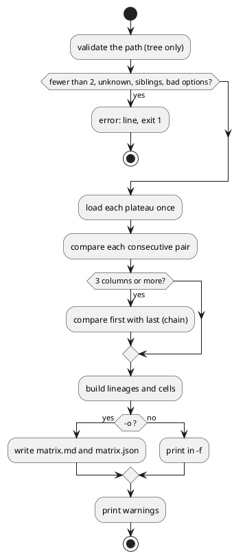

# Plateau matrix file — `archicode plateau matrix`, lineages by plateaus plus a Span

## Summary

This TDD has no PRD (profile `TDD+pln`; the scope arrives settled from the manifest row W-2 of wave 033, from issue #24 with the author's decision of 2026-10-31, and from the layout and record of run 0206). It designs one command, `archicode plateau matrix`, that reads the plateaus of one path of the tree and writes a table: a row per element lineage (followed through `replaces`), a column per plateau, and a Span column that is one `compare` of the first plateau with the last, with `chain`. The table is a text on standard output or the files `matrix.md` and `matrix.json` in a folder beside the views. A Java test pins it against `diff` per pair through `src/test/resources/brightcart/matrix-cases.json`. The page of the editor follows in a later wave and reads the same cases.

## Scope

In: the command and its refusals, the lineage rule, the three formats, `matrix-cases.json` and its tests, one `*IT`, the native-image reflection entries, the manual (the generated command reference and a short section), the guide golden, `src/main/java/io/morin/archicode/CLAUDE.md`, the model `docs/architecture/` and the sample built from it.

Out (wave Non-Goals, restated only where a decision touches them): no page, no relationships as rows, no transient row beyond what the rule yields, no kernel change, no change of `gap.json` or `gap.md`, no change of the output of an existing command on a shipped workspace.

## PRD Traceability

Traceability is **incomplete**: there is no PRD. The requirements are assumed from the sources below and named `R-n` here so that the plan can cite them.

| ID | Requirement (assumed, sourced) | Source |
|---|---|---|
| R-1 | Rows are lineages followed through `replaces`; columns are the plateaus of one path of the tree | wave Purpose, run 0206 Q1 |
| R-2 | A Span column is one `compare` of the first plateau with the last, with `chain` | run 0206 Q2, gate criterion 5 |
| R-3 | No row without a change, no relationships, no transient row | wave Non-Goals, #24 |
| R-4 | The command and file names are settled by this design, beside `gap.*`, `gap.json` untouched | wave Decision Prerequisites |
| R-5 | A path that holds two siblings of a forked tree is one `error:` line, exit 1 | gate criterion 6 |
| R-6 | `matrix-cases.json` is derived from `diff` per pair plus the span and read by a Java test; the Span counts equal `diff --plateau marketplace --against baseline` (+38 ~3 -6, 11 moved, 2 split, 1 merged) | gate criterion 5 |
| R-7 | The command is in the manual (`[[command-reference]]`), the native image (`reflect-config.json`) and the model of ArchiCode; one `*IT` runs it | gate criteria 4 to 7 |
| R-8 | `src/main/rust`, `src/main/wasm`, `src/test/resources/brightcart/expected` and the `gap.*` goldens are unchanged; `scripts/byte-identity.sh` green with no new exception | gate criteria 6, 7 |

Addressed: R-1 to R-8. Partially addressed: none. Unresolved: none.

## Technical Goals

- TG-1: one command writes the matrix of a path of plateaus with the machinery that exists (`PlateauComparer`, `Comparison`, `PlateauTree`), and nothing new in the kernel (R-1, R-2, R-4).
- TG-2: the file is a contract another reader (the page, an agent, CI) can read: stable order, stable bytes for the same input (R-6).
- TG-3: every cell agrees with `diff` for the same pair, and the Span with `diff` for the first and last plateau, proved by a test that runs both (R-6).
- TG-4: a mistake of the author is one `error:` line, exit 1, nothing written (R-5).

## Non-Goals

- A `--width`, a `--fail-on` or a filter for the matrix: the first reader is a file reader.
- Folding the cumulative state of the cells in code (the dominance rule of run 0206 is how a reader sees the agreement, not code).
- The editor reading `discovery` rules for the matrix files (see DEF-1).

## Assumptions

- ASM-1: `Comparison.getElements()` gives, for the target of a pair, every element with its `Change`, and for an element that replaces others the list `replaces` (as `ElementChange.replaces`). Validate: the first test prints it for `baseline`, `inhouse`, `marketplace`.
- ASM-2: the presence of a reference in a plateau is read from the loaded `Workspace` (the public fields `appIndex` and `techIndex`, each with its `elementByReferenceIndex`, as `PlateauComparer` reads them), because the union omits an element a later one replaced. Validate: `query graph` sizes of `src/test/resources/brightcart/expected/sizes.json` (50, 66, 82 elements) equal the count of references per plateau.
- ASM-3: the number of rows whose Span state is `new`, `changed`, `removed` or `moved` equals the counts of the comparison of the first with the last plateau (38, 3, 6, 11 on the layered Brightcart). `split` and `merged` counts of the kernel count the elements that replace (2 and 1); whether rows agree is to be seen by the first test. If they do not, the file states the counts of the comparison as they are (CTR-1 `span.counts`) and the test compares those with `diff`, not the rows. Validate: first red/green test of the plan.
- ASM-4: the layered Brightcart gives 88 rows (87 lineages, 88 with a split drawn on two rows), 61 with a change, on the path `baseline`, `inhouse`, `marketplace` (record T2 of run 0206, on a jar of 0.22.0-SNAPSHOT). Validate: the same test; the numbers in `matrix-cases.json` are written from the run, not from this sentence.

## Constraints

- CON-1: Java 25, Quarkus, Picocli; Lombok conventions (`@FieldDefaults`, `@RequiredArgsConstructor`); no `// NOPMD`; `./mvnw test-compile pmd:check` green.
- CON-2: a warning goes through the `Warnings` bean, a mistake is an `ArchiCodeException` (one `error:` line, exit 1, no stack trace); nothing uses `log.warn` for the user.
- CON-3: a new class that the application reads by reflection goes to `src/main/resources/META-INF/native-image/io.morin.archicode/archicode/reflect-config.json`; the pull request does not run the Native job, so the run says the native image was not proved.
- CON-4: the output of every existing command on a shipped workspace is unchanged (`scripts/byte-identity.sh` runs `plateau list` and `diff`, not the new command; the new command's name appears in `--help`, `golden.md` and the manual, which are not part of that harness).
- CON-5: the manual's generated block is regenerated with `ARCHICODE_MANUAL_REGENERATE=1 ... ./mvnw test -Dtest=CommandReferenceTest`; `src/test/resources/guide/golden.md` is regenerated with `archicode guide`.
- CON-6: W-1 (run 0224) is merged into the working tree already (it edited `cli/ArchiCode.java`, `reflect-config.json`, `README.adoc`, the CLAUDE.md files, `golden.md`, `HelpIT`, `docs/architecture/`): the run edits on top of it and does not revert its lines.

## Current State

- `cli/PlateauGroup` has two subcommands, `ListPlateausCommand` and `FoldCommand`. `cli/DiffCommand` compares one pair: it loads the target and the base with `WorkspaceFactory.create(path, null, plateauId)`, calls `new PlateauComparer(mapperFactory.createLazy(MapperFormat.JSON)).compare(base, target)`, passes the warnings of the comparison and `StateTags.warnings` to `Warnings`, and prints `GapReport.render`. `Against.of` resolves the plateau to compare with; `PlateauOption` is the `--plateau` mixin.
- `viewpoint/kernel/PlateauComparer.compare(base, target)` already decides `on_one_chain` (`PlateauTree.onOneChain`) and builds `chain` (`PlateauTree.standsOn`, `Workspace.getSteps()`), so a comparison several layers apart composes the `replaces` of the layers in between (kernel rule 8, cases `compose-replaces-cases.json`).
- `rendering/gap/GapReport` writes the table of a pair in `text`, `markdown` and `json` (`GapFormat`). `cli/GapFiles` writes `gap.md` and `gap.json` beside the views of a comparison, in `<views.path>-<plateau>-vs-<against>`.
- `workspace/ManifestDiscovery` leaves out, below a `/**` path, the folders of the generated views: `views.path` and the folders beside it whose name begins with it and a dash.
- The layered Brightcart (`src/test/resources/brightcart/layered`) has the tree `baseline`, `inhouse` and `saas` (both override `baseline`), `marketplace` over `inhouse`; `expected/comparisons.json` has the `diff` counts per pair; `LayeredFixtures` writes it for the unit tests and `Shipped.copy` for the `*IT`.
- No tool gives one element across three plateaus or more, a state over a whole span in one place, or a file with more than two plateaus (run 0206, T1).

## Proposed Design

A new command in the group `plateau`, a small pure model, a writer, and a test oracle.

```plantuml
@startuml
package "cli" {
  [PlateauGroup] --> [PlateauMatrixCommand]
  [PlateauMatrixCommand] --> [MatrixPath] : resolves the columns
}
package "workspace" {
  [WorkspaceFactory]
  [PlateauTree]
}
package "viewpoint.kernel" {
  [PlateauComparer]
  [Comparison]
}
package "rendering.matrix" {
  [PlateauMatrix] : lineages, cells, span
  [MatrixReport] : text, markdown, json
}
[PlateauMatrixCommand] --> [WorkspaceFactory] : one load per plateau
[PlateauMatrixCommand] --> [PlateauComparer] : N-1 pairs + 1 span
[PlateauMatrixCommand] --> [PlateauMatrix]
[PlateauMatrixCommand] --> [MatrixReport]
[MatrixPath] --> [PlateauTree]
[PlateauMatrix] ..> [Comparison] : reads
@enduml
```

The reviewer validates that the command is the only class that loads workspaces, that `PlateauMatrix` and `MatrixReport` are plain Java with no Picocli and no CDI (like `workspace/Fold`), and that nothing below `viewpoint/kernel` changes.

- DEC-1 — The command is `archicode plateau matrix`
  - Decision: `plateau matrix [PLATEAU_ID...] [--plateau ID] [-f text|markdown|json] [-o PATH]`, class `cli/PlateauMatrixCommand`, registered in `PlateauGroup.subcommands`. The rendering classes live in a new package `io.morin.archicode.rendering.matrix` (`PlateauMatrix`, `MatrixReport`), the path resolution in `cli/MatrixPath`.
  - Rationale: the matrix is a reading of the tree of plateaus, so it lives with `plateau list` and `plateau fold`, not with `diff`, which compares one pair and has `--plateau` and `--against` with a meaning the matrix does not share. It keeps `gap.json`, `gap.md`, `diff` and `views generate` untouched (R-4, CON-4). The likely paths of the manifest (`cli/PlateauGroup.java`, `cli/*Matrix*.java`, `rendering/**`) already name these places.
  - Alternatives considered: `diff --span` (rejected: grows an option set whose every option is about one pair, and risks a change of `diff` output); a writer inside `views generate` (rejected: it writes `gap.*` for one pair and the wave forbids a change of its output); `matrix` at the top level (rejected: `PlateauGroup` is the home of the commands of the tree).
  - Tradeoffs: one more subcommand in `--help`, the guide golden and the manual, which move in the same commit.
  - Linked PRD IDs: R-1, R-4, R-7, R-8.
- DEC-2 — The columns are a path of one chain, given or derived
  - Decision: with ids (`plateau matrix baseline inhouse marketplace`), the columns are those plateaus in that order; with none, the columns are `PlateauTree.chain(P)` from the root, `P` being `--plateau`, else `settings.current`, else the last plateau when the tree is one line (the rule of `PlateauOption`: a tree that forks needs `--plateau`, else the same one `error:` line as the other commands). Every listed plateau must exist, appear once, and be an ancestor of the next (`PlateauTree.onOneChain` and ancestry, in the order given); a plateau may be skipped (`baseline marketplace`), in which case the cell compares with the column on its left through `chain`. `--plateau` and ids together are a usage error of the command (one `error:` line). A path of fewer than two plateaus is one `error:` line.
  - Rationale: the ids express "a path that holds two siblings" (R-5) and refuse it; the derived path is the common ask and cannot hold siblings. Two siblings are two alternatives, not a history: the pair prints warnings and the kernel's `on_one_chain` is false (run 0206, Q4). No cell of the matrix compares siblings.
  - Alternatives considered: only `--plateau` (rejected: R-5 could not be asked and a path with a skipped plateau could not be read); "all plateaus of the tree" (rejected: a fork has no order).
  - Tradeoffs: a second way to choose the columns; the refusal sentence must name both siblings.
  - Linked PRD IDs: R-1, R-5.
- DEC-3 — A row is a lineage, built from the comparisons of consecutive columns
  - Decision: for each column `i`, the present references are those of the loaded plateau (ASM-2). For each pair `(i-1, i)` the predecessors of a node `(i, ref)` are: the references `replaces` of its `ElementChange` that are present in `i-1`; else `ref` itself when present in `i-1`; else none. A row is the backward trace from a **terminal node**, one that no node of the next column names as predecessor. A split origin (several successors) is therefore drawn in each of its results' rows, each row naming the same origin; a merge (several predecessors) is one row, the first cell listing the origins; an element new in column `i` starts its row there; an element absent from the next column (removed) ends it. The row is named by the reference of its terminal node, its `kind` and `name` are those in that node. Rows are sorted by layer (`application`, then `technology`), then by that reference by Unicode code point.
  - Rationale: a row by reference breaks as soon as an element is renamed (`commerce.search` and `discovery.search` are one element); a union-find would glue a split's results into one row (87 lineages, not 88). Using the comparison's own `replaces` keeps one reading of "moved" in both tools (R-1, TG-3), including the rule of `PlateauComparer` that leaves out of a layered target the `replaces` the base already says.
  - Alternatives considered: union-find by lineage (rejected: merges split results); rows by reference with a fold of the cells (rejected: wrong on `commerce.search` and `shop.web`, run 0206 Q1, Q2).
  - Tradeoffs: a split origin appears in several rows; the count of rows is not the count of distinct references.
  - Linked PRD IDs: R-1, R-3.
- DEC-4 — The state of a cell is the pair comparison's state; the Span is one comparison
  - Decision: for column `i > 0` the cell of a row is: `absent` when the row has no node in `i` and none in `i-1`; `removed` when it has a node in `i-1` and none in `i`; otherwise the `Change` word of the node in `i` from the comparison of `(i-1, i)` (`new`, `changed`, `moved`, `split`, `merged`, or `present` for `none`), with `from` (the `replaces` references) and `natures`. The first column is `present` or `absent`. The Span (only when the path has three plateaus or more; with two the Span is the step and is not drawn twice) comes from **one** `PlateauComparer.compare(first, last)` (so `chain` and `on_one_chain` are the existing ones) and is, for a row: the `Change` of its terminal node when that node is in the last column; `removed` when its first node is in the first column and the terminal node is not in the last; empty when neither (a transient). Never a fold of the cells.
  - Rationale: the sum of the cells is not the cumulative change (7 + 5 = 12 moved against 11, run 0206 Q2); the kernel already composes. Cost: N-1 + 1 compares, each plateau loaded once (a `diff` loads two plateaus per call, so the matrix loads fewer).
  - Alternatives considered: fold of the cells by dominance (rejected above); a second `chain` computed in Java (rejected: `PlateauComparer` does it).
  - Tradeoffs: the Span of a row whose terminal node is moved in two steps shows the natures of the whole way, which is what the user needs, not what the cell shows.
  - Linked PRD IDs: R-2, R-3, R-6.
- DEC-5 — No row without a change, no flag
  - Decision: a row is left out when none of its cells is `new`, `changed`, `removed`, `moved`, `split` or `merged` and its Span is empty or `none`; the file says how many were left out (`unchanged`).
  - Rationale: R-3; run 0206 showed 61 rows with a change among 88. A flag would be a second contract to test.
  - Alternatives considered: `--all` (rejected, lean); a row for each element of the workspace (rejected: it is `query graph`).
  - Tradeoffs: a reader cannot see the unchanged elements; the count is there.
  - Linked PRD IDs: R-3.
- DEC-6 — Standard output by default, the files in a folder beside the views with `-o`
  - Decision: without `-o` the matrix is printed in `-f` (default `text`; `markdown` and `json` as `diff`, `GapFormat`). With `-o PATH` (relative to the folder of the workspace file, or absolute, as `views generate -o`) the command writes `matrix.md` and `matrix.json` in `PATH-matrix-<first>-to-<last>` (default `PATH` is `settings.views.path`), prints one line `wrote <folder>` and the two files hold the same text as `-f markdown` and `-f json`. `-f` with `-o` is one `error:` line. A folder that exists is written over, file by file (the files are the command's own names), nothing else in it is touched.
  - Rationale: the name `matrix.*` sits beside `gap.*`; the folder begins with `views.path` and a dash, so `ManifestDiscovery` already leaves it out below a `/**` path, which matters because `matrix.json` would otherwise be read as a manifest. The folder name is not `<views.path>-<last>-matrix`, which would collide with a facet named `matrix` (`views-<plateau>-<facet>`); `-matrix-` has the same theoretical collision as `-vs-` and is accepted for the same reason.
  - Alternatives considered: extend `ManifestDiscovery.holdsComparison` to `matrix.json` and `matrix.md` (rejected for now: the rule is shared with the page and pinned by `discovery-cases.json`, so it needs the editor build; see DEF-1); always write files (rejected: a pipe to an agent is simpler).
  - Tradeoffs: a `-o` that points outside the `views` family and below a `/**` path would make `matrix.json` read as a manifest on the next load; the manual says so (DEF-1).
  - Linked PRD IDs: R-4, R-7.
- DEC-7 — The oracle is `matrix-cases.json`, cross-checked live against `diff`
  - Decision: `src/test/resources/brightcart/matrix-cases.json` holds, per case (the path `baseline inhouse marketplace` with its Span, the path `baseline saas` with no Span, the skip `baseline marketplace`, and the refusals), the columns, the number of rows, the number left out, the counts of each pair and of the Span as `diff -f json` prints them, and a list of expected rows (the lineages of run 0206: `discovery.search`, `storefront.web`, `orders.history`, `orders.placement`, `accounts.profiles`, `commerce.cart`, `shop.app`). The Java test `PlateauMatrixCasesTest` runs the command in process (`CliHarness`), compares with the file, and **also** runs `diff -f json` for each pair and checks that every cell of every row of the output equals the state `diff` gives the element of that plateau and that the Span counts are the counts of `diff` for the first and last plateau.
  - Rationale: the cases file is the contract the page reads later; the live cross-check keeps the file from being a snapshot of the implementation (R-6, TG-3). Same pattern as `compose-replaces-cases.json` and `expected/comparisons.json` (`verified: archicode diff`).
  - Alternatives considered: a golden file only (rejected: pins bytes, proves nothing about `diff`); a node reader now (rejected: no page this wave, no kernel change).
  - Tradeoffs: the case file is written once from the run and reviewed by eye; ASM-3 may leave `split` and `merged` row counts out of the cross-check.
  - Linked PRD IDs: R-6.

## Repository Impact

- IMP-1 — The command
  - Path(s): `src/main/java/io/morin/archicode/cli/PlateauMatrixCommand.java`, `cli/MatrixPath.java`, `cli/PlateauGroup.java`
  - Change type: additive (new classes), modify (one line in `subcommands`)
  - Why impacted: DEC-1, DEC-2, DEC-6.
  - Linked PRD IDs: R-1, R-4, R-5
  - Risks / notes: `ArchiCode.java` is not touched (the group exists); W-1 changed it already.
- IMP-2 — The model and the writer
  - Path(s): `src/main/java/io/morin/archicode/rendering/matrix/PlateauMatrix.java`, `MatrixReport.java`
  - Change type: additive
  - Why impacted: DEC-3, DEC-4, DEC-5; CTR-1.
  - Linked PRD IDs: R-1, R-2, R-3
  - Risks / notes: plain Java, records for the rows and cells; sorted maps only, so the same bytes for the same input.
- IMP-3 — Native image
  - Path(s): `src/main/resources/META-INF/native-image/io.morin.archicode/archicode/reflect-config.json`
  - Change type: modify (entries for `PlateauMatrixCommand` and the records serialised by Jackson, if any; the JSON is built with `ObjectNode` like `GapReport`, so only the command is expected)
  - Why impacted: CON-3.
  - Linked PRD IDs: R-7
  - Risks / notes: not proved by the pull request's CI; the run says so.
- IMP-4 — Tests
  - Path(s): `src/test/java/io/morin/archicode/rendering/matrix/PlateauMatrixTest.java` (lineage rule on small hand-made comparisons: a move in two steps, a split, a merge, a transient, a removal), `.../cli/PlateauMatrixCasesTest.java`, `.../cli/PlateauMatrixCommandTest.java` (refusals, the writing of the files, a reload of the workspace with the folder in place), `src/test/java/io/morin/archicode/it/PlateauMatrixIT.java`, `src/test/resources/brightcart/matrix-cases.json`, `src/test/java/io/morin/archicode/it/HelpIT.java` (the new line)
  - Change type: additive, modify (`HelpIT`)
  - Why impacted: TG-3, TG-4, DEC-7; the `*IT` runs the packaged application on a copy of the layered Brightcart.
  - Linked PRD IDs: R-5, R-6, R-7
  - Risks / notes: `MistakeSweepTest` and the manifest corpus load shipped workspaces; the new files are no workspace, so they are not added to them. The coverage floor of `jacoco:check` (0.90) holds for the new package: no dead branch.
- IMP-5 — Guide, manual, rules
  - Path(s): `src/test/resources/guide/golden.md`, `src/doc/README.adoc` (generated command reference and a section `[[plateau-matrix]]` next to `[[plateau-fold]]`), `src/main/java/io/morin/archicode/CLAUDE.md` (a short paragraph in the plateau part of the rules), `src/main/java/io/morin/archicode/workspace/CLAUDE.md` (one line under "Comparing plateaus")
  - Change type: modify
  - Why impacted: CON-5; a command that changes `archicode guide` changes the golden file in the same commit.
  - Linked PRD IDs: R-7
  - Risks / notes: W-1 edited the same files: take the lines it left.
- IMP-6 — The model of ArchiCode
  - Path(s): `docs/architecture/manifests/archicode.yaml`, `src/main/resources/editor-webapp/samples/archicode.yaml` (built), `src/test/javascript/architecture/impact-questions.json` (only if an answer changes)
  - Change type: modify
  - Why impacted: Canonical Impact CI-arc-1; `npm run sample:build` must leave `git status --short` unchanged.
  - Linked PRD IDs: R-7
  - Risks / notes: `ArchitectureDriftTest` fails on a `tags.path` that does not exist.

## Canonical Impact

- CI-arc-1 — structure changed: the repository declares no `arc` register in `docs/CLAUDE.md` (the file does not exist); the model of ArchiCode is `docs/architecture/` (see `CLAUDE.md` at the root). Elements to add there: a component `plateau_matrix` in the container `commands` (`tags.path`: `src/main/java/io/morin/archicode/cli/PlateauMatrixCommand.java, src/main/java/io/morin/archicode/cli/MatrixPath.java`) with `calls` towards `archicode.commandline.viewpoint` (`PlateauComparer`), `archicode.commandline.workspace` (`WorkspaceFactory`, `PlateauTree` through `resource`) and `archicode.commandline.rendering` (the new package, whose description, "PlateauMatrix and MatrixReport", gains `matrix`). Verified by inspection and by `ArchitectureDriftTest`.
- CI-dom-1 — None: no `dom` register is declared.

## Data Model and Contracts

- CTR-1 — `matrix.json` and `matrix-cases.json`
  - Current contract: none. `gap.json` is a table of one pair and is not changed.
  - Proposed contract: `matrix.json` is `{ "path": [plateau ids], "columns": [{ "plateau", "name", "horizon" }], "span": null | { "from", "to", "counts": { "elements": { "new", "changed", "removed", "moved", "split", "merged" }, "relationships": { "new", "changed", "removed" } } }, "rows": [{ "layer", "reference", "kind", "name", "cells": [{ "plateau", "state", "reference", "from": [refs], "natures": [words] }], "span": null | { "state", "from": [refs], "natures": [words] } }], "unchanged": n }`. `state` is one of `absent`, `present`, `new`, `changed`, `removed`, `moved`, `split`, `merged`. `reference` of a cell is the reference of the row's node in that plateau (absent for `absent`), so a renamed element tells its old and new names. `span.counts` is the `Comparison.getCounts()` of the first and last plateau as `GapReport` writes them for `diff`. Keys are in this order, lists are sorted as DEC-3 says, the JSON is indented as `GapReport.json` indents. `matrix.md` is the same table in Markdown, with the counts of each pair under the header; the text format is the same table aligned as `plateau list` aligns its own. `matrix-cases.json` is `{ "cases": [{ "id", "args", "path", "rows": n, "unchanged": n, "pairs": [{ "from", "to", "counts": {...} }], "span": {...}|null, "expectRows": [{ "reference", "cells": [state...], "span": state }] }], "refusals": [{ "id", "args", "error": "..." }] }`.
  - Affected files: `rendering/matrix/MatrixReport.java`, `src/test/resources/brightcart/matrix-cases.json`, the tests.
  - Migration or compatibility notes: additive; a future reader of `matrix.json` is the page, and this file is its contract. A field added later is additive; a state word is the kernel's seven plus `absent` and `present`.
  - Linked PRD IDs: R-1, R-2, R-6
- CTR-2 — The command line
  - Current contract: `plateau` has `list` and `fold`.
  - Proposed contract: `plateau matrix` as in DEC-1, DEC-2, DEC-6; exit codes 0 and 1 (2 for a usage error, as everywhere); no `--fail-on`.
  - Affected files: `PlateauGroup`, the command reference of the manual, `golden.md`, `HelpIT`.
  - Migration or compatibility notes: `--help` of `plateau` and of the top command move in the same commit (`CommandReferenceTest`, `HelpIT`, `GuideTest`).
  - Linked PRD IDs: R-4, R-7

## Interfaces and Behavior

- IF-1 — `archicode plateau matrix [PLATEAU_ID...]`: input a workspace (`-w`), ids or `--plateau`; output the table on standard output or, with `-o`, `matrix.md` and `matrix.json` in a folder. The warnings of each pair (`Comparison.getWarnings()`) and `StateTags.warnings` go through `Warnings` and are printed as `warning:` when the command ends, as `diff` does. Standard output holds the table only.
- IF-2 — Errors, each one `error:` line, exit 1, nothing written, told before the first comparison:
  - a workspace with no plateau: the sentence of `diff` ("the workspace declares no plateau: ...");
  - fewer than two plateaus (`--plateau baseline`, one id): ``the matrix needs a path of at least two plateaus: `baseline` is the root and nothing is before it``;
  - an unknown id: the sentence `PlateauTree.node` already gives;
  - a plateau twice, or an id that does not override the previous one: ``the plateaus `inhouse` and `saas` are not on one chain: `saas` is not a plateau that overrides `inhouse` (they are alternatives, both override `baseline`). Name the plateaus of one path, oldest first``;
  - `--plateau` with ids, `-f` with `-o`: one sentence each;
  - a tree that forks with neither ids nor `--plateau`: the existing sentence.
- IF-3 — Text format: a header (`matrix of baseline, inhouse, marketplace`, the counts of each pair as `diff` words), then the table with a column per plateau and `SPAN`; a cell reads `-` (absent), `=` (present), `new`, `changed`, `removed`, `moved from a`, `split from a`, `merged from a, b`; a line `N rows without a change are left out`.

## Flows and Processing Logic

- FLOW-1 — `plateau matrix baseline inhouse marketplace`
  - Trigger: the command.
  - Steps: (1) parse and validate the path against the tree (`MatrixPath`, no load); (2) load each plateau once with `WorkspaceFactory.create(path, null, id)`; (3) `PlateauComparer.compare(column[i-1], column[i])` for each pair; (4) when three columns or more, `compare(first, last)`; (5) `PlateauMatrix.of(columns, pairs, span)` builds nodes, predecessors, rows, cells and Span; (6) `MatrixReport.render` in the format, or writes the two files; (7) `Warnings`.
  - Branches / failure paths: a refusal of step 1 prints one `error:` and stops; the kernel's refusal of a plateau (a dangling reference) is the `ArchiCodeException` that `diff` already raises; a failure to write a file is the file-system sentence of `ErrorOutput`, the files are written after the whole text is built, `matrix.md` first.
  - Final output / rendered result: a table of lineages.
  - Linked PRD IDs: R-1, R-2, R-5



The reviewer validates that nothing is loaded or compared before the path is valid and that the Span comparison is the only extra `compare`.

## Reliability, Performance, and Scalability

- One `diff` through the jar on the Brightcart is about 1.2 s (run 0206, measured); the matrix of three plateaus loads three and compares three pairs: the same order, not measured here. No browser cost in this wave.
- Determinism: sorted maps, no clock, no absolute path in the output; `PlateauMatrixCasesTest` runs the command twice and compares bytes.
- Testability: `PlateauMatrix` takes data (presence sets, `Comparison` objects), so the lineage rule has unit tests with no Quarkus.

## Security and Privacy

Not materially affected: the command reads the workspace and writes at most two files in a folder it names with `-o`; a path with `..` is the user's own choice, as for `views generate -o`.

## Observability and Verification

- `./mvnw test-compile pmd:check`; `./mvnw verify -DskipITs=false` (unit tests, `PlateauMatrixIT` on the packaged application); `./mvnw test -Dtest=CommandReferenceTest` after regenerating the manual block; `./mvnw test -Dtest=GuideTest` after regenerating `golden.md`.
- `PlateauMatrixCasesTest` (the oracle, DEC-7); `PlateauMatrixTest` (the rule); `PlateauMatrixCommandTest` (refusals with `LayeredFixtures`: `inhouse saas`, `saas inhouse marketplace`, an unknown id, one plateau, a forked tree with no `--plateau`; the files; reload with the folder in a `/**` workspace exits 0).
- Gate checks, as the wave states them: `git diff --stat -- src/main/rust src/main/wasm src/test/resources/brightcart/expected` prints nothing; `scripts/byte-identity.sh` exits 0 with `scripts/byte-identity-exceptions.txt` unchanged; `npm run sample:build` and `npm run editor:build` leave `git status --short` unchanged after the model is edited; `npm run test:unit`, `npm run format:check` and `npm run lint`.
- Not proved by CI on the branch: the native image (the Native job runs on main or a tag); the run says so.

## Deployment and Rollout

Code-only, additive, in the pull request of wave 033. No staging. Backward compatibility: no existing output changes. Rollback: revert the commit of the run; `plateau list` and `plateau fold` are untouched.

## Risks and Tradeoffs

- RISK-1: the Span of a row and the counts of the kernel may not agree for `split` and `merged` (ASM-3). Mitigation: `span.counts` is the kernel's, the cross-check compares counts to `diff`, and the row-level check covers `new`, `changed`, `removed`, `moved`.
- RISK-2: the lineage rule on an inherited element: `PlateauComparer` hides a `replaces` the base already writes, so a node may look like "present, unchanged" where a reader expects `moved`. Mitigation: the rule reads the comparison, which is the same one `diff` prints, and the cross-check proves it on every cell.
- RISK-3: `matrix.json` read as a manifest when `-o` points to a folder outside the views family and below a `/**` path (DEC-6, DEF-1). Mitigation: the manual says it; the default is safe, with a test.
- RISK-4: edits on top of W-1's uncommitted lines in shared files (CON-6). Mitigation: edit by anchors, run `git diff` on each shared file before and after.
- RISK-5: the cost of one load per plateau on a large workspace; accepted, equal to `diff`.

## Open Questions

None open. Resolved inline:

- Q-1 (resolved, DEC-6): the folder name and the default output. Chosen: `<views.path>-matrix-<first>-to-<last>`; the discovery rule needs no change.
- Q-2 (resolved, DEC-2): a skipped plateau is allowed; the pair is compared through `chain`.
- Q-3 (resolved, DEC-4): with two plateaus there is no Span column.
- Q-4 (assumption, ASM-3): the agreement of row counts with the kernel's `split` and `merged` counts is checked by the first test; it changes the test, not the design.

## Deferred Work

- DEF-1: extend `ManifestDiscovery.holdsComparison` (and `holdsComparisonFiles` in the page, `discovery-cases.json`) so that a folder holding `matrix.json` and `matrix.md` is left out wherever `-o` put it; needs the editor build.
- DEF-2: the page of the editor that reads `matrix-cases.json` (the author's second run on #24), with the transient row, relationships in a second block, and the address keys.
- DEF-3: `--width` and `--fail-on` for the matrix, if CI wants them.
- DEF-4: wrapping the text table for a path of more than three plateaus.

## File Placement and Frontmatter

This file: `docs/wav/wav-033-import-structurizr-and-plateau-matrix/run/run-0225-plateau-matrix-file/tdd-0225-plateau-matrix-file.md`, frontmatter `type: tdd`, `run: 0225`, `wave: 033`, `status: draft`. The pln follows as `pln-0225-plateau-matrix-file.md` in the same folder.

Review pass: dispatched. The Stage 5 KDML review ran in a leaf agent with a fresh context (no Agent tool, so the review was done by that agent itself), independent of the drafter because it is a different agent from the one that wrote this TDD in Stage 4. Referent read: `cli/{PlateauGroup,DiffCommand,Against,GapFiles,GenerateViewsCommand}`, `workspace/{Workspace,WorkspaceFactory}`, `resource/plateau/PlateauTree`, `viewpoint/kernel/{PlateauComparer,Comparison}`, `rendering/gap/GapReport`, `manifest/ManifestDiscovery`, `NativeReflectionConfigTest`, the Brightcart test helpers, `expected/comparisons.json`, run 0206. Verdict: KISS 4, DRY 3, MECE 3, LEAN 4, LUCID 4, C 3 (overall: acceptable, revision needed); the findings are returned to the main agent, which applies them.
