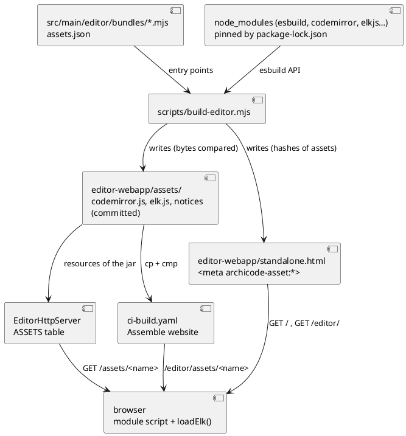
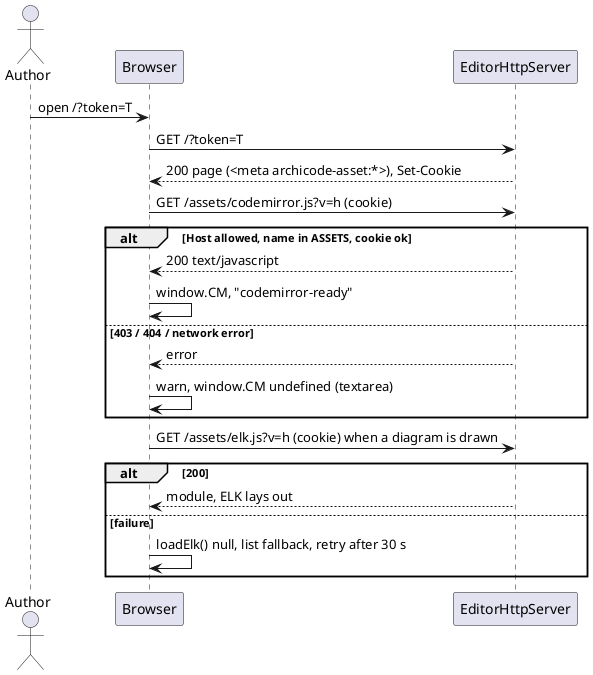

# Editor assets beside the page — CodeMirror and ELK bundled into committed files, served by the editor server and the website

## Summary

This TDD has no PRD (profile `TDD+pln`; the scope arrives settled from the manifest row W-2 of wave 034, its gates 1 to 3 and 5 to 8 of P2, and from issue #207 as decided on 2026-11-06). Today the editor page imports CodeMirror (five `import()` in `src/main/editor/codemirror-loader.mjs`) and ELK (one in `src/main/editor/model/kernel-bridge.js`) from `https://esm.sh` when it opens; offline, the YAML falls back to a textarea and the diagrams to a plain list. The design: a pinned bundler (esbuild) turns the two entry files `src/main/editor/bundles/codemirror.mjs` and `elk.mjs` into the ES modules `src/main/resources/editor-webapp/assets/codemirror.js` and `elk.js`, written by `scripts/build-editor.mjs`, committed, and compared by `npm run editor:check`. The page loads them with `import("./assets/<name>?v=<8 hex>")`, the hash written into `<meta>` tags at build time. `EditorHttpServer` serves them from a table `ASSETS`, the step "Assemble website" copies and compares them, and an end-to-end spec proves the editor draws a diagram and edits YAML in CodeMirror with every host but `127.0.0.1` blocked. The kernel (base64 in the page) is W-3: this run leaves it where it is.

## Scope

In: `package.json` and the lock (esbuild and the libraries, exact versions), the bundle entries and `assets.json`, `scripts/build-editor.mjs` (build, write, check), the `<meta>` hashes and the loaders in `codemirror-loader.mjs` and `kernel-bridge.js`, the two committed assets and their notice file, the `ASSETS` table and its Java and IT tests, the rule of `scripts/changes.mjs`, the step "Assemble website", a guard test against a remote `import(`, the e2e spec and the hosted route table of `src/test/e2e/harness.js`, the model `docs/architecture/` and its sample, and the sentences that say how the page is built or loaded (manual, `README.md`, the `CLAUDE.md` files, `embed.sh` comment).

Out: the kernel `.wasm` beside the page and the base64 block's removal (W-3), a Maven build of the page or the kernel (#207 road after this wave), a change of what the editor does with CodeMirror or ELK (same calls, same fallbacks), a change to any command line output.

## PRD Traceability

Traceability is **incomplete**: there is no PRD. The requirements are assumed from the sources below and named `R-n` so that the plan can cite them.

| ID | Requirement (assumed, sourced) | Source |
|---|---|---|
| R-1 | CodeMirror and ELK are bundled by a pinned bundler into files committed beside the page, not inlined in it | #207 decision; wave Purpose; manifest row W-2 |
| R-2 | Neither `src/main/editor` nor `standalone.html` has an `import(` of an `http(s)` address | gate 1 of P2 |
| R-3 | `esbuild` and `codemirror`, `@codemirror/lang-yaml`, `@codemirror/lang-json`, `@codemirror/language`, `@lezer/highlight`, `elkjs` are in `package.json` and the lock; `npm ci` exits 0 | gate 2 |
| R-4 | `codemirror.js` and `elk.js` are ES modules in `src/main/resources/editor-webapp/assets/`, built by `build-editor.mjs`, committed, rebuilt and compared by `editor:check` | gate 3 (the `.wasm` of that gate is W-3) |
| R-5 | The page loads them by `import("./assets/…?v=<8 hex of the SHA-256>")`; the fallbacks (textarea, plain list) are unchanged | manifest row W-2 |
| R-6 | `EditorHttpServer` has a table `ASSETS`: exact names, token or session cookie, `Host` check, 404 for any other name, the right type; `EditorHttpServerTest` and `EditorServeIT` pass | gate 5 (the `.wasm` entry and `application/wasm` are W-3) |
| R-7 | `scripts/changes.mjs` has a rule for the new folder | manifest row W-2 |
| R-8 | "Assemble website" copies the folder `assets` to the editor folder of the site and compares each file with `cmp` | gate 7 |
| R-9 | A test fails if the sources or the page name a remote `import(` | manifest row W-2 |
| R-10 | An end-to-end spec starts the editor with every host but `127.0.0.1` blocked, draws a diagram and edits YAML in CodeMirror, on Chromium and Firefox | gate 6 |
| R-11 | The manual and the editor `CLAUDE.md` say that building the page needs `npm ci` | manifest row W-2 |
| R-12 | `npm run test:unit`, `test:coverage`, `format:check`, `lint` and `./mvnw verify -DskipITs=false` exit 0; `scripts/byte-identity.sh` exits 0 with its exceptions file unchanged; `ratchet.max` at most 99; `editor:build` and `sample:build` leave `git status --short` unchanged | gate 8 |
| R-13 | The run reports the sizes and the load time before and after | wave Risks |

Addressed: R-1 to R-13. Partially addressed: R-4 and R-6 (the `.wasm` halves belong to W-3, see DEC-7). Unresolved: none.

## Technical Goals

- TG-1: nothing the editor needs to draw a diagram or edit YAML comes from a server that is not the one that served the page (R-1, R-2, R-10).
- TG-2: the committed assets are exactly what the pinned inputs build, on a clean checkout, proved by `editor:check` and by CI (R-4).
- TG-3: the page, the editor server and the website agree on one address layout, `assets/<name>`, relative to the page (R-5, R-6, R-8).
- TG-4: a failure to load an asset is the fallback that exists today, with a console warning, never a blank page (R-5).
- TG-5: the website step is as proved as it can be before a tag (R-8, see FLOW-4).

## Non-Goals

- A content hash in the file name (`codemirror.<hash>.js`): the `?v=` query and a table of exact names are what the wave decided.
- Code splitting, a service worker, or loading CodeMirror only when a YAML file is opened: the loader still fires at page start, as today.
- Upgrading `elkjs` (kept at 0.9.3, the version the page loads today) or `codemirror` (6.0.1).
- Linting the bundle entries with ESLint (Prettier covers them through the glob of `src/main/editor`).

## Assumptions

- ASM-1: esbuild 0.28.2 gives the same bytes for the same inputs on every machine. Validated here: two builds in one folder and one build in another folder, after `npm ci`, were identical (`cmp`). Not validated: macOS or Windows. The first pull request run of the job `Page` (Linux) is the proof that matters; the run says macOS is unproved.
- ASM-2: `npm install` of the six libraries at the versions of DEC-2 gives one copy of `@codemirror/state` (6.7.6) and of `@codemirror/view` (6.43.15) and one of `@lezer/common`; two copies are what crashed CodeMirror in the jsdelivr attempt that `page.html` records. Validated by `npm ls`; the run adds a guard (see Observability).
- ASM-3: `elkjs/lib/elk.bundled.js` (CommonJS, inline worker stub) bundles to an ES module whose default export is the `ELK` class and lays out a graph in a page and in Node. Validated in Node: `new elk.default().layout(...)` returned positions. Not validated in a browser: the e2e spec is that.
- ASM-4: a dynamic `import()` in an inline classic script resolves a `./assets/…` specifier against the document URL, so it is `/assets/…` under `editor serve` and `/editor/assets/…` on the website (as the relative `samples/…` fetch does today). Validated by the hosted-style harness and, for the website, only by a tag run (FLOW-4 rehearses it).
- ASM-5: the module request of `import()` carries the `archicode-session` cookie (same-origin credentials), so the token-or-cookie rule of the samples works for assets. Validated by `EditorServeIT` plus the e2e spec, which load the page with the token, drop it from the address and reload.
- ASM-6: size of the bundles with esbuild `--minify` for chrome111, firefox121, safari16.2: `codemirror.js` about 430 KB (140 KB gzip), `elk.js` about 1.46 MB (440 KB gzip). The numbers in this TDD were measured on a scratch build; the run reports the committed ones.

## Constraints

- CON-1: `src/main/resources/editor-webapp/standalone.html` stays at that path and generated by `scripts/build-editor.mjs`; the parts under the six layer folders are still the only parts (`layers.json` is not changed, `ratchet.max` stays at most 99).
- CON-2: Maven needs neither Node nor Rust: the assets are committed, and the jar takes them from `src/main/resources` (the native include `editor-webapp/**` already covers a new folder).
- CON-3: the editor works with no network at all and with external hosts blocked (R-10); the fallbacks stay for a failed asset.
- CON-4: no output of an existing command changes; `scripts/byte-identity.sh` runs unchanged with no new exception.
- CON-5: `page.html` directive lines are exactly one `<!--@name args-->`; every shipped line the build writes is LF, UTF-8, ends with a newline (the committed assets are written as built, which ends with a newline, `build-editor` adds none).
- CON-6: the website step runs only on a tag (`Build`, "Assemble website"); a pull request proves nothing of it.
- CON-7: the `.wasm` is not touched here: `embed.sh`, the base64 block, the `@wasm` directive and `harness.js` read of it stay as they are (W-3).
- CON-8: the browser floor is Chromium 111, Firefox 121, Safari 16.2 (`src/main/editor/CLAUDE.md`, `browser-apis.test.js`); the bundles are built for it.
- CON-9: no `// NOPMD` and no `@SuppressWarnings("PMD…")`; Java changes keep `./mvnw test-compile pmd:check` green.

## Current State

- `src/main/editor/codemirror-loader.mjs` is the body of the one `<script type="module">` of `page.html`: five `await import('https://esm.sh/…')` (`codemirror@6.0.1`, `@codemirror/lang-yaml@6.1.1`, `@codemirror/lang-json@6.0.1`, `@codemirror/language@6`, `@lezer/highlight@1`), sets `window.CM = { EditorView, basicSetup, yaml, json }` (+ `darkHighlight` in an inner try), fires `codemirror-ready`, and leaves `window.CM` undefined on failure; `mountFileEditorIfNeeded()` (`presentation/element-view.js`) and the file view feature-detect it.
- `src/main/editor/model/kernel-bridge.js` `loadElk()` does `import('https://esm.sh/elkjs@0.9.3/lib/elk.bundled.js')`, `new mod.default()`, and on a failure warns, returns `null` and retries at most once per 30 s; `presentation/diagram-page.js` draws `renderDiagramFallbackHtml` (a list) when ELK is `null`.
- `scripts/build-editor.mjs` has no dependency: `assemble(root)` replaces `@include`, `@parts` and `@wasm` lines; modes write, `--check`, `--check-identical`, `--where`, `--map`, `--root`. `npm run editor:build`, `prelint`, `pretest:unit` and `pretest:coverage` call it; `editor:check` is `build-editor.mjs --check && check-editor.mjs --layers`. `embed.sh` (write mode) also calls it.
- `package.json` has no bundler and no editor library (dev dependencies: eslint, acorn, playwright, globals; dependencies: prettier). `npm ci` is already the first step of the job `Page`, which runs `editor:check`.
- `EditorHttpServer` has contexts `/` (the page), `/api/fs/` and `/samples/`; `SAMPLES` is a `Map<String,String>` of two exact names to resource paths; `handleSample` does the `Host` check, 404 for an unknown name, 405 for a non-GET, 403 without the token header or the session cookie, then writes `text/yaml` with `Cache-Control: no-store` and `nosniff`. `EditorHttpServerTest` (sample cases at line 449 and after) and `EditorServeIT` cover it.
- `ci-build.yaml` "Assemble website" (job `Build`, tag only) writes `target/site/editor/index.html` (stamped) and copies `samples/` with `test -f` and `cmp` per file.
- `src/test/e2e/harness.js` `startHostedPage()` is a Node server with a fixed `HOSTED_ROUTES` map (`/`, `/editor/`, `/editor/samples/brightcart.yaml`) and 404 for the rest; `fixtures.js` fails any test whose page says `console.error`.
- `scripts/changes.mjs` rule R-07 sends `src/main/resources/**` to all four jobs; R-16 sends `package.json` and the lock to `page` and `e2e`.
- The manual (`src/doc/README.adoc` line 1881) says the editor loads `elkjs` and CodeMirror from a CDN; `README.md` line 87 and the manual line 1864 say the page is a single file.

## Proposed Design

One build, three consumers. `build-editor.mjs` reads `src/main/editor/assets.json` (the list of assets), builds each entry with the esbuild API in memory, writes the files to `src/main/resources/editor-webapp/assets/` when their bytes differ, and then assembles the page, in which a new directive `<!--@assets-->` becomes one `<meta name="archicode-asset:<name>" content="./assets/<name>?v=<8 hex>">` per asset. The two loaders read their address from the `<meta>`. The server serves the files from a table; the website step copies the folder.

Reviewer: check that the page learns the hash from the files on disk (not from the build in memory), so that `--where`, `--map` and `mapOf` need no esbuild; that the server and the site publish the same two names; and that nothing points from the browser to a host outside the three arrows into it.

**DEC-1 — esbuild API from `build-editor.mjs`, assets listed in `assets.json`**
- Decision: `scripts/build-editor.mjs` gets a step that, when `src/main/editor/assets.json` exists, imports `esbuild` lazily (`await import('esbuild')`) and builds each listed entry with `bundle: true, format: 'esm', platform: 'browser', target: ['chrome111','firefox121','safari16.2'], minify: true, legalComments: 'none', charset: 'utf8', write: false, logLevel: 'silent'` and a one-line `banner` naming the entry and the script. The file `assets.json` is `{ "assets": [ { "name": "codemirror.js", "entry": "bundles/codemirror.mjs" }, { "name": "elk.js", "entry": "bundles/elk.mjs" } ] }`. Without the file, nothing changes (the temporary trees of `build-editor.test.js` have none). A page with `<!--@assets-->` and no `assets.json`, or the reverse, is an error. A missing `esbuild` is the one line `error: esbuild is not installed: run npm ci`.
- Rationale: the wave says the files are built by `build-editor.mjs`, committed, and compared by `editor:check`; one script and one `--check` keep the "page is the assembly" rule whole, and the API with `write: false` returns bytes to compare without a shell or a temporary folder.
- Alternatives considered: an `npm run assets:build` script beside `editor:build` (two commands to forget, and the page's hash would depend on a file the other command writes); a vendored copy of the libraries' own dist files without a bundler (no ES module for ELK, five files, the dedupe problem returns); inlining the bundles in the page (the author prefers a lean `standalone.html`).
- Tradeoffs: `editor:build` and so `prelint`, `pretest:unit` and `pretest:coverage` now need `npm ci` (they already do for `editor:check`, ESLint and the tests that use `acorn`); `embed.sh` write mode calls the same script, so its "no npm install" comment is no longer true.
- Linked PRD IDs: R-1, R-3, R-4, R-11.

**DEC-2 — pins**
- Decision: all in `devDependencies`, exact versions, and the lock committed: `esbuild` 0.28.2, `codemirror` 6.0.1, `@codemirror/lang-yaml` 6.1.1, `@codemirror/lang-json` 6.0.1, `@codemirror/language` 6.13.1, `@lezer/highlight` 1.2.5, `elkjs` 0.9.3. These are the versions the page asks of esm.sh today (`@6` and `@1` resolved to the latest of their line). They are build inputs: nothing from `node_modules` ships.
- Rationale: same code as today, so the e2e and node suites judge a change of delivery, not of library; exact pins like the other dev dependencies.
- Alternatives considered: newest of each (a library upgrade hidden in a delivery change); `dependencies` (they would count as runtime dependencies of a package that is `private`).
- Tradeoffs: the libraries are not upgraded by this run; DEF-2.
- Linked PRD IDs: R-3.

**DEC-3 — two entry files, one export surface each**
- Decision: `src/main/editor/bundles/codemirror.mjs` re-exports `EditorView` and `basicSetup` from `codemirror`, `yaml` from `@codemirror/lang-yaml`, `json` from `@codemirror/lang-json`, `HighlightStyle` and `syntaxHighlighting` from `@codemirror/language`, `tags` from `@lezer/highlight`; `bundles/elk.mjs` is `export { default } from 'elkjs/lib/elk.bundled.js'`. `codemirror-loader.mjs` imports `codemirror.js` once and builds `window.CM` and the dark highlighting from it, with the colours and the inner try/catch unchanged.
- Rationale: one bundle gives one copy of `@codemirror/state` and `view` by construction (the single module graph the esm.sh choice was after) and one request; ELK stays a separate file because it is 1.46 MB and loaded only when a diagram is drawn (`loadElk()` is lazy today).
- Alternatives considered: one file for both (ELK loaded at start for a page that may never draw); five files like the five `import()` (five requests, a state shared by the module graph only if the bundler dedupes anyway).
- Tradeoffs: `bundles/` is a new folder of `src/main/editor` that is not a layer, so `partsOnDisk` (which walks the layer folders only) does not see it; the Prettier glob does.
- Linked PRD IDs: R-1, R-4, R-5.

**DEC-4 — the address in a `<meta>` written by the build**
- Decision: a directive `<!--@assets-->` in `page.html` (in `<head>`, after the `archicode-version` meta) is replaced by `<meta name="archicode-asset:codemirror.js" content="./assets/codemirror.js?v=1a2b3c4d">` and the same for `elk.js`, where `1a2b3c4d` is the first 8 hex of the SHA-256 of the file as committed on disk. The module loader and `loadElk()` read the `<meta>`, resolve it with `new URL(content, document.baseURI).href`, and `import()` the result. A new top-level function `assetAddress(name)` in `model/kernel-bridge.js` returns that address or `null` (no `document.querySelector`, no `<meta>`, an empty content: `null`, no throw); the module script of `codemirror-loader.mjs` is a separate script and reads the `<meta>` itself with the same three lines. A `null` address is a failed import: the existing fallbacks run.
- Rationale: the specifier must be a relative URL starting with `./` or an absolute one (a bare `assets/x.js` is a bare module specifier and fails), and the hash must be in the page, which only the build can write; a `<meta>` keeps the hash out of the parts, which stay verbatim (acorn and `names.json` parse them) and makes the unit harness need no change but a `null`-tolerant `querySelector`.
- Alternatives considered: a placeholder token replaced inside the parts (the parts would no longer be verbatim, and `--where` maps lines of the page to files); a generated JS part with the hashes (a generated file in `src/main/editor`, and `names.json` would list it); `import.meta.url` (not available in a classic script).
- Tradeoffs: the module script (a module cannot call a function of the classic script) and `kernel-bridge.js` each carry three lines of reading; the name `assetAddress` enters `names.json`.
- Linked PRD IDs: R-5.

**DEC-5 — `ASSETS` table and a shared static handler**
- Decision: `EditorHttpServer` gets a context `/assets/` and `static final Map<String, Asset> ASSETS = Map.of("codemirror.js", new Asset("/editor-webapp/assets/codemirror.js", "text/javascript; charset=utf-8"), "elk.js", …)` (`record Asset(String resource, String contentType)`). `handleSample` and the new `handleAsset` become one private method over a lookup (`name -> resource and type`), with the order the samples have: `Host` check (403), unknown name (404), non-GET (405), no token header and no session cookie (403, the token in the query is not accepted), resource missing from the classpath (500), then `200` with the type, `Cache-Control: no-store`, `X-Content-Type-Options: nosniff`. The request never builds a path: the name is a key. `SAMPLES` is unchanged.
- Rationale: R-6 and the samples' tests fix the behaviour; one handler keeps the two routes from drifting and keeps the Java coverage floor.
- Alternatives considered: serving the folder by path (a traversal surface for no gain: two names); a copy of `handleSample` (duplicated security checks).
- Tradeoffs: `no-store` means a reload fetches 1.9 MB on localhost; the `?v=` hash would allow `immutable` caching (DEF-1).
- Linked PRD IDs: R-6.

**DEC-6 — a rule for the new folder, narrower than R-07**
- Decision: a rule `R-07a` before `R-07` in `scripts/changes.mjs`: `src/main/resources/editor-webapp/assets/**` runs `java`, `page`, `e2e` (not `kernel`: the Kernel job compares the `.wasm` and the page's kernel block, which an asset does not touch). `package.json` and the lock keep R-16 (`page`, `e2e`). `changes-map.test.js` gets an `EXAMPLES` row for an asset path and for `src/main/editor/bundles/x.mjs` (R-07, all four).
- Rationale: R-07 would also work but wake the Rust job for 1.9 MB of JavaScript; the test file says every rule is audited against what a job reads.
- Alternatives considered: leave R-07 (safe, wasteful); also add `assets.json` and `bundles/**` (already R-07).
- Tradeoffs: W-3 puts the `.wasm` copy under the same folder in the jar; it revisits this rule then (handed over in the prg).
- Linked PRD IDs: R-7.

**DEC-7 — the `.wasm` halves of gates 3 and 5 are W-3's**
- Decision: the manifest assigns gates 3 and 5 to both W-2 and W-3, and both name `viewpoint_kernel.wasm`. This run proves them for `codemirror.js` and `elk.js` only (the folder, `editor:check`, the 200 and the type, the 403, the 404); `ASSETS` has two entries. W-3 adds the third entry, `application/wasm`, the copy of the `.wasm` by Maven, and the proof of the rest of those gates. The prg of the run says so.
- Rationale: the wasm in `assets/` and `application/wasm` need W-3's change of how the page reads the kernel; serving a file nothing loads is dead code that a coverage test would have to cover.
- Alternatives considered: add the `.wasm` entry now (a table row with no reader, and a second copy of a 100 KB file in git or a Maven step this run is not scoped for).
- Tradeoffs: gate 3 and 5 of the phase P2 as a whole are not held until W-3, which is how the manifest sequences them.
- Linked PRD IDs: R-4, R-6.

**DEC-8 — a notice file for the bundled licences**
- Decision: the build also writes `assets/THIRD-PARTY-NOTICES.txt`: for each package that esbuild's metafile lists as an input, sorted by name, its name, version, SPDX licence and the text of its `LICENSE*` file; each bundle's banner line names this file. It is committed, compared by `--check`, copied by the website step with the rest of the folder, and not in `ASSETS` (nothing loads it).
- Rationale: `legalComments: 'none'` strips the notices the libraries carry; the MIT licence of CodeMirror and Lezer and the EPL-2.0 of `elkjs` ask that the notice travel with the copy, and a repository that now commits their code is the distributor. Cheap and deterministic.
- Alternatives considered: `legalComments: 'eof'` (CodeMirror carries no `/*!` comments, so the licence would be missing anyway); doing nothing (the exposure grows with the commit).
- Tradeoffs: about 40 lines in the build script and a file of a few tens of KB; the licences are MIT and EPL-2.0, which ask that their notices travel with copies (checked, Q-1), so it is kept; the author may still drop it.
- Linked PRD IDs: R-1 (not in the wave's list; added by design).

**DEC-9 — guard tests**
- Decision: (a) `src/test/javascript/editor-build/remote-import.test.js` reads every `.js`/`.mjs`/`.html` under `src/main/editor`, and `standalone.html`, and fails on `import(` followed by an `http(s)://` string, on `from 'http(s)://` and on `<script src="http`; it first proves on strings that each shape is caught. (b) `editor-assets.test.js` reads `package-lock.json` and fails unless `node_modules/@codemirror/state` and `node_modules/@codemirror/view` each exist once and no nested copy (`…/node_modules/@codemirror/state` below another package) exists. (c) tests of the build (below).
- Rationale: R-9 and ASM-2 name failures that otherwise show at run time in a browser, once.
- Alternatives considered: the grep of the gate only (a CI step nobody sees locally).
- Tradeoffs: (b) reads the lock's layout, which npm may change; the test names what it read.
- Linked PRD IDs: R-2, R-9.

## Repository Impact

- IMP-1 — dependencies
  - Path(s): `package.json`, `package-lock.json`
  - Change type: modify
  - Why impacted: DEC-2; `grep -c esbuild package.json` and `grep -c "node_modules/esbuild" package-lock.json` at least 1 (gate 2).
  - Linked PRD IDs: R-3
  - Risks / notes: the lock is generated by `npm install` with the registry of the day; run `npm ci` after to prove it; R-16 sends a change here to `page` and `e2e`.
- IMP-2 — bundle entries and list
  - Path(s): `src/main/editor/bundles/codemirror.mjs`, `src/main/editor/bundles/elk.mjs`, `src/main/editor/assets.json`
  - Change type: additive
  - Why impacted: DEC-1, DEC-3.
  - Linked PRD IDs: R-1, R-4
  - Risks / notes: not parts: `layers.json` and `names.json` do not list them; Prettier formats them.
- IMP-3 — the build
  - Path(s): `scripts/build-editor.mjs`
  - Change type: modify
  - Why impacted: the assets step, the `@assets` directive, the `--check` of the assets and the notice file, the message when `esbuild` is missing, the header comment ("No dependency" is no longer true).
  - Linked PRD IDs: R-4, R-11
  - Risks / notes: `assemble()` reads the hashes from the committed files, so `mapOf` (used by `check-editor.mjs --layers`), `--where` and `--check-identical` work without esbuild; `embed.sh` write mode now needs `npm ci`.
- IMP-4 — the page skeleton and loaders
  - Path(s): `src/main/editor/page.html`, `src/main/editor/codemirror-loader.mjs`, `src/main/editor/model/kernel-bridge.js`, `src/main/editor/names.json`
  - Change type: modify
  - Why impacted: DEC-3, DEC-4; the long comment about esm.sh in `page.html` is replaced by a short one about the assets; `assetAddress` enters `names.json` (`node scripts/check-editor.mjs --write-names`).
  - Linked PRD IDs: R-2, R-5
  - Risks / notes: `kernel-bridge.js` is in the `model` layer: `assetAddress` uses only DOM globals, so no upward pair is added (`ratchet.max` unchanged).
- IMP-5 — the committed assets
  - Path(s): `src/main/resources/editor-webapp/assets/codemirror.js`, `elk.js`, `THIRD-PARTY-NOTICES.txt`, `src/main/resources/editor-webapp/standalone.html`
  - Change type: additive (assets), modify (page: three `<meta>` lines, a shorter loader and comment)
  - Why impacted: R-4; the page stays about 2.7 MB until W-3.
  - Linked PRD IDs: R-4
  - Risks / notes: `.prettierignore` need not list the folder (not in the globs); ESLint does not read it.
- IMP-6 — the editor server
  - Path(s): `src/main/java/io/morin/archicode/cli/EditorHttpServer.java`, `src/test/java/io/morin/archicode/cli/EditorHttpServerTest.java`, `src/test/java/io/morin/archicode/it/EditorServeIT.java`
  - Change type: modify
  - Why impacted: DEC-5; the Javadoc route list gains `GET /assets/<name>`.
  - Linked PRD IDs: R-6
  - Risks / notes: the samples' tests must stay green untouched; the native include `editor-webapp/**` already covers the folder, so `reflect-config.json` is not touched (no new class is read by reflection).
- IMP-7 — CI and the change map
  - Path(s): `.github/workflows/ci-build.yaml`, `scripts/changes.mjs`, `src/test/javascript/changes-map.test.js`, `.github/CLAUDE.md`
  - Change type: modify
  - Why impacted: DEC-6; "Assemble website" gains `mkdir -p target/site/editor/assets`, `cp -r src/main/resources/editor-webapp/assets/. target/site/editor/assets/`, `test -f` of each asset and a `cmp` of every file of the source folder against its copy (a loop over the source folder, so a file added later is compared too).
  - Linked PRD IDs: R-7, R-8
  - Risks / notes: proved only by a tag run (CON-6); FLOW-4 rehearses it. A change under `.github/**` runs all four jobs (R-06).
- IMP-8 — end-to-end
  - Path(s): `src/test/e2e/editor-offline.spec.js` (new), `src/test/e2e/harness.js`
  - Change type: additive, modify
  - Why impacted: R-10; `HOSTED_ROUTES` gains `/editor/assets/<name>` for each file of the assets folder (read at request, with its type), so the hosted-style page loads them at the website's layout.
  - Linked PRD IDs: R-10
  - Risks / notes: the fixture `pageErrors` fails a test on a console error, which a blocked request would raise: the spec asserts that no request to a blocked host was even attempted.
- IMP-9 — node tests
  - Path(s): `src/test/javascript/editor-build/build-editor.test.js`, `remote-import.test.js` (new), `editor-assets.test.js` (new), `src/test/javascript/viewpoint-kernel/harness.js` and a test of `assetAddress`
  - Change type: modify, additive
  - Why impacted: DEC-1, DEC-4, DEC-9.
  - Linked PRD IDs: R-2, R-9, R-12
  - Risks / notes: `scripts/editor-coverage-floor.json` must not go down.
- IMP-10 — sentences and the model
  - Path(s): `src/doc/README.adoc` (line 1881 and where the page is called a single file), `README.md` (lines 87 and 123 to 126), `CLAUDE.md` (the generated-page rule), `src/main/editor/CLAUDE.md` (the page is generated, `editor:build` "needs Node, no npm install", the loader and the `@wasm` list), `src/test/CLAUDE.md` (the spec, the hosted routes, the guard tests), `src/main/rust/viewpoint-kernel/embed.sh` (its comment), `docs/architecture/manifests/archicode.yaml` and `manifests/views/view.contracts.yaml`, `src/main/resources/editor-webapp/samples/archicode.yaml` (by `npm run sample:build`)
  - Change type: modify
  - Why impacted: R-11; no history in a `CLAUDE.md`: they state what is true now.
  - Linked PRD IDs: R-11
  - Risks / notes: the manual states what Q-2 measured about opening the file directly (Firefox loads the assets, Chromium and Safari fall back).

## Canonical Impact

`docs/CLAUDE.md` does not exist and the repository declares no `arc` or `dom` register. `CI-arc-1` and `CI-dom-1`: Not applicable — no canonical registers declared.

The model of ArchiCode in `docs/architecture/` (not a register) gets one component: `archicode.contracts.couplings.editor_assets` ("Editor assets", `tags.path` `src/main/resources/editor-webapp/assets, src/main/editor/bundles`), with `archicode.commandline.commands.editor_serve --serves--> editor_assets` and `archicode.editor.page --reads--> editor_assets` (qualifiers the manifests already use), and "the five couplings" becomes "the six couplings" in the container and the saved view. It is a coupling, not a layer, so `ArchitectureDriftTest` rules 1 to 3 do not apply; rule 4 (`tags.path` exists) does. The plan fixes it in the same commit as the code and runs `npm run sample:build`.

## Data Model and Contracts

- CTR-1 — `src/main/editor/assets.json` and the entry modules
  - Current contract: none.
  - Proposed contract: `{ "assets": [ { "name": "<file>.js", "entry": "<path under src/main/editor>" } ] }`; each entry is an ES module bundled alone; `codemirror.js` exports `EditorView, basicSetup, yaml, json, HighlightStyle, syntaxHighlighting, tags`; `elk.js` has the `ELK` class as `default`.
  - Affected files: `src/main/editor/assets.json`, `bundles/*.mjs`, `codemirror-loader.mjs`, `kernel-bridge.js`.
  - Migration or compatibility notes: the `window.CM` object keeps its keys (`EditorView`, `basicSetup`, `yaml`, `json`, `darkHighlight`).
  - Linked PRD IDs: R-4, R-5
- CTR-2 — the `<meta>` of an asset in the page
  - Current contract: none (the page has `archicode-version` and, when served, `archicode-server`).
  - Proposed contract: one `<meta name="archicode-asset:<name>" content="./assets/<name>?v=<8 hex>">` per asset of `assets.json`, in the order of the list, written by `<!--@assets-->`; `<8 hex>` is the start of the SHA-256 of the committed file. A page served by `editor serve` keeps them untouched (only `<meta name="archicode-version">` is rewritten and `archicode-server` inserted).
  - Affected files: `page.html`, `standalone.html`, `build-editor.mjs`.
  - Migration or compatibility notes: a released page (0.17.0 to the current) is a different file and keeps its esm.sh imports; the tests that run a released page do not need assets.
  - Linked PRD IDs: R-5
- CTR-3 — `GET /assets/<name>` on `editor serve`
  - Current contract: `/assets/…` is 404 (the `/` context).
  - Proposed contract: as DEC-5. `codemirror.js` and `elk.js`: 200, `text/javascript; charset=utf-8`, the bytes of the jar resource. The query (`?v=`) is ignored. A name outside the table, even with the right token, is 404; `/assets`, `/assets/`, `/assets/elk.js/`, `/assets/ELK.js` and `/assets/../standalone.html` are 404.
  - Affected files: `EditorHttpServer.java` and its tests.
  - Migration or compatibility notes: additive; no API route changes.
  - Linked PRD IDs: R-6
- CTR-4 — the layout of the website
  - Current contract: `/editor/` (the stamped page) and `/editor/samples/<id>.yaml`.
  - Proposed contract: also `/editor/assets/<name>` for every file of `src/main/resources/editor-webapp/assets/`, byte for byte.
  - Affected files: `ci-build.yaml`.
  - Migration or compatibility notes: the page and its assets are published by one push of `target/site` (one commit of the Pages branch).
  - Linked PRD IDs: R-8
- CTR-5 — the build script's interface
  - Current contract: modes write, `--check`, `--check-identical <rev>`, `--where`, `--map`, `--root`; one `error:` line and exit 1 per failure; "No dependency".
  - Proposed contract: unchanged modes and exit codes; write also builds and writes the assets; `--check` also fails with `error: editor-webapp/assets/<name> is generated: edit src/main/editor and run \`npm run editor:build\`` when a committed asset or the notice file differs from the build; `--where`, `--map` and `--check-identical` do not need esbuild.
  - Affected files: `build-editor.mjs`, `build-editor.test.js`.
  - Migration or compatibility notes: the unit trees of `build-editor.test.js` without `assets.json` behave as before.
  - Linked PRD IDs: R-4, R-12

## Interfaces and Behavior

- IF-1: the build (`npm run editor:build`) writes assets and page; no write when bytes are the same, so `git status --short` is unchanged on a clean tree.
- IF-2: the module script loads `codemirror.js`; success sets `window.CM` and fires `codemirror-ready`; any failure (no `<meta>`, 403, 404, a network error, a parse error) logs the existing warning and leaves `window.CM` undefined, so the file view shows the textarea.
- IF-3: `loadElk()` loads `elk.js` with the same retry rule (30 s) and warning; failure returns `null` and the diagram page draws its list.
- IF-4: `editor serve` and the website answer the same two addresses relative to the page.
- IF-5: with the assets folder missing beside a page (a saved copy of the page, `file://`), the editor opens with the textarea and the list, as it does offline today. Measured (Q-2): from a `file://` page with the folder beside it, Firefox loads the assets; Chromium and WebKit refuse the module (origin `null`, CORS) and the editor shows the textarea and the list. The manual says that.

## Flows and Processing Logic

- FLOW-1 — build
  - Trigger: `npm run editor:build`, `prelint`, `pretest:unit`, `pretest:coverage`, or `embed.sh` (write).
  - Steps: read `assets.json`; `import('esbuild')`; build each entry in memory; for each result, write the file when its bytes differ; build the notices from the metafile and write it the same way; `assemble(root)` reads the SHA-256 of each committed asset and writes the `<meta>` lines; write the page when its bytes differ.
  - Branches / failure paths: no `assets.json` and no `@assets` line: as before; one without the other: `error:` line; esbuild missing or an entry unresolved: `error:` line naming the entry and `npm ci`; `--check`: the same build with nothing written, then the comparisons of CTR-5.
  - Final output / rendered result: assets and `standalone.html` consistent, exit 0.
  - Linked PRD IDs: R-4, R-12
- FLOW-2 — the editor opens (served)
  - Trigger: the author opens the URL printed by `editor serve`.
  - Steps: `GET /?token=…` returns the page with the `<meta>` lines and a session cookie; the module script reads `archicode-asset:codemirror.js`, `import()`s it; `GET /assets/codemirror.js?v=…` passes the `Host` check and the cookie; `window.CM` is set; later a diagram draws, `loadElk()` imports `elk.js` the same way.
  - Branches / failure paths: asset 403/404/500 or a network error: warning, textarea or list; the page and everything else works.
  - Final output / rendered result: a diagram with `g.dg-node` boxes and a CodeMirror editor in the file view, with no request to another host.
  - Linked PRD IDs: R-5, R-6, R-10
- FLOW-3 — the editor opens (website)
  - Trigger: a visitor opens `https://tmorin.github.io/archicode/editor/`.
  - Steps: the page and `assets/…` are static files of the same publication; no token; the same imports.
  - Branches / failure paths: a cached older page (GitHub Pages caches for a short time) with a newer asset: the exports are the contract of CTR-1, kept stable.
  - Final output / rendered result: as FLOW-2.
  - Linked PRD IDs: R-5, R-8
- FLOW-4 — rehearsal of "Assemble website"
  - Trigger: the run, before the hand-off, because the step runs only on a tag.
  - Steps: in a scratch folder, copy `src/site`, `src/main/resources/editor-webapp` and a stub `target/generated-docs/index.html`; run the lines of the step's `run:` block as the workflow has them (extracted from the YAML, `GITHUB_REF_NAME=archicode-0.0.0-rehearsal`); serve `target/site` by a static server on `127.0.0.1`; open `/editor/` in Chromium and check that a diagram draws and `.cm-editor` mounts with external hosts blocked.
  - Branches / failure paths: a `cmp` or `test -f` failure stops the step (`set -euo pipefail`); a 404 on an asset fails the check.
  - Final output / rendered result: the layout of CTR-4 proved except for GitHub Pages' own base path and cache; the hand-off says the real step is unproved until a tag.
  - Linked PRD IDs: R-8

Reviewer: check that both loaders fall back to the behaviour of an offline page today, and that no arrow goes anywhere but the server that served the page.

## Reliability, Performance, and Scalability

- The page does not wait for the assets: the module script is deferred as today and `codemirror-ready` re-renders a textarea already shown.
- Size: the repository grows by about 1.9 MB of minified JavaScript, and by that much each time a library is upgraded; the page itself does not shrink until W-3. Gzip on GitHub Pages is about 580 KB for both. The run records raw and gzip sizes and, on `editor serve` and on the rehearsal server, the median of five loads of the time to `codemirror-ready` and to the first drawn box; the figures "before" were taken on 2026-11-06 on the committed page with the method and the numbers of Q-3; the run takes the "after" with that method and reports both.
- Determinism: ASM-1; the build target list is fixed in the script so a change of esbuild default does not move the bytes.

## Security and Privacy

- The page no longer asks a third party for code: no esm.sh request leaks the visitor's address or can serve different code (a supply-chain risk removed), and the editor works with external hosts blocked.
- `/assets/` follows the samples' rules: `Host` check against DNS rebinding, token or session cookie, a table of exact names (no path from a request), `nosniff` with an exact JavaScript type. The files are public code, so the token adds nothing for confidentiality; it keeps one rule for every route.
- The committed bundles are generated code that a reviewer cannot read: `editor:check` and the lock are what tie them to their inputs (RISK-1).

## Observability and Verification

Run with `JAVA_HOME` a JDK 25 for the Java commands.

- `npm ci`, then `npm run editor:build` twice (second run: `git status --short` unchanged), `npm run editor:check`, `npm run sample:build` (unchanged tree), `npm run test:unit`, `npm run test:coverage` (no floor lowered), `npm run format:check`, `npm run lint`.
- `grep -rnE "import\(.https?:" src/main/editor src/main/resources/editor-webapp --include=*.js --include=*.mjs --include=*.html` prints nothing (gate 1); `grep -c esbuild package.json` and `grep -c "node_modules/esbuild" package-lock.json` at least 1 (gate 2); the folder holds `codemirror.js` and `elk.js` (gate 3, minus the `.wasm`).
- New node tests: `build-editor.test.js` (assets built from a temporary entry, `<meta>` hash equals the SHA-256 of the written file, `--check` fails on an edited asset and on an edited notice file, no write when equal, a page with `@assets` and no list, a list and no directive, and a copy of the script in a folder with no `node_modules` gives the `npm ci` line); `remote-import.test.js` and `editor-assets.test.js` (DEC-9); a test of `assetAddress` (no `<meta>`, empty content, a valid one against `document.baseURI`) and of `loadElk()` returning `null` with no address; a row in `changes-map.test.js`.
- Java: `EditorHttpServerTest` cases for assets (bytes equal to the committed files, the type and `nosniff`; token header and cookie; no proof, wrong, empty, query token: 403; host not allowed: 403; non-GET: 405; the 404 names of CTR-3; unknown name before token: 404) and `EditorServeIT` (200 for both with the token read from the printed address, 403 without, 404 for another name) with `./mvnw verify -DskipITs=false`; `ArchitectureDriftTest` and `ArchitectureImpactTest` after the model change; `./mvnw test-compile pmd:check`.
- E2E: `npx playwright test src/test/e2e/editor-offline.spec.js --project=chromium` and `--project=firefox` exit 0 (WebKit not in `testMatch`; the list of `playwright.config.js` is not changed). The spec routes every URL whose host is not `127.0.0.1` to `abort()` and records it; it (a) opens a served example, draws a view (`g.dg-node` exists only when ELK laid it out), opens a file in the raw YAML view (`#file-edit-codemirror-host` holds a `.cm-editor`), types in it, saves, and reads the file back from the disk of the copy; (b) opens the hosted-style page, opens the sample, draws a diagram and mounts CodeMirror; and asserts that the list of blocked requests is empty. The run shows the spec fails on a jar whose `elk.js` or `codemirror.js` is broken (`ARCHICODE_E2E_JAR` on a copy), so it is not vacuous.
- `scripts/byte-identity.sh` exits 0 with `scripts/byte-identity-exceptions.txt` unchanged; `node scripts/check-editor.mjs --list` still reports at most 99 upward pairs.
- FLOW-4 rehearsal, with its output kept in the run record.

## Deployment and Rollout

- Code, build and data-file change; no migration. The jar, the native image and the Docker image carry the assets through `src/main/resources`. The hosted editor changes on the next tag (the author decides it), and the step that publishes it is unproved before then.
- The page and the assets are published together; a visitor who holds the previous page keeps working (it imports esm.sh and ignores the folder).
- Rollback: revert the commit; the page goes back to esm.sh. A revert after a tag is a new tag.

## Risks and Tradeoffs

- RISK-1: the bundles are 1.9 MB of generated, minified code in git; a bad bundle looks like a good one. Mitigation: pinned inputs, `editor:check` in the job `Page` on a clean Linux checkout, the e2e spec on two engines, the notice file.
- RISK-2: the bytes differ on another OS or after an esbuild bump, and `editor:check` fails for a contributor with no code change. Mitigation: ASM-1, one pinned version, a message that says to run `npm run editor:build`; macOS and Windows unproved.
- RISK-3: the website step is wrong and a tag publishes an editor with no CodeMirror or diagrams (they would fall back, not break). Mitigation: FLOW-4, `test -f` and `cmp` per file in the step, and the hand-off names it unproved.
- RISK-4: a cached page with an asset of a later release under the same path (the `?v=` query is ignored by the server and by Pages). Mitigation: the export surface (CTR-1) is a contract; a change of it renames the file.
- RISK-5: saving the page alone, or opening it from `file://`, no longer gives CodeMirror and ELK even with network. The manual and `README.md` say "a single file"; the sentences change (IMP-10). It is the cost of the decision to keep the page lean; Firefox still loads a sibling folder from `file://`, Chromium and Safari do not (Q-2).
- RISK-6: `npm ci` is now needed for `editor:build`, so `prelint` and the test scripts fail with the `esbuild` line on a checkout without `node_modules`; the one-line message says what to run.
- RISK-7: ELK's bundled worker stub (`web-worker` → `Worker`) behaves differently when bundled; ASM-3 is validated in Node only. Mitigation: the e2e spec on Chromium and Firefox.

## Open Questions

None open. The three questions of the draft were resolved on 2026-11-06 (Stage 6) and are kept here with how, so that a reader sees they were checked and not guessed.

- Q-1 (resolved): keep the notice file of DEC-8. Checked with `npm view` and `npm pack --dry-run`: `codemirror`, `@codemirror/lang-yaml`, `@codemirror/lang-json`, `@codemirror/language`, `@lezer/highlight` and `esbuild` are MIT; `elkjs` 0.9.3 is EPL-2.0. The MIT text asks that its notice be included in all copies or substantial portions, and a minified bundle of the library is one; EPL-2.0 asks the same of object-code distribution. Every package that ends in a bundle ships a file the build can read (`LICENSE`, and `LICENSE.md` for `elkjs`, both matched by `LICENSE*`). So the file is a licence obligation of committing the bundles, not a taste, and the decision is: keep, as DEC-8 has it. The author may still drop it (nothing else depends on it), but the default is no longer a question.
- Q-2 (resolved): measured on 2026-11-06 with Playwright (Chromium 156.0.8078.4, Firefox 157.0, WebKit 27.2) on a page opened as `file:///…/site/page.html` whose inline classic script ran `import('./assets/elk.js?v=abcd1234')`, the module being a stand-in beside the page. Firefox: loaded (the query string is accepted). Chromium: refused, `Access to script at 'file:///…' from origin 'null' has been blocked by CORS policy`. WebKit: refused, `Cross-origin script load denied by Cross-Origin Resource Sharing policy. Origin null is not allowed`. Decision: IF-5 is a supported behaviour only in the fallback sense: a saved copy of the page opened from `file://` gets CodeMirror and ELK in Firefox when the `assets` folder is beside it, and in Chromium and Safari gets the textarea and the plain list (the warning of IF-2 and IF-3, no blank page). The manual and `README.md` say that, and say that a page opened from `editor serve` or from the website has both everywhere. The run repeats the measurement on the real `assets/` once it exists (a three-line check in the run record) and corrects the sentence only if the result differs. Not measured: Chrome with `--allow-file-access-from-files`, and an installed browser other than Playwright's builds.
- Q-3 (resolved): the network was available (`https://esm.sh/codemirror@6.0.1` answered 200), so the "before" is taken now, on the committed page (which still imports esm.sh), and the run takes the "after" with the same method. Method, fixed so the two are comparable: the hosted-style server of `src/test/e2e/harness.js` (`startHostedPage()`), the address `#/timeline/applications?plateau=marketplace&compare=past&sample=brightcart`, one new browser context per load (no cache of the page), five loads per engine, the median reported. Two times from the start of the navigation, each read by a 5 ms poll in an init script: the first `g.dg-node` in the document, and `window.CM` defined. Measured before (Chromium 156, Firefox 157, esm.sh answering from its CDN; milliseconds; loads in order):

  | Engine | First `g.dg-node` | median | `window.CM` defined | median |
  |---|---|---|---|---|
  | Chromium | 1637, 1416, 1363, 1358, 1497 | 1416 | 3133, 1809, 1485, 1423, 1803 | 1803 |
  | Firefox | 4745, 2186, 2339, 2366, 2569 | 2366 | 3116, 1196, 1031, 1007, 1154 | 1154 |

  The first load of each engine is the slowest (a cold CDN edge or a cold browser profile); the median ignores it. These figures depend on the network of the day, which is why the "after" is taken in the same session as far as possible. The `window.CM` figure of Chromium is above its box figure because the module script waits for five imports; after this run it waits for one local file. The measurement script is a scratch file of the run, not shipped: it is the thirty lines the method above describes.

## Deferred Work

- DEF-1: `Cache-Control: public, max-age=31536000, immutable` for `/assets/` and a check that the `v` query equals the hash (the hash makes it safe); `no-store` today.
- DEF-2: upgrading `elkjs` (0.13 exists) and the CodeMirror packages, and a script that bumps them and reports the size change.
- DEF-3: serving the assets in the release smoke test (`.github/scripts/release-smoke.sh` asks only for the page); `EditorServeIT` on the native runner covers it in the Native job.
- DEF-4: the kernel `.wasm` beside the page, `application/wasm`, the copy by Maven and the removal of the base64 block (W-3), and the Maven build of the kernel and the page (#207, after this wave).

## File Placement and Frontmatter

Saved as `docs/wav/wav-034-diagrams-assets-likec4-matrix-page/run/run-0227-editor-assets-beside-the-page/tdd-0227-editor-assets-beside-the-page.md`, the place and name the runs of waves 033 and 034 use, with the frontmatter `title`, `status`, `owner`, `date`, `related`, `run: 0227`, `wave: 034` and `type: tdd`.
