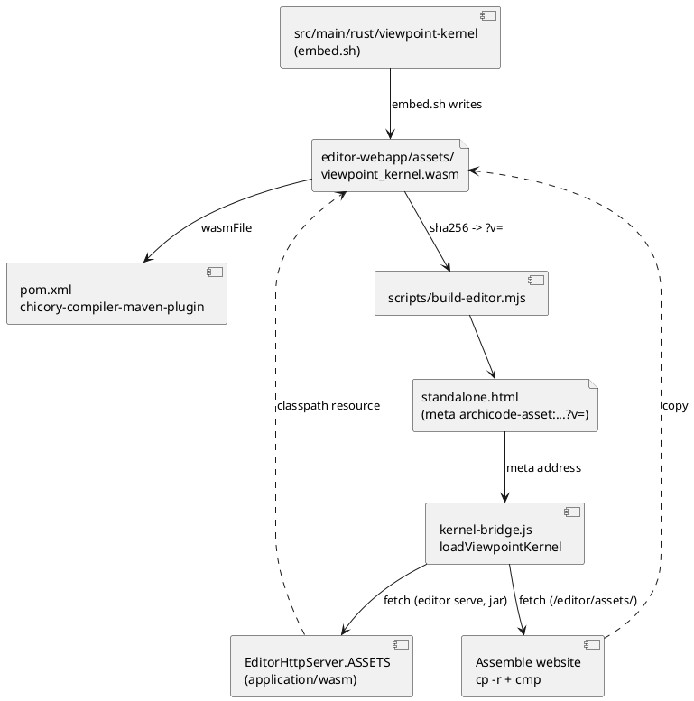

# Kernel beside the page — the viewpoint WebAssembly is a committed file in the assets folder, fetched by the page, served by the editor server and the website

## Summary

This TDD has no PRD (profile `TDD+pln`; the scope arrives settled from the manifest row W-3 of wave 034, gates 3, 4, 5 and 8 of P2, and from issue #207 of 2026-11-06). Run 0227 (W-2) put CodeMirror and ELK in `src/main/resources/editor-webapp/assets/`, with `assets.json`, the `<!--@assets-->` metas carrying a `?v=` hash, a table `ASSETS` in `EditorHttpServer` and a rule in "Assemble website". What is left inline is the kernel: `scripts/build-editor.mjs` reads `src/main/wasm/viewpoint_kernel.wasm` (813,383 bytes) and writes it into the page as a base64 `<script type="application/octet-stream" id="viewpoint-kernel-wasm">` block (about 1.08 MB of the 2.74 MB page), which `kernel-bridge.js` decodes with `atob`.

The design: the committed `.wasm` moves to `src/main/resources/editor-webapp/assets/viewpoint_kernel.wasm` (the one copy in git; Chicory's `wasmFile` in `pom.xml` points there, and the jar carries it as a resource), `assets.json` lists it as a file that is not bundled, the build writes its `archicode-asset:viewpoint_kernel.wasm` meta with the `?v=` hash, `loadViewpointKernel` fetches it and instantiates it with `WebAssembly.instantiateStreaming`, `ASSETS` gets a third entry typed `application/wasm`, and the base64 block, the `@wasm` directive and the Python of `embed.sh` go. The page falls by about 1.08 MB.

## Scope

In: `src/main/editor/model/kernel-bridge.js`, `page.html` (the `@wasm` block and its comment), `assets.json` and its reader in `scripts/build-editor.mjs`, the move of the `.wasm`, `pom.xml` (`wasmFile`), `EditorHttpServer` (`ASSETS`) and its Java tests, `embed.sh`, `scripts/changes.mjs` and its test, the node harness and the tests that read the kernel, the e2e hosted route table and `editor-offline.spec.js`, the Kernel job and the website step comments of `ci-build.yaml`, the release smoke scripts, the model `docs/architecture/` and its sample, and the sentences that say where the kernel is and how the page gets it (manual, `CLAUDE.md` files, `README.md` of the kernel).

Out: any change to the Rust, to `compute`/`compare` or to the ABI (the `.wasm` bytes stay the same; wave Non-Goals), a Maven build of the kernel or of the page (#207, the road after this wave), a loader for the kernel that does not need a server (see DEC-6), a content hash in the file name, and anything of CodeMirror and ELK (done by run 0227).

## PRD Traceability

Traceability is **incomplete**: there is no PRD. The requirements are assumed from the sources below and named `R-n` so that the plan can cite them. R-1 to R-5 are the `.wasm` halves that run 0227 left to this run (its DEC-7).

| ID | Requirement (assumed, sourced) | Source |
|---|---|---|
| R-1 | `viewpoint_kernel.wasm` is in the folder `src/main/resources/editor-webapp/assets/`, committed once; `npm run editor:check` exits 0 and compares it (its `?v=` in the page) with the committed file | gate 3 of P2; row W-3 ("one copy in git") |
| R-2 | The page fetches it with `WebAssembly.instantiateStreaming` and the `?v=` hash; the base64 block is gone from the page and from `build-editor.mjs` | row W-3 |
| R-3 | `standalone.html` is at least 1,000,000 bytes smaller than the 2,736,458 bytes of the starting repository, and `grep -c "application/octet-stream" standalone.html` prints 0 | gate 4 |
| R-4 | `editor serve`: `/assets/viewpoint_kernel.wasm` with the token answers 200 with `application/wasm`; without the token or the cookie 403; a name not in the table 404; `EditorHttpServerTest` and `EditorServeIT` pass | gate 5 |
| R-5 | The editor still draws a diagram with every host but `127.0.0.1` blocked, on Chromium and Firefox, the kernel coming from the file | gate 6 as W-2's spec, extended |
| R-6 | `embed.sh` builds and compares the `.wasm` only; `harness.js` and the node tests read the file; the Kernel job and `src/main/rust/viewpoint-kernel/CLAUDE.md` follow | row W-3 |
| R-7 | The website step copies and compares the folder, so the `.wasm` is on the site with no new step text | gate 7 (already written by W-2) |
| R-8 | `npm run test:unit`, `test:coverage`, `format:check`, `lint`, `./mvnw verify -DskipITs=false`, `scripts/byte-identity.sh` (exceptions file unchanged) exit 0; `ratchet.max` at most 99; `editor:build` and `sample:build` leave `git status --short` unchanged; `git diff --stat -- src/main/rust` prints nothing | gate 8, wave Non-Goals |
| R-9 | The sizes of the page before and after (bytes, gzipped) are reported | wave Risks |

Addressed: R-1 to R-9. Partially addressed: R-7 and the Maven half of R-1 are proved only by a tag run and a jar build (see FLOW-3 and RISK-2). Unresolved: none (Q-1 is resolved for the host; the header of the file itself is proved by the first tag run).

## Technical Goals

- TG-1: the page holds no binary: no base64 block, no `application/octet-stream` (R-2, R-3).
- TG-2: one copy of the `.wasm` in git; the CLI (Chicory), the jar, `editor serve`, the website and the node tests all read that file (R-1, R-6).
- TG-3: the committed `.wasm` is what the Rust builds and the page's hash of it is current, proved without Node by the Kernel job (R-1, R-6).
- TG-4: the kernel's failure to load is an error the user reads, not a blank page, and a later call retries (R-2).
- TG-5: the bytes of the `.wasm` and every output of the command line are unchanged (R-8).

## Non-Goals

- Upgrading the Rust toolchain, changing the kernel's contract version, or recompiling the kernel with different flags: `embed.sh --check` must still find the file identical to what it builds today.
- Caching policy (`Cache-Control`, a service worker): the `?v=` query is the cache key, as for the two other assets.
- A file in `src/main/wasm` kept for Maven: there is no second copy (DEC-1).
- A fallback that runs the kernel from a copy inside the page (see DEC-6).

## Assumptions

- ASM-1: Maven's resource step copies `src/main/resources/**` with no filtering (`grep -c "<filtering>" pom.xml` prints 0 today), so a binary in `editor-webapp/assets/` reaches the jar intact. Validate: `unzip -p target/*.jar editor-webapp/assets/viewpoint_kernel.wasm | cmp - src/main/resources/editor-webapp/assets/viewpoint_kernel.wasm`.
- ASM-2: `chicory-compiler-maven-plugin` takes any path in `wasmFile` and runs before the compile; the generated `ViewpointKernelModule` does not depend on where the file sits. Validate: `./mvnw -o compile -Dmaven.test.skip` and `ViewpointKernelTest`.
- ASM-3: `quarkus.native.resources.includes` already holds `editor-webapp/**` (`application.properties` line 8), so the native image carries the `.wasm`. Validate: `EditorServeIT` on the native build (the Native job).
- ASM-4: GitHub Pages serves `.wasm` as `application/wasm`. Not provable before a tag; DEC-3 makes the page work if it does not (Q-1).
- ASM-5: `WebAssembly.instantiateStreaming` exists in the engines the page already requires (the `TARGETS` of `build-editor.mjs`: chrome111, firefox121, safari16.2). It does in all three.

## Constraints

- CON-1: "Maven needs no Rust" stays true: the `.wasm` is committed, `embed.sh` is run by hand and by the Kernel job only.
- CON-2: `standalone.html` is generated; the `.wasm` change reaches it through `npm run editor:build` (the `<!--@assets-->` metas) and a rebuild with no change to the file leaves the page identical.
- CON-3: the editor has a ratchet (`ratchet.max` at most 99 in `src/main/editor/layers.json`) and a coverage floor that must not fall; `kernel-bridge.js` gains no upward use.
- CON-4: `src/main/editor/names.json` lists every top-level name of the page parts; a part's added or removed name is written there (`check-editor` fails otherwise).
- CON-5: `scripts/changes.mjs` rules are first-match; a path with no rule runs all four jobs.
- CON-6: the step "Assemble website" runs only on a tag; the pull request cannot prove the website.
- CON-7: `scripts/check-editor-moves.sh` and `--where`, `--map`, `--check-identical` of the build script run on old trees and need no esbuild; the `.wasm` change keeps them so.

## Current State

- `src/main/wasm/viewpoint_kernel.wasm`: the only committed copy, read by `pom.xml` (`chicory-compiler-maven-plugin`, `<wasmFile>${project.basedir}/src/main/wasm/viewpoint_kernel.wasm</wasmFile>`), by `scripts/build-editor.mjs` through `<!--@wasm ../wasm/viewpoint_kernel.wasm-->` in `src/main/editor/page.html` (line 44), by `embed.sh`, by `compare.test.js` (`WASM`), and named in `changes-map.test.js` and in the model (`archicode.contracts.couplings.kernel_wasm`, `tags.path`).
- `src/main/editor/model/kernel-bridge.js` `loadViewpointKernel()`: reads `#viewpoint-kernel-wasm`, `atob`, `WebAssembly.instantiate(bytes, {})`, wraps the C ABI (`alloc`, `compute`, `compare`, `states`, `quiet`, `apply_patches`, `result_ptr`, `dealloc`); the promise is cleared on failure so the next call retries; callers show "The diagram could not be computed: …" (`diagram-page.js`). `assetAddress(name)` (same file) already reads the `archicode-asset:NAME` meta and resolves it against `document.baseURI`; ELK uses it.
- `assets.json` lists two bundled `.js` entries; `build-editor.mjs` validates names as `*.js`, bundles them with esbuild and writes a meta per asset with the first 8 hex of the SHA-256 of the committed file.
- `EditorHttpServer.ASSETS`: two entries, `text/javascript; charset=utf-8`, token or cookie, `Host` check, 404 otherwise.
- `src/test/e2e/harness.js` `ASSET_TYPES` knows `.js` only: any other file of the folder is filtered out of the hosted route table.
- `src/test/javascript/viewpoint-kernel/harness.js` (`createApp`) reads the base64 block of the page with a regex and answers `getElementById('viewpoint-kernel-wasm')`; it already passes `options.fetch` to the page.
- `embed.sh`: builds, writes the `.wasm` and the base64 block (Python), then runs `build-editor.mjs`; `--check` compares the file and the block with no Node.
- Starting sizes: page 2,736,735 bytes; base64 block 1,084,512 characters.

## Proposed Design

**DEC-1 — the `.wasm` moves to the assets folder; git keeps one copy**
- Decision: `git mv src/main/wasm/viewpoint_kernel.wasm src/main/resources/editor-webapp/assets/viewpoint_kernel.wasm`; `src/main/wasm/` ceases to exist; `pom.xml` `wasmFile` becomes `${project.basedir}/src/main/resources/editor-webapp/assets/viewpoint_kernel.wasm`. The jar, the native image (`editor-webapp/**`), `EditorHttpServer` (classpath resource), the website step (`cp -r` of the folder), the hosted e2e route table and the node tests all read that file.
- Rationale: gate 3 asks that the folder `assets` hold the file, the row asks for one copy in git, and the website step, the e2e harness and the server already enumerate that folder. The row's words "Maven puts it there in the jar" are met: the jar holds it because it is a resource, with no copy step.
- Alternatives considered: keep it in `src/main/wasm` and copy at build with `maven-resources-plugin` (the folder in git would lack the file, so gate 3, the website `cmp` loop and the e2e routes would each need their own source path; a stale `target` copy is a new failure); keep both (two copies, forbidden by the row and by "one copy in git").
- Tradeoffs: the jar and the native image now carry the raw 813 KB beside the translated bytecode (about +0.8 MB each); a path the model, the tests and the rules named moves (IMP-9, IMP-10).
- Linked IDs: R-1, R-6, TG-2.

**DEC-2 — the file is listed in `assets.json` as a file that is copied, not bundled**
- Decision: `assets.json` gains a second list `files` (`{ "name": "viewpoint_kernel.wasm" }`; the name matches `^[A-Za-z0-9][A-Za-z0-9._-]*\.(wasm)$`, extendable). `<!--@assets-->` writes one meta per asset of `assets` and then of `files`, the hash being the first 8 hex of the SHA-256 of the file on disk; a listed file that is missing is the one-line error "the asset … is missing". `check` compares nothing else for a `files` entry (it is not built); the Kernel job compares it with the Rust build (DEC-5). The `wasm` directive and its branch in `build-editor.mjs` are removed, and so is the `@wasm` block of `page.html` with its comment; a page line `<!--@wasm …-->` is then an unknown directive and fails as any other.
- Rationale: the existing mechanism (meta, `?v=`, `assetAddress`) serves the new file at no cost; a separate list keeps "built" and "committed" apart so `check` does not try to rebuild the kernel (CON-1).
- Alternatives considered: put the kernel in `assets` with an `entry` (esbuild cannot build Rust); hard-code the name in `kernel-bridge.js` with no meta (the hash would have to be written elsewhere).
- Tradeoffs: `assets.json` has two lists; the reader and its unit tests grow by one case each.
- Linked IDs: R-1, R-2.

**DEC-3 — `loadViewpointKernel` fetches the file, streaming when the type allows**
- Decision: `const address = assetAddress('viewpoint_kernel.wasm')` (null: throw "The page names no viewpoint_kernel.wasm file."); `const response = await fetch(address)`; a response that is not `ok` throws "The viewpoint kernel could not be loaded: HTTP <status> from <address>." (a network error becomes "The viewpoint kernel could not be loaded from <address>: <message>"); when the `content-type` starts with `application/wasm`, `WebAssembly.instantiateStreaming(response, {})`, otherwise `WebAssembly.instantiate(await response.arrayBuffer(), {})`. The rest (ABI wrapper, version check, `adoptKernelStates`, `loadedKernel`, the retry on failure) is unchanged. `assetAddress` and the pieces that name the file are in the same part, no new top-level name but those listed in `names.json` (CON-4).
- Rationale: the wave says `instantiateStreaming`; a wrong type on a host that does not know `.wasm` (Q-1) makes it reject, and reading the header first avoids a double read of a body that cannot be cloned after use.
- Alternatives considered: `instantiateStreaming` only (a host with a wrong type breaks every diagram); `arrayBuffer()` only (loses streaming compile, which is the point for 813 KB).
- Tradeoffs: two paths to test (the node harness drives both: type `application/wasm` and `application/octet-stream`).
- Linked IDs: R-2, TG-4.

**DEC-4 — the server table gets a third entry, `application/wasm`**
- Decision: `ASSETS` gets `"viewpoint_kernel.wasm" -> new Asset("/editor-webapp/assets/viewpoint_kernel.wasm", "application/wasm")`; the route code, the `Host` check, the token or cookie proof and the 404 for every other name are unchanged. The Javadoc ("a table of two entries") says three. A `?v=` query is ignored, as for the two others.
- Rationale: `instantiateStreaming` needs the type; the table is the one route (a request never names a resource).
- Alternatives considered: derive the type from the extension (a request path would then reach a lookup other than the table).
- Tradeoffs: none beyond a row.
- Linked IDs: R-4.

**DEC-5 — `embed.sh` builds and compares the `.wasm` only, and needs neither Python nor Node to check**
- Decision: write mode copies the build to `src/main/resources/editor-webapp/assets/viewpoint_kernel.wasm` and then runs `scripts/build-editor.mjs` (so the page's `?v=` follows). `--check` rebuilds in a scratch folder, fails when the committed file is not the build, and fails when the page's `archicode-asset:viewpoint_kernel.wasm` meta holds a hash other than `sha256sum <file> | cut -c1-8` (a `grep`/`sed` on the page: no Node). The two messages keep the form "… is not the build of the current sources" and "run src/main/rust/viewpoint-kernel/embed.sh and commit the result". The Python block goes; the Kernel job's comment says "needs rustup, nothing else".
- Rationale: the base64 block no longer exists, so the check is the file and the page's hash of it; Node is not on the Kernel job.
- Alternatives considered: call `build-editor.mjs --check` from the Kernel job (needs `npm ci`: a new step and minutes for a one-line comparison).
- Tradeoffs: the hash comparison is a shell idiom duplicating the build's rule (8 hex of the SHA-256); a node test pins the rule (IMP-8) so a change of one fails the other.
- Linked IDs: R-1, R-6, TG-3.

**DEC-6 — a page opened from `file://` no longer has its kernel; the wave accepts it and the manual says so**
- Decision: the kernel needs a server (`editor serve`, the website, or a saved copy with its `assets` folder in Firefox). On Chromium and Safari from `file://` the `fetch` is refused: the diagram scene shows the existing error panel with DEC-3's sentence naming the file, and the rest of the editor (files, elements, YAML) works. No second copy of the kernel stays in the page.
- Rationale: the wave Purpose is a lean page, and the base64 block is exactly what is removed; the manual already says the two other assets need Firefox from `file://` (README.adoc line 1881), so the page already degrades there (ELK falls back to the plain list); the kernel is the third file. This is a deliberate narrowing of what a saved copy does, decided by #207 and the manifest, not a defect to engineer around.
- Alternatives considered: keep a small inline fallback (defeats the size gate); `FileReader`/File System Access to load the kernel (new surface, not asked).
- Tradeoffs: a saved single-file copy shows no diagram in Chromium and Safari. The manual sentence says that the file editor and the diagrams need the folder `assets` beside the page and a server (or Firefox).
- Linked IDs: R-2, R-3.

**DEC-7 — the change rule keeps the Kernel job on a `.wasm` change**
- Decision: a rule `R-07a0` before `R-07a` for `src/main/resources/editor-webapp/assets/viewpoint_kernel.wasm` with the four jobs (`ALL`), reason "the kernel the CLI translates and the page fetches; embed.sh --check compares it"; `R-07` loses `src/main/wasm/**` from its patterns and its reason loses "embedded in the page". `changes-map.test.js` swaps its `['src/main/wasm/viewpoint_kernel.wasm', ALL]` row for the new path and keeps `assets/codemirror.js` at `e2e,java,page`.
- Rationale: rules are first-match (CON-5); without the rule the move would silently drop the Kernel job from a change of the file.
- Alternatives considered: change `R-07a` to include `K` (a CodeMirror change would then run the Rust job).
- Tradeoffs: one more rule; its row is in the test.
- Linked IDs: R-6, R-8.

### Diagram

The reviewer checks that the `.wasm` has one source (the file) and four readers (Chicory, the hash in the page, the server, the site), and that nothing writes it except `embed.sh`. Text fallback: embed.sh writes the file; Chicory, the build script (hash), the editor server and the website step read it; the page names it by meta and the bridge fetches it from the server or the site.

## Repository Impact

- IMP-1 — the kernel file. Path(s): `src/main/wasm/viewpoint_kernel.wasm` -> `src/main/resources/editor-webapp/assets/viewpoint_kernel.wasm`. Change type: remove + additive (same bytes). Why impacted: DEC-1. Linked IDs: R-1. Risks / notes: `git mv` so the history follows; the file is identical (`cmp` with the old one before and after).
- IMP-2 — Maven. Path(s): `pom.xml` (`wasmFile`, the comment "The .wasm is built by …"). Change type: modify. Why impacted: DEC-1. Linked IDs: R-1, R-6. Risks / notes: ASM-1, ASM-2; the only edit of the file, by anchor (the file may hold uncommitted lines of another run: re-read first).
- IMP-3 — the build script and the assets list. Path(s): `scripts/build-editor.mjs` (remove the `wasm` directive and its header line; read `files` in `readAssetList`; the `@assets` branch writes their metas; the header comment), `src/main/editor/assets.json`, `src/main/editor/page.html` (remove the block and its comment). Change type: modify, schema-affecting (CTR-1). Why impacted: DEC-2. Linked IDs: R-1, R-2, R-3. Risks / notes: CON-7; the unit tests of IMP-9.
- IMP-4 — the loader. Path(s): `src/main/editor/model/kernel-bridge.js`, `src/main/editor/names.json` if a name is added or removed, `src/main/editor/presentation/diagram-state.js` (the comment on line 6 that says "below as base64"). Change type: modify. Why impacted: DEC-3. Linked IDs: R-2, TG-4. Risks / notes: no new upward use (CON-3); `loadedKernel` is assigned as before.
- IMP-5 — the generated page. Path(s): `src/main/resources/editor-webapp/standalone.html`. Change type: modify (generated by `npm run editor:build`). Why impacted: the block goes, a meta is added. Linked IDs: R-3. Risks / notes: about 1.08 MB less; never edited by hand.
- IMP-6 — the server. Path(s): `src/main/java/io/morin/archicode/cli/EditorHttpServer.java` (the table, the Javadoc), `src/test/java/io/morin/archicode/cli/EditorHttpServerTest.java` (the table's third entry with its type and bytes, 403 without proof, `/assets/elk.wasm` and `/assets/viewpoint_kernel.wasm/` still 404 in the neighbours list, the three assertions `contains("viewpoint-kernel-wasm")` of lines 100, 126, 152 become the meta of the file), `src/test/java/io/morin/archicode/it/EditorServeIT.java` (the loop over names gains the `.wasm` compared as bytes, not text, with `application/wasm`; the assertion on line 90). Change type: modify. Why impacted: DEC-4. Linked IDs: R-4. Risks / notes: PMD (`./mvnw test-compile pmd:check`); the `.wasm` is compared as `byte[]`.
- IMP-7 — the kernel script and its documents. Path(s): `src/main/rust/viewpoint-kernel/embed.sh`, `src/main/rust/viewpoint-kernel/CLAUDE.md`, `src/main/rust/viewpoint-kernel/README.md` (lines 41 to 61). Change type: modify. Why impacted: DEC-5, DEC-1. Linked IDs: R-6. Risks / notes: no Rust source changes (`git diff --stat -- src/main/rust` prints only these two `.md` and `embed.sh`: the gate of the wave reads `src/main/rust` whole for `*.rs` and `Cargo*`; the run states that `embed.sh` and the two notes are the only touched files there, see Q-2).
- IMP-8 — node tests and the harness. Path(s): `src/test/javascript/viewpoint-kernel/harness.js` (`createApp` reads the file, answers the meta lookup for the file, and gives the page a `fetch` that serves it with a chosen type; a test's own `options.fetch` still wins for other addresses), `src/test/javascript/viewpoint-kernel/compare.test.js` (reads the file), `src/test/javascript/editor-build/build-editor.test.js` (the `wasm` fixture and `expectedPage` become a `files` entry and its meta), `src/test/javascript/editor-build/editor-assets.test.js` (new cases: the page's hash of the `.wasm` is the file's, the page has no `octet-stream` block, the file is a WebAssembly module (`\0asm`), `embed.sh`'s rule and the build's rule give the same 8 hex), `src/test/javascript/changes-map.test.js`, a new test over `loadViewpointKernel` with both content types and the failure sentences. Change type: modify + additive. Why impacted: DEC-2, DEC-3, DEC-7. Linked IDs: R-2, R-6, R-8. Risks / notes: coverage floor (`scripts/editor-coverage-floor.json`) not lowered; the new failure branches are covered by the new test.
- IMP-9 — rules of the change map. Path(s): `scripts/changes.mjs`, the comment of `R-07a`. Change type: modify. Why impacted: DEC-7. Linked IDs: R-6, R-8. Risks / notes: first match.
- IMP-10 — the model of ArchiCode and its sample. Path(s): `docs/architecture/manifests/archicode.yaml` (`kernel_wasm`: `tags.path` to the new path; a relationship `editor_serve --serves--> kernel_wasm` and `page --reads--> kernel_wasm`, qualifiers already used, parallel to `editor_assets`), `docs/architecture/manifests/views/view.contracts.yaml` if a line follows, `src/main/resources/editor-webapp/samples/archicode.yaml` (`npm run sample:build`), `src/test/javascript/architecture/impact-questions.json` only if an expected set changes. Change type: modify. Why impacted: `ArchitectureDriftTest` rule 4 (`tags.path` exists) would fail on the old path. Linked IDs: R-1. Risks / notes: run `./mvnw test -Dtest=ArchitectureImpactTest,ArchitectureDriftTest`.
- IMP-11 — e2e. Path(s): `src/test/e2e/harness.js` (`ASSET_TYPES` gets `['.wasm', 'application/wasm']`), `src/test/e2e/editor-offline.spec.js` (both tests assert that `/assets/viewpoint_kernel.wasm` was requested, answered 200 `application/wasm`, with no host but `127.0.0.1`, and that the page source holds no `viewpoint-kernel-wasm` element; the hosted one asserts `/editor/assets/viewpoint_kernel.wasm` in `hosted.requests`). Change type: modify. Why impacted: R-5. Linked IDs: R-5. Risks / notes: without the `ASSET_TYPES` row the hosted harness silently drops the file and every hosted test shows no diagram.
- IMP-12 — CI and release scripts. Path(s): `.github/workflows/ci-build.yaml` (the comments of jobs `Page` and `Kernel`, the step text "Check the committed WebAssembly …": "needs rustup and python3" becomes "needs rustup"; the website step is not edited), `.github/scripts/release-smoke.sh` (line 89 checks the `archicode-asset:viewpoint_kernel.wasm` meta and then `GET /assets/viewpoint_kernel.wasm` answers 200 with the token), `.github/scripts/test-release-scripts.sh` (the fake server serves the meta and the file), `.github/CLAUDE.md`. Change type: modify. Why impacted: DEC-1, DEC-5. Linked IDs: R-4, R-6. Risks / notes: the smoke checks the released native binary serves the kernel (ASM-3); the editor tests of the job `Page` read the file.
- IMP-13 — sentences. Path(s): `CLAUDE.md` (line 25: the path of the `.wasm`), `src/main/editor/CLAUDE.md` ("`<!--@wasm FILE-->` stays inline" and the line on `file://`), `src/doc/README.adoc` (line 1881 and wherever the kernel's place is told: three files beside the page; the `file://` sentence of DEC-6), `src/test/CLAUDE.md` and `scripts/extract-editor-script.mjs` (line 13 comment) if they name the block. Change type: modify. Why impacted: the repository's "no history in CLAUDE.md" rule: state what is true now. Linked IDs: R-2, R-6. Risks / notes: `grep -rn "octet-stream\|viewpoint-kernel-wasm\|src/main/wasm" --include=* .` (outside `docs/wav`, `node_modules`, `target`) prints only the harness's historical comparison lines, if any, else nothing.

## Canonical Impact

`docs/CLAUDE.md` does not exist and the repository declares no `arc` or `dom` register. `CI-arc-1` and `CI-dom-1`: Not applicable — no canonical registers declared.

The model of ArchiCode in `docs/architecture/` (not a register) changes as IMP-10 says: the `tags.path` of `kernel_wasm` and, as for `editor_assets`, the two relationships that say who serves and who reads the file. The plan fixes it in the same commit as the code and runs `npm run sample:build`.

## Data Model and Contracts

- CTR-1 — `src/main/editor/assets.json`. Current contract: `{ "assets": [{ "name": "<x>.js", "entry": "bundles/<x>.mjs" }] }`, every name a `.js` bundled by esbuild. Proposed contract: plus an optional `"files": [{ "name": "<x>.wasm" }]`, committed files that sit in the assets folder, not built, whose hash is written into a meta like an asset's. Affected files: `src/main/editor/assets.json`, `scripts/build-editor.mjs`, `build-editor.test.js`. Migration or compatibility notes: a tree without `files` builds as before (`--check-identical` on an old revision unaffected, CON-7); a name in both lists is an error. Linked IDs: R-1, R-2.
- CTR-2 — the page's asset metas. Current contract: `<meta name="archicode-asset:codemirror.js" content="./assets/codemirror.js?v=<8 hex>">` and the same for `elk.js`. Proposed contract: the same line for `viewpoint_kernel.wasm`, after the two bundled ones (order of `assets` then `files`), and no `<script id="viewpoint-kernel-wasm">`. Affected files: `standalone.html`, `kernel-bridge.js`, the harness. Migration or compatibility notes: a saved copy of an older page holds its own kernel and works; a new page with no `assets` folder shows the DEC-6 error. Linked IDs: R-2, R-3.
- CTR-3 — `GET /assets/viewpoint_kernel.wasm` of `editor serve` (and `/editor/assets/viewpoint_kernel.wasm` of the website). Current contract: not served. Proposed contract: 200 with `application/wasm` and the bytes of the committed file, token or session cookie, `Host` check, 403 without proof, `?v=` ignored; every other name under `/assets/` is 404. Affected files: `EditorHttpServer.java`, its tests. Migration or compatibility notes: additive. Linked IDs: R-4.
- CTR-4 — the place of the kernel. Current contract: `src/main/wasm/viewpoint_kernel.wasm`. Proposed contract: `src/main/resources/editor-webapp/assets/viewpoint_kernel.wasm`, the one committed copy, the same bytes. Affected files: IMP-1, IMP-2, IMP-7, IMP-8, IMP-10. Migration or compatibility notes: a branch of another run that edits the old path conflicts on the move; the wave runs strictly one after another. Linked IDs: R-1, R-6.

## Interfaces and Behavior

- IF-1: `loadViewpointKernel()` returns the same `kernel` object (`compute`, `quiet`, `compare`, `applyPatches`) and the same retry on failure; only its source of bytes changes. Errors are the three sentences of DEC-3, shown in the existing error panel; a missing meta (a page built before this run) is the first.
- IF-2: `embed.sh` and `embed.sh --check` keep their usage; the two failure messages are named in DEC-5.
- IF-3: `editor serve` and the website give the same address layout, `assets/NAME` relative to the page.

## Flows and Processing Logic

**FLOW-1 — the editor draws a diagram**
- Trigger: a diagram is first needed (`loadViewpointKernel()` in `diagram-page.js`, `diagram-layout.js`, `story-scene.js`, `plateau-choice.js`).
- Steps: the bridge reads the meta, resolves it against `document.baseURI`, `fetch`es it (token cookie or none on the website), instantiates it by DEC-3, calls `states`, keeps `loadedKernel`; ELK loads in parallel (`Promise.all`); the layout is drawn.
- Branches / failure paths: no meta, an HTTP error, a network error or a bad type with no streaming: the promise rejects, is cleared, the scene shows the error panel and the next draw retries; a module that fails to compile: the browser's message, same panel.
- Final output / rendered result: the same diagram as before the run (the node tests compare the views with the CLI's).
- Linked IDs: R-2, R-5.

**FLOW-2 — the kernel changes**
- Trigger: someone edits the Rust.
- Steps: `embed.sh` builds, writes the file in `assets/`, runs `npm run editor:build` (the meta's hash moves); the commit holds the Rust, the `.wasm` and the page. The Kernel job runs `embed.sh --check`: the file is the build, the page's hash is the file's. The rule `R-07a0` runs the four jobs.
- Branches / failure paths: file not rebuilt, or page not rebuilt: the check says which, with the line "run src/main/rust/viewpoint-kernel/embed.sh and commit the result".
- Final output / rendered result: a committed file, a page that names it.
- Linked IDs: R-1, R-6.

**FLOW-3 — the website**
- Trigger: a tag.
- Steps: "Assemble website" copies the folder (the `.wasm` included) to `target/site/editor/assets/` and `cmp`s each file; the browser loads `/editor/assets/viewpoint_kernel.wasm?v=…` from GitHub Pages.
- Branches / failure paths: a type other than `application/wasm` takes the `arrayBuffer` path (DEC-3); a missing file is the error panel. Not provable by the pull request (CON-6): the hosted e2e route table is the rehearsal.
- Final output / rendered result: the hosted editor draws the sample.
- Linked IDs: R-5, R-7.

## Reliability, Performance, and Scalability

- The kernel is one more request on the first diagram: a local fetch of 813 KB (the page is 1.08 MB lighter), compiled while it streams. The load time before and after is read in the e2e run (R-9) as the time from `goto` to the first `g.dg-node`, with the page size and its gzip size; it is reported, not gated.
- A retry costs a fetch; the promise is cleared on failure as today, and no loop exists (a render does not retry within the same turn: the draw is asked once per user action).
- The CLI is unchanged: the same bytes are translated by the same plugin.

## Security and Privacy

- The route has the same proof as the other two assets (token in the header or the session cookie, `Host` check) and a table of exact names; no path is built from a request (ASM in run 0227's `ASSETS`).
- The page loads nothing from a remote address; the guard test `remote-import.test.js` keeps passing, and the hosted spec asserts no other host is asked.
- The `.wasm` carries no secret; `?v=` is a content hash, not a credential.

## Observability and Verification

Commands, from the gates 3, 4, 5, 8 of P2 (JDK 25 as `JAVA_HOME` for Maven):

- `npm ci && npm run editor:check` exits 0, and `npm run editor:build` and `npm run sample:build` leave `git status --short` unchanged.
- `ls src/main/resources/editor-webapp/assets` shows `codemirror.js`, `elk.js`, `viewpoint_kernel.wasm`, the notice file; `ls src/main/wasm` fails; `cmp` of the file with `git show HEAD:src/main/wasm/viewpoint_kernel.wasm` is identical.
- `wc -c src/main/resources/editor-webapp/standalone.html` is at most 1,736,458; `grep -c "application/octet-stream" src/main/resources/editor-webapp/standalone.html` prints 0.
- `./mvnw test -Dtest=EditorHttpServerTest,ArchitectureDriftTest,ArchitectureImpactTest,CommandReferenceTest` and `./mvnw verify -DskipITs=false` (EditorServeIT: 200, `application/wasm`, bytes equal, 403 without proof, 404 for another name).
- `npm run test:unit`, `npm run test:coverage`, `npm run format:check`, `npm run lint`; `scripts/byte-identity.sh` with the exceptions file unchanged; `./mvnw test-compile pmd:check`; `ratchet.max` at most 99.
- `npx playwright test src/test/e2e/editor-offline.spec.js --project=chromium` and `--project=firefox`; the same spec against a jar whose `.wasm` route is removed fails (the proof that it tests the file).
- `src/main/rust/viewpoint-kernel/embed.sh --check` (needs rustup; on the machine only if present, else it is the Kernel job's proof).
- `git diff --stat -- 'src/main/rust/**/*.rs' 'src/main/rust/**/Cargo*'` prints nothing.
- The rehearsal of the website step: the extracted block runs in a scratch folder and `cmp` passes for the three files.

## Deployment and Rollout

Code-only, no data migration. The page and the file are committed together; an older page with the new server still works (it has its own kernel), a new page with an older server has no route for the file (403 or 404: the DEC-6 panel), so they ship in one commit. The pull request proves everything but the website (CON-6, RISK-2); the hand-off says that step is unproved until a tag. Rollback: revert the commit (the file returns to `src/main/wasm`, the block to the page). This section is planning guidance only; releasing is the author's call.

## Risks and Tradeoffs

- RISK-1: the move leaves a stale reference (a test, a rule, the model, a script) that only a later job notices. Mitigation: the `grep` of IMP-13, `ArchitectureDriftTest`, the Kernel job's `embed.sh --check`, and the full suites; the task that moves the file lists the grep for `src/main/wasm` over the whole tree outside `docs/wav`.
- RISK-2: the website serves a wrong type or a wrong base path; proved only by a tag. Mitigation: DEC-3's `arrayBuffer` path and the hosted e2e route table; the hand-off names it (Q-1).
- RISK-3: the Kernel job drops out of a `.wasm` change (rules are first-match). Mitigation: DEC-7 and its test row.
- RISK-4: a saved page from `file://` loses its diagrams in Chromium and Safari (DEC-6). Mitigation: the manual sentence and the error panel naming the file.
- RISK-5: the jar and the native image are about 0.8 MB larger. Accepted (DEC-1).
- RISK-6: `embed.sh --check`'s hash rule drifts from the build's. Mitigation: the node test of IMP-8 asserts the two give the same 8 hex.
- RISK-7: `pom.xml` and `ci-build.yaml` may hold uncommitted lines of another run when this run starts. Mitigation: edit by anchors, re-read the file first, never overwrite.

## Open Questions

- Q-1: does GitHub Pages answer `application/wasm` for the file? Impact: low, DEC-3 works either way; it only decides whether streaming compile is used on the website. Resolution (observed 2026-11-07): a `.wasm` file served by GitHub Pages (`https://mdn.github.io/webassembly-examples/js-api-examples/simple.wasm`) answers `content-type: application/wasm`, so the host maps the extension; the site's own copy is not published before a tag, so the run records the file itself as unproved on the website and keeps the `arrayBuffer` fallback of DEC-3. Status: resolved for the host, the file's own header proved by the first tag run, not blocking.
- Q-2: gate 3 of P3 and the wave Completion Criteria say `git diff --stat -- src/main/rust …` prints nothing for the whole wave, but `embed.sh` and the two notes under `src/main/rust/viewpoint-kernel/` change here (the wave's own scope names them). Impact: the P3 gate command as written would print them. Resolution (made here, from the repository): the run changes no `.rs` file, no `Cargo.*`, no `rust-toolchain.toml` and not the bytes of the `.wasm`; the plan's gate check uses the pathspec `'src/main/rust/**/*.rs' 'src/main/rust/**/Cargo*'`, and the prg names the three files and asks the author (or the wave's gate wording) to read the criterion as "the Rust", which is what the Non-Goal says ("No change of the kernel's Rust"). Status: resolved by reading, flagged to the wave.

## Deferred Work

- DEF-1: Maven builds the kernel (Rust) and the page (Node), so no binary is committed (#207, the road after this wave).
- DEF-2: a content hash in the file names instead of `?v=`.
- DEF-3: a kernel that loads from `file://` in Chromium and Safari.

## File Placement and Frontmatter

Saved as `docs/wav/wav-034-diagrams-assets-likec4-matrix-page/run/run-0228-kernel-beside-the-page/tdd-0228-kernel-beside-the-page.md`, beside the run's status file, with `type: tdd`, `run: 0228`, `wave: 034` and `status: draft`, as run 0227's TDD.
