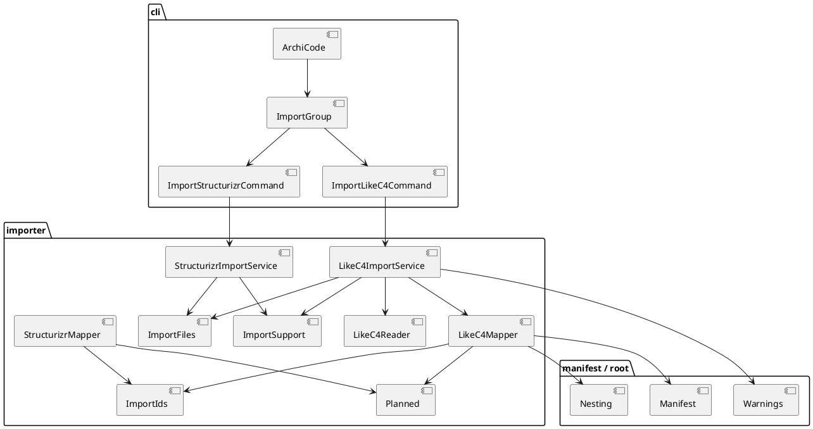
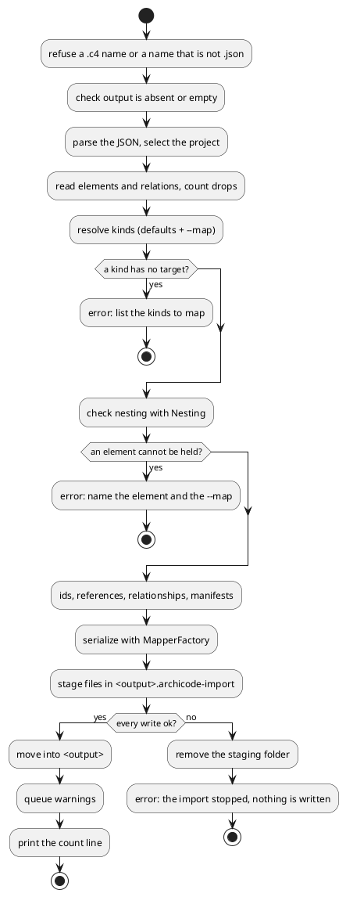

# Import a LikeC4 JSON export

# Summary

`archicode import likec4 <model.json> --output <folder> [--map <kind>=<kind>]... [--project <id>]` reads the JSON written by `likec4 export json` (the elements, their kinds, and the relationships between them) and writes an ArchiCode workspace in `<folder>`: a `.archicode.yaml` and one manifest per element. It is the second command of the group `import`; the first is `import structurizr` (run 0224).

What it says and refuses: every part of the export that v1 does not carry (views, deployment, styles, metadata, links, globals, imports, diffs, manual layouts) and every rewritten id is one `warning:` line, and the exit code stays 0. A `.c4` file, a file that is not a LikeC4 export, an array of several projects with no `--project`, a `--project` the file does not hold, a kind of the model that has no target and no `--map`, an element whose kind and place cannot be held in ArchiCode's nesting, and a non-empty output folder are each one `error:` line, exit 1, and the folder is not changed. The files are written all or none (the writer of run 0224).

Design: a reader (`LikeC4Reader`), a mapper (`LikeC4Mapper`) and a service (`LikeC4ImportService`) in the package `io.morin.archicode.importer`, behind a thin command `cli/ImportLikeC4Command` added to `cli/ImportGroup`. The reader and the mapper are pure. What the two importers really have in common (the id rewrite and the collision suffix, the output records `Planned` and `WorkspaceFile`, the parse and serialize steps of the service) is moved out of the Structurizr classes into four small shared types (`ImportIds`, `ImportSupport` and the records `Planned` and `WorkspaceFile`) without changing a byte of the Structurizr output (DEC-3); nothing else is shared.

Proof: a sample generated once with the vendor tool from the MIT example `cloud-system` of `github.com/likec4/likec4` is committed with its licence and its provenance and is the oracle. The output is loaded by the command line and by the editor in tests. There is no PRD (profile TDD+pln): the sources are issue #134, its author's decision of 2026-10-31 and 2026-11-02, and the gate of phase P3 of wave 034, so traceability is incomplete (see PRD Traceability).

# Scope

In scope: the package `importer/` (reader, mapper, service, the three shared classes), `cli/ImportLikeC4Command` and its line in `cli/ImportGroup`, the sample under `src/test/resources/likec4/` with its licence and provenance, the goldens of the output, the Java tests, one `*IT`, one node test that opens the output in the editor, the entries of `reflect-config.json`, the golden of the guide and the expectations of `HelpIT`, the manual (`src/doc/README.adoc`), `src/main/java/io/morin/archicode/CLAUDE.md`, `src/test/CLAUDE.md`, the model `docs/architecture/` and the generated sample bundle.

Out of scope: see Non-Goals and Deferred Work.

# PRD Traceability

No PRD. The requirements are assumed from issue #134, the author's decision on it, the manifest entry W-4 of wave 034 and the P3 gate (criteria 1 to 4 and 7 concern this run), and are labelled `REQ-n`; they are not sourced from a PRD id.

- `REQ-1` (gate 1): `src/test/resources/likec4/` holds a JSON file, the MIT licence text and a provenance text with `github.com/likec4/likec4`, the version of the tool, the command run and a 40-hex commit SHA. Addressed (DEC-9, IMP-8).
- `REQ-2` (gate 2): on the packaged application `import likec4 <sample> --output <empty folder>` exits 0 and prints one warning line for each dropped part present in the sample; `query graph` on the output has as many elements as the sample's `elements` minus the number the report says were dropped. Addressed (DEC-1 to DEC-7, DEC-10). See DEC-10 for what "dropped elements" is: with every kind mapped, none is dropped, and the sum rule holds with zero.
- `REQ-3` (gate 3): a `.c4` input, a non-empty output folder, and a sample with a kind that has no target and no `--map` are each one `error:` line, exit 1, no stack trace (the last one lists the kinds to map), and `--map kind=kind` for each listed kind exits 0. Addressed (DEC-1, DEC-4, DEC-5, DEC-7).
- `REQ-4` (gate 4): a test of `src/test/java/io/morin/archicode/it` runs the import on the packaged application; an editor test loads the output; `reflect-config.json` names LikeC4 (`grep -c LikeC4` at least 1). Addressed (IMP-5, IMP-6, IMP-9).
- `REQ-5` (gate 7, part): PMD, `./mvnw verify -DskipITs=false`, `scripts/byte-identity.sh` (exceptions file unchanged), `npm run test:unit`, `test:coverage`, `format:check`, `lint`, `editor:build` and `sample:build` leaving `git status --short` unchanged, `CommandReferenceTest` with `import likec4` in the listing. Addressed (IMP-3, IMP-10 to IMP-13).
- `REQ-6` (decision on #134, wave scope): JSON only; CLI only; v1 = the elements, their kinds and the relationships; default mapping of `actor`, `system`, `container` and `component`, `--map kind=kind` for the others; ids rewritten per segment with the original in a tag; views, deployment, styles and metadata reported as dropped; `.c4` refused with the export command; a model array refused, or `--project` read. Addressed (DEC-1 to DEC-8).
- `REQ-7` (wave, first task): generate the sample once with `likec4@1.60.0` (or the version found) from `examples/cloud-system`, `likec4 export json --skip-layout --project cloud-system`, trimmed of its `views`, with the licence and the provenance; stop with the reason when Node or the network is missing. Addressed (DEC-9, Q-5).
- `REQ-8` (gate 7 and manifest scope): the manual and the model of ArchiCode. Addressed (IMP-10 to IMP-12).
- `REQ-9` (wave non-goal): no shared model of the two importers beyond what the code of run 0224 already shares. Addressed with a stated reading (DEC-3: the output side and the id rule are moved, no input model is shared).
- Unresolved: none blocks the run. Q-5 and Q-6 are facts only the first task can confirm; each has a stated fallback.

# Technical Goals

- `TG-1`: a pure reader of the LikeC4 JSON that keeps the elements, their kinds and the relationships, and counts what it ignores (REQ-2, REQ-6).
- `TG-2`: a pure mapper to `Manifest` objects with a kind for each element, a parent from the id, rewritten ids and resolved references, refusing a place ArchiCode cannot hold (REQ-3, REQ-6).
- `TG-3`: a report in `Warnings` for each drop and each rewritten id (REQ-2, REQ-6).
- `TG-4`: the id rule, the collision suffix, the output records and the service steps shared by both importers with the Structurizr output unchanged byte for byte (REQ-5, REQ-9).
- `TG-5`: the proof: the packaged application imports the sample, the output loads in the command line and in the editor, a golden pins it (REQ-2, REQ-4).

# Non-Goals

- No LikeC4 DSL input (a `.c4` file is refused with the command to export), no editor action for the import, no views, no deployment (wave non-goals; REQ-6).
- No shared model of the two importers' inputs, no neutral intermediate model (REQ-9).
- No plateaus in the output: one layer, one plateau.
- No new dependency: Jackson (already used by the manifests and the first importer) reads the JSON.
- No change of an existing command's output: `scripts/byte-identity.sh` stays green with `scripts/byte-identity-exceptions.txt` unchanged, and `import structurizr` writes the same bytes and the same warnings as before.
- No change under `src/main/rust`, `src/main/wasm` or `src/main/editor`.

# Assumptions

- `ASM-1`: the JSON of `likec4 export json` is the data of one project: an object with `projectId`, `project`, `specification`, `elements`, `relations`, `globals`, `imports`, `deployments` and `views` (and `manualLayouts` or `diffs` in some versions). `elements` is an object keyed by the id of the element, a dotted path whose last segment is the name the author gave (`cloud.ui.dashboard`) and whose prefix is its parent; each element has `id`, `kind`, `title`, and optionally `summary`, `description` (a text, or an object with `txt` or `md`), `technology`, `tags` (an array of names), `links`, `metadata`, `notation` and `style`. `relations` is an object keyed by the id of the relationship; each has `id`, `source` and `target` (objects `{"model": "<element id>"}`), and optionally `title`, `description`, `technology`, `kind`, `tags`, `links`, `metadata`, `color`, `line`, `head`, `tail`, `isBidirectional`. With more than one project the file is an array of such objects. Read from the vendor source (`packages/core/src/types/model-data.ts`, `model-logical.ts`, `packages/likec4/src/cli/export/json/handler.ts`, read on `main` on 2026-11-07, not at the tag `v1.60.0` of Q-3). Validated by the first task, which reads the sample the tool wrote at the version it ran, and by the first test (the reader fails with one sentence on a document with no `elements`).
- `ASM-2`: an element's place comes from its id (the dotted prefix), not from a `parent` key; the parent of every element is in the file. Validated on the sample; a missing parent is an error (CTR-1).
- `ASM-3`: LikeC4 ids are not always valid ArchiCode ids (upper case, camel case), so ArchiCode ids derive from each segment by the rule of run 0224 (DEC-3). Validated by the first task on the generated sample, which says which ids and kinds are camel case.
- `ASM-4`: the licence of the sample is MIT for the whole repository `likec4/likec4` (Q-2). Validated by the first task at the commit it records.
- `ASM-5`: `Warnings` printed on the error output at the end of the command (`ErrorOutput`) is the channel for the report, as for the first importer.
- `ASM-6`: the loader refuses an element held by a parent that does not hold its kind, by the table of `Nesting` (a system holds containers, a container holds components, a person and a component hold nothing; only a person, a solution and a system are at the top of the application layer). The importer must not write what the loader refuses (DEC-5). Validated by the first test, which loads the output.

# Constraints

- `CON-1`: Java 25, Quarkus, Picocli, Lombok conventions of `CLAUDE.md`; PMD ruleset unchanged, no `NOPMD`.
- `CON-2`: the native image reaches classes by reflection only when they are in `reflect-config.json`; `NativeReflectionConfigTest` fails when one is missing. The Native job of CI is the proof and does not run on a branch (RISK-4).
- `CON-3`: one `error:` line and exit 1 for a mistake of the author (`ArchiCodeException`, `ErrorOutput`); no stack trace.
- `CON-4`: every file the repository ships is loaded by the command line and by the editor in a test (`CLAUDE.md`, Conventions): the output golden is a workspace under `src/test/resources/`, so `ShippedFilesTest` and `shipped-files.test.js` load it with no entry of `exceptions.json`. The sample JSON itself is an input, not a workspace: the test that reads it is the importer's.
- `CON-5`: no real workspace content in the repository: the sample is the public `cloud-system` example, never the author's own model; no name, id, label or path of the author's workspace appears in the sample, the goldens, the tests or the documents.
- `CON-6`: the third-party file keeps its licence next to it and its provenance (REQ-1).
- `CON-7`: adding a command moves `--help` and the generated command listing of the manual: `HelpIT`, `GuideTest` (golden `src/test/resources/guide/golden.md`) and `CommandReferenceTest` move in the same commit.
- `CON-8`: the run changes no existing command's output (`scripts/byte-identity.sh`); the extraction of DEC-3 is guarded by the Structurizr tests and goldens that exist and that stay unedited.
- `CON-9`: the manual's rule about a sentence the command line says (`CLAUDE.md`, "the command line and the editor say the same sentences") does not apply to the importer's sentences: it is a command of the command line only, so there is no cases file shared with the editor.

# Current State

- `cli/ArchiCode.java` is the `@TopCommand`; `cli/ImportGroup` (`name = "import"`, `subcommands = { ImportStructurizrCommand.class }`) is the group.
- `cli/ImportStructurizrCommand` takes `<workspace.json>` and `-o/--output` (required), calls `StructurizrImportService.importWorkspace(input, output, ImportFiles.disk())` and prints `imported <n> elements and <m> relationships into <folder>` on the standard output. It loads no workspace.
- `importer/`: `StructurizrReader` (a `JsonNode` tree to a `StructurizrModel` and a `Dropped` count), `StructurizrMapper` (the model to `Mapped(manifests, workspace, elements, relationships, droppedRelationships, rewrites)`; it holds the nested records `Planned` and `WorkspaceFile` and the private `slug`, `isIdCharacter`, `replacesCharacter`, `hasAlphanumeric` and the sibling loop of `place`), `ImportFiles` and `DiskImportFiles` (the all-or-nothing writer: a staging folder `<output>.archicode-import`, an absent or empty folder only), `StructurizrImportService` (the checks of the name, `parse`, `serialize`, `reason`, `WORKSPACE_FILE`, the report, the call to `ImportFiles.commit`, then `warnings.warnAll`).
- `Manifest` (`header` with `kind`, `version`, `parent`; `content` as `ObjectNode`), `ManifestKind` (`PERSON`, `SYSTEM`, `CONTAINER`, `COMPONENT`, ...), `AbstractElement` (`id`, `name`, `description`, `qualifiers`, `tags`, `relationships` with `destination`, `label`, `qualifiers`, `tags`), `Nesting` (which kind a parent holds, which a layer holds at its top, derived from `Parent#elementType()` and the `@JsonSubTypes` of the held interface) and `MapperFactory.forWriting(MapperFormat.YAML)`.
- The goldens and tests of the first importer: `src/test/resources/structurizr/` (sample, `PROVENANCE.md`, `expected/`, `expected-report.txt`), `StructurizrGoldenTest`, `StructurizrReaderTest`, `StructurizrMapperTest` (which reads `StructurizrMapper.Planned`), `StructurizrImportServiceTest`, `ImportFilesTest`, `StructurizrImportIT`, `structurizr-import-workspace.test.js`.
- `src/test/resources/likec4/` does not exist. `reflect-config.json` lists `cli.ImportGroup` and `cli.ImportStructurizrCommand`. The manual has the section `[[import-structurizr]]` and the hand-written line of `import` under `== Commands`; `docs/architecture/manifests/archicode.yaml` has the elements `import_structurizr` (the command) and `importer` (the package, "Reads the JSON export of a Structurizr workspace...").
- Node and the network are reachable from the session that drafts this document (the npm registry answers; `likec4` is at 1.60.0, MIT, and the tag `v1.60.0` of `likec4/likec4` is the commit `0375d146f8de2eb919033bd3b43b3701194f518b`).

# Proposed Design

Four classes added to the package `importer` (the reader, its model record, the mapper, the service), four small shared types, and a thin command. The importer calls no command and the command holds no logic.

- `LikeC4Reader`: a `JsonNode` in, a `LikeC4Model` out (records `Element`: id (the dotted path), kind, title, description, technology, tags; `Link` for a relationship: id, source, target, title, technology, kind, tags, bidirectional flag; and `Dropped`: a counted map of the parts present and not carried). It reads an object, or an array that `--project` selects from (DEC-2). It accepts `description` or `summary` as a text or as an object with `txt` or `md`.
- `LikeC4Mapper`: the model and the kind mapping in, `Mapped` out. It builds the tree from the dotted ids, maps each kind (DEC-4), checks each element's place against `Nesting` (DEC-5), gives ids and references (DEC-3), writes relationships on their source (DEC-6) and builds the `Manifest` objects. It serializes nothing.
- `LikeC4ImportService`: the sequence: refuse a `.c4` name and anything that is not `.json`, parse, read, map, serialize, write through `ImportFiles.commit`, then queue the report. It knows no command line.
- `cli/ImportLikeC4Command` (`name = "likec4"`): `<model.json>`, `-o/--output <folder>` (required), `--map <kind>=<kind>` (repeatable, a `Map<String, String>` of Picocli), `--project <id>`. It prints the same one line as the first command on success.
- Shared, package-private, behaviour taken from `StructurizrMapper` and `StructurizrImportService` unchanged: `ImportIds` (`slug`, `rewritesCharacter`, `hasAlphanumeric`, and `assign(bases, rewritten)` that returns the ids and the rewritten flags with the suffix loop), `ImportSupport` (`WORKSPACE_FILE`, `parse`, `reason`, `serialize`, `add`), and the output records `Planned` and `WorkspaceFile` as top-level public records of the package. `StructurizrMapper` and `StructurizrImportService` call them; their public API changes only where `StructurizrMapper.Planned` becomes `Planned` (a test line).

The reviewer validates that the two importers share only `ImportIds`, `ImportSupport`, `Planned`, `WorkspaceFile` and `ImportFiles` (output side and the id rule), that no input model is shared, that only `ImportFiles` writes, that only the services serialize, and that the command calls the service and nothing else. Textual fallback: command, then service, then reader, mapper, serialization and `ImportFiles` in that order, with `Warnings` fed by the service and `Nesting` read by the mapper.

## Design decisions

- `DEC-1` — JSON only, a command of the CLI only, `.c4` refused with the way to export
  - `Decision:` the input is the JSON export. A name ending in `.c4` is refused before the file is read, with `error: <file> is a LikeC4 source file: export it to JSON first (likec4 export json <folder> --skip-layout -o <model.json>)`; an extension other than `.json` is `error: <file> is not a JSON export of a LikeC4 model: only the JSON export is read`. The command shown is the one of the vendor source read for this document (`packages/likec4/src/cli/export/json/handler.ts`: the options `path`, `-o/--outfile`, `--project`, `--skip-layout`, `--pretty`); the first task of the plan runs `likec4 export json --help` and `likec4 export json` once on the sample and fixes the exact sentence to what the tool printed, or, if the tool cannot be run, keeps the sentence that names no option beyond `likec4 export json`. There is no editor action.
  - `Rationale:` the author's decision on #134; a source file needs the vendor's own language server, which nothing here has.
  - `Alternatives considered:` parse the `.c4` source (a language of its own, large); call the `likec4` program from the command (an external program that is not on every machine, and the native image has no way to run it).
  - `Tradeoffs:` a `.c4` user needs one more step, which the sentence names.
  - `Linked PRD IDs:` REQ-3, REQ-6.
- `DEC-2` — A model array is read only with `--project`
  - `Decision:` a top-level JSON object is the model. A top-level array is the export of several projects (the vendor handler writes an array when the folder holds more than one project, and an object for one): with `--project <id>` the command reads the object whose `projectId` is `<id>` (a missing one is `error: <file> holds no project <id>: it holds <ids>`); with no `--project`, an array of exactly one object is read as that object, and an array of two or more is `error: <file> holds <n> projects (<ids>): choose one with --project <id>`. `--project` given with an object whose `projectId` differs is the same "holds no project" error; given with an object that has no `projectId` it is ignored with no message. An empty array and a value that is neither an object nor an array are `error: <file> is not a LikeC4 JSON export`.
  - `Rationale:` the wave says "a model array refused or `--project` read"; both are cheap and the vendor's own output has both shapes.
  - `Alternatives considered:` refuse every array (a multi-project user must re-export one by one, which the sentence of DEC-1 says anyway); import every project into folders (a layout nobody asked for).
  - `Tradeoffs:` an option that is rarely used.
  - `Linked PRD IDs:` REQ-6.
- `DEC-3` — Ids come from each segment of the LikeC4 id; the original is kept in a tag; the shared part is moved, not generalized
  - `Decision:` the ArchiCode id of an element is its last id segment (not its title) rewritten by the rule of run 0224: lowercased, every run of characters outside `[a-z0-9_-]` replaced by one `_`, trimmed of `_`; a segment with no letter and no digit takes the fallback `<kind>_<n>`, where `<kind>` is the ArchiCode kind and `<n>` the 1-based position among its siblings in the order of the export, through the same rewrite (the fallback is the one part of the rule that differs from run 0224, whose `<n>` is the Structurizr id; each mapper keeps its own fallback and hands the bases to `ImportIds.assign`). Siblings are all the elements under one parent whatever their kind; a collision (`appA` and `appa` both give `appa`) takes the first suffix `_2`, `_3`, ... that no sibling holds, in the order of the export. The reference is the dotted join of the parent's reference and the id, so the file `manifests/<reference>.yaml` is unique. The original id (the whole dotted LikeC4 id) is the tag `likec4.id`; the LikeC4 kind is the tag `likec4.kind`. A rewritten id is defined as in run 0224 (a character other than a letter, a digit, `_`, `-` was replaced, or the fallback was taken, or a suffix was added; a change of case alone is not a rewrite), and each is one warning naming the element's LikeC4 id and the id written. The `name` of the element is its `title`, or the last segment when the title is empty. Because the rule, the suffix loop, the records `Planned` and `WorkspaceFile` and the steps of the service (`parse`, `serialize`, `reason`, `WORKSPACE_FILE`) are the same code as the first importer's, they are moved into `ImportIds`, `ImportSupport`, `Planned` and `WorkspaceFile` and the first importer calls them; nothing is generalized beyond that (no interface, no neutral model). This is what "what the code of #135 already shares" means here: the code that is already identical is moved; the inputs stay two models.
  - `Rationale:` an id in LikeC4 is an identifier the author chose and that views and relationships name, so it is the stable handle; the title is a label that often holds spaces and accents. The decision of run 0224 deferred the extraction to this run (its DEF-1); doing it as a move guarded by the existing goldens costs less than a second copy of a subtle rule (the suffix loop).
  - `Alternatives considered:` id from the title as for Structurizr (changes whenever a label is edited, and a camelCase id would lose nothing but the title would); keep the LikeC4 id as is (upper case; ArchiCode's own rule is lower case and the editor's references are lower case); copy the helpers (two copies of the suffix loop).
  - `Tradeoffs:` a camelCase id loses its humps (`supportUser` is `supportuser`; the tag keeps the original); `StructurizrMapper` and `StructurizrImportService` change though their output does not (CON-8, RISK-3).
  - `Linked PRD IDs:` REQ-6, REQ-9.
- `DEC-4` — The kind mapping: four defaults, `--map` for the rest, nothing guessed
  - `Decision:` the kinds that need no option are `actor` to `person`, `system` to `system`, `container` to `container` and `component` to `component`. Every other kind present in `elements` (the kinds of the cloud-system example, to be read by the first task, are expected to include some such as `externalSystem` or `queue`) needs `--map <kind>=<target>`, where `<target>` is one of `person`, `system`, `container`, `component`. A `--map` also overrides a default (`--map actor=system`). A kind that has no target after the defaults and the options is one `error:` line, before any file is staged: `error: no ArchiCode kind for the LikeC4 kind(s) <k1>, <k2>: map each with --map <kind>=<person|system|container|component>`, listing every such kind of the model in the order of their first element in the file (so one run tells all of them). A `--map` whose source kind is in no element of the model is `error: --map names the kind <k>, which no element of the model has (kinds: <list>)`; a target outside the four, a `--map` with no `=`, and one source mapped twice are each one `error:` line. When several of these hold at once, the first of this order is the one line printed: the malformed, duplicated or out-of-list `--map` options (in the order given), then a `--map` for an absent kind, then the kinds with no target.
  - `Rationale:` the gate asks for exactly this; guessing (`externalSystem` is a system) puts the author's decision into the tool, and an unknown kind in a typed `--map` is a typo that must not pass silently.
  - `Alternatives considered:` a default for every kind seen in LikeC4's common examples (invented); mapping by the `shape` of the style (a drawing property, not a meaning); a file of mapping (an option the author did not ask for).
  - `Tradeoffs:` the first run on a real model usually fails once and tells the full list; the error line may be long on a model with many kinds.
  - `Linked PRD IDs:` REQ-3, REQ-6.
- `DEC-5` — The nesting is checked before anything is staged
  - `Decision:` after the kinds are known, each element is checked against the table of `Nesting`: an element with a parent must be held by the kind of the parent's target (system holds container, container holds component), and an element with no parent must be held at the top of the application layer (person, system). A violation is one `error:` line naming the element, its kind, its parent and the target: `error: the LikeC4 element cloud.ui.app (kind app, mapped to container) cannot be held by cloud.ui (container): a container holds components; change --map app=...`. The mapper reads the rule from `Nesting` (`Nesting.holds(parent, child)` and `Nesting.holdsAtTheTop(layer, child)` on an instance of each target class (`Person`, `System`, `Container`, `Component`) and of `Application` for the top, or the name lists of `kindsHeldBy` and `kindsHeldAtTheTop`; the plan picks the one that needs no change of `resource/`) so the importer never has its own copy of the rule, and `ArchitectureModelTest`/the loader remain the judge.
  - `Rationale:` LikeC4 lets any element contain any other; ArchiCode refuses what the loader's nesting forbids. Writing a workspace the loader then refuses would send the author to the loader's wording with no way back to the `--map` that caused it, and the gate requires `query graph` to load the output.
  - `Alternatives considered:` write it anyway and let the loader say (the first error the author reads is about `header.parent`, not the option); reparent or flatten silently (loses structure and invents a model); promote a mistakenly nested element to the top (changes the author's tree).
  - `Tradeoffs:` some LikeC4 models cannot be imported unless the author changes the mapping; the error names the pair so the fix is visible. A `solution` is never a target of `--map` in v1, so a system cannot be held by a system.
  - `Linked PRD IDs:` REQ-3, REQ-6.
- `DEC-6` — Relationships: written on the source, element ends only
  - `Decision:` a relationship becomes an entry of `relationships` of its source: `destination` is the reference of the target, `label` is the `title` (or the `description` text when there is no title), `qualifiers` hold the `technology` when present, then the LikeC4 `tags` of the relationship (as for an element, CTR-2), and `tags` hold `likec4.id` (the relationship's id), and `likec4.kind` when it has a `kind`. `source.model` and `target.model` are resolved in a map built before the first manifest is made, so the order of the file does not matter. A relationship of `relations` whose `source` or `target` is not a `model` reference to an imported element (a reference of another shape, an element that is absent) is dropped and counted in `relationships to elements that are not imported`; the relationships of `deployments` are counted apart (DEC-8). A relationship with `isBidirectional` is written one way, once, and counted as `bidirectional relationships: N written in one direction`. A relationship between an element and one of its ancestors or descendants is written as it is (ASM-6: the loader accepts it, the first test proves it, as for run 0224's ASM-3).
  - `Rationale:` the same placement as the first importer; the export holds explicit relationships only (the implied ones of the views are not in `relations`), so there is nothing to skip.
  - `Alternatives considered:` write the other direction too for a bidirectional one (a duplicate the author did not write).
  - `Tradeoffs:` the direction of a bidirectional link is the source's.
  - `Linked PRD IDs:` REQ-6.
- `DEC-7` — Writing: the writer of run 0224, unchanged
  - `Decision:` `LikeC4ImportService` hands `(path, bytes)` pairs to `ImportFiles.commit`, with the same rules: a non-empty `--output` is `error: the folder <f> is not empty: import writes nothing over a folder`, an existing file is one `error:` line, an absent folder and its absent parents are created, a failed write removes the staging folder and says `the import stopped at <file> (<reason>): nothing is written`. The workspace file has `settings.name` (the `project.title` of the model, else its `project.name`, else the `projectId`, else the name of the file) and `manifests.paths: ["manifests/**"]`.
  - `Rationale:` the seam, its fakes and its tests exist; the gate asks for the folder to be unchanged on every refusal.
  - `Alternatives considered:` none worth the cost.
  - `Tradeoffs:` none.
  - `Linked PRD IDs:` REQ-3, REQ-6.
- `DEC-8` — The report
  - `Decision:` the warnings are, in this order and each only when its count is above zero: `views: N dropped`, `deployment elements: N dropped`, `deployment relationships: N dropped` (the relationships under `deployments`), `styles: N dropped` (the elements and relationships that carry a non-empty `style`, `color`, `line`, `head` or `tail`), `metadata: N dropped` (the elements and relationships with a non-empty `metadata`), `links: N dropped` (elements and relationships with links), `globals: N dropped` (the entries of `globals`), `imports: N dropped` (the entries of `imports`; Q-6 asks whether `elements` also holds them), `diffs: N dropped`, `manual layouts: N dropped`, `bidirectional relationships: N written in one direction`, `relationships to elements that are not imported: N dropped`, then one sentence per rewritten id (DEC-3). They are queued after the move has succeeded, so a failed write prints `the import stopped...` and no list. On the standard output: `imported <n> elements and <m> relationships into <folder>`. The sentences are stable and pinned by `expected-report.txt`.
  - `Rationale:` the gate asks for one line per dropped part present; the author reads the list to know what to write again.
  - `Alternatives considered:` a JSON report (nobody asked; DEF-2); one line per dropped item (hundreds of lines on a model with styles).
  - `Tradeoffs:` the list of parts is fixed in the reader; a key of a later export is not reported (DEF-3).
  - `Linked PRD IDs:` REQ-2, REQ-6.
- `DEC-9` — The sample and the oracle
  - `Decision:` `src/test/resources/likec4/cloud-system.json` (the export of `examples/cloud-system`, produced as in REQ-7 with `--skip-layout --project cloud-system`, its `views` emptied: the key is kept as `{}`), `LICENSE-MIT.txt` (the licence of the repository at the commit) and `PROVENANCE.md` (the repository URL, the path of the example, the exact tool version, the exact command, the 40-hex SHA of the commit the example was read at, the date, the size, and the sentence that the only change is the removal of `views`). The tool is installed in a scratch folder outside the repository with `npm install --ignore-scripts` and run there; nothing of it enters the repository or `package.json`. The oracle of the element count is the sample, read by the tests (a number read from the file, not a literal), plus the goldens under `src/test/resources/likec4/expected/` (the workspace written with the mapping the plan chooses, one `--map` for each non-default kind of the sample) and `expected-report.txt`. The part of the report for a part the sample does not hold (views, since they are trimmed) is tested on a copy of the sample made by the test with a `views` entry added.
  - `Rationale:` REQ-1; a count read from the input cannot drift from it; a real export proves compatibility where a hand-written file proves only the reader.
  - `Alternatives considered:` a hand-written minimal export (the fallback of the wave's open question if the tool cannot run; proves nothing of the real shape); keep the views (large; the importer drops them anyway).
  - `Tradeoffs:` a third-party file of some size in the repository; the trim means the sample cannot show a `views` warning by itself.
  - `Linked PRD IDs:` REQ-1, REQ-2, REQ-7.
- `DEC-10` — What "dropped elements" means for the count of the gate
  - `Decision:` the importer writes every element of `elements`, so the number it drops is zero and the report has no line for dropped elements; the gate's equation (elements of `query graph` plus the elements the report says were dropped equals `jq ".elements|length"`) holds with zero. The IT states it as `graph elements == jq-equivalent count of elements in the sample`, read by the test from the file.
  - `Rationale:` a refusal (DEC-4, DEC-5) is chosen over a silent loss, so that the written workspace is complete; the count then needs no adjustment.
  - `Alternatives considered:` skip the elements of an unmapped kind and report them (the gate's third criterion asks the opposite: an error).
  - `Tradeoffs:` none.
  - `Linked PRD IDs:` REQ-2.

# Repository Impact

- `IMP-1 — The importer`
  - `Path(s):` `src/main/java/io/morin/archicode/importer/` (`LikeC4Reader`, `LikeC4Model`, `LikeC4Mapper`, `LikeC4ImportService`)
  - `Change type:` additive
  - `Why impacted:` the whole feature.
  - `Linked PRD IDs:` REQ-2, REQ-3, REQ-6
  - `Risks / notes:` the reader and the mapper touch no file; `ImportFiles` is the only class that writes.
- `IMP-2 — The shared part, moved`
  - `Path(s):` `src/main/java/io/morin/archicode/importer/` (`ImportIds`, `ImportSupport`, `Planned`, `WorkspaceFile` added; `StructurizrMapper.java` and `StructurizrImportService.java` modified to call them)
  - `Change type:` modify (a move; the output does not change)
  - `Why impacted:` DEC-3.
  - `Linked PRD IDs:` REQ-9, REQ-5
  - `Risks / notes:` RISK-3; the Structurizr goldens and `byte-identity.sh` are the guard and are not edited; `StructurizrMapperTest` changes one reference (`Planned`).
- `IMP-3 — The command and the group`
  - `Path(s):` `src/main/java/io/morin/archicode/cli/ImportLikeC4Command.java`, `cli/ImportGroup.java` (one name in `subcommands`)
  - `Change type:` additive
  - `Why impacted:` the new command appears in `--help`.
  - `Linked PRD IDs:` REQ-3, REQ-4
  - `Risks / notes:` `HelpIT` and the guide golden move (CON-7). The `ArchiCode.java` line of the wave's `likely_paths` needs no edit: the group is already registered there.
- `IMP-4 — Tests of the classes`
  - `Path(s):` `src/test/java/io/morin/archicode/importer/` (`LikeC4ReaderTest`, `LikeC4MapperTest`, `LikeC4ImportServiceTest`, `ImportIdsTest`)
  - `Change type:` additive
  - `Why impacted:` ids with camel case, collisions and odd characters, the fallback, the default and the given mapping, an unmapped kind, a mapping for a kind the model lacks, a bad nesting, a missing parent, relationships to an absent element, bidirectional, an array with and without `--project`, a model with no `elements`, a failed write that leaves nothing, a refused folder that is unchanged, a `.c4` input, a `views` entry added to the sample.
  - `Linked PRD IDs:` REQ-2, REQ-3, REQ-6
  - `Risks / notes:` each refusal is checked as one `error:` line with no stack trace.
- `IMP-5 — The goldens`
  - `Path(s):` `src/test/resources/likec4/expected/` (the workspace written from the sample, `expected-report.txt`), `src/test/java/io/morin/archicode/importer/LikeC4GoldenTest.java`
  - `Change type:` additive
  - `Why impacted:` the output is pinned byte for byte, with `-Darchicode.golden.regenerate=true` as for the first golden; the folder is a shipped workspace loaded by `ShippedFilesTest` and `shipped-files.test.js`, part of `ManifestCorpus` (so of `ManifestSchemaCorpusTest` and `ManifestRoundTripCorpusTest`) and of `MistakeSweepTest`, which mutates one manifest per kind (CON-4). A mutation of `header.parent` of an imported container or component may end in a stack trace and need an entry of `known-traces.json` (RISK-5). `scripts/byte-identity.sh` also loads the golden with the base jar.
  - `Linked PRD IDs:` REQ-2, REQ-4
  - `Risks / notes:` a literal count of manifests or workspaces in a test or in `src/test/CLAUDE.md` may move; the plan greps for it first.
- `IMP-6 — The integration test and the editor test`
  - `Path(s):` `src/test/java/io/morin/archicode/it/LikeC4ImportIT.java`, `src/test/javascript/viewpoint-kernel/likec4-import-workspace.test.js`
  - `Change type:` additive
  - `Why impacted:` the packaged application imports the sample, `query graph` loads the output and the counts match; a `.c4`, a non-empty folder, an unmapped kind and an array with two projects are each one `error:` line (pattern of `StructurizrImportIT`); the same sample with `--map` for each listed kind exits 0. The node test opens `src/test/resources/likec4/expected/` in the editor with no mistake, no duplicate reference and as many elements as the sample (pattern of `structurizr-import-workspace.test.js`; it needs no change under `src/main/editor`).
  - `Linked PRD IDs:` REQ-2, REQ-3, REQ-4
  - `Risks / notes:` RISK-2.
- `IMP-7 — Native reflection`
  - `Path(s):` `src/main/resources/META-INF/native-image/io.morin.archicode/archicode/reflect-config.json`
  - `Change type:` additive (`cli.ImportLikeC4Command`, and a class if the command needs one for `--map`)
  - `Why impacted:` CON-2; `NativeReflectionConfigTest` keeps it complete.
  - `Linked PRD IDs:` REQ-4
  - `Risks / notes:` the reader uses a `JsonNode` tree, so the model records need no entry; the test says. Picocli's `Map<String, String>` option is the one thing the first importer has no equal for (RISK-4).
- `IMP-8 — The sample`
  - `Path(s):` `src/test/resources/likec4/cloud-system.json`, `LICENSE-MIT.txt`, `PROVENANCE.md`
  - `Change type:` additive
  - `Why impacted:` REQ-1. Running the tool downloads a package and its dependencies from the npm registry into a scratch folder: the plan names the package, version and source before it does so, and the run stops and says why if it cannot.
  - `Linked PRD IDs:` REQ-1, REQ-7
  - `Risks / notes:` RISK-1; nothing the tool installs is committed.
- `IMP-9 — Guide and help goldens`
  - `Path(s):` `src/test/resources/guide/golden.md`, the expectations of `HelpIT`, and `src/main/resources/guide/guide.md` only if it lists the first-level commands by hand
  - `Change type:` modify
  - `Why impacted:` CON-7.
  - `Linked PRD IDs:` REQ-5
  - `Risks / notes:` regenerate and read the diff; only the new command may differ.
- `IMP-10 — The manual`
  - `Path(s):` `src/doc/README.adoc`
  - `Change type:` modify (a section `[[import-likec4]]` after `[[import-structurizr]]`: how to export the JSON, what is read, the mapping and `--map`, the ids and tags, what is dropped, the refusals; the hand-written line of `import` names it; the generated listing of `[[command-reference]]` holds the command)
  - `Why impacted:` the manual says what each command does; `CommandReferenceTest` fails until the listing holds it.
  - `Linked PRD IDs:` REQ-5, REQ-8
  - `Risks / notes:` `src/test/javascript/manual-anchors.json` and `manual-skeleton.test.js` may need the new anchor; `MistakeSweepTest` and the manual's `[source]` blocks are read by tests.
- `IMP-11 — Notes for the next session`
  - `Path(s):` `src/main/java/io/morin/archicode/CLAUDE.md`, `src/test/CLAUDE.md`
  - `Change type:` modify (a short section for the second importer and the shared classes; a paragraph "The LikeC4 import golden" next to the Structurizr one; no wave, run or issue ids)
  - `Why impacted:` the next session reads them before touching the command line.
  - `Linked PRD IDs:` REQ-8
  - `Risks / notes:` they state what is true now, no history.
- `IMP-12 — The model of ArchiCode and its sample`
  - `Path(s):` `docs/architecture/manifests/archicode.yaml` (the command `import_likec4` with its `tags.path` of `ImportGroup.java` and `ImportLikeC4Command.java`, its edge to `importer`; the description of `importer` no longer says only Structurizr), `src/test/javascript/architecture/impact-questions.json` if a question changes, then `npm run sample:build` (which rewrites `src/main/resources/editor-webapp/samples/archicode.yaml`)
  - `Change type:` modify
  - `Why impacted:` see Canonical Impact; `ArchitectureDriftTest` and the step "Check the samples are the bundles of their folders" fail otherwise.
  - `Linked PRD IDs:` REQ-5, REQ-8
  - `Risks / notes:` `tags.path` values must exist; the file is also touched by run 0228's uncommitted edit and by the later matrix-page run, so the plan reads it again at its first task.
- `IMP-13 — The first importer's tests, for the move`
  - `Path(s):` `src/test/java/io/morin/archicode/importer/StructurizrMapperTest.java`
  - `Change type:` modify (`StructurizrMapper.Planned` becomes `Planned`, one line)
  - `Why impacted:` DEC-3.
  - `Linked PRD IDs:` REQ-9
  - `Risks / notes:` no assertion changes; the goldens of `structurizr/expected/` stay unedited (CON-8).

# Canonical Impact

Not applicable — no canonical registers declared (`docs/` has no `CLAUDE.md` and no `arc` or `dom` register; the wave business case says the same). The model of ArchiCode in `docs/architecture/` is not a register: its update is IMP-12, with `ArchitectureDriftTest` as its check.

# Data Model and Contracts

- `CTR-1 — The LikeC4 JSON as read`
  - `Current contract:` none.
  - `Proposed contract:` the keys of ASM-1 are read (`projectId`, `project.title`, `project.name`, `elements`, `relations`, and for the report `views`, `deployments`, `globals`, `imports`, `diffs`, `manualLayouts`, and the keys `style`, `metadata`, `links`, `color`, `line`, `head`, `tail`, `isBidirectional` of an element or a relationship); every other key is ignored, unreported (DEF-3). A document that is an object with no `elements` object is `error: <file> is not a LikeC4 JSON export: it has no elements`. An element with no `kind` is `error: the LikeC4 element <id> has no kind`; an element whose parent is absent is `error: the LikeC4 element <id> has no parent 
 in the file`. A relationship with no `source` or `target` is dropped and counted. An input path that is a folder is `error: <file> is a folder: import reads a JSON file`.
  - `Affected files:` `importer/LikeC4Reader.java`, `importer/LikeC4Mapper.java`, and `importer/LikeC4ImportService.java` for the checks on the file (a folder, a missing file, not JSON), as in the first importer.
  - `Migration or compatibility notes:` a later version with new keys is read as before (they are ignored); a version that changes the shape of `elements` or `relations` fails at the first check with the sentence above, and the sample is the canary (RISK-1).
  - `Linked PRD IDs:` REQ-6.
- `CTR-2 — The workspace written`
  - `Current contract:` the manifests and `.archicode.yaml` of `cli/InitCommand`, `Manifest`, and the output of run 0224.
  - `Proposed contract:` `.archicode.yaml` (`settings.name`, `settings.manifests.paths: ["manifests/**"]`); `manifests/<reference>.yaml` with `header.kind` the full `ManifestKind` id (`archicode.morin.io/person`, `.../system`, `.../container`, `.../component`, read from `ManifestKind.getId()`), `header.version: "1"`, `header.parent` for an element that has a parent, and `content` with `id`, `name`, `description` (the `description` text, else the `summary`, as text: `txt`, or the Markdown source of `md`), `qualifiers` (the `technology` and the LikeC4 `tags`), `tags` (`likec4.id`, `likec4.kind`) and `relationships` as DEC-6 decides. Written with `MapperFactory.forWriting(YAML)`, so a file reads as the editor's own. No schema change.
  - `Affected files:` `importer/LikeC4Mapper.java` (builds the `Manifest` objects), `importer/LikeC4ImportService.java` (serializes them).
  - `Migration or compatibility notes:` the output is the existing manifest schema, so `query schemas manifest` and the editor read it unchanged; the corpus checks it (CON-4).
  - `Linked PRD IDs:` REQ-2, REQ-6.
- `CTR-3 — The command`
  - `Current contract:` none (`import structurizr` has the same form without `--map` and `--project`).
  - `Proposed contract:` `archicode import likec4 <model.json> --output <folder> [--map <kind>=<kind>]... [--project <id>]`; `--output` is required; exit 0 with the report, exit 1 with one `error:` line. It loads no workspace: `-w` is not read (the usage line shows the global option as for `import structurizr`).
  - `Affected files:` `cli/ImportLikeC4Command.java`, `cli/ImportGroup.java`.
  - `Migration or compatibility notes:` additive; no existing command changes.
  - `Linked PRD IDs:` REQ-3, REQ-6.
- `CTR-4 — The shared importer API`
  - `Current contract:` `StructurizrMapper.Planned`, `StructurizrMapper.WorkspaceFile` (public nested records) and package-private helpers inside two classes.
  - `Proposed contract:` top-level `io.morin.archicode.importer.Planned` and `WorkspaceFile` (the same fields, the same Jackson shape: the golden of `.archicode.yaml` proves it), and the package-private `ImportIds` and `ImportSupport`.
  - `Affected files:` `StructurizrMapper.java`, `StructurizrImportService.java`, `StructurizrMapperTest.java`, the new classes.
  - `Migration or compatibility notes:` internal to the package; no caller outside `importer/` and its tests (a grep in the plan's first task confirms).
  - `Linked PRD IDs:` REQ-9.

# Interfaces and Behavior

- `IF-1 — Import`: input a `.json` file and an output folder; output the workspace folder, `imported <n> elements and <m> relationships into <folder>` on the standard output, `warning:` lines on the error output (DEC-8).
- `IF-2 — Errors` (each one `error:` line, exit 1, nothing written): a missing input file; an input that is not JSON; a name ending in `.c4` (DEC-1); a JSON that is not an export, an array with no `--project` and two or more projects, a `--project` the file does not hold (DEC-2); a kind with no target, a `--map` that is malformed, names an absent kind or a target outside the four, an element that cannot be held (DEC-4, DEC-5); an element with no kind or no parent in the file (CTR-1); a non-empty output folder, an output that is an existing file, an input that is a folder, a write that fails (DEC-7). An absent output folder or parent, and an empty folder, are not errors.
- `IF-3 — Loading what was written`: `archicode query graph -w <folder>/.archicode.yaml` and the editor read the output with no change; the number of elements equals the number of `elements` of the input (DEC-10).

# Flows and Processing Logic

- `FLOW-1 — Import`
  - `Trigger:` `archicode import likec4 cloud-system.json --output out --map externalSystem=system --map queue=container ...`.
  - `Steps:` the command hands the paths and the options to the service; the service refuses a `.c4` name and a non-`.json` name, checks `out` is absent or empty, reads and parses the JSON; the reader selects the project (DEC-2), builds the model and counts the drops; the mapper resolves the kinds (DEC-4), checks the nesting (DEC-5), rewrites ids and resolves relationships (DEC-3, DEC-6) and builds the manifests; the service serializes them; `ImportFiles` stages and moves the folder; once the move has succeeded the service queues the warnings and the command prints the line of IF-1.
  - `Branches / failure paths:` any refusal of IF-2 stops before the first byte is staged; a write failure removes the staging folder and queues no warning, so only the `error:` line is printed.
  - `Final output / rendered result:` a workspace that loads, and the list of what was left out.
  - `Linked PRD IDs:` REQ-2, REQ-3.

The reviewer validates that every refusal is before the first byte is staged, that the only branch after the write begins is the failure one, that the warnings are queued only on the success branch, and that the two checks on kinds are done on the whole model, so one run lists every kind and the first misplaced element.

# Reliability, Performance, and Scalability

The export is read whole in memory (a LikeC4 export without views is small; with layout and views it can be some MB, and the tool reads manifests the same way). The write is all or nothing (DEC-7). The output is deterministic: the order of `elements` in the file is kept (a JSON object read by Jackson keeps its order), ids and suffixes depend only on it, so two runs on one file give the same bytes (the golden). No network is used at run time.

# Security and Privacy

The input is untrusted data: nothing in it is executed, and no path is built from its content: file names are the rewritten references, which hold only `[a-z0-9_.-]` because every id, the fallback included, passes through the rewrite of DEC-3 (a unit case with a segment such as `..` or `x/y` pins it), so nothing can leave `manifests/`. A `--map` value is only compared with a fixed list. The importer reads one file and writes one folder. No secret is read. The scratch install of the vendor tool (IMP-8) runs with `--ignore-scripts` in a folder outside the repository and its output is a data file, which the run reads before it commits it.

# Observability and Verification

- Classes: `./mvnw test -Dtest='LikeC4*Test,ImportIdsTest,Structurizr*Test,ImportFilesTest'`; a test writes the sample's output to a temp folder and compares it with `src/test/resources/likec4/expected/` byte for byte, and `ShippedFilesTest` loads that folder.
- Integration: `./mvnw verify -DskipITs=false` runs `LikeC4ImportIT` on the jar; the gate's commands are run by hand once on the packaged application and recorded in the run's progress file (the count read with `jq '.elements|length'` against `query graph`).
- Editor: `npm run test:unit` runs `likec4-import-workspace.test.js`.
- Refusals: the `.c4`, the unmapped kind, the bad nesting, the array and the non-empty folder cases check the `error:` line, the exit code and that the folder is unchanged.
- The move: `StructurizrGoldenTest` and `StructurizrImportIT` pass with `src/test/resources/structurizr/` unedited, and `git diff --stat -- src/test/resources/structurizr` prints nothing for the run.
- Cross-cutting: `./mvnw test-compile pmd:check`, `./mvnw test -Dtest=CommandReferenceTest`, `HelpIT`, `GuideTest`, `NativeReflectionConfigTest`, `scripts/byte-identity.sh`, `npm run test:coverage`, `npm run format:check`, `npm run lint`, `npm run editor:build` and `npm run sample:build` with `git status --short` unchanged; `git diff --stat -- src/main/rust src/main/wasm src/main/editor` prints nothing.

# Deployment and Rollout

Code, test resources, documentation and the model; no migration, no change of an existing command's output, so nothing to roll back but the commit. The Native job of CI proves the native image and does not run on a branch: the run says whether it was proved and leaves it to the pull request's merge (RISK-4). Planning guidance only; no deployment is implied.

# Risks and Tradeoffs

- `RISK-1`: the JSON of the tool depends on its version (a key renamed, `elements` an array in a later version, a description in another shape). Mitigation: ASM-1 is read from the vendor source and re-checked on the generated sample; the sentence "is not a LikeC4 JSON export" is the failure; the provenance names the version.
- `RISK-2`: the sample may use kinds and a nesting that the nesting rule refuses under any mapping (for example a component directly under a system), so the gate's "exits 0 with `--map` for each listed kind" would fail. Mitigation: the first task generates the sample, lists its kinds and the (parent kind, child kind) pairs, and chooses the `--map` options; if no mapping makes it load, the run stops with that finding (the importer must not weaken `Nesting`, and the sample must not be edited beyond the removal of `views`).
- `RISK-3`: the move of DEC-3 changes `StructurizrMapper` and its service, so a slip changes the Structurizr output. Mitigation: the Structurizr tests, the golden and `byte-identity.sh` are the guard and are not edited; the move is its own task and its own commit state before the LikeC4 code uses it.
- `RISK-4`: a missing reflection entry fails only in the native runner, and a Picocli `Map` option is new here. Mitigation: `NativeReflectionConfigTest`; the IT runs the `--map` form on the jar, and the Native job on the pull request is the proof; the run says it was not proved on the branch.
- `RISK-5`: the golden under `src/test/resources/` joins the shipped corpus, so any literal count of manifests or workspaces in a test or in `src/test/CLAUDE.md` moves, and `MistakeSweepTest` may end in a stack trace on `header.parent`. Mitigation: the plan greps for the counts first; a trace whose cause is not the importer gets a reasoned entry of `known-traces.json`, a trace whose cause is the importer is fixed in the mapper.
- `RISK-6`: a camelCase id loses its humps and two ids may collide after lowercasing. Mitigation: the suffix rule and the warning say which; the tag keeps the original.
- `RISK-7`: `--help`, the guide golden and the generated manual listing move; they move in the same commit (CON-7).
- `RISK-8`: `docs/architecture/manifests/archicode.yaml` and the generated sample have uncommitted edits from another run in the working tree. Mitigation: the plan's first task reads the file as it is and touches only the lines for the importer; `npm run sample:build` is the last step.

# Open Questions

- `Q-1` (resolved, 2026-11-07): the shape of the export. `likec4 export json` writes `ComputedLikeC4ModelData` (with `--skip-layout`), whose `elements` and `relations` are objects keyed by id, not arrays; with several projects it writes an array. Source: `packages/likec4/src/cli/export/json/handler.ts` and `packages/core/src/types/model-data.ts`, `model-logical.ts`, `_aux.ts` on `main`. The wave text "`jq .elements|length`" is right for an object. The first task re-checks on the generated file.
- `Q-2` (resolved, 2026-11-07): the licence. `likec4/likec4` has the MIT licence at its root (`LICENSE`, "Copyright (c) 2023-2026 Denis Davydkov"), and the npm package `likec4@1.60.0` says MIT. Per-path notices in the example folder were not looked for; the example folder holds no licence file of its own; the nearest is the root `LICENSE` of the repository at the tag (read 2026-11-07), so the root MIT licence governs it, and the provenance cites that file. ASM-4 holds.
- `Q-3` (resolved, 2026-11-07): the version and the commit. The latest `likec4` on the registry is 1.60.0, and the tag `v1.60.0` of `likec4/likec4` is the commit `0375d146f8de2eb919033bd3b43b3701194f518b`; `main` was at `3cce820fadd11839d6bd745cf611722085558065`. Decision: the sample is generated from the example at the tag `v1.60.0` with `likec4@1.60.0`, and the provenance records the tag's commit; the first task re-reads the registry in case a newer version exists, and uses the newest only if the example and the tool agree on it.
- `Q-4` (resolved, 2026-11-07, design): kinds the author did not name and places the nesting refuses are errors, not guesses (DEC-4, DEC-5). Nothing is asked of the author.
- `Q-5` (open, bounded; the first task answers it; checked in part on 2026-11-07): the tool must run headless in this environment (`npm install --ignore-scripts` then `likec4 export json --skip-layout --project cloud-system -o <file> <example folder>`). Checked: Node 24.12 is present, the registry answers (`likec4` 1.60.0), `npm install --ignore-scripts likec4@1.60.0` completes in an empty folder (0 vulnerabilities), the tag `v1.60.0` clones and holds `examples/cloud-system`. Not checked: the `export json` command itself, because running a freshly downloaded package was refused by the permission system of the session. So the question is not answered: the first task runs it (the implement stage may run it). If it cannot run, the run does not invent a sample: it stops with the reason and the importer waits (the wave's open question). Not a blocker of the design.
- `Q-6` (open, bounded; the first task answers it; partly answered on 2026-11-07 from the example sources at `v1.60.0`): (a) kinds: the specification `_spec.c4` of `examples/cloud-system` declares `actor`, `system`, `externalSystem`, `container`, `app`, `component` and `mobileApp` (the other `.c4` files were not read for more); the (parent kind, child kind) pairs, which fix the `--map` options of the golden and of the IT (RISK-2), still come from the generated file. (b) `imports`: no `import` statement appears in the example's `.c4` files, so `imports` is expected empty for this sample; DEC-8 is only exercised by a hand-made case. (c) Still open until the file exists: whether `description` is a text or an object at 1.60.0 (the reader accepts both). Not a blocker of the design.

# Deferred Work

- `DEF-1`: a neutral model shared by the two importers, if a third importer arrives (the wave forbids it now).
- `DEF-2`: a JSON form of the report.
- `DEF-3`: report keys of a later export that the reader does not know.
- `DEF-4`: carry views and deployment (each is its own design; v1 reports them), and the LikeC4 `relationship kind`, `style` and `metadata`.
- `DEF-5`: an editor action for the import, and reading the `.c4` source (excluded by the decision on #134).
- `DEF-6`: importing every project of a model array into its own folder.
- `DEF-7`: `solution` as a `--map` target, so that a system can hold a system.

# File Placement and Frontmatter

Saved as `docs/wav/wav-034-diagrams-assets-likec4-matrix-page/run/run-0229-likec4-json-import/tdd-0229-likec4-json-import.md`, with `type: tdd`, `run: 0229`, `wave: 034`, `status: draft`, `owner`, `date` and `related` in the frontmatter, as the TDDs of the earlier runs.
