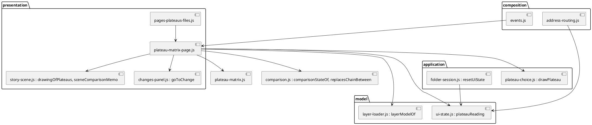
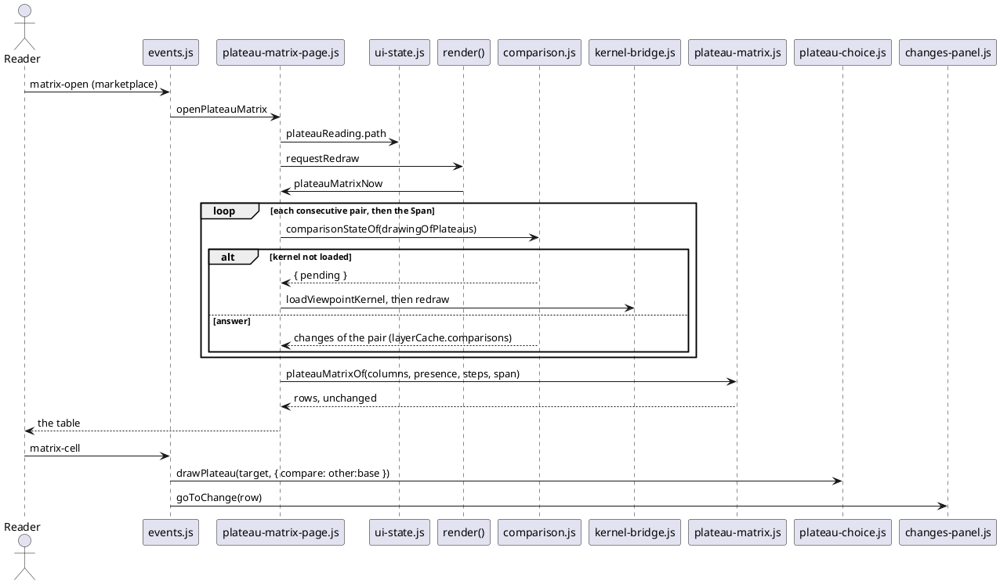

# A Reading view for a path of plateaus on the page Plateaus

# Summary

On the page Plateaus of the editor, a reader chooses a plateau on the tree and reads, in one table, where each element of the path from the root to that plateau came from and went: a column for each plateau of the path plus a Span column, a row for each lineage (an element followed through `replaces`), rows grouped by layer, rows with no change folded by default, elements only. It is the page that the command `archicode plateau matrix` (wave 033) was promised to get "in a second run, reading the same cases". The table shows the same rows as the command for the same path.

Design: the rule that turns presence and comparisons into rows is ported once, as a pure function of the model layer (`model/plateau-matrix.js`), from `rendering/matrix/PlateauMatrix.java`, and pinned by `src/test/resources/brightcart/matrix-cases.json` (the oracle, never edited), read by a new node test as `PlateauMatrixCasesTest` reads it in Java. The cells come from `comparisonStateOf` once per consecutive pair and once for the Span, with the `chain` of `replacesChainBetween` that the editor already adds (no kernel change). A new presentation part draws the table under the tree; the chosen plateau is in the address; a click on a cell draws the pair of that cell and opens the existing Changes panel on that element. Nothing under `src/main/rust`, `src/main/wasm` or the oracle changes.

There is no PRD (profile TDD+pln). The sources are issue #24 and its decisions of 2026-10-31, the layout settled by run 0206, and the gate of phase P3, so traceability is incomplete (see PRD Traceability).

# Scope

In scope: `src/main/editor/` (one part in `model/`, one in `presentation/`, edits to the Plateaus page, the state, the reset of the state (`application/folder-session.js`), the events, the address, `style.css`, the lists `layers.json` and `names.json`), the generated `src/main/resources/editor-webapp/standalone.html`, the node tests and one end-to-end spec, `scripts/editor-coverage-floor.json` (only if a figure can go up), the manual (`src/doc/README.adoc`), the `CLAUDE.md` of `src/main/editor/presentation/`, and `docs/architecture/` and the generated sample only if a sentence of the model goes stale (CI-arc-1).

Out of scope: see Non-Goals and Deferred Work.

# PRD Traceability

No PRD. The requirements are assumed from issue #24 (comment of 2026-10-31, "Page-only first slice"), the manifest entry W-5 of wave 034 and the gate P3 (criteria 1 to 3), and are labelled `REQ-n`; they are not sourced from a PRD id.

- `REQ-1` (gate 1): a node test reads `src/test/resources/brightcart/matrix-cases.json` and checks that the cells of the Reading view for the path `baseline, inhouse, marketplace` of the layered Brightcart are the cells of the file, Span included (11 moved, 2 split, 1 merged). Addressed (DEC-1, DEC-3, IMP-1, IMP-7).
- `REQ-2` (gate 1): an end-to-end spec, named in this run's plan, passes with `--project=chromium` and `--project=firefox`; the path is in the address and a reload keeps it. Addressed (DEC-6, IMP-8).
- `REQ-3` (gate 2): `git diff --stat -- src/main/rust src/main/wasm src/test/resources/brightcart/matrix-cases.json src/test/resources/brightcart/expected` prints nothing for the whole wave, `ratchet.max` at most 99, no figure of `scripts/editor-coverage-floor.json` lower. Addressed (DEC-1, DEC-8, TG-4, RISK-1, RISK-2).
- `REQ-4` (gate 3): PMD, `./mvnw verify -DskipITs=false`, `scripts/byte-identity.sh` with its exceptions file unchanged, `npm run test:unit`, `test:coverage`, `format:check`, `lint`, and `editor:build` and `sample:build` leaving `git status --short` unchanged. Addressed (Observability and Verification).
- `REQ-5` (issue #24, scope of the slice): on the page Plateaus; one path chosen on the tree; columns are the path plus Span; lineage rows grouped by layer; a Changes-only fold; elements only; cells from `comparisonStateOf` per consecutive pair and once for the Span with `chain` from `replacesChainBetween`; the path in the address under the rule of wave 027; a click opens the existing Changes panel. Addressed (DEC-2 to DEC-7).
- `REQ-6` (issue #24, out of the slice and the wave Non-Goals): no relationships, no transient row, no all-against-baseline, no kernel change, no change of `plateau matrix`, `gap.*` or `matrix-cases.json`. Respected (Non-Goals).
- `REQ-7` (manifest scope): the manual and the model of ArchiCode. Addressed (IMP-9, IMP-10, CI-arc-1).
- Unresolved: none blocks the run. Q-1 and Q-2 are facts that the first test and a first measure settle, each with a stated fallback.

# Technical Goals

- `TG-1`: one pure function that builds the rows from the presence of the plateaus and the comparisons, equal to the Java rule on every case of the oracle (REQ-1).
- `TG-2`: an assembly that gets that data from the editor's own functions (`layerModelOf`, `comparisonStateOf`, `replacesChainBetween`) and writes no `AppState`, file or cache of its own: the only cache it touches is the comparison memo of the story scene on `layerCache`, and the only state it sets is the view state `plateauReading` (REQ-5).
- `TG-3`: a table that is readable at 1280 and 360 px in both themes, never by colour alone, with a click that opens the Changes panel (REQ-5).
- `TG-4`: no growth of the editor's debts: no upward pair, no figure of the coverage floor lower (REQ-3).
- `TG-5`: the proof: a node test on the oracle, an address test, one end-to-end spec on two browsers (REQ-1, REQ-2).

# Non-Goals

- No relationships, no transient row, no all-against-baseline reading, no choice of the first plateau other than the root (wave Non-Goals, issue #24).
- No change of the kernel, `plateau matrix`, `gap.*`, `matrix-cases.json` or the expected comparisons of the Brightcart; the oracle is read, not edited.
- No export of the table from the editor (the command writes the file).
- No new dependency and no remote import (the page is offline-safe, wave 034 P2).
- No edit of a plateau from the Reading view; writing stays where it is (`plateauWritingHtml`).

# Assumptions

- `ASM-1`: the answer of `compare` that `comparisonStateOf(...).full.changes` holds is the table the command line reads from `diff -f json`: rows `{ thing: 'element', layer, reference, change, replaces, natures }`, `change` being `new`, `changed`, `removed`, `moved`, `split` or `merged`, and an element that is not listed did not change. Read from `PlateauMatrixCasesTest` (the keys `thing`, `layer`, `reference`, `change`) and `model/comparison.js`; the exact names of `replaces` and `natures` on the JavaScript side are confirmed by the first test (Q-1).
- `ASM-2`: `layerModelOf(id, settings).index.application` and `.technology` are Maps whose values carry `reference`, `kind` and `name` and hold the elements of the plateau as loaded, not a union (the Java `presence` reads the same). Validated by the first test, which builds the matrix of each case and checks `rows` and `unchanged` of the case (`rows + unchanged` is the number of lineages, 88 for the first case).
- `ASM-3`: one kernel `compare` of a Brightcart pair is fast enough to run N pairs on the page's turn (the story player runs one per step). Not measured; Q-2 and RISK-3.
- `ASM-4`: the path is always the chain from the root to the plateau chosen on the tree (`plateauChain`), so it is always on one chain and in tree order, and the refusals of the command (siblings, unknown, order, twice) cannot be produced by the page. The pure function still takes any list the oracle gives it, including the case `baseline-marketplace-skipping-inhouse`.
- `ASM-5`: the address rule of wave 027 is the one of `[[editor-link-carries]]`: a parameter is in the address when it changes what is drawn, absent means the default, never for the surroundings. The chosen path and the unfolded rows change what is drawn; the open state of a detail does not.

# Constraints

- `CON-1`: the page is generated; edits are in `src/main/editor/`, then `npm run editor:build`, both committed (`CLAUDE.md`).
- `CON-2`: the ratchet of `layers.json` stays at 99 or lower: a part uses only the layers before it; the assembly that needs `drawingOfPlateaus` and `sceneComparisonMemo` (both in `presentation/story-scene.js`) is therefore in `presentation/`.
- `CON-3`: the coverage floor of `scripts/editor-coverage-floor.json` is not lowered: the new lines must be run by the node suite (the area `pages` is at 87.1 lines).
- `CON-4`: a state that is not the workspace is view state: no `modelsChanged()`, reset by `resetUiState`, not in `snapshotWriteState` (as the Maps' parts and `diagramColumns`).
- `CON-5`: the command line and the editor say the same sentences (`CLAUDE.md`): the words of the states (`new`, `changed`, `removed`, `moved`, `split`, `merged`) are the ones of `CHANGE_STATES` (in `presentation/diagram-states.js`, filled from the kernel, so empty until the kernel is loaded) and the glyphs are those of the Changes panel, and the cases file is shared; the page invents no state word. The pure rule returns the words; the glyphs are added in `presentation/` (CON-2).
- `CON-6`: a mark never relies on colour alone (the manual's rule for the comparison): each cell has a glyph and a word.
- `CON-7`: no real workspace content: tests and fixtures use the layered Brightcart only.
- `CON-8`: Safari floor and the APIs of `browser-apis.test.js` (Chromium 111, Firefox 121, Safari 16.2): no CSS or API newer than that; `position: sticky` and `overflow: auto` only.

# Current State

- The page Plateaus is `renderPlateausPageHtml` in `presentation/pages-plateaus-files.js`: the tree as `ol.timeline-list` (`timelineListHtml`, `timelineItemHtml`), buttons per entry (`timeline-draw`, `timeline-changes`, `plateau-create`, `plateau-edit`), the events in `composition/events.js`, and the Changes panel on the right when a comparison is on (`renderPlateausPerspectiveHtml`, `withChangesPanel`). `settlePlateausPanel` loads the kernel and redraws the panel.
- The comparison of any two plateaus without writing the state exists: `drawingOfPlateaus(plateau, against, toggles)` and `sceneComparisonMemo()` in `presentation/story-scene.js` (kept on `layerCache.comparisons`), `comparisonStateOf(drawing, memo)` in `model/comparison.js` (returns null, `{ pending }`, `{ problems }` or the answer, with the `chain` from `replacesChainBetween(baseId, targetId)` added by `comparisonInput`). `layerModelOf(id, settings)` gives the elements of a plateau.
- The row rule exists in Java only: `rendering/matrix/PlateauMatrix.java` (`of(columns, presence, steps, span)`, `trace`, the sort by layer rank, then reference by code point, then column) and `cli/PlateauMatrixCommand.java` (presence from the loaded plateau, one comparison per step and one for the Span).
- The oracle: `src/test/resources/brightcart/matrix-cases.json`, with `workspace`, three `cases` (`baseline-inhouse-marketplace`: 61 rows, 27 unchanged, Span 38 new, 3 changed, 6 removed, 11 moved, 2 split, 1 merged; `baseline-saas`; `baseline-marketplace-skipping-inhouse`, 2 columns, no Span) and `refusals`. Each case has `expectRows` (`layer`, `reference`, `cells` as one state word per column, `span`, `from` per cell when a cell replaces something), `pairs` and `span` counts. `PlateauMatrixCasesTest` also cross-checks each cell against `diff -f json`.
- The Changes panel and its walk are `presentation/changes-panel.js` (`renderChangesPanelHtml`, `goToChange`, `orderedChangeRows`, `changeRowKey`); the address is `currentRouteHash` in `composition/address-routing.js`, read by `syncPerspectiveFromHash` (`drawLayersNamedByAddress`, `applyDiagramParamsFromHash`).
- The editor's six layers are in `src/main/editor/layers.json` in order (`core`, `model`, `persistence`, `application`, `presentation`, `composition`), `ratchet.max` is 99, the lists are `names.json` and `java-names.json`.
- Node harness: `src/test/javascript/viewpoint-kernel/harness.js` (`createApp`), `mem-folder.js`, `layered-folders.js`; the Brightcart layered folder is read by `plateaus-page-and-addresses.test.js` and `story-player-scene.test.js`. End-to-end specs are in `src/test/e2e/` (`changes-walk.spec.js`, `sample.spec.js`, `diagram-address.spec.js`).

# Proposed Design

Three new places and edits to six existing ones; the page Plateaus keeps its list and gains, below it, a Reading block when a path is chosen.

- `model/plateau-matrix.js` (pure, no `AppState`): `plateauMatrixOf({ columns, presence, steps, span })` returning `{ columns, rows, unchanged, spanCounts }`, a port of `PlateauMatrix.of` (same predecessor rule, same trace, same sort, same `unchanged` count), and nothing that draws: it returns state words only (`new`, `changed`, `removed`, `moved`, `split`, `merged`, plus `absent` and `present`, the words of `MatrixReport`), because `CHANGE_STATES` and the glyphs live in `presentation/diagram-states.js` and a `model/` part that named them would be an upward pair. The glyph of a word is added in `presentation/plateau-matrix-page.js` (`matrixGlyphOf`): the glyph of `CHANGE_STATES` for a change, `-` for `absent` and `=` for `present`, and the plain word alone while `CHANGE_STATES` is still empty (the kernel is not loaded).
- `presentation/plateau-matrix-page.js`: `plateauMatrixPathOf(id)` (the plateaus of `plateauChain(tree, id)` ids), `plateauMatrixNow()` (assembles the inputs: one `layerModelOf` per column; one `comparisonStateOf(drawingOfPlateaus(column[i], column[i-1]), sceneComparisonMemo())` per step; one for the Span from the first to the last when there are three columns or more; it returns `{ pending }`, `{ problems }` or the matrix; it keeps no memo of its own, the only cache is the comparison memo that `sceneComparisonMemo()` keeps on `layerCache`), `renderPlateauMatrixHtml()` (the table), `openPlateauMatrix(id)`, `closePlateauMatrix()`, `setMatrixRows(all)`, `openMatrixCell(column, layer, reference)`.
- State in `model/ui-state.js`: `plateauReading = { path: <last plateau id>|null, all: false }`, view state (CON-4).
- `presentation/pages-plateaus-files.js`: an entry that is not the root gets a button *Read the path* (`data-action="matrix-open"`, `aria-pressed` on the chosen one); `renderPlateausPageHtml` appends the block under the list; `settlePlateausPanel` also redraws when the reading was pending.
- `composition/events.js`: four actions; `composition/address-routing.js`: the two keys (DEC-6); `application/folder-session.js`: `resetUiState` clears `plateauReading` with the folder (the clicks draw a plateau through `drawPlateau`, already there, and `snapshotWriteState` in `application/layer-writes.js` does not hold the state).
- `style.css`: the table (`.matrix`, a scroll box, a sticky first column), the Span column, the narrow layout.

The reviewer validates that every arrow goes down or stays in its layer (`plateau-matrix.js` uses nothing but plain data and nothing above `model/`: it does not call `comparison.js`, the assembly hands it the changes; only `presentation/` reaches `story-scene.js`), that the new part reads the kernel only through `comparisonStateOf`, and that no arrow writes `AppState`. Textual fallback: events call the page part, which reads the tree, `layerModelOf` and `comparisonStateOf`, hands the plain data to the pure rule, and draws; a click calls `drawPlateau` then `goToChange`.

## Design decisions

- `DEC-1` — One port of the Java rule in the model layer, pinned by the oracle; no rule in the page's drawing
  - `Decision:` `model/plateau-matrix.js` ports `PlateauMatrix.of` statement for statement (predecessors, backward trace from terminal elements, split drawn in each result's row, merge as one row, Span from the first-to-last comparison, `removed` for a row that ends before the last plateau, empty for a row that starts after the first and ends before the last, sort by layer rank then code point then first column, unchanged rows counted). The node test `plateau-matrix-cases.test.js` feeds it the data of the Brightcart and checks each case of `matrix-cases.json`: `expectRows` (layer, reference, `cells`, `span`, `from`), `rows`, `unchanged`, and the `span` and `pairs` counts from the comparisons.
  - `Rationale:` the file is the contract ("the oracle, not edited"); one rule written twice must be held equal by a test, and the Java side already is.
  - `Alternatives considered:` ask the kernel (the rule is not in the Rust and the wave forbids changing it); call `plateau matrix` from the page (the hosted editor has no command line); read the rows from a file that the command writes (not available in a browser workspace).
  - `Tradeoffs:` two implementations of one rule; the shared cases file is the guard, as for `compose-replaces-cases.json`. About 150 lines of JavaScript.
  - `Linked PRD IDs:` REQ-1, REQ-3, REQ-5.
- `DEC-2` — The path is the chain from the root to the plateau chosen on the tree; Span is first-to-last of that chain
  - `Decision:` the tree of the page stays; an entry that is not the root has *Read the path*, which sets `plateauReading.path` to its id. The columns are `plateauChain(tree, id)` (root first) and the Span column is one comparison of the first with the last, with `chain`. A path of two plateaus has no Span column (the step is the Span), as the file has none (`span: null`).
  - `Rationale:` the decision of the author on #24 (Span first-to-last, a forked tree needs the path chosen) and run 0206 (Q-3); a chain from the root cannot hold siblings (ASM-4), so the refusals of the command never arise.
  - `Alternatives considered:` Span against the baseline only (equal here: the first plateau is the root); a start other than the root (a second choice on the tree, deferred, DEF-1); every plateau of the tree as a column (siblings would be compared, `on_one_chain` false).
  - `Tradeoffs:` the case `baseline-marketplace-skipping-inhouse` is proved on the pure function and is not reachable on the page.
  - `Linked PRD IDs:` REQ-5.
- `DEC-3` — The assembly compares with `comparisonStateOf` through the story scene's drawing and memo, with the wording toggle off
  - `Decision:` for column `i` (1-based from the second) the step is `comparisonStateOf(drawingOfPlateaus(column[i], column[i-1], { hideWording: false }), sceneComparisonMemo())` and the Span is the same with the last and the first; the changes read are `state.full.changes` filtered to `thing === 'element'`. The presence of a column is the two layer indexes of `layerModelOf(id, settings)` as `{ layer, reference, kind, name }`. The `chain` is added by `comparisonInput`, so a pair of plateaus not adjacent in the tree is composed as the editor already does.
  - `Rationale:` no new engine (wave Non-Goal), no `AppState` write, the memo keeps the answers with the manifests they were made from; `hideWording` off gives the table of `diff` (the oracle's cells).
  - `Alternatives considered:` `comparisonState()` of the drawn plateau (it would move the editor's drawing for every pair); a memo of the page (a second cache to invalidate).
  - `Tradeoffs:` the assembly lives in `presentation/` (CON-2); it is a function of the plateaus and the manifests, so a redraw with nothing changed is a cache hit.
  - `Linked PRD IDs:` REQ-1, REQ-5.
- `DEC-4` — Rows and cells as a table, grouped by layer, folded by default, one state word and glyph per cell
  - `Decision:` a `<table class="matrix">` in a scroll box: the row header is the reference (and the kind and name as a title), a sticky first column; the head is the plateaus (name and id), then Span; a row of a layer group is under a `<tbody>` with a caption row *Application* or *Technology* (application first, as the file sorts). A cell is `<button>` (DEC-7) with the glyph and the word of its state (the glyph of `CHANGE_STATES` added by `matrixGlyphOf` in `presentation/`, `-` absent, `=` present) and, for a cell that replaces something, `from <references>`. *Changes only* (default on) shows the rows the file holds; off, it adds the unchanged rows, whose cells are all `=` or `-`; the count (`61 of 88 rows`, `27 unchanged`) is under the title. A 360 px layout keeps the table in its own horizontal scroll (the page does not scroll sideways).
  - `Rationale:` the layout of run 0206 (a row is one lineage, a column one plateau, a Span column, rows folded); the same words as the Changes panel (CON-5); no colour alone (CON-6).
  - `Alternatives considered:` one card per row under 40 rem (more markup for no gain, deferred); a `matrix` role on a grid of divs (a table is the native reading of rows by columns).
  - `Tradeoffs:` a wide path scrolls sideways inside its box.
  - `Linked PRD IDs:` REQ-5.
- `DEC-5` — Unfolded rows come from the same function, not from a second pass
  - `Decision:` `plateauMatrixOf` returns every lineage with a flag `changes` and a count `unchanged`, as the Java builds `built` before filtering; the page filters. The oracle compares the filtered rows (`expectRows`) and the count; the unfolded view is checked by count (`rows + unchanged`, 88 for the first case) and by a spot check that an unchanged lineage has only `present` and `absent` cells.
  - `Rationale:` the file leaves unchanged rows out, so the page cannot be proved cell by cell on them; one function means one rule.
  - `Alternatives considered:` a view with no unfolding (the author asked for the fold, not for its absence).
  - `Tradeoffs:` the unchanged rows are proved by the same rule, not by an oracle.
  - `Linked PRD IDs:` REQ-5, REQ-1.
- `DEC-6` — The address carries the path and the unfolding, nothing else
  - `Decision:` `matrix=<plateau id>` is written when `plateauReading.path` is set, `rows=all` only when the rows are unfolded; both after `plateau=` on the page Plateaus only; absent means no reading and folded. They are read by `syncPerspectiveFromHash` (a path that is not in the tree, is the root, names a plateau that cannot be drawn, or a workspace with no plateau or with blocked layers drops the key and the address is written back as it is), restored on a reload and on Back and Forward, and a path chosen on the page is an entry of the history (`layerChangeIsAnEntry` as the plateau choice). The open or folded state of a detail, scroll and the selected cell are not in the address.
  - `Rationale:` wave 027 rule (ASM-5); run 0206 proposed the path as the last plateau.
  - `Alternatives considered:` the whole list `matrix=baseline,inhouse,marketplace` (longer, and not richer: the path is the chain, ASM-4).
  - `Tradeoffs:` if a start other than the root is added later (DEF-1) the key gets a second form; the single id stays valid.
  - `Linked PRD IDs:` REQ-2, REQ-5.
- `DEC-7` — A click draws the pair of the cell and opens the existing Changes panel on that element
  - `Decision:` a cell of column `i` calls `drawPlateau(column[i], { compare: 'other:<column[i-1]>' })` (`{ compare: 'past' }` when `column[i-1]` is its parent; the function takes the plateau id and an options object, not a string), a cell of the Span calls it with the last and `{ compare: 'other:<first>' }`, then selects the row of the element in the Changes panel through the function the panel's rows use (`goToChange` over the row whose key is the element); the panel opens on the right (`comparisonPanelOn()` is then true on this page). The Reading block stays on the page, and the first column has no click. A cell that is `absent` or `present` is not a button.
  - `Rationale:` "a click opens the existing Changes panel" (the slice of #24); it reuses the panel and the key `j`/`k` walk with no second list.
  - `Alternatives considered:` a detail under the table (run 0206's mock-up; a second panel that says what the Changes panel says); a link to Elements (loses the comparison).
  - `Tradeoffs:` a click changes the plateau drawn and the comparison of the whole editor (the band and `plateau=` and `compare=` follow), as *Changes* on an entry already does; Back returns.
  - `Linked PRD IDs:` REQ-5.
- `DEC-8` — Part placement and the ratchet
  - `Decision:` `model/plateau-matrix.js` after `model/comparison.js` in `layers.json`; `presentation/plateau-matrix-page.js` before `presentation/pages-plateaus-files.js`. `npm run editor:check` is run after each part and `node scripts/check-editor.mjs --list` must not show a new upward pair. The area markers of `scripts/editor-coverage.mjs` are not changed (the parts sit in existing areas).
  - `Rationale:` CON-2, CON-3.
  - `Alternatives considered:` put the assembly in `application/` (an upward pair on `story-scene.js`, +1 on 99).
  - `Tradeoffs:` the part list and `names.json` change with every new top-level name; `check-editor.mjs --write-names` writes it.
  - `Linked PRD IDs:` REQ-3.

# Repository Impact

- `IMP-1` — The pure rule
  - `Path(s):` `src/main/editor/model/plateau-matrix.js` (new), `src/main/editor/layers.json`, `src/main/editor/names.json`
  - `Change type:` additive
  - `Why impacted:` DEC-1, DEC-8.
  - `Linked PRD IDs:` REQ-1, REQ-3.
  - `Risks / notes:` the sort is by code point, not UTF-16 (the Java `compareCodePoints`): a JavaScript `localeCompare` or `<` on strings would differ for an astral character; the test has one reference with such a character.
- `IMP-2` — The assembly and the drawing
  - `Path(s):` `src/main/editor/presentation/plateau-matrix-page.js` (new)
  - `Change type:` additive
  - `Why impacted:` DEC-2 to DEC-5, DEC-7.
  - `Linked PRD IDs:` REQ-5.
  - `Risks / notes:` the kernel may be pending (a first visit): the block says *Reading the plateaus…*, and `settlePlateausPanel` loads the kernel and redraws (FLOW-1).
- `IMP-3` — The page Plateaus
  - `Path(s):` `src/main/editor/presentation/pages-plateaus-files.js`
  - `Change type:` modify
  - `Why impacted:` the button on an entry, the block under the list.
  - `Linked PRD IDs:` REQ-5.
  - `Risks / notes:` `timeline-list` and the Changes button keep their markup, byte for byte, so `plateaus-page-and-addresses.test.js` and the sample specs read the same.
- `IMP-4` — The state and the events
  - `Path(s):` `src/main/editor/model/ui-state.js`, `src/main/editor/application/folder-session.js`, `src/main/editor/composition/events.js`
  - `Change type:` modify
  - `Why impacted:` CON-4; four actions (`matrix-open`, `matrix-close`, `matrix-rows`, `matrix-cell`).
  - `Linked PRD IDs:` REQ-5.
  - `Risks / notes:` `resetUiState` (in `application/folder-session.js`, which this item also edits) must clear the reading with the folder; `snapshotWriteState` (`application/layer-writes.js`) must not hold it.
- `IMP-5` — The address
  - `Path(s):` `src/main/editor/composition/address-routing.js`
  - `Change type:` modify
  - `Why impacted:` DEC-6.
  - `Linked PRD IDs:` REQ-2.
  - `Risks / notes:` `diagram-address-audit.test.js` holds every input of the drawing to a parameter or a reason: the two new inputs are added to it.
- `IMP-6` — The style
  - `Path(s):` `src/main/editor/style.css`
  - `Change type:` additive
  - `Why impacted:` DEC-4, CON-6, CON-8.
  - `Linked PRD IDs:` REQ-5.
  - `Risks / notes:` `stylesheet-claims.spec.js` and `workspace-menu-layout.test.js` read declarations of the sheet; a new block must not move them. Dark mode through the existing tokens only.
- `IMP-7` — The node tests
  - `Path(s):` `src/test/javascript/viewpoint-kernel/plateau-matrix-cases.test.js` (the oracle), `plateau-matrix-rule.test.js` (the pure rule on hand-made inputs: split, merge, a transient row as a function result, code-point order, two plateaus with no Span), `plateau-matrix-page.test.js` (the block, the address, the click, the fold, the pending kernel, a workspace with no plateau); `diagram-address-audit.test.js` (modify)
  - `Change type:` additive, one modify
  - `Why impacted:` REQ-1, CON-3.
  - `Linked PRD IDs:` REQ-1, REQ-3.
  - `Risks / notes:` the oracle test reads `matrix-cases.json` with `fs` and does not write it.
- `IMP-8` — The end-to-end spec
  - `Path(s):` `src/test/e2e/plateau-matrix.spec.js` (new)
  - `Change type:` additive
  - `Why impacted:` REQ-2: opens the Brightcart sample on the page Plateaus, chooses *Read the path* on `marketplace`, checks the head (`baseline`, `inhouse`, `marketplace`, Span), the row count and the Span words of one row, clicks a cell and sees the Changes panel, reloads and finds `matrix=marketplace` and the table, at 1280 and 360 px.
  - `Linked PRD IDs:` REQ-2.
  - `Risks / notes:` runs with `--project=chromium` and `--project=firefox`; WebKit is not claimed.
- `IMP-9` — The manual and the editor's notes
  - `Path(s):` `src/doc/README.adoc` (`[[editor-plateaus]]`, `[[editor-link-carries]]` and the line of `plateau matrix`), `src/main/editor/presentation/CLAUDE.md`
  - `Change type:` modify
  - `Why impacted:` the page gets a view; the address has two keys; the doc tests (`manual-anchors.json`, `manual-skeleton.test.js`) read the manual.
  - `Linked PRD IDs:` REQ-7.
  - `Risks / notes:` CLAUDE.md states what is true now, with no wave, run or issue ids.
- `IMP-10` — The generated page and the floor
  - `Path(s):` `src/main/resources/editor-webapp/standalone.html`, `scripts/editor-coverage-floor.json`
  - `Change type:` modify
  - `Why impacted:` `npm run editor:build`; the floor is raised only if `test:coverage` says so (`--write-floor`).
  - `Linked PRD IDs:` REQ-3, REQ-4.
  - `Risks / notes:` `src/main/resources/editor-webapp/samples/` and `docs/architecture/` do not change unless CI-arc-1 says so; `npm run sample:build` must leave `git status --short` unchanged.

# Canonical Impact

- `CI-arc-1`: None expected. `docs/architecture/manifests/archicode.yaml` models the editor by its six layers (`archicode.editor.model`, `archicode.editor.presentation`, `archicode.editor.composition`) and the command `plateau_matrix`, not by part; no element or `tags.path` becomes stale. The model also has `mirror of` relationships and `shared_cases` between the command line and the editor: if one of them, or a sentence of a layer that names the Plateaus page, names the matrix or its cases, it is changed to say that the page reads `matrix-cases.json` too; then `npm run sample:build` follows (the sample of the ArchiCode model is a bundle of the folder) and `ArchitectureDriftTest` and `impact-questions.json` are rerun. The implementing run checks this with `grep -n -i "plateau\|matrix\|mirror of\|shared_cases" docs/architecture/manifests/archicode.yaml` (and the manifests beside it) and says so in its log.
- `CI-dom-1`: Not applicable: `docs/` declares no `dom` register.

# Data Model and Contracts

- `CTR-1` — View state `plateauReading`
  - `Current contract:` none.
  - `Proposed contract:` `{ path: string|null, all: boolean }` in `model/ui-state.js`; `path` is the id of a non-root plateau of the tree; reset by `resetUiState`, not in `snapshotWriteState`, no `modelsChanged()`.
  - `Affected files:` `model/ui-state.js`, `presentation/plateau-matrix-page.js`, `composition/address-routing.js`, `composition/events.js`.
  - `Migration or compatibility notes:` none stored; an older address has neither key and draws the page as before.
  - `Linked PRD IDs:` REQ-5.
- `CTR-2` — The address keys of the page Plateaus
  - `Current contract:` `#/timeline/plateaus?plateau=<id>`.
  - `Proposed contract:` `...?matrix=<id>` and `rows=all`, after `plateau=`; an unknown or root id, a plateau that cannot be drawn, blocked layers, or a workspace with no plateau, drops the key and the address is written back; `rows=all` without `matrix=` is dropped.
  - `Affected files:` `composition/address-routing.js`, `src/doc/README.adoc`, the address audit test.
  - `Migration or compatibility notes:` additive; the plateau drawn and the comparison keep their own keys, which a click on a cell changes.
  - `Linked PRD IDs:` REQ-2.
- `CTR-3` — The input of `plateauMatrixOf`
  - `Current contract:` the Java `PlateauMatrix.of(columns, presence, steps, span)` with `Node(layer, reference, kind, name)` and `Comparison.ElementChange(layer, reference, change, replaces, natures)`.
  - `Proposed contract:` the same shapes as plain objects: `columns: [{ id, ... }]`, `presence: [[{ layer, reference, kind, name }]]`, `steps: [[{ layer, reference, change, replaces, natures }]]` (the element changes of each pair), `span: [...]|null`; the output is `{ columns, rows: [{ layer, reference, kind, name, cells: [{ plateau, state, reference, from, natures }], span: { state, from, natures }|null, changes }], unchanged }`. It throws on sizes that disagree, with the Java sentence.
  - `Affected files:` `model/plateau-matrix.js`, the tests.
  - `Migration or compatibility notes:` none; the oracle's `expectRows` are a projection of the output (`layer`, `reference`, `cells[].state`, `span.state`, `cells[].from` when one is not empty).
  - `Linked PRD IDs:` REQ-1.

# Interfaces and Behavior

- `IF-1`: *Read the path* on an entry of the tree (not the root) opens the Reading block under the list, titled with the path (`baseline, inhouse, marketplace`); pressing it again, or *Close reading*, closes it. With one plateau the button is absent.
- `IF-2`: the block says the counts (`61 changes in 88 lineages`), *Changes only* (a toggle with `aria-pressed`) and the table of DEC-4. An error panel instead of the table when a pair cannot be drawn (the sentences of `comparisonStateOf`: `problems`), with the pair named; the tree stays usable.
- `IF-3`: a cell with a change is a button whose label says the element, the state and the pair (`commerce.cart, moved, inhouse to marketplace`); activating it is DEC-7. Keyboard: Tab through cells; no new global key.
- `IF-4`: error and fallback states: kernel not loaded (a status line, then the table); a workspace with one plateau (the existing note, no button); a plateau that cannot be drawn (its entry has the `!` flag, *Read the path* is disabled); no plateau tree (`AppState.layers` null) or layers blocked (`layers.blocked`): no button and no block, the page as it is today; a stored or addressed path that is no longer in the tree, is the root, or whose plateau cannot be drawn: `plateauReading` is cleared and the key leaves the address, and the page shows the list alone.

# Flows and Processing Logic

- `FLOW-1` — Open a path
  - `Trigger:` the reader presses *Read the path* on `marketplace`, or opens an address with `matrix=marketplace`.
  - `Steps:` `openPlateauMatrix(id)` sets `plateauReading.path`, pushes an entry of the history, requests a redraw; `renderPlateausPageHtml` calls `plateauMatrixNow()`; it takes `plateauChain`, loads each `layerModelOf`, runs the steps and the Span through `comparisonStateOf`, calls `plateauMatrixOf`, draws the table.
  - `Branches / failure paths:` `loadedKernel` null: `{ pending }`, a status line, `loadViewpointKernel().then(redraw)` (as `settlePlateausPanel`); a `problems` answer for a pair: the error block names the pair; an address that names an unknown plateau: the key is dropped; a write in flight or a dialog open: the page is as `drawLayersNamedByAddress` leaves it.
  - `Final output / rendered result:` the table of the path.
  - `Linked PRD IDs:` REQ-5, REQ-2.
- `FLOW-2` — Click a cell
  - `Trigger:` activation of a cell button.
  - `Steps:` `drawPlateau(target, { compare: compareChoice })` (the editor draws the plateau and compares it with the cell's base); `goToChange` selects the element's row; the right panel opens on Changes.
  - `Branches / failure paths:` the row is not in the list (a filter of the panel hides it): `goToChange` clears the filter as the walk does, or the panel opens with no row selected, which the test fixes; `drawPlateau` returns false when the pair is already the one drawn (or when the layers are blocked or the plateau is not in the tree): the panel is already on that comparison, only the row is selected; with the editor's wording toggle on (`AppState.hideWording`) a wording-only `changed` row is not in the panel's list, so no row is selected and the panel opens on the pair, which the test fixes.
  - `Final output / rendered result:` the Changes panel on the pair of the cell, on the element.
  - `Linked PRD IDs:` REQ-5.

The reviewer validates that the kernel is asked once for each pair and once for the Span (and cached), that the pending branch ends in a redraw, and that the click changes the editor's drawing only through `drawPlateau`. Textual fallback: open sets the path, the redraw assembles, compares, builds and draws; a click draws the pair and selects the change.

# Reliability, Performance, and Scalability

- The comparisons are cached on `layerCache.comparisons` (a redraw is a hit; a change of a manifest empties the cache with the layer cache). The pure rule is linear in the elements of the path. `ASM-3` is checked by timing the first open of the Brightcart and of `replaces-large-pair` (839 changes; the harbour of `src/test/resources/replaces-large-pair/plateaus`) by hand and recording the figures in the log; the time test `performance-budget.test.js` is not extended (it judges the kernel).
- The table is drawn in one string; at 61 to 88 rows it is small. A path of many plateaus grows by a column each; the box scrolls.
- Testability: the rule is pure (no browser); ELK does not run in the node suite and is not used here.

# Security and Privacy

Materially none: the page reads the workspace already loaded, makes no request and writes nothing. Every reference, name and plateau id is passed through `escapeHtml` (and through `encodeURIComponent` in the address); a test has a reference with `<` and `&`.

# Observability and Verification

- `node --test src/test/javascript/viewpoint-kernel/plateau-matrix-cases.test.js` (the oracle, `expectRows` of the three cases and `rows`, `unchanged`, `pairs`, `span`), `plateau-matrix-rule.test.js`, `plateau-matrix-page.test.js`, `diagram-address-audit.test.js`, `plateaus-page-and-addresses.test.js` (unchanged and green).
- `npx playwright test src/test/e2e/plateau-matrix.spec.js --project=chromium` and `--project=firefox` (after `npm run editor:build`; the spec is run by name, `npm run test:e2e` runs all).
- `npm run editor:check` (the three lists and the ratchet at 99 or lower; `node scripts/check-editor.mjs --list` before and after, the count unchanged), `npm run test:unit`, `npm run test:coverage` (no figure below the floor; `--write-floor` only raises), `npm run format:check`, `npm run lint`, `npm run editor:build` and `npm run sample:build` with `git status --short` unchanged afterwards.
- `./mvnw test-compile pmd:check`, `./mvnw verify -DskipITs=false` and `scripts/byte-identity.sh` (the exceptions file unchanged): no Java source changes, so these prove that the page's change touched nothing the jar serves besides `standalone.html` (which `EditorHttpServerTest` and `ShippedFilesTest` read).
- `git diff --stat -- src/main/rust src/main/wasm src/test/resources/brightcart/matrix-cases.json src/test/resources/brightcart/expected` prints nothing.
- A look at the page in the Browser pane at 1280 and 360 px, in both themes, on the Brightcart sample (no console error).

# Deployment and Rollout

A code-only change of the editor page (generated file committed with its parts). No data migration; an older address has neither key. The hosted editor gets it with the next tag (the website is proved only by a tag run, a wave risk not changed by this run). Backward compatibility: the list of plateaus and its buttons are byte for byte unchanged when no path is chosen. Rollback: revert the commit; the address keys of a kept link are dropped by the reader.

This section is planning guidance only: no deploy, tag or release is part of the run.

# Risks and Tradeoffs

- `RISK-1`: the ratchet at 99: any name used by a lower layer from a higher one adds a pair and the gate fails. Mitigation: DEC-8 and `check-editor.mjs --list` after each part.
- `RISK-2`: the coverage floor: about 400 new lines that the node suite does not run would lower `pages` (87.1). Mitigation: the page test drives the block, the fold, the address, the click, the pending and the error states; `test:coverage` is run before the commit.
- `RISK-3`: the cost of N `compare` calls on the page's turn on a large workspace. Mitigation: the memo, the manual measure of Q-2, a pending status line; a worker is deferred (DEF-3).
- `RISK-4`: the port drifts from the Java (an order or an edge case): the oracle has three cases and no transient row; a transient is proved by a hand-made input in `plateau-matrix-rule.test.js` whose expected values are written from the Java comment (`span` null), not from the code.
- `RISK-5`: a click changes the editor's drawing; a reader may not expect it. Mitigation: the button label says the pair, and the manual says it (the same effect as *Changes*).
- `RISK-6`: a `stylesheet` or layout test that reads declarations of `style.css` moves. Mitigation: the block is added after the existing ones and the two tests are run.
- `RISK-7`: Firefox and Chromium render the sticky column and the scroll box differently. Mitigation: the e2e spec runs on both; WebKit is not claimed (as the other specs of the Changes panel).

# Open Questions

- `Q-1` (resolved, read from the sources): a row of `state.full.changes` has `thing`, `layer`, `reference`, `destination`, `label`, `change`, and, as arrays, `replaces` (references of the other plateau, `changes-panel.js` reads `row.replaces` as `Array.isArray(row.replaces) ? row.replaces : []`) and `natures` (`natureWordsText(row.natures)`). Resolved: the mapping line reads `row.replaces` and `row.natures` from the `changes` rows directly, with no fallback to `state.records`; the key of a row for the click (DEC-7) is `changeRowKey(row)` = `changeKey(thing, layer, reference, destination, label)`. The first test of the plan still prints one row to pin the shape.
- `Q-2` (`hard_judgment`, resolved by default): where the time goes on a large path. Resolved: no worker, no incremental draw; the page uses the cache and the pending line; if the manual measure of the first open of `replaces-large-pair` exceeds one second the plan records the figure as a finding and DEF-3 stands. The author may overturn it.
- `Q-3` (resolved, decision): the unfolded view (DEC-5) is proved by count and by the same rule, since the oracle holds no unchanged row. Alternative: extend `matrix-cases.json` (forbidden by gate 2).

# Deferred Work

- `DEF-1`: a first plateau other than the root (a second choice on the tree), with the key `matrix=<from>..<to>` or similar.
- `DEF-2`: relationships as a second block, a transient row, an all-against-baseline reading, a reading of the sibling branch (issue #24, still open).
- `DEF-3`: the time of `compare` for a long path in the browser, and a worker or an incremental draw if Q-2's figure asks for it.
- `DEF-4`: one card per row under 40 rem, a markdown or JSON export from the editor.

# File Placement and Frontmatter

This document is `docs/wav/wav-034-diagrams-assets-likec4-matrix-page/run/run-0230-plateau-matrix-page/tdd-0230-plateau-matrix-page.md`, named after the run as the other runs' documents are, with `type: tdd`, `run: 0230`, `wave: 034`, `status`, `owner`, `date` and `related`. The plan, `pln-0230-plateau-matrix-page.md`, follows beside it.
