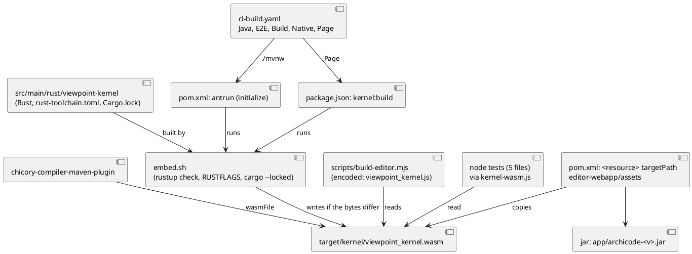
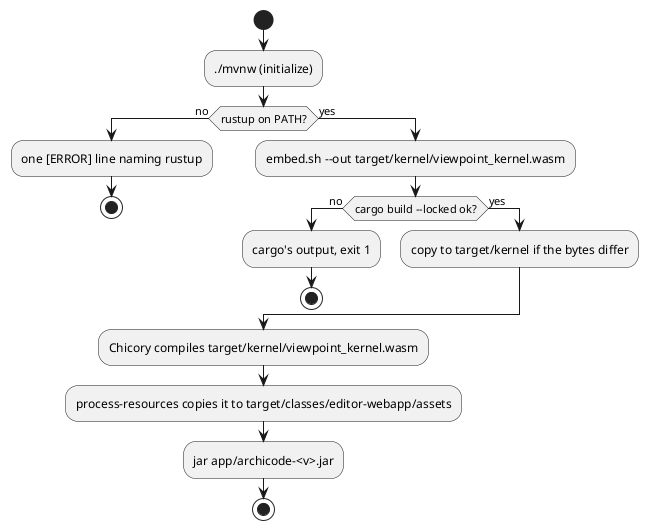

# The viewpoint kernel is built by Maven, no WebAssembly is committed

# Summary

Today `src/main/resources/editor-webapp/assets/viewpoint_kernel.wasm` is committed: `embed.sh` builds it from the Rust, the Chicory plugin of `pom.xml` translates it to JVM bytecode, `scripts/build-editor.mjs` writes from it the script `viewpoint_kernel.js` (committed too), five node tests read it, and the job `Kernel` of CI rebuilds it to compare it with the committed file. This run removes the committed file. `./mvnw` builds the kernel from `src/main/rust/viewpoint-kernel` with the pinned toolchain into `target/kernel/viewpoint_kernel.wasm`, feeds it to the Chicory plugin and puts it in the jar under the path it had (`editor-webapp/assets/viewpoint_kernel.wasm`); the node side (`build-editor.mjs`, the tests) reads the same file from `target/kernel/`; the jobs of `ci-build.yaml` that run `./mvnw` (and the job `Page`, which runs node) get Rust and a cache; the job `Kernel` keeps its tests, format, lint and coverage and loses its comparison with a committed file. The bytes are those the committed file had (proved on this machine by `cmp`, see DEC-1). When `rustup` is missing the build stops at its first phase with one `[ERROR]` line that names it and no stack trace (spiked, see DEC-2).

The page itself (`standalone.html`, `viewpoint_kernel.js`, the two bundles, the samples) stays committed in this run: moving it is wave 035's next run (W-2). This run changes where the `.wasm` that the script is made from comes from, and nothing about what the page is.

There is no PRD (profile TDD+pln): the sources are issue #207, the manifest entry W-1 of wave 035 and the six gate criteria of its phase P1, so traceability is incomplete (see PRD Traceability).

# Scope

In scope: `src/main/rust/viewpoint-kernel/embed.sh` and the comment of its `rust-toolchain.toml`; the `pom.xml` (the Rust build before the Chicory plugin, the Chicory input, the resource that puts the file in the jar); the committed `.wasm` leaves git; `scripts/build-editor.mjs`; `package.json`; the five node tests that read the `.wasm`, `build-editor.test.js`, `changes-map.test.js` and `scripts/changes.mjs`; `.github/workflows/ci-build.yaml`; the model of ArchiCode (`docs/architecture/manifests/archicode.yaml`) and the sample bundle made from it; `CLAUDE.md`, `src/main/rust/viewpoint-kernel/CLAUDE.md` and its `README.md`, `src/main/editor/CLAUDE.md`, `.github/CLAUDE.md`, `src/test/CLAUDE.md`.

Out of scope: the Rust of the kernel; `src/main/editor` beyond nothing (the page is not touched); building the page, the bundles or the samples with Maven (W-2); the manual, which says nothing about how the `.wasm` is built (checked: `grep -n -i -E "committed|embed.sh" src/doc/README.adoc` has no line about it; see IMP-12); a tag, a release, a dispatch of the workflow.

# PRD Traceability

No PRD. The requirements are the six criteria of the gate of phase P1 and the scope text of W-1, labelled `REQ-n` as in the TDD of run 0229; they are not sourced from a PRD id.

- `REQ-1` (gate 1): `git ls-files | grep -c viewpoint_kernel.wasm` prints 0. Addressed (DEC-1, IMP-4). It prints 1 today (the `.wasm`; `viewpoint_kernel.js` does not match) and 0 after; the script stays committed until W-2.
- `REQ-2` (gate 2): from a clean `target`, `./mvnw package -Dmaven.test.skip -Dplugin.asciidoctor.skip=true` exits 0; the `.wasm` in `target/quarkus-app/app/archicode-<version>.jar` is byte-identical to `git show 7742b07:src/main/resources/editor-webapp/assets/viewpoint_kernel.wasm`; a second clean build gives the same SHA-256. Addressed (DEC-1, DEC-3, DEC-8). The run names the jar: the application's own classes and resources are in `target/quarkus-app/app/`, the dependencies in `lib/main` (observed on the current `target/`).
- `REQ-3` (gate 3): with a `PATH` that holds `java` and the wrapper but neither `cargo` nor `rustup`, the first phase that builds the kernel exits non-zero with one `[ERROR]` line that names `rustup` and no stack trace of a plugin. Addressed (DEC-2, DEC-5). The first phase is `initialize`, so the command is `./mvnw -o initialize` (the plugin must be in `~/.m2`: one earlier build with the network).
- `REQ-4` (gate 4): no `CLAUDE.md` says "Maven needs no Rust" and the kernel's `CLAUDE.md` does not say the `.wasm` is committed. Addressed (IMP-12).
- `REQ-5` (gate 5): the step "Check the committed WebAssembly is the one the Rust builds" is gone, and the run's document lists each job that runs `./mvnw` with the step that makes `cargo` available in it. Addressed (DEC-6, IMP-11; the list is in FLOW-3 and the table of IMP-11).
- `REQ-6` (gate 6): `./mvnw test-compile pmd:check`, `./mvnw verify -DskipITs=false`, `npm run test:unit`, `npm run editor:check`, `npm run format:check` and `npm run lint` exit 0 with `npm ci` and the Maven build first; `scripts/byte-identity.sh` exits 0 with `scripts/byte-identity-exceptions.txt` unchanged; `npm run editor:build` leaves `git status --short` unchanged. Addressed (DEC-4, DEC-7, IMP-5 to IMP-10).

Unresolved: none of the six; the proof that the three native targets (`ubuntu-24.04-arm`, `macos-15`, and `ubuntu-24.04` on a tag) can build the kernel is not obtainable by a pull request (Q-1).

# Technical Goals

- `TG-1`: no WebAssembly in git; one script, `embed.sh`, knows how the kernel is built (toolchain, `RUSTFLAGS`, target), and Maven, npm and CI all call it (REQ-1, REQ-2).
- `TG-2`: the same bytes as today from a clean checkout, and the jar holds them at the path it held them (REQ-2).
- `TG-3`: a missing `rustup` is one clear line, from Maven and from npm (REQ-3).
- `TG-4`: every command that reads the kernel file builds it first or says in one line how to (REQ-6).
- `TG-5`: CI builds the kernel where a job needs it, with a cache, and the Kernel job no longer compares a committed file (REQ-5).
- `TG-6`: no document says the `.wasm` is committed or that Maven needs no Rust (REQ-4).

# Non-Goals

- Moving the page, the bundles, `viewpoint_kernel.js` or the samples out of git, running `npm ci` from Maven: W-2.
- Any change of the Rust, of the toolchain channel, of `Cargo.lock`, or of what the kernel computes.
- A committed hash or a test of the bytes of the `.wasm` (DEC-8).
- Renaming `embed.sh` (DEF-1).
- Windows: the Rust build is a bash script, as the release scripts are.

# Assumptions

- `ASM-1`: the compiler output does not depend on the cargo target directory. Validated here: a build into a scratch `--target-dir` with the committed remaps gave a file `cmp`-identical to the committed `.wasm` (813,383 bytes, 11 s from a clean target, this machine). Re-validated by the gate (REQ-2).
- `ASM-2`: GitHub-hosted `ubuntu-latest`, `ubuntu-24.04`, `ubuntu-24.04-arm` and `macos-15` runners ship `rustup`; `rust-toolchain.toml` makes the first `cargo` command install the pinned compiler, the three components and the wasm target. Checked on 2026-11-07 against the software lists of the runner images (`actions/runner-images`: `Ubuntu2404-Readme.md`, `Ubuntu2404-Arm64-Readme.md` and `macos-15-arm64-Readme.md` each list Rustup 1.29.2 and Cargo 1.99.1 under "Rust Tools") and, for `ubuntu-latest`, by the job `Kernel` as it is today (no install step). What no list proves is the first `cargo` run on the arm and macOS runners (network, rustup's download of the pinned 1.97.1 over the image's 1.99.1): that run is the tag or the rehearsal dispatch (Q-1).
- `ASM-3`: `actions/cache` of `~/.rustup/toolchains`, `~/.rustup/update-hashes`, `~/.cargo/registry` and `~/.cargo/git` is a sufficient cache of the toolchain; a restored toolchain directory is used by `rustup` without a download. Validated by the second run of the pull request (the step prints a cache hit and the build step is faster); if not, the cache is dropped and the time reported.
- `ASM-4`: the Maven plugin `maven-antrun-plugin` 3.2.0 and Ant 1.10.15 download at the first build as every plugin does; the build already needs the network at its first run (Quarkus, Chicory).
- `ASM-5`: a native image built from a different jar of the same bytes behaves as before: the `.wasm` content is the same, only the path it comes from at build time moves.

# Constraints

- `CON-1`: the toolchain is pinned by `src/main/rust/viewpoint-kernel/rust-toolchain.toml` (`channel = "1.97.1"`, minimal profile, `rustfmt`, `clippy`, `llvm-tools-preview`, target `wasm32-unknown-unknown`) and rustup installs it by itself.
- `CON-2`: the `RUSTFLAGS` remaps of `embed.sh` (`~/.cargo`, `~/.rustup` and the kernel folder) and `Cargo.lock` give the same bytes on every machine; they stay as they are, with `--locked` added so that a build never moves the lock.
- `CON-3`: the jar keeps `editor-webapp/assets/viewpoint_kernel.wasm` (the gate reads it there, and `quarkus.native.resources.includes` has `editor-webapp/**`); `EditorHttpServer` still answers 404 for it (`EditorHttpServerTest.answers404ForAnyOtherPathUnderAssets`).
- `CON-4`: `scripts/byte-identity.sh` and its exceptions file do not change: the output of no command changes.
- `CON-5`: the page opened from a disk keeps working: `standalone.html` and `assets/*.js` are the committed bytes (`editor-offline.spec.js` third test is not touched).
- `CON-6`: JDK 25 for `./mvnw`; PMD (`./mvnw test-compile pmd:check`) reads `src/main/java` and `src/test/java` only.
- `CON-7`: the build is Linux and macOS (bash 3.2 compatible `embed.sh`, as the scripts of `.github/scripts` are).

# Current State

- `src/main/rust/viewpoint-kernel/` holds `Cargo.toml` (serde, serde_json, serde_json_path; release profile `opt-level = "z"`, `lto`, `panic = "abort"`, `strip`), `Cargo.lock`, `rust-toolchain.toml`, `embed.sh`, `README.md`, `CLAUDE.md` and `src/`.
- `embed.sh` has two modes: write (builds into `src/main/rust/viewpoint-kernel/target`, copies over the committed file, then runs `node scripts/build-editor.mjs`) and `--check` (builds into a `mktemp` folder and `cmp`s with the committed file).
- `pom.xml`: `chicory-compiler-maven-plugin` 1.7.5, execution `viewpoint-kernel` (goal `compile`, default phase `generate-sources`), `wasmFile` `${project.basedir}/src/main/resources/editor-webapp/assets/viewpoint_kernel.wasm`, class `io.morin.archicode.viewpoint.kernel.ViewpointKernelModule`. No `<resources>` element (the default `src/main/resources` carries the `.wasm` into `target/classes` and the jar). `maven-antrun-plugin` is not used by the pom; Maven and plugin resolution need the network at the first build.
- `scripts/build-editor.mjs`: `ASSETS_DIR = 'src/main/resources/editor-webapp/assets'`; for an `encoded` entry of `src/main/editor/assets.json` (`{"name":"viewpoint_kernel.js","from":"viewpoint_kernel.wasm","global":"ArchiCodeKernelWasm"}`) it reads `ASSETS_DIR/from` and writes `name` there as `globalThis.<global> = '<base64>';`. Only `buildAssets` (modes build and `--check`) reads the `.wasm`; `assemble` (the page, the `?v=` hashes) reads the committed `assets/*.js`.
- `package.json`: `editor:build`, `editor:check`, `prelint`, `pretest:unit`, `pretest:coverage` run `build-editor.mjs`; `editor:check` is `build-editor.mjs --check && check-editor.mjs --layers`.
- Node tests that read the `.wasm` by a path of their own: `src/test/javascript/viewpoint-kernel/compare.test.js`, `contains-changes-union.test.js`, `sibling-candidates.test.js`, `patches.test.js`, `change.test.js`; `src/test/javascript/editor-build/build-editor.test.js` builds trees under `--root` with a `kernel.wasm` in the assets folder; `src/test/javascript/changes-map.test.js` lists the `.wasm` path as a path that runs all four jobs.
- `scripts/changes.mjs`: rule `R-07a0` sends the `.wasm` path to the four jobs, `R-07a` (`editor-webapp/assets/**`) to Java, Page and E2E, `R-07` (`src/main/rust/**`, `src/main/editor/**`, `src/main/resources/**`) to all four, `R-20` (`scripts/**`) to Java, Page and Kernel (reason: `build-editor.mjs` is run by `embed.sh --check`), `R-10` (`pom.xml`) to Java and E2E.
- `.github/workflows/ci-build.yaml`: jobs `Changes`, `Java` (`./mvnw verify`), `Page` (node), `Kernel` (cargo test, fmt, clippy, llvm-cov, then `embed.sh --check`), `E2E` (`./mvnw package -Dmaven.test.skip -Dplugin.asciidoctor.skip=true`, three browsers), `Build` (two `./mvnw deploy` steps on `main` and on a tag, the website assembly that copies `src/main/resources/editor-webapp/assets/` and compares each file), `Targets`, `Native` (`./mvnw verify -Dnative` on the matrix of `release-plan.sh`), `Release`, `Smoke`, `Publish`. `Native` checks out `ref: needs.Targets.outputs.source`, which on a dispatch with a tag is an older tag.
- The model: `docs/architecture/manifests/archicode.yaml` has the component `archicode.contracts.couplings.kernel_wasm` ("The committed WebAssembly both tools run", `tags.path` the committed file, relationship `generated from` to `archicode.kernel.engine`), pinned by `manifests/views/view.contracts.yaml` and expected by question `Q01` of `src/test/javascript/architecture/impact-questions.json`. `ArchitectureDriftTest` rule 4 fails when a `tags.path` does not exist. The model is bundled into the committed `samples/archicode.yaml`.
- Docs that say it: `CLAUDE.md` (line "The kernel's WebAssembly ... is committed and Maven needs no Rust"), `src/main/rust/viewpoint-kernel/CLAUDE.md` (the same sentence, and the `embed.sh` line), `src/main/rust/viewpoint-kernel/README.md` ("Maven does not need Rust", the `embed.sh` description), `src/main/editor/CLAUDE.md` (three bullets on `embed.sh`, `encoded` "committed files" and the `pre` hooks), `.github/CLAUDE.md` (the job `Kernel` and `R-07a0`).

# Proposed Design

One script builds the kernel; four callers use it. Nothing is generated into `src/`.

The reviewer validates that `embed.sh` is the only component that names `cargo` and the remaps, that every reader of the `.wasm` reads `target/kernel/viewpoint_kernel.wasm` and no other path, and that no arrow leads to a file under `src/`. Textual fallback: Rust -> `embed.sh` -> `target/kernel/viewpoint_kernel.wasm` -> (Chicory, the jar resource, `build-editor.mjs`, the node tests); `embed.sh` is run by antrun (Maven), `npm run kernel:build` and the CI steps.

- `DEC-1 — the kernel is built into target/kernel, by embed.sh, and nothing is committed`
  - Decision: `embed.sh` takes an optional `--out FILE` (default `<repo>/target/kernel/viewpoint_kernel.wasm`), builds with `cargo build --release --locked --target wasm32-unknown-unknown` into `--target-dir <dir of FILE>/cargo` (`target/kernel/cargo`), and copies the result to FILE only when FILE is missing or the bytes differ (`cmp -s`), so that an up-to-date build touches nothing and Chicory and the resources step see no change. The `--check` mode and the call of `build-editor.mjs` are removed. `src/main/resources/editor-webapp/assets/viewpoint_kernel.wasm` is deleted from git.
  - Rationale: one place for the flags; `rm -rf target` is then a really clean build (the gate), and `mvn clean` removes everything the build wrote; the compiler output does not depend on the target directory (ASM-1, proved by `cmp` against the committed file on this machine); `--locked` makes a build fail instead of moving `Cargo.lock`.
  - Alternatives considered: keep cargo's `src/main/rust/viewpoint-kernel/target` (incremental, but `rm -rf target` would not be clean and a second "clean" build would prove nothing); write the `.wasm` back into `src/` as an ignored file (the build then writes into the source tree, which the page build of W-2 is to stop doing); call `cargo` directly from the pom (the remaps and the `rustup` check would live in two places).
  - Tradeoffs: a clean build pays the Rust build, 11 s on this machine plus the toolchain download the first time; `cargo test` and `clippy` keep their own `src/main/rust/viewpoint-kernel/target`, so a contributor has two cargo target directories (about the size of the kernel's dependencies).
  - Linked PRD IDs: REQ-1, REQ-2, TG-1, TG-2.

- `DEC-2 — maven-antrun-plugin 3.2.0, not exec-maven-plugin, runs embed.sh at initialize`
  - Decision: `maven-antrun-plugin` 3.2.0 (version pinned in the pom like the others), execution id `kernel`, goal `run`, phase `initialize`, declared before the Chicory plugin. Its target: set the property `kernel.missing-rustup` to the sentence "rustup is not installed: the viewpoint kernel is built from its Rust, install rustup from https://rustup.rs (Maven runs src/main/rust/viewpoint-kernel/embed.sh)"; `<condition property="rustup.found">` (an `<available file="rustup" filepath="${env.PATH}"/>`); `<fail unless="rustup.found" message="${kernel.missing-rustup}"/>`; then `<exec executable="bash" failonerror="true">` with arguments `embed.sh --out ${project.build.directory}/kernel/viewpoint_kernel.wasm`.
  - Rationale: spiked in the scratchpad with the Maven wrapper and a minimal pom, on a `PATH` without `rustup`. `exec-maven-plugin` 3.6.4 prints `[ERROR] Command execution failed.` followed by a Java stack trace (`ExecuteException ... DefaultExecutor.executeInternal`), which the gate forbids, and its only message is the script's own stderr line, not prefixed `[ERROR]`. `maven-antrun-plugin` 3.2.0 with the `fail` task printed exactly one `[ERROR]` line that holds the sentence, then the `around Ant part` location line (which, with the message held in a property, shows `${kernel.missing-rustup}` and not the sentence), the Maven help lines, and no stack trace; so one `[ERROR]` line names `rustup`. `frontend-maven-plugin` installs its own Node and is about npm: it is not a fit for cargo and its use for W-2 is that run's decision.
  - Alternatives considered: `exec-maven-plugin` (the stack trace); `maven-enforcer-plugin` with a beanshell rule (a new plugin and a longer failure); a Maven profile that activates on the file `~/.cargo/bin/rustup` (cannot see a `rustup` installed elsewhere on the `PATH`).
  - Tradeoffs: Ant XML in the pom; `<available>` looks for `rustup` and `rustup.exe` along `PATH` only (a `rustup` shim that is not an executable file named so is not seen). `-Dmaven.antrun.skip=true` would skip the kernel and the Chicory step then fails for want of the file: it is not offered as a way to skip.
  - Linked PRD IDs: REQ-3, TG-3.

- `DEC-3 — Chicory and the jar read target/kernel; the resource puts the file at its old path`
  - Decision: `wasmFile` becomes `${project.build.directory}/kernel/viewpoint_kernel.wasm`. The pom gets a `<build><resources>` list of two entries: `src/main/resources` (what the default was) and `${project.build.directory}/kernel` with `<targetPath>editor-webapp/assets</targetPath>` and `<includes><include>viewpoint_kernel.wasm</include></includes>`, so that the cargo folder under it is not copied. The comment above the Chicory plugin says where the `.wasm` comes from.
  - Rationale: `process-resources` runs after `initialize`, so the file exists when the entry is processed; a resource entry is declarative and follows `clean`; the jar and `target/classes` then hold the file at the same path as before (CON-3, gate 2, `quarkus.native.resources.includes`).
  - Alternatives considered: an antrun `<copy>` into `target/classes` (an imperative copy that a changed `.wasm` mtime pattern can miss); dropping the `.wasm` from the jar (the gate reads it there and the native resource include keeps a path that no longer exists).
  - Tradeoffs: the Quarkus dev mode and IDE imports see a second resource directory that exists only after the first build.
  - Linked PRD IDs: REQ-2, TG-2.

- `DEC-4 — the node side reads target/kernel; a script that reads it builds it first`
  - Decision: `build-editor.mjs` gets `KERNEL_DIR = 'target/kernel'`; an `encoded` entry of `assets.json` is read from `KERNEL_DIR/<from>` and written to `ASSETS_DIR/<name>` as before (`assets.json` itself does not change). When the file is missing the error is `error: the file \`viewpoint_kernel.wasm\` of \`viewpoint_kernel.js\` is missing: target/kernel/viewpoint_kernel.wasm (run \`npm run kernel:build\`)`. `package.json` gets `"kernel:build": "bash src/main/rust/viewpoint-kernel/embed.sh"`, and `editor:build`, `editor:check` (its `--check` part), `prelint`, `pretest:unit` and `pretest:coverage` run `npm run kernel:build &&` before `node scripts/build-editor.mjs`. A new CommonJS helper `src/test/javascript/viewpoint-kernel/kernel-wasm.js` exports the path and a reader that throws the same one-line advice; the five tests use it instead of their own path.
  - Rationale: `cargo` is the judge of staleness and an up-to-date build takes a second, so no test ever reads an old kernel after a Rust change (RISK-3); the pre-scripts already are the one hook of the project; `build-editor.mjs` stays pure (no process spawn), which its tests rely on.
  - Alternatives considered: `build-editor.mjs` runs `embed.sh` itself when the file is missing (a build tool that spawns another, and a stale file is not rebuilt); the tests build it (five copies of the same call); only the CI step builds it (a developer who changes the Rust and runs `npm run test:unit` tests the old kernel).
  - Tradeoffs: every `npm run lint`, `test:unit`, `test:coverage`, `editor:build` and `editor:check` needs `rustup`; `node --test <file>` and `npx playwright test` by hand read what is there and fail with the one line when it is missing.
  - Linked PRD IDs: REQ-6, TG-4.

- `DEC-5 — embed.sh checks rustup first and with builtins only`
  - Decision: its first statement is `command -v rustup >/dev/null 2>&1 || { echo "error: rustup is not installed: ..." >&2; exit 1; }` (the same sentence as the pom, without the Maven words), before `dirname`, so that a `PATH` with nothing in it still gets the sentence. A node test (IMP-9) runs `bash embed.sh` with an empty `PATH` and asserts exit 1, one line, naming `rustup`.
  - Rationale: the npm and CI callers have no antrun check; the test pins the sentence where the pom spike cannot be a test.
  - Alternatives considered: no check in the script (cargo's own "command not found" does not say what to install).
  - Tradeoffs: the sentence is written in two places (the pom and the script); the node test and the gate each read one.
  - Linked PRD IDs: REQ-3, TG-3.

- `DEC-6 — CI: Rust and a cache in each job that builds the jar or the page; Kernel loses the comparison`
  - Decision: a step "Cache the Rust toolchain" (`actions/cache@v6`, paths `~/.rustup/toolchains`, `~/.rustup/update-hashes`, `~/.cargo/registry`, `~/.cargo/git`; key `${{ runner.os }}-${{ runner.arch }}-rust-${{ hashFiles('src/main/rust/viewpoint-kernel/rust-toolchain.toml', 'src/main/rust/viewpoint-kernel/Cargo.lock') }}`) is added, inline like the existing "Cache Maven packages" steps, to `Java`, `E2E`, `Build` (with `if: ${{ env.PUBLISHES == 'true' }}`, before the two deploy steps), `Native` (before "Build the native image ...") and `Page` (before the first node step that reads the kernel, which gets a step "Build the kernel": `npm run kernel:build`). No install step: `rustup` is on the runners (ASM-2) and the first `cargo` installs the pinned compiler. The step "Check the committed WebAssembly is the one the Rust builds" of `Kernel` is deleted; its header comment and the comment of the job are rewritten. The job `Kernel` keeps `cargo test`, `fmt`, `clippy` and `llvm-cov`.
  - Rationale: the open question of the wave names this default (install in each, cache the toolchain). `target` is not cached: the kernel is built into `target/kernel/cargo` in 11 s and the Maven `target` holds much else. A composite action was rejected because `Native` checks out an older tag on a dispatch with a tag, which has no `.github/actions`, as it already fetches the release scripts from another checkout.
  - Alternatives considered: a cache of `target/kernel/cargo` (a few seconds saved, a key to maintain); a release asset or a cache that carries the `.wasm` (rejected by the wave, #207); `dtolnay/rust-toolchain` (a new third-party action to install what `rust-toolchain.toml` already says).
  - Tradeoffs: each job adds the toolchain download on a cold cache (the three components) and about 15 s of cargo; five copies of the same eight lines.
  - Linked PRD IDs: REQ-5, TG-5.

- `DEC-7 — changes.mjs follows`
  - Decision: `R-07a0` is deleted (a path that no longer exists); `R-20` (`scripts/**`) becomes Java and Page, its reason rewritten (`build-editor.mjs` is no longer run by the Kernel job); the Rust (`R-07`) and `embed.sh` (same folder) keep all four jobs. `changes-map.test.js` loses the `.wasm` row and its `build-editor.mjs` row becomes `java,page`.
  - Rationale: the job `Kernel` no longer runs a script of `scripts/` nor reads an asset; the jobs that build the kernel are `Java`, `Page` and `E2E`, which `R-07` sends.
  - Alternatives considered: leave `R-20` as it is (the Kernel job would run for a script change that it does not read: time spent for nothing).
  - Tradeoffs: none known; the test of the map fails if a rule is wrong.
  - Linked PRD IDs: REQ-5.

- `DEC-8 — no committed hash, no test of the bytes`
  - Decision: the equality with the earlier file is proved once, in this run's verification, by `cmp` of the jar's `.wasm` with `git show 7742b07:...` and by the same SHA-256 on two clean builds; nothing in the repository records the bytes afterwards.
  - Rationale: the toolchain moves on purpose; a recorded hash would be a second committed file to update, which is what the wave removes. What the bytes are no longer matters to a comparison: the page's `?v=` hash and `viewpoint_kernel.js` are built from the same file in the same build.
  - Alternatives considered: a recorded SHA-256 in `embed.sh`'s folder checked by a test.
  - Tradeoffs: a toolchain or a host that gives other bytes is not detected by CI; the only effect is a different `?v=` hash. The macOS native binary may hold other bytes than the Linux one for the same sources (RISK-4).
  - Linked PRD IDs: REQ-2.

- `DEC-9 — the website stops publishing the .wasm`
  - Decision: the website step copies `src/main/resources/editor-webapp/assets/`, which no longer holds the `.wasm`; `/editor/assets/viewpoint_kernel.wasm` is no longer published. No change to the step in this run beyond what W-2 does.
  - Rationale: nothing loads it (the page uses the script; `grep -n "viewpoint_kernel.wasm" standalone.html` finds one comment); the jar's server already answers 404 for it; copying it from `target/kernel` would add a line that only a tag can prove.
  - Alternatives considered: `cp target/kernel/viewpoint_kernel.wasm target/site/editor/assets/` plus a `cmp`.
  - Tradeoffs: an observable change of the hosted site, in this run, proved only by a tag; the hand-off says so.
  - Linked PRD IDs: REQ-5.

- `DEC-10 — the model of ArchiCode follows`
  - Decision: the component `archicode.contracts.couplings.kernel_wasm` keeps its id and its relationship; its description becomes "The WebAssembly both tools run, built from the Rust by Maven (embed.sh)." and its `tags.path` `src/main/rust/viewpoint-kernel/embed.sh`. `npm run sample:build` rewrites `samples/archicode.yaml`; `Q01` of `impact-questions.json` is unchanged (it expects the id).
  - Rationale: `ArchitectureDriftTest` rule 4 would fail on a `tags.path` to a deleted file; a path under `target/` would exist only after a build. The script is the source of the coupling.
  - Alternatives considered: `tags.path` `target/kernel/viewpoint_kernel.wasm` (a build output as a code path).
  - Tradeoffs: none.
  - Linked PRD IDs: REQ-6.

# Repository Impact

- `IMP-1 — embed.sh`
  - Path(s): `src/main/rust/viewpoint-kernel/embed.sh`
  - Change type: modify
  - Why impacted: the two modes and the node call go; `--out`, `--locked`, the first-line `rustup` check, copy-if-different (DEC-1, DEC-5).
  - Linked PRD IDs: REQ-1, REQ-3
  - Risks / notes: stays bash 3.2 compatible; keeps the remaps and the `cd "$here"` for `rust-toolchain.toml`; the header comment is rewritten (it names the committed file).
- `IMP-2 — toolchain comment`
  - Path(s): `src/main/rust/viewpoint-kernel/rust-toolchain.toml`
  - Change type: modify (comment only)
  - Why impacted: it says "The .wasm is committed and CI rebuilds it to compare"; the channel and the lists do not change.
  - Linked PRD IDs: REQ-4
  - Risks / notes: a changed byte of the channel would move the `.wasm`; the diff must show comment lines only.
- `IMP-3 — pom.xml`
  - Path(s): `pom.xml`
  - Change type: modify
  - Why impacted: antrun execution (`initialize`), Chicory `wasmFile`, the two resources (DEC-2, DEC-3).
  - Linked PRD IDs: REQ-2, REQ-3
  - Risks / notes: antrun before Chicory in the file; `quarkus-maven-plugin`, Failsafe, JaCoCo and the `native` profile are not touched; `./mvnw verify -Dnative` is what proves the resource path in the image on a native runner.
- `IMP-4 — the committed WebAssembly`
  - Path(s): `src/main/resources/editor-webapp/assets/viewpoint_kernel.wasm`
  - Change type: remove
  - Why impacted: REQ-1.
  - Linked PRD IDs: REQ-1
  - Risks / notes: `git rm`; the file stays reachable by `git show 7742b07:...` (the baseline of the gate); the working tree of a contributor keeps an untracked copy until they delete it, which the build does not read.
- `IMP-5 — build-editor.mjs`
  - Path(s): `scripts/build-editor.mjs`
  - Change type: modify
  - Why impacted: `KERNEL_DIR`, the source of `encoded` entries, the missing-file sentence, the header comment ("a committed file of that folder") (DEC-4).
  - Linked PRD IDs: REQ-6
  - Risks / notes: the bytes written for `viewpoint_kernel.js` and the page must be the committed ones: `npm run editor:build` then `git status --short` is empty.
- `IMP-6 — npm scripts`
  - Path(s): `package.json`
  - Change type: modify
  - Why impacted: `kernel:build`; the five scripts that read the kernel build it first (DEC-4).
  - Linked PRD IDs: REQ-6
  - Risks / notes: `format:check` does not cover `package.json`; `npm run test:timing` reads the page and the script, not the `.wasm`, and is not changed.
- `IMP-7 — node tests that read the .wasm`
  - Path(s): `src/test/javascript/viewpoint-kernel/kernel-wasm.js` (additive), `compare.test.js`, `contains-changes-union.test.js`, `sibling-candidates.test.js`, `patches.test.js`, `change.test.js` (modify)
  - Change type: additive and modify
  - Why impacted: their own path constants name the deleted file.
  - Linked PRD IDs: REQ-6
  - Risks / notes: the helper is not a `*.test.js`, so `node --test "src/test/javascript/**/*.test.js"` does not run it; `format:check` and `lint` cover it.
- `IMP-8 — the build-editor tests`
  - Path(s): `src/test/javascript/editor-build/build-editor.test.js`
  - Change type: modify
  - Why impacted: its `makeEncodedTree` puts `kernel.wasm` in the assets folder of the fixture tree; it goes under `target/kernel` of the tree, and the missing-file expectation (`/^error: the file \`kernel\.wasm\` of \`kernel\.js\` is missing/`) keeps its start and gains the advice.
  - Linked PRD IDs: REQ-6
  - Risks / notes: the rest of the file builds trees without an `encoded` entry and does not move.
- `IMP-9 — a test of embed.sh without rustup`
  - Path(s): `src/test/javascript/editor-build/embed-script.test.js`
  - Change type: additive
  - Why impacted: DEC-5.
  - Linked PRD IDs: REQ-3
  - Risks / notes: runs `/bin/bash embed.sh` with `PATH` a fresh empty folder; does not start `cargo`.
- `IMP-10 — the map of jobs`
  - Path(s): `scripts/changes.mjs`, `src/test/javascript/changes-map.test.js`
  - Change type: modify
  - Why impacted: DEC-7.
  - Linked PRD IDs: REQ-5
  - Risks / notes: the test lists every rule against a path; a path with no rule falls to `R-22` (all four jobs).
- `IMP-11 — the workflow`
  - Path(s): `.github/workflows/ci-build.yaml`
  - Change type: modify
  - Why impacted: DEC-6. The jobs that run `./mvnw`, each with the step that makes `cargo` available:

    | Job | What runs `./mvnw` or the kernel | Step that makes `cargo` available |
    |---|---|---|
    | `Java` | `./mvnw verify` | "Cache the Rust toolchain" before "Build artifacts"; `rustup` of the runner |
    | `E2E` (three browsers) | `./mvnw package -Dmaven.test.skip -Dplugin.asciidoctor.skip=true` | "Cache the Rust toolchain" before "Build the packaged application" |
    | `Build` | `./mvnw deploy` (snapshot on `main`, release on a tag) | "Cache the Rust toolchain" with `if: PUBLISHES`, before the two deploy steps |
    | `Native` (`ubuntu-24.04`, `ubuntu-24.04-arm`, `macos-15`) | `./mvnw verify -Dnative` | "Cache the Rust toolchain" before "Build the native image and run the integration tests against it" |
    | `Page` (node, no Maven) | `npm run kernel:build`, then the node steps | "Cache the Rust toolchain" and "Build the kernel" before "Check the editor page is the assembly of its parts" |

  - Linked PRD IDs: REQ-5
  - Risks / notes: no job but these runs `./mvnw` (`.github/scripts/native-collect.sh` runs `./mvnw help:evaluate`, a goal with no lifecycle, so no kernel); a pull request runs `Native` on `linux-amd64` only (RISK-1).
- `IMP-12 — documents`
  - Path(s): `CLAUDE.md`, `src/main/rust/viewpoint-kernel/CLAUDE.md`, `src/main/rust/viewpoint-kernel/README.md`, `src/main/editor/CLAUDE.md`, `.github/CLAUDE.md`, `src/test/CLAUDE.md`
  - Change type: modify
  - Why impacted: root and kernel `CLAUDE.md`: the sentence "Maven needs no Rust ... committed" becomes the rule that `./mvnw` and the npm scripts that read the kernel need `rustup`, and that the file is built into `target/kernel/` (the `embed.sh` line of the commands block says what it now does); `README.md` says the same in its table and its "Changing it" section; `src/main/editor/CLAUDE.md`: `encoded` entries are read from `target/kernel/` and the three `embed.sh` statements (the `pre` hooks, the page that `embed.sh` assembled, `--check`) are rewritten; `.github/CLAUDE.md`: the job `Kernel` lost its comparison, `R-07a0` is gone, the jobs and their Rust cache; `src/test/CLAUDE.md`: the node suite needs the kernel built (`npm run kernel:build` or any Maven build). Each states what is true now, with no history. The manual: unchanged (it says nothing on building the `.wasm`; `grep -n -i -E "embed.sh|is committed" src/doc/README.adoc` is checked empty for the kernel).
  - Linked PRD IDs: REQ-4
  - Risks / notes: the gate greps `Maven needs no Rust` over every `CLAUDE.md` and `committed` in the kernel's.
- `IMP-13 — the model and its sample`
  - Path(s): `docs/architecture/manifests/archicode.yaml`, `src/main/resources/editor-webapp/samples/archicode.yaml`
  - Change type: modify (the second is generated)
  - Why impacted: DEC-10.
  - Linked PRD IDs: REQ-6
  - Risks / notes: run `npm run sample:build` and commit the bundle; the job `Page` step "Check the samples are the bundles of their folders" fails otherwise.

# Canonical Impact

Not applicable — no canonical registers declared (`docs/` has no `CLAUDE.md` and no `arc` or `dom` register; the wave's business case says the same). The model of ArchiCode in `docs/architecture/` is not a register: its update is IMP-13, with `ArchitectureDriftTest` as its check.

# Data Model and Contracts

- `CTR-1 — the kernel file`
  - Current contract: `src/main/resources/editor-webapp/assets/viewpoint_kernel.wasm`, committed; the source of Chicory, of `viewpoint_kernel.js` and of five node tests.
  - Proposed contract: `target/kernel/viewpoint_kernel.wasm`, a build output written by `embed.sh` (never partly: it is copied only after `cargo` exits 0); the jar and `target/classes` hold a copy at `editor-webapp/assets/viewpoint_kernel.wasm`.
  - Affected files: IMP-1 to IMP-8.
  - Migration or compatibility notes: no committed file moves bytes; a checkout from before this run keeps working on its own tree.
  - Linked PRD IDs: REQ-1, REQ-2
- `CTR-2 — embed.sh`
  - Current contract: `embed.sh` (write, then page assembly) and `embed.sh --check` (exit 1 when the committed file differs).
  - Proposed contract: `embed.sh [--out FILE]`: exit 0 and FILE holds the kernel; exit 1 with one `error:` line when `rustup` is missing; any `cargo` failure is cargo's own output and its exit code. An unknown argument is `error: unknown option`, exit 2. `--check` is gone.
  - Affected files: IMP-1, IMP-3, IMP-6, `ci-build.yaml`.
  - Migration or compatibility notes: no other caller exists (`grep -rn embed.sh` over the tracked files, listed above).
  - Linked PRD IDs: REQ-3
- `CTR-3 — encoded entries of assets.json`
  - Current contract: `from` names a file of `src/main/resources/editor-webapp/assets`.
  - Proposed contract: `from` names a file of `target/kernel`; the file is the output of `embed.sh`, and a missing file is the sentence of DEC-4. `src/main/editor/assets.json` is unchanged; the sentence `assets.json lists ... twice` and the others of `build-editor.mjs` keep their text.
  - Affected files: IMP-5, IMP-8.
  - Migration or compatibility notes: W-2 moves the destination `ASSETS_DIR` to the build folder; this run does not.
  - Linked PRD IDs: REQ-6
- `CTR-4 — the build of the jar`
  - Current contract: Maven needs JDK 25 and the network at its first build.
  - Proposed contract: Maven also needs `rustup` on the `PATH` (the first `cargo` downloads the compiler, the components and the wasm target, and the crates of `Cargo.lock`); the `./mvnw` flags the repository uses (`-Dmaven.test.skip`, `-Dplugin.asciidoctor.skip=true`, `-Dpmd.skip=true`, `-Dnative`) do not skip the kernel build.
  - Affected files: IMP-3, IMP-12.
  - Migration or compatibility notes: a contributor who only works on Java now needs Rust installed; the one line says how.
  - Linked PRD IDs: REQ-3

# Interfaces and Behavior

- `IF-1 — ./mvnw (any lifecycle phase from initialize)`: runs `embed.sh --out target/kernel/viewpoint_kernel.wasm`, then Chicory, then the rest; with `rustup` missing: one `[ERROR] Failed to execute goal ...maven-antrun-plugin:3.2.0:run (kernel) ...: An Ant BuildException has occurred: rustup is not installed: ...`, the `around Ant part` line (it holds the property's name, not the sentence), and Maven's help lines; exit 1.
- `IF-2 — npm run kernel:build`: runs `embed.sh` with the default output; the first `cargo` of a clean machine installs the toolchain (a few minutes, once). Missing `rustup`: `error: rustup is not installed: ...` on stderr, exit 1.
- `IF-3 — npm run editor:build | editor:check | lint | test:unit | test:coverage`: build the kernel, then do what they did. `node scripts/build-editor.mjs` alone, and `node --test <file>` on a kernel test: read `target/kernel`, and say in one line how to build it when it is missing.
- `IF-4 — the jar`: the same files at the same paths; `archicode views generate` and the editor server behave as before (`EditorServeIT`, `EditorHttpServerTest` pass unchanged).

# Flows and Processing Logic

- `FLOW-1 — clean build of the jar`
  - Trigger: `rm -rf target && ./mvnw package -Dmaven.test.skip -Dplugin.asciidoctor.skip=true` with JDK 25.
  - Steps: `initialize`: antrun checks `rustup`, runs `embed.sh --out target/kernel/viewpoint_kernel.wasm` (cargo builds into `target/kernel/cargo`, the file is copied) -> `generate-sources`: Chicory compiles it to `ViewpointKernelModule` -> `process-resources`: the two resource entries copy `src/main/resources` and the `.wasm` to `target/classes/editor-webapp/assets/` -> compile, jar, Quarkus build (`quarkus-app/app/archicode-<v>.jar`).
  - Branches / failure paths: no `rustup`: stop at `initialize` with IF-1; `cargo` fails (network, compile): the exec fails, the build stops with cargo's output; `Cargo.lock` out of date: `--locked` fails with cargo's sentence.
  - Final output / rendered result: the jar holds the `.wasm` byte-identical to the one of `7742b07`; a second clean build gives the same SHA-256.
  - Linked PRD IDs: REQ-2, REQ-3
- `FLOW-2 — the node suite on a clean checkout`
  - Trigger: `npm ci && npm run test:unit`.
  - Steps: `pretest:unit` runs `kernel:build` (cargo, copy if different) then `build-editor.mjs`: builds `codemirror.js`, `elk.js`, reads `target/kernel/viewpoint_kernel.wasm`, writes `viewpoint_kernel.js` only if its bytes differ (they do not) -> the node tests, five of which read the `.wasm` through `kernel-wasm.js`.
  - Branches / failure paths: no `rustup`: DEC-5 sentence; a Rust change: cargo rebuilds, the script and the `?v=` hash change, `git status` shows them and the author commits them (until W-2).
  - Final output / rendered result: all tests pass; `git status --short` is empty.
  - Linked PRD IDs: REQ-6
- `FLOW-3 — CI`
  - Trigger: a pull request or a push.
  - Steps: `Changes` decides (DEC-7) -> `Java`, `E2E`, `Native`, `Build` (on `main` or a tag) restore the Rust cache, then `./mvnw`; `Page` restores it, runs `npm run kernel:build`, then `npm run editor:check` and the rest; `Kernel` runs the cargo checks.
  - Branches / failure paths: a cold cache downloads the toolchain; a cache miss never fails a job; `Native` on a dispatch with an older tag builds that tag with its own pom (no Rust needed there), and the cache step is harmless.
  - Final output / rendered result: the same jobs green; `Build` still names the same checks.
  - Linked PRD IDs: REQ-5

The reviewer validates the order (`initialize` before `generate-sources` before `process-resources`), that the only stop before Chicory is one of the two failures, and that no path writes under `src/`. Textual fallback: check `rustup`; build; copy if different; Chicory; resource copy; jar.

# Reliability, Performance, and Scalability

- A clean build adds about 11 s of cargo on this machine plus the one-time toolchain download; an up-to-date build adds the cargo no-op (under a second) to every `./mvnw` and to each of the five npm scripts. The run records the local figures; the CI figures per job come from the pull request's runs (a job is compared with the last run of `main`) and are reported by the pull request, not guessable here.
- `embed.sh` writes its output only after `cargo` succeeded and only when the bytes differ, so a failed build leaves the previous file and an unchanged one keeps its mtime.
- Reproducibility is the pinned compiler, `--locked` and the remaps (CON-2); two clean builds must have the same SHA-256 (gate 2). Nothing compares the bytes to a committed file afterwards (DEC-8).
- Testability: the one-line failure is a test (IMP-9); the Maven failure is a gate check in a controlled `PATH`.

# Security and Privacy

- The build downloads the crates of `Cargo.lock` (as the job `Kernel` already does) and the Rust toolchain from rustup's servers; `--locked` keeps the crate versions fixed. No secret enters the build; the jobs keep their `permissions`. The Rust cache holds a toolchain and crate sources, no credentials.
- No third-party action is added (`actions/cache` is already used); `curl | sh` is not used to install rustup.

# Observability and Verification

Commands, run by the run's verification with JDK 25 as `JAVA_HOME` (the shell's default is 21):

- REQ-1: `git ls-files | grep -c viewpoint_kernel.wasm` prints 0.
- REQ-2: `rm -rf target && ./mvnw package -Dmaven.test.skip -Dplugin.asciidoctor.skip=true` exits 0; `unzip -p target/quarkus-app/app/archicode-*.jar editor-webapp/assets/viewpoint_kernel.wasm | cmp - <(git show 7742b07:src/main/resources/editor-webapp/assets/viewpoint_kernel.wasm)` prints nothing; the SHA-256 of that file after a second `rm -rf target` build is the same.
- REQ-3: with a `PATH` of a folder that holds symlinks to `java` (and what the wrapper needs: `bash`, `uname`, `dirname`, ...) and no `cargo` or `rustup`, `./mvnw -o initialize` exits non-zero and `./mvnw -o initialize 2>&1 | grep -c "^\[ERROR\].*rustup"` prints 1; no `at org.` line follows. The same with `bash embed.sh` and an empty `PATH` is `embed-script.test.js`.
- REQ-4: `grep -rn "Maven needs no Rust" --include=CLAUDE.md .` prints nothing; `grep -c "committed" src/main/rust/viewpoint-kernel/CLAUDE.md` prints no line that says the `.wasm` is committed.
- REQ-5: `grep -c "Check the committed WebAssembly is the one the Rust builds" .github/workflows/ci-build.yaml` prints 0 and `grep -c "embed.sh --check" .github/workflows/ci-build.yaml` prints 0; each job of the table of IMP-11 is found in the file with its step (`grep -n "Cache the Rust toolchain"` finds five).
- REQ-6: `./mvnw test-compile pmd:check`; `./mvnw verify -DskipITs=false`; `npm ci`; `npm run test:unit`; `npm run editor:check`; `npm run format:check`; `npm run lint`; `scripts/byte-identity.sh` with `git diff --stat scripts/byte-identity-exceptions.txt` empty; `npm run editor:build && git status --short` empty (besides the files of this run). `npm run test:coverage` is run too: it reads the same page.
- Also: `EditorHttpServerTest` and `EditorServeIT` pass unchanged (CON-3); `ArchitectureDriftTest` and `ArchitectureImpactTest` pass (DEC-10); `npm run sample:check` passes.
- Not provable here: the workflow (a pull request runs it, and `Native` on one target), the other two native targets and the website (a tag, or a rehearsal by hand: Q-1).

# Deployment and Rollout

- Kind of change: build-affecting, with a new external dependency of the build (`rustup`), code and documents only; no data migration. The workflow change takes effect when its pull request runs.
- Staging verification: the pull request's CI (jobs `Java`, `Page`, `Kernel`, `E2E`, `Native` on linux-amd64). The published website, the snapshot artifacts and the other native targets are not exercised by it; `Build`'s deploy steps run on `main` after the merge and on a tag.
- Backward compatibility: no output of the program changes (CON-4). The author's `release:prepare` runs the build on the author's machine, where `rustup` is present (`/home/tibo/.cargo/bin/rustup`). A tag older than this run keeps building with its own committed file.
- Rollback: revert the commit (the `.wasm` returns with it); no migration to undo.
- This section is planning guidance only: no tag, release or dispatch is made by the run.

# Risks and Tradeoffs

- `RISK-1`: the native targets `ubuntu-24.04-arm` and `macos-15` and the website step are proved only by a tag (a pull request runs `Native` on linux-amd64 and no website step); a missing `rustup` or a cache problem there fails a release build late. Mitigation: the step list is small and ASM-2 is stated; a rehearsal dispatch of the workflow by hand (`gh workflow run ci-build.yaml --ref <branch>`, which builds the three targets and makes a draft release that is never published) proves them before a tag, and is the author's to start (Q-1).
- `RISK-2`: time. Each of five jobs adds a toolchain download on a cold cache and about 15 s of cargo; the pull request reports it and the cache (ASM-3) is the answer.
- `RISK-3`: a stale kernel in a node run that does not go through npm. Mitigation: DEC-4; a run by hand reads what is in `target/kernel`, and the CI job `Page` goes through npm.
- `RISK-4`: byte differences across hosts (a macOS runner against Linux). They no longer fail anything (DEC-8); the macOS native binary may hold a kernel with other bytes, with the same behavior, covered by the integration tests that run against that binary.
- `RISK-5`: the pom has two `<resources>` entries; a second resource directory under `target/` is read by Quarkus and the native build as any other. Mitigation: gate 2 reads the jar; the `native` build is run by the pull request's `Native` job.
- `RISK-6`: `rustup` present but offline (a first build without network): cargo cannot fetch the toolchain or the crates and fails with its own text. Not mitigated (the build already needs the network).
- `RISK-7`: the `<available>` check misses a `rustup` that is a shell function or alias; the build then says it is missing while `rustup` works for the user. Acceptable: a function is not on the `PATH` of a Maven child process either.

# Open Questions

- `Q-1` (tradeoff, left open; its factual half resolved on 2026-11-07): the runners `ubuntu-24.04-arm` and `macos-15` do ship `rustup` (ASM-2, checked in the image software lists), so no install step is added. What stays open is only the author's choice: run the rehearsal dispatch (`gh workflow run ci-build.yaml --ref <branch>`) before a tag, or accept the proof by the tag run, as the wave states. Impact: a failed release build, not a wrong binary. Default: no rehearsal, the proof by the tag run. Not a blocker of the run.
- `Q-2` (resolved here): how Maven runs `cargo` (the wave's open question): antrun, DEC-2. How it runs `npm` is W-2's.
- `Q-3` (resolved here): the baseline for the tests that compare the page with an earlier tag does not concern this run (the page is committed); the `.wasm` baseline is `git show 7742b07:...`, used once (DEC-8).

# Deferred Work

- `DEF-1`: rename `embed.sh` (it no longer embeds anything); not done because the wave's paths and gates name it and a rename moves every document that cites it.
- `DEF-2`: the page, the bundles, `viewpoint_kernel.js` and the samples out of git (W-2), including the `ASSETS_DIR` of `build-editor.mjs`, `editor:check` and the website step.
- `DEF-3`: a cache of `target/kernel/cargo` if the CI times show the cargo step matters.

# File Placement and Frontmatter

Saved as `docs/wav/wav-035-maven-builds-kernel-and-page-likec4-import/run/run-0231-kernel-built-by-maven/tdd-0231-kernel-built-by-maven.md`, with `type: tdd`, `run: 0231`, `wave: 035`, `status: draft`, `owner`, `date` and `related` in the frontmatter, as the TDDs of the earlier runs.
