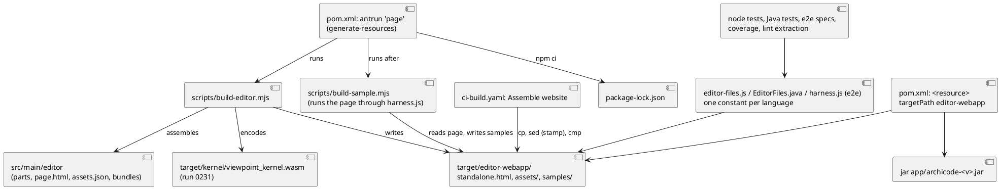
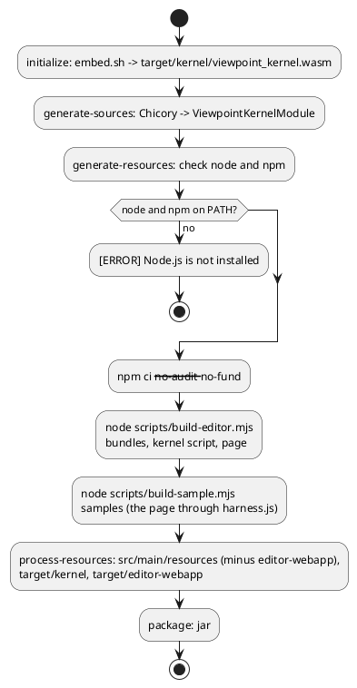

# The editor page, its bundles, its kernel script and its samples are built by Maven, none is committed

# Summary

Today seven generated files are committed under `src/main/resources/editor-webapp/`: `standalone.html`, `assets/codemirror.js`, `assets/elk.js`, `assets/viewpoint_kernel.js`, `assets/THIRD-PARTY-NOTICES.txt`, `samples/brightcart.yaml` and `samples/archicode.yaml` (the `.wasm` left git in run 0231). `scripts/build-editor.mjs` writes the first five from `src/main/editor`, `scripts/build-sample.mjs` writes the samples from two folders, and about seventy readers (the jar, the website step of CI, Java and node tests, the end-to-end suite, four scripts) read them where they stand.

This run makes `./mvnw` build them. A second execution of the `maven-antrun-plugin` that run 0231 introduced runs at `generate-resources`: it checks that `node` and `npm` exist (one `[ERROR]` line naming Node.js when not), runs `npm ci`, then `node scripts/build-editor.mjs` and `node scripts/build-sample.mjs`. They write the same seven files, at the same relative paths, under `target/editor-webapp/`. The pom puts that folder in the jar as `editor-webapp/` (the kernel `.wasm` still comes from `target/kernel`, DEC-1 of run 0231), the website step of CI copies and compares from it, and every reader reads it (one shared constant per language). The seven files leave git, the folder is ignored, and the bytes are those the committed files had: `standalone.html` and the three scripts are proved byte-identical to commit `7742b07` by a spike that rebuilt them from a clean tree (DEC-1). The page opened from a disk keeps working from `target/editor-webapp/` (the third test of `editor-offline.spec.js` reads it there).

There is no PRD (profile TDD+pln): the sources are #207, the manifest entry W-2 of wave 035 and the seven criteria of its phase P2, so traceability is incomplete (see PRD Traceability).

# Scope

In scope: `pom.xml`; the seven tracked files and `.gitignore`, `.prettierignore`; `scripts/build-editor.mjs`, `scripts/build-sample.mjs`, `scripts/check-editor.mjs`, `scripts/check-editor-moves.sh`, `scripts/editor-coverage.mjs`, `scripts/extract-editor-script.mjs`, `scripts/changes.mjs`; `package.json`; the readers in `src/test/javascript` (61 files), `src/test/e2e` (3 files) and `src/test/java` (5 classes); the tests of the scripts above; `.github/workflows/ci-build.yaml`; the model of ArchiCode (`docs/architecture/manifests/archicode.yaml`) and `src/test/javascript/architecture/impact-questions.json` if a question names a moved path; `CLAUDE.md`, `src/main/editor/CLAUDE.md`, `src/test/CLAUDE.md`, `.github/CLAUDE.md`, `src/main/rust/viewpoint-kernel/CLAUDE.md` and `README.md`, `README.md`, `src/doc/README.adoc`.

Out of scope: the Rust of the kernel and `embed.sh` (run 0231); the content of `src/main/editor` (no part, no `page.html`, no `assets.json` changes: the page is expected byte-identical, see REQ-3); `EditorHttpServer` (it reads `/editor-webapp/...` from the classpath, which the jar keeps), `application.properties` (`editor-webapp/**` stays in `quarkus.native.resources.includes`); a tag, a release, a dispatch; the LikeC4 importer (W-3).

# PRD Traceability

No PRD. The requirements are the seven criteria of the gate of phase P2 and the scope text of W-2, labelled `REQ-n` as in the TDD of run 0231; they are not sourced from a PRD id.

- `REQ-1` (gate 1): `git ls-files src/main/resources/editor-webapp` prints nothing (7 files today; the wave text says 8, counting the `.wasm` run 0231 removed) and `git ls-files | grep -c viewpoint_kernel` prints 0 (1 today: `assets/viewpoint_kernel.js`). Addressed (DEC-1, IMP-2).
- `REQ-2` (gate 2): from `rm -rf target node_modules`, `./mvnw package -Dmaven.test.skip -Dplugin.asciidoctor.skip=true` exits 0 with Maven running `npm ci`, and the jar holds `editor-webapp/standalone.html`, `assets/codemirror.js`, `assets/elk.js`, `assets/viewpoint_kernel.js`, `samples/brightcart.yaml` and `samples/archicode.yaml`. Addressed (DEC-1, DEC-2, DEC-3, FLOW-1). The jar is `target/quarkus-app/app/archicode-<version>.jar` (run 0231 observed it).
- `REQ-3` (gate 3): the built `codemirror.js`, `elk.js` and `viewpoint_kernel.js` are byte-identical to `git show 7742b07:src/main/resources/editor-webapp/assets/<name>`, and the built `standalone.html` too unless this document names the change of `src/main/editor` that explains the difference. Addressed (ASM-1): no change of `src/main/editor` is planned, so no difference is expected.
- `REQ-4` (gate 4): `npx playwright test src/test/e2e/editor-offline.spec.js --project=chromium` and `--project=firefox` exit 0, including the third test (page from a disk, no `import(`, classic scripts), reading the page from the folder of the build; `npm run test:unit` exits 0 (it includes `remote-import.test.js`). Addressed (DEC-1, DEC-6, IMP-9, IMP-10).
- `REQ-5` (gate 5): the step "Assemble website" of `ci-build.yaml` copies the page, the assets and the samples from the folder of the build and compares them with `cmp`; `sed -n "/Assemble website/,/Publish website/p" .github/workflows/ci-build.yaml | grep -c "src/main/resources/editor-webapp"` prints 0 (6 today). Addressed (DEC-7, FLOW-3, IMP-12). The tag run alone proves the step (Q-1).
- `REQ-6` (gate 6): `grep -n "committed" CLAUDE.md src/main/editor/CLAUDE.md src/main/rust/viewpoint-kernel/CLAUDE.md | grep -E "standalone|assets|wasm|bundle|sample|page"` prints nothing, and the manual says how to get the page. Addressed (DEC-9, IMP-14). The gate's grep finds 6 lines today (3 in `src/main/editor/CLAUDE.md`, 3 in `CLAUDE.md`, none in the kernel's); `src/test/CLAUDE.md` and `.github/CLAUDE.md` have no line the grep finds but name the sample check and the folder, and are corrected too.
- `REQ-7` (gate 7): `npm run test:unit`, `npm run test:coverage`, `npm run format:check`, `npm run lint`, `./mvnw test-compile pmd:check` and `./mvnw verify -DskipITs=false` exit 0; `scripts/byte-identity.sh` exits 0 with `scripts/byte-identity-exceptions.txt` unchanged; `ratchet.max` in `src/main/editor/layers.json` is at most 99 (it is 99); `git diff 7742b07 HEAD -- scripts/editor-coverage-floor.json` shows no lower number. Addressed (DEC-4, DEC-5, DEC-6, IMP-3 to IMP-11).

Unresolved: none of the seven can be disproved before implementation; the proof of REQ-5 and of the native targets is not obtainable by a pull request (Q-1).

# Technical Goals

- `TG-1`: no generated file of the editor in git; `./mvnw` is the road that builds them, `npm run editor:build` the same road without Maven (REQ-1, REQ-2).
- `TG-2`: the same bytes as the committed files, at the same paths in the jar and on the website (REQ-2, REQ-3).
- `TG-3`: a missing Node.js is one `[ERROR]` line, as a missing rustup is (REQ-2).
- `TG-4`: one place per language that names the folder the readers read, with one line of advice when it is not built (REQ-4, REQ-7).
- `TG-5`: the checks that compared a committed file with the build keep their value without a committed file, and the comparisons with an earlier page have a named baseline (REQ-7).
- `TG-6`: CI builds the page wherever it builds the jar, and the website is assembled from the build (REQ-5).
- `TG-7`: no document says the page, the bundles or the samples are committed, and the manual says how to get the page (REQ-6).

# Non-Goals

- A change of what the page is: no part, no CSS, no bundle entry changes (the build is moved, not the content).
- A baseline outside git for the pages of tags cut after this wave (a release asset, the page inside the released jar): no test needs one today (DEC-5, DEF-1).
- Making `npm ci` conditional or `node_modules` shared between builds (DEC-3).
- Windows: the build is bash and Node on Linux and macOS, as in run 0231 (CON-7 there).
- Moving the node test harness out of `src/test` although the build now calls it (RISK-5).

# Assumptions

- `ASM-1`: the page, the three scripts and the notice file are a pure function of `src/main/editor`, `package-lock.json` and `target/kernel/viewpoint_kernel.wasm`. Validated here: a scratch tree with only `src/main/editor`, `node_modules` and a copy of `target/kernel` gave, with `node scripts/build-editor.mjs --root <tree>`, files `cmp`-identical to the committed `standalone.html`, `codemirror.js`, `elk.js`, `viewpoint_kernel.js` and `THIRD-PARTY-NOTICES.txt`, and `standalone.html` identical to `git show 7742b07:...`, in 0.32 s. Re-validated by the gate (REQ-3), on the three native runners only by a tag run (Q-1).
- `ASM-2`: the samples are a pure function of the page, the kernel script and the two fixture folders (`src/test/resources/brightcart/layered`, `docs/architecture`). Validated here: `node scripts/build-sample.mjs --check` exits 0 on the working tree in 0.07 s. The sample `archicode.yaml` differs from `7742b07` by two lines that run 0231 caused (the retag of `kernel_wasm` in the model), and by the lines IMP-13 changes; `brightcart.yaml` is expected identical to `7742b07`.
- `ASM-3`: `maven-antrun-plugin` 3.2.0 runs `npm` and `node` through `<exec>`; a `PATH` without `node` gives one `[ERROR]` line. Validated here by a spike with the Maven wrapper and a minimal pom: `npm ci --no-audit --no-fund` and `node --version` ran from `generate-resources` (1.6 s in all, node_modules refilled with 80 packages), and a `PATH` of symlinks with `bash`, `java` and the wrapper but no `node` gave `[ERROR] Failed to execute goal ...maven-antrun-plugin:3.2.0:run (page) ... Node.js is not installed: ...`, then the `around Ant part` location line, no stack trace. The plugin is in `~/.m2` (run 0231).
- `ASM-4`: `npm ci` is fast enough to run on every build: 0.6 s on this machine from a warm npm cache for the 108 packages of `package-lock.json` (72 MB), a few seconds from a cold one. To be measured in CI (the run reports the time added to each job, wave open question 4).
- `ASM-5`: the GitHub-hosted runners the workflow uses (`ubuntu-latest`, `ubuntu-24.04`, `ubuntu-24.04-arm`, `macos-15`) install Node.js 22 with `actions/setup-node@v4`, as the jobs `Page` and `E2E` already do on `ubuntu-latest`, and `npm ci` selects the `@esbuild/<platform>` package of the lock for each. Not validated for the arm and macOS runners (Q-1).
- `ASM-6`: `maven-release-plugin` (`release:prepare`, `release:perform`) runs the build with the author's `PATH`, which holds Node (the author uses npm daily). Not validated: no release is cut by this run.

# Constraints

- `CON-1`: `package.json` and `package-lock.json` pin the tools (esbuild 0.28.2, codemirror, elkjs, ...); the build uses `npm ci`, never `npm install`.
- `CON-2`: the page opened from a disk (`file://`) keeps working: `standalone.html` and `assets/*.js` are classic scripts beside it, no `import(`, no `fetch` (`remote-import.test.js`, third test of `editor-offline.spec.js`); the layout of `target/editor-webapp/` is the old layout.
- `CON-3`: the jar holds `editor-webapp/standalone.html`, `editor-webapp/assets/*.js`, `editor-webapp/assets/THIRD-PARTY-NOTICES.txt`, `editor-webapp/assets/viewpoint_kernel.wasm` (from `target/kernel`) and `editor-webapp/samples/*.yaml`, at the paths they have today (`EditorHttpServer`, `NativeReflectionConfigTest`, `quarkus.native.resources.includes`).
- `CON-4`: `scripts/byte-identity.sh` and its exceptions file do not change: the output of no command changes.
- `CON-5`: `scripts/editor-coverage-floor.json` and `ratchet.max` (99) do not go down (REQ-7).
- `CON-6`: JDK 25 for `./mvnw`; PMD reads `src/main/java` and `src/test/java` only (the new Java helper is in its scope).
- `CON-7`: Linux and macOS, bash 3.2 compatible shell scripts, as run 0231.
- `CON-8`: Prettier covers `scripts/**/*.mjs`, `src/test/**/*.js` and the sources of the editor; ESLint `--max-warnings 0` covers `scripts` and `src/test` (every new or changed script is formatted and linted).

# Current State

- Tracked and generated: the seven files above, 1.7 MB for the page, 1.1 MB for the kernel script. `.gitignore` has nothing for them; `.prettierignore` lists `src/main/resources/editor-webapp/standalone.html`.
- `scripts/build-editor.mjs` (constants `PAGE_PATH`, `ASSETS_DIR`, `KERNEL_DIR = 'target/kernel'`): write mode builds the assets with esbuild in memory, writes those whose bytes differ, assembles the page (the `<meta archicode-asset:NAME ... ?v=8 hex>` lines read the hash of each asset file on disk, so `assemble(root)` throws `the asset X is missing` when an asset is absent) and writes it if it differs. `--check` fails with `standalone.html is generated: edit src/main/editor and run npm run editor:build` when a committed file differs; `--check-identical <rev>`, `--where`, `--map` are documented as needing no esbuild but call `assemble`, which needs the assets on disk. `--root <dir>` works on another tree with the same layout.
- `scripts/build-sample.mjs`: `SAMPLES` maps `brightcart` and `archicode` to a fixture folder and a sample path under `src/main/resources/editor-webapp/samples/`; `buildSample(root, id)` reads `PAGE` of `root` and runs it in Node through `src/test/javascript/viewpoint-kernel/harness.js` (whose `HTML` and `KERNEL` constants name the committed page and `assets/viewpoint_kernel.js`); `--check` compares with the committed sample; `--root`, `--only`.
- `scripts/check-editor.mjs` imports `assemble` and `mapOf` from `build-editor.mjs`; its mode `--statements <rev>` reads `git show <rev>:PAGE_PATH`. `scripts/check-editor-moves.sh` runs, for each `refactor: move` commit of a pull request, `build-editor.mjs --root <worktree of the commit> --check-identical <commit>^`, and for each `refactor: relocate` commit the `--statements` mode.
- `scripts/editor-coverage.mjs` (`HTML`) and `scripts/extract-editor-script.mjs` (default `html`) read the committed page. `package.json`: `prelint`, `pretest:unit` and `pretest:coverage` run `npm run kernel:build && node scripts/build-editor.mjs`; `editor:build` and `editor:check` run `kernel:build` first; `sample:build` and `sample:check` run `build-sample.mjs`.
- `pom.xml` (run 0231, uncommitted at the time of this draft): execution `kernel` of `maven-antrun-plugin` 3.2.0 at `initialize`; `<resources>` with `src/main/resources` (excluding `editor-webapp/assets/viewpoint_kernel.wasm`) and `target/kernel` mapped to `editor-webapp/assets`; Chicory reads `target/kernel/viewpoint_kernel.wasm`.
- Readers, counted by `grep -rl editor-webapp`: 61 files of `src/test/javascript` (including `viewpoint-kernel/harness.js`, `conformance.test.js` which builds the folder from the repository root, `build-editor.test.js` and `yaml-parts.test.js` which build trees of their own), 3 of `src/test/e2e` (`harness.js` for the page, the assets folder and the sample; `hosted.js`; `editor-offline.spec.js`), 6 Java test classes of which 5 read a file (`EditorHttpServerTest` 5 literals, `EditorServeIT` 2, `GuideViewPropertiesTest` 1, `EditorReadSchemaTest` 1, `BrightcartSampleTest` 1; `NativeReflectionConfigTest` lists `target/classes` and is unchanged), `scripts/` (five files), the model (two `tags.path`) and `ci-build.yaml` (step "Assemble website": 6 lines, the comment of the step "Check the samples are the bundles of their folders").
- Comparisons with an earlier page: `story-player-scene.test.js` (`archicode-0.18.0`), `save-keeps-the-brackets.test.js` (0.18.0), `save-keeps-quotes-and-comments.test.js` (0.18.0 and 0.19.0), `delete-plateau-as-released.test.js` (0.17.0) read `git show <tag>:src/main/resources/editor-webapp/standalone.html`; `plateau-matrix-page.test.js` reads `HEAD:` of the same path; `check-editor.test.js:260` reads a fixed commit. The tag `archicode-0.25.0` (the latest) holds a committed page and its page is identical to that of `7742b07` (`git diff archicode-0.25.0 7742b07 -- src/main/editor src/main/resources/editor-webapp` is empty).
- `ci-build.yaml`: jobs that run `./mvnw` are `Java` (`verify`), `E2E` (`package`), `Build` (two `deploy` steps, then "Assemble website") and `Native` (`verify -Dnative`); `Page` runs node only; `Page` and `E2E` have `actions/setup-node@v4` (22, `cache: npm`) and `npm ci`, `Java`, `Build` and `Native` have no Node step. "Assemble website" runs on any tag, while the `deploy` that builds runs only for a `chore(release)` commit on a tag.
- `scripts/changes.mjs`: `R-07a` sends `src/main/resources/editor-webapp/assets/**` to Java, Page and E2E; `R-05` (`docs/architecture/**`) to Java and Page; `R-16` (`package.json`, `package-lock.json`) to Page and E2E; `R-20` (`scripts/**`) to Java and Page; `R-18` (`src/test/javascript/**`) to Page. `changes-map.test.js` fixes rows that name the page and a bundle.
- The model: `archicode.editor.page` has `tags.path` `src/main/resources/editor-webapp/standalone.html`; `archicode.contracts.couplings.editor_assets` has `src/main/resources/editor-webapp/assets, src/main/editor/bundles`. `ArchitectureDriftTest` rule 4 fails when a `tags.path` does not exist.

# Proposed Design

One folder, written by two scripts, read by everything that used to read `src/main/resources/editor-webapp/`. Nothing is generated into `src/`.

The reviewer validates that `target/editor-webapp/` is the only place the seven files are written, that no arrow leads from a reader to `src/main/resources/editor-webapp/`, that `bs` runs after `be`, and that the `.wasm` reaches the jar by the resource of run 0231 and not by this folder. Textual fallback: `npm ci` -> `build-editor.mjs` (bundles and kernel script, then the page) -> `build-sample.mjs` (the samples) -> `target/editor-webapp/` -> jar resource, readers, website.

- `DEC-1 — the build writes the old layout under target/editor-webapp, and nothing under src/`
  - Decision: `build-editor.mjs` and `build-sample.mjs` write `standalone.html`, `assets/*` and `samples/*.yaml` under `<root>/target/editor-webapp/` (the constants `PAGE_PATH`, `ASSETS_DIR` and the sample paths change; `--root` keeps its meaning of a tree with the repository's layout). The pom has two `<resource>` entries for `src/main/resources` and `target/kernel` as run 0231 left them, with the exclusion widened from the `.wasm` to `editor-webapp/**`, and a third: directory `${project.build.directory}/editor-webapp`, `targetPath` `editor-webapp`. `.gitignore` gets `/src/main/resources/editor-webapp/`.
  - Rationale: the same relative paths keep `EditorHttpServer`, `quarkus.native.resources.includes`, the `<meta archicode-asset ... ./assets/NAME?v=hash>` lines and the disk layout of `file://` as they are (CON-2, CON-3); `rm -rf target` is a clean build (the gate), as for the kernel (DEC-1 of run 0231); the exclusion keeps a stale ignored copy in a contributor's `src/main/resources/editor-webapp/` (left by an earlier checkout) out of the jar. The spike of ASM-1 shows the bytes are those of the committed files.
  - Alternatives considered: build into the ignored `src/main/resources/editor-webapp/` (no reader changes, but a build that writes into the source tree, `rm -rf target` not clean and a stale file silently packaged: rejected as in run 0231); write straight into `target/classes/editor-webapp` (the node readers and the website would read the output of a Maven phase, and `mvn clean` semantics are mixed with resource copying); a folder other than `target/editor-webapp` (nothing gained).
  - Tradeoffs: about 70 readers change a path; a reader run before any build finds no file (DEC-6 gives it one line of advice).
  - Linked PRD IDs: REQ-1, REQ-2, REQ-3, TG-1, TG-2.

- `DEC-2 — a second antrun execution, "page", at generate-resources, runs npm ci and the two scripts`
  - Decision: in the `maven-antrun-plugin` 3.2.0 block of run 0231, a second execution `page`, phase `generate-resources`: set the property `page.missing-node` to "Node.js is not installed: the editor page is built with node and npm, install Node.js 22 from https://nodejs.org (Maven runs npm ci and scripts/build-editor.mjs)"; `<condition property="node.found">` with `<and>` of two `<available>` on `node` and `npm` along `${env.PATH}`; `<fail unless="node.found" message="${page.missing-node}"/>`; then three `<exec failonerror="true" dir="${project.basedir}">`: `npm ci --no-audit --no-fund`, `node scripts/build-editor.mjs`, `node scripts/build-sample.mjs`.
  - Rationale: spiked (ASM-3): one plugin and one failure style for both tools, the one-line failure the gate asks of the kernel is the same here; `generate-resources` is after `initialize`, where the kernel is built, and before `process-resources`, where the folder is copied into `target/classes`. The kernel script needs `target/kernel/viewpoint_kernel.wasm`, which exists by then.
  - Alternatives considered: `frontend-maven-plugin` (downloads and installs its own Node into the project, which the wave's premise "Node installed" does not need, adds a plugin and a version to track, and was not spiked for its failure output); `exec-maven-plugin` (prints a stack trace on failure: run 0231 spiked it); the npm `pre` hooks only (Maven would not run `npm ci` itself, which REQ-2 requires); a Maven profile (an opt-out leaves a jar without a page).
  - Tradeoffs: Ant XML in the pom; `<available>` sees `node` and `npm` on `PATH` only (a shim that is not an executable file of that name is not seen); no way to skip the step (`-Dmaven.antrun.skip=true` would also skip the kernel, and the jar would hold no page).
  - Linked PRD IDs: REQ-2, TG-3.

- `DEC-3 — npm ci runs on every build, with no up-to-date test`
  - Decision: the execution runs `npm ci` unconditionally.
  - Rationale: the spike found that Ant's `<exec>` has no `unless` attribute (`The <exec> type doesn't support the "unless" attribute`): a condition needs a nested target or a script, which is more code than the 0.6 s a warm `npm ci` costs (ASM-4); `npm ci` also makes `node_modules` exactly the lock every time, which is what a gate that starts with `rm -rf node_modules` means.
  - Alternatives considered: skip when `node_modules/.package-lock.json` is newer than `package-lock.json` (needs a wrapper script or an Ant `<antcall>`; a half-installed folder passes the test); `npm install` (moves the lock).
  - Tradeoffs: `npm ci` deletes `node_modules` first, so a process that uses it at the same moment (a running `npm run test:unit`, an editor's language server) fails or is confused; the first build and a cold CI cache need the network.
  - Linked PRD IDs: REQ-2.

- `DEC-4 — the scripts write to the folder, assemble without assets for the structural modes, and --check means "the sources assemble"`
  - Decision: (a) `build-editor.mjs`: `PAGE_PATH` is `target/editor-webapp/standalone.html`, `ASSETS_DIR` `target/editor-webapp/assets`; write mode writes assets then the page as now. (b) `assemble(root, { strict })`: with `strict: true` (the write mode, after the assets are written) a missing asset still throws; otherwise a missing asset gets the placeholder hash `00000000` in its `<meta>` line. `--where`, `--map`, `--check-identical`, `check-editor.mjs` and the tests that call `assemble` or `mapOf` on a tree without a build use the non-strict form, so no mode that analyses the sources needs esbuild, the kernel or `node_modules`, as the header of the script already says. (c) `--check` writes nothing and exits 1 only when the sources do not assemble (a part missing from `layers.json`, a bad `assets.json`, an unbuildable bundle: the errors it already raises); the "is generated: edit src/main/editor" sentences and `staleAssets` go, since no committed file can be stale. (d) `build-sample.mjs`: the sample paths and `PAGE` move to the folder; `--check` is removed with the committed sample it compared (a build that drops a file of a fixture still fails with its one line: the check inside `buildSample` stays).
  - Rationale: the source-only modes must run on the worktree of an earlier commit (FLOW-4) where nothing is built; the placeholder makes two such assemblies comparable and cannot reach a written page because the write mode is strict.
  - Alternatives considered: build the assets for every worktree of `check-editor-moves.sh` (needs `node_modules`, the kernel and the Rust of each commit: minutes for a check of the structure); keep `--check` as a comparison with `target/editor-webapp` (it would compare the build with itself).
  - Tradeoffs: the tests of the "stale" sentences of `build-editor.test.js` (`--check fails when the page is missing`, the assets variants) are rewritten, not kept; a hand-edited file in `target/editor-webapp` is silently replaced by the next build.
  - Linked PRD IDs: REQ-7, TG-5.

- `DEC-5 — the baselines are the tags that hold a page, the commit-by-commit checks assemble the old sources`
  - Decision: the four tests that read `git show archicode-<tag>:src/main/resources/editor-webapp/standalone.html` (tags 0.17.0, 0.18.0, 0.19.0, all older than this wave) are unchanged: a tag is immutable and holds its page. `plateau-matrix-page.test.js`, which read `HEAD:` of the committed page, reads `archicode-0.25.0` (identical to `7742b07`, see Current State) and skips with the reason when the tag is not in the clone, as the other four do; the baseline named here is the page of the tag `archicode-0.25.0`. `--check-identical <rev>` and `--statements <rev>`: when `<rev>` holds the page, as today; when it does not (every commit after this run), the script reads `src/main/editor` of `<rev>` with `git archive <rev> src/main/editor`, assembles it non-strict (DEC-4b) and compares it with the non-strict assembly of the tree being checked. No test names a tag cut after this wave, so no release asset or page inside a released jar is used (DEF-1).
  - Rationale: this is wave open question 2; its default (the page in the released jar, or a release asset) is not needed by any reader today, and the commit checks only need the sources: a `refactor: move` commit moves parts and leaves the bundles and the kernel alone, so equal assemblies with equal placeholder hashes is the same promise as equal pages. A move that did change an asset would be caught by the node tests on the bundles (`editor-assets.test.js`), not by this check.
  - Alternatives considered: pin `plateau-matrix-page.test.js` on `7742b07` (a commit sha rather than a name; the tag is the same page and reads as "the released page"); drop that test (it guards a wave 034 promise); build the old commit completely (see DEC-4).
  - Tradeoffs: `plateau-matrix-page.test.js` goes stale on the first change to the plateaus list after the tag; the test then names a newer tag (RISK-4). A pull request across this run's own boundary has commits with and without a page, and both paths are kept.
  - Linked PRD IDs: REQ-7, TG-5.

- `DEC-6 — one constant per language names the folder, with one line of advice`
  - Decision: `src/test/javascript/viewpoint-kernel/editor-files.js` (beside `kernel-wasm.js` of run 0231) exports `PAGE`, `ASSETS_DIR`, `SAMPLES_DIR` and `readPage()`, which throws one line `the editor page is missing: target/editor-webapp/standalone.html (run npm run editor:build)` when the file is absent. The 61 node files drop their own `path.resolve(__dirname, '../../../main/resources/editor-webapp/...')` for it (a mechanical change; the files in `src/test/javascript/` and `editor-build/` import it by their relative path); `harness.js` takes `HTML` and `KERNEL` from it. `src/test/e2e/harness.js` exports the same three paths for `hosted.js` and the specs. `src/test/java/io/morin/archicode/EditorFiles.java` (a final class with `PAGE`, `ASSETS`, `SAMPLES` as `Path`) is used by the five Java classes. The scripts hold their own constant (they run before the tests exist) and the model names none.
  - Rationale: a path in 70 places is the cost this run pays once; a constant makes the next move one line. The advice follows `readKernelWasm()` of run 0231.
  - Alternatives considered: replace the string in place (cheapest, leaves 70 copies); read the classpath resource from Java tests (the node side cannot, two conventions).
  - Tradeoffs: a codemod over 61 files in one commit; tests that build trees of their own (`build-editor.test.js`, `yaml-parts.test.js`, `build-sample-script.test.js`, `conformance.test.js`) need individual care and are listed in IMP-9.
  - Linked PRD IDs: REQ-4, REQ-7, TG-4.

- `DEC-7 — CI: Node wherever Maven runs, the website from the folder, the rules of the job map follow`
  - Decision: `Java`, `Build` and `Native` get `actions/setup-node@v4` (`node-version: "22"`, `cache: "npm"`) before their `./mvnw` step, as `E2E` has it (`Native` on the three matrix targets: the step has no `if`); no `npm ci` step is added to them, Maven runs it. In `Build`, before "Assemble website", a step with the same `if` (tag) runs `./mvnw --batch-mode process-resources -Dplugin.asciidoctor.skip=true`: it is idempotent after the `deploy` of a release commit and builds the folder for a tag that is not a release commit. "Assemble website" copies `standalone.html` (through the stamp `sed`), `samples/` and `assets/` from `target/editor-webapp/`, compares each file with `cmp` as now, and the 6 lines naming `src/main/resources/editor-webapp` go. In `Page` the step "Check the samples are the bundles of their folders" is removed, and "Check the editor page is the assembly of its parts" is renamed "Check the editor sources assemble". `scripts/changes.mjs`: `R-07a` is removed; `R-05` becomes Java, Page and E2E (the model is bundled into the jar's sample); `R-16` becomes Java, Page and E2E; `R-20` becomes Java, Page and E2E; a rule before `R-18` sends `src/test/javascript/viewpoint-kernel/harness.js` to Java, Page and E2E (the build runs it); `changes-map.test.js` follows.
  - Rationale: every job that runs Maven now needs Node; the `process-resources` step makes the website independent of whether `deploy` ran; the rules of the job map name what a changed file reaches, and a changed script, lock file, fixture model or harness now changes the jar.
  - Alternatives considered: install Node once and share it between jobs (jobs do not share a runner); the page as an artifact of the Page job (a second producer of the same bytes); `cmp` of the website against the jar's content (heavier, later).
  - Tradeoffs: about one `npm ci` and a few seconds of Node in four jobs (reported per job); the `Native` targets other than `ubuntu-24.04` are proved by a tag only (Q-1).
  - Linked PRD IDs: REQ-5, TG-6.

- `DEC-8 — the scripts of package.json build the whole folder, and sample:check goes`
  - Decision: `editor:build` is `npm run kernel:build && node scripts/build-editor.mjs && node scripts/build-sample.mjs`; `prelint`, `pretest:unit` and `pretest:coverage` become `npm run editor:build`; `editor:check` is `npm run kernel:build && node scripts/build-editor.mjs --check && node scripts/check-editor.mjs --layers`; `sample:build` stays (the samples alone, on an existing page); `sample:check` is removed.
  - Rationale: every test that reads a sample needs the samples built (`sample-archicode.test.js`, `bundle-flows.test.js`); one script is the source of truth for "what the pre hooks build".
  - Alternatives considered: keep `sample:check` as a build-and-compare (nothing committed to compare with).
  - Tradeoffs: each `pre` hook now runs the cargo no-op (about 1 s), the bundles (0.3 s) and the samples (0.1 s).
  - Linked PRD IDs: REQ-7.

- `DEC-9 — the documents say what is built, and the manual says where the page is`
  - Decision: `CLAUDE.md`, `src/main/editor/CLAUDE.md`, `src/test/CLAUDE.md`, `.github/CLAUDE.md`, `src/main/rust/viewpoint-kernel/CLAUDE.md` and `README.md`, and `README.md` say that the page, the bundles, the kernel script and the samples are made by the build into `target/editor-webapp/`, that `./mvnw` (or `npm run editor:build`) makes them and that no file of them is committed, with no history of how it was. The manual (`src/doc/README.adoc`, section "Opening the editor") gets a third way: *From a build*, `./mvnw package` or `npm run editor:build` writes `target/editor-webapp/standalone.html` with `assets/` beside it, which opens from a disk, offline; the page published at `/editor/` and `editor serve` stay as they are. `.prettierignore` loses its line.
  - Rationale: wave open question 3 (where the author gets a page without building) is answered in the manual: nowhere else than the three ways; the gate's grep on "committed" must find nothing.
  - Alternatives considered: a page attached to each release (a second published copy; rejected in the wave for the same reason as the `.wasm`).
  - Tradeoffs: none.
  - Linked PRD IDs: REQ-6, TG-7.

- `DEC-10 — the model names sources, and the sample is rebuilt by the build`
  - Decision: in `docs/architecture/manifests/archicode.yaml`, `archicode.editor.page` gets `tags.path` `src/main/editor/page.html` and the description "The standalone page, assembled by scripts/build-editor.mjs into target/editor-webapp"; `editor_assets` gets `src/main/editor/assets.json, src/main/editor/bundles`. No relationship changes, so questions `Q03` and `Q04` of `impact-questions.json` hold. No `npm run sample:build` is committed: the sample is built.
  - Rationale: `ArchitectureDriftTest` rule 4 requires every `tags.path` to exist, and a path under `target/` exists only after a build; the sources always exist.
  - Alternatives considered: keep a path under `target/` (the test would depend on the order of builds).
  - Tradeoffs: the model no longer says where the output lands except in a description.
  - Linked PRD IDs: REQ-7.

# Repository Impact

- `IMP-1 — pom.xml`
  - Path(s): `pom.xml`
  - Change type: modify
  - Why impacted: execution `page` (DEC-2); the resource exclusion widened to `editor-webapp/**` and the resource `target/editor-webapp` (DEC-1); the comment on the Chicory block already says the `.wasm` is built into `target/kernel`.
  - Linked PRD IDs: REQ-2.
  - Risks / notes: the execution order within a phase is the order of the file: `page` is the only execution at `generate-resources`.

- `IMP-2 — the seven tracked files, .gitignore, .prettierignore`
  - Path(s): `src/main/resources/editor-webapp/**` (7 files), `.gitignore`, `.prettierignore`
  - Change type: remove
  - Why impacted: nothing generated stays in git; `git rm` the seven files; `.gitignore` gets `/src/main/resources/editor-webapp/`; `.prettierignore` loses `src/main/resources/editor-webapp/standalone.html` (the comment above it is rewritten: the page is built into `target/`, which Prettier ignores).
  - Linked PRD IDs: REQ-1.
  - Risks / notes: do the `git rm` after the readers are moved, in the same commit as the pom, so no commit has a build that cannot find its readers.

- `IMP-3 — build-editor.mjs and its tests`
  - Path(s): `scripts/build-editor.mjs`, `src/test/javascript/editor-build/build-editor.test.js`, `editor-assets.test.js`, `yaml-parts.test.js`
  - Change type: modify
  - Why impacted: DEC-1 and DEC-4: new constants, `assemble(root, { strict })`, `--check` and `--check-identical` redefined, the header rewritten. `build-editor.test.js` builds trees under `--root` with the old layout and tests the "stale" sentences: rewritten for the new folder and the new `--check`; `yaml-parts.test.js` copies the committed assets into its tree for the `<meta>` hashes (it no longer has to: non-strict); `editor-assets.test.js` compares the bundles with the build of their entries.
  - Linked PRD IDs: REQ-3, REQ-7.
  - Risks / notes: the byte-identity of the output is the contract; a test builds the repository's own `src/main/editor` into a temporary root and compares with `git show archicode-0.25.0:...` for the page and the three scripts (skipped without the tag).

- `IMP-4 — build-sample.mjs and its test`
  - Path(s): `scripts/build-sample.mjs`, `src/test/javascript/viewpoint-kernel/build-sample-script.test.js`
  - Change type: modify
  - Why impacted: DEC-4d; the test runs the script on a copy of the fixture, the samples and the page (`--root`), and its `--check` cases go with the mode.
  - Linked PRD IDs: REQ-7.
  - Risks / notes: the cases of `bundle skips a file` and `carries N of the files` stay (they are the failure of the build).

- `IMP-5 — check-editor and the move check`
  - Path(s): `scripts/check-editor.mjs`, `scripts/check-editor-moves.sh`, `src/test/javascript/editor-build/check-editor.test.js`, `check-editor-statements.test.js`, `check-editor-layers.test.js`, `check-editor-moves.test.js`
  - Change type: modify
  - Why impacted: `--statements <rev>` and `--check-identical <rev>` fall back to the sources of `<rev>` (DEC-5); `PAGE_PATH` in `check-editor.mjs` stays for the revisions that hold a page; the message `cannot read src/main/resources/editor-webapp/standalone.html at nowhere` (a test pins it) changes if the fallback changes the reading order.
  - Linked PRD IDs: REQ-7.
  - Risks / notes: `check-editor-moves.test.js` builds git repositories with a committed page; it needs a second case with commits that have none (FLOW-4).

- `IMP-6 — coverage and lint extraction`
  - Path(s): `scripts/editor-coverage.mjs`, `scripts/extract-editor-script.mjs`
  - Change type: modify
  - Why impacted: `HTML` and the default `html` move to `target/editor-webapp/standalone.html`.
  - Linked PRD IDs: REQ-7.
  - Risks / notes: the floor must not move (CON-5); the run compares `target/editor-coverage/report.json` before and after.

- `IMP-7 — the job map`
  - Path(s): `scripts/changes.mjs`, `src/test/javascript/changes-map.test.js`
  - Change type: modify
  - Why impacted: DEC-7 (CTR-3). The test lists `git ls-files` paths with the expected jobs; the two rows that name the page and `codemirror.js` go, rows for `package.json`, `scripts/build-editor.mjs`, `docs/architecture/manifests/archicode.yaml` and `harness.js` change.
  - Linked PRD IDs: REQ-7.
  - Risks / notes: `node scripts/changes.mjs --list` shows a rule for every tracked path; a path with no rule falls to "all four".

- `IMP-8 — package.json`
  - Path(s): `package.json`
  - Change type: modify
  - Why impacted: DEC-8.
  - Linked PRD IDs: REQ-7.
  - Risks / notes: `package-lock.json` does not change (no dependency changes).

- `IMP-9 — the node readers`
  - Path(s): `src/test/javascript/viewpoint-kernel/editor-files.js` (new), `viewpoint-kernel/harness.js`, the 61 files that name `editor-webapp`, among them `conformance.test.js` (line 315 builds the folder from the fixture path), `sample-brightcart.test.js`, `sample-archicode.test.js`, `bundle-flows.test.js`, `sample-landing.test.js` (samples), `site.test.js` (the stamped page), `remote-import.test.js` (the page and its sources), `plateau-matrix-page.test.js` (DEC-5)
  - Change type: modify (additive for `editor-files.js`)
  - Why impacted: DEC-6.
  - Linked PRD IDs: REQ-4, REQ-7.
  - Risks / notes: tests that take the page from `ARCHICODE_EDITOR_HTML` keep that override. The codemod is checked by `grep -rn "main/resources/editor-webapp" src/test scripts` printing only the lines that name a tag.

- `IMP-10 — the end-to-end suite`
  - Path(s): `src/test/e2e/harness.js`, `src/test/e2e/hosted.js`, `src/test/e2e/editor-offline.spec.js`
  - Change type: modify
  - Why impacted: `PAGE`, `SAMPLE` and `ASSETS` move to the folder; the third test of the offline spec opens `target/editor-webapp/standalone.html` from a disk. `ASSET_ROUTES` is computed at import and is empty when the folder is missing: it must throw instead, with the one line of advice, so a missing build does not become a 404 the specs explain badly.
  - Linked PRD IDs: REQ-4.
  - Risks / notes: the specs run on the packaged jar, whose copy of the page is the same bytes (a Java IT compares them, IMP-11).

- `IMP-11 — the Java readers`
  - Path(s): `src/test/java/io/morin/archicode/EditorFiles.java` (new), `cli/EditorHttpServerTest.java`, `it/EditorServeIT.java`, `cli/GuideViewPropertiesTest.java`, `manifest/EditorReadSchemaTest.java`, `brightcart/BrightcartSampleTest.java`
  - Change type: modify (additive for `EditorFiles`)
  - Why impacted: DEC-6; the tests read `target/editor-webapp/...`, which exists after `generate-resources`; `EditorServeIT` compares the served assets with that folder, which proves the jar holds the build.
  - Linked PRD IDs: REQ-7.
  - Risks / notes: the assertion messages say "as committed" (`EditorHttpServerTest`), reworded.

- `IMP-12 — CI`
  - Path(s): `.github/workflows/ci-build.yaml`
  - Change type: modify
  - Why impacted: DEC-7. Jobs that run `./mvnw` and the step that makes Node available in each:

    | Job | Maven command | Step that makes Node available |
    |---|---|---|
    | `Java` | `./mvnw verify` | new "Set up Node.js" (`actions/setup-node@v4`, 22, npm cache) before "Build artifacts" |
    | `E2E` | `./mvnw package ...` | "Set up Node.js" and "Install the Node.js dependencies" (exist; the `npm ci` step stays for the Playwright version and the browsers) |
    | `Build` | two `deploy` steps and the new `process-resources` step | new "Set up Node.js", `if: env.PUBLISHES == 'true'`, before the deploy steps |
    | `Native` | `./mvnw verify -Dnative` on three targets | new "Set up Node.js" before the build step, every target |
    | `Page` | none (node only) | exists |

  - Linked PRD IDs: REQ-5.
  - Risks / notes: the comment lines of the steps that mention committed files are rewritten; the gate agent greps the step range for the six old lines.

- `IMP-13 — the model`
  - Path(s): `docs/architecture/manifests/archicode.yaml`, `src/test/javascript/architecture/impact-questions.json` (unchanged unless a question names a moved path)
  - Change type: modify
  - Why impacted: DEC-10.
  - Linked PRD IDs: REQ-7.
  - Risks / notes: `ArchitectureDriftTest` and `ArchitectureImpactTest` run in `verify`; the sample of the model is built from this folder by the same run.

- `IMP-14 — the documents`
  - Path(s): `CLAUDE.md`, `src/main/editor/CLAUDE.md`, `src/test/CLAUDE.md`, `.github/CLAUDE.md`, `src/main/rust/viewpoint-kernel/CLAUDE.md`, `src/main/rust/viewpoint-kernel/README.md`, `README.md`, `src/doc/README.adoc`
  - Change type: modify
  - Why impacted: DEC-9. The lines to rewrite are the 6 that the grep of REQ-6 finds (`CLAUDE.md` lines 24, 25 and 39; `src/main/editor/CLAUDE.md` lines 7, 20 and 57) and the sentences of `src/test/CLAUDE.md` and `.github/CLAUDE.md` that name the folder or the sample check of the job `Page`. The rule of the root file "after any change under `docs/architecture` run `npm run sample:build`" goes. No history in them (the project's rule for `CLAUDE.md`).
  - Linked PRD IDs: REQ-6.
  - Risks / notes: `manual-howto.test.js` and `CommandReferenceTest` read the manual; the generated command-reference block is not touched.

# Canonical Impact

Not applicable — no canonical registers declared: `docs/` has no `CLAUDE.md` and no `arc` or `dom` register (checked by `ls docs`: `architecture`, `fixtures`, `run`, `wav`), as in run 0231. The model of ArchiCode in `docs/architecture` is not a register; its update is IMP-13, checked by `ArchitectureDriftTest` and `ArchitectureImpactTest`.

# Data Model and Contracts

- `CTR-1 — the folder of the build`
  - Current contract: seven tracked files under `src/main/resources/editor-webapp/` (`standalone.html`, `assets/{codemirror,elk,viewpoint_kernel}.js`, `assets/THIRD-PARTY-NOTICES.txt`, `samples/{brightcart,archicode}.yaml`), which Maven copies as resources; the `.wasm` joins them in the jar from `target/kernel`.
  - Proposed contract: the same seven files with the same relative names under `target/editor-webapp/`, written by `build-editor.mjs` (the first five) and `build-sample.mjs` (the samples), none tracked; the jar holds them under `editor-webapp/`, plus the `.wasm` from `target/kernel`. The website holds `index.html` (the page with its stamp), `assets/` and `samples/` under `/editor/`.
  - Affected files: IMP-1, IMP-2, IMP-3, IMP-4, IMP-9 to IMP-12.
  - Migration or compatibility notes: a clone made before this run keeps ignored files in `src/main/resources/editor-webapp/`; the pom excludes them from the jar and nothing reads them. The jar and the website keep their paths, so `EditorHttpServer`, a bookmark of `/editor/` and `file://` copies are unaffected.
  - Linked PRD IDs: REQ-1, REQ-2, REQ-3.

- `CTR-2 — the commands that build and check`
  - Current contract: `build-editor.mjs [--check | --check-identical <rev> | --where <line> | --map] [--root <dir>]`; `build-sample.mjs [--check] [--root <dir>] [--only <id>]`; npm `editor:build`, `editor:check`, `sample:build`, `sample:check`.
  - Proposed contract: `--check` writes nothing and fails only on a source that does not assemble; `--check-identical <rev>` and `check-editor.mjs --statements <rev>` accept a `<rev>` with no page (DEC-5); `build-sample.mjs` loses `--check`; `editor:build` builds the folder, `sample:check` is gone. Every failure is still one `error:` line on the error output and exit 1.
  - Affected files: IMP-3 to IMP-5, IMP-8.
  - Migration or compatibility notes: nobody outside the repository calls these scripts; `.github/CLAUDE.md` and `src/main/editor/CLAUDE.md` are the documents that name them.
  - Linked PRD IDs: REQ-7.

- `CTR-3 — the map of jobs`
  - Current contract: `R-07a` (assets: Java, Page, E2E), `R-05` (Java, Page), `R-16` (Page, E2E), `R-20` (Java, Page), `R-18` (Page).
  - Proposed contract: `R-07a` removed; `R-05`, `R-16` and `R-20` add the job E2E (and `R-16` adds Java); a rule for `src/test/javascript/viewpoint-kernel/harness.js` sends it to Java, Page and E2E.
  - Affected files: IMP-7.
  - Migration or compatibility notes: a pull request that touches only these paths runs more jobs than before; no job runs less.
  - Linked PRD IDs: REQ-5, REQ-7.

- `CTR-4 — the Maven build`
  - Current contract: phases `initialize` (kernel), `generate-sources` (Chicory), `process-resources` (copies `src/main/resources` and `target/kernel`).
  - Proposed contract: a phase `generate-resources` (page) between them; the resource list has three entries (DEC-1); the build needs `rustup`, `node` and `npm` on the `PATH` and the network at the first run, and fails at `initialize` or `generate-resources` with one `[ERROR]` line naming the missing tool.
  - Affected files: IMP-1.
  - Migration or compatibility notes: `-Dmaven.test.skip` and `-Dplugin.asciidoctor.skip=true` still build the page; PMD and the manual do not need it.
  - Linked PRD IDs: REQ-2.

# Interfaces and Behavior

- `IF-1` — `./mvnw <goal up to package>`: with Rust, Node and the network, writes `target/kernel/viewpoint_kernel.wasm` (run 0231), runs `npm ci`, writes `target/editor-webapp/**`, and puts both in the jar. Without Node: exit 1, `[ERROR] ... Node.js is not installed: ...` (ASM-3), no stack trace.
- `IF-2` — `npm run editor:build`: the same folder without Maven, for the node suite, the lint and a developer; prints the sizes as `build-editor.mjs` does today.
- `IF-3` — `npx playwright test src/test/e2e/editor-offline.spec.js`: opens the page from `target/editor-webapp/standalone.html` as a `file://` URL.
- `IF-4` — a reader run with no build: one line naming the missing file and `npm run editor:build` (DEC-6); a Java test run before `generate-resources` (only possible with `-Dmaven.antrun.skip`) fails on `Files.readString` with the path in the message.
- `IF-5` — `scripts/check-editor-moves.sh <base> <head>`: unchanged usage and output; a `refactor: move` commit passes when the non-strict assembly of its sources equals its parent's.

# Flows and Processing Logic

- `FLOW-1 — a clean build`
  - Trigger: `rm -rf target node_modules && ./mvnw package -Dmaven.test.skip -Dplugin.asciidoctor.skip=true`.
  - Steps: `initialize`: antrun `kernel` builds `target/kernel/viewpoint_kernel.wasm`; `generate-sources`: Chicory translates it; `generate-resources`: antrun `page` checks `node` and `npm`, runs `npm ci`, `build-editor.mjs` (bundles, kernel script from `target/kernel`, page) and `build-sample.mjs` (the page run through `harness.js`, two bundles); `process-resources`: the three resources are copied to `target/classes`; `package`: the jar.
  - Branches / failure paths: no `rustup`: `[ERROR]` at `initialize` (run 0231). No `node` or `npm`: `[ERROR]` at `generate-resources`. `npm ci` fails (network, lock): the command's own output, exit 1. A script fails: its `error:` line, exit 1 (a part not in `layers.json`; "the bundle skips N files").
  - Final output / rendered result: `target/editor-webapp/` and a jar with `editor-webapp/standalone.html`, `assets/*.js`, `assets/viewpoint_kernel.wasm`, `samples/*.yaml`.
  - Linked PRD IDs: REQ-2, REQ-3.

The reviewer validates that the samples step follows the page step and that the only branch that stops the build before the scripts is the missing tool. Textual fallback: the list of steps of FLOW-1.

- `FLOW-2 — the developer loop`
  - Trigger: a change in `src/main/editor`, `docs/architecture` or a fixture.
  - Steps: `npm run test:unit` (its `pre` hook runs `editor:build`: `kernel:build`, `build-editor.mjs`, `build-sample.mjs`), then the node suite reads `target/editor-webapp/`. `npm run editor:check` for the sources and the layer rules.
  - Branches / failure paths: no `rustup`: the `embed.sh` line. No `node_modules`: `error: esbuild is not installed: run npm ci`.
  - Final output / rendered result: the node suite, lint and coverage on a freshly built folder.
  - Linked PRD IDs: REQ-7.

- `FLOW-3 — the website on a tag`
  - Trigger: a tag push; job `Build`.
  - Steps: the `deploy` step of a release commit (builds the folder), the step `process-resources` (idempotent), "Assemble website": stamp and copy the page, copy `samples/` and `assets/`, `cmp` each file with its source in `target/editor-webapp/`, `grep` the stamp, publish.
  - Branches / failure paths: the folder is missing (the step before failed): the first `cp` fails and the job is red, nothing is published. A tag that is not a release commit builds the folder in the extra step.
  - Final output / rendered result: `/editor/index.html`, `/editor/assets/*`, `/editor/samples/*` as before, with no `.wasm` (it was already not carried by the page).
  - Linked PRD IDs: REQ-5.

- `FLOW-4 — a move commit after this run`
  - Trigger: a pull request with a commit `refactor: move ...`; job `Page`.
  - Steps: `check-editor-moves.sh` makes a worktree of the commit, runs `build-editor.mjs --root <worktree> --check-identical <commit>^`; the parent holds no page, so the script exports `src/main/editor` of the parent with `git archive`, assembles both non-strict and compares.
  - Branches / failure paths: the parent holds a page (the commit is before this run): the old comparison. An unknown revision: `cannot read src/main/editor at <rev>`.
  - Final output / rendered result: `<short hash> <subject> ok` or the first differing line with the part that produced it.
  - Linked PRD IDs: REQ-7.

# Reliability, Performance, and Scalability

- Time added to a Maven build: `npm ci` 0.6 s warm, the bundles and the page 0.3 s, the samples 0.1 s (spikes above), plus Ant and process start; the run reports the figure for each CI job before and after (wave open question 4), with the cache of `setup-node` (npm) and the existing cache of the Rust toolchain.
- Reliability: the build depends on the npm registry at a cold `npm ci` as it already depends on Maven Central; no step retries.
- Testability: the check that the build gives the committed bytes is a node test against the tag `archicode-0.25.0` (IMP-3) and the gate's `cmp` against `7742b07`.
- Maintainability: one folder constant per language (DEC-6).

# Security and Privacy

- `npm ci` runs the install scripts of the packages of `package-lock.json` during a Maven build, as it does in the jobs `Page` and `E2E` today; the lock pins the versions, and the flag `--ignore-scripts` is not used: only `esbuild` (a `postinstall` that only optimizes the launcher) and `elkjs` (no install script of its own that the build needs) declare install scripts in the lock, and a scratch `npm ci --ignore-scripts` on linux-x64 still gave a working esbuild 0.28.2 (Q-2 resolved), so the flag would work, but the jobs `Page` and `E2E` run a plain `npm ci` and the build keeps the same command (DEC-2).
- The jar and the website content are the same files as before; nothing new is published or fetched at run time.

# Observability and Verification

Commands, with `JAVA_HOME` a JDK 25 (the shell's `java` is 21):

- Gate 1: `git ls-files src/main/resources/editor-webapp; git ls-files | grep -c viewpoint_kernel`.
- Gate 2: `rm -rf target node_modules && ./mvnw package -Dmaven.test.skip -Dplugin.asciidoctor.skip=true`, then `unzip -l target/quarkus-app/app/archicode-*.jar | grep -E "editor-webapp/(standalone.html|assets/(codemirror|elk|viewpoint_kernel).js|samples/(brightcart|archicode).yaml)"` lists six lines.
- Gate 3: for each of `assets/codemirror.js`, `assets/elk.js`, `assets/viewpoint_kernel.js`, `standalone.html`: `git show 7742b07:src/main/resources/editor-webapp/<name> | cmp - target/editor-webapp/<name>`; the same for `assets/THIRD-PARTY-NOTICES.txt` and `samples/brightcart.yaml`; `samples/archicode.yaml` is compared with the file at the commit that closes run 0231 and differs only by the lines of IMP-13.
- Gate 4: `npx playwright test src/test/e2e/editor-offline.spec.js --project=chromium` and `--project=firefox`; `npm run test:unit`.
- Gate 5: the `sed -n ... | grep -c` of REQ-5 prints 0; the gate agent reads the step and finds the `cmp` loop on `target/editor-webapp`; the table of IMP-12 is checked against the file (the `Set up Node.js` step of each of the four jobs).
- Gate 6: the grep of REQ-6 prints nothing; the manual has the paragraph of DEC-9 (`grep -n "target/editor-webapp" src/doc/README.adoc`).
- Gate 7: `npm run test:unit`, `npm run test:coverage`, `npm run format:check`, `npm run lint`, `./mvnw test-compile pmd:check`, `./mvnw verify -DskipITs=false`, `scripts/byte-identity.sh` (exit 0, `sha256sum scripts/byte-identity-exceptions.txt` unchanged), `jq .ratchet.max src/main/editor/layers.json` (at most 99), `git diff 7742b07 HEAD -- scripts/editor-coverage-floor.json`; `npm run editor:build` twice leaves `git status --short` unchanged both times.
- Failure messages: `PATH` of symlinks with `bash`, `java`, the wrapper and `rustup` but not `node`: `./mvnw -o generate-resources` exits non-zero with one `[ERROR]` line naming Node.js and no `at org.` line (as ASM-3).
- Not provable by a pull request: REQ-5 and the cold-runner time (Q-1).

# Deployment and Rollout

- Kind of change: build and repository layout; the jar, the native binaries and the website carry the same files. No runtime behavior changes.
- Staging: the pull request runs `Java`, `Page`, the three `E2E` projects and `Native` on `ubuntu-24.04` (one target). The arm and macOS native targets and "Assemble website" run on a tag only; the hand-off says so.
- Backward compatibility: `file://` copies of the page, `/editor/` bookmarks and the editor served by `editor serve` are unaffected (CTR-1). Contributors run `npm ci` once as before and need `rustup` since run 0231; a contributor with an old ignored `src/main/resources/editor-webapp/` can delete it.
- Rollback: revert the commit(s) of the run; the seven files are in git history (`git checkout 7742b07 -- src/main/resources/editor-webapp` restores them, with the `.wasm` from run 0231's revert).

# Risks and Tradeoffs

- `RISK-1`: the native targets `ubuntu-24.04-arm` and `macos-15` and the website step are proved only by a tag run: an `@esbuild/<platform>` package that does not install, or a byte that differs, shows there (Q-1). Mitigation: the wave's rehearsal dispatch of the workflow is the author's call; the hand-off lists it.
- `RISK-2`: Node versions: the jobs use 22, the author's machine 24. esbuild is a native binary and its output does not depend on the Node that starts it (ASM-1 was validated on Node 24 against the committed bytes, which CI checks on 22 in the job `Page` today); the other scripts use only built-ins.
- `RISK-3`: a stale ignored `src/main/resources/editor-webapp/` in a clone: mitigated by the resource exclusion (DEC-1).
- `RISK-4`: `plateau-matrix-page.test.js` compares with the tag `archicode-0.25.0`: the first change to the plateaus list makes it fail until it names a newer tag; the failure message says so.
- `RISK-5`: the build calls a file of `src/test` (`harness.js`), so a change to the test harness can change a jar; the job map covers it (CTR-3). A move to `scripts/` is a later refactor.
- `RISK-6`: the codemod over 61 test files is large; a missed file fails with the advice line or reads a path that does not exist. The grep of IMP-9 and the full node suite catch both.
- `RISK-7`: `npm ci` deleting `node_modules` while another process uses it (DEC-3).
- `RISK-8`: the extra time and the extra network use of every Maven job (ASM-4); measured and reported.

# Open Questions

- `Q-1`: do the arm and macOS native targets and the website step work with Node, `npm ci` and the built folder? Impact: a failed tag run after the merge. Not answerable before a tag; the hand-off to the author names it, and the run logs it as unproved (a blocker for nothing else).
- `Q-2` (resolved at Stage 6): does `npm ci --ignore-scripts` still install a working esbuild? Yes on linux-x64: in a scratch copy of `package.json` and `package-lock.json`, `npm ci --ignore-scripts` added the 108 packages in 0.5 s, `node_modules/@esbuild/linux-x64` was present, `node_modules/.bin/esbuild --version` printed 0.28.2, a bundle of a one-line file worked and `require("esbuild").transformSync` worked (Node 24.12.0). Only two packages of the lock declare install scripts (`elkjs`, `esbuild`, from `hasInstallScript` in `package-lock.json`); the `esbuild` `postinstall` (`install.js`) only validates and optimizes the binary path. Decision: DEC-2 keeps `npm ci --no-audit --no-fund` without the flag, the command the jobs `Page` and `E2E` already run, so that one lock is installed one way everywhere; the arm and macOS runners are not covered by this check (Q-1).

# Deferred Work

- `DEF-1`: a baseline for the pages of tags cut after this wave (the page inside the released jar, or a release asset), when a test needs to compare with one.
- `DEF-2`: moving `harness.js` and the sample builder out of `src/test` (RISK-5).
- `DEF-3`: a `cmp` of the website against the page inside the jar.

# File Placement and Frontmatter

This TDD is `docs/wav/wav-035-maven-builds-kernel-and-page-likec4-import/run/run-0232-editor-page-built-by-maven/tdd-0232-editor-page-built-by-maven.md`, with `type: tdd`, `run: 0232`, `wave: 035`, `status: draft`.
