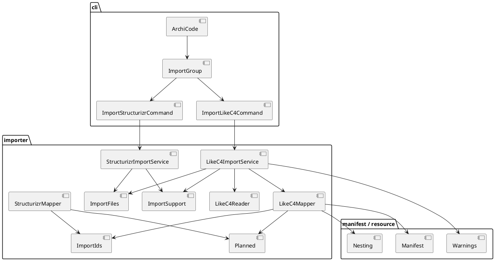
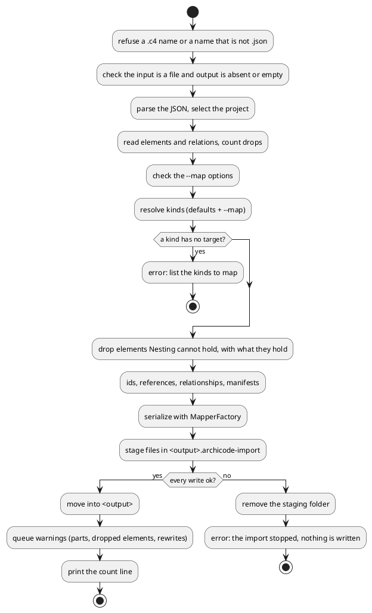

# Import a LikeC4 JSON export

# Summary

`archicode import likec4 <model.json> --output <folder> [--map <kind>=<kind>]... [--project <id>]` reads the JSON written by `likec4 export json` (the elements, their kinds and the relationships between them) and writes an ArchiCode workspace in `<folder>`: a `.archicode.yaml` and one manifest per element. It is the second command of the group `import`; the first is `import structurizr`.

What it says and refuses: every part of the export that v1 does not carry (views, deployment, styles, metadata, links, `navigateTo`, `notation`, globals, imports, diffs, manual layouts), every element that ArchiCode cannot hold, and every rewritten id is a `warning:` line, and the exit code stays 0 (`specification` is read through the kinds of the elements and is not reported). The refusals, listed once in IF-2, are each one `error:` line, exit 1, and the folder is not changed. The files are written all or none (the writer that exists).

Design: a reader (`LikeC4Reader`), a mapper (`LikeC4Mapper`) and a service (`LikeC4ImportService`) in `io.morin.archicode.importer`, behind a thin command `cli/ImportLikeC4Command` added to `cli/ImportGroup`. The reader and the mapper are pure. What the two importers really share (the id rewrite and its collision suffix, the output records `Planned` and `WorkspaceFile`, the parse and serialize steps of the service) is moved out of the Structurizr classes into small shared types, without changing a byte of the Structurizr output (DEC-3).

The design departs from the one of run 0229 on one point that the sample forced (DEC-5): an element whose place ArchiCode's nesting cannot hold is dropped with a warning, not refused. No `--map` makes the sample's 27 elements fit (six do not under the mapping of DEC-9), and the gate of phase P3 asks for exit 0 and a count "minus the number the report says were dropped".

Proof: the sample `src/test/resources/likec4/` (already in the repository, made once with the vendor tool; this run does not regenerate or edit it) is the oracle. The output is loaded by the command line and by the editor in tests. There is no PRD (profile TDD+pln): traceability is incomplete (see PRD Traceability).

# Scope

In scope: the package `importer/` (reader, model, mapper, service, the shared types), `cli/ImportLikeC4Command` and its line in `cli/ImportGroup`, the goldens of the output, the workspace `src/test/resources/likec4-expected/` and the report `src/test/resources/likec4-expected-report.txt` (outside `src/test/resources/likec4/`, which stays the untouched sample), the Java tests, one `*IT`, one node test that opens the output in the editor, the entries of `reflect-config.json`, the golden of the guide and the expectations of `HelpIT`, the manual (`src/doc/README.adoc`), `src/main/java/io/morin/archicode/CLAUDE.md`, `src/test/CLAUDE.md`, the model `docs/architecture/` and the sample bundle built from it.

Out of scope: see Non-Goals and Deferred Work.

# PRD Traceability

No PRD. The requirements are assumed from issue #134 and the author's decisions on it, the manifest entry W-3 of wave 035, and the P3 gate (its six criteria), and are labelled `REQ-n`; they are not sourced from a PRD id, so traceability is incomplete.

- `REQ-1` (gate 1): the sample is the one of commit `331f1d5`, untouched by the wave: `git diff 331f1d5 HEAD --stat -- src/test/resources/likec4` prints nothing (the goldens are in `src/test/resources/likec4-expected/` and `likec4-expected-report.txt`, outside that folder, so the literal command of the gate holds); `PROVENANCE.md` names `github.com/likec4/likec4`, the tool version, the command and a 40-hex commit SHA. Addressed (DEC-9, IMP-8). It already holds today (read on 2026-11-08).
- `REQ-2` (gate 2): on the packaged application, `import likec4 <sample> --output <empty folder> --map kind=kind...` exits 0 and prints one `warning:` line for each dropped part the sample holds; `query graph` on the output has as many elements as the sample's `elements` minus the number on the `dropped elements: N` line of the report. Addressed (DEC-1 to DEC-8, DEC-10).
- `REQ-3` (gate 3): a `.c4` input, a non-empty output folder, and the sample with a kind that has no target and no `--map` are each one `error:` line, exit 1, no stack trace (the list of refusals is IF-2; the last names the kinds to map); `--map kind=kind` for each named kind then exits 0. Addressed (DEC-1, DEC-4, DEC-5, DEC-7).
- `REQ-4` (gate 4): a test of `src/test/java/io/morin/archicode/it` runs the import on the packaged application, a test loads the output with the command line, another loads it in the editor's node suite, and `grep -c LikeC4 reflect-config.json` is at least 1. Addressed (IMP-5, IMP-6, IMP-7).
- `REQ-5` (gate 5): `import structurizr` writes the same bytes and the same warnings; `git diff 7742b07 HEAD --stat -- src/test/resources/structurizr` prints nothing. Addressed (DEC-3, IMP-2, IMP-13).
- `REQ-6` (gate 6): PMD, `./mvnw verify -DskipITs=false`, `npm run test:unit`, `test:coverage`, `format:check`, `lint`, `scripts/byte-identity.sh` (exceptions file unchanged), `CommandReferenceTest` listing `import likec4`, `sample:build` and the page build leaving `git status --short` unchanged, the model naming the new classes with `ArchitectureDriftTest` passing. Addressed (IMP-9 to IMP-12).
- `REQ-7` (decision on #134, wave scope): JSON only; command line only; v1 = the elements, their kinds and the relationships; default mapping of `actor`, `system`, `container` and `component`, `--map kind=kind` for the others; ids rewritten per segment with the original in a tag; views, deployment, styles and metadata reported as dropped; `.c4` refused with the export command; a model array refused or `--project` read. Addressed (DEC-1 to DEC-8).
- `REQ-8` (wave scope): the manual and the model of ArchiCode follow. Addressed (IMP-10 to IMP-12).
- `REQ-9` (wave scope): the output side and the id rule that the Structurizr importer holds are moved out of its classes; no neutral model of the two inputs. Addressed (DEC-3).
- Unresolved: none. Q-1 to Q-4 are resolved.

# Technical Goals

- `TG-1`: a pure reader of the LikeC4 JSON that keeps the elements, their kinds and the relationships, and counts what it ignores (REQ-2, REQ-7).
- `TG-2`: a pure mapper to `Manifest` objects with a kind for each element, a parent from the id, rewritten ids and resolved references, dropping with a reason what ArchiCode cannot hold (REQ-2, REQ-3, REQ-7).
- `TG-3`: a report in `Warnings` for each drop and each rewritten id (REQ-2, REQ-7).
- `TG-4`: the id rule, the collision suffix, the output records and the service steps shared by both importers, the Structurizr output unchanged byte for byte (REQ-5, REQ-9).
- `TG-5`: the proof: the packaged application imports the sample, the output loads in the command line and in the editor, goldens pin it (REQ-2, REQ-4).

# Non-Goals

- No LikeC4 DSL input (a `.c4` file is refused with the export command), no editor action for the import, no views, no deployment (REQ-7).
- No neutral model shared by the two importers' inputs (REQ-9).
- No plateaus in the output: one layer, one plateau.
- No new dependency: Jackson reads the JSON.
- No change of an existing command's output: `scripts/byte-identity.sh` stays green with `scripts/byte-identity-exceptions.txt` unchanged.
- No regeneration and no edit of the sample, and no run of the vendor tool: the file is the oracle.
- No change under `src/main/rust` or `src/main/editor`.

# Assumptions

- `ASM-1`: the shape of the export, read on the sample of `likec4@1.60.0` on 2026-11-08: an object with `_stage`, `projectId`, `project` (`id`, `title`), `specification`, `elements`, `relations`, `globals`, `imports`, `deployments` (`elements`, `relations`), `views` and `manualLayouts`. `elements` is an object keyed by the dotted id; each element has `id`, `kind`, `title`, and optionally `description` (null for 2 of 27, otherwise an object `{"txt": ...}`; the reader also accepts a text and an object with `md`), `summary`, `technology`, `tags` (an array of names), `links`, `metadata`, `notation`, `style` (non-empty on all 27). `relations` is an object keyed by an opaque id; each has `id`, `source` and `target` (`{"model": "<element id>"}`), `title`, and optionally `technology`, `kind` (4 of 24), `metadata` (4), `navigateTo` (6). There is no `parent` key: the place of an element is the dotted prefix of its id. `specification` (kinds, tags, relationship kinds, `customColors`, `metadataKeys`) is not read as a part of its own: the reader takes the kinds from the elements. With several projects the file is an array of such objects: this shape is from the vendor handler source and was not seen in the sample or run against the tool, so the test that reads an array builds it in memory and the shape is an assumption, not a fact. Validated by the first test, which reads the sample, and by the reader failing with one sentence on a document with no `elements`.
- `ASM-2`: the parent of every element is in the file (the prefix of each of the 27 ids is an element). Validated on the sample; a missing parent is an error (CTR-1).
- `ASM-3`: LikeC4 ids are not always valid ArchiCode ids (`tblUsers`, `supportUser`, `fn_enrich`), so ArchiCode ids derive from each segment by the rule of run 0224 (DEC-3).
- `ASM-4`: `Warnings` printed on the error output at the end of the command is the channel for the report, as for the first importer.
- `ASM-5`: the loader refuses an element held by a parent that does not hold its kind, by `Nesting` (read through `kindsHeldBy` and `kindsHeldAtTheTop`; a system holds containers, a container holds components, a person and a component hold nothing; the application layer holds a person, a solution and a system at its top). The importer must not write what the loader refuses (DEC-5). Validated by the first test, which loads the output.
- `ASM-6`: the project title for `settings.name` is `project.title` (the sample: "Cloud System"). Validated on the sample.

# Constraints

- `CON-1`: Java 25, Quarkus, Picocli, the Lombok conventions of `CLAUDE.md`; PMD ruleset unchanged, no `NOPMD`.
- `CON-2`: the native image reaches classes by reflection only when they are in `reflect-config.json`; `NativeReflectionConfigTest` fails when one is missing: it walks every compiled class under `io/morin/archicode`, nested and private records included, and demands an entry for each. The Native job of CI is the proof and does not run on a branch (RISK-4).
- `CON-3`: one `error:` line and exit 1 for a mistake of the author (`ArchiCodeException`, `ErrorOutput`); no stack trace.
- `CON-4`: every file the repository ships is loaded by the command line and by the editor in a test: the output golden is a workspace under `src/test/resources/`, so `ShippedFilesTest` and `shipped-files.test.js` load it. The sample JSON is an input, not a workspace: the importer's tests read it.
- `CON-5`: no real workspace content in the repository: the sample is the public `cloud-system` example, and nothing of the author's own model appears in goldens, tests or documents.
- `CON-6`: adding a command moves `--help` and the generated command listing of the manual: `HelpIT`, `GuideTest` (golden `src/test/resources/guide/golden.md`) and `CommandReferenceTest` move in the same commit.
- `CON-7`: the run changes no existing command's output; the move of DEC-3 is guarded by the Structurizr tests and goldens, which stay unedited. The shared id helper keeps the exception of the Structurizr rule: a space is replaced by `_` like any other character outside `[a-z0-9_-]` but does not make a rewrite (`replacesCharacter`), and a change of case alone does not either; `ImportIds` is parametrized by the text it is given (a name for Structurizr, a last segment for LikeC4) and by the fallback each mapper builds.
- `CON-8`: the importer's sentences are a command-line matter only, so the rule of one cases file shared with the editor does not apply (`CLAUDE.md`, rules that cross every area).
- `CON-9`: the run sits after W-1 and W-2 in the wave. The working tree may hold their moves of the editor page and its tests; the plan reads the files where they are when the run starts and takes no path for granted that W-2 moves (the page and its assets, the harness, the sample bundle). As read at the start of the run: `src/main/resources/editor-webapp/**` is no longer in the working tree (the page is built into `target/editor-webapp/`), the node harness is `src/test/javascript/viewpoint-kernel/harness.js` (it takes the page and the assets from `editor-files.js`) and the end-to-end one is `src/test/e2e/harness.js`.

# Current State

- `cli/ArchiCode.java` is the `@TopCommand`; `cli/ImportGroup` (`name = "import"`, `subcommands = { ImportStructurizrCommand.class }`, a `@ParentCommand ArchiCode archiCode` field) is the group.
- `cli/ImportStructurizrCommand` takes `<workspace.json>` and `-o/--output` (required), calls `StructurizrImportService.importWorkspace(input, output, ImportFiles.disk())` and prints `imported <n> elements and <m> relationships into <folder>` on the standard output. It loads no workspace.
- `importer/` holds `StructurizrReader` (231 lines), `StructurizrModel`, `StructurizrMapper` (383 lines; it holds the nested public records `Planned` and `WorkspaceFile` and the private `slug`, `isIdCharacter`, `replacesCharacter`, `hasAlphanumeric` and the sibling loop of `place`), `ImportFiles` and `DiskImportFiles` (the all-or-nothing writer: a staging folder `<output>.archicode-import`, an absent or empty folder only), and `StructurizrImportService` (`WORKSPACE_FILE`, `parse`, `reason`, `serialize`, the report, the call to `ImportFiles.commit`, then `warnings.warnAll`; the record `Imported(elements, relationships)`). Nothing of run 0229 is kept in the tree.
- `Manifest` (`header` with `kind`, `version`, `parent`; `content` as `ObjectNode`), `ManifestKind`, `AbstractElement` (`id`, `name`, `description`, `qualifiers`, `tags`, `relationships`), `Nesting` (a utility class; every method takes an instance, there is no static table: `holds(Element parent, Element child)`, `kindsHeldBy(Element parent)`, `holdsAtTheTop(Parent<?> layer, Element child)`, `kindsHeldAtTheTop(Parent<?> layer)`, derived from `Parent#elementType()` and the `@JsonSubTypes` names; the lists are sorted alphabetically), `MapperFactory.forWriting(MapperFormat.YAML)`.
- The tests and goldens of the first importer: `src/test/resources/structurizr/` (sample, `PROVENANCE.md`, `expected/`, `expected-report.txt`), `StructurizrGoldenTest`, `StructurizrReaderTest`, `StructurizrMapperTest` (reads `StructurizrMapper.Planned`), `StructurizrImportServiceTest`, `ImportFilesTest`, `StructurizrImportIT`, `structurizr-import-workspace.test.js`.
- `reflect-config.json` lists `cli.ImportGroup`, `cli.ImportStructurizrCommand`, `importer.DiskImportFiles`, `importer.ImportFiles` and `$Kind`, `importer.StructurizrImportService` and `$Imported`, `StructurizrMapper` with `$Item`, `$Mapped`, `$Placed`, `$Planned`, `$WorkspaceFile` and its nested `$Manifests` and `$Settings` (every class of the package, nested records included); no LikeC4 entry. The manual has the section `[[import-structurizr]]`; `docs/architecture/manifests/archicode.yaml` has the elements `import_structurizr` and `importer`, and carries uncommitted edits of the wave's other runs.
- The sample (`cloud-system.json`, `LICENSE`, `PROVENANCE.md`, committed in `331f1d5`): 27 elements of 12 kinds, 24 relations, a deployment model of 49 elements and 6 relations, 3 views (`view-with-custom-colors`, `cloud_ui_dashboard`, `customer`), 3 manual layouts, `globals` and `imports` present and empty (`globals` holds three empty maps). Kinds with the default target: `actor` (2), `system` (1), `container` (6), `component` (5, with `cloud.next.graphql`, `cloud.next.events`, `amazon.rds.aurora`, `amazon.rds.pg`, `cloud.legacy.backend.services`). Kinds with none, in the order of their first element: `app` (4), `externalSystem` (1), `table` (2), `gqlQuery` (1), `gqlMutation` (1), `mobileApp` (1), `queue` (2), `lambda` (1). The nesting is up to four levels (`cloud` > `legacy` > `backend` > `services`; `amazon` > `rds` > `aurora` > `tblUsers`) and an actor sits under a system (`cloud.supportUser`).

# Proposed Design

Reader, model, mapper and service added to `importer`, a few shared types, and a thin command. The importer calls no command and the command holds no logic.

- `LikeC4Reader`: a `JsonNode` in, a `LikeC4Model` out (records `Element`: id (the dotted path), kind, title, description, technology, tags; `Link` for a relationship: id, source, target, title, technology, kind, tags, bidirectional flag; `Dropped`: a counted map of the parts present and not carried, `navigateTo` and `notation` among them). It reads an object, or an array that `--project` selects from (DEC-2). It reads `description` as a text or an object with `txt` or `md`, and falls back to `summary`.
- `LikeC4Mapper`: the model and the kind mapping in, `Mapped` out. It builds the tree from the dotted ids, maps each kind (DEC-4), drops what the nesting cannot hold (DEC-5, read from `Nesting` on bare instances), gives ids and references (DEC-3), writes relationships on their source (DEC-6) and builds the `Manifest` objects. It serializes nothing.
- `LikeC4ImportService`: the sequence: refuse a `.c4` name and anything that is not `.json`, parse, read, map, serialize, write through `ImportFiles.commit`, queue the report. It knows no command line.
- `cli/ImportLikeC4Command` (`name = "likec4"`): `<model.json>`, `-o/--output <folder>` (required), `--map <kind>=<kind>` (repeatable: a repeated `String` option, a `List<String>` that the service parses at the `=`, never a Picocli `Map`, so that a malformed, duplicated or out-of-list value is one of the sentences of DEC-4), `--project <id>`. It prints the same one line as the first command on success.
- Shared, package-private unless a test needs more, behaviour taken from `StructurizrMapper` and `StructurizrImportService` unchanged: `ImportIds` (`slug`, `rewritesCharacter`, `hasAlphanumeric`, and `assign(bases, rewritten)` that returns the ids and the rewritten flags with the suffix loop), `ImportSupport` (`WORKSPACE_FILE`, `parse`, `reason`, `serialize`, `add`), and the top-level public records `Planned` and `WorkspaceFile`.

The reviewer validates that the two importers share only `ImportIds`, `ImportSupport`, `Planned`, `WorkspaceFile` and `ImportFiles` (output side and the id rule), that no input model is shared, that only `ImportFiles` writes, that only the services serialize, and that the command calls the service and nothing else. Textual fallback: command, then service, then reader, mapper, serialization and `ImportFiles` in that order, with `Warnings` fed by the service and `Nesting` read by the mapper.

## Design decisions

- `DEC-1` — JSON only, a command of the command line only, `.c4` refused with the way to export
  - `Decision:` the input is the JSON export. A name ending in `.c4` is refused before the file is read: `error: <file> is a LikeC4 source file: export it to JSON first (likec4 export json --skip-layout -o <model.json> <folder>)`; a name ending in `.likec4` (the other extension of LikeC4 sources) is refused with the same sentence; an extension other than `.json` is `error: <file> is not a JSON export of a LikeC4 model: only the JSON export is read`. The command shown is the one that `PROVENANCE.md` records as run for the sample (`likec4 export json --skip-layout --project cloud-system -o cloud-system.json examples/cloud-system`), without the `--project` of that folder, which a single-project folder does not need. The refusals are all listed in IF-2. There is no editor action.
  - `Rationale:` the decision on #134; a source file needs the vendor's own language server, which nothing here has.
  - `Alternatives considered:` parse the `.c4` source (a language of its own); call the `likec4` program (not on every machine, and the native image cannot run it).
  - `Tradeoffs:` a `.c4` user needs one more step, which the sentence names.
  - `Linked PRD IDs:` REQ-3, REQ-7.
- `DEC-2` — A model array is read only with `--project`
  - `Decision:` a top-level object is the model. A top-level array is the export of several projects (a shape taken from the vendor source, not seen in the sample, ASM-1): with `--project <id>` the command reads the object whose `projectId` is `<id>` (a missing one is `error: <file> holds no project <id>: it holds <ids>`); with no `--project`, an array of exactly one object is read as that object, and an array of two or more is `error: <file> holds <n> projects (<ids>): choose one with --project <id>`. `--project` given with an object whose `projectId` differs is the same "holds no project" error (the sample's `projectId` is `cloud-system`); given with an object that has no `projectId` it is ignored. An empty array and a value that is neither an object nor an array are `error: <file> is not a LikeC4 JSON export`.
  - `Rationale:` the wave says "a model array refused or `--project` read"; both are cheap.
  - `Alternatives considered:` refuse every array; import every project into folders (a layout nobody asked for).
  - `Tradeoffs:` an option that is rarely used, tested on a synthetic array (the sample is one object).
  - `Linked PRD IDs:` REQ-7.
- `DEC-3` — Ids come from each segment of the LikeC4 id; the original is kept in a tag; the shared part is moved, not generalized
  - `Decision:` the ArchiCode id of an element is its last id segment (not its title) rewritten by the rule of run 0224: lowercased, every run of characters outside `[a-z0-9_-]` replaced by one `_`, trimmed of `_`; a segment with no letter and no digit takes the fallback `<kind>_<n>`, where `<kind>` is the ArchiCode kind and `<n>` the 1-based position among its siblings in the order of the export (each mapper keeps its own fallback and hands the bases to `ImportIds.assign`). Siblings are all the elements of the export under one parent, whatever their kind, the ones later dropped by DEC-5 included, counted in file order: the position and the suffix of an element never depend on what the nesting rule drops. A collision (`appA` and `appa`) takes the first suffix `_2`, `_3`, ... that no sibling holds, in the order of the export. The reference is the dotted join of the parent's reference and the id, so the file `manifests/<reference>.yaml` is unique (`amazon.rds.aurora.tblusers` and `amazon.rds.pg.tblusers` do not collide). The whole dotted LikeC4 id is the tag `likec4.id`; the LikeC4 kind is the tag `likec4.kind`. A rewritten id is defined as in run 0224 (a character other than a letter, a digit, `_`, `-` or a space was replaced, the space being replaced by `_` without counting as a rewrite, the exception of the Structurizr rule that the shared helper keeps (CON-7), or the fallback was taken, or a suffix was added; a change of case alone is not a rewrite, so `tblUsers` and `supportUser` give no warning), and each is one warning naming the LikeC4 id and the id written. The `name` is the `title`, or the last segment when the title is empty. The rule, the suffix loop, the records `Planned` and `WorkspaceFile` and the steps of the service (`parse`, `serialize`, `reason`, `WORKSPACE_FILE`) are moved into `ImportIds`, `ImportSupport`, `Planned` and `WorkspaceFile`, and the first importer calls them; nothing is generalized beyond that (no interface, no neutral model).
  - `Rationale:` an id in LikeC4 is the stable handle that views and relationships name; the title is a label. The move, guarded by the existing goldens, costs less than a second copy of a subtle rule (the suffix loop), and is what the wave scope asks for.
  - `Alternatives considered:` id from the title as for Structurizr (changes whenever a label is edited); keep the LikeC4 id as is (upper case, against ArchiCode's own lower-case references); copy the helpers.
  - `Tradeoffs:` a camelCase id loses its humps (the tag keeps the original); `StructurizrMapper` and `StructurizrImportService` change though their output does not (RISK-3).
  - `Linked PRD IDs:` REQ-5, REQ-7, REQ-9.
- `DEC-4` — The kind mapping: four defaults, `--map` for the rest, nothing guessed
  - `Decision:` the kinds that need no option are `actor` to `person`, `system` to `system`, `container` to `container` and `component` to `component`. Every other kind present in `elements` needs `--map <kind>=<target>`, where `<target>` is one of `person`, `system`, `container`, `component`. A `--map` also overrides a default. A kind with no target after the defaults and the options is one `error:` line before any file is staged (the refusals of this decision are part of IF-2): `error: no ArchiCode kind for the LikeC4 kind(s) <k1>, <k2>: map each with --map <kind>=<person|system|container|component>`, listing every such kind in the order of their first element in the file (for the sample: `app, externalSystem, table, gqlQuery, gqlMutation, mobileApp, queue, lambda`), so one run tells all of them. A `--map` whose source kind is in no element is `error: --map names the kind <k>, which no element of the model has (kinds: <list>)`; a target outside the four, a `--map` with no `=`, and one source mapped twice are each one `error:` line. `--map` is a repeated `String` option parsed by the service, not a Picocli `Map` (CTR-3). When several hold at once, the first of this order is the one line printed: the malformed, duplicated or out-of-list `--map` options (in the order given), then a `--map` for an absent kind, then the kinds with no target.
  - `Rationale:` the gate asks for exactly this; guessing (`externalSystem` is a system) puts the author's decision into the tool, and an unknown kind in a typed `--map` is a typo that must not pass silently.
  - `Alternatives considered:` a default for every kind of LikeC4's common examples (invented); mapping by the `shape` of the style (a drawing property, not a meaning); a file of mapping (not asked for).
  - `Tradeoffs:` the first run on a real model fails once and tells the full list.
  - `Linked PRD IDs:` REQ-3, REQ-7.
- `DEC-5` — An element the nesting cannot hold is dropped with a reason, with what it holds
  - `Decision:` after the kinds are known, each element is checked against `Nesting`, from the top of the tree down: an element with a parent must be held by the kind of the parent's target (a system holds containers, a container holds components), and an element with no parent must be held at the top of the application layer (a person, a system). An element that fails is not written and is one warning, `element <likec4 id> (kind <k>, mapped to <target>) dropped: <reason>`, where the reason is `a <parent target> cannot hold a <target>` (for the parent, named with its LikeC4 id) or `a <target> cannot be at the top of the layer`. The elements it holds are dropped with it, each with its own line and the reason `held by the dropped element <id>`. The relationships that name a dropped element are dropped and counted (DEC-6). The mapper reads the rule from `Nesting` through the name lists `kindsHeldBy(Element)` and `kindsHeldAtTheTop(Parent)`, called on bare instances of the target classes built with their own builder (`System.builder().id("s").build()` for a system parent, `Application.builder().build()` for the layer; both methods take an instance, there is no static table to read), and compares the subtype name of the target kind with the list. It never reads a copy of the table of its own, nothing changes under `resource/`, and the loader remains the judge (ASM-5). The number of `dropped` element lines is the number the gate subtracts (DEC-10). The number of `dropped` element lines is the number the gate subtracts (DEC-10).
  - `Rationale:` the sample forces it. LikeC4 lets any element contain any other, and the sample has four levels where ArchiCode's application layer has three below a system and a person under a system. No `--map` holds all 27 elements; with the mapping of DEC-9 six cannot be held: `cloud.supportUser` (a person under a system), `cloud.legacy.backend.services` (a component under a component, the `app` above it being a container or a component, and a container under a container is refused too), `cloud.next.graphql.myAccount` and `cloud.next.graphql.updateAccount` (under a component), `amazon.rds.aurora.tblUsers` and `amazon.rds.pg.tblUsers` (under a component). A refusal there would make the gate's "exits 0 with `--map kind=kind` for each named kind" unreachable, and the gate itself allows the drop ("minus the number the report says were dropped"). The wave's stop condition for an unfit sample (a part the importer needs is missing from the file) does not apply: nothing the importer needs is missing, the reader finds all it reads.
  - `Alternatives considered:` an error naming the pair (the design of run 0229; the gate cannot pass on this sample); lift the element to its nearest ancestor that can hold it, or promote it to the top (invents a tree the author did not write, and changes what the id prefix says); write it anyway and let the loader say (the first error read is about `header.parent`, not the option); a `skip` value of `--map` (an option nobody asked for, DEF-7).
  - `Tradeoffs:` part of the author's model is not imported unless the mapping or the model changes; the lines name each element and the cause, so the loss is visible and the count is exact. A `solution` is never a target of `--map` in v1.
  - `Linked PRD IDs:` REQ-2, REQ-3, REQ-7.
- `DEC-6` — Relationships: written on the source, element ends only
  - `Decision:` a relationship becomes an entry of `relationships` of its source: `destination` is the reference of the target, `label` is the `title` (else the `description` text), `qualifiers` hold the `technology` when present, then the LikeC4 `tags` of the relationship, and `tags` hold `likec4.id` (the relationship's id) and `likec4.kind` when it has a `kind` (`requests`, `uses` in the sample). `source.model` and `target.model` are resolved in a map built before the first manifest is made, so the order of the file does not matter. A relationship whose `source` or `target` is not a `model` reference to a written element (another shape, an absent element, a dropped element) is dropped and counted in `relationships to elements that are not imported: N dropped`; the relationships of `deployments` are counted apart (DEC-8). A relationship with `isBidirectional` is written one way, once, and counted as `bidirectional relationships: N written in one direction`. A relationship between an element and one of its ancestors or descendants is written as it is (the loader accepts it; the first test proves it).
  - `Rationale:` the same placement as the first importer; the export holds explicit relationships only.
  - `Alternatives considered:` write the other direction too for a bidirectional one (a duplicate the author did not write).
  - `Tradeoffs:` the direction of a bidirectional link is the source's.
  - `Linked PRD IDs:` REQ-2, REQ-7.
- `DEC-7` — Writing: the writer that exists, unchanged
  - `Decision:` `LikeC4ImportService` hands `(path, bytes)` pairs to `ImportFiles.commit`, with its rules: a non-empty `--output` is `error: the folder <f> is not empty: import writes nothing over a folder`, an existing file is one `error:` line, an absent folder and its absent parents are created, a failed write removes the staging folder and says `the import stopped at <file> (<reason>): nothing is written`. The workspace file has `settings.name` (`project.title`, else `project.name`, else the `projectId`, else the name of the file) and `manifests.paths: ["manifests/**"]`. An input path that is a folder or does not exist is one `error:` line, raised by the service.
  - `Rationale:` the seam, its fakes and its tests exist; the gate asks for the folder to be unchanged on every refusal.
  - `Alternatives considered:` none worth the cost.
  - `Tradeoffs:` none.
  - `Linked PRD IDs:` REQ-3, REQ-7.
- `DEC-8` — The report
  - `Decision:` the warnings are, in this order and each only when its count is above zero: `views: N dropped`, `deployment elements: N dropped`, `deployment relationships: N dropped`, `styles: N dropped` (the elements and relationships with a non-empty `style`, `color`, `line`, `head` or `tail`), `metadata: N dropped` (the elements and relationships with a non-empty `metadata`), `links: N dropped` (elements and relationships with links), `navigateTo: N dropped` (the relationships and elements with a `navigateTo`), `notation: N dropped` (the elements with a `notation`), `globals: N dropped` (the entries of the maps of `globals`; an empty map counts zero), `imports: N dropped` (the entries of `imports`), `diffs: N dropped`, `manual layouts: N dropped`, `bidirectional relationships: N written in one direction`, `relationships to elements that are not imported: N dropped`, `dropped elements: N` (the count of the lines that follow, only when above zero), then one line per dropped element (DEC-5), then one sentence per rewritten id (DEC-3). They are queued after the move has succeeded, so a failed write prints `the import stopped...` and no list. The standard output is `imported <n> elements and <m> relationships into <folder>`. For the sample, the parts present are: views (3), deployment elements (49), deployment relationships (6), styles (27 elements), metadata (1 element and 4 relationships, 5), links (2), `navigateTo` (6 relationships), `notation` (16 elements), manual layouts (3), `dropped elements: 6`, the six dropped elements, and the dropped relationships of those six; `globals`, `imports` and `diffs` are empty and give no line. `specification` is read through the kinds of the elements and is never a line of the report. The plan fixes these numbers when the golden is generated; the sentences are pinned by `likec4-expected-report.txt`.
  - `Rationale:` the gate asks for one line per dropped part present; the author reads the list to know what to write again.
  - `Alternatives considered:` a JSON report (DEF-2); one line per dropped style or metadata item (hundreds of lines on a real model).
  - `Tradeoffs:` the list of parts is fixed in the reader; a key of a later export is not reported (DEF-3).
  - `Linked PRD IDs:` REQ-2, REQ-7.
- `DEC-9` — The sample and the oracle: used as it is
  - `Decision:` `src/test/resources/likec4/cloud-system.json`, `LICENSE` (MIT, copied from the root of the repository at the commit) and `PROVENANCE.md` (the repository, tag `v1.60.0`, commit `0375d146f8de2eb919033bd3b43b3701194f518b`, `likec4@1.60.0`, the command, the cut from 19 views to 3) are read by the tests and never regenerated or edited; CI never runs the vendor tool. The oracle of the element count is the sample read by the tests (`elements` has 27 keys, a number read from the file, not a literal in the assertion), plus the goldens `src/test/resources/likec4-expected/` (the workspace written with the mapping the plan chooses, one `--map` for each of the eight kinds) and `src/test/resources/likec4-expected-report.txt`, both outside `src/test/resources/likec4/` so that the sample's folder is the three files of the commit and nothing else. The mapping of the golden maps `app`, `gqlMutation`, `gqlQuery`, `lambda`, `mobileApp`, `queue` and `table` to `component` and `externalSystem` to `system`, so that 21 of the 27 elements are written and 6 are dropped (DEC-5); the plan checks this by running the mapper before it writes the golden. The parts the sample does not hold (diffs, a non-empty `globals` or `imports`, a bidirectional relationship, an array of projects) are tested on a copy that the test makes in memory.
  - `Rationale:` REQ-1; a count read from the input cannot drift from it; a real export proves compatibility where a hand-written file proves only the reader.
  - `Alternatives considered:` a hand-written minimal export (proves only the reader).
  - `Tradeoffs:` the sample is a third-party file; its 3 views mean it shows the `views` warning by itself.
  - `Linked PRD IDs:` REQ-1, REQ-2.
- `DEC-10` — What the gate's count is
  - `Decision:` the gate's equation is `elements of query graph = jq '.elements|length' of the sample - the number of `dropped` element lines`. With the golden mapping it is 27 - 6 = 21; the IT reads 27 from the file, reads N of the line `warning: dropped elements: N`, checks that N is the count of the lines of the error output that start `warning: element ` and contain ` dropped: `, and compares the difference with the graph, and the golden pins the literal. An unmapped kind is not a drop: it is the error of DEC-4.
  - `Rationale:` a refusal of what cannot be carried is chosen where the gate asks for one (an unmapped kind), and a drop where the gate allows one (a place the nesting cannot hold), so each case is the cheaper honest one.
  - `Alternatives considered:` none.
  - `Tradeoffs:` none.
  - `Linked PRD IDs:` REQ-2.

# Repository Impact

- `IMP-1` — The importer
  - `Path(s):` `src/main/java/io/morin/archicode/importer/` (`LikeC4Reader`, `LikeC4Model`, `LikeC4Mapper`, `LikeC4ImportService`)
  - `Change type:` additive
  - `Why impacted:` the whole feature.
  - `Linked PRD IDs:` REQ-2, REQ-3, REQ-7
  - `Risks / notes:` the reader and the mapper touch no file; `ImportFiles` is the only class that writes.
- `IMP-2` — The shared part, moved
  - `Path(s):` `src/main/java/io/morin/archicode/importer/` (`ImportIds`, `ImportSupport`, `Planned`, `WorkspaceFile` added; `StructurizrMapper.java` and `StructurizrImportService.java` modified to call them)
  - `Change type:` modify (a move; the output does not change)
  - `Why impacted:` DEC-3.
  - `Linked PRD IDs:` REQ-5, REQ-9
  - `Risks / notes:` RISK-3; the Structurizr goldens and `byte-identity.sh` are the guard and are not edited; this is the plan's first code task, before the LikeC4 classes use it.
- `IMP-3` — The command and the group
  - `Path(s):` `src/main/java/io/morin/archicode/cli/ImportLikeC4Command.java`, `cli/ImportGroup.java` (one name in `subcommands`)
  - `Change type:` additive
  - `Why impacted:` the new command appears in `--help`.
  - `Linked PRD IDs:` REQ-3, REQ-4
  - `Risks / notes:` `HelpIT` and the guide golden move (CON-6). `ArchiCode.java` needs no edit: the group is registered there.
- `IMP-4` — Tests of the classes
  - `Path(s):` `src/test/java/io/morin/archicode/importer/` (`LikeC4ReaderTest`, `LikeC4MapperTest`, `LikeC4ImportServiceTest`, `ImportIdsTest`)
  - `Change type:` additive
  - `Why impacted:` camel case, collisions and odd characters (`..`, `x/y`), the fallback, the default and the given mapping, an unmapped kind, a `--map` for an absent kind, a person under a system and a component under a component dropped with their descendants, a missing parent, relationships to a missing or dropped element, bidirectional, an array with and without `--project`, a model with no `elements`, a failed write that leaves nothing, a refused folder that is unchanged, a `.c4` input, a part the sample lacks added to a copy.
  - `Linked PRD IDs:` REQ-2, REQ-3, REQ-7
  - `Risks / notes:` each refusal is checked as one `error:` line with no stack trace.
- `IMP-5` — The goldens
  - `Path(s):` `src/test/resources/likec4-expected/` (the workspace written from the sample) and `src/test/resources/likec4-expected-report.txt`, `src/test/java/io/morin/archicode/importer/LikeC4GoldenTest.java`
  - `Change type:` additive (the sample itself is not touched)
  - `Why impacted:` the output is pinned byte for byte, with `-Darchicode.golden.regenerate=true` as for the first golden; the folder is a shipped workspace loaded by `ShippedFilesTest` and `shipped-files.test.js`, part of `ManifestCorpus` (so of `ManifestSchemaCorpusTest` and `ManifestRoundTripCorpusTest`) and of `MistakeSweepTest` (CON-4). A mutation of `header.parent` of an imported container or component may end in a stack trace and need an entry of `known-traces.json` (RISK-5). `scripts/byte-identity.sh` loads the golden with the base jar.
  - `Linked PRD IDs:` REQ-2, REQ-4
  - `Risks / notes:` a literal count of manifests or workspaces in a test or in a CLAUDE.md may move; the preflight grepped for them (RISK-5): the exact ones are the `440` of `ManifestRoundTripCorpusTest` (a printed message) and of `src/main/java/io/morin/archicode/CLAUDE.md`, the others are lower bounds.
- `IMP-6` — The integration test and the editor test
  - `Path(s):` `src/test/java/io/morin/archicode/it/LikeC4ImportIT.java`, `src/test/javascript/viewpoint-kernel/likec4-import-workspace.test.js`
  - `Change type:` additive
  - `Why impacted:` the packaged application imports the sample with the eight `--map`, `query graph` loads the output and the counts match (DEC-10); a `.c4`, a non-empty folder, the sample without `--map` (the error names the eight kinds) and a synthetic array with two projects are each one `error:` line (pattern of `StructurizrImportIT`). The node test opens `src/test/resources/likec4-expected/` in the editor with no mistake, no duplicate reference and as many elements as the golden holds (pattern of `structurizr-import-workspace.test.js`; it needs no change under `src/main/editor`, and reads the harness where W-2 left it, CON-9: `viewpoint-kernel/harness.js` today).
  - `Linked PRD IDs:` REQ-2, REQ-3, REQ-4
  - `Risks / notes:` RISK-4.
- `IMP-7` — Native reflection
  - `Path(s):` `src/main/resources/META-INF/native-image/io.morin.archicode/archicode/reflect-config.json`
  - `Change type:` additive and modify: one entry for each compiled class the run adds under `io/morin/archicode`, nested and private records included (`cli.ImportLikeC4Command`, `importer.LikeC4Reader`, `LikeC4Model` and its records, `LikeC4Mapper` and its records, `LikeC4ImportService` and its records, `ImportIds`, `ImportSupport`, `Planned`, `WorkspaceFile` and its `Manifests` and `Settings`); the entries `StructurizrMapper$Planned`, `$WorkspaceFile`, `$WorkspaceFile$Manifests` and `$WorkspaceFile$Settings` follow the move to the top-level names
  - `Why impacted:` CON-2; `NativeReflectionConfigTest` keeps it complete.
  - `Linked PRD IDs:` REQ-4
  - `Risks / notes:` `NativeReflectionConfigTest.everyClassOfTheModelIsRegisteredForReflection` walks the compiled classes of the package, so no class is exempt, the model records and the private ones included; the test is the check, run after the last class is written.
- `IMP-8` — The sample, read only
  - `Path(s):` `src/test/resources/likec4/cloud-system.json`, `LICENSE`, `PROVENANCE.md`
  - `Change type:` none (the files exist; a test checks that the provenance names the repository, the tool version, the command and a 40-hex SHA)
  - `Why impacted:` REQ-1 holds today; the run must leave it so: `git diff 331f1d5 HEAD --stat -- src/test/resources/likec4` prints nothing, since the goldens of IMP-5 are in `src/test/resources/likec4-expected/` and `likec4-expected-report.txt`, outside that folder; the check is also done on the three files by name.
  - `Linked PRD IDs:` REQ-1
  - `Risks / notes:` the vendor tool is not run.
- `IMP-9` — Guide and help goldens
  - `Path(s):` `src/test/resources/guide/golden.md`, the expectations of `HelpIT`, and `src/main/resources/guide/guide.md` only if it lists the first-level commands by hand
  - `Change type:` modify
  - `Why impacted:` CON-6.
  - `Linked PRD IDs:` REQ-6
  - `Risks / notes:` regenerate and read the diff; only the new command may differ.
- `IMP-10` — The manual
  - `Path(s):` `src/doc/README.adoc`, `src/test/javascript/manual-anchors.json` and `manual-skeleton.test.js` if the anchor needs them
  - `Change type:` modify (a section `[[import-likec4]]` after `[[import-structurizr]]`: how to export the JSON, what is read, the mapping and `--map`, the ids and tags, what is dropped including the elements the nesting cannot hold, the refusals; the hand-written line of `import` names it; the generated listing holds the command)
  - `Why impacted:` the manual says what each command does; `CommandReferenceTest` fails until the listing holds it.
  - `Linked PRD IDs:` REQ-6, REQ-8
  - `Risks / notes:` the manual's `[source]` blocks are read by tests; W-2 also edits the manual (CON-9), so the plan reads it at its first task.
- `IMP-11` — Notes for the next session
  - `Path(s):` `src/main/java/io/morin/archicode/CLAUDE.md`, `src/test/CLAUDE.md`
  - `Change type:` modify (a short section for the second importer and the shared classes; a paragraph "The LikeC4 import golden" next to the Structurizr one)
  - `Why impacted:` the next session reads them before touching the command line.
  - `Linked PRD IDs:` REQ-8
  - `Risks / notes:` they state what is true now, no wave, run or issue ids.
- `IMP-12` — The model of ArchiCode and its sample
  - `Path(s):` `docs/architecture/manifests/archicode.yaml` (the command `import_likec4` with its `tags.path` of `ImportGroup.java` and `ImportLikeC4Command.java`, its edge to `importer`; the description of `importer` no longer says only Structurizr), `src/test/javascript/architecture/impact-questions.json` if a question changes, then `npm run sample:build` and the build of the page, wherever W-2 puts the bundle
  - `Change type:` modify
  - `Why impacted:` see Canonical Impact; `ArchitectureDriftTest` and the step "Check the samples are the bundles of their folders" fail otherwise.
  - `Linked PRD IDs:` REQ-6, REQ-8
  - `Risks / notes:` `tags.path` values must exist; the file carries edits of other runs, so the plan reads it again at its first task and touches only the lines of the importer; the gate asks `git status --short` unchanged after the builds.
- `IMP-13` — The first importer's tests, for the move
  - `Path(s):` `src/test/java/io/morin/archicode/importer/StructurizrMapperTest.java`
  - `Change type:` modify (`StructurizrMapper.Planned` becomes `Planned`, one line)
  - `Why impacted:` DEC-3.
  - `Linked PRD IDs:` REQ-5, REQ-9
  - `Risks / notes:` no assertion changes; `src/test/resources/structurizr/` stays unedited.

# Canonical Impact

Not applicable — no canonical registers declared (`docs/` has no `CLAUDE.md` and no `arc` or `dom` register). The model of ArchiCode in `docs/architecture/` is not a register: its update is IMP-12, with `ArchitectureDriftTest` as its check.

# Data Model and Contracts

- `CTR-1` — The LikeC4 JSON as read
  - `Current contract:` none.
  - `Proposed contract:` the keys of ASM-1 are read (`projectId`, `project.title`, `project.name`, `elements`, `relations`, and for the report `views`, `deployments`, `globals`, `imports`, `diffs`, `manualLayouts`, and the keys `style`, `metadata`, `links`, `color`, `line`, `head`, `tail`, `isBidirectional` of an element or a relationship); every other key is ignored, unreported (DEF-3); `navigateTo` and `notation` are read for the report (DEC-8) and `specification` is not read at all. A document that is an object with no `elements` object is `error: <file> is not a LikeC4 JSON export: it has no elements`. An element with no `kind` is `error: the LikeC4 element <id> has no kind`; an element whose parent is absent is `error: the LikeC4 element <id> has no parent 
 in the file`. A relationship with no `source` or `target` is dropped and counted. An input path that is a folder is `error: <file> is a folder: import reads a JSON file`. The refusals are all listed in IF-2.
  - `Affected files:` `importer/LikeC4Reader.java`, `importer/LikeC4Mapper.java`, and `importer/LikeC4ImportService.java` for the checks on the file.
  - `Migration or compatibility notes:` a later version with new keys is read as before; a version that changes the shape of `elements` or `relations` fails at the first check with the sentence above, and the sample is the canary (RISK-1).
  - `Linked PRD IDs:` REQ-7.
- `CTR-2` — The workspace written
  - `Current contract:` the manifests and `.archicode.yaml` of `cli/InitCommand`, `Manifest`, and the output of the first importer.
  - `Proposed contract:` `.archicode.yaml` (`settings.name`, `settings.manifests.paths: ["manifests/**"]`); `manifests/<reference>.yaml` with `header.kind` the full `ManifestKind` id (read from `ManifestKind.getId()`), `header.version: "1"`, `header.parent` for an element that has a parent, and `content` with `id`, `name`, `description` (the `description` text, else the `summary`, as text), `qualifiers` (the `technology` and the LikeC4 `tags`), `tags` (`likec4.id`, `likec4.kind`) and `relationships` as DEC-6 decides. Written with `MapperFactory.forWriting(YAML)`. No schema change.
  - `Affected files:` `importer/LikeC4Mapper.java`, `importer/LikeC4ImportService.java`.
  - `Migration or compatibility notes:` the output is the existing manifest schema, so `query schemas manifest` and the editor read it unchanged; the corpus checks it (CON-4).
  - `Linked PRD IDs:` REQ-2, REQ-7.
- `CTR-3` — The command
  - `Current contract:` none (`import structurizr` has the same form without `--map` and `--project`).
  - `Proposed contract:` `archicode import likec4 <model.json> --output <folder> [--map <kind>=<kind>]... [--project <id>]`; `--output` is required; exit 0 with the report, exit 1 with one `error:` line. `--map` is a repeated `String` (`List<String>`) option that the service parses, not a Picocli `Map`. It loads no workspace: `-w` is not read.
  - `Affected files:` `cli/ImportLikeC4Command.java`, `cli/ImportGroup.java`.
  - `Migration or compatibility notes:` additive; no existing command changes.
  - `Linked PRD IDs:` REQ-3, REQ-7.
- `CTR-4` — The shared importer API
  - `Current contract:` `StructurizrMapper.Planned` and `StructurizrMapper.WorkspaceFile` (public nested records) and private helpers inside two classes.
  - `Proposed contract:` top-level `io.morin.archicode.importer.Planned` and `WorkspaceFile` (the same fields, the same Jackson shape: the golden of `.archicode.yaml` proves it), and the package-private `ImportIds` and `ImportSupport`.
  - `Affected files:` `StructurizrMapper.java`, `StructurizrImportService.java`, `StructurizrMapperTest.java`, the new classes, and `reflect-config.json`, which names every class including the moved records and the new classes (`NativeReflectionConfigTest` reads the compiled classes).
  - `Migration or compatibility notes:` internal to the package; a grep in the plan's first task confirms no caller outside `importer/` and its tests.
  - `Linked PRD IDs:` REQ-9.

# Interfaces and Behavior

- `IF-1` — Import: input a `.json` file and an output folder; output the workspace folder, `imported <n> elements and <m> relationships into <folder>` on the standard output, `warning:` lines on the error output (DEC-8).
- `IF-2` — Errors, the one list of refusals (each one `error:` line, exit 1, nothing written; the sentences are in the decision named in brackets, which do not list the refusals again): a missing input file; an input that is not JSON; a name ending in `.c4` or `.likec4`, and a name that does not end in `.json` (DEC-1); a JSON that is not an export, an array with no `--project` and two or more projects, a `--project` the file does not hold (DEC-2); a kind with no target, a `--map` that is malformed, names an absent kind or a target outside the four (DEC-4); an element with no kind or no parent in the file (CTR-1); a non-empty output folder, an output that is an existing file, an input that is a folder, a write that fails (DEC-7). An absent output folder or parent, and an empty folder, are not errors. An element the nesting cannot hold is not an error (DEC-5).
- `IF-3` — Loading what was written: `archicode query graph -w <folder>/.archicode.yaml` and the editor read the output with no change; the number of elements is the sample's minus the dropped (DEC-10).

# Flows and Processing Logic

- `FLOW-1` — Import
  - `Trigger:` `archicode import likec4 cloud-system.json --output out --map app=component --map externalSystem=system ...`.
  - `Steps:` the command hands the paths and the options to the service; the service refuses a `.c4` name and a non-`.json` name, checks the input exists and is a file, checks `out` is absent or empty, reads and parses the JSON; the reader selects the project (DEC-2), builds the model and counts the drops; the mapper checks the options and resolves the kinds (DEC-4), drops the elements the nesting cannot hold (DEC-5), rewrites ids and resolves relationships (DEC-3, DEC-6) and builds the manifests; the service serializes them; `ImportFiles` stages and moves the folder; once the move has succeeded the service queues the warnings and the command prints the line of IF-1.
  - `Branches / failure paths:` any refusal of IF-2 stops before the first byte is staged; a write failure removes the staging folder and queues no warning, so only the `error:` line is printed.
  - `Final output / rendered result:` a workspace that loads, and the list of what was left out.
  - `Linked PRD IDs:` REQ-2, REQ-3.

The reviewer validates that every refusal is before the first byte is staged, that the only branch after the write begins is the failure one, that the warnings are queued only on the success branch, that the check on kinds is done on the whole model (one run lists every kind), and that a nesting problem never reaches the error branch.

# Reliability, Performance, and Scalability

The export is read whole in memory (the sample is about 85 KB; an export with layout and views can be some MB, which the manifests' reader handles the same way). The write is all or nothing (DEC-7). The output is deterministic: the order of `elements` in the file is kept (Jackson keeps the order of an object), ids and suffixes depend only on it, so two runs on one file give the same bytes (the golden). No network is used at run time.

# Security and Privacy

The input is untrusted data: nothing in it is executed, and no path is built from its content: file names are the rewritten references, which hold only `[a-z0-9_.-]` because every id, the fallback included, passes through the rewrite of DEC-3 (a unit case with a segment such as `..` or `x/y` pins it), so nothing can leave `manifests/`. A `--map` value is only compared with a fixed list. The importer reads one file and writes one folder. No secret is read. The vendor tool is not run.

# Observability and Verification

- Classes: `./mvnw test -Dtest='LikeC4*Test,ImportIdsTest,Structurizr*Test,ImportFilesTest'`; a test writes the sample's output to a temp folder and compares it with `src/test/resources/likec4-expected/` byte for byte and the warnings with `src/test/resources/likec4-expected-report.txt`; `ShippedFilesTest` loads that folder.
- Integration: `./mvnw verify -DskipITs=false` runs `LikeC4ImportIT` on the jar; the gate's commands are run by hand once on the packaged application and recorded in the run's progress file (the count read with `jq '.elements|length'` against `query graph` and the number of `dropped` lines).
- Editor: `npm run test:unit` runs `likec4-import-workspace.test.js`.
- Refusals: the `.c4`, the unmapped kinds, the non-empty folder and the array cases check the `error:` line, the exit code and that the folder is unchanged.
- The move: `StructurizrGoldenTest` and `StructurizrImportIT` pass with `src/test/resources/structurizr/` unedited, and `git diff 7742b07 HEAD --stat -- src/test/resources/structurizr` prints nothing.
- The sample: `git diff 331f1d5 HEAD --stat -- src/test/resources/likec4/cloud-system.json src/test/resources/likec4/LICENSE src/test/resources/likec4/PROVENANCE.md` prints nothing.
- Cross-cutting: `./mvnw test-compile pmd:check`, `./mvnw test -Dtest=CommandReferenceTest`, `HelpIT`, `GuideTest`, `NativeReflectionConfigTest`, `scripts/byte-identity.sh`, `npm run test:coverage`, `npm run format:check`, `npm run lint`, `npm run sample:build` and the build of the page with `git status --short` unchanged; `git diff --stat -- src/main/rust src/main/editor` shows nothing from this run.

# Deployment and Rollout

Code, test resources, documentation and the model; no migration, no change of an existing command's output, so nothing to roll back but the commit. The Native job of CI proves the native image and does not run on a branch: the hand-off says whether it was proved (RISK-4). Planning guidance only; no deployment is implied.

# Risks and Tradeoffs

- `RISK-1`: the JSON of the tool depends on its version (a key renamed, `elements` an array in a later version). Mitigation: ASM-1 is read on the sample; the sentence "is not a LikeC4 JSON export" is the failure; the provenance names the version.
- `RISK-2`: dropping what the nesting cannot hold loses part of an author's model (six of 27 on the sample). Mitigation: one line per element with the cause (DEC-5); the alternative (lifting) is DEF-5. The author may prefer another behavior; this is the choice that keeps the gate reachable and is cheap to change later because it is one function of the mapper.
- `RISK-3`: the move of DEC-3 changes `StructurizrMapper` and its service, so a slip changes the Structurizr output. Mitigation: the Structurizr tests, the golden and `byte-identity.sh` are the guard and are not edited; the move is its own task and its own commit state before the LikeC4 code uses it.
- `RISK-4`: a missing reflection entry fails only in the native runner. Mitigation: `NativeReflectionConfigTest` registers every class of the package, nested and private records included, so it fails on the jar build when one is missing (the earlier idea that model records need no entry is wrong); `--map` is a repeated `String`, so no Picocli `Map` is bound; the IT runs the `--map` form on the jar; the Native job on the pull request is the proof of the image, and the hand-off says it was not proved on the branch.
- `RISK-5`: the golden `src/test/resources/likec4-expected/` joins the shipped corpus, so any literal count of manifests or workspaces in a test or in `src/test/CLAUDE.md` moves, and `MistakeSweepTest` may end in a stack trace on `header.parent`. Mitigation: the preflight grepped for the counts (the exact `440` is in `ManifestRoundTripCorpusTest` and in `src/main/java/io/morin/archicode/CLAUDE.md`; `>= 400` and `>= 17` are lower bounds that hold); a trace whose cause is not the importer gets a reasoned entry of `known-traces.json`, a trace whose cause is the importer is fixed in the mapper.
- `RISK-6`: a camelCase id loses its humps and two ids may collide after lowercasing. Mitigation: the suffix rule and the warning say which; the tag keeps the original.
- `RISK-7`: `--help`, the guide golden and the generated manual listing move; they move in the same commit (CON-6).
- `RISK-8`: `docs/architecture/manifests/archicode.yaml`, the manual and the test harness carry or move edits of W-1 and W-2 (CON-9). Mitigation: the plan's first task reads each file as it is, touches only the lines of the importer, and runs `npm run sample:build` last.

# Open Questions

- `Q-1` (resolved, 2026-11-08): `description` and `summary` are both set on `customer` in the sample (`summary` is a one-line `txt`, `description` a long `md` text), so both can coexist in a real export. `description` wins and the `summary` is the fallback when `description` is null or empty; `summary` is not reported as dropped when `description` is used, since it is a shorter form of the same text. The golden of `customer` pins it.
- `Q-2` (resolved, 2026-11-08, re-read at the preflight: `elements` has 27 keys, the files are those of commit `331f1d5`): the sample is fit. All the fields the reader needs (`elements`, `relations`, kinds, titles, descriptions, technology, tags, `project.title`) are present, so the stop condition of the wave for an unfit sample does not apply. The nesting finding (DEC-5) is a design input, not a fault of the file.
- `Q-3` (resolved, 2026-11-08, design): kinds the author did not name are errors (DEC-4), places the nesting cannot hold are drops (DEC-5). Nothing is asked of the author before the run; the author may later ask for the lifting of DEF-5.
- `Q-4` (resolved, 2026-11-08): the licence and the version. Recorded by `PROVENANCE.md` (MIT, tag `v1.60.0`, commit `0375d146f8de2eb919033bd3b43b3701194f518b`, `likec4@1.60.0`); nothing to decide.

# Deferred Work

- `DEF-1`: a neutral model shared by the two importers, if a third importer arrives (the wave forbids it now).
- `DEF-2`: a JSON form of the report.
- `DEF-3`: report keys of a later export that the reader does not know.
- `DEF-4`: carry views and deployment (each is its own design; v1 reports them), and the LikeC4 `style` and `metadata`.
- `DEF-5`: lift an element the nesting cannot hold to its nearest ancestor that can hold it, behind an option, instead of dropping it.
- `DEF-6`: importing every project of a model array into its own folder.
- `DEF-7`: `solution` as a `--map` target, so that a system can hold a system, and `skip` as a value of `--map`.
- `DEF-8`: an editor action for the import, and reading the `.c4` source (excluded by the decision on #134).

# File Placement and Frontmatter

Saved as `docs/wav/wav-035-maven-builds-kernel-and-page-likec4-import/run/run-0233-likec4-json-import/tdd-0233-likec4-json-import.md`, with `type: tdd`, `run: 0233`, `wave: 035`, `status: draft`, `owner`, `date` and `related` in the frontmatter, as the TDDs of the earlier runs.
